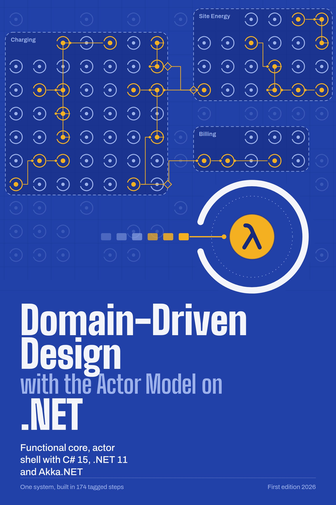

<p align="center">
  
</p>

<h1 align="center">Domain-Driven Design with the Actor Model on .NET</h1>

<p align="center"><em>Functional core, actor shell with C# 15, .NET 11 and Akka.NET</em></p>

<p align="center">
  <a href="https://github.com/snow-jallen/ddd-actors-dotnet/actions/workflows/book.yml"></a>
  <a href="https://github.com/snow-jallen/ddd-actors-dotnet/releases/latest"></a>
</p>

<p align="center">
  <a href="https://github.com/snow-jallen/ddd-actors-dotnet/releases/latest/download/ddd-actor-model-dotnet.pdf"><b>PDF</b></a> ·
  <a href="https://github.com/snow-jallen/ddd-actors-dotnet/releases/latest/download/ddd-actor-model-dotnet.epub"><b>EPUB</b></a> ·
  <a href="https://github.com/snow-jallen/ddd-actors-dotnet/releases/latest/download/ddd-actor-model-dotnet.html"><b>HTML</b></a> ·
  <a href="https://github.com/snow-jallen/ddd-actors-dotnet/releases/latest/download/ohmline-sample.zip"><b>Sample code (zip)</b></a> ·
  <a href="https://github.com/snow-jallen/ddd-actors-dotnet-sample"><b>Sample repo</b></a>
</p>

---

Most Domain-Driven Design books stop at the whiteboard. Most actor-model tutorials stop at ping-pong. Most .NET architecture guides stop at the database. So you end up with a dozen good ideas, from a dozen different books, that you have never seen working together in one system.

This book is that system. You take **one** realistic business, **Ohmline**, a network of public EV charging stations, from the first EventStorming session to a rolling upgrade of a running Akka.NET cluster. Every pattern shows up at the point where Ohmline needs it, next to the patterns it depends on, in code that compiles and tests that pass.

## One system, every topic, in context

The topics below usually live in separate books, talks and blog posts. Here, each one hands its result to the next:

```mermaid
flowchart LR
  A["Discover the domain<br/>EventStorming, ubiquitous language"] --> B["Draw the boundaries<br/>bounded contexts, context maps"]
  B --> C["Model the rules<br/>value objects, aggregates, deciders"]
  C --> D["Give them a runtime<br/>actors, persistence, sharding"]
  D --> E["Answer the questions<br/>CQRS, projections, read models"]
  E --> F["Run the long processes<br/>sagas, outbox, anticorruption layers"]
  F --> G["See inside<br/>OpenTelemetry through the mailbox"]
  G --> H["Reach the edge<br/>offline-first .NET MAUI app"]
  H --> I["Ship and evolve<br/>schema versioning, rolling upgrades"]
```



What that buys you:

- **Strategy that the build enforces.** Bounded contexts are projects, and context-map relationships are checked by architecture tests. Translation layers sit at the boundaries where Ohmline's rules meet the outside world.
- **A functional core you can test in microseconds.** C# 15 unions make every decision exhaustive: if a command can produce an outcome you did not handle, the build fails.
- **An actor shell that answers the hard questions:**
  - who is allowed to change this charger right now (one actor per aggregate, cluster-wide);
  - what happens when the database blinks mid-write;
  - how state comes back after a crash or a deploy.
- **CQRS explained end to end.** It runs from `Persist` to the journal row, through the projection and its offset, to the screen the driver is looking at. That includes read-your-writes and what to do about a dashboard that lags behind.
- **Production concerns from the start, not as an appendix:** traces that survive the actor mailbox, metrics with a cardinality budget, and health checks that tell the truth. It also covers events that must still deserialize five years from now, and a cluster you can upgrade without downtime.

## Real-world scenarios, not toy examples

Ohmline is fictional, but its problems are not:

| The business says | The book shows you |
|---|---|
| "A site must never draw more than its grid connection allows, even when the grid operator asks us to cut back mid-session." | A `SitePowerBudget` aggregate with a fair-share allocator. It runs as a sharded persistent actor that reacts to curtailment signals. |
| "Price every session from the tariff that was valid when it started." | A Knowledge Level of versioned tariffs held by a cluster singleton. Each session copies its tariff the moment it starts. |
| "Put a hold on the card, capture what was used, release the rest. The payment provider times out a lot." | A charging-journey process manager with timers, idempotency keys, and an anticorruption layer around a deliberately ugly payment API. |
| "Chargers from different vendors speak a WebSocket protocol we don't control." | A device gateway: connection actors that translate protocol frames into domain commands, plus a charger simulator for tests. |
| "The driver app has to work in an underground car park." | An offline-first .NET MAUI app with a durable outbox and client-generated command IDs. The server de-duplicates retried commands. |
| "Operations stopped saying 'fault' and started saying 'out of order'." | Renaming a concept when events are forever, with event versioning and upcasting. A golden corpus keeps old events readable. |

## Learn by diffing: 174 tagged steps

The companion repository, [**ddd-actors-dotnet-sample**](https://github.com/snow-jallen/ddd-actors-dotnet-sample), has one annotated tag for every section that changes code. Each tag builds with zero warnings and passes its tests, and each one is a small, readable diff:

```bash
git clone https://github.com/snow-jallen/ddd-actors-dotnet-sample.git && cd ddd-actors-dotnet-sample
git tag -n --sort=version:refname          # the whole book, one line per step
git checkout ch10-s04                      # "ReceivePersistentActor: Decide, PersistAll, Evolve, reply"
git diff ch10-s03 ch10-s04                 # exactly what that section added
dotnet test --solution Ohmline.slnx        # and proof that it works
```

You also get **ten `wrong/*` branches**, each committing a classic mistake on purpose and showing the tests it breaks:
- putting logic in `Receive`
- using an `IActorRef` as an identity
- writing the offset before the handler runs
- dual writes instead of an outbox
- high-cardinality metric tags
- …and more

Practice is built in. Every chapter has "Try it" boxes with exact commands, plus exercises that extend the sample in a direction the chapter opened up.

## What's inside

| Part | Chapters |
|---|---|
| **I. First Principles** | 1 Taming complexity: why DDD meets the actor model · 2 Actors from first principles (a mailbox in sixty lines, then Akka.NET) · 3 The C# 15 modeling toolkit (unions, records, extension members) |
| **II. Strategic Design** | 4 Discovering the domain: storytelling and EventStorming · 5 Bounded contexts, context maps and distillation |
| **III. The Functional Core** | 6 Value objects and entities · 7 Aggregates and the Decider · 8 Domain events, services, policies and supple design · 9 Unit testing the domain (Given-When-Then, property-based tests) |
| **IV. The Actor Shell** | 10 The aggregate as a persistent actor: commands, events and the journal · 11 Recovery, snapshots, Durable State and failure · 12 Cluster sharding: the shard region as repository |
| **V. CQRS, Processes and Integration** | 13 CQRS I: from journal to read model · 14 CQRS II: living with eventual consistency · 15 Process managers and sagas · 16 Integrating bounded contexts: anticorruption layers, open host and the outbox |
| **VI. Instrumentation and Telemetry** | 17 Tracing through the mailbox · 18 Metrics, logs, health checks and dashboards |
| **VII. The Mobile Edge** | 19 An offline-first .NET MAUI driver app, and why the domain stays on the server |
| **VIII. Operations, Releases and Versioning** | 20 Events are forever: evolving schemas, snapshots and read models · 21 Versioning, releasing and running the cluster |

The appendices cover:
- a version matrix of every package used
- a glossary of the ubiquitous language
- an index of every tag and anti-pattern branch
- a table mapping each DDD pattern to Akka.NET, with section pointers
- a verified references index

## Built to be trusted

- **Every code listing comes from the repo.** All 400+ listings were checked against the sample at the tag the text names, and every quoted test count and `git diff --stat` line was re-checked against the final history.
- **Every reference was checked against its source.** 640 quotations, attributed claims and further-reading items were confirmed against live sources, then re-checked independently. Books link to the publisher's page with a chapter reference, and page numbers appear only where they were confirmed.
- **The sample is a real build.** It has 2,600+ tests, real PostgreSQL through Testcontainers and .NET Aspire, a multi-node cluster on your laptop, and a MAUI Android app that builds at every mobile tag.
- **The tooling is current.** It uses .NET 11, C# 15, Akka.NET 1.5.73 (with an upgrade branch to 1.6), Akka.Hosting, Akka.Persistence.Sql, PostgreSQL 17, .NET Aspire 13.6, OpenTelemetry, xUnit v3 on Microsoft.Testing.Platform, and .NET MAUI.

## Who it's for

You are a C# developer who has shipped web APIs, perhaps read part of Evans, and never run an EventStorming workshop, written an actor, or event-sourced anything. No prior DDD or actor experience is assumed. If you already know one side well, the book shows you how it connects to the others: DDD practitioners see a runtime that fits aggregates, and Akka.NET users see a modeling discipline that keeps actors from turning into distributed spaghetti.

## Read it

- **Download** the PDF (800+ pages, with a clickable outline), the EPUB, or the single-page HTML from the [latest release](https://github.com/snow-jallen/ddd-actors-dotnet/releases/latest). Every push to `main` also refreshes the [latest build](https://github.com/snow-jallen/ddd-actors-dotnet/releases/tag/latest-build).
- **Browse** the Markdown in [`book/`](book/) right here on GitHub, where the diagrams render inline.
- **Follow along** with the sample: `git clone --recurse-submodules https://github.com/snow-jallen/ddd-actors-dotnet.git`.

## Build it yourself

```bash
tools/build-book.sh     # build/book.md always; HTML and EPUB with pandoc; PDF with Chrome/Chromium and pypdf (or uv)
```

`.github/workflows/book.yml` runs the same script on every push and attaches the results to the release. Prerequisites and options are documented at the top of [`tools/build-book.sh`](tools/build-book.sh). The cover is generated from [`tools/cover/make-cover.py`](tools/cover/make-cover.py).

To build and test the sample, install the .NET SDK named in its `global.json` and run `dotnet test --solution Ohmline.slnx` inside `sample/`. Integration tests need Podman or Docker.

## Repository layout

| Path | What it is |
|---|---|
| [`book/`](book/) | The manuscript: front matter, 21 chapters, references index, appendices |
| `sample/` | The [Ohmline sample](https://github.com/snow-jallen/ddd-actors-dotnet-sample) as a submodule, one tag per section |
| [`research/`](research/) | The research notes behind the book, with verified versions and spike code |
| [`editorial/`](editorial/) | The outline, style guide and sample-architecture contract every chapter was written against, plus the verification records (errata, review log, reference ledgers) |
| [`tools/`](tools/) | The book build, the cover generator and helper scripts |

## How this book was made

This book was produced with [Claude Code](https://claude.com/claude-code), which coordinated teams of AI agents for research, coding, writing, editing and testing. An editor agent held the outline and the style guide. Coders built the sample one section, commit and tag at a time. Writers could only quote code from the repo at a named tag. Testers rebuilt every tag and checked every listing. Fresh, independent agents verified every reference against its source.

The verification records are in `editorial/`, so you can see what was checked and what was fixed. If you find a mistake, please [open an issue](https://github.com/snow-jallen/ddd-actors-dotnet/issues).

## License

The Ohmline sample code is released under the [MIT License](https://github.com/snow-jallen/ddd-actors-dotnet-sample/blob/main/LICENSE). Ohmline, TallyPay, Northgate Grid and AssetTrack are fictional companies.
