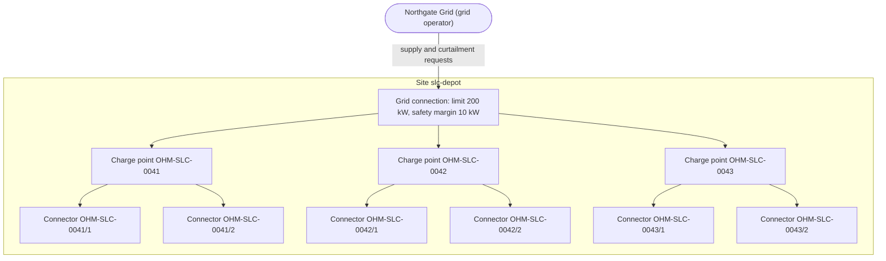
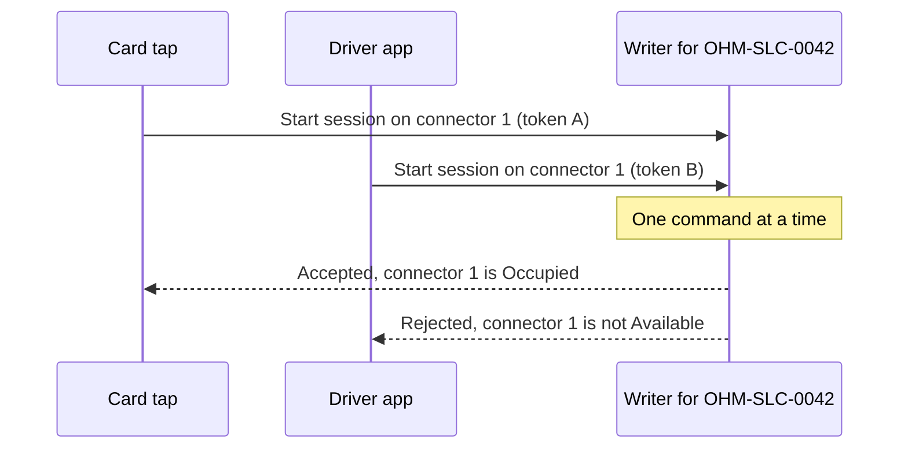
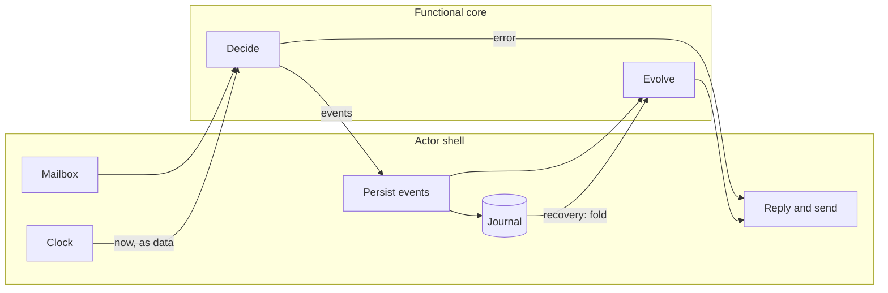

# Chapter 1. Taming Complexity: Why Domain-Driven Design Meets the Actor Model

At 07:40 on a weekday, five electric cars are charging at Ohmline's bus depot, `slc-depot`. The grid connection allows 200 kW, Ohmline keeps 10 kW in reserve, and the five sessions share the remaining 190 kW at 38 kW each. In the same second, Northgate Grid, the grid operator, asks the site to give back 40 kW for an hour, and a sixth driver taps an RFID card at connector `OHM-SLC-0043/2`.

In Ohmline's old system, each request was handled correctly on its own. The curtailment handler read the five allocations, scaled them to fit 150 kW and saved them. The start handler read the same allocations, still at 38 kW, shared the old 190 kW among six cars and saved last, so its numbers won. For the next forty minutes the depot drew 190 kW against a curtailed limit of 160 kW, and the penalty arrived on Northgate Grid's next invoice.

No line of that code was wrong. The defect lived between two correct handlers, in a rule no single piece of code owned: the site never draws more than it is allowed. Domain complexity, consistency and concurrency look like three problems, but here they are one. You must decide what the rules are, which software owns each rule, and how that owner sees changes one at a time.

> **In this chapter you will:**
>
> - tell essential from accidental complexity in a charging scenario, and name what CRUD thinking hides;
> - follow one RFID charge from plug-in to receipt in Ohmline's ubiquitous language;
> - explain why Ohmline gives every aggregate exactly one writer instead of using distributed transactions;
> - map aggregates, repositories, process managers and Anticorruption Layers onto Akka.NET, and say what actors do not give you;
> - place a rule in the functional core or the actor shell using `Decide` and `Evolve`;
> - install the pinned .NET 11 SDK, check out a section tag and run `tools/verify-tags.sh`.

> **Starting point:** none. The sample repo begins at this chapter's first tag. Clone it as described in "How to follow along" at the front of the book, and run `git checkout ch01-s02` when you reach section 1.2.

## 1.1 Essential versus accidental complexity

In ["No Silver Bullet: Essence and Accidents of Software Engineering"](https://www.cs.unc.edu/techreports/86-020.pdf) (1986, reprinted in [*IEEE Computer* in 1987](https://doi.org/10.1109/MC.1987.1663532)), Fred Brooks split the difficulty of software into two kinds. The *essence* is the conceptual construct itself: the data, their relationships, the algorithms and functions. *Accidents* are the difficulties of expressing that construct with particular languages, machines and tools. Brooks argued, in the paper's abstract, that much of the accidental difficulty had already been removed, so no new tool could promise a tenfold gain; what remained was essential.

Ohmline has plenty of essence. A site may draw its grid connection limit less curtailment and a safety margin, shared fairly between sessions that come and go. A session is priced from the tariff in force when it started. Idle fees apply after a grace period, but only if the car, not Ohmline, stopped the charge. No framework makes those rules go away.

Ohmline also has accident: HTTP retries, JSON mapping, lock ordering. Concurrency is where the two get confused. In the opening story, "two requests arrive in the same second" is essential: the domain must say what happens then. "The last save wins" is accidental. It could not have happened if one piece of software had owned the site's power budget and seen the two requests in order.

### Modeling failures that look like infrastructure failures

Many teams have split a system like this into microservices and ended up worse off. A common split follows the tables: sessions, chargers, payments. Starting a charge needs the connector's status, the token's validity, the site's capacity and a payment hold, so every start becomes a chain of synchronous calls, a shared database, or a distributed transaction. The services deploy separately but change together. The network gets the blame, but the boundaries were drawn around data instead of around the rules that use it. Domain-Driven Design (DDD) draws boundaries around rules instead: bounded contexts in Chapter 5, aggregates in Chapter 7.

### The cost of CRUD thinking

CRUD thinking treats the domain as rows to create, read, update and delete. A CRUD Ohmline has `PUT /sessions/{id}` and a `Status` column, and stopping a session sets `Status = 'Stopped'`. The database now knows *that* the session stopped but not *why*: the driver pressed stop, the spend cap was reached, or a curtailment paused it. The why decides the price, and section 8.6 rebuilds exactly that distinction.

Without intent in the model, rules move to wherever updates are issued: controllers, nightly jobs, stored procedures. Martin Fowler calls the result an [*anemic domain model*](https://martinfowler.com/bliki/AnemicDomainModel.html) (bliki entry "AnemicDomainModel", 2003). CRUD is not wrong everywhere (Billing is deliberately simple, section 16.3), but it is costly where rules are rich and change often, which is where Ohmline makes its money.

The practical takeaway: when you meet a defect like the one in the opening story, write the violated rule as one sentence a domain expert would accept, then ask which code owns it. If the answer is "several" or "none", the bug is in the model.

## 1.2 Meet Ohmline: one charge, told end to end

Ohmline is a fictional charge point operator with about 300 sites: public car parks, workplaces and one bus depot. Drivers start a charge with an RFID card or the driver app, and Ohmline must keep three promises at once:

- keep every site within the power its grid connection allows, less whatever the grid operator has asked it to give back;
- price every charging session from the tariff that applied when the session started;
- take payment as a hold on the driver's card, later captured for the final amount or released.

Every company here is fictional, including TallyPay (payments), Northgate Grid and AssetTrack (a legacy registry). The charger protocol is a simplified subset in the style of [OCPP 1.6](https://openchargealliance.org/protocols/open-charge-point-protocol/) in its JSON form (OCPP 1.6J), with no claim of conformance.

### One site

A *site* is a location with one grid connection and therefore one power budget. The sample's domain primer draws the depot like this:

*File: docs/ohmline-primer.md @ ch01-s02*



Power flows through the single connection to three *charge points*, each with two numbered *connectors*. Each connector delivers 5 kW to 50 kW, so six cars at full speed would ask for 300 kW. The connection allows 200 kW, and the 10 kW *safety margin* leaves an *effective capacity* of 190 kW to share. Power is scarcer than plugs.

### One charge, end to end

A driver arrives at 07:52 and plugs into connector `OHM-SLC-0042/1`, which stops being *Available*. She taps her RFID card; the charge point sends its *id token*, and Driver Accounts decides whether she may charge. Three more things happen within seconds. Tariffs copies the site's *tariff* into a *tariff snapshot* (USD 0.42 per kWh, a USD 1.00 session fee, and an *idle fee* of USD 0.40 per minute after a 15-minute *grace period*) that later tariff changes never touch. Billing asks TallyPay for a *hold* of USD 40.00, which is also the session's *spend cap*. Site Energy's *fair-share allocation* grants the connector 38 kW, because five sessions now share 190 kW, and Ohmline sends the charge point a *charging profile* with that limit.

The *charging session* starts, and every minute the charge point sends a *meter reading*: its cumulative energy register in Wh, which must never go backwards. At 08:15 Northgate Grid asks the site to shed 40 kW for an hour. That *curtailment* lowers the effective capacity to 150 kW, every allocation is recomputed, and this connector drops to 30 kW. At 08:40 the car is full and stops drawing power. The session is *suspended by the EV*, not by Ohmline, so the grace period starts.

She unplugs at 09:05, ten minutes after the grace period ended, with 27.6 kWh delivered. The *price breakdown* is USD 11.59 for energy (27.6 kWh at USD 0.42, rounded), USD 1.00 for the session and USD 4.00 for ten idle minutes: USD 16.59. Billing *captures* that from the hold, releases the rest and issues a receipt, perhaps long after she has left.

Notice the three time scales (seconds for the start, hours for the charge, later still for settlement) and that five contexts each decided something, while none could decide everything.

### Why this domain and not e-commerce

Online shops are the usual teaching domain, but their rules are mostly data entry, and their concurrency problems rarely show up in a small example. In charging, invariants are quantitative: "at most 190 kW", against numbers that change every second. Time is everywhere: reservations expire, grace periods end, time-of-use bands follow site-local time. Charge points behave like actors, each external system needs its own translation, and drivers in underground car parks have no signal (Chapter 19).

### The sample repo is born

Tag `ch01-s02` is the sample repo's first commit: `README.md`, an MIT `LICENSE`, a `.gitignore` from `dotnet new gitignore`, a `.gitattributes` that normalizes line endings to LF, and `docs/ohmline-primer.md`, which tells this story as an 11-step table and lists the five invariants the sample enforces.

Every section that changes the sample adds one commit on `main` with an annotated tag `chNN-sMM`, the state at the end of that section; code-free sections such as 1.1 have no tag. The README shows the commands you will use throughout:

```bash
# File: README.md @ ch01-s02
git tag --list 'ch*'                    # every section tag, in book order
git checkout ch01-s02                   # the sample as it is at the end of section 1.2
git diff ch01-s02 ch01-s03 --stat       # which files section 1.3 changed
git diff ch01-s02 ch01-s03 -- docs      # the same diff, limited to one folder
git log --format='%h %s' ch01-s02..ch01-s04
git checkout main                       # back to the latest state
```

A checked-out tag leaves you on a detached `HEAD`; to experiment, create a branch first with `git switch -c my-experiments ch01-s02`.

> **Try it**
>
> ```bash
> git checkout ch01-s02
> git show --stat --format='%h %s' ch01-s02
> ```
>
> Git prints the annotated tag's header first, then the commit subject `ch01-s02: Meet Ohmline: one charge, told end to end` and `5 files changed, 702 insertions(+)`.

## 1.3 Models, language and the people who know the business

Ask three people at Ohmline for the depot's "capacity". The electrician says 200 kW. The operations lead, holding Northgate Grid's notice, says 160 kW. The allocator's author says 150 kW, after the safety margin. The old system had one `Capacity` column filled three ways: the opening story's overload began as a vocabulary problem.

Eric Evans's [*Domain-Driven Design*](https://www.informit.com/store/domain-driven-design-tackling-complexity-in-the-heart-9780321125217) (2003) answers with five of the ideas that his [*Domain-Driven Design Reference*](https://domainlanguage.com/wp-content/uploads/2016/05/DDD_Reference_2015-03.pdf) (2015) groups under "Putting the Model to Work" (part I, pp. 1–8):

- **Model-Driven Design.** The code *is* the model, and the two change together. If the code says "capacity" while the experts say "effective capacity", there are two models, and they will drift.
- **Ubiquitous Language.** One language, built with the domain experts, used in conversation, documents, type names and test names. Changing the language changes the model. It is ubiquitous only *within* a bounded context, which is why Chapter 5 draws boundaries.
- **Hands-on Modelers.** Those who shape the model touch the code, and those who write code take part in modeling; insight is lost in a handover. In this book, you are the hands-on modeler.
- **Refactoring Toward Deeper Insight.** Models improve in jumps, when a conversation reveals that one word is really two concepts. Ohmline's jump comes in section 8.6, when "suspended" splits into *suspended by the EV* and *suspended by the charger*.
- **Continuous Integration.** In Evans's sense (*DDD Reference*, p. 5) this is more than a build server. Everyone in a context merges often, with automated tests that flag fragmentation quickly, *and* keeps exercising the language together, so the model does not split into private dialects.

### Events are forever

This book's architecture raises the price of deeper insight. In a CRUD system, renaming a column is a migration and the old name is gone. In an event-sourced system the history *is* the data: an event written last year as `ConnectorFaulted` keeps that name in the journal forever. Insight arrives as new event types plus translation of old ones as they are read, which Chapter 20 does for a real rename. Choose names that reach the journal with care.

### The code: a glossary and decision records

Tag `ch01-s03` adds `docs/glossary.md`, a `Term | Context | Meaning` table of 13 terms. Its opening paragraph sets the rule that keeps it alive:

*File: docs/glossary.md @ ch01-s03*

```text
This is the ubiquitous language of Ohmline. Use these words exactly as written here: in
conversations, in documents, in type and member names, and in test names. When a conversation
produces a better word, change the glossary first and the code in the same commit.
```

Two of its rows settle the capacity argument: *Effective capacity* is "Grid connection limit minus active curtailment minus safety margin", owned by Site Energy, and *Grid connection limit* is "The maximum power the site may draw from the grid". Section 4.5 expands the glossary per context once there are types to name.

The commit also starts a habit: an Architecture Decision Record (ADR) for every decision that is expensive to reverse. `docs/adr/template.md` follows the format of context, decision and consequences from Michael Nygard's ["Documenting Architecture Decisions"](https://cognitect.com/blog/2011/11/15/documenting-architecture-decisions) (2011), and ADR 0000 adopts it:

*File: docs/adr/0000-record-architecture-decisions.md @ ch01-s03*

```text
- Files are named `NNNN-short-title.md`, numbered from `0000` in order. A number is never reused.
- Each record starts from `docs/adr/template.md` and names the book section (`chNN-sMM`) that
  introduces it.
- A record is written in the same commit as the change it explains.
- Once accepted, a record is not edited, apart from its status line and links. A changed decision
  gets a new record, and the old record's status becomes "Superseded by NNNN".
```

The last rule is deliberate. ADRs are append-only, like the events the sample will persist: the past stays readable as it was, and a change of mind is a new record that points back at the old one. The commit also rewords one line of the primer, which at `ch01-s02` pointed to a glossary that did not exist yet.

> **Try it**
>
> ```bash
> git checkout ch01-s03
> git diff ch01-s02 ch01-s03 --stat
> git diff ch01-s02 ch01-s03 -- docs/ohmline-primer.md
> ```
>
> The first diff ends with `4 files changed, 78 insertions(+), 1 deletion(-)`. The second shows the one reworded sentence, which now says the glossary "defines the most important of them and grows with the book".

## 1.4 Consistency without distributed transactions

Two drivers reach connector `OHM-SLC-0042/1` at the same moment: one taps a card, the other presses "start" in the driver app. Both requests read the connector as *Available*, and both write *Occupied* with their own session. The rule "a connector hosts at most one session" is broken, and nothing crashed. Inside one database, a row lock or a version column would stop the second writer. But starting a session also needs the token, the site's power budget and a hold from TallyPay, and those live in other stores, one of them at another company.

### Why two-phase commit does not save you

The textbook answer is two-phase commit (2PC). A coordinator asks each participant to *prepare* (write durably, lock, vote), and if all vote yes, to *commit*. A participant that voted yes holds its locks until it hears the outcome; if the coordinator fails then, it is *in doubt* and blocks everyone who needs those rows. Availability multiplies: four participants each up 99.9% of the time give about 99.6%. Locks are held across network round trips. And TallyPay's HTTP API will never take part in your two-phase commit.

### Helland's entities and activities

Pat Helland built transaction systems for years before writing ["Life Beyond Distributed Transactions: An Apostate's Opinion"](https://www.cidrdb.org/cidr2007/papers/cidr07p15.pdf) (CIDR 2007, revised in [*ACM Queue* in 2016](https://doi.org/10.1145/3012426.3025012)). He argues that systems which must keep growing end up with one shape:

- Data is divided into **entities**, each with a unique key and updated atomically on its own. No transaction spans two entities, which may live on different machines tomorrow.
- Work across entities is an **activity**: each entity remembers what it knows about its partners, and they agree through messages.
- Messages may be resent, so receivers must be **idempotent**: handling a message twice has the effect of handling it once.
- Uncertainty is handled by the business, with tentative operations that are later confirmed or cancelled. A payment hold is one.

Martin Thompson's [*single-writer principle*](https://mechanical-sympathy.blogspot.com/2011/09/single-writer-principle.html) (2011) makes the same point on one machine: data that only one thread writes needs no locks.

### The code: ADR 0001

Tag `ch01-s04` records this as Ohmline's first decision. Helland's entity becomes an *aggregate* in DDD terms, a consistency boundary whose invariants are checked together (Chapter 7):

*File: docs/adr/0001-single-writer-per-aggregate.md @ ch01-s04*

```text
We will give every aggregate exactly one writer at a time.

- An aggregate (a charge point, a charging session, a site's power budget, an id token) has a
  unique identity. At any moment exactly one live instance in the whole system may change its
  state, and every command for that identity is processed by that instance, one at a time.
- No transaction spans two aggregates: no two-phase commit, and no database transaction that
  writes two aggregates' state.
- A rule that spans aggregates is carried out by messages between their writers, tracked by an
  activity (a process manager in DDD terms), and is eventually consistent. Every such message
  may be delivered more than once, so its receiver must handle it idempotently.
```

A fourth bullet handles uniqueness across many entities by making the unique value an aggregate's identity; section 12.7 builds the id token that way. With one writer for charge point `OHM-SLC-0042`, the race above has nowhere to happen:



The card's command wins only because it arrived first. When the writer reaches the app's command, its state already says *Occupied*, so the rule holds without a lock, a version check or a retry.

The ADR is clear about the costs. Aggregate boundaries become the central design decision, because only a rule whose data sits in one aggregate is checked immediately; rules across aggregates hold *eventually*. One writer is a throughput ceiling (section 15.8). Questions across many aggregates need read models (Chapter 13). And a network partition could create two writers, which is why the split-brain resolver (section 12.1) and journal sequence numbers (section 10.9) exist.

> **Try it**
>
> ```bash
> git checkout ch01-s04
> git diff ch01-s03 ch01-s04 --stat
> ```
>
> The diff reports `1 file changed, 74 insertions(+)`.

## 1.5 Actors as the runtime for consistency boundaries

ADR 0001 asks for one writer per aggregate, processing commands one at a time, wherever in a cluster it runs. Chapter 2 builds that from a queue and a loop, but the idea already has a name and a mature .NET runtime.

In 1973 Carl Hewitt, Peter Bishop and Richard Steiger [proposed the *actor*](https://www.ijcai.org/Proceedings/73/Papers/027B.pdf) as the one primitive of computation. Later work by Gul Agha, starting with his book [*Actors*](https://doi.org/10.7551/mitpress/1086.001.0001) (1986), made the model precise; in ["A Foundation for Actor Computation"](https://doi.org/10.1017/S095679689700261X) (Agha, Mason, Smith and Talcott, 1997) it comes down to three primitives an actor may use in response to a message: **send** messages to actors whose addresses it knows, **create** new actors, and **become**, choosing the behaviour for its next message. An actor shares no memory; only messages reach it.

### The mailbox is the lock

Messages wait in the actor's *mailbox*, and the actor handles them one at a time. No other code holds a reference to its state, so the single-writer principle comes with the runtime. Make each charge point an actor, and the card tap and the app request of section 1.4 become two messages in the mailbox for `OHM-SLC-0042`; whichever is handled second sees *Occupied*. *Become* covers lifecycles: a charger that has not booted refuses remote starts, which section 2.6 builds with Akka.NET's `Become` and `Stash`. From Chapter 7 on, the book keeps lifecycles in the state itself instead, where tests can reach them without an actor.

### Location transparency

You talk to an Akka.NET actor through an `IActorRef`, and a message is sent the same way whether the actor is local or remote. With cluster sharding (Chapter 12) you do not even hold a reference: you address the entity `OHM-SLC-0042`, and the shard region finds its node, starts it if needed and delivers the message. That is how one writer per identity spans a cluster.

### A first map from DDD to Akka.NET

These properties line up with DDD's building blocks:

| DDD concept | Akka.NET construct | Built in |
|---|---|---|
| Aggregate | Sharded persistent actor, one per identity | Chapters 10 to 12 |
| Repository | Shard region: send to an identity | Section 12.2 |
| Process manager (Helland's activity) | Persistent actor with timers | Section 15.3 |
| Anticorruption layer (ACL) | Translating actor around a pure translator | Sections 16.7, 16.8 |

The repository row has no `Load` and no `Save`: loading is recovery from the journal when the entity starts, and saving is persisting events. Vaughn Vernon's [*Reactive Messaging Patterns with the Actor Model*](https://www.informit.com/store/reactive-messaging-patterns-with-the-actor-model-applications-9780133846836) (2015) explores many of these correspondences on the JVM, in Scala and Akka, including process managers for domain-driven designs and event-sourced persistent actors.

### What actors do not give you: a model

An actor is state with a queue in front of it. Nothing stops a `ChargePointActor` from keeping a mutable `Status` string, accepting `UpdateStatus` and leaving the rules to its callers: CRUD with a mailbox, the *anemic actor*. Nothing stops it from mixing rules with persistence and calls to TallyPay in one handler (*logic in Receive*), from becoming one actor per connector for a rule that one record could check (*one actor per database row*), or from waiting on another aggregate's reply mid-decision while its own mailbox stalls (*Ask chains*). Appendix C gives each of these anti-patterns a page. Actors give a consistency boundary a runtime; where the boundaries go and what the rules are is modeling work, and section 2.10 hands over to it.

The practical takeaway: when someone proposes "make it an actor", ask which invariant that actor will own.

## 1.6 Functional core, actor shell

Picture a first "start session" handler in a charge point actor: it reads the clock to check a reservation, checks the connector, calls TallyPay for a hold, persists `SessionStarted`, mutates three fields and replies. Testing any rule now needs an actor system, a journal, a fake payment provider and a timeout. Worse, on replay after a restart, applying `SessionStarted` must not call TallyPay again or judge yesterday's reservation by today's clock, which is hard to guarantee when rules and effects are interleaved.

Gary Bernhardt's ["Functional Core, Imperative Shell"](https://www.destroyallsoftware.com/screencasts/catalog/functional-core-imperative-shell) screencast (2012) separates the two. The *core* makes every decision as a pure function over values: same inputs, same outputs, no I/O. The *shell* gathers inputs, calls the core and carries out what it decided. The core has many paths and no dependencies, so it gets most of the unit tests; the shell has few paths, so a handful of integration tests covers it.

Jérémie Chassaing's ["Functional Event Sourcing Decider"](https://thinkbeforecoding.com/post/2021/12/17/functional-event-sourcing-decider) (2021) gives the core a fixed shape for an event-sourced aggregate: an initial state and two core functions, recorded in ADR 0002 like this (Chassaing's Decider also has an `isTerminal` predicate, which this book leaves out):

*File: docs/adr/0002-functional-core-actor-shell.md @ ch01-s06*

```text
Decide : State × Command → Events | Error
Evolve : State × Event   → State
```

**Decide** holds the rules. Given the state of charge point `OHM-SLC-0042` and "start a session on connector 1 for token A", it returns the events that record what happened or an error explaining why not, and changes nothing. **Evolve** returns the next state for one event. It never validates and never fails, because an event is a fact: refusing to believe `SessionStarted` would make the history unreadable. Recovery is a *fold* of `Evolve` over the stored events, and a test is the same fold followed by one `Decide`, so the rule you test is the rule that runs during replay.

### The code: ADR 0002 and a vision

Tag `ch01-s06` adds ADR 0002. It puts the core in `Ohmline.SharedKernel` and the `*.Domain` projects, which reference the .NET base library only, and lists the shell's work per command:

*File: docs/adr/0002-functional-core-actor-shell.md @ ch01-s06*

```text
1. receive the command from the mailbox, one at a time;
2. call `Decide` with the current state, the command and the current time;
3. persist the events it returns, or reply with the error;
4. apply each persisted event with `Evolve`, then reply and send any messages that follow.
```

The current time is an *input* to `Decide`; the core never reads a clock, and new ids arrive as data too. The diagram shows both paths through the shell, live commands and recovery, sharing one `Evolve`:



Only values cross the boundary of the core. ADR 0002 sums up what lives where in a short table:

*File: docs/adr/0002-functional-core-actor-shell.md @ ch01-s06*

```text
| Lives in the core | Lives in the shell |
|---|---|
| Invariants and business rules | The mailbox, which serializes commands |
| States, commands, events, errors | Persisting events and recovering state |
| Prices, allocations, deadlines as values | Reading the clock, running timers |
| What should happen next, as data | Sending messages, calling other contexts |
```

The same commit drafts `docs/vision.md`, a *Domain Vision Statement* in Evans's sense (*Domain-Driven Design*, ch. 15 "Distillation"; [*DDD Reference*](https://domainlanguage.com/wp-content/uploads/2016/05/DDD_Reference_2015-03.pdf), p. 42): a short statement of the core domain and its value. It opens with "Ohmline turns limited grid connections into reliable, fairly priced charging," names power allocation as the reason site owners choose Ohmline, and lists payments, hardware, maps and accounting as things to buy or keep simple. A functional core is an investment; the vision says where to make it. Section 5.8 revises it.

### Honest trade-offs

There is more ceremony: separate command and event types, two functions instead of one handler. Immutable state allocates on every change, which is cheap at aggregate size but not free. Time-based behaviour is split: the core decides that a reservation expires at 08:10, and the shell schedules the timer (section 11.4). Effects the core asks for, such as placing a hold, are returned as data, one more hop in a debugger. And the rule erodes unless the build enforces it, which section 5.3 does. In return, most tests become millisecond functions over values (Chapter 9), and Akka.NET can be upgraded without touching the model (section 21.10).

> **Try it**
>
> ```bash
> git checkout ch01-s06
> git diff ch01-s04 ch01-s06 --stat
> ```
>
> The diff starts from `ch01-s04` because section 1.5 has no tag. It ends with `2 files changed, 114 insertions(+)`.

## 1.7 Setting up the workbench

Tag `ch01-s07` adds no code, only the files that make every build give the same answer on every machine.

### Install the SDK

The sample was verified on SDK `11.0.100-rc.3.26522.148`, a ["go-live" release candidate](https://dotnet.microsoft.com/en-us/download/dotnet/11.0) supported in production. On Linux or macOS, Microsoft's install script adds that exact version beside your other SDKs; on Windows, use `dotnet-install.ps1` or the installer.

```bash
curl -sSL https://dot.net/v1/dotnet-install.sh -o dotnet-install.sh
chmod +x dotnet-install.sh
./dotnet-install.sh --version 11.0.100-rc.3.26522.148 --install-dir "$HOME/.dotnet"
export DOTNET_ROOT="$HOME/.dotnet"
export PATH="$DOTNET_ROOT:$PATH"
```

> **Version note:** at the time of writing (November 2026), .NET 11 GA is expected later this month. Appendix A lists what changes when the sample re-pins from RC3 to GA.

### `global.json`: the SDK and the test runner

*File: global.json @ ch01-s07*

```json
{
  "sdk": {
    "version": "11.0.100-rc.3.26522.148",
    "rollForward": "latestFeature",
    "allowPrerelease": true
  },
  "test": {
    "runner": "Microsoft.Testing.Platform"
  }
}
```

`rollForward: latestFeature` accepts this SDK or a later 11.0 patch or feature band, never 12.0, and `allowPrerelease` is required while the pin is an RC. xUnit v3 4.x, used from Chapter 2, runs on Microsoft.Testing.Platform (MTP) v2 by default ([xUnit.net v3 4.0.0 release notes](https://xunit.net/releases/v3/4.0.0)), and MTP v2 [no longer runs through VSTest on .NET 10 and later SDKs](https://learn.microsoft.com/en-us/dotnet/core/testing/microsoft-testing-platform-migration-from-v1-to-v2#compatibility-with-vstest-based-dotnet-test). Without this section, `dotnet test` fails at build time with "[Testing with VSTest target is no longer supported by Microsoft.Testing.Platform on .NET 10 SDK and later.](https://github.com/microsoft/testfx/blob/main/src/Platform/Microsoft.Testing.Platform.MSBuild/buildMultiTargeting/Microsoft.Testing.Platform.MSBuild.targets)" In MTP mode, `dotnet test` must be told what to run: `dotnet test --solution Ohmline.slnx`.

### Settings for every project

MSBuild imports the nearest `Directory.Build.props` into every project below it:

```xml
<!-- File: Directory.Build.props @ ch01-s07 -->
<Project>
  <PropertyGroup>
    <TargetFramework>net11.0</TargetFramework>
    <!-- LangVersion is deliberately not set: net11.0 defaults to C# 15. -->
    <Nullable>enable</Nullable>
    <ImplicitUsings>enable</ImplicitUsings>
    <TreatWarningsAsErrors>true</TreatWarningsAsErrors>
    <IsPackable>false</IsPackable>
    <Deterministic>true</Deterministic>
    <!-- Reproducible old tags: the vulnerability audit runs as a separate CI job (ch21-s04),
         not in every build. -->
    <NuGetAudit>false</NuGetAudit>
  </PropertyGroup>
  <PropertyGroup Condition="'$(GITHUB_ACTIONS)' == 'true'">
    <ContinuousIntegrationBuild>true</ContinuousIntegrationBuild>
  </PropertyGroup>
</Project>
```

C# 15 is the default for `net11.0`, so unions need no preview flag. `TreatWarningsAsErrors` makes every warning a failure, which section 3.3 relies on. `Deterministic` and, on CI, `ContinuousIntegrationBuild` make builds reproducible.

With Central Package Management, every version lives in `Directory.Packages.props`, and no `PackageReference` carries a `Version`:

```xml
<!-- File: Directory.Packages.props @ ch01-s07 -->
<Project>
  <PropertyGroup>
    <ManagePackageVersionsCentrally>true</ManagePackageVersionsCentrally>
    <AkkaVersion>1.5.73</AkkaVersion>
  </PropertyGroup>
  <!-- ... -->
  <!-- Every Akka.* package uses Version="$(AkkaVersion)", so an upgrade is a one-line change. -->
  <ItemGroup Label="Akka.NET">
  </ItemGroup>
  <!-- ... -->
</Project>
```

All seven labelled item groups are empty. Each package arrives in the commit that first uses it, starting with `xunit.v3` and `Shouldly` in section 2.1. `NuGet.config` clears every other source and maps all packages to nuget.org, so a machine-wide feed cannot change what a tag restores. `Directory.Build.targets` stays empty until section 5.3 imports the domain purity check. `.editorconfig` sets LF, UTF-8 and a 100-character limit for C#, the width of this book's code blocks. `Ohmline.slnx`, the XML solution format, is an empty `<Solution>` element until section 2.1 adds projects.

### Containers and the Aspire CLI

From Chapter 12, integration tests start Postgres in a container, so you need Docker or Podman. The sample was verified with rootless Podman on Linux, which needs its Docker-compatible socket:

```bash
systemctl --user enable --now podman.socket
export DOCKER_HOST=unix:///run/user/$(id -u)/podman/podman.sock
```

The Aspire CLI 13.6 runs the local multi-node cluster from section 12.10. Install it with the instructions at [aspire.dev](https://aspire.dev/get-started/install-cli/).

### Following along

Each chapter starts from the last tag of the chapter before it. Each **Try it** box checks out its section's tag and diffs it against the previous tag that exists; from section 2.1 on, it also runs `dotnet test --solution Ohmline.slnx`.

### Checking every tag

`tools/verify-tags.sh` checks out each tag in book order into a temporary git worktree (yours is never touched), cleans it with `git clean -ffdxq`, and verifies it:

```bash
# File: tools/verify-tags.sh @ ch01-s07
# ...
verify() {
  (
    cd "$tree"
    dotnet build Ohmline.slnx -warnaserror
    dotnet test --solution Ohmline.slnx
  ) || return 1

  local leftovers
  leftovers="$(git -C "$tree" status --porcelain)"
  if [[ -n "$leftovers" ]]; then
    printf 'The build or the tests left files behind:\n%s\n' "$leftovers"
    return 1
  fi
}
# ...
```

A tag fails if the build fails, a test fails, or either leaves files behind in the source tree. A tag whose `Ohmline.slnx` has no `<Project` element is skipped, and that is every tag so far, because an empty solution cannot pass. At `ch01-s07` the build reports `error : Unable to find a project to restore!` (a restore warning that `-warnaserror` promotes), and `dotnet test --solution Ohmline.slnx` stops with `Unhandled exception: The solution configuration '|' is invalid.` Neither is a fault in your setup. From section 2.1 onward, every tag must pass both commands.

> **Note:** the script's `mapfile` needs bash 4 or later; macOS ships bash 3.2, so install a newer bash first.

> **Try it**
>
> ```bash
> git checkout ch01-s07
> git diff ch01-s06 ch01-s07 --stat
> dotnet --version
> tools/verify-tags.sh 'ch01-*'
> ```
>
> The diff ends with `9 files changed, 267 insertions(+)`. `dotnet --version` prints `11.0.100-rc.3.26522.148` (or a later 11.0 SDK you installed), because `global.json` selects it. The script prints `skipped (Ohmline.slnx has no projects yet)` for each of the five Chapter 1 tags and ends with `0 passed, 5 skipped, 0 failed`. Without the pattern it would build every tag in your clone.

## Summary

- Essential complexity is the domain's rules; accidental complexity is how code is arranged. Concurrency defects often come from a rule no single piece of code owns, and CRUD updates lose the intent rules depend on.
- One RFID charge touches five contexts on three time scales, and "capacity" alone had three meanings, so Ohmline writes its language down.
- Distributed transactions couple availability and hold locks across the network. Helland's alternative is one atomically updated writer per entity and idempotent messages between writers, recorded as ADR 0001.
- An actor's mailbox gives the single-writer principle a runtime, and sharding extends it across a cluster. Actors give you no model.
- A pure Decider holds the rules and the actor shell holds every effect; tests and recovery share one fold over `Evolve`, at the price of more types and indirection.
- `global.json` pins the SDK and the MTP test runner, CPM pins every package, and `tools/verify-tags.sh` checks every tag.

## DDD canon covered

Domain; Ubiquitous Language; Model-Driven Design; Hands-on Modelers; Refactoring Toward Deeper Insight; Continuous Integration; Distillation (Domain Vision Statement, first draft); Eventual consistency and UX; Idempotency and delivery semantics; Split-brain resolver and the single-writer guarantee; Functional core / actor shell; previews of Aggregate = sharded persistent actor, Shard region as repository, Process manager actor with timers, ACL translating actor and the Anti-pattern catalog.

## Exercises

1. **Reflect.** Find a defect in a system you know where two correct pieces of code wrote the same data. State the violated rule in one sentence. Which component should own it? Weigh moving the rule against the defect recurring.
2. **Reflect.** The vision at `ch01-s06` puts power allocation at the core. Argue for or against treating fair pricing as core too, considering how often each set of rules changes, what a competitor could buy off the shelf, and which mistakes cost most.
3. **Extend.** On your own branch from `ch01-s07`, add "Spend cap" and "Idle fee" to `docs/glossary.md` using the definitions in section 1.2. It worked if `git diff ch01-s07 -- docs/glossary.md` shows exactly two added rows in the existing format.
4. **Extend.** Write a new ADR from `docs/adr/template.md` for a decision Ohmline has not made, such as "duplicate meter readings are ignored", with at least two costs under Consequences. Check it against the rules in ADR 0000.
5. **Break it.** At `ch01-s07`, run `dotnet build Ohmline.slnx` with and without `-warnaserror`. Expect `Build succeeded.` with one warning, then `Build FAILED.` with one error, both reading `Unable to find a project to restore!`. Explain the difference.

## Further reading

- Frederick P. Brooks, Jr., [*No Silver Bullet: Essence and Accidents of Software Engineering*](https://doi.org/10.1109/MC.1987.1663532), *IEEE Computer* 20(4): 10–19 (1987); the 1986 version is free as [UNC technical report TR86-020](https://www.cs.unc.edu/techreports/86-020.pdf). The source of section 1.1's distinction.
- Eric Evans, [*Domain-Driven Design Reference*](https://domainlanguage.com/wp-content/uploads/2016/05/DDD_Reference_2015-03.pdf) (2015). Free and short; part I, "Putting the Model to Work" (pp. 1–8), defines every pattern in section 1.3.
- Pat Helland, [*Life Beyond Distributed Transactions: An Apostate's Opinion*](https://www.cidrdb.org/cidr2007/papers/cidr07p15.pdf) (CIDR 2007); updated in [*ACM Queue* 14(5), 2016](https://doi.org/10.1145/3012426.3025012). Entities, activities and idempotence: the theory behind ADR 0001.
- Carl Hewitt, Peter Bishop and Richard Steiger, [*A Universal Modular ACTOR Formalism for Artificial Intelligence*](https://www.ijcai.org/Proceedings/73/Papers/027B.pdf) (IJCAI 1973). Where actors began.
- Jérémie Chassaing, [*Functional Event Sourcing Decider*](https://thinkbeforecoding.com/post/2021/12/17/functional-event-sourcing-decider) (2021). The Decide/Evolve shape of this book's core.
- Gary Bernhardt, [*Functional Core, Imperative Shell*](https://www.destroyallsoftware.com/screencasts/catalog/functional-core-imperative-shell) (2012). The screencast that names the split.
- Microsoft, [*Testing with `dotnet test`*](https://learn.microsoft.com/en-us/dotnet/core/testing/unit-testing-with-dotnet-test#mtp-mode-of-dotnet-test) (2026), section "MTP mode of `dotnet test`". Why `global.json` needs the `test` section.
