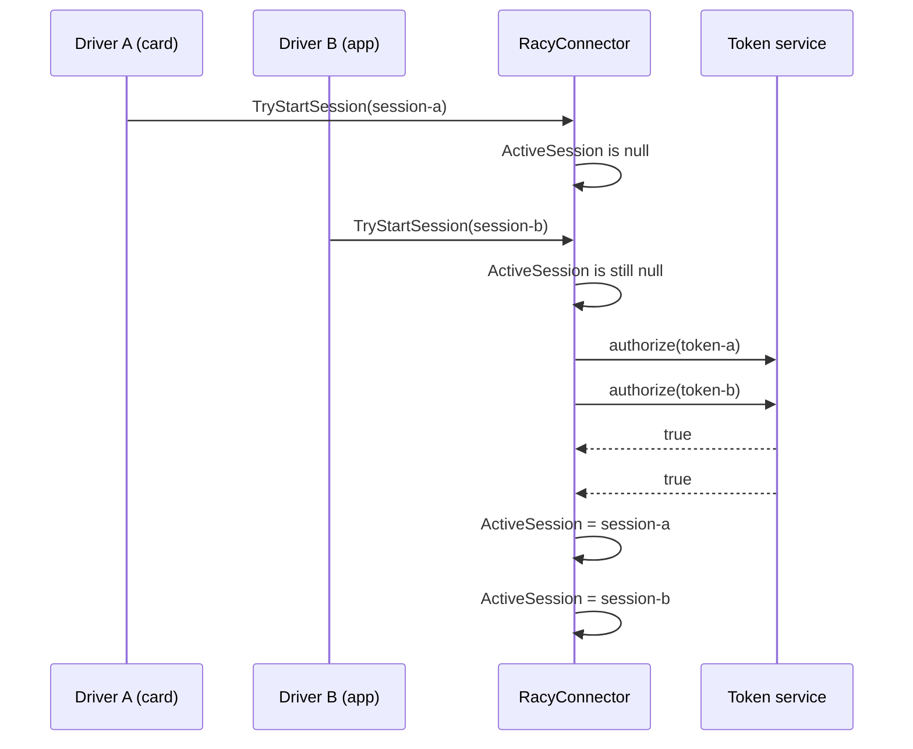
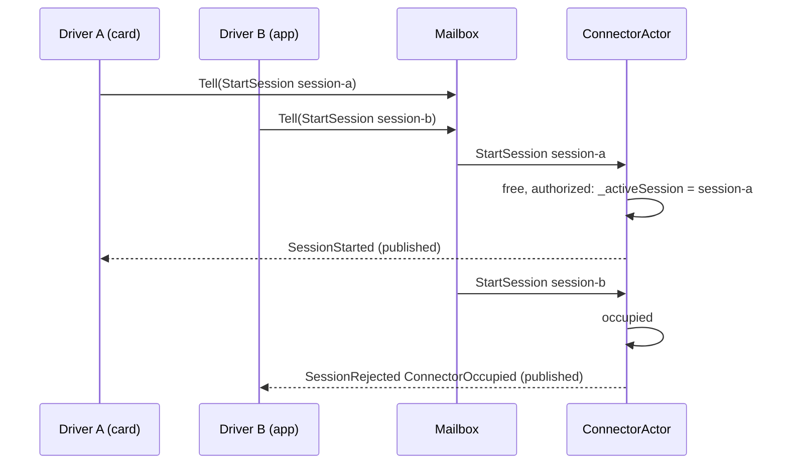
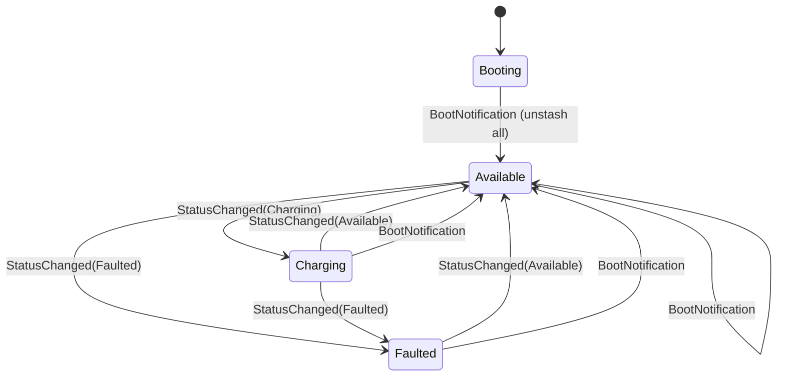
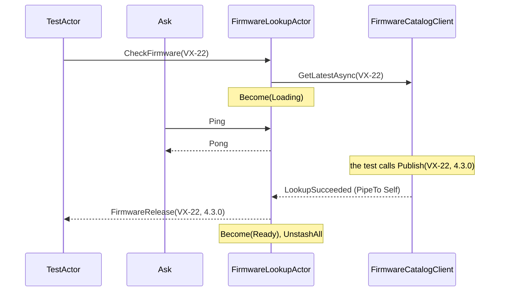

# Chapter 2. Actors from First Principles

At 17:58 on a Friday, connector `OHM-SLC-0042/1` at `slc-depot` is free. A driver taps an RFID card on the charger. In the same instant a second driver, still crossing the car park, presses "Start charging" in the driver app for the same connector. Both requests reach Ohmline's prototype back end within a few milliseconds.

The prototype keeps each connector as an object in memory. Each request checks that the connector is free, asks the token service whether the credential may charge, and records the session. The token service takes 40 ms to answer. Both requests check, both wait, both record, and both drivers see "Charging started". Only one car is plugged in, and the support desk spends Monday morning working out which receipt to void.

Chapter 1 named the cure: one writer per aggregate, handling one message at a time (ADR 0001), with the actor as its runtime. This chapter builds it twice: first by hand from a `Channel` and a loop, so that you see every moving part, then on Akka.NET 1.5.73. All of it lives in `learn/` projects; no product code is written until Part II has modeled the domain.

> **In this chapter you will:**
>
> - reproduce a double-booked connector deterministically with a `Barrier`, and fix it with a lock and then with a mailbox;
> - build `Mailbox<TMessage>`, a reply address, an `AskAsync` with a mandatory timeout and a restarting supervisor in about 200 lines of plain C#;
> - write the same connector as an Akka.NET `ReceiveActor` and test it with the TestKit;
> - model a charger's lifecycle with `Become`, `Stash` and a keyed heartbeat timer;
> - choose between `PipeTo` and `ReceiveAsync` for I/O, and between `Resume`, `Restart` and `Escalate` for failures;
> - host an actor in ASP.NET Core with Akka.Hosting and watch coordinated shutdown run when the host stops.

> **Starting point:** `ch01-s07`, the empty workbench from section 1.7.
>
> ```bash
> git checkout ch01-s07
> ```

## 2.1 Shared mutable state: double-booking a connector

The prototype's connector is an ordinary class. Its rule is the first invariant in Ohmline's list: a connector hosts at most one session. The method enforces it with a check followed by an act, and between the two it calls the token service.

```csharp
// File: learn/Ch02.ActorsByHand/RacyConnector.cs @ ch02-s01
public sealed class RacyConnector(string connectorId, Func<string, bool> authorize)
{
    public string ConnectorId { get; } = connectorId;

    public string? ActiveSession { get; private set; }

    public bool TryStartSession(string sessionId, string tokenUid)
    {
        if (ActiveSession is not null)
            return false;

        // Another thread can pass the check above while this one waits for the token service.
        if (!authorize(tokenUid))
            return false;

        ActiveSession = sessionId;
        return true;
    }
    // ...
}
```

Single-threaded, the class is correct; the first test in `DoubleBookingTests` shows an occupied connector rejecting a second driver. The defect needs two threads inside `TryStartSession` at once, as on Friday evening:



Both checks run before either write, so both drivers get `true`, and the last write wins. As in Chapter 1's depot story, no line is wrong; the defect lives between two correct executions.

### Making a race deterministic

A test that starts two threads and hopes they collide passes most of the time and teaches nothing. Because the constructor takes `authorize` as a function, the test can pass one that holds each driver inside the token check until the other arrives.

```csharp
// File: learn/Ch02.ActorsByHand.Tests/DoubleBookingTests.cs @ ch02-s01
    [Fact]
    public async Task Given_a_free_racy_connector_when_two_drivers_tap_at_once_then_both_start()
    {
        using var bothChecked = new Barrier(participantCount: 2);
        var connector = new RacyConnector(ConnectorId, _ => WaitForOtherDriver(bothChecked));

        var started = await TwoDriversTapAtOnce(connector.TryStartSession);

        started.ShouldBe([true, true]);
    }
    // ...
    private static bool WaitForOtherDriver(Barrier bothChecked)
    {
        bothChecked.SignalAndWait(MeetingTimeout);
        return true;
    }
```

A `Barrier` with two participants releases nobody until both have called `SignalAndWait`, and both can reach it only after passing the "is it free" check, so the double booking happens on every run. `MeetingTimeout` is one second: if only one driver can ever get inside, the barrier gives up and that driver continues.

### The lock fix, and its limits

`LockedConnector` wraps the whole check, token call and write in one lock. It uses `System.Threading.Lock`, the dedicated lock type that .NET 9 introduced and that the C# `lock` statement recognizes (Microsoft's [`lock` statement reference](https://learn.microsoft.com/en-us/dotnet/csharp/language-reference/statements/lock#guidelines), "Guidelines").

```csharp
// File: learn/Ch02.ActorsByHand/LockedConnector.cs @ ch02-s01
    public bool TryStartSession(string sessionId, string tokenUid)
    {
        lock (_gate)
        {
            if (_activeSession is not null)
                return false;

            if (!authorize(tokenUid))
                return false;

            _activeSession = sessionId;
            return true;
        }
    }
```

Under the same harness the second driver cannot enter, the barrier times out, and the second driver then finds the connector occupied: exactly one `true`. The fix is correct, and most codebases stop here. It does not scale to a whole design:

- **The lock is held across I/O.** A slow token service becomes a queue of blocked threads.
- **Every access must remember the lock.** Even the `ActiveSession` getter takes it; one forgotten `lock` reintroduces the race, and no compiler warns you.
- **Rules span objects.** The site's power budget involves every connector; locking several objects means a lock order, and a wrong one means a deadlock.
- **A lock lives in one process.** Two instances behind a load balancer have two locks.

### A first look at xUnit v3 on Microsoft.Testing.Platform

The tests use xUnit v3 4.0.2 and Shouldly 4.3.0, pinned in `Directory.Packages.props`. A new `learn/Directory.Build.props` gives every learning project the root settings, and every project whose name ends in `.Tests` the test settings.

```xml
<!-- File: learn/Directory.Build.props @ ch02-s01 -->
<Project>
  <!-- MSBuild uses only the nearest Directory.Build.props, so import the root one explicitly. -->
  <!-- ... -->

  <PropertyGroup>
    <IsPackable>false</IsPackable>
  </PropertyGroup>

  <!-- Learning test projects (named *.Tests) follow the same rules as the projects in tests/. -->
  <PropertyGroup Condition="$(MSBuildProjectName.EndsWith('.Tests'))">
    <!-- xUnit v3 test projects are executables: xUnit generates the entry point. -->
    <OutputType>Exe</OutputType>
    <IsTestProject>true</IsTestProject>
  </PropertyGroup>

  <ItemGroup Condition="$(MSBuildProjectName.EndsWith('.Tests'))">
    <PackageReference Include="xunit.v3" />
    <PackageReference Include="Shouldly" />
    <Using Include="Xunit" />
    <Using Include="Shouldly" />
  </ItemGroup>
</Project>
```

The elided line is an `<Import>` that finds the root file with `$([MSBuild]::GetPathOfFileAbove(...))`, so the test project's `.csproj` holds only a `ProjectReference`. An xUnit v3 test project is an executable, run by Microsoft.Testing.Platform (MTP), which `global.json` selected in section 1.7; in MTP mode `dotnet test` must be told what to run, so the commands in this book name the solution with `--solution`. Chapter 9 goes deeper.

> **Tip:** the xUnit analyzer rule xUnit1051 is a build error in this repo, because every warning is. Inside a test method, pass `TestContext.Current.CancellationToken` to every call that accepts a token, including `Task.Run`.

> **Try it**
>
> ```bash
> git checkout ch02-s01
> git diff ch01-s07 ch02-s01 --stat
> git diff ch01-s07 ch02-s01 -- learn/Ch02.ActorsByHand
> dotnet test --solution Ohmline.slnx
> ```
>
> The diff ends with `8 files changed, 170 insertions(+)`. The test run's summary reports `total: 3` and `failed: 0`; the locked test takes about a second because its barrier times out.

## 2.2 A mailbox in sixty lines

The lock made threads take turns at the connector's state. An actor turns that around: threads never touch the state. They drop a message into a queue, the *mailbox*, and a single loop takes messages out one at a time and runs the handler. Only that loop sees the state, so nothing can interleave with a check-then-act. `System.Threading.Channels` provides the queue, and `SingleReader` promises it that only one loop reads.

```csharp
// File: learn/Ch02.ActorsByHand/Mailbox.cs @ ch02-s02
public sealed class Mailbox<TMessage> : IAsyncDisposable
{
    private readonly Channel<TMessage> _channel =
        Channel.CreateUnbounded<TMessage>(new UnboundedChannelOptions { SingleReader = true });
    private readonly Action<TMessage> _handle;
    private readonly Task _loop;

    public Mailbox(Action<TMessage> handle)
    {
        _handle = handle;
        _loop = Task.Run(ProcessMessagesAsync);
    }

    /// <summary>Completes when the mailbox stops, and faults if the handler threw.</summary>
    public Task Completion => _loop;

    /// <summary>Queues the message and returns at once. A stopped mailbox drops it.</summary>
    public void Tell(TMessage message) => _channel.Writer.TryWrite(message);
```

`Tell` is the only way in, and it returns at once. The handler is a synchronous `Action<TMessage>`, so one message is finished before the next is read.

```csharp
// File: learn/Ch02.ActorsByHand/Mailbox.cs @ ch02-s02
    private async Task ProcessMessagesAsync()
    {
        try
        {
            await foreach (var message in _channel.Reader.ReadAllAsync())
                _handle(message);
        }
        catch (Exception exception)
        {
            _channel.Writer.TryComplete(exception);
            throw;
        }
    }

    /// <summary>Stops accepting messages, processes those already queued, then stops.</summary>
    public async ValueTask DisposeAsync()
    {
        _channel.Writer.TryComplete();
        await _loop.ConfigureAwait(ConfigureAwaitOptions.SuppressThrowing);
    }
}
```

If the handler throws, the loop closes the channel and rethrows, so `Completion` faults and later tells are dropped; section 2.4 builds supervision on that. Disposal closes the writer and lets the loop drain what is queued. The whole file is 49 lines.

### The connector as an actor

Messages cross threads, so they should be immutable. A positional record's properties are init-only, so neither the sender nor the actor can change a message once it has been told. The protection is shallow: a record that carries a `List<T>` shares that list, and the sender can still change it while the actor reads it. Appendix C lists this as *mutable messages*; keep message fields to strings, numbers, other records and immutable collections.

```csharp
// File: learn/Ch02.ActorsByHand/ConnectorMessage.cs @ ch02-s02
public abstract record ConnectorMessage;

public sealed record StartSession(string SessionId, string TokenUid) : ConnectorMessage;

public sealed record EndSession(string SessionId) : ConnectorMessage;
```

`ConnectorActor` owns a `Mailbox<ConnectorMessage>` and a private `_activeSession` field. Its `Start` method is the racy logic without a lock, publishing every outcome as an event through a callback.

```csharp
// File: learn/Ch02.ActorsByHand/ConnectorActor.cs @ ch02-s02
    private void Start(StartSession start)
    {
        if (_activeSession is not null)
        {
            _publish(new SessionRejected(
                ConnectorId, start.SessionId, RejectionReason.ConnectorOccupied));
            return;
        }

        if (!_authorize(start.TokenUid))
        {
            _publish(new SessionRejected(
                ConnectorId, start.SessionId, RejectionReason.TokenNotAuthorized));
            return;
        }

        _activeSession = start.SessionId;
        _publish(new SessionStarted(ConnectorId, start.SessionId));
    }
```

`Handle` dispatches with a `switch` whose `default` arm throws, because `ConnectorMessage` is an ordinary abstract record; closed hierarchies arrive in section 3.4. Friday evening now runs like this:



Both tells return at once, and the second is handled only after the first has finished. `ConnectorActorTests` reuses the barrier harness from section 2.1. Only the first message reaches the token check, the barrier times out, and exactly one `SessionStarted` and one `SessionRejected` (`ConnectorOccupied`) are published. Fifty threads telling `StartSession` through `Parallel.For` get one start and 49 rejections. Even the tests obey the single-writer rule: only the mailbox loop adds to their `List<ConnectorEvent>`, and they read it after `await using` has drained the mailbox.

### What the mailbox costs

- **The token check still blocks the actor**, but only this connector waits, not a pool of threads, and nobody can forget to queue.
- **The mailbox is unbounded.** A flood of tells grows memory without limit; a bounded channel adds back-pressure at the price of blocking or dropping senders.
- **Outcomes arrive as events.** The caller of `Tell` learns nothing directly; section 2.3 adds replies.

The same shape returns in section 19.6, where the driver app drains its outbox through a single-reader `Channel`.

> **Try it**
>
> ```bash
> git checkout ch02-s02
> git diff ch02-s01 ch02-s02 --stat
> git diff ch02-s01 ch02-s02 -- learn/Ch02.ActorsByHand
> dotnet test --solution Ohmline.slnx
> ```
>
> The diff shows `6 files changed, 235 insertions(+)`, and the run reports `total: 7`, `failed: 0`.

## 2.3 Tell, don't ask: reply addresses and futures

The live board in the depot office shows each connector's status, but `Tell` returns nothing and the connector does not know who is asking. It need not know: a message that expects an answer can carry the address the answer should go to. Hohpe and Woolf call this the [*Return Address*](https://www.enterpriseintegrationpatterns.com/patterns/messaging/ReturnAddress.html) pattern (*Enterprise Integration Patterns*, 2003, ch. 5 "Message Construction"); Vernon's [*Reactive Messaging Patterns with the Actor Model*](https://www.informit.com/store/reactive-messaging-patterns-with-the-actor-model-applications-9780133846836) (2015, ch. 6 "Message Construction", section "Return Address") applies it to actors. By hand, an address is anything you can tell (`ICanTell<TMessage>`), and a reply address is a delegate:

```csharp
// File: learn/Ch02.ActorsByHand/ReplyTo.cs @ ch02-s03
public delegate void ReplyTo<in TReply>(TReply reply);
```

`ConnectorMessage` gains `GetStatus(ReplyTo<ConnectorStatus> ReplyTo)`, and the connector's handler answers whoever the message names:

```csharp
// File: learn/Ch02.ActorsByHand/ConnectorActor.cs @ ch02-s03
            case GetStatus get:
                get.ReplyTo(new ConnectorStatus(ConnectorId, _activeSession));
                break;
```

The first test in `ReplyAndAskTests` passes another mailbox's `Tell` as the address, `new GetStatus(ReplyTo: statusBoard.Tell)`, and nobody waits for anything. That is the normal shape of a conversation between actors: every answer is another message.

### Asking from outside

An HTTP endpoint or a test has no mailbox, so it needs a *future*: a `Task` that completes when the reply arrives. `AskAsync` builds one from a `TaskCompletionSource`.

```csharp
// File: learn/Ch02.ActorsByHand/AskExtensions.cs @ ch02-s03
    public static async Task<TReply> AskAsync<TMessage, TReply>(
        this ICanTell<TMessage> actor,
        Func<ReplyTo<TReply>, TMessage> createMessage,
        TimeSpan timeout,
        CancellationToken cancellationToken = default)
    {
        ArgumentOutOfRangeException.ThrowIfLessThanOrEqual(timeout, TimeSpan.Zero);

        // Without RunContinuationsAsynchronously the asker's code after the await would run on
        // the actor's loop, inside the actor's turn.
        var reply = new TaskCompletionSource<TReply>(
            TaskCreationOptions.RunContinuationsAsynchronously);

        using var timeoutSource =
            CancellationTokenSource.CreateLinkedTokenSource(cancellationToken);
        timeoutSource.CancelAfter(timeout);
        using var registration = timeoutSource.Token.Register(() =>
        {
            if (cancellationToken.IsCancellationRequested)
                reply.TrySetCanceled(cancellationToken);
            else
                reply.TrySetException(new TimeoutException($"No reply within {timeout}."));
        });

        // A reply that arrives after the timeout finds the task completed and is dropped.
        actor.Tell(createMessage(answer => reply.TrySetResult(answer)));
        return await reply.Task;
    }
```

- **The timeout is mandatory.** The guard refuses zero and `Timeout.InfiniteTimeSpan`. An actor can be busy, stopped, or never answer that message.
- **Continuations run asynchronously.** The reply is set on the actor's loop; without `RunContinuationsAsynchronously`, the asker's code after `await` would run inside the actor's turn.
- **Late replies are harmless.** After a timeout, `TrySetResult` does nothing.

At the call site, typing the lambda's parameter lets C# infer both type arguments:

```csharp
// File: learn/Ch02.ActorsByHand.Tests/ReplyAndAskTests.cs @ ch02-s03
        var status = await connector.AskAsync(
            (ReplyTo<ConnectorStatus> replyTo) => new GetStatus(replyTo),
            AskTimeout,
            TestContext.Current.CancellationToken);
```

> **Version note:** `AskAsync` is a classic `this` extension method. Written as a C# 14 extension block on SDK 11.0.100-rc.3, `connector.AskAsync<ConnectorStatus>(...)` fails with CS1061, because once you supply one type argument you must supply all of them.

### Why fire-and-forget is the default

In `Given_a_busy_connector_when_asked_with_a_short_timeout_then_it_times_out`, the token service blocks on a `ManualResetEventSlim`. A `GetStatus` asked with a 100 ms timeout queues behind the slow `StartSession` and throws `TimeoutException`: an ask waits for everything ahead of it in the mailbox.

If the asker is itself an actor awaiting the answer during its turn, its own mailbox stalls and its own askers time out in turn. Under load such chains collapse into timeouts; Appendix C calls the anti-pattern *Ask chains*. Between actors, tell; keep asks at the edges, always with a timeout.

> **Try it**
>
> ```bash
> git checkout ch02-s03
> git diff ch02-s02 ch02-s03 --stat
> git diff ch02-s02 ch02-s03 -- learn/Ch02.ActorsByHand
> dotnet test --solution Ohmline.slnx
> ```
>
> The diff shows `7 files changed, 135 insertions(+), 2 deletions(-)`, and the run reports `total: 12`, `failed: 0`.

## 2.4 Let it crash: supervision and addresses by hand

The depot's live board subscribes to every connector's events. One evening the board's server is down, and its subscriber throws when a driver is rejected. The exception is thrown inside the connector's turn, so it ends the mailbox loop: the actor has crashed, and every later tell is silently dropped.

Wrapping every call in `try`/`catch` spreads recovery code through the logic, and after an unexpected exception the state may not be coherent anyway. [Joe Armstrong's Erlang thesis](https://erlang.org/download/armstrong_thesis_2003.pdf) (2003) argues the opposite: let the failing process die, and let another process that watches it, the *supervisor*, decide what to do. His slogans are "let some other process fix the error" and "let it crash" (ch. 4 "Programming Techniques", sections 4.3 "Error handling philosophy" and 4.4 "Let it crash", pp. 104–107).

### A supervisor by hand

`ConnectorActor` now exposes its mailbox's `Completion`. `Supervisor` holds one child, forwards tells to it, and waits for the child to finish.

```csharp
// File: learn/Ch02.ActorsByHand/Supervisor.cs @ ch02-s04
    public void Tell(ConnectorMessage message) => Volatile.Read(ref _child).Tell(message);

    private async Task SuperviseAsync()
    {
        while (true)
        {
            try
            {
                await _child.Completion;
                return; // The child stopped because it was disposed, not because it crashed.
            }
            catch (Exception exception)
            {
                Volatile.Write(ref _child, _createChild());
                ChildRestarted?.Invoke(exception);
            }
        }
    }
```

A fault means a crash: the loop builds a fresh child and raises `ChildRestarted`, which the tests await instead of sleeping. Callers keep one stable address, the supervisor, while the actor behind it is replaced. The key test crashes an occupied connector:

```csharp
// File: learn/Ch02.ActorsByHand.Tests/SupervisionTests.cs @ ch02-s04
        connector.Tell(new StartSession("session-a", "token-a"));
        (await GetStatusAsync(connector, ct)).ActiveSession.ShouldBe("session-a");

        connector.Tell(new StartSession("session-b", "token-b")); // Rejected, and publishing fails.

        (await _restarted.Task.WaitAsync(Timeout, ct)).ShouldBeOfType<InvalidOperationException>();
        // Session A is still charging, but the restarted connector no longer knows about it.
        (await GetStatusAsync(connector, ct)).ActiveSession.ShouldBeNull();
```

The restart cost the connector its memory. A car still draws power on session A, while the connector reports itself free. A restart rebuilds an actor from its constructor, so state that matters must live somewhere that survives; Chapters 10 and 11 keep it in a journal of events and replay it on start-up.

The crash comes from the subscriber, not the token service, for a reason: an occupied connector rejects *before* calling the token service, so a failing token service never crashed it. Anything an actor calls during its turn fails inside the actor, including a callback. Akka.NET subscribers receive messages instead.

This supervisor is deliberately naive: it restarts forever, at once, and the messages queued behind the failure are lost with the crashed mailbox. Section 2.8 adds decision rules and backoff.

### Addresses by identity

A request names a connector by identity, `OHM-SLC-0042/1`, and something must turn that into the one actor for it. `ActorDirectory<TActor>` does, creating the actor on first use.

```csharp
// File: learn/Ch02.ActorsByHand/ActorDirectory.cs @ ch02-s04
public sealed class ActorDirectory<TActor>(Func<string, TActor> createActor) : IAsyncDisposable
    where TActor : IAsyncDisposable
{
    // GetOrAdd may run its factory twice under contention and keep only one result. Storing a
    // Lazy means a losing call creates a cheap wrapper, never a second running actor.
    private readonly ConcurrentDictionary<string, Lazy<TActor>> _actors = new();

    public TActor GetOrCreate(string id) =>
        _actors.GetOrAdd(id, key => new Lazy<TActor>(() => createActor(key))).Value;
    // ...
}
```

Two actors for one connector would bring the double booking back, and `GetOrAdd` may run its factory twice, hence the `Lazy`; 100 parallel lookups of one id create exactly one actor. An `ActorDirectory<Supervisor>` gives "look up by identity, create on demand, restart on failure". Evans's repository gives "the illusion of an in-memory collection of all objects of that aggregate's root type" ([*Domain-Driven Design Reference*](https://www.domainlanguage.com/wp-content/uploads/2016/05/DDD_Reference_2015-03.pdf), "Repositories", p. 17; [*Domain-Driven Design*](https://www.informit.com/store/domain-driven-design-tackling-complexity-in-the-heart-9780321125217), ch. 6 "The Life Cycle of a Domain Object"); this is that idea for actors looked up by identity in one process, and Chapter 12's shard region is the same idea across a cluster.

> **Try it**
>
> ```bash
> git checkout ch02-s04
> git diff ch02-s03 ch02-s04 --stat
> git diff ch02-s03 ch02-s04 -- learn/Ch02.ActorsByHand
> dotnet test --solution Ohmline.slnx
> ```
>
> The diff shows `4 files changed, 183 insertions(+)`, and the run reports `total: 17`, `failed: 0`.

## 2.5 Hello, Akka.NET

The by-hand actor leaves work undone: many actors on a few threads, failure rules, timers, logging, persistence and clustering. Akka.NET, a [.NET port](https://github.com/akkadotnet/akka.net/blob/1.5.73/README.md) of the JVM's Akka, provides all of it, and every piece you built has a counterpart:

| By hand (sections 2.2 to 2.4) | Akka.NET |
|---|---|
| `Mailbox<TMessage>` and its loop | The actor's mailbox and dispatcher |
| `ConnectorActor.Handle` | `Receive<T>` handlers on a `ReceiveActor` |
| `ICanTell<TMessage>` | `IActorRef` |
| `ReplyTo<T>` in each message | `Sender`, sent with every message |
| `AskAsync` with a timeout | `Ask<T>(message, timeout)` |
| `Supervisor` | The parent and its `SupervisorStrategy` |
| `ActorDirectory<TActor>` | `ActorOf` for children; the shard region (Chapter 12) |

### The connector in Akka.NET

This section adds `Akka` and `Akka.TestKit.Xunit` (the TestKit for xUnit v3) at `$(AkkaVersion)`, 1.5.73. The project `learn/Ch02.AkkaBasics.Tests` holds actors and tests together.

```csharp
// File: learn/Ch02.AkkaBasics.Tests/Connectors/AkkaConnectorActor.cs @ ch02-s05
public sealed class AkkaConnectorActor : ReceiveActor
{
    private string? _activeSession;

    public AkkaConnectorActor(string connectorId)
    {
        Receive<StartSession>(start =>
        {
            if (_activeSession is not null)
            {
                Sender.Tell(new SessionRejected(connectorId, start.SessionId));
                return;
            }

            _activeSession = start.SessionId;
            Sender.Tell(new SessionStarted(connectorId, start.SessionId));
        });

        // Handlers are tried in order and the first match wins. An EndSession for any other
        // session matches nothing: Akka.NET treats it as unhandled and sends no reply.
        Receive<EndSession>(end => end.SessionId == _activeSession, end =>
        {
            _activeSession = null;
            Sender.Tell(new SessionEnded(connectorId, end.SessionId));
        });

        Receive<GetStatus>(_ => Sender.Tell(new ConnectorStatus(connectorId, _activeSession)));
    }
    // ...
    public static Props Props(string connectorId) =>
        Akka.Actor.Props.Create(() => new AkkaConnectorActor(connectorId));
}
```

A `ReceiveActor` registers handlers in its constructor, optionally with a predicate; the first match wins. No message carries a reply address: `Sender` is whoever told the current message, so this connector replies to the asking driver. (The token check is left out of this version.) `Props` is the recipe for an actor. Akka.NET, not your code, calls the constructor, because it must call it again on a restart. `ActorOf` creates the actor and returns an `IActorRef`:

```csharp
// File: learn/Ch02.AkkaBasics.Tests/Connectors/AkkaConnectorActorTests.cs @ ch02-s05
        var connector = Sys.ActorOf(AkkaConnectorActor.Props(ConnectorId));

        connector.Tell(new StartSession("session-a"), sender: TestActor);

        await ExpectMsgAsync(
            new SessionStarted(ConnectorId, "session-a"),
            cancellationToken: TestContext.Current.CancellationToken);
```

### Akka.Analyzers: never `new` an actor

`new AkkaConnectorActor(...)` would give an object with no mailbox, address or parent. `Akka.Analyzers` 0.3.3, which comes with `Akka`, rejects it. `NeverNewAnActor.cs` keeps such a call inside `#if DEMO_COMPILE_ERRORS` (output wrapped):

```text
$ dotnet build learn/Ch02.AkkaBasics.Tests -p:DefineConstants=DEMO_COMPILE_ERRORS
.../Connectors/NeverNewAnActor.cs(7,50): error AK1000: Actors must be instantiated using
`ActorOf` or `ActorOfAsTestActorRef` via a `Props` class.
(https://getakka.net/articles/debugging/rules/AK1000.html)
```

[AK1000](https://getakka.net/articles/debugging/rules/AK1000.html) is an error by default, not only under this repo's `TreatWarningsAsErrors`.

### The first TestKit tests

`TestKit` gives every test a fresh `ActorSystem`, `Sys`, and a `TestActor` that records what it receives. `ExpectMsgAsync` waits up to three seconds by default ([`single-expect-default = 3s`](https://github.com/akkadotnet/akka.net/blob/1.5.73/src/core/Akka.TestKit/Internal/Reference.conf#L22-L24)) and compares by value. Pass the sender explicitly, `Tell(message, TestActor)`: after an `await` the test may continue on a thread where the implicit sender is not set. Ten `TestProbe` drivers telling `StartSession` at once get one `SessionStarted` and nine `SessionRejected`. `Ask` has the shape of `AskAsync`, and the same rule:

```csharp
// File: learn/Ch02.AkkaBasics.Tests/Connectors/AkkaConnectorActorTests.cs @ ch02-s05
        // Always pass a timeout: Akka.NET's default ask timeout is infinite.
        var status = await connector.Ask<ConnectorStatus>(new GetStatus(), AskTimeout, ct);
```

The effective default `akka.actor.ask-timeout` is `infinite` ([`akka.conf`](https://github.com/akkadotnet/akka.net/blob/1.5.73/src/core/Akka/Configuration/akka.conf#L128-L129) at 1.5.73). The last test asks about an `EndSession` for a session that never started; no handler matches, and after 200 ms the ask throws `Akka.Actor.AskTimeoutException`, not `System.TimeoutException`.

> **Note:** actors in these tests are unnamed. A connector id such as `OHM-SLC-0042/1` contains `/`, which is not allowed in an actor name. Section 2.9 names its actor `charger-twin`.

> **Try it**
>
> ```bash
> git checkout ch02-s05
> git diff ch02-s04 ch02-s05 --stat
> git diff ch02-s04 ch02-s05 -- Directory.Packages.props learn/Ch02.AkkaBasics.Tests
> dotnet test --solution Ohmline.slnx
> ```
>
> The diff shows `9 files changed, 170 insertions(+)`, and the run reports `total: 22`, `failed: 0`.

## 2.6 Behaviour as state: Become and Stash

A charger that reconnects sends a *boot notification* with its vendor, model and firmware version. Until then the back office knows nothing reliable about it: "what is your status?" has no honest answer, and an earlier status report cannot be interpreted.

The back office keeps a *twin* per charge point, an actor holding its latest picture of the device. Its rules depend on the lifecycle: a booting twin answers nothing, and a faulted charger must report `Available` before it can charge again. Instead of a status field and an `if` in every handler, the actor model's *become* lets the actor replace its handlers, so the behaviour *is* the state. Gul Agha's formulation makes this part of every message: an actor that accepts one "must also compute a replacement behavior" ([*Actors: A Model of Concurrent Computation in Distributed Systems*](https://dspace.mit.edu/handle/1721.1/6952), MIT AI Lab TR 844, 1985, section 3.1.2 "The Behavior of an Actor"). Akka.NET calls it [`Become`](https://getakka.net/articles/actors/receive-actor-api.html#becomeunbecome). At `ch02-s06` the twin has four behaviours:



In Booting, everything except the boot notification is stashed. In Faulted, `StatusChanged(Charging)` has no transition. A boot notification in a running state means the charger restarted.

### The code

`ChargerTwin` implements `IWithStash`, so Akka.NET sets its `Stash` property; the constructor calls `Booting()`.

```csharp
// File: learn/Ch02.AkkaBasics.Tests/Chargers/ChargerTwin.cs @ ch02-s06
    private void Booting()
    {
        Receive<BootNotification>(boot =>
        {
            _firmwareVersion = boot.FirmwareVersion;
            Become(Available);
            Stash.UnstashAll(); // The stashed messages go back to the front of the mailbox.
        });
        ReceiveAny(_ => Stash.Stash());
    }

    private void Available()
    {
        Receive<StatusChanged>(s => s.Status == ChargerStatus.Charging, _ => Become(Charging));
        Receive<StatusChanged>(s => s.Status == ChargerStatus.Faulted, _ => Become(Faulted));
        ReceiveWhileRunning(ChargerStatus.Available);
    }
```

`Stash.Stash()` sets the current message aside; `UnstashAll()` puts the stashed messages back at the front of the mailbox, where the new behaviour handles them first. `Become` replaces all the handlers at once.

```csharp
// File: learn/Ch02.AkkaBasics.Tests/Chargers/ChargerTwin.cs @ ch02-s06
    private void Faulted()
    {
        // A faulted charger must be repaired (report Available) before it can charge again, so
        // StatusChanged(Charging) has no handler here and goes unhandled.
        Receive<StatusChanged>(s => s.Status == ChargerStatus.Available, _ => Become(Available));
        ReceiveWhileRunning(ChargerStatus.Faulted);
    }

    private void ReceiveWhileRunning(ChargerStatus status)
    {
        Receive<GetStatus>(_ =>
            Sender.Tell(new ChargerStatusReport(_chargePointId, status, _firmwareVersion)));
        // ...
```

There is no status field: each behaviour passes its own status to `ReceiveWhileRunning`, so the reported status cannot disagree with the active handlers.

The tests show the stash at work. A `GetStatus` told to a booting twin gets no answer for 200 ms; after the boot it gets `Available` with firmware `4.2.1`, so a caller never sees a "booting" status. A `StatusChanged(Charging)` sent before the boot is replayed afterwards, leaving the twin `Charging`. The other tests walk the transitions, using the fictional vendor `Voltaro`, model `VX-22`.

### Costs and cautions

- **A stash is memory.** A twin whose charger never boots stashes everything; section 2.9 shows what an asker sees.
- **Unhandled is silent.** The sender of an unmatched message hears nothing. That is right for `StatusChanged(Charging)` in Faulted, and a silent loss anywhere it is not intended.
- **Behaviours hide the state from plain tests.** From Chapter 7 on, lifecycles live in a state union inside a pure decider, where a test is a function call; `Become` stays for the shell's own concerns, such as section 2.8's loading behaviour.

> **Try it**
>
> ```bash
> git checkout ch02-s06
> git diff ch02-s05 ch02-s06 --stat
> git diff ch02-s05 ch02-s06 -- learn/Ch02.AkkaBasics.Tests/Chargers
> dotnet test --solution Ohmline.slnx
> ```
>
> The diff shows `5 files changed, 199 insertions(+)`, and the run reports `total: 29`, `failed: 0`.

## 2.7 Time inside actors

A charger that loses its network connection sends no goodbye, and the twin keeps reporting `Available` for a charger nobody can use. In OCPP 1.6 a connected charger sends a *heartbeat* "after a configurable time interval", which the central system sets in its reply to the boot notification ([*Open Charge Point Protocol 1.6*](https://openchargealliance.org/protocols/open-charge-point-protocol/), edition 2, sections 4.6 "Heartbeat" and 6.4 "BootNotification.conf"; over 1.6J's WebSocket transport the spec makes heartbeats optional but advised). The twin assumes such a heartbeat: after three silent intervals it should mark the charger offline and tell whoever looks after it.

Time must reach the actor the way everything else does, as a message: a timer touching the fields from its own thread would bring back the race of section 2.1. `IWithTimers` gives the actor a `Timers` property whose keyed timers deliver messages to its own mailbox.

### The watchdog

At `ch02-s07`, `ChargerTwin` also implements `IWithTimers`, takes the heartbeat interval (one minute by default) and gains an `Offline` status. Every path into the running states goes through `Start`:

```csharp
// File: learn/Ch02.AkkaBasics.Tests/Chargers/ChargerTwin.cs @ ch02-s07
    private void Start(BootNotification boot)
    {
        _firmwareVersion = boot.FirmwareVersion;
        _missedHeartbeats = 0;
        // Starting a timer with a key that is already in use replaces the old timer.
        Timers.StartPeriodicTimer(HeartbeatCheckKey, CheckHeartbeat.Instance, _heartbeatInterval);
        Become(Available);
    }

    private sealed record CheckHeartbeat
    {
        public static readonly CheckHeartbeat Instance = new();
    }
```

The timer starts at boot, not in `PreStart`, where its ticks would only be stashed. Because of the key `"heartbeat-check"`, a reboot replaces the timer instead of adding a second. `CheckHeartbeat` is private, so no other actor can forge a tick. The running behaviours share the counting handlers:

```csharp
// File: learn/Ch02.AkkaBasics.Tests/Chargers/ChargerTwin.cs @ ch02-s07
        Receive<Heartbeat>(_ => _missedHeartbeats = 0);
        Receive<CheckHeartbeat>(_ =>
        {
            if (++_missedHeartbeats < MaxMissedHeartbeats)
                return;

            Timers.Cancel(HeartbeatCheckKey);
            Context.Parent.Tell(new ChargerWentOffline(_chargePointId, _missedHeartbeats));
            Become(Offline);
        });
```

Each heartbeat resets the count. On the third silent tick the twin cancels its timer, tells its parent `ChargerWentOffline`, and becomes Offline, where it answers `GetStatus` with `Offline` and waits for a new `BootNotification`; a stray heartbeat does not bring it back. It tells its *parent* because the parent is responsible for it, as in section 2.4. Akka.NET cancels an actor's timers when it stops.

### Testing with real time

`ChargerTwinHeartbeatTests` uses a 200 ms interval and creates each twin with `ChildActorOfAsync`, which makes `TestActor` its parent:

```csharp
// File: learn/Ch02.AkkaBasics.Tests/Chargers/ChargerTwinHeartbeatTests.cs @ ch02-s07
        var twin = await ChildActorOfAsync(
            ChargerTwin.Props(ChargePointId, HeartbeatInterval), cancellationToken: ct);

        twin.Tell(Boot);

        await ExpectNoMsgAsync(HeartbeatInterval, ct); // One or two missed: not offline yet.
        await ExpectMsgAsync(new ChargerWentOffline(ChargePointId, 3), cancellationToken: ct);
```

Other tests keep a twin online with heartbeats every 50 ms and reboot an offline twin to watch it go offline again, proving the timer restarted. Real time makes these the slowest tests so far. Later chapters take real time out of tests twice: `FakeTimeProvider` (section 3.8) for pure domain code, and the TestKit's `TestScheduler` (section 15.7) for actor timers.

### AK1004: the scheduler that leaks

`LeakyHeartbeatWatchdog.cs`, inside `#if DEMO_COMPILE_ERRORS`, uses the older `Context.System.Scheduler.ScheduleTellRepeatedly(...)` in `PreStart` and discards the result. Nothing cancels it when the actor stops or restarts. Akka.Analyzers flags it (output wrapped):

```text
$ dotnet build learn/Ch02.AkkaBasics.Tests -p:DefineConstants=DEMO_COMPILE_ERRORS
...
.../Chargers/LeakyHeartbeatWatchdog.cs(11,9): error AK1004: Usage of ScheduleTellOnce() and
ScheduleTellRepeatedly() inside an Akka actor, especially the variant that does not accept an
ICancelable parameter, can cause memory leak and unnecessary CPU usage if they are not canceled
properly inside PostStop(). Consider implementing the IWithTimers interface and use the
Timers.StartSingleTimer() or Timers.StartPeriodicTimer() instead.
(https://getakka.net/articles/debugging/rules/AK1004.html)
```

[AK1004](https://getakka.net/articles/debugging/rules/AK1004.html) is a warning in Akka.Analyzers 0.3.3; it shows as an error because the repo treats warnings as errors.

> **Try it**
>
> ```bash
> git checkout ch02-s07
> git diff ch02-s06 ch02-s07 --stat
> git diff ch02-s06 ch02-s07 -- learn/Ch02.AkkaBasics.Tests/Chargers/ChargerTwin.cs
> dotnet test --solution Ohmline.slnx
> ```
>
> The diff shows `6 files changed, 163 insertions(+), 10 deletions(-)`, and the run reports `total: 33`, `failed: 0`.

## 2.8 Supervision, backoff and the async question

Ohmline's maintenance team wants the latest firmware for each charger model, from a vendor catalog over HTTP that is slow and sometimes down. A caching `FirmwareLookupActor` raises the two questions every actor doing I/O must answer: what happens to its mailbox while it waits, and what happens when the I/O fails. In the tests, a fake `FirmwareCatalogClient` returns a pending task until the test calls `Publish` or `Fail`, and counts lookups in `LookupCount`.

### PipeTo and a loading behaviour

The actor never awaits the lookup. `PipeTo` turns the task's outcome into a message to itself, and the actor becomes Loading.

```csharp
// File: learn/Ch02.AkkaBasics.Tests/Firmware/FirmwareLookupActor.cs @ ch02-s08
    private void Ready()
    {
        Receive<CheckFirmware>(check =>
        {
            ArgumentException.ThrowIfNullOrWhiteSpace(check.Model, nameof(check.Model));
            if (_latest.TryGetValue(check.Model, out var cached))
            {
                Sender.Tell(cached);
                return;
            }

            var requester = Sender; // Sender changes with every message; capture it now.
            _catalog.GetLatestAsync(check.Model).PipeTo(
                Self,
                success: release => new LookupSucceeded(release, requester),
                failure: exception => new LookupFailed(check.Model, exception, requester));
            Become(Loading);
        });
        Receive<Ping>(_ => Sender.Tell(new Pong()));
    }
```

The handler returns at once, so the mailbox keeps running. `Sender` belongs to the current message, and by the time the task completes another message may be current, so the requester is captured and carried inside the private result records.

```csharp
// File: learn/Ch02.AkkaBasics.Tests/Firmware/FirmwareLookupActor.cs @ ch02-s08
    private void Loading()
    {
        Receive<LookupSucceeded>(succeeded =>
        {
            _latest[succeeded.Release.Model] = succeeded.Release;
            succeeded.Requester.Tell(succeeded.Release);
            Become(Ready);
            Stash.UnstashAll();
        });
        Receive<LookupFailed>(failed =>
        {
            failed.Requester.Tell(new FirmwareUnavailable(failed.Model));
            throw new FirmwareCatalogUnavailableException(failed.Model, failed.Cause);
        });
        Receive<Ping>(_ => Sender.Tell(new Pong()));
        ReceiveAny(_ => Stash.Stash());
    }
```

While Loading, the actor still answers `Ping` and stashes further lookups. On success it caches the release, answers the requester and replays the stash, so a second request for the model is served from the cache. A failure answers the requester and then throws, on purpose: the supervisor decides what a broken catalog means. The ping test's messages flow like this:



In `Given_a_lookup_in_flight_when_pinged_then_the_actor_answers_at_once`, the `Ask` for `Pong` succeeds while the lookup is pending, and `TestActor` receives the release only after the test publishes it.

### ReceiveAsync: simpler, and the mailbox waits

`BlockingFirmwareLookupActor` is the same lookup with an `async` handler:

```csharp
// File: learn/Ch02.AkkaBasics.Tests/Firmware/BlockingFirmwareLookupActor.cs @ ch02-s08
        ReceiveAsync<CheckFirmware>(async check =>
        {
            var release = await catalog.GetLatestAsync(check.Model);
            Sender.Tell(release);
        });
        Receive<Ping>(_ => Sender.Tell(new Pong()));
```

It reads like ordinary code, and `Sender` is still the original requester after the `await`. The price: Akka.NET suspends the mailbox until the task completes. In `Given_a_receive_async_handler_awaiting_io_when_pinged_then_the_ping_waits`, a `Ping` gets no answer for 300 ms; after `Publish` the release goes to the requester, and only then does the `Pong` arrive. The two styles compare like this:

| | `PipeTo` + Loading + Stash | `ReceiveAsync` |
|---|---|---|
| Mailbox during the I/O | Keeps running | Suspended |
| `Sender` after completion | Capture it yourself | Stable |
| Code | A behaviour and two internal messages | One handler |
| Use for | Slow or unreliable I/O; actors that must stay responsive | Short awaits where ordering matters more than responsiveness |

### Deciding what a failure means

A parent's *supervisor strategy* decides what happens to a failed child. An ordinary parent declares one by overriding `SupervisorStrategy()`; without an override, the default `OneForOneStrategy` restarts the child for most exceptions, which is section 2.4's naive supervisor again. `OneForOneStrategy` affects only the failed child, and its *decider* maps the exception to a `Directive`. Here the parent is a backoff supervisor, so `FirmwareSupervision` hands it the strategy through `WithSupervisorStrategy`:

```csharp
// File: learn/Ch02.AkkaBasics.Tests/Firmware/FirmwareSupervision.cs @ ch02-s08
    public static Props WithBackoff(
        Props lookup, TimeSpan minBackoff, TimeSpan maxBackoff, TimeSpan resetAfter) =>
        BackoffSupervisor.Props(
            Backoff.OnFailure(
                    lookup,
                    childName: "firmware-lookup",
                    minBackoff: minBackoff,
                    maxBackoff: maxBackoff,
                    randomFactor: 0.2,
                    maxNrOfRetries: -1)
                .WithAutoReset(resetAfter)
                .WithSupervisorStrategy(new OneForOneStrategy(Decide)));

    /// <summary>What to do with a child that threw, decided by the exception.</summary>
    public static Directive Decide(Exception exception) => exception switch
    {
        ArgumentException => Directive.Resume, // A bad request: drop it, keep the cache.
        FirmwareCatalogUnavailableException => Directive.Restart, // Try again, with backoff.
        _ => Directive.Escalate,
    };
```

- **Resume** keeps the actor and its state and drops the failed message; after a blank model name the cache survives (`LookupCount` stays 1).
- **Restart** builds a fresh instance from `Props`, losing state, as in section 2.4.
- **Escalate** fails the supervisor itself with the same exception, so that its own parent decides; use it for exceptions this level does not understand.

Restarting at once against a catalog that is down only adds load. `BackoffSupervisor` starts a new child after `minBackoff`, doubles the delay after each further failure up to `maxBackoff`, and adds up to 20% jitter so that many actors do not retry in step. `WithAutoReset` returns to `minBackoff` once a child has run for `resetAfter`. The tests read `BackoffSupervisor.GetRestartCount`: 1 after the failure, back to 0 once the new child has run 500 ms.

> **Version note:** in Akka.NET 1.5.73 the factory is the static class `Akka.Pattern.Backoff`, whose `OnFailure(...)` returns `BackoffOptions`. There is no JVM-style `BackoffOpts`.

> **Warning:** during the backoff there is no child, so messages sent to the supervisor in that window are not delivered to one. The restart test retries its final `Ask` inside `AwaitAssertAsync` for that reason. If callers need an answer during the backoff, look at `WithReplyWhileStopped`.

Expect alarming output even when every test passes: Akka.NET logs each supervised failure at error level with its exception chain, such as `HttpRequestException: The catalog is down.`

> **Try it**
>
> ```bash
> git checkout ch02-s08
> git diff ch02-s07 ch02-s08 --stat
> git diff ch02-s07 ch02-s08 -- learn/Ch02.AkkaBasics.Tests/Firmware
> dotnet test --solution Ohmline.slnx
> ```
>
> The diff shows `9 files changed, 343 insertions(+)`. The run logs the supervised failures and still reports `total: 42`, `failed: 0`.

## 2.9 Actors in the Generic Host

Ohmline's services are ASP.NET Core applications, where configuration, dependency injection, logging and process lifetime belong to the .NET Generic Host. The actor system must start with the host, be reachable from endpoints, log where everything else logs, and stop cleanly during a deployment. Akka.Hosting 1.5.73, added to `Directory.Packages.props` here, does that. This section creates `learn/Ch02.Hosted`, a minimal API hosting one `ChargerTwin`, whose source it compiles by link from the learning tests.

```csharp
// File: learn/Ch02.Hosted/ChargerApp.cs @ ch02-s09
        builder.Services.AddAkka("learn", akka => akka
            .ConfigureLoggers(loggers =>
            {
                loggers.ClearLoggers();
                loggers.AddLoggerFactory(); // Akka.NET logs through Microsoft.Extensions.Logging.
            })
            .WithActorAskTimeout(TimeSpan.FromSeconds(5)) // For any Ask that passes no timeout.
            .WithActors((system, registry) =>
            {
                var twin = system.ActorOf(ChargerTwin.Props(ChargePointId), "charger-twin");
                registry.Register<ChargerTwin>(twin);
            })
            .AddStartup((system, _) =>
                CoordinatedShutdown.Get(system).AddTask(
                    CoordinatedShutdown.PhaseBeforeServiceUnbind,
                    "drain-charger-twins",
                    () =>
                    {
                        system.Log.Info("Host is stopping: draining charger twins");
                        return Task.FromResult(Done.Instance);
                    })));
```

Read it top to bottom:

- **`AddAkka("learn", ...)`** registers an actor system that starts and stops with the host, and puts `ActorSystem` and `ActorRegistry` into dependency injection.
- **`ConfigureLoggers`** sends actor log lines through Microsoft.Extensions.Logging.
- **`WithActorAskTimeout`** replaces the infinite default for an `Ask` without a timeout, as a safety net.
- **`WithActors`** creates top-level actors; `registry.Register<ChargerTwin>(twin)` files the `IActorRef` under a key type.
- **`AddStartup`** runs a callback after the actors have started. This one adds a task to [*coordinated shutdown*](https://getakka.net/articles/actors/coordinated-shutdown.html), Akka.NET's ordered shutdown phases. `before-service-unbind` comes first (["The first pre-defined phase that applications can add tasks to"](https://github.com/akkadotnet/akka.net/blob/1.5.73/src/core/Akka/Configuration/akka.conf#L1095-L1102)); later phases hand off shards and leave the cluster (Chapter 12). A real service would stop accepting work here.

### Reaching the actor from an endpoint

An endpoint receives `IRequiredActor<ChargerTwin>` from dependency injection and awaits `GetAsync`, which waits until `WithActors` has registered the actor.

```csharp
// File: learn/Ch02.Hosted/ChargerEndpoints.cs @ ch02-s09
        var twinRef = await twin.GetAsync(ct);
        try
        {
            var report = await twinRef.Ask<ChargerStatusReport>(new GetStatus(), AskTimeout, ct);
            return TypedResults.Ok(report);
        }
        catch (AskTimeoutException)
        {
            // A twin that has not booted stashes the question, so the ask runs out of time.
            return TypedResults.Problem(
                "The charger twin did not answer in time.",
                statusCode: StatusCodes.Status503ServiceUnavailable);
        }
```

`AskTimeout` is 2 s. Any id other than `OHM-SLC-0042` gets 404; Chapter 12 replaces the single twin with a shard region. `POST /chargers/{id}/boot-notification` tells the twin a `BootNotification` and returns `202 Accepted`, standing in for the charger until the Device Gateway arrives in Chapter 16. A trimmed run:

```text
$ dotnet run --project learn/Ch02.Hosted --urls http://127.0.0.1:5089
$ curl -i http://127.0.0.1:5089/chargers/OHM-SLC-0042/status
HTTP/1.1 503 Service Unavailable
Content-Type: application/problem+json
...
$ curl -i -X POST http://127.0.0.1:5089/chargers/OHM-SLC-0042/boot-notification \
    -H 'Content-Type: application/json' \
    -d '{"vendor":"Voltaro","model":"VX-22","firmwareVersion":"4.2.1"}'
HTTP/1.1 202 Accepted
...
Location: /chargers/OHM-SLC-0042/status
$ curl -i http://127.0.0.1:5089/chargers/OHM-SLC-0042/status
HTTP/1.1 200 OK
...
{"chargePointId":"OHM-SLC-0042","status":"Available","firmwareVersion":"4.2.1"}
```

The first request takes about two seconds: the booting twin stashed the question and the ask timed out. At boot the twin unstashes that `GetStatus` and answers it, but the temporary actor `Ask` created is gone, so the host logs a *dead letter*, a message with nowhere to go (wrapped):

```text
$ dotnet run --project learn/Ch02.Hosted --urls http://127.0.0.1:5089
...
info: Akka.Actor.ActorSystem[0]
      [INFO][11/05/2026 04:28:37.548Z][Thread 0009][akka://learn/deadLetters] Message
      [ChargerStatusReport] from [akka://learn/temp/c] to [akka://learn/deadLetters] was not
      delivered. [1] dead letters encountered. ...
```

One is harmless; a steady stream means timeouts that are too short. Note Akka.NET's own prefix inside the Microsoft.Extensions.Logging category `Akka.Actor.ActorSystem`. Stopping the host with SIGTERM, as Kubernetes and systemd do, logs (wrapped):

```text
$ kill -TERM <pid of Ch02.Hosted>
info: Akka.Actor.ActorSystem[0]
      [INFO][...][CoordinatedShutdown (akka://learn)] Starting coordinated shutdown from CLR
      termination hook.
...
info: Akka.Actor.ActorSystem[0]
      [INFO][...][ActorSystem(learn)] Host is stopping: draining charger twins
info: Microsoft.Hosting.Lifetime[0]
      Application is shutting down...
```

Ctrl+C works from an interactive terminal, but a background process started by a non-interactive shell ignores SIGINT. `learn/Ch02.Hosted.Tests` starts the real host on port 0; one test calls `StopAsync` and finds "draining charger twins" in the captured logs, proving both the shutdown path and the logging bridge.

> **Try it**
>
> ```bash
> git checkout ch02-s09
> git diff ch02-s08 ch02-s09 --stat
> git diff ch02-s08 ch02-s09 -- learn/Ch02.Hosted
> dotnet test --solution Ohmline.slnx
> ```
>
> The diff shows `10 files changed, 258 insertions(+)`, and the run reports `total: 46`, `failed: 0`; the 503 test takes the full 2 s ask timeout. Then run the host and the `curl` commands above: the first status read returns `503 Service Unavailable`, the boot returns `202 Accepted`, and the second read returns `200 OK` with `"status":"Available"`.

## 2.10 What actors do not give you: a model

Look back at what this chapter solved. The double booking disappeared because one loop owned the connector's state. Replies, timeouts, restarts, lookup by identity, timers, I/O without a blocked mailbox, and a clean stop under a host all have a well-understood mechanism, and Akka.NET supplies each one. Those are concurrency and failure, and actors handle them well.

Now look at what nobody decided. "A connector hosts at most one session" was assumed, not discovered; nobody asked whether a reserved connector may accept another driver's card, or what "occupied" means while a car sits plugged in after charging has ended. `ChargerTwin` invented four statuses and a rule about faults; Ohmline's operations team may use different words. Is the connector, the charge point or the site the thing that must be consistent, given that the site's power budget spans every connector? Is a twin's status a fact worth keeping, or a cache of the device? The `AkkaConnectorActor` would happily enforce the wrong rule with perfect concurrency.

Those are modeling questions, and Evans's answer is to work them out with the people who know the business, in their language, and to draw boundaries around the rules rather than around the tables or the devices ([*Domain-Driven Design*](https://www.informit.com/store/domain-driven-design-tackling-complexity-in-the-heart-9780321125217), ch. 2 "Communication and the Use of Language" and ch. 6 "The Life Cycle of a Domain Object"; summarized in his free [*Domain-Driven Design Reference*](https://www.domainlanguage.com/wp-content/uploads/2016/05/DDD_Reference_2015-03.pdf) under "Ubiquitous Language" and "Aggregates"). Part II does that work: Chapter 4 discovers the domain with Domain Storytelling and EventStorming, and Chapter 5 draws the bounded contexts. Chapter 3 first sharpens the C# 15 tools the model will be written in.

The practical takeaway: before you write `ReceiveActor` for a domain concept, write down the invariant that actor exists to protect. If you cannot, you are not ready to write the actor.

## Summary

- A check-then-act on shared state races whenever I/O sits between the check and the act; a `Barrier` makes the race deterministic, and a lock fixes one object but not a design.
- An actor is private state behind a single-reader queue; a `Channel` and one loop are enough to make one writer per connector real.
- Replies travel to an address carried with the message; asks belong at the edges, always with a timeout, because an ask waits for everything ahead of it in the mailbox.
- Supervision restarts a failed actor behind a stable address, and a restart forgets state, which is why aggregates will persist their events.
- Akka.NET maps every by-hand piece to a mature mechanism: `Props` and `ActorOf`, `Sender`, `Ask`, `Become` and `Stash`, keyed timers, deciders and backoff, and the TestKit.
- `PipeTo` with a loading behaviour keeps a mailbox responsive during I/O; `ReceiveAsync` is simpler but suspends the mailbox until the task completes.
- Akka.Hosting puts the actor system inside the Generic Host, with `IRequiredActor<T>` for endpoints and coordinated shutdown when the host stops.

## DDD canon covered

Invariants (one session per connector, held by a single writer); Repositories and Shard region as repository (preview: `ActorDirectory<TActor>`); Aggregate = sharded persistent actor (motivation: state lost on restart); Actor shape without a framework (client mailbox); Anti-pattern catalog (Ask chains, mutable messages); Functional core / actor shell (motivation in section 2.10).

## Exercises

1. **Reflect.** `ChargerTwin` keeps its lifecycle in behaviours; Chapter 7 keeps lifecycles in a state union inside a pure decider. Compare what each choice costs to test, to read and to persist, and where you would draw the line for a twin that only mirrors a device.
2. **Reflect.** Section 2.2's mailbox is unbounded. Weigh a bounded channel with `BoundedChannelFullMode.Wait` against `DropOldest` for a connector that receives meter readings at 1 Hz, considering memory, latency and which messages may be lost.
3. **Extend.** Starting from `ch02-s04`, give `Supervisor` a restart limit: after three crashes within one minute it stops restarting and completes its own loop with the last exception. Write a test with a subscriber that always throws and assert the fourth crash is not restarted.
4. **Extend.** Starting from `ch02-s09`, add `POST /chargers/{id}/heartbeat` that tells the twin a `Heartbeat`. Write a test in `Ch02.Hosted.Tests` that boots the twin and posts a heartbeat, then reads status `Available`. Then explain what the hosted twin, which nobody sends heartbeats today, reports some minutes after a boot.
5. **Break it.** At `ch02-s08`, delete `var requester = Sender;` from `FirmwareLookupActor` and use `Sender` inside the `PipeTo` lambdas instead. Build and expect Akka.Analyzers to object (rule [AK1005](https://getakka.net/articles/debugging/rules/AK1005.html) exists for `Sender` read inside a lambda passed to an asynchronous method); if your build lets it through, expect the lookup tests to time out. Explain what `Sender` refers to when the task completes.
6. **Break it.** At `ch02-s01`, delete the `lock (_gate)` line and its braces from `LockedConnector.TryStartSession`. Expect `Given_a_free_locked_connector_when_two_drivers_tap_at_once_then_one_starts` to fail on every run, because the count of started sessions is 2 where 1 was expected.

## Further reading

- Carl Hewitt, Peter Bishop and Richard Steiger, [*A Universal Modular ACTOR Formalism for Artificial Intelligence*](https://www.ijcai.org/Proceedings/73/Papers/027B.pdf) (IJCAI, 1973). The paper that introduced actors; its section "Sending Messages and Creating Actors" holds the two operations this chapter builds first.
- Gul Agha, [*Actors: A Model of Concurrent Computation in Distributed Systems*](https://dspace.mit.edu/handle/1721.1/6952) (MIT AI Lab Technical Report 844, 1985). Send, create and *become*: chapter 3 "Computation in Actor Systems" defines the replacement behavior and the `become` command.
- Joe Armstrong, [*Making reliable distributed systems in the presence of software errors*](https://erlang.org/download/armstrong_thesis_2003.pdf) (doctoral dissertation, Royal Institute of Technology, Stockholm, 2003). The argument for letting processes crash under supervision; chapter 4 "Programming Techniques", sections 4.3 and 4.4.
- Vaughn Vernon, [*Reactive Messaging Patterns with the Actor Model*](https://www.informit.com/store/reactive-messaging-patterns-with-the-actor-model-applications-9780133846836) (Addison-Wesley, 2015). Request-Reply, Return Address and many more patterns, with actors; chapter 6 "Message Construction" for the reply patterns.
- Gregor Hohpe and Bobby Woolf, [*Return Address*](https://www.enterpriseintegrationpatterns.com/patterns/messaging/ReturnAddress.html), from [*Enterprise Integration Patterns*](https://www.informit.com/store/enterprise-integration-patterns-designing-building-9780321200686) (Addison-Wesley, 2003), chapter 5 "Message Construction". The pattern behind `ReplyTo<T>` and `Sender`.
- Akka.NET, [*ReceiveActor API*](https://getakka.net/articles/actors/receive-actor-api.html) (2026). `Receive`, `Become` and `IWithStash` from the source.
- Akka.NET, [*Coordinated Shutdown*](https://getakka.net/articles/actors/coordinated-shutdown.html) (2026). The phases and how to add tasks.
- Akka.NET, [*Testing Actor Systems*](https://getakka.net/articles/actors/testing-actor-systems.html) (2026). The TestKit, probes and why to test through messages.
- Microsoft, [*Channels*](https://learn.microsoft.com/en-us/dotnet/core/extensions/channels) (2026). The `System.Threading.Channels` options behind `Mailbox<TMessage>`.
