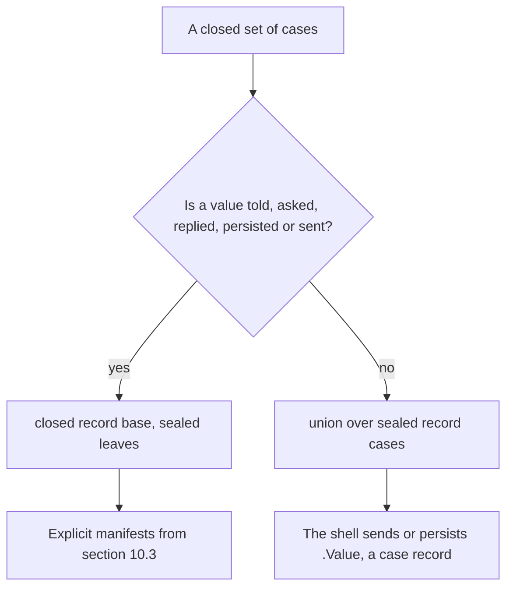
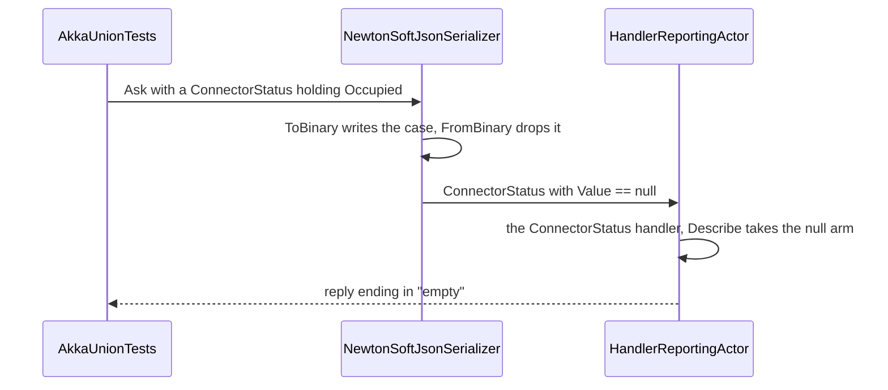

# Chapter 3. The C# 15 Modeling Toolkit

At 07:40 the live board in the depot office at `slc-depot` shows connector `OHM-SLC-0042/1` in green. A van driver from a delivery firm plugs in. At 07:52 the bus due on that connector arrives to find it taken, and leaves for its route twenty minutes late with a third of a battery.

Nothing crashed. The prototype stored a connector's status as a string, and a month earlier someone had added `"Reserved"` so that fleet buses could hold a connector. The board's rendering code ended in a `default:` branch that painted anything it did not recognize as available. The compiler had no way to object, because a string can hold any status, including ones that do not exist yet.

The fix is not more care. It is a type whose cases the compiler knows, so that adding `Reserved` breaks the build at every switch that has not decided what a reservation means. C# 15, which ships with .NET 11, finally has such types: unions and closed hierarchies. This chapter learns them, and the other language features the book relies on, by writing tests against the compiler and the runtime. It also finds where those features stop working, which turns out to be the moment a value leaves the process: in an Akka.NET mailbox or in JSON.

> **In this chapter you will:**
>
> - pin down language behaviour with learning tests that fail first when a new SDK changes it;
> - write a value object whose guard runs for constructors and with-expressions, and explain why `default` still escapes it;
> - declare unions and closed record hierarchies, and make a forgotten case a build error;
> - return expected failures as a `Result<T, E>` union, chain them with `Map`, `Bind` and `Match`, and give every value object one `TryCreate` contract through static abstract members;
> - make quantities add and compare through generic math, and take time and Guid v7 identities from an injected `TimeProvider` that a test controls;
> - show, with tests, why a union must never be told to an actor or written to a journal, and which closed-record settings keep JSON from losing data.

> **Starting point:** `ch02-s09`, the hosted actor from section 2.9.
>
> ```bash
> git checkout ch02-s09
> ```

## 3.1 Learning tests: pinning down a language

Every feature in this chapter is new or recent, and the SDK is a release candidate: `11.0.100-rc.3` at the time of writing (November 2026). Posts written against earlier previews describe behaviour that has since changed; one widely read Preview 7 post, Andrew Lock's ["The pain of serializing unions and closed class hierarchies with System.Text.Json"](https://andrewlock.net/exploring-the-dotnet-11-preview-7-the-pain-of-serializing-unions-and-closed-class-hierarchies-with-system-text-json/) (section "InferClosedTypePolymorphism is great…sometimes"), reported that System.Text.Json failed on nested closed hierarchies, which works on RC3. The documentation is also thinner than the features, and some details, such as what a union's `ToString()` prints, are quicker to ask the compiler than to look up.

The tool for this is the *learning test*. Kent Beck catalogues it in [*Test-Driven Development: By Example*](https://www.informit.com/store/test-driven-development-by-example-9780321146533) (2002; ch. 26, "Red Bar Patterns", "Learning Test", pp. 136–137): before you rely on an external package, write a test that shows your understanding of its API is correct. James Grenning's chapter on boundaries in Robert C. Martin's [*Clean Code*](https://www.pearson.com/en-us/subject-catalog/p/clean-code/P200000009088/9780132350884) (2008; ch. 8, "Boundaries", section "Learning Tests Are Better Than Free", p. 118) adds the economics: the tests cost what the exploration would have cost anyway, and when the package changes, a learning test fails before production code does. Here the "package" is the C# compiler and the .NET runtime. When GA ships and the SDK is re-pinned (Appendix A), this project runs first.

### The LanguageLab project

Tag `ch03-s01` adds `learn/Ch03.LanguageLab.Tests` to the solution under `/learn/`. Like the Chapter 2 learning projects, it gets xUnit v3 and Shouldly from `learn/Directory.Build.props`. Its one package reference, `Microsoft.Extensions.TimeProvider.Testing` 10.11.0, brings its `PackageVersion` into `Directory.Packages.props` now, although section 3.8 is the first to use it. By the end of the chapter the project holds one test class per section:

| Test class | Section | Pins down |
|---|---|---|
| `RecordEqualityTests` | 3.1 | value equality, `with`, record struct versus record class |
| `FieldKeywordTests` | 3.2 | a `field`-validated `init` and the `default` bypass |
| `UnionTests` | 3.3 | lowering, conversions, the `default` trap |
| `ClosedHierarchyTests` | 3.4 | exhaustiveness across assemblies |
| `GenericMathTests`, `ExtensionMemberTests` | 3.6, 3.7 | operator interfaces, extension blocks and indexers |
| `PatternTests`, `TimeTests` | 3.8 | list and property patterns, `FakeTimeProvider`, Guid v7 |
| `SerializationRealityTests`, `AkkaUnionTests` | 3.9 | unions and closed records in JSON and in a mailbox |

### Records, the starting point

Records (C# 9) and record structs (C# 10) are where Ohmline's values begin, so the first tests pin down what they generate: a constructor, init-only properties, value equality, a `with` copy and a readable `ToString()`. `installed with { Model = "VX-50" }` returns a new `ChargerInfo` and leaves `installed` untouched.

`ChargerInfo` is a record class: a reference type, so assigning it copies a reference, but `==` compares members. `ConnectorKey` is a `readonly record struct`, a value type with the same generated members, so assigning it copies the value. One test sets up section 3.2: `default(ConnectorKey).ChargePointId` is `null`, although the property's type is a non-nullable `string`. A struct can always exist without any constructor having run.

The last test is the one that will matter most in later chapters:

```csharp
// File: learn/Ch03.LanguageLab.Tests/RecordEqualityTests.cs @ ch03-s01
[Fact]
public void Given_records_with_equal_immutable_arrays_then_they_are_not_equal()
{
    var first = new TariffRates("standard", [0.42m, 0.30m]);
    var second = new TariffRates("standard", [0.42m, 0.30m]);

    // ImmutableArray<T> compares by reference, so the generated Equals does too.
    first.ShouldNotBe(second);
    first.PricePerKwh.SequenceEqual(second.PricePerKwh).ShouldBeTrue();
}
```

Value equality stops at the members' own `Equals`, and `ImmutableArray<T>` compares the array reference. Events and state in this book hold `ImmutableArray`s, so a test comparing two events with `ShouldBe` can fail although every price matches; later tests compare collections with `SequenceEqual` or Shouldly's collection assertions.

> **Try it**
>
> ```bash
> git checkout ch03-s01
> git diff ch02-s09 ch03-s01 --stat
> git diff ch02-s09 ch03-s01 -- learn/Ch03.LanguageLab.Tests
> dotnet test --solution Ohmline.slnx
> ```
>
> The diff ends with `7 files changed, 115 insertions(+)`. The run reports `total: 54` and `failed: 0`: the 46 tests from Chapter 2 plus 8 in `Ch03.LanguageLab.Tests`.

## 3.2 Records, with, and validation with the field keyword

The site power budget hands out power allocations in kW. A negative allocation is nonsense, and it is worse than nonsense in a sum, because it quietly frees capacity that does not exist. Evans calls a type like this a *value object* ([*Domain-Driven Design*](https://www.informit.com/store/domain-driven-design-tackling-complexity-in-the-heart-9780321125217), ch. 5 "A Model Expressed in Software", section "Value Objects"; summarized in the [*Domain-Driven Design Reference*](https://domainlanguage.com/wp-content/uploads/2016/05/DDD_Reference_2015-03.pdf), p. 12): it has no identity and is treated as immutable, so two instances with the same value are interchangeable. Wlaschin's [*Domain Modeling Made Functional*](https://pragprog.com/titles/swdddf/domain-modeling-made-functional/) (2018; chapter "Integrity and Consistency in the Domain", section "The Integrity of Simple Values") adds the property this section is about: a *constrained type* refuses to hold an invalid value. If a `Kilowatts` can never be negative, no code that receives one has to check.

The obvious place for the check is the constructor. But a with-expression does not call the constructor: it copies the value and assigns the changed properties through their `init` accessors. A guard has to live in the `init` accessor to cover both paths, which used to mean a hand-written backing field. The `field` keyword (C# 14) names the compiler-generated backing field inside an accessor:

```csharp
// File: learn/Ch03.LanguageLab.Tests/Kilowatts.cs @ ch03-s02
/// <summary>
/// Power in kW. The guard lives in the init accessor, so the constructor and every
/// with-expression go through it.
/// </summary>
public readonly record struct Kilowatts
{
    public Kilowatts(decimal value) => Value = value;

    public decimal Value
    {
        get;
        init => field = value >= 0
            ? value
            : throw new ArgumentOutOfRangeException(nameof(Value), value, "Negative power.");
    }

    public override string ToString() => $"{Value} kW";
}
```

`Kilowatts` is deliberately not positional: the constructor assigns through the property, so one guard covers both paths:

```csharp
// File: learn/Ch03.LanguageLab.Tests/FieldKeywordTests.cs @ ch03-s02
[Fact]
public void Given_a_valid_value_when_copied_with_a_negative_change_then_the_guard_throws()
{
    var power = new Kilowatts(22m);

    Should.Throw<ArgumentOutOfRangeException>(() => power with { Value = -5m });
}
```

### The guard most people write first

Most developers first put the guard in the property initializer of a positional record:

```csharp
// File: learn/Ch03.LanguageLab.Tests/InitializerGuardedKilowatts.cs @ ch03-s02
public readonly record struct InitializerGuardedKilowatts(decimal Value)
{
    public decimal Value { get; init; } = Value >= 0
        ? Value
        : throw new ArgumentOutOfRangeException(nameof(Value), Value, "Power cannot be negative.");
}
```

`new InitializerGuardedKilowatts(-1m)` throws, but an initializer runs only in the constructor. `power with { Value = -5m }` goes through the plain `init` accessor, and a test shows the copy holding -5. The bug survives every constructor test you write.

### What no accessor can guard

A struct has a value that no code of yours produces: `default`. `default(Kilowatts)`, `new Kilowatts()` and each slot of `new Kilowatts[2]` are zero, and neither the constructor nor the `init` accessor ran for any of them. For power, zero is valid, so nothing goes wrong. `ConnectorNumber`, built the same way with the guard `value >= 1`, shows the case where it matters: `default(ConnectorNumber).Value` is 0, and `new ConnectorNumber(0)` throws.

Hence the sample's rule. Use a `readonly record struct` with a `field`-validated `init` where `default` is valid or is checked at the boundary, as for units of measure. Where a default instance must never exist, use a `sealed record` with a private constructor, whose only default is `null`, which nullable reference types track. Section 6.1 builds `Energy`, `Power`, `Current` and `Voltage` on the first shape.

> **Try it**
>
> ```bash
> git checkout ch03-s02
> git diff ch03-s01 ch03-s02 --stat
> git diff ch03-s01 ch03-s02 -- learn/Ch03.LanguageLab.Tests
> dotnet test --solution Ohmline.slnx
> ```
>
> The diff shows `5 files changed, 118 insertions(+), 1 deletion(-)`; the deletion is a shortened doc comment in `ConnectorKey.cs`. The run reports `total: 61`, `failed: 0`, with 7 new tests in `FieldKeywordTests`.

## 3.3 Union types: closed sets of existing types

Back to the depot board. A connector is available, or occupied by a charging session, or faulted with an error code; only an occupied connector has a session id, and only a faulted one has an error code. A class with a `Status` string and two nullable fields can also represent "available, with a session id and an error code". Yaron Minsky's advice to [*make illegal states unrepresentable*](https://blog.janestreet.com/effective-ml-revisited/) ("Effective ML Revisited", Jane Street blog, 2011), which Wlaschin's book builds on, asks for a type with exactly the three shapes. Functional languages call it a sum type; Wlaschin calls it a *choice type* (*Domain Modeling Made Functional*, chapter "Understanding Types", section "Composition of Types").

C# 15 has one. A `union` declaration lists existing types, its *cases*, and a value of the union holds exactly one of them:

```csharp
// File: learn/Ch03.LanguageLab.Tests/ConnectorStatus.cs @ ch03-s03
/// <summary>A connector is in exactly one of three states. Each case is a record.</summary>
public union ConnectorStatus(Available, Occupied, Faulted);

public sealed record Available;

public sealed record Occupied(string SessionId);

public sealed record Faulted(string ErrorCode);
```

There is no `case` keyword and no way to declare a case inside the union. The cases are ordinary types, usually `sealed record`s, and need not be related: a union can list `int`, a record from another module, or another union. The sample keeps a union and its cases in one file named after the union.

### What the compiler generates

`Given_a_union_declaration_then_the_compiler_emits_a_struct_holding_an_object` checks the lowering by reflection rather than taking the specification's word for it. A union is a struct marked `[Union]` that implements `System.Runtime.CompilerServices.IUnion`, with one constructor per case and a single `object? Value` property. Each constructor doubles as an implicit conversion, so `ConnectorStatus status = new Occupied("session-a");` compiles. A value-type case is boxed. Equality compares `Value`, so two unions holding equal records are equal. And `ToString()` prints only the type name, `Ch03.LanguageLab.Tests.ConnectorStatus`, so log `status.Value`, which prints `Occupied { SessionId = session-a }`.

### Exhaustive switches and the default trap

Patterns on a union test its contents, and a switch expression with one arm per case is *exhaustive*: the compiler knows there is no fourth case. The tests use two helpers:

```csharp
// File: learn/Ch03.LanguageLab.Tests/UnionTests.cs @ ch03-s03
private static string Describe(ConnectorStatus status) => status switch
{
    Available => "available",
    Occupied occupied => $"occupied by {occupied.SessionId}",
    Faulted faulted => $"faulted: {faulted.ErrorCode}",
    null => "unknown",
};

// No warning: every case type is non-nullable, so the compiler does not expect null here.
private static string DescribeWithoutNullArm(ConnectorStatus status) => status switch
{
    Available => "available",
    Occupied occupied => $"occupied by {occupied.SessionId}",
    Faulted faulted => $"faulted: {faulted.ErrorCode}",
};
```

Why the `null` arm? A union is a struct, so `default(ConnectorStatus)` exists, and it holds no case: `Value` is `null` and `status is null` is `true`. `DescribeWithoutNullArm` then throws `SwitchExpressionException` ("Non-exhaustive switch expression failed to match its input"), and the clean build proves that the compiler does not warn, because every case type is non-nullable. Default unions arrive through uninitialized fields, array slots and, as section 3.9 shows, deserialization. The house rule is a `null =>` arm on every switch a default can reach, never a `_ =>` discard, which would also swallow the next case someone adds.

### Unions inside unions

The board must also say that a whole charger is offline. `StatusReport` is a union of `ConnectorStatus` and `ChargerOffline`. Conversions do not chain: `Occupied` converts to `ConnectorStatus` and `ConnectorStatus` to `StatusReport`, but the compiler applies only one user-defined conversion. The tests write the explicit hop and the matching pattern:

```csharp
// File: learn/Ch03.LanguageLab.Tests/UnionTests.cs @ ch03-s03
StatusReport report = (ConnectorStatus)new Occupied("session-a");

(report is ConnectorStatus and Occupied { SessionId: "session-a" }).ShouldBeTrue();
```

Patterns do not reach into a nested union, so `report is Occupied` is a compile error. Nor is a union its own case: `status is ConnectorStatus` fails, because no case *is* a `ConnectorStatus`. `UnionCompileErrors.cs` keeps these inside `#if DEMO_COMPILE_ERRORS`, with a switch that forgets `Faulted` and one over a `Faulted?` input without a `null` arm. The real errors, trimmed:

```text
$ dotnet build learn/Ch03.LanguageLab.Tests -p:DefineConstants=DEMO_COMPILE_ERRORS
...(9,59): error CS0029: Cannot implicitly convert type '...Occupied' to '...StatusReport'
...(12,89): error CS8121: ... 'StatusReport' cannot be handled by a pattern of type 'Occupied'.
...(15,83): error CS8121: ...type 'ConnectorStatus' ... by a pattern of type 'ConnectorStatus'.
...(18,72): error CS8509: ... For example, the pattern '...Faulted' is not covered.
...(26,71): error CS8655: ... For example, the pattern 'null' is not covered.
```

### Making exhaustiveness a build error

CS8509 and CS8655 are warnings by default. The sample sets `TreatWarningsAsErrors`, but that is the first setting a developer turns off locally to get past an unrelated warning, so tag `ch03-s03` pins these in the root `Directory.Build.props`:

```diff
# git diff ch03-s02 ch03-s03 -- Directory.Build.props
     <TreatWarningsAsErrors>true</TreatWarningsAsErrors>
+    <!-- Exhaustiveness is not negotiable, even when someone turns TreatWarningsAsErrors off
+         locally. CS8509: a switch expression misses a case. CS8655: it misses null. -->
+    <WarningsAsErrors>$(WarningsAsErrors);CS8509;CS8655;nullable</WarningsAsErrors>
     <IsPackable>false</IsPackable>
```

With `-p:TreatWarningsAsErrors=false` the demo build still reports `error CS8509` and `error CS8655`; with the line removed as well, they drop to warnings. `nullable` adds every nullable-reference warning. For DDD this line is the payoff of the chapter: when section 8.6 splits a session's `Suspended` state in two, the build lists every decision to revisit. One limit remains: only switch *expressions* are checked, so the sample writes decision tables as expressions, never as `switch` statements.

> **Try it**
>
> ```bash
> git checkout ch03-s03
> git diff ch03-s02 ch03-s03 --stat
> git diff ch03-s02 ch03-s03 -- Directory.Build.props learn/Ch03.LanguageLab.Tests
> dotnet test --solution Ohmline.slnx
> dotnet build learn/Ch03.LanguageLab.Tests -p:DefineConstants=DEMO_COMPILE_ERRORS
> ```
>
> The diff shows `5 files changed, 159 insertions(+)`. The tests report `total: 71`, `failed: 0`, with 10 in `UnionTests`. The last build fails with the five errors above.

## 3.4 Closed hierarchies and the union-versus-closed decision

Not every closed set looks like `ConnectorStatus`. The commands Ohmline sends to a charge point (remote start, remote stop, set or clear a charging profile) all name the charge point they are for. They are sent to actors, which in Akka.NET means passing an `object` that a handler picks out by type. And they are declared in one assembly and handled in another, because the charging context and the device gateway share the protocol.

The classic C# shape, an abstract base record with sealed derived records, carries shared data in the base and works with `Receive<TBase>`. It has never had exhaustiveness: any assembly may derive another case, so a switch elsewhere needs a `_ =>` arm, which hides the next real addition as the depot board's `default:` did.

C# 15's `closed` modifier closes the gap. Only the declaring assembly may derive directly from a closed class or record, so the compiler knows every case, everywhere:

```csharp
// File: learn/Ch03.ClosedLib/ChargerCommand.cs @ ch03-s04
/// <summary>
/// Commands Ohmline sends to a charge point, in the style of OCPP 1.6J. The base is closed, so
/// only this assembly can add a command, and every switch over it knows all of them.
/// </summary>
public closed record ChargerCommand(string ChargePointId);

public sealed record RemoteStart(string ChargePointId, int ConnectorNumber, string TokenUid)
    : ChargerCommand(ChargePointId);

public sealed record RemoteStop(string ChargePointId, string SessionId)
    : ChargerCommand(ChargePointId);

/// <summary>An intermediate level is closed too, so its leaves stay known as well.</summary>
public closed record ChargingProfileCommand(string ChargePointId, int ConnectorNumber)
    : ChargerCommand(ChargePointId);

public sealed record SetChargingProfile(string ChargePointId, int ConnectorNumber, decimal LimitKw)
    : ChargingProfileCommand(ChargePointId, ConnectorNumber);

public sealed record ClearChargingProfile(string ChargePointId, int ConnectorNumber)
    : ChargingProfileCommand(ChargePointId, ConnectorNumber);
```

The protocol is a simplified subset in the style of OCPP 1.6J. `Ch03.ClosedLib` is a separate project on purpose, so that the tests switch over these types from another assembly. A closed record lowers to an abstract class marked with `System.Runtime.CompilerServices.IsClosedTypeAttribute`, which a test checks.

From the other assembly, a switch with one arm per leaf needs no discard and, because the input is a non-nullable reference, no `null` arm. A pattern on an intermediate closed level covers all of its leaves:

```csharp
// File: learn/Ch03.LanguageLab.Tests/ClosedHierarchyTests.cs @ ch03-s04
// Exhaustive across assemblies: no discard arm, and no null arm for a non-nullable reference.
private static string Describe(ChargerCommand command) => command switch
{
    RemoteStart start => $"start on {start.ConnectorNumber} for {start.TokenUid}",
    RemoteStop stop => $"stop {stop.SessionId}",
    SetChargingProfile profile => $"limit {profile.ConnectorNumber} to {profile.LimitKw} kW",
    ClearChargingProfile clear => $"clear the limit on {clear.ConnectorNumber}",
};

private static bool IsSafeToRetry(ChargerCommand command) => command switch
{
    ChargingProfileCommand => true,
    RemoteStart or RemoteStop => false,
};
```

For contrast, `ChargerNotification` is a plain `abstract record` with two sealed leaves. The test file derives a third, `file sealed record DiagnosticsUploaded`, which is legal because the base is open, and it lands in the switch's `_ => "something new"` arm. That is why the compiler insists on the discard; without it, CS8509 reports "the pattern '_' is not covered". Deriving from the closed base in another assembly, or misusing the modifier, gives three declaration errors:

```text
$ dotnet build learn/Ch03.LanguageLab.Tests \
    -p:DefineConstants=DEMO_COMPILE_ERRORS%3BDECLARATION_ERRORS
...(25,22): error CS9382: 'ResetCharger': cannot use a closed type 'ChargerCommand' from another ...
...(28,29): error CS9381: 'SealedAndClosed': a closed type cannot be sealed or static
...(31,31): error CS9384: 'AbstractAndClosed': a closed type cannot be marked abstract ...
```

The second symbol in that command records a discovery the learning tests made. Once any type declaration is in error, the compiler reports nothing from method bodies, so these three errors hid every demo from section 3.3. They sit behind `DECLARATION_ERRORS`, nested inside `#if DEMO_COMPILE_ERRORS`; `%3B` is an escaped `;` that keeps MSBuild from splitting the property.

Closing is not transitive. A leaf that is neither `sealed` nor `closed` can be derived from in another assembly, and the new type is then silently covered by that leaf's arm. Seal every leaf and close every intermediate level.

### Choosing between the two

Both constructs give exhaustive switches. They differ once a value leaves the function that made it, as section 3.9's tests show:

| Concern | `union` | `closed record` |
|---|---|---|
| Cases unrelated, primitive or from other modules | yes | no: cases derive from the base |
| Data shared by every case | no instance fields | base parameters |
| Akka.NET `Receive<TBase>` | only for the boxed union | yes, for any leaf |
| Akka.NET 1.5 default serializer | loses the case | round-trips |
| System.Text.Json discriminator | none | `[JsonDerivedType]` or inferred |
| Memory | struct plus a boxed case | one reference |

ADR 0003, added at this tag, turns the table into house style. Its decision reads:

*File: docs/adr/0003-unions-vs-closed-records.md @ ch03-s04*

```text
We will use a `closed record` base with `sealed record` leaves for anything that is sent between
actors, persisted or put on a wire: commands, replies, queries, domain events, snapshot DTOs and
integration events. Every intermediate level of such a hierarchy is `closed` as well.

We will use a `union` for values that stay in process: aggregate state, decisions, error sets,
`Result<T, E>`, effects, parse and translation results, actor-side protocol unions, and the
inputs of a process manager that listens to several contexts.
```

The question to ask of any closed set is where its values travel:



The two meet at the shell. A decider returns a union such as `Result<ImmutableArray<ChargePointEvent>, ChargePointError>`; the shell persists the events, which are closed records, and maps the error union to a closed-record reply (sections 7.4 and 10.2). Two constructs cost one more question in every review; the ADR answers it.

> **Try it**
>
> ```bash
> git checkout ch03-s04
> git diff ch03-s03 ch03-s04 --stat
> git diff ch03-s03 ch03-s04 -- learn docs/adr
> dotnet test --solution Ohmline.slnx
> ```
>
> The diff shows `8 files changed, 234 insertions(+)`. The run reports `total: 75`, `failed: 0`, with 4 tests in `ClosedHierarchyTests`.

## 3.5 Errors as values: a Result union

A driver asks to start charging on connector 3 of a charge point that has two. That is not a bug; it is Tuesday. An exception does not appear in a method's signature, so callers cannot see which expected failures to handle, and no `catch` is checked for completeness. Wlaschin returns errors as values, in a type that is either a success or a failure, and chains steps so that the first failure skips the rest: [railway-oriented programming](https://fsharpforfunandprofit.com/rop/) (*Domain Modeling Made Functional*, chapter "Implementation: Working with Errors"). .NET teams have used libraries such as [OneOf](https://github.com/mcintyre321/OneOf) or [ErrorOr](https://github.com/error-or/error-or) for this; with unions it takes about fifty lines.

This is the first product code. Tag `ch03-s05` creates `src/Ohmline.SharedKernel`, whose project file has no package references and a comment saying why: the shared kernel is pure. Section 5.5 discusses the Shared Kernel pattern; for now it holds types every context will use, starting with `Result`:

```csharp
// File: src/Ohmline.SharedKernel/Result.cs @ ch03-s05
public union Result<T, E>(Ok<T>, Err<E>);

public sealed record Ok<T>(T Value);

public sealed record Err<E>(E Error);

public static class Result
{
    public static Ok<T> Ok<T>(T value) => new(value);

    public static Ok<Unit> Ok() => new(Unit.Value);

    /// <summary>
    /// Wraps an error. When E is itself a union, name it (<c>Fail&lt;StartError&gt;(...)</c>):
    /// union conversions do not chain, so the case needs one explicit hop.
    /// </summary>
    public static Err<E> Fail<E>(E error) => new(error);
// ...
```

Why `Ok<T>` and `Err<E>` rather than `union Result<T, E>(T, E)`? Because `Result<string, string>` would then have two constructors accepting a `string`, and no conversion could tell success from failure. `Result.Ok(...)` and `Result.Fail(...)` return the case, and the implicit conversion turns it into the method's `Result`. The operations live in a C# 14 *extension block* (section 3.7); read `extension<T, E>(Result<T, E> result)` as "these members appear on every `Result<T, E>`":

```csharp
// File: src/Ohmline.SharedKernel/Result.cs @ ch03-s05
    extension<T, E>(Result<T, E> result)
    {
        public bool IsOk => result is Ok<T>;

        public Result<TNext, E> Map<TNext>(Func<T, TNext> map) => result switch
        {
            Ok<T> ok => new Ok<TNext>(map(ok.Value)),
            Err<E> err => err,
            null => throw DefaultResult(),
        };

        public Result<TNext, E> Bind<TNext>(Func<T, Result<TNext, E>> next) => result switch
        {
            Ok<T> ok => next(ok.Value),
            Err<E> err => err,
            null => throw DefaultResult(),
        };

        public TOut Match<TOut>(Func<T, TOut> ok, Func<E, TOut> err) => result switch
        {
            Ok<T> success => ok(success.Value),
            Err<E> failure => err(failure.Error),
            null => throw DefaultResult(),
        };
    }
    // ...
```

`Map` transforms a success and passes an error through. `Bind` runs a next step that can itself fail. `Match` turns either outcome into one value. In `Err<E> err => err`, the case converts implicitly to the new `Result<TNext, E>`, so an error crosses every step unwrapped. A default `Result` is a bug, so the `null` arms throw rather than guess.

The new `tests/Ohmline.SharedKernel.Tests` reads like a small validation pipeline. `ParseConnectorNumber("3").Bind(number => OnChargePoint(number, 2))` holds the error "Connector 3 does not exist; the charge point has 2.", and when the parse fails, a counter shows the bound step never ran.

### One explicit hop

Most of Ohmline's error sets are unions, such as `StartError(ConnectorBusy, TokenRejected)` in the tests. Returning `new ConnectorBusy(1)` as a `Result<string, StartError>` would chain conversions, which section 3.3 showed the compiler refuses. Naming the error type once converts the argument to `StartError`, and `Err<StartError>` then converts to the `Result`:

```csharp
// File: tests/Ohmline.SharedKernel.Tests/ResultTests.cs @ ch03-s05
private static Result<string, StartError> Start(bool connectorBusy) =>
    connectorBusy
        ? Result.Fail<StartError>(new ConnectorBusy(1))
        : Result.Ok("session-a");
```

`ResultCompileErrors.cs` keeps the wrong versions: the bare case, and `Result.Fail(new ConnectorBusy(1))`, which infers `E` as `ConnectorBusy`. Both give CS0029. `Unit` completes the picture: a `readonly record struct` with one value, printed as `()`, so `Result<Unit, E>` is an operation with nothing to return, and `Result.Ok()` produces it.

> **Version note:** on the RC3 compiler, an explicit type argument for a method in a generic extension block must name the block's type parameters as well. `r.Map<string>(x => x.ToString())` fails with CS1061, while `r.Map<int, string, string>(...)` and the inferred `r.Map(x => x.ToString())` compile. The sample always lets the compiler infer.

The tag also adds `tests/Directory.Build.props`, which makes every project under `tests/` an xUnit v3 executable with Shouldly, as `learn/Directory.Build.props` does for learning projects.

> **Try it**
>
> ```bash
> git checkout ch03-s05
> git diff ch03-s04 ch03-s05 --stat
> git diff ch03-s04 ch03-s05 -- src/Ohmline.SharedKernel tests
> dotnet test --solution Ohmline.slnx
> ```
>
> The diff shows `9 files changed, 237 insertions(+)`. The run reports `total: 84`, `failed: 0`, with 9 tests in the new `Ohmline.SharedKernel.Tests`.

## 3.6 Static abstract members and generic math

Chapter 6 adds a dozen value objects, from `Energy` to `TokenUid`, each with the same two doors: a `TryCreate` that returns a `Result` for outside input, and a `Create` that throws for constants and test data, where an invalid value is a bug. Generic code needs them too: a serializer converter must turn a raw `decimal` back into whichever value object a property holds.

An ordinary interface cannot require a static method. Static abstract members (C# 11) can, and a static virtual member can also supply a default body. Tag `ch03-s06` writes the contract once:

```csharp
// File: src/Ohmline.SharedKernel/IValueObject.cs @ ch03-s06
public interface IValueObject<TSelf, TValue>
    where TSelf : IValueObject<TSelf, TValue>
{
    TValue Value { get; }

    static abstract Result<TSelf, ValidationError> TryCreate(TValue value);

    /// <summary>
    /// For values that are valid by construction, such as constants and test data. An invalid
    /// value here is a bug, so it throws.
    /// </summary>
    static virtual TSelf Create(TValue value) => TSelf.TryCreate(value) switch
    {
        Ok<TSelf> ok => ok.Value,
        Err<ValidationError> err => throw new ArgumentException(err.Error.Message, nameof(value)),
        null => throw new InvalidOperationException($"{typeof(TSelf)}.TryCreate returned default."),
    };
}
```

The self-referencing constraint lets the interface name the implementing type. `ValidationError` is a placeholder record with a `Message`; section 6.2 replaces it with a union. A test-only `StateOfCharge` (0 to 100 %) implements the contract with a private constructor and a `TryCreate`.

One surprise is pinned by a compile-error demo: `StateOfCharge.Create(80)` does not compile, because the default body of `Create` is not a member of the implementing type. The CS1929 message misleads, suggesting an unrelated `FileSystemAclExtensions.Create`. A static virtual member is reached through a type parameter constrained to the interface:

```csharp
// File: tests/Ohmline.SharedKernel.Tests/ValueObjectTests.cs @ ch03-s06
private static TSelf Create<TSelf, TValue>(TValue value)
    where TSelf : IValueObject<TSelf, TValue> => TSelf.Create(value);
```

### Generic math for quantities

.NET 7 used the same mechanism to describe arithmetic, with `IAdditionOperators`, `IAdditiveIdentity`, `IComparisonOperators` and their relatives in `System.Numerics`. A quantity that implements them works with algorithms written once for any number. `Kilowatts` gains three:

```diff
# git diff ch03-s05 ch03-s06 -- learn/Ch03.LanguageLab.Tests/Kilowatts.cs
@@ -1,3 +1,5 @@
+using System.Numerics;
+
 namespace Ch03.LanguageLab.Tests;
 
 /// <summary>
@@ -5,6 +7,9 @@ namespace Ch03.LanguageLab.Tests;
 /// with-expression go through it.
 /// </summary>
 public readonly record struct Kilowatts
+    : IAdditionOperators<Kilowatts, Kilowatts, Kilowatts>,
+      IAdditiveIdentity<Kilowatts, Kilowatts>,
+      IComparisonOperators<Kilowatts, Kilowatts, bool>
 {
     public Kilowatts(decimal value) => Value = value;
 
@@ -16,5 +21,18 @@ public readonly record struct Kilowatts
             : throw new ArgumentOutOfRangeException(nameof(Value), value, "Negative power.");
     }
 
+    public static Kilowatts AdditiveIdentity => new(0m);
+
+    public static Kilowatts operator +(Kilowatts left, Kilowatts right) =>
+        new(left.Value + right.Value);
+
+    public static bool operator <(Kilowatts left, Kilowatts right) => left.Value < right.Value;
+
+    public static bool operator >(Kilowatts left, Kilowatts right) => left.Value > right.Value;
+
+    public static bool operator <=(Kilowatts left, Kilowatts right) => left.Value <= right.Value;
+
+    public static bool operator >=(Kilowatts left, Kilowatts right) => left.Value >= right.Value;
+
     public override string ToString() => $"{Value} kW";
 }
```

`IComparisonOperators` also requires `==` and `!=`, which the record struct already generates. `GenericMath.Sum<T>` starts at `T.AdditiveIdentity`; `GenericMath.Clamp<T>` uses only `<` and `>`. The tests sum allocations of 38, 38 and 22 kW to 98 kW, sum `decimal`s and `int`s with the same method, and clamp a request into a connector's 5 to 50 kW: 2 kW becomes 5, 80 kW becomes 50. `Kilowatts` plus `Kilowatts` giving `Kilowatts` is Evans's [*Closure of Operations*](https://domainlanguage.com/wp-content/uploads/2016/05/DDD_Reference_2015-03.pdf) (*Domain-Driven Design*, ch. 10 "Supple Design"; *Domain-Driven Design Reference*, p. 24); section 6.1 extends it across dimensions, where power times time is energy.

> **Try it**
>
> ```bash
> git checkout ch03-s06
> git diff ch03-s05 ch03-s06 --stat
> git diff ch03-s05 ch03-s06 -- src/Ohmline.SharedKernel learn/Ch03.LanguageLab.Tests/Kilowatts.cs
> dotnet test --solution Ohmline.slnx
> ```
>
> The diff shows `8 files changed, 191 insertions(+)`. The run reports `total: 96`, `failed: 0`: 5 new tests in `ValueObjectTests` and 7 in `GenericMathTests`.

## 3.7 Extension members and extension indexers

`new Kilowatts(22m)` buries the number in ceremony. Power times a duration is energy, but neither `Kilowatts` nor `TimeSpan` should know about the other. And the question asked of a meter history, "what did the register say at 07:53?", deserves an index. Extension methods could only add instance methods; C# 14's *extension blocks* add properties, static members and operators, and C# 15 adds indexers:

```csharp
// File: learn/Ch03.LanguageLab.Tests/ChargingExtensions.cs @ ch03-s07
public static class ChargingExtensions
{
    extension(decimal value)
    {
        /// <summary>Reads like a unit: <c>22m.kW</c>.</summary>
        public Kilowatts kW => new(value);
    }

    extension(Kilowatts)
    {
        public static Kilowatts FromWatts(decimal watts) => new(watts / 1000m);

        public static KilowattHours operator *(Kilowatts power, TimeSpan duration) =>
            new(power.Value * duration.Ticks / TimeSpan.TicksPerHour);
    }

    extension(ImmutableArray<MeterSample> history)
    {
        /// <summary>The last sample taken at or before a time (the history is in order).</summary>
        public MeterSample? this[DateTimeOffset at] =>
            history.LastOrDefault(sample => sample.TakenAt <= at);
    }

    // Preview of section 10.2: once Akka.NET is referenced, one block gives every IActorRef a
    // Send that accepts only the protocol union, and tells the case inside it, never the union.
    //
    // extension(IActorRef self)
    // {
    //     public void Send(ChargerProtocol msg) => self.Tell(msg.Value);
    // }
}
```

The first block names its receiver, so its members are instance members: `22m.kW` is a `Kilowatts`, and `(-1m).kW` still throws, because it goes through the constructor and the guard. The second block names only a type, so its members are static: `Kilowatts.FromWatts(7_400m)` reads as if `Kilowatts` had declared it, and the operator makes `38m.kW * TimeSpan.FromMinutes(30)` equal to 19 kWh. Ticks keep the arithmetic exact in `decimal`. The third block is the C# 15 indexer. On the same history, `history[1]` is the built-in `int` indexer and `history[PluggedInAt.AddSeconds(90)]` is the extension, which returns the sample from minute one, or `null` before the first sample.

The closing comment is a preview, not code: `ChargerProtocol` does not exist yet. An `IActorRef` accepts any `object`, and section 3.9 shows what goes wrong when that object is a union; section 10.2 builds the real `Send`. The cost of extension members is discoverability: a reader who sees `power * duration` has to find the class that declared the operator, so the sample keeps them next to the types they serve.

> **Try it**
>
> ```bash
> git checkout ch03-s07
> git diff ch03-s06 ch03-s07 --stat
> git diff ch03-s06 ch03-s07 -- learn/Ch03.LanguageLab.Tests
> dotnet test --solution Ohmline.slnx
> ```
>
> The diff shows `4 files changed, 96 insertions(+)`. The run reports `total: 101`, `failed: 0`, with 5 tests in `ExtensionMemberTests`.

## 3.8 Patterns that read like rules; time and identity

Domain experts state rules as shapes and thresholds: "if the last reading is lower than the one before it, the meter went backwards"; "an idle fee applies when the car is plugged in, draws no power, and has been idle for more than fifteen minutes". Patterns keep those shapes. List patterns (C# 11) match a sequence by its elements:

```csharp
// File: learn/Ch03.LanguageLab.Tests/PatternTests.cs @ ch03-s08
private static string Classify(ImmutableArray<MeterSample> history) => history switch
{
    [] => "no readings",
    [_] => "one reading",
    [.., var previous, var last] when last.RegisterWh < previous.RegisterWh =>
        "the register went backwards",
    [var first, .., var last] => $"{last.RegisterWh - first.RegisterWh} Wh delivered",
};

private static bool IdleFeeApplies(ChargingSnapshot snapshot) =>
    snapshot is { PluggedIn: true, Power.Value: 0m, IdleFor.TotalMinutes: > 15 };
```

`Classify` is exhaustive without a discard. The guarded arm does not count toward exhaustiveness, but the last arm covers every history of two or more readings. `IdleFeeApplies` uses extended property patterns, and a theory pins the boundary: 16 idle minutes charge a fee, exactly 15 do not. Section 6.5 uses list patterns on real meter readings, and section 8.4 sets pattern-based rules beside classic specification objects.

Relational patterns are checked too. `Describe(Kilowatts power)` switches on `power.Value` with arms for `0m`, `> 0m and < 22m`, `>= 22m and < 150m` and `>= 150m`. The compiler does not know about the `init` guard, so those arms leave negative decimals uncovered and the switch is not exhaustive. The sample adds a `< 0m` arm that throws `UnreachableException`, which states the assumption instead of hiding it in a discard.

Two smaller C# 15 features complete the set. A *labeled break* leaves nested loops at once; `FindFirstFault` scans each charge point's connectors and stops the whole search at the first fault:

```csharp
// File: learn/Ch03.LanguageLab.Tests/PatternTests.cs @ ch03-s08
chargePoints:
foreach (var (chargePointId, connectors) in site)
{
    for (var index = 0; index < connectors.Length; index++)
    {
        inspected++;
        if (connectors[index] is Faulted)
        {
            fault = new ConnectorKey(chargePointId, index + 1);
            break chargePoints;
        }
    }
}
```

The test finds the fault at `OHM-SLC-0042/1` after inspecting 3 connectors, so a second fault at `OHM-SLC-0043` is never reached. Section 7.8's allocator uses the same construct. *Collection expression arguments* pass constructor arguments with `with(...)`: `HashSet<string> tokens = [with(StringComparer.OrdinalIgnoreCase), "04A1B2C3", "04a1b2c3"];` holds one token UID, and `[with(capacity: 60), ...]` presizes a list for an hour of minute samples.

### Time and identity

A reservation expires after 15 minutes. Code that reads `DateTime.UtcNow` to decide that can be tested only by waiting. [`TimeProvider`](https://learn.microsoft.com/en-us/dotnet/standard/datetime/timeprovider-overview) (.NET 8) is the abstraction for the clock, timers and delays, and `FakeTimeProvider` from `Microsoft.Extensions.TimeProvider.Testing` moves only when a test advances it:

```csharp
// File: learn/Ch03.LanguageLab.Tests/ReservationTimer.cs @ ch03-s08
/// <summary>A reservation that runs out. It reads the time only through the clock.</summary>
public sealed class ReservationTimer(TimeProvider clock, TimeSpan holdFor)
{
    public DateTimeOffset ExpiresAt { get; } = clock.GetUtcNow() + holdFor;

    public bool HasExpired => clock.GetUtcNow() >= ExpiresAt;
}
```

`TimeTests` starts the fake at 2026-11-04 07:52 UTC, advances 14 minutes (not expired), then one more (expired). The same fake fires a one-minute timer three times when advanced three minutes, and completes a 15-minute `Task.Delay` without waiting. `ReservationTimer` is a learning type: from section 7.4, deciders receive the time as data in a `DecisionContext`, and only the shell asks `TimeProvider`.

Identifiers come from the clock too. A version 7 GUID ([RFC 9562, section 5.7](https://www.rfc-editor.org/rfc/rfc9562.html#section-5.7)) starts with a 48-bit Unix timestamp in milliseconds, so new ids sort roughly in creation order, which suits journals and database indexes. [`Guid.CreateVersion7`](https://learn.microsoft.com/en-us/dotnet/api/system.guid.createversion7) (.NET 9) accepts the timestamp, and the shared kernel's first identity type makes the clock mandatory:

```csharp
// File: src/Ohmline.SharedKernel/Identity/GuidV7.cs @ ch03-s08
public static class GuidV7
{
    public static Guid New(TimeProvider clock) => Guid.CreateVersion7(clock.GetUtcNow());
}
```

`GuidV7Tests` reads the first 12 hex digits back as the fake clock's milliseconds, shows two ids from one instant still differ, and shows ids 1 ms apart sort in order. Within one millisecond the tail is random, so order is *not* guaranteed there, and neither the tests nor your code may assume it. Section 6.4 wraps these GUIDs in `SessionId` and `JourneyId`.

> **Try it**
>
> ```bash
> git checkout ch03-s08
> git diff ch03-s07 ch03-s08 --stat
> git diff ch03-s07 ch03-s08 -- learn/Ch03.LanguageLab.Tests src/Ohmline.SharedKernel/Identity
> dotnet test --solution Ohmline.slnx
> ```
>
> The diff shows `8 files changed, 274 insertions(+), 1 deletion(-)`. The run reports `total: 121`, `failed: 0`: 12 tests in `PatternTests`, 5 in `TimeTests` and 3 in `GuidV7Tests`.

## 3.9 Serialization reality check: unions and closed records on the wire and in the mailbox

Ohmline's values will not stay in one process: commands cross a cluster, events stay in a journal for years, and integration events go out as JSON. Before section 10.3 writes a serializer, tag `ch03-s09` tests what System.Text.Json and Akka.NET 1.5.73 do with the two constructs.

### System.Text.Json

System.Text.Json in .NET 11 writes a union as its bare case, with no discriminator. `JsonSerializer.Serialize<ConnectorStatus>(new Occupied("session-a"))` produces `{"SessionId":"session-a"}`. Reading it back throws a `JsonException`, because all three cases are JSON objects: "JSON value type 'Object' is ambiguous for union type 'Ch03.LanguageLab.Tests.ConnectorStatus' because multiple case types can use this value type."

A union whose cases are different kinds of JSON token round-trips: `ConfigurationValue(int, bool, string)` reads `60`, `true` and `"Voltaro"` back as the right case. For object cases, `[JsonUnion(TypeClassifier = typeof(JsonUnionTypeStructuralClassifier))]` picks the case from property names. It works for `StartBlocker(Occupied, Faulted)`, where each case has a property the other lacks, and `{}` then fails to read. It does not work for `ConnectorStatus`: `Available` has no properties, so the classifier can never pick it, and it refuses the whole union with `NotSupportedException` at first use, even for writing. The source generator agrees in advance: a `[JsonSerializable(typeof(ConnectorStatus))]` context reports SYSLIB1227, "case types 'Available', 'Occupied', 'Faulted' all serialize as JSON value type 'Object'". Unions are not a wire format.

Closed records are, with one setting. Without it, the serializer writes only the declared type's members:

```csharp
// File: learn/Ch03.LanguageLab.Tests/SerializationRealityTests.cs @ ch03-s09
ChargerCommand command = new RemoteStop("OHM-SLC-0042", "session-a");

var json = JsonSerializer.Serialize(command);

json.ShouldBe("""{"ChargePointId":"OHM-SLC-0042"}""");
```

> **Warning:** the session id is gone, and nothing failed. A closed record serialized through its base type without polymorphism loses every leaf field. Turn on `InferClosedTypePolymorphism` in the `JsonSerializerOptions` or on the base type, or list `[JsonDerivedType]`s.

With `InferClosedTypePolymorphism = true`, a `SetChargingProfile` two closed levels down is written as `{"$type":"SetChargingProfile","LimitKw":32,"ConnectorNumber":1,"ChargePointId":"OHM-SLC-0042"}` and reads back equal. The discriminator is the type name, so renaming the record breaks every document already stored. Explicit discriminators fix that:

```csharp
// File: learn/Ch03.LanguageLab.Tests/TariffEvent.cs @ ch03-s09
[JsonPolymorphic(TypeDiscriminatorPropertyName = "$event")]
[JsonDerivedType(typeof(TariffPublished), "tariffs.tariff-published.v1")]
[JsonDerivedType(typeof(TariffWithdrawn), "tariffs.tariff-withdrawn.v1")]
public closed record TariffEvent(string TariffId);

public sealed record TariffPublished(string TariffId, decimal PricePerKwh) : TariffEvent(TariffId);
```

`TariffPublished("peak", 0.42m)` becomes `{"$event":"tariffs.tariff-published.v1","PricePerKwh":0.42,"TariffId":"peak"}`, a name chosen once and kept forever. Section 10.3 applies the same idea through a manifest registry, so the domain types carry no attributes.

### The Akka.NET mailbox

`Tell` takes an `object`, and Akka.NET picks a `Receive<T>` handler by its runtime type; no union conversion happens in either direction. `HandlerReportingActor` replies with the name of the handler that matched:

```csharp
// File: learn/Ch03.LanguageLab.Tests/HandlerReportingActor.cs @ ch03-s09
public HandlerReportingActor()
{
    Receive<Occupied>(occupied => Sender.Tell($"Receive<Occupied>: {occupied.SessionId}"));
    Receive<ConnectorStatus>(
        status => Sender.Tell($"Receive<ConnectorStatus>: {Describe(status)}"));
    Receive<ChargerCommand>(
        command => Sender.Tell($"Receive<ChargerCommand>: {command.GetType().Name}"));
}
```

Telling a `ConnectorStatus` variable boxes the union struct, so the first handler does not match and the answer is `Receive<ConnectorStatus>: occupied by session-a`. Telling `status.Value!` sends the `Occupied` record, which reaches `Receive<Occupied>`. By the same rule, a bare `Occupied` told to an actor that registered only `Receive<ConnectorStatus>` goes unhandled, because a boxed `Occupied` is not a `ConnectorStatus`. A closed-record leaf such as `RemoteStop` is a `ChargerCommand`, so the base handler receives it with no ceremony.

Serialization is where the union breaks. `Sys.Serialization.FindSerializerFor(status)` returns Akka.NET 1.5's default `NewtonSoftJsonSerializer`. The bytes it writes contain `"SessionId":"session-a"`, but `FromBinary` returns a `ConnectorStatus` whose `Value` is `null`, without an exception. A closed record round-trips. The last test shows what this means for a running actor by creating a second actor system with `akka.actor.serialize-messages = on`, which sends every message through its serializer as if it crossed the network:



The actor answers `Receive<ConnectorStatus>: empty`, and only because of its `null` arm; without it, the switch would throw inside the actor. This is section 3.3's `default` trap arriving through the mailbox, and it is why every actor test in the sample runs with `serialize-messages` on (section 10.4): otherwise the first cluster deployment finds the bug.

> **Anti-pattern: persisting or telling a union wrapper.** A union told, asked, replied with or persisted arrives in the wrong handler, or empty after serialization. Send `.Value`, a closed-record case, through a typed `Send` (section 10.2). Branch `wrong/ch10-s02-union-on-the-wire` shows the reply version of the failure.

The tag also adds `docs/house-style.md`, which collects this chapter's rules, each naming the test that pins it down. Its serialization section opens with the rule the rest of the book depends on:

*File: docs/house-style.md @ ch03-s09*

```text
- **Never `Tell`, `Ask`, reply with or `Persist` a union.** `Tell` takes `object`, so the union
  arrives boxed as the union struct: `Receive<Occupied>` does not see it, only
  `Receive<ConnectorStatus>` does. Send the case, `.Value`, through a typed `Send` (section 10.2).
```

> **Version note:** these results are for Akka.NET 1.5.73 and .NET 11 RC3. Akka.NET 1.6.0-beta5's `Akka.Serialization.V2` round-trips union fields, and ADR 0003 names it as a reason to revisit the decision; section 21.10 covers the upgrade.

> **Try it**
>
> ```bash
> git checkout ch03-s09
> git diff ch03-s08 ch03-s09 --stat
> git diff ch03-s08 ch03-s09 -- learn/Ch03.LanguageLab.Tests docs/house-style.md
> dotnet test --solution Ohmline.slnx
> ```
>
> The diff shows `12 files changed, 397 insertions(+)`. The run ends with `total: 137`, `failed: 0`, `succeeded: 137`: 10 tests in `SerializationRealityTests` and 6 in `AkkaUnionTests` join the 121 from section 3.8.

## Summary

- Learning tests turn questions about a young language into executable answers that fail first when the SDK changes.
- A `field`-validated `init` accessor guards constructors and with-expressions alike; `default` still bypasses every accessor, so choose a `sealed record` where a default instance must never exist.
- A union is a struct holding one of a fixed list of existing types; switches over it are exhaustive, but a default union holds no case, so every switch a default can reach needs a `null` arm, and nested unions need one explicit hop.
- A `closed` record hierarchy is exhaustive across assemblies and works with `Receive<TBase>`; with CS8509 and CS8655 as errors, a new case breaks the build wherever it is not handled.
- Expected failures are values: `Result<T, E>` with `Map`, `Bind` and `Match` replaces exceptions and result libraries, and static abstract members give every value object the same `TryCreate`.
- Extension members and patterns let code read like the domain's rules; `TimeProvider` and Guid v7 keep time a controllable input.
- Unions stay in process: Akka.NET delivers the boxed union and its 1.5 serializer empties it, and System.Text.Json cannot read object-shaped cases back; closed records with explicit discriminators are what travel.

## DDD canon covered

Value Objects (smart constructors, unions); Invariants; Supple design: Closure of Operations; Shared Kernel (the project begins; the pattern is in section 5.5); Serialization strategy and serializer IDs (motivation); Functional core / actor shell; Anti-pattern catalog (persisting or telling a union wrapper).

## Exercises

1. **Reflect.** Decide whether the depot board's read model should hold connector status as a union or a closed record, weighing exhaustiveness, data shared by every case (a connector id) and how the board receives updates.
2. **Reflect.** `Kilowatts` is a struct with a valid default; `StateOfCharge` is a sealed record with a private constructor. For a `TokenUid` that must be eight upper-case hex digits, compare the two shapes on allocation, the `default` problem and how much code must check for an invalid instance.
3. **Extend.** Starting from `ch03-s05`, add `MapError<ENext>(Func<E, ENext> map)` to the extension block in `Result.cs`. Write a test in `ResultTests` that turns the `string` error of `ParseConnectorNumber("two")` into a `StartError` and one that shows a success passes through untouched.
4. **Break it.** At `ch03-s03`, add `public sealed record Reserved(string TokenUid);` and list it as a fourth case of `ConnectorStatus`. Build, and expect `error CS8509` at both switches in `UnionTests`, each naming the pattern `Ch03.LanguageLab.Tests.Reserved` as not covered. This is the depot board's bug, caught before it ships.
5. **Break it.** At `ch03-s09`, remove the `[JsonPolymorphic(InferClosedTypePolymorphism = true)]` attribute from `ConnectorEvent`. Expect `Given_inferred_polymorphism_on_the_type_when_written_then_the_type_name_is_used` to fail at its `ShouldStartWith` assertion, because the JSON no longer starts with a `$type` and the token UID has vanished from it.

## Further reading

- Microsoft, [*What's new in C# 15*](https://learn.microsoft.com/en-us/dotnet/csharp/whats-new/csharp-15) (2026). The official list of the features this chapter tests.
- Microsoft, [*Union types (C# reference)*](https://learn.microsoft.com/en-us/dotnet/csharp/language-reference/builtin-types/union) (2026). Declaration, conversions and pattern rules.
- .NET team, [*Unions* feature specification](https://learn.microsoft.com/en-us/dotnet/csharp/language-reference/proposals/csharp-15.0/unions) (2026). The lowering and the exact conversion and pattern rules; the [*Closed hierarchies* specification](https://learn.microsoft.com/en-us/dotnet/csharp/language-reference/proposals/csharp-15.0/closed-hierarchies) sits beside it.
- Microsoft, [*Serialize union types with System.Text.Json*](https://learn.microsoft.com/en-us/dotnet/standard/serialization/system-text-json/union-types) (2026). Type classifiers and their limits.
- Scott Wlaschin, [*Domain Modeling Made Functional*](https://pragprog.com/titles/swdddf/domain-modeling-made-functional/) (Pragmatic Bookshelf, 2018), chapters "Understanding Types", "Integrity and Consistency in the Domain" and "Implementation: Working with Errors". Choice types, constrained types and errors as values, the ideas C# 15 makes idiomatic.
- Eric Evans, [*Domain-Driven Design Reference*](https://domainlanguage.com/wp-content/uploads/2016/05/DDD_Reference_2015-03.pdf) (2015), "Value Objects" (p. 12) and "Closure of Operations" (p. 24). Value objects and Closure of Operations in Evans's own words.
- Kent Beck, [*Test-Driven Development: By Example*](https://www.informit.com/store/test-driven-development-by-example-9780321146533) (Addison-Wesley, 2002), ch. 26 "Red Bar Patterns", pp. 136–137. The Learning Test pattern.
- Andrew Lock, [*The pain of serializing unions and closed class hierarchies with System.Text.Json*](https://andrewlock.net/exploring-the-dotnet-11-preview-7-the-pain-of-serializing-unions-and-closed-class-hierarchies-with-system-text-json/) (2026). Preview-era problems to compare with RC3.
