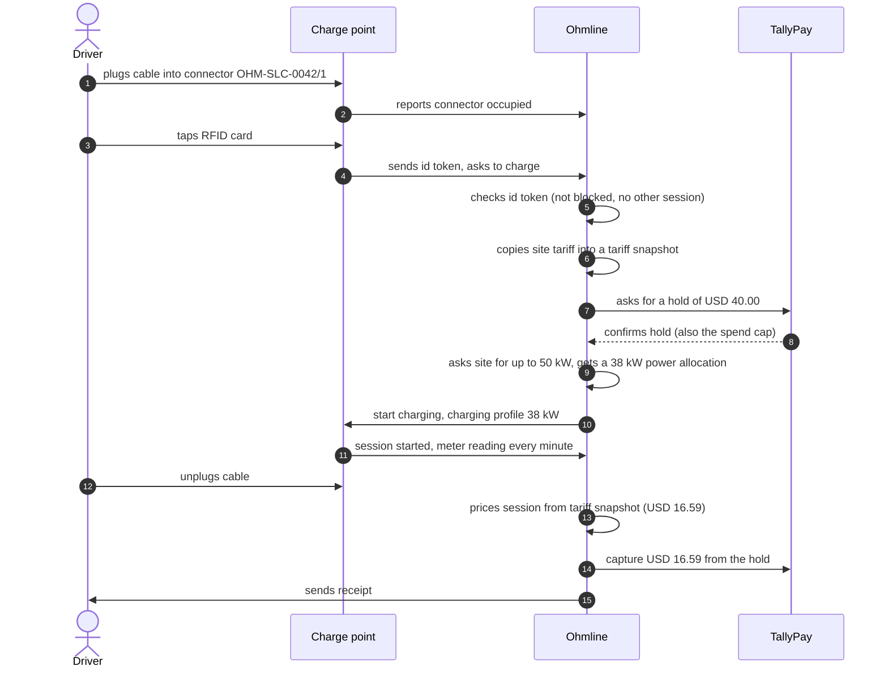
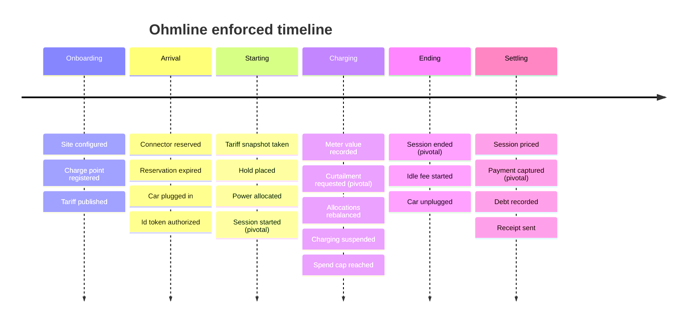
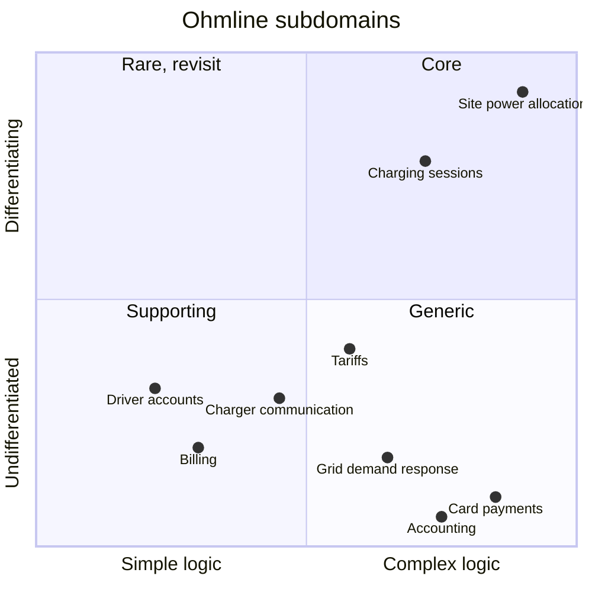

# Chapter 4. Discovering the Domain: Storytelling and EventStorming

On Monday at 09:00 the billing specialist opens the weekly operations call with a line from her list: "A transaction failed at the west garage on Friday night." The developer searches the logs for rolled-back database transactions and finds none. The charging operations lead finds a clean `StopTransaction` from connector `OHM-SLC-0107/2` at 19:15. For forty minutes, three competent people look in three places for a failure none of them can see.

Nothing had failed. A car finished charging at 18:40 and stayed plugged in, the idle fee pushed the price to USD 45.79 against a USD 40.00 hold, TallyPay declined the larger capture, and Ohmline took the USD 40.00 and recorded a debt of USD 5.79. Each person used "transaction" correctly, and each meant something different: a payment, a database commit, a charging session in the charger's protocol.

Part II starts here, before any aggregate exists, because code written now would freeze one of those meanings into types, and in an event-sourced system some names reach stored data and never change. This chapter goes from conversations with Ohmline's people to a vocabulary the compiler checks, leaving an artifact in `docs/` at every step.

> **In this chapter you will:**
>
> - record a business scenario as a numbered domain story with a sequence diagram;
> - read Big Picture, process-level and design-level EventStorming boards, and map every sticky colour to the code it becomes;
> - write per-context glossary entries and naming rules, and name the identifiers that can never change once stored;
> - compile the charge point's commands and events as closed hierarchies in two new projects;
> - classify Ohmline's subdomains and justify a business-logic pattern, and an amount of Akka.NET, for each context.

> **Starting point:** `ch03-s09`, the serialization tests and house style from section 3.9.
>
> ```bash
> git checkout ch03-s09
> ```

## 4.1 Domain Storytelling with Ohmline's people

Chapter 1 walked one charge from plug-in to receipt using the primer, written on the developers' side of the table. The people who know where the business hurts are elsewhere: the operations lead, the duty officer who watches the depot, the billing specialist who chases debts. Ask them for "requirements" and you get a wish list. Ask them what happened last Tuesday, and they talk for an hour.

### The idea: stories in a pictographic language

[*Domain Storytelling*](https://www.informit.com/store/domain-storytelling-a-collaborative-visual-and-agile-9780137458912), by Stefan Hofer and Henning Schwentner (Addison-Wesley, 2021), turns that hour into a model. A domain expert tells one concrete example and a moderator draws it live, in a small pictographic language: **story actors** (the people and systems that act), **work objects** (what they act on or pass along: an RFID card, a hold) and **activities** (arrows labelled with verbs). Numbered arrows turn the picture into sentences the moderator reads back, and the expert corrects them on the spot (Hofer and Schwentner, ch. 2, "The Pictographic Language"; the authors summarize it in their [quick-start guide](https://domainstorytelling.org/quick-start-guide)).

Each story is scoped on three axes (Hofer and Schwentner, ch. 4, "Scope"): *granularity* (coarse or fine), *point in time* (as-is or to-be) and *domain purity* (pure, with only people and paper, or digitalized, with existing systems as story actors). Ohmline's stories are fine-grained, as-is and digitalized: the goal is to learn today's business, including the systems it depends on.

> **Note:** a story actor is a person or a system role that does something in a story. It is not an Akka.NET actor. Some story actors will later be served by Akka.NET actors and many will not; the story does not decide that.

### The code: three stories in `docs/domain-stories/`

Tag `ch04-s01` adds three stories, each with a header table, numbered sentences, a Mermaid `sequenceDiagram`, its work objects and its lessons. In story 01, the RFID charge, `autonumber` keeps each arrow in step with its sentence:

*File: docs/domain-stories/01-rfid-charge.md @ ch04-s01*



Look at arrows 5, 6, 9 and 13: Ohmline talking to itself. The file calls them "the first hint that 'Ohmline' is not one thing". Checking a token, locking a price, sharing the site's power and pricing a session are done by different people today, and a box that keeps drawing arrows to itself hides several models.

Story 02, from the duty officer and the fleet manager, is a curtailment at `slc-depot`: Northgate Grid asks for 40 kW back and fleet sessions are served first. Its lessons are about words: Northgate Grid *requests* a curtailment and Ohmline *applies* it, and "rebalance" means recomputing allocations, not moving shards. Story 03 is this chapter's opening, told by the billing specialist:

*File: docs/domain-stories/03-failed-capture.md @ ch04-s01*

```text
4. **Ohmline** prices the *session* from its *tariff snapshot*: USD 36.79 for energy, USD 1.00
   session fee and USD 8.00 *idle fee*, USD 45.79 in total.
5. **Ohmline** asks **TallyPay** to *capture* USD 45.79 from the *hold*.
6. **TallyPay** declines: the amount is larger than the *hold*.
7. **Ohmline** asks **TallyPay** to *capture* USD 40.00, the whole *hold*.
8. **TallyPay** confirms the *capture*.
9. **Ohmline** records a *debt* of USD 5.79 against the driver's account.
```

Real numbers are why this works. While the car charged, the price stayed below the USD 40.00 spend cap; the idle fee alone pushed it over the hold. No abstract requirement would have exposed that, and the story records the outcome as a debt, not an error. Its variation, in which TallyPay does not answer, adds a rule developers should hear from a billing specialist rather than learn in production: "a capture that is asked for twice must never take the money twice."

### Consequences

Stories are cheap, and they capture the first words of the ubiquitous language in the experts' own mouths. They are also linear: each follows one path through one case, so no set of stories tells you that you have heard every event that matters, or who else should have been in the room.

> **Try it**
>
> ```bash
> git checkout ch04-s01
> git diff ch03-s09 ch04-s01 --stat
> git show ch04-s01:docs/domain-stories/03-failed-capture.md
> dotnet test --solution Ohmline.slnx
> ```
>
> The diff ends with `3 files changed, 247 insertions(+)`. The section adds documents only, so the run still reports `total: 137` and `failed: 0`.


## 4.2 Big Picture EventStorming

Three stories came from three people. The pricing analyst has not spoken, nobody has mentioned a charge point going offline, and the stories disagree about when a session "starts". You need the whole business on one surface, with everyone who knows a piece of it in front of it at once.

### The idea: one wall, orange stickies, past tense

Alberto Brandolini's EventStorming ([*Introducing EventStorming*](https://leanpub.com/introducing_eventstorming), Leanpub) does this with a long roll of paper. A *Big Picture* session runs in phases. Brandolini's chapter 4, "Running a Big Picture Workshop", names them kick-off, chaotic exploration, enforcing the timeline, people and systems, problems and opportunities, and pick your problem. The steps below compress them for a small group and borrow one concept, pivotal events, from the ddd-crew [EventStorming Glossary & Cheat sheet](https://github.com/ddd-crew/eventstorming-glossary-cheat-sheet), which also lists the terms and sticky colours:

1. **Chaotic exploration.** Everyone writes *domain events* on orange stickies, in the past tense ("Hold placed"), without discussion. The past tense forces people to name facts, and experts agree on facts more readily than on procedures.
2. **Enforcing the timeline.** The group merges duplicates and orders events left to right. Disagreements about order are arguments worth keeping.
3. **Pivotal events.** The group marks "the few most significant events in the flow", which the glossary notes are often the ones the most people are interested in. Brandolini's chapter 4 has no separate phase for this; the glossary lists it among its Big Picture concepts.
4. **People and external systems.** Small yellow stickies for people, large pink ones for systems Ohmline does not control.
5. **Hotspots.** Every question, conflict or risk goes on a magenta sticky turned on its corner (Brandolini's "Problems and opportunities"), and the group then chooses which to tackle first (his "Pick your problem").

Later levels add blue commands, lilac policies, green read models and large pale yellow aggregates (Brandolini, ch. 14, "Process Modeling Building Blocks", and ch. 17, "Running a Design-Level EventStorming").

### The code: `docs/eventstorming/big-picture.md`

Tag `ch04-s02` records a four-hour session with five domain experts, two developers and a facilitator; about 120 stickies went up in the first 25 minutes. The enforced timeline:

*File: docs/eventstorming/big-picture.md @ ch04-s02*



The pivotal events cut the wall into phases, and the group named each phase. "Connector faulted" and "Charge point went offline" can happen in any phase, so they went on a strip below the wall; events that ignore the timeline usually belong to something that outlives one process.

The four pivotal events are *Session started* (energy flows, the price is locked, money is held), *Curtailment requested*, *Session ended* (the connector is free, the session can be priced) and *Payment captured* (the money has moved). Three become types: `SessionStarted`, `SessionEnded`, `PaymentCaptured`. "Curtailment requested" does not. It is Northgate Grid's fact, and section 4.4 shows what Ohmline records instead.

The hotspots are the most valuable output. The file lists ten, each with its votes and the place that answers it. The top four: H2, who suspended the charge, since no idle fee is due when Ohmline paused it (6 votes; section 8.6 answers it as a refactoring toward deeper insight); H3, idle fees pushing the price above the hold (5, the settle-session board); H1, three words for one thing (4, section 4.5); and H8, whether a retry can take the money twice (4, section 15.6). H9, a tariff change mid-session, got no votes: the pricing analyst settled it on the spot.

### Consequences

The stickies also clustered around five vocabularies with their own experts: connectors and sessions, capacity and curtailment, tariffs, tokens, and holds and debts. Chapter 5 turns them into bounded contexts. A common failure: developers write technical events ("Row inserted") or states ("Charging"). Neither is a fact an expert would recognize, and the facilitator should move them off the wall.

> **Try it**
>
> ```bash
> git checkout ch04-s02
> git diff ch04-s01 ch04-s02 --stat
> git show ch04-s02:docs/eventstorming/big-picture.md
> ```
>
> The diff shows `1 file changed, 151 insertions(+)`. The file has a second diagram, a flowchart that gives the four pivotal events a thick black border and hangs hotspots H2, H3 and H5 off them.


## 4.3 Process-Level EventStorming

The Big Picture says *what* happens between "Car plugged in" and "Session started", not *why* each event happens, who asks for it, or what they must know first. Those answers decide which part of Ohmline does the work, so the next session zooms into starting a charge and settling a session.

### The idea: the grammar of a process

A process-level board adds three colours and a grammar (Brandolini, ch. 14, "Process Modeling Building Blocks"). An event follows either a **command** (blue, imperative: "Place hold") or an **external system** (pink) that reports it. A command comes from a person or from a **policy** (lilac) reacting to an earlier event, written "whenever *X*, then *Y*" (the ddd-crew glossary's [policy entry](https://github.com/ddd-crew/eventstorming-glossary-cheat-sheet#:~:text=whenever%20X%20happens) reads "whenever X happens, we do Y"). A person who issues a command needs information first, a **read model** (green). Read left to right, the wall becomes a chain, and an event that nothing causes is a question for the room.

Pink stickies change role at this level: they now receive commands, and they can refuse them. The charge point is told to start and TallyPay is asked for a hold. Ohmline controls neither, so every arrow into a pink sticky needs an answer to "and if it says no, or nothing?"

### The code: two process boards

Tag `ch04-s03` adds `process-start-charging.md` and `process-settle-session.md`. The happy path for starting a charge:

*File: docs/eventstorming/process-start-charging.md @ ch04-s03*

```mermaid
flowchart LR
    Driver["Driver"]:::person
    CP["Charge point"]:::external
    Pay["TallyPay"]:::external
    Occupied["Connector occupied"]:::event
    Lock["Lock token for session"]:::command
    Locked["Token locked for session"]:::event
    P1["Whenever a token is locked, then place a hold"]:::policy
    Hold["Place hold"]:::command
    Held["Hold placed"]:::event
    P2["Whenever a hold is placed, then request power"]:::policy
    Request["Request allocation"]:::command
    Allocated["Power allocated"]:::event
    P3["Whenever power is allocated, then start the charger"]:::policy
    Start["Remote start"]:::command
    Started["Session started"]:::event
    CP --> Occupied
    Driver -- taps card --> CP --> Lock --> Locked --> P1 --> Hold --> Pay --> Held
    Held --> P2 --> Request --> Allocated --> P3 --> Start --> CP
    CP --> Started
    classDef event fill:#ffa94d,stroke:#d9480f,color:#000
    classDef command fill:#74c0fc,stroke:#1864ab,color:#000
    classDef policy fill:#d0bfff,stroke:#6741d9,color:#000
    classDef external fill:#fcc2d7,stroke:#c2255c,color:#000
    classDef person fill:#ffec99,stroke:#e67700,color:#000
```



The driver does one thing: taps a card. Everything after "Token locked for session" is driven by policies, each sending a command to a different owner: TallyPay for the hold, the site for power, the charge point to start. The file's policy table adds the unhappy paths: P4 and P5 handle a refused token and a declined hold, and P6 says that if the session has not started 60 s after the remote start, Ohmline releases the allocation, voids the hold and unlocks the token. P6 is a *time-triggered policy*: its trigger is a clock, not an event. Each undo step is a business decision; voiding a hold is not the same as never placing one, because the driver's bank shows both.

The order of P1 and P2 is a business decision too: Ohmline holds the money before it commits power, so a declined card never takes power from other cars at the site.

The settle-session board fans out from "Session ended" into independent branches: release the power within seconds, and price, capture or record a debt. Policy P8 retries an unanswered capture after 1, 5 and 30 minutes with the same idempotency key (hotspot H8). Releasing power, pricing and unlocking the token need know nothing of each other, while the capture chain must count its attempts: "that memory is what makes the chain a process rather than a set of reactions".

### Consequences

The boards already sort policies into two kinds of code. Independent reactions to one event become subscribers (sections 8.5 and 15.1); a chain with memory and deadlines becomes a process manager, the charging journey of section 15.2, with P6 as its energy-flow timeout (section 15.5). The read models carry one honest compromise, which the pricing analyst accepted: the tariff snapshot is copied from a *current site tariff* read model that may be seconds old.

> **Try it**
>
> ```bash
> git checkout ch04-s03
> git diff ch04-s02 ch04-s03 --stat
> git show ch04-s03:docs/eventstorming/process-settle-session.md
> ```
>
> The diff shows `2 files changed, 190 insertions(+)`. The settle-session file lists nine policies, P1 to P9, and three read models: Receipt, Session history and Open debts.


## 4.4 Design-Level EventStorming and the sticky-to-code map

The process boards say that "Occupy connector" leads to "Connector occupied". They do not say who refuses it when another car is already plugged in, or when the connector is reserved for someone else. A rule like "a connector hosts at most one session" needs an owner, and the owner needs a memory.

### The idea: who decides, and what must it remember?

At design level the room asks one question of every blue sticky, which the sample's file states like this:

*File: docs/eventstorming/design-level.md @ ch04-s04*

```text
The process boards say *what* happens. The design-level board asks, for every blue command:
**who decides whether it is allowed, and what must that decider remember to decide it?** The
answer is a large yellow sticky placed between the command and its events: an aggregate. An
aggregate is the smallest thing that can keep one of Ohmline's rules true on its own.
```

Grouping commands by the rule they need, and rules by the memory they need, produced four aggregates:

| Aggregate | Rule it keeps true | Keyed by | Shard type name |
|---|---|---|---|
| Charge point | One session per connector; a reservation admits only its token | `OHM-SLC-0042` | `charge-point` |
| Charging session | Meter registers never go backwards; snapshot price; spend cap | Guid v7 | `charging-session` |
| Site power budget | Allocations within effective capacity and connector limits | `slc-depot` | `site-power-budget` |
| Id token | One account, at most one active session | Token UID | `id-token` |

The file records why. A charge point lives for years and changes a few times a day; a session lives for an hour and records a meter value every minute, so nesting sessions would make every meter value wait behind connector changes. The site budget's rule spans every connector at a site, so it cannot be split (section 15.8 says how to measure how hot it gets). The id token stands alone because hotspot H7 is a rule about the token. Chapter 7 tests these boundaries with the ddd-crew [Aggregate Design Canvas](https://github.com/ddd-crew/aggregate-design-canvas).

Some blue stickies found no yellow one. "Price session" needs no memory beyond the snapshot and the readings, so it became a pure domain service (section 8.3). The payment commands go to Billing. And "Curtailment requested" stays on its pink sticky: a translator turns Northgate Grid's signal into the command `ApplyCurtailment`, and the site power budget records its own fact, `CurtailmentApplied` (section 16.8).

### The code: the sticky-to-code map

Tag `ch04-s04` adds `docs/eventstorming/design-level.md`: the charge point board, the eight command and event pairs that section 4.6 compiles, the other aggregates' commands and events, and the table that connects the wall to the rest of this book:

| Sticky | Becomes | Lives in | Example | Sections |
|---|---|---|---|---|
| Orange: event | `sealed record` leaf of a `closed record` base, persisted | `*.Domain` | `ConnectorReserved` | 4.6, 7.2 |
| Blue: command | `sealed record` leaf of a `closed record` base | `*.Contracts` | `ReserveConnector` | 4.6, 7.2 |
| Yellow: aggregate | Pure decider in a persistent entity actor in a shard region | `*.Domain`, `*.Actors` | `ChargePoint` | 7.6, 10, 12 |
| Lilac: policy | Pure reaction run by a subscriber or a process manager | `*.Domain`, `*.Actors` | `ChargingJourney` | 8.5, 15 |
| Lilac with a clock | Actor timer sending a command | `*.Actors` | `ExpireReservation` | 11 |
| Green: read model | Projection from the journal to a table | `*.ReadModels` | `session-history-v1` | 13, 14 |
| Pink: external system | Anticorruption layer: pure translator plus adapter | `*.Acl.*`, gateway | `TallyPayTranslator` | 6.7, 16 |
| Small yellow: person | Client of an HTTP endpoint or the driver app | `*.Api`, mobile | a reservation endpoint | 12.5, 19 |
| Magenta: hotspot | Open question in an ADR, or a test named after the rule | `docs/`, `tests/` | H2 | 8.6 |

The map is close to one-to-one, which is why this book pairs EventStorming with a functional core in an actor shell.

### Consequences

Two consequences shape the sample. First, **commands live in `Contracts` and events in `Domain`**: the Device Gateway and the HTTP edge send a charge point its commands, so they may reference them, while the events are the aggregate's own memory and other contexts get a published version (section 16.1). Second, **the names on the wall are permanent**: shard type names end up in every persistence id, and event names in stored manifests.

> **Try it**
>
> ```bash
> git checkout ch04-s04
> git diff ch04-s03 ch04-s04 --stat
> git show ch04-s04:docs/eventstorming/design-level.md
> ```
>
> The diff shows `1 file changed, 148 insertions(+)`. The charge point board in the file has one aggregate sticky, `ChargePoint`, with four commands and a time-triggered policy feeding it and five events leaving it.


## 4.5 Ubiquitous language: glossary, naming rules and durable vocabulary

Hotspot H1 is this chapter's Monday call. Evans's [*Ubiquitous Language*](https://domainlanguage.com/wp-content/uploads/2016/05/DDD_Reference_2015-03.pdf) (section 1.3; Evans, *Domain-Driven Design Reference*, "Ubiquitous Language", pp. 3–4) asks for one language in conversation, documents and code. It does not ask that one word mean one thing across the whole company, and in Ohmline it cannot: the charger's protocol already owns "transaction", and so does every bank.

### The idea: one language per context

A ubiquitous language is ubiquitous *within a bounded context*; the Reference's own wording is "Within a bounded context, use the same language in diagrams, writing, and especially speech." The fix for H1 is not to ban a word but to say which context owns each meaning, and where a word stops:

| Word | Context | Meaning | Inside Ohmline |
|---|---|---|---|
| Transaction (OCPP) | Device Gateway | The charger's name for a charging session | Charging session |
| Charging session | Charging | One charge on one connector, start to end | `ChargingSession` |
| Payment | Billing | A money movement at TallyPay: hold, capture or void | Never "transaction" |

The protocol's words stop at the gateway: `StartTransaction` becomes `StartSession` and `Authorize` becomes `LockForSession`. The same treatment settles "hold" (money, in Billing) versus "reservation" (a connector, in Charging), and "rebalance" (allocations) versus shard rebalancing.

### The code: a glossary per context and naming rules

Tag `ch04-s05` rewrites `docs/glossary.md` into sections: words used in every context, one section per context, the Device Gateway's protocol words, and a table of words with several meanings. Its *In code* column names the type that carries each term, and a name there is reserved "from the moment it appears here, even before the section that adds the type". That is how the id token's events (`TokenRegistered`, `TokenBlocked`, `TokenLockedForSession`, `TokenUnlocked`) are fixed now, although section 12.7 writes them.

The tag also adds `docs/naming-rules.md`. Commands are an imperative verb plus a glossary noun (`ReserveConnector`); domain events are the noun plus a past participle (`ConnectorReserved`); no name repeats its kind (`ReserveConnectorCommand`). Two of its rules carry most of the weight:

*File: docs/naming-rules.md @ ch04-s05*

```text
- **One command, one intention.** `ReserveConnector` and `CancelReservation` are two commands,
  not one `ChangeReservation` with a flag. A command that can mean two things leads to an event
  that records neither.
- **Events record what happened, not what changed in a table.** `ConnectorOccupied` says a car
  was plugged in. `ConnectorStatusChanged { Status = 2 }` says only that a column moved, and
  every reader has to work out why.
```

The banned names follow: `Update*`, `Set*`, `*Changed` for a whole state, `*Manager`, `*Helper`, `*Util` and a bare `Transaction`. The one exception is `SetChargingProfile`, a charger-protocol action that keeps its external name. A process manager is named after its process: `ChargingJourney`, never `ChargingProcessManager`.

> **Anti-pattern: anemic actor and logic in Receive.** An aggregate whose protocol is `SetConnectorStatus(Status)` has no rules: its sender decides. An intention such as `OccupyConnector` puts the decision where the memory is. Its mirror image, rules in `Receive` handlers, is section 10.10's.

### Durable names

Most names can be refactored: rename a C# type, run the tests, done. A few are written into stored data or a running cluster, and `naming-rules.md` lists them: shard type names, persistence ids (`charge-point-OHM-SLC-0042`), the number of shards, event manifests (`charging.connector-reserved.v1`), serializer ids, tags and projection ids. Its first rule explains why a C# rename stays safe:

*File: docs/naming-rules.md @ ch04-s05*

```text
- **The manifest, not the C# type name, is what is stored.** Each context's serializer maps
  every event type to its manifest explicitly (section 10.3), so a C# rename is safe and a
  manifest rename is not.
- **A durable name is reviewed before its first commit,** with the same care as a database
  column. If it is wrong, add a new name next to the old one and migrate; never edit the old one
  in place (Chapter 20).
```

> **Anti-pattern: changing `maxNumberOfShards`, PersistenceId formats or serializer IDs.** A charge point whose persistence id changes from `charge-point-OHM-SLC-0042` to anything else recovers as a brand-new aggregate with no history. Nothing fails; the old events are still in the journal, and nobody reads them.

### Consequences

The glossary is now a contract with the code: a better word changes the glossary first and the code in the same commit, except for durable names, which stay and gain an alias. Section 20.7 does this when operations start saying "out of order" instead of "fault".

> **Try it**
>
> ```bash
> git checkout ch04-s05
> git diff ch04-s04 ch04-s05 --stat
> git diff ch04-s04 ch04-s05 -- docs/glossary.md
> ```
>
> The diff ends with `2 files changed, 230 insertions(+), 18 deletions(-)`. Most of the deletions are the single 13-row table from section 1.3, now replaced by one table per context.


## 4.6 From stickies to types: the vocabulary compiles

A glossary in Markdown cannot fail a build. Scott Wlaschin's [*Domain Modeling Made Functional*](https://pragprog.com/titles/swdddf/domain-modeling-made-functional/) (2018) argues that types can be documentation a domain expert reads. Its preface promises code that does double duty, "first as readable documentation of the domain but also as a compilable framework", and chapter 5, "Domain Modeling with Types", sets out to make the code look as simple as the text-based design that chapter 2 shows to the domain expert. Types are also what the compiler checks. So before any behaviour exists, the charge point's vocabulary becomes code.

### The idea: closed hierarchies with empty leaves

Commands and events cross actor boundaries, and events reach the journal. ADR 0003 (section 3.4) settled what such messages are: a `closed record` base with `sealed record` leaves. Only the base's own assembly can derive from it, so a switch over it in any other project knows every case without a discard arm.

The leaves carry no data yet, on purpose. Data needs value objects (Chapter 6) and decisions about what each event records (section 7.2); names need neither.

### The code: two projects and two files

Tag `ch04-s06` creates Charging's first two projects under the `/src/Charging/` solution folder. The commands go in `Ohmline.Charging.Contracts`, which references only `Ohmline.SharedKernel`:

```csharp
// File: src/Charging/Ohmline.Charging.Contracts/ChargePoints/ChargePointCommand.cs @ ch04-s06
namespace Ohmline.Charging.Contracts.ChargePoints;

/// <summary>
/// Everything a charge point can be asked to do, named as on the design-level EventStorming
/// board (<c>docs/eventstorming/design-level.md</c>). The base is closed: only this assembly
/// can add a command, so a switch over it anywhere else knows every case.
/// </summary>
/// <remarks>The commands carry no data yet; section 7.2 adds it.</remarks>
public closed record ChargePointCommand;

/// <summary>Add a charge point and its connectors to Ohmline's network.</summary>
public sealed record RegisterChargePoint : ChargePointCommand;

/// <summary>Keep a connector for one token until the reservation expires.</summary>
public sealed record ReserveConnector : ChargePointCommand;
// ...
/// <summary>The reservation's time is up; sent by a timer, not by a person.</summary>
public sealed record ExpireReservation : ChargePointCommand;
// ...
/// <summary>The connector has been repaired and can be used again.</summary>
public sealed record ClearConnectorFault : ChargePointCommand;
```

`public closed record ChargePointCommand;` has neither a parameter list nor a body, which C# accepts; section 7.2 gives the base a `ChargePointId`. Each summary uses glossary words, and the eight leaves match the design-level table. The events go in `Ohmline.Charging.Domain`:

```csharp
// File: src/Charging/Ohmline.Charging.Domain/ChargePoints/ChargePointEvent.cs @ ch04-s06
namespace Ohmline.Charging.Domain.ChargePoints;

/// <summary>
/// Everything that can happen to a charge point, named as on the design-level EventStorming
/// board (<c>docs/eventstorming/design-level.md</c>). These are the charge point's own memory:
/// they stay inside Charging, and other contexts never reference them.
/// </summary>
/// <remarks>The events carry no data yet; section 7.2 adds it.</remarks>
public closed record ChargePointEvent;

public sealed record ChargePointRegistered : ChargePointEvent;

public sealed record ConnectorReserved : ChargePointEvent;
// ...
public sealed record ConnectorFaulted : ChargePointEvent;

public sealed record ConnectorFaultCleared : ChargePointEvent;
```

The event leaves need no comments: a past-tense name is already the sentence an expert would say. The Domain project file states both dependency and purity:

```xml
<!-- File: src/Charging/Ohmline.Charging.Domain/Ohmline.Charging.Domain.csproj @ ch04-s06 -->
<Project Sdk="Microsoft.NET.Sdk">

  <!--
    Charging's model: events, state and deciders. Pure: the shared kernel, Charging's own
    contracts and the base class library only, and no package references.
  -->

  <ItemGroup>
    <ProjectReference Include="../../Ohmline.SharedKernel/Ohmline.SharedKernel.csproj" />
    <ProjectReference Include="../Ohmline.Charging.Contracts/Ohmline.Charging.Contracts.csproj" />
  </ItemGroup>

</Project>
```

`Domain` references `Contracts`, because a decider takes commands and returns events; `Contracts` references only the shared kernel, so senders never pull in Charging's model. Section 5.3 enforces both rules.

### Consequences

This tag adds no tests: the types have no behaviour, and the compiler is the check. As section 3.4 showed with `Ch03.ClosedLib`, a closed base keeps other assemblies from adding a case (CS9382) and makes switches over it exhaustive across assemblies, so with CS8509 an error since section 3.3, a switch that misses a leaf breaks the build. Exercises 5 and 6 show both against the real types.

The cost is that every new command or event is a reviewed change in one specific project, which is the intended friction.

> **Try it**
>
> ```bash
> git checkout ch04-s06
> git diff ch04-s05 ch04-s06 --stat
> git diff ch04-s05 ch04-s06 -- Ohmline.slnx src/Charging
> dotnet build Ohmline.slnx -warnaserror
> dotnet test --solution Ohmline.slnx
> ```
>
> The diff shows `5 files changed, 87 insertions(+)`. The build output gains `Ohmline.Charging.Contracts -> .../Ohmline.Charging.Contracts.dll` and the same line for `Ohmline.Charging.Domain`, with 0 warnings and 0 errors. The run still reports `total: 137` and `failed: 0`.


## 4.7 Subdomains: core, supporting, generic

Ohmline cannot model everything with the care section 4.4 gave the charge point. A *subdomain* is a part of what the business does, with or without software, and classifying subdomains decides where the best people and the most careful modeling go.

### The idea: three types and four questions

Evans's [distillation](https://domainlanguage.com/wp-content/uploads/2016/05/DDD_Reference_2015-03.pdf) names the *Core Domain*, where the business wins or loses, and *Generic Subdomains*, problems everybody has and somebody has solved (*Domain-Driven Design Reference*, part V, "Distillation for Strategic Design", pp. 40–41). Vernon's [*Implementing Domain-Driven Design*](https://www.informit.com/store/implementing-domain-driven-design-9780321834577) (2013) adds *supporting* subdomains: specific to the business, necessary, but no differentiator (ch. 2, "Domains, Subdomains, and Bounded Contexts", p. 52). Vlad Khononov's [*Learning Domain-Driven Design*](https://www.oreilly.com/library/view/learning-domain-driven-design/9781098100124/) (2021) turns the classification into questions: does it give a competitive advantage, is the logic complex, is it volatile, could you buy it? (ch. 1, "Analyzing Business Domains", section "Comparing Subdomains"). Two lenses help with borderline cases: the ddd-crew [Bounded Context Canvas](https://github.com/ddd-crew/bounded-context-canvas#strategic-classification)'s *business-model role* (revenue generator, engagement creator or compliance enforcer, with cost reduction as a fourth value in the canvas's [YAML template](https://github.com/ddd-crew/bounded-context-canvas/blob/master/tools/yaml-version/bounded-context-canvas.yaml)) and Simon Wardley's *evolution* stages (genesis, custom built, product, commodity; [*Wardley Maps*](https://learnwardleymapping.com/book/), ch. 2, "Finding a Path").

### The code: `docs/subdomains.md`

Tag `ch04-s07` classifies eleven subdomains by type, evolution stage, build or buy, business-model role and rationale: two core, four supporting, and five generic ones that are bought or integrated, such as card payments through TallyPay. Khononov's chart of complexity against differentiation (*Learning Domain-Driven Design*, ch. 1) summarizes it:

*File: docs/subdomains.md @ ch04-s07*



Site power allocation sits alone in the top right. At most sites power is scarcer than chargers, and the allocator decides many times a minute how effective capacity is shared: fleet before public, every connector within its limits, never over the line. That lets a site owner run ten chargers on a connection sized for four, and no product does it for Ohmline's mix of sites; Site Energy gets the sample's most careful model (sections 7.8 and 9.4).

Tariffs is the instructive borderline. It scored "complex" and "volatile", two signs of core, and stays supporting because, in the file's words, "the volatility is in the *data*, not in the model": a new tariff is a new row, not a new rule. Section 8.2 builds tariffs as a Knowledge Level for that reason. On the chart Tariffs even sits just inside the generic quadrant: complex, not differentiating. The chart is a sketch, not a verdict; the heuristics table's last question keeps Tariffs in-house, because no product prices a session with Ohmline's snapshot rule.

### Consequences

The classification does not decide which bounded contexts exist (Chapter 5) or how each is built (the next section). It is not permanent either: core subdomains drift toward supporting as the market catches up, so the file is reviewed whenever Ohmline's strategy changes.

> **Try it**
>
> ```bash
> git checkout ch04-s07
> git diff ch04-s06 ch04-s07 --stat
> git show ch04-s07:docs/subdomains.md
> ```
>
> The diff shows `1 file changed, 103 insertions(+)`. The file's heuristics table applies Khononov's four questions to site power allocation, tariffs and charger communication.


## 4.8 Choosing a business-logic pattern per subdomain

Every aggregate so far is headed for a pure decider, a sharded persistent actor, a journal, permanent manifests, snapshots and projections. Billing records holds, captures, debts and receipts; the charge point's machinery would make that bookkeeping harder to change, not safer.

### The idea: four patterns, chosen by the subdomain

Khononov catalogs four ways to implement business logic (*Learning Domain-Driven Design*, ch. 5, "Implementing Simple Business Logic", ch. 6, "Tackling Complex Business Logic", and ch. 7, "Modeling the Dimension of Time"), the first three from Martin Fowler's [*Patterns of Enterprise Application Architecture*](https://martinfowler.com/books/eaa.html) (2002; Transaction Script and Domain Model in ch. 9, "Domain Logic Patterns", Active Record in ch. 10, "Data Source Architectural Patterns"):

- **[Transaction script](https://martinfowler.com/eaaCatalog/transactionScript.html):** one procedure per operation, inside a database transaction.
- **[Active record](https://martinfowler.com/eaaCatalog/activeRecord.html):** transaction scripts over objects that load and save themselves.
- **[Domain model](https://martinfowler.com/eaaCatalog/domainModel.html):** aggregates and value objects that protect invariants under any sequence of commands.
- **Event-sourced domain model:** a domain model whose state is the fold of its stored events.

His decision heuristic (ch. 10, "Design Heuristics", section "Tactical Design Decision Tree") asks about the logic rather than the label: money, an audit log or deep analytics point to an event-sourced domain model; otherwise complex rules get a domain model, complex data an active record, and the rest a transaction script. Core subdomains usually end with one of the two domain-model patterns, supporting ones with an active record or a transaction script. In this book the choice has a second dimension, because event sourcing also means Akka.NET: the subdomain type decides how much Akka.NET to spend.

### The code: ADR 0004

Tag `ch04-s08` records the decision in `docs/adr/0004-implementation-style-per-subdomain.md`:

| Context | Type | Pattern | Akka.NET |
|---|---|---|---|
| Charging | Core | Event-sourced domain model | Sharded persistent actors, timers |
| Site Energy | Core | Event-sourced; allocator as Cohesive Mechanism | A sharded persistent actor per site |
| Tariffs | Supporting | Domain model with a Knowledge Level | One persistent cluster singleton |
| Driver Accounts | Supporting | Small event-sourced reservation aggregate | A sharded persistent actor |
| Billing | Supporting | Transaction scripts on Npgsql, inbox and outbox | **None** |

Two rows are not what the heuristic alone predicts. Driver Accounts is supporting yet event-sourced, because uniqueness across aggregates is awkward with Akka.NET actors, and keying a small aggregate on the token UID turns "one active session per token" into a local check (section 12.7). Billing moves money, which the heuristic sends toward event sourcing, yet it has no actors, no journal and no decider (section 16.3). That is a judgment call. The ADR argues that Billing's audit trail is its tables and its outbox, which is what accountants expect; the session events behind each amount are in Charging's journal anyway. The ADR also closes the door on the obvious temptation:

*File: docs/adr/0004-implementation-style-per-subdomain.md @ ch04-s08*

```text
We will not make a context event-sourced, or put it in an actor, because the rest of the sample
is built that way.
```

And it names the pitfall it exists to prevent:

*File: docs/adr/0004-implementation-style-per-subdomain.md @ ch04-s08*

```text
- **The pitfall this ADR exists to prevent is "everything is an event-sourced sharded actor".**
  A new context starts as the simplest pattern its rules allow. It moves up the table when a
  rule, a concurrency problem or a need for history demands it, and the move is recorded as a
  new ADR that supersedes the row above.
```

### Consequences

The sample now runs two styles side by side: an Akka.NET cluster (`Ohmline.Node` and the gateway) and an ordinary web service (`Ohmline.Billing`), integrated through published contracts and HTTP rather than actor references (Chapter 16). Even inside one context the choice varies: section 11.7 keeps only the latest state of the charge point listing.

> **Try it**
>
> ```bash
> git checkout ch04-s08
> git diff ch04-s07 ch04-s08 --stat
> dotnet test --solution Ohmline.slnx
> ```
>
> The diff shows `2 files changed, 91 insertions(+)`: the ADR and eight tag-index rows in `README.md`. The run reports `total: 137` and `failed: 0`, as at `ch03-s09`.


## Summary

- Concrete stories with real numbers expose rules that abstract requirements hide; Big Picture EventStorming puts the whole business on one timeline, and its hotspots become a backlog.
- Process-level boards explain every event by a command or a policy; chains with memory and deadlines become process managers.
- Design-level boards find aggregates by asking who decides and what it must remember; each sticky colour maps to a predictable kind of code.
- A ubiquitous language is per context: "transaction" belongs to the charger protocol and stops at the gateway. Shard type names, persistence ids and manifests are stored, so they are chosen once and never edited.
- A closed command and event hierarchy makes the vocabulary compile before any behaviour exists, with commands in `Contracts` for other senders and events kept inside `Domain`.
- The subdomain type sets the budget: core subdomains get event-sourced deciders in sharded actors, and Billing gets transaction scripts and no actors at all.

## DDD canon covered

Domain Storytelling; EventStorming (Big Picture / Process / Design Level); Ubiquitous Language; Domain; Subdomains: core / supporting / generic, plus BCC business role and evolution; Domain Events (naming); Aggregates and [Vernon's 4 rules](https://www.informit.com/store/implementing-domain-driven-design-9780321834577) (*Implementing Domain-Driven Design*, ch. 10, "Aggregates"; discovery only); Business-logic pattern choice; Serialization strategy and serializer IDs (durable names); Anti-pattern catalog.

## Exercises

1. **Reflect.** Hotspot H5 asks whether a public driver whose power drops during a curtailment should pay the same rate. The pricing analyst said yes. Argue the other side, weighing driver trust, the snapshot rule and which context would have to change.
2. **Reflect.** ADR 0004 gives Billing no Akka.NET actors. Name a business change that would justify an event-sourced Billing, and what it would cost in durable names, serializers and read models.
3. **Extend.** Starting from `ch04-s01`, write `docs/domain-stories/04-reservation-expires.md` for hotspot H6: a driver reserves a connector at the depot and loses signal underground. It worked when every arrow matches one numbered sentence and every work object is in the glossary at `ch04-s05`, or you have found a missing word.
4. **Extend.** Starting from `ch04-s06`, add `Sessions/SessionCommand.cs` to `Ohmline.Charging.Contracts` with the five session commands from the design-level board, and `Sessions/SessionEvent.cs` to the Domain project with its seven events. Switch over `SessionCommand` in the Domain project with five arms and no discard. It worked when `dotnet build Ohmline.slnx -warnaserror` reports 0 warnings and 0 errors.
5. **Break it.** At `ch04-s06`, add a switch expression over `ChargePointCommand` to the Domain project that leaves out `ClearConnectorFault`. Expect the build to fail with `error CS8509`, "[The switch expression does not handle all possible values of its input type (it is not exhaustive)](https://learn.microsoft.com/en-us/dotnet/csharp/language-reference/compiler-messages/pattern-matching-warnings#pattern-completeness-and-redundancy)", naming the pattern `Ohmline.Charging.Contracts.ChargePoints.ClearConnectorFault` as not covered.
6. **Break it.** At `ch04-s06`, add `public sealed record Sneaky : ChargePointCommand;` to `Ohmline.Charging.Domain`. Expect `error CS9382: 'Sneaky': cannot use a closed type 'ChargePointCommand' from another assembly as a base type.` Remove it, rename `RegisterChargePoint` to `UpdateChargePoint` and build again: it succeeds. Naming rules are enforced by review, which is why they are written down.

## Further reading

- Stefan Hofer and Henning Schwentner, [*Domain Storytelling: A Collaborative, Visual, and Agile Way to Build Domain-Driven Software*](https://www.informit.com/store/domain-storytelling-a-collaborative-visual-and-agile-9780137458912) (Addison-Wesley, 2021), with the authors' site at [domainstorytelling.org](https://domainstorytelling.org/). The pictographic language (ch. 2) and scope factors (ch. 4).
- Alberto Brandolini, [*Introducing EventStorming*](https://leanpub.com/introducing_eventstorming) (Leanpub), with [eventstorming.com](https://www.eventstorming.com/). All three levels, from the method's author: Big Picture (ch. 4), process modeling (chs. 13–15) and design level (ch. 17).
- Eric Evans, [*Domain-Driven Design Reference*](https://domainlanguage.com/wp-content/uploads/2016/05/DDD_Reference_2015-03.pdf) (2015). Ubiquitous Language (p. 3), Core Domain (p. 40) and Generic Subdomains (p. 41) in Evans's words.
- Vlad Khononov, [*Learning Domain-Driven Design*](https://www.oreilly.com/library/view/learning-domain-driven-design/9781098100124/) (O'Reilly, 2021). Subdomain heuristics (ch. 1), the four business-logic patterns (chs. 5–7) and the decision heuristics behind ADR 0004 (ch. 10).
- ddd-crew, [*Bounded Context Canvas*](https://github.com/ddd-crew/bounded-context-canvas) (V5). The business-model roles and evolution stages used in `docs/subdomains.md` ("Strategic Classification").
- Scott Wlaschin, [*Domain Modeling Made Functional*](https://pragprog.com/titles/swdddf/domain-modeling-made-functional/) (Pragmatic Bookshelf, 2018). From EventStorming (ch. 1) to types that document the domain (ch. 5).
- Martin Fowler, [*Patterns of Enterprise Application Architecture*](https://martinfowler.com/books/eaa.html) (Addison-Wesley, 2002), with the online [catalog of patterns](https://martinfowler.com/eaaCatalog/). The original Transaction Script and Domain Model (ch. 9) and Active Record (ch. 10).
