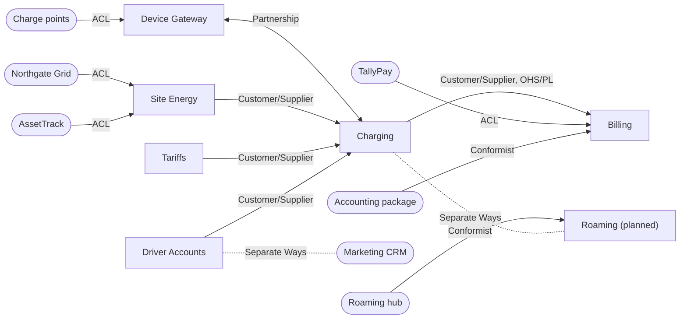
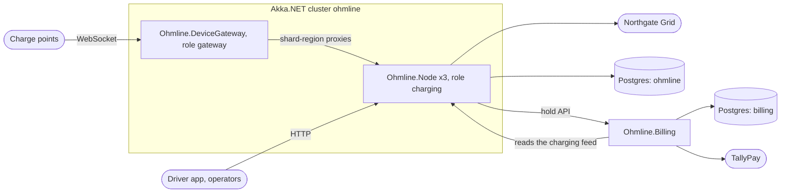
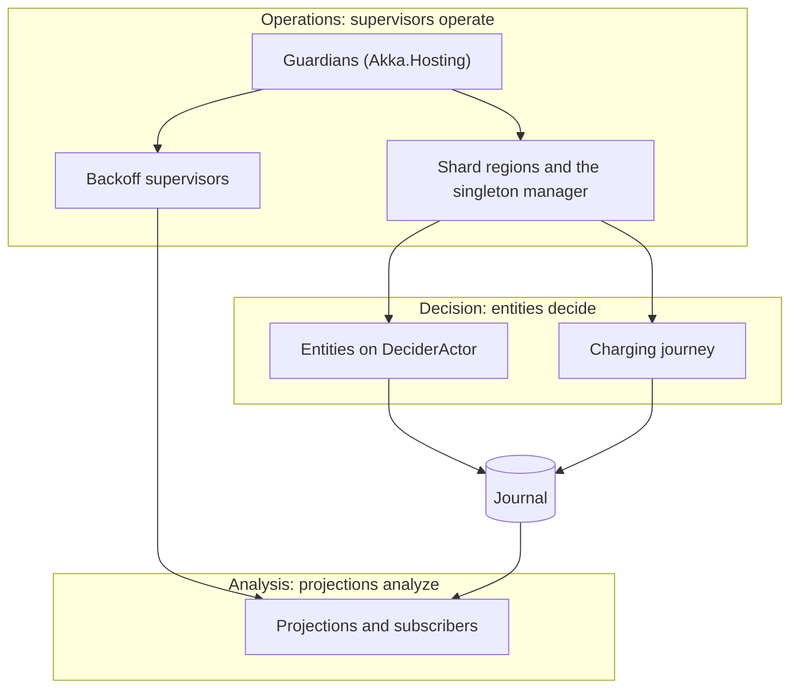

# Chapter 5. Bounded Contexts, Context Maps and Distillation

The whiteboard in the Sessions team's room holds a class called `Session`, and it keeps growing. The Sessions team started it with a connector, a tariff snapshot and a list of meter readings. Finance IT added a hold reference, a receipt number and a captured amount. The partnerships manager came back from a call with the roaming hub and added the hub's session id, a charge detail record and a status field with the hub's own values. Then somebody asked: a car stops drawing power at 09:41 and stays plugged in until 10:05, so when did the session end?

The hub says 09:41, because energy stopped. Charging says 10:05: the idle-fee grace period was running and the connector was still occupied. Billing does not care about either time; for Billing a session exists once it has a price. All three answers are correct, and no single class can hold all three without every team breaking every other team's tests.

Chapter 4 found Ohmline's words. This chapter draws lines where their meaning changes, writes down what may cross each line, and turns the lines into projects, build checks and tests.

> **In this chapter you will:**
>
> - fill in a Bounded Context Canvas and name the messages on it that are serializer-stable public contracts;
> - lay out each context as Domain, Contracts, Actors, ReadModels and Api projects whose references point inwards, and watch the build reject a domain project that asks for Akka.NET;
> - draw a context map that names a team relationship and an integration pattern for every line, and tie each line to an artifact a test can see;
> - write governance rules for a Shared Kernel, versioning rules for a Published Language and translation rules for an Anticorruption Layer;
> - justify one Akka.NET cluster with two roles plus one ordinary service, and name the distributed Big Ball of Mud that topology must guard against;
> - distill the core into a vision statement and a highlighted core, and map responsibility layers onto the actor hierarchy.

> **Starting point:** `ch04-s08`, ADR 0004 and the implementation style per subdomain from section 4.8.
>
> ```bash
> git checkout ch04-s08
> ```

## 5.1 Bounded contexts and the Bounded Context Canvas

The `Session` on the whiteboard fails because three groups of people use one word for three things, and the class tries to serve all of them. A base class with three subclasses only moves the argument into an inheritance hierarchy. The way out is to accept that there are three models and to say exactly where each one applies.

### The idea: one model per boundary

A **bounded context** is the boundary inside which one model, and one ubiquitous language, applies without ambiguity. [Evans](https://www.informit.com/store/domain-driven-design-tackling-complexity-in-the-heart-9780321125217) (2003, ch. 14 "Maintaining Model Integrity", section "Bounded Context") asks for the boundary to be explicit in three ways: who works on the model, which part of the application uses it, and its physical form; his *[DDD Reference](https://domainlanguage.com/wp-content/uploads/2016/05/DDD_Reference_2015-03.pdf)* (2015, "Bounded Context", p. 2) puts it as setting boundaries "in terms of team organization, usage within specific parts of the application, and physical manifestations such as code bases and database schemas". Inside the boundary, "session" has exactly one meaning; outside it, the same word may mean something else, and nobody assumes otherwise.

A bounded context is not a subdomain: a subdomain is part of the problem (section 4.7), a bounded context part of the solution. The two often line up, as they mostly do in Ohmline, but need not. Nor is a bounded context a microservice; section 5.7 puts four contexts into one cluster.

Scott Wlaschin ([*Domain Modeling Made Functional*](https://pragprog.com/titles/swdddf/domain-modeling-made-functional/), 2018, ch. 3 "A Functional Architecture", section "Communicating Between Bounded Contexts") pictures each bounded context with an input gate and an output gate: inside, everything is in the context's own types; across the boundary travels a plain data shape, checked at the gate. In this book that shape is a message.

### The canvas

The ddd-crew's **[Bounded Context Canvas](https://github.com/ddd-crew/bounded-context-canvas#section-definitions)** (version 5) describes a context on one page, in eleven fields: name, purpose, strategic classification, domain roles, inbound communication, outbound communication, ubiquitous language, business decisions, assumptions, verification metrics and open questions. The classification reuses the business-model roles and evolution stages from section 4.7. The domain roles are archetypes from the ddd-crew's [model traits worksheet](https://github.com/ddd-crew/bounded-context-canvas/blob/master/resources/model-traits-worksheet.md) such as *execution model*, *enforcer*, *gateway* and *audit model*. (The Tariffs canvas also lists "Knowledge Level", which is Evans's pattern rather than an archetype (*DDD Reference*, "Knowledge Level", p. 51); section 5.9 explains it.)

### The code: six canvases

Tag `ch05-s01` adds one canvas per context in `docs/canvases/`: `bc-charging.md`, `bc-site-energy.md`, `bc-tariffs.md`, `bc-driver-accounts.md`, `bc-billing.md` and `bc-device-gateway.md`. The Charging canvas settles the whiteboard argument in its Ubiquitous language section:

*File: docs/canvases/bc-charging.md @ ch05-s01*

```text
The word "session" means something different next door. In Billing it is only the thing an
invoice refers to: a `SessionId`, an amount and a receipt line, with no meter readings at all. At
the roaming hub it is the hub's own record of a charge, with its own identifier and statuses,
which Ohmline does not control. Three models, three meanings, one word: that is why there are
three boundaries.
```

Billing's canvas agrees from the other side, and Roaming, a planned context, has no canvas yet.

The most consequential fields are the two communication tables. Each row names a collaborator, a message, its kind (command, query, event, or event as a reply) and the project that carries its type. The Charging canvas opens its inbound table with the rule that governs them all:

*File: docs/canvases/bc-charging.md @ ch05-s01*

```text
Every message in these tables is a public contract. Its type lives in a `Contracts` project (or,
for the charge point's own words, in the Device Gateway's protocol), it crosses a serializer, and
it changes only by adding a new version next to the old one (sections 10.3 and 20.2).
```

That sentence is the bridge from strategic design to the actor shell. A message in a canvas table is told to a shard region, serialized between nodes or written to a feed, so its name and shape are durable vocabulary in the sense of section 4.5. The canvas is also the inventory of everything that will need a manifest, a golden file and a versioning rule.

### Consequences

A canvas is a hypothesis, not a specification: its assumptions and verification metrics ("zero connectors ever recorded with two sessions at once") exist to be checked against production. Two pitfalls are common: drawing a context per entity, which splits one consistency rule across two models, and filling in canvases once for a slide deck. The communication tables stay useful only while they match the `Contracts` projects, which is why every row names one.

> **Try it**
>
> ```bash
> git checkout ch05-s01
> git diff ch04-s08 ch05-s01 --stat
> git show ch05-s01:docs/canvases/bc-billing.md
> ```
>
> The diff shows `6 files changed, 533 insertions(+)`. In Billing's canvas, the Ubiquitous language table defines "Session" as only a reference, and ends its "Payment" row with `Never a "transaction"`.

## 5.2 Modules made physical: architecture styles and the solution layout

At `ch05-s01` the solution has exactly two projects that belong to any context: `Ohmline.Charging.Contracts` and `Ohmline.Charging.Domain` from section 4.6. Before the first decider is written, a charge point's actor, a projection for the site live board and an HTTP endpoint for reservations each need a home that keeps them out of the model.

### The idea: four styles, one rule

Four architecture styles compete for that decision:

| Style | Source | What sits in the centre | Direction of dependencies |
|---|---|---|---|
| Layered | [Evans](https://www.informit.com/store/domain-driven-design-tackling-complexity-in-the-heart-9780321125217) (2003, ch. 4 "Isolating the Domain") | Nothing: UI, application, domain and infrastructure are stacked | Downwards, so the domain depends on infrastructure |
| Hexagonal (ports and adapters) | [Alistair Cockburn (2005)](https://alistair.cockburn.us/hexagonal-architecture/) | The application, behind ports | Adapters depend on ports; the application knows no adapter |
| Onion | [Jeffrey Palermo (2008)](https://jeffreypalermo.com/2008/07/the-onion-architecture-part-1/) | The domain model, wrapped in layers with more behaviour | Inwards only ("all coupling is toward the center") |
| Clean | [Robert C. Martin (2012)](https://blog.cleancoder.com/uncle-bob/2012/08/13/the-clean-architecture.html#:~:text=The%20Dependency%20Rule) | Entities, then use cases | Inwards only ("The Dependency Rule") |

Classic layering lets the domain call the infrastructure below it. The other three invert that: the model sits in the centre and depends on nothing, and everything touching the outside world is an adapter that depends on it. Martin's own post lists hexagonal and onion architecture among its sources and says that these architectures "all vary somewhat in their details" but "are very similar"; the inward rule is why.

That rule decides where actors go. **Actors are adapters, not domain.** A persistent actor receives messages from outside (a driving adapter for the decider) and writes to the journal through a persistence plugin (a driven adapter); the decider knows neither. The shell also takes on the application work that Evans keeps out of domain objects (*[DDD Reference](https://domainlanguage.com/wp-content/uploads/2016/05/DDD_Reference_2015-03.pdf)*, "Layered Architecture", p. 10, which frees them from "storing themselves, managing application tasks, and so forth"): it loads state by recovery, asks the domain to decide, saves the result with `PersistAll` and replies.

### Modules you can compile

Evans (2003, ch. 5 "A Model Expressed in Software", section "Modules (a.k.a. Packages)"; *DDD Reference*, "Modules", p. 15) defines **Modules** as packages chosen to tell the story of the system: high cohesion inside, low coupling between, names from the ubiquitous language. In .NET, a project is the strongest module available, because the compiler enforces its edges. Ohmline uses one folder per bounded context and one project per role inside it:

| Project | Role | References |
|---|---|---|
| `*.Domain` | The pure model: events, state, deciders | Shared kernel, own `Contracts` |
| `*.Contracts` | Messages that other contexts or the edge send or receive | Shared kernel |
| `*.Actors` | The actor shell and serializers | Own `Domain` and `Contracts`, `Ohmline.ActorShell` |
| `*.ReadModels` | Projections from the journal | Own `Domain` and `Contracts`, `Ohmline.ActorShell` |
| `*.Api` | HTTP endpoints that turn requests into commands | Own `Contracts`, `Ohmline.ActorShell` |

The project is also where a C# 15 `closed` hierarchy ends. Section 3.4 showed that a closed type cannot be extended from another assembly (CS9382). `closed` seals the case set and `internal` hides the helpers that are not part of the language, so only `Ohmline.Charging.Domain` can add a charge point event, and every exhaustive switch over those events, in any project, stays exhaustive.

### The code: the empty skeleton

Tag `ch05-s02` adds the projects for every context, Billing's contracts and web host, the Device Gateway's pure protocol project and web host, and `Ohmline.ActorShell` for the reusable parts of the shell. Each project file says what it is for:

```xml
<!-- File: src/Charging/Ohmline.Charging.Actors/Ohmline.Charging.Actors.csproj @ ch05-s02 -->
<Project Sdk="Microsoft.NET.Sdk">

  <!--
    Charging's actor shell: the actors that host Charging's deciders, its serializer and
    AddChargingContext(). Adapters around the pure model, not part of it.
  -->

  <ItemGroup>
    <ProjectReference Include="../Ohmline.Charging.Domain/Ohmline.Charging.Domain.csproj" />
    <ProjectReference Include="../Ohmline.Charging.Contracts/Ohmline.Charging.Contracts.csproj" />
    <ProjectReference Include="../../Ohmline.ActorShell/Ohmline.ActorShell.csproj" />
  </ItemGroup>

</Project>
```

There are no package references yet; `Ohmline.ActorShell` receives Akka.NET in section 10.1. `Ohmline.Charging.Api` references Charging's `Contracts` but not its `Domain` ("It speaks Charging's contracts, not its domain"). Nothing references an `Actors`, `ReadModels` or `Api` project, which keeps them replaceable, and other contexts (`Ohmline.Billing`, `Ohmline.DeviceGateway.Ocpp`) reach Charging only through its `Contracts`. `Ohmline.slnx` gains a solution folder per context. The web hosts `Ohmline.Billing` and `Ohmline.DeviceGateway` each have a five-line `Program.cs`, because a Web SDK project needs an entry point (CS5001); Chapter 16 fills both.

### Consequences

The solution grows from 11 projects to 30, most of them empty. That costs restore time and a layout to learn, and buys a home for every later listing. A smaller system could fold `Actors`, `ReadModels` and `Api` into one project per context; the split that matters is between the model and everything else. Nothing yet stops someone adding `Akka` to a `Domain` project, which the next section fixes.

> **Try it**
>
> ```bash
> git checkout ch05-s02
> git diff ch05-s01 ch05-s02 --stat
> dotnet build Ohmline.slnx -warnaserror
> dotnet test --solution Ohmline.slnx
> ```
>
> The diff shows `22 files changed, 306 insertions(+)`. The build of the 30 projects in `Ohmline.slnx` reports 0 warnings and 0 errors, and the test run still reports `total: 137`.

## 5.3 Keeping the core pure, enforced

It is late on a Friday, and the session decider needs power from the site budget. The quickest route: add `<PackageReference Include="Akka" />` to `Ohmline.Charging.Domain`, take an `IActorRef` and `Ask`. The build passes, the reviewer is skimming, and three months later no session rule can be tested without an `ActorSystem`.

### The idea: an isolated core the build defends

Section 5.2's inward rule is the strictest form of what Evans calls isolating the domain ([2003, ch. 4 "Isolating the Domain"](https://www.informit.com/store/domain-driven-design-tackling-complexity-in-the-heart-9780321125217)). A rule kept only in a diagram erodes, and the cheapest place to defend this one is the dependency graph, with two checks that see different things:

- **A build target** reads the project file before the compiler runs. It catches a forbidden `PackageReference` the moment it is added, even if no code uses it yet.
- **A reflection test** reads the compiled assembly's references. It sees what the code really uses, including a package that arrives transitively through another project, and can apply a stricter rule. It cannot see an unused package, because the compiler drops unused references.

### The code: `build/DomainPurity.targets`

Tag `ch05-s03` makes `Directory.Build.targets`, which MSBuild imports after each project file, import `build/DomainPurity.targets`. By then every `PackageReference` is known:

```xml
<!-- File: build/DomainPurity.targets @ ch05-s03 -->
  <PropertyGroup>
    <IsOhmlineDomainProject>$(MSBuildProjectName.EndsWith('.Domain'))</IsOhmlineDomainProject>
  </PropertyGroup>

  <ItemGroup>
    <ForbiddenDomainPackagePrefix Include="Akka" />
    <ForbiddenDomainPackagePrefix Include="OpenTelemetry" />
    <ForbiddenDomainPackagePrefix Include="Npgsql" />
    <ForbiddenDomainPackagePrefix Include="Microsoft.AspNetCore" />
  </ItemGroup>

  <Target Name="CheckDomainPurity"
          BeforeTargets="CoreCompile"
          Condition="'$(IsOhmlineDomainProject)' == 'true'">
    <PropertyGroup>
      <_Forbidden>(?i)^(@(ForbiddenDomainPackagePrefix->'%(Identity)', '|'))</_Forbidden>
      <_Rule>A domain project must stay pure (section 5.3).</_Rule>
      <_Advice>Move the code that needs it to an Actors, ReadModels or Api project.</_Advice>
    </PropertyGroup>

    <ItemGroup>
      <_ImpureReference Include="@(PackageReference)"
          Condition="$([System.Text.RegularExpressions.Regex]::IsMatch(
                        '%(Identity)', '$(_Forbidden)'))" />
      <_ImpureReference Include="@(FrameworkReference)"
          Condition="'%(Identity)' == 'Microsoft.AspNetCore.App'" />
    </ItemGroup>

    <Error Condition="'@(_ImpureReference)' != ''"
           Code="OHM0001"
           Text="$(MSBuildProjectName) references @(_ImpureReference, ', '). $(_Rule) $(_Advice)" />
  </Target>
```

The four forbidden families become one case-insensitive regular expression. The target runs immediately before `CoreCompile`, only in projects whose name ends in `.Domain`, also catches the ASP.NET Core framework reference, and joins every offender into one error. With `Akka`, `akka.hosting`, `Shouldly` and the ASP.NET Core framework temporarily added to `Ohmline.Charging.Domain`, the build stops with `error OHM0001: Ohmline.Charging.Domain references Akka, akka.hosting, Microsoft.AspNetCore.App.`, followed by the rule and the advice. `Shouldly` passes: the target blocks infrastructure, not every package.

### The code: `tests/Ohmline.ArchitectureTests`

The test project references every domain and contracts project by wildcard (`../../src/**/Ohmline.*.Domain.csproj`, and the same for `*.Contracts.csproj`), and reads the list of projects to check from `Ohmline.slnx`, so a new context is covered from its first commit. The rules are predicates over assembly names, with an extension property (section 3.7) over `GetReferencedAssemblies()`:

```csharp
// File: tests/Ohmline.ArchitectureTests/DependencyRules.cs @ ch05-s03
    extension(Assembly assembly)
    {
        public IEnumerable<string> ReferencedNames =>
            assembly.GetReferencedAssemblies().Select(reference => reference.Name!);
    }
// ...
    /// <summary>Part of the base class library that ships with .NET itself.</summary>
    public static bool IsRuntime(string assembly) =>
        File.Exists(Path.Combine(RuntimeFolder, assembly + ".dll"));
```

`IsRuntime` asks whether a file of that name sits next to `System.Private.CoreLib` in the shared framework; a NuGet package never does. That makes the stricter rule (a domain project may use no package at all) a one-line query:

```csharp
// File: tests/Ohmline.ArchitectureTests/DomainPurityTests.cs @ ch05-s03
    [Theory]
    [MemberData(nameof(DomainProjects))]
    public void A_domain_assembly_references_only_kernel_contracts_and_runtime(string project)
    {
        var references = Repository.Load(project).ReferencedNames;

        references
            .Where(name => !IsSharedKernel(name) && !IsContracts(name) && !IsRuntime(name))
            .ShouldBeEmpty();
    }
```

`ContractsPurityTests` checks that every `Contracts` project references only the shared kernel and the runtime.

A check that has never failed proves little, and today the domain projects are nearly empty, so the purity tests pass trivially. `DependencyRulesTests` therefore feeds the predicates known bad and good names, and `DomainPurityTargetTests` tests the targets file itself: it writes a throwaway project that imports the real `build/DomainPurity.targets`, runs `dotnet msbuild -t:CoreCompile` on it and reads the output.

```csharp
// File: tests/Ohmline.ArchitectureTests/DomainPurityTargetTests.cs @ ch05-s03
    [Fact]
    public async Task A_domain_project_that_references_Akka_fails_to_build()
    {
        var (exitCode, output) = await PurityProbe.BuildAsync(
            "Ohmline.Probe.Domain", """<PackageReference Include="Akka.Cluster.Hosting" />""");

        exitCode.ShouldNotBe(0);
        output.ShouldContain("OHM0001: Ohmline.Probe.Domain references Akka.Cluster.Hosting.");
    }
```

Nothing is restored or compiled, so the four probes take about a second together. Removing `Akka` from the forbidden list makes this test fail, so it guards the rule rather than restating it.

### Consequences

The core is now pure by construction, as far as references go. The checks cannot see everything that makes code impure: `DateTime.UtcNow` or a static mutable field in a decider uses only the runtime. Those are kept out by the decider's shape (section 7.6) and the tests of Chapter 9.

> **Try it**
>
> ```bash
> git checkout ch05-s03
> git diff ch05-s02 ch05-s03 --stat
> git diff ch05-s02 ch05-s03 -- Directory.Build.targets build
> dotnet test --solution Ohmline.slnx
> ```
>
> The diff shows `11 files changed, 347 insertions(+), 2 deletions(-)`. The test run reports `total: 165`: 28 new tests in `Ohmline.ArchitectureTests`.

## 5.4 Context mapping I: teams and flows

The canvases say which messages cross each boundary, but not who has to adapt when one changes. The Sessions team wants to rename a field in the event Billing reads; Finance IT reports to the finance director and plans its quarter around an audit; the Gateway team wants a new connector status next week. Every line between two contexts is also a line between two teams, and Melvin Conway's observation ("[How Do Committees Invent?](https://www.melconway.com/Home/Committees_Paper.html)", 1968) applies: organizations that design systems "are constrained to produce designs which are copies of the communication structures of these organizations".

### The idea: map what is, then name it

Evans (2003, ch. 14 "Maintaining Model Integrity", section "Context Map") introduced the **context map**: the bounded contexts that exist and the relationships between them, as they are today rather than as anyone wishes (the *DDD Reference*, "Context Map", p. 29: "Map the existing terrain. Take up transformations later."). The ddd-crew's [context-mapping guide](https://github.com/ddd-crew/context-mapping#team-relationships) names three **team relationships**, and the sample's map gives every line one before choosing a pattern, because the team relationship decides which patterns are possible:

- **Mutually dependent:** both teams must deliver for either to succeed, so they plan together.
- **Upstream/downstream:** the upstream team's decisions affect the downstream team, not the other way round.
- **Free:** a change on one side does not affect the other at all.

"Upstream" is about meaning, not the direction of data: the upstream context owns the model the downstream one must accept or translate. Three patterns describe this section's relationships:

- **Partnership** (marked with an asterisk in Evans's *[DDD Reference](https://domainlanguage.com/wp-content/uploads/2016/05/DDD_Reference_2015-03.pdf#page=37)*, 2015, p. 30; the contents page, p. iii, explains the asterisk as "New term introduced since the 2004 book"): two mutually dependent teams coordinate planning and integration, and succeed or fail together.
- **Customer/Supplier:** the downstream team is a customer whose needs go onto the upstream team's backlog, with an agreed contract.
- **Conformist:** the downstream team adopts the upstream model as it is, because translating would cost more than it saves or because the upstream will not listen.

### The code: `docs/context-map.md`

Tag `ch05-s04` records a two-hour workshop with one person from each team, the head of operations and a facilitator, in four passes: contexts and external systems, an arrow per message family, a team relationship per pair, then a pattern per relationship. It names five teams: Sessions (Charging), Gateway, Energy (Site Energy), Pricing and Accounts (Tariffs, Driver Accounts) and Finance IT (Billing). The map has 14 nodes:

*File: docs/context-map.md @ ch05-s04*



Arrows point downstream, rounded boxes are systems Ohmline does not own, the two-headed arrow is the Partnership, and a dotted line means "no integration". The shared kernel is left out, because an edge from every context would hide everything else; it is the first row of the file's 15-row relationship table, which gives each relationship its team relationship, pattern and what flows.

**Partnership: Charging and the Device Gateway.** A session starts only when a charge point says so, and a charge point earns money only if a session follows. A new measurand needs changes on both sides in the same release, so the two teams share planning and a release train, and the gateway translates straight into Charging's commands instead of keeping a model of its own. Neither team can ship a protocol change alone.

**Customer/Supplier, in both directions.** Charging decides what a session is, so for `SessionCompleted` it is upstream of Billing: Billing's needs (the session id, the price breakdown, the token) go onto the Sessions team's backlog, and Charging promises not to break the event. The hold API is a separate row the other way round: Finance IT owns it, and the Sessions team is the customer asking for what the charging journey needs, such as idempotency keys. One pair of contexts can have a relationship per flow.

**Conformist: the roaming hub.** The hub has hundreds of members and will not change its protocol for one of them. When Ohmline builds its Roaming context, that context will adopt the hub's model, sessions and charge detail records included, and translate to Charging's language at its own boundary. That is the third "session" from section 5.1. Billing conforms to the accounting package's import format in the same way.

### Consequences

The Partnership is the most expensive line on the map and is kept for the one pair that cannot work apart. The common pitfall is drawing the map you want. A "customer" whose requests are never scheduled is really a Conformist, and should either accept that or build an Anticorruption Layer.

> **Try it**
>
> ```bash
> git checkout ch05-s04
> git diff ch05-s03 ch05-s04 --stat
> git show ch05-s04:docs/context-map.md
> ```
>
> The diff shows `1 file changed, 141 insertions(+)`. The relationship table in the file has 15 rows, and its first row is the Shared Kernel shared by all contexts.

## 5.5 Context mapping II: Shared Kernel, Open Host Service and Published Language

Every context needs kilowatts, money and a way to name a charge point, and Chapter 3 already put `Result` and `GuidV7` into `Ohmline.SharedKernel`. A shared project is the cheapest place to add a type and the most expensive place to change one. Without rules it becomes `Common`: a dumping ground every context depends on and nobody can change.

### The idea: what is shared, and how others are served

A **Shared Kernel** is a deliberately small subset of the model that teams agree to share and not to change without consulting each other (Evans 2003, ch. 14, section "Shared Kernel"; the *[DDD Reference](https://domainlanguage.com/wp-content/uploads/2016/05/DDD_Reference_2015-03.pdf)*, p. 31, says it "shouldn't be changed without consultation with the other team"). It is safe only under explicit governance.

Two more patterns describe one upstream serving many downstreams. An **Open Host Service** (OHS) is one protocol open to every integrator, instead of a translator per consumer; a **Published Language** (PL) is the documented exchange language it speaks. Charging's integration events have one consumer today, Billing, so the Open Host Service is a cheap bet: Billing needs a documented, versioned feed anyway, and Roaming will read the same one instead of asking for its own integration.

### The code: governance you can review

Tag `ch05-s05` adds `src/Ohmline.SharedKernel/GOVERNANCE.md`. Only units (`Energy`, `Power`, `Current`, `Voltage`), money (`Money`, `Currency`, `RoundingPolicy`) and cross-context identifiers (`SiteId`, `ChargePointId`, `SessionId` and the like) belong in the kernel, plus small building blocks such as `Result<T, E>`. Never allowed: actors, any context's messages or errors, serialization code, clocks or I/O, and any type only one context uses. Kernel types end up inside persisted events, so `Energy` is kWh forever and a written member is never renamed. The kernel has its own semantic version (1.0.0), and a change one team needs and another opposes stays out: the first team copies the type into its own context.

A rule that every team reviews needs a mechanism, and `.github/CODEOWNERS` maps paths to the teams on the context map. Its owners are addresses at the reserved `ohmline.example` domain, so no real account is asked for a review; a real repository names GitHub teams.

*File: .github/CODEOWNERS @ ch05-s05*

```text
# Partnership: the gateway translates straight into Charging's commands, so both teams review.
/src/DeviceGateway/                         gateway@ohmline.example sessions@ohmline.example

# Published Language and Customer/Supplier contracts: the supplier and its consumers review.
/src/Charging/Ohmline.Charging.Contracts/   charging-contracts@ohmline.example
/src/Billing/Ohmline.Billing.Contracts/     finance-it@ohmline.example sessions@ohmline.example

# Shared Kernel: every team that uses it reviews (src/Ohmline.SharedKernel/GOVERNANCE.md).
/src/Ohmline.SharedKernel/                  kernel-reviewers@ohmline.example
```

GitHub requires only one owner's approval per path, even when a line names two teams, so `kernel-reviewers@` stands for one reviewer per team and the author waits for one from each: a convention, not a rule GitHub enforces. A new test, `SharedKernelPurityTests`, checks the kernel's own rule: it references the runtime and nothing else.

### The code: Charging's Published Language

`src/Charging/Ohmline.Charging.Contracts/README.md` gives the project two audiences. Commands for senders inside the cluster carry internal manifests such as `charging.{kebab-type-name}.v{N}`. The `Integration/` folder, filled in section 16.1, is the Published Language, with names such as `ohmline.charging.session-completed.v1`, served by the Open Host Service `GET /feeds/charging` (section 16.2). Wire names are declared with `[JsonDerivedType]` and never derived from a C# name, fields carry their unit in their name (`EnergyKwh`), and no type from `Ohmline.Charging.Domain` ever appears in a published message. Its versioning rules:

*File: src/Charging/Ohmline.Charging.Contracts/README.md @ ch05-s05*

```text
- **Versions belong to messages, not to this project.** `session-completed.v1` and
  `session-completed.v2` can live side by side; nothing else in the project changes because one
  message got a new version.
- **Adding an optional field is not a new version.** Consumers are tolerant readers: they ignore
  fields they do not know, and a missing new field means "not provided".
- **Anything else is a new version:** removing or renaming a field, changing a unit, a meaning
  or a type, or making an optional field required. The new version is a new type
  (`SessionCompletedV2`) with a new name (`.v2`).
- **Expand, then contract.** Publish the new version alongside the old one, wait until every
  consumer has moved (the context map lists them), then stop publishing the old one. A
  published name is never reused, and consumers must be able to read every version ever
  published, because the feed can be replayed from the start (section 20.9).
```

Versioning per message rather than per project is what lets a context evolve one event at a time; sections 16.10 and 20.9 add the golden files and the first `.v2`.

### Consequences

The review rule keeps the kernel small, at the price that a genuinely shared change waits for five teams. The Published Language costs discipline: Charging may never quietly reshape an event another service has stored.

> **Try it**
>
> ```bash
> git checkout ch05-s05
> git diff ch05-s04 ch05-s05 --stat
> git show ch05-s05:src/Ohmline.SharedKernel/GOVERNANCE.md
> dotnet test --solution Ohmline.slnx
> ```
>
> The diff shows `5 files changed, 190 insertions(+)`. The test run reports `total: 166`, one more than at `ch05-s04`: `The_shared_kernel_references_only_the_runtime`.

## 5.6 Context mapping III: Anticorruption Layer, Separate Ways and Big Ball of Mud

Site Energy cannot compute an effective capacity without each site's grid connection limit, and the only record of those limits is AssetTrack, the registry Ohmline bought years ago. Its nightly export spells the bus depot `SLC-DEPOT`, `slc depot` and `SLC_DEPOT`, writes power as `200 kW`, `200000W` and `0.4 MW`, and leaves the priority blank whenever someone was in a hurry. Nobody can fix AssetTrack from inside Ohmline, and nobody can stop using it.

### The idea: quarantine the mud

**Big Ball of Mud** is Brian Foote and Joseph Yoder's name ("[Big Ball of Mud](http://www.laputan.org/mud/)", PLoP '97, 1997) for a system that is "haphazardly structured, sprawling, sloppy"; Evans's 2015 *[DDD Reference](https://domainlanguage.com/wp-content/uploads/2016/05/DDD_Reference_2015-03.pdf)* ("Big Ball of Mud", p. 38) adds it to the context map, with the advice to "Draw a boundary around the entire mess" and to "Be alert to the tendency for such systems to sprawl into other contexts". What stops the spread is an **Anticorruption Layer** (ACL): a translation layer, owned by the downstream context, that turns the upstream's model into the downstream's terms (Evans 2003, ch. 14, section "Anticorruption Layer"; *DDD Reference*, p. 34). In this book it is a pure function (section 6.7), and it can be specified before it is written.

The cheapest pattern of all is **Separate Ways**: two contexts do not integrate, because the integration would cost more than it earns. It is a decision, not an omission, so it goes on the map.

### The code: the export and its translation rules

Tag `ch05-s06` commits `tools/legacy-assets/assettrack-export.csv`: 40 rows, one per connector, with the site's fields repeated on every row, which is how they come to disagree. Among the mess:

| Column | Values found |
|---|---|
| `SITE_CODE` | `SLC-DEPOT`, `slc depot`, `SLC_DEPOT`, `slc-west-garage` |
| `GRID_CONN`, `MIN_PWR`, `MAX_PWR` | `200 kW`, `200000W`, `200kw`, `0.4 MW`, `6000`, `"3,7 kW"`, `11` |
| `TZ` | `America/Denver`, `America/Denvr`, `Mountain`, `US/Mountain` |
| `PRIO` | `FLEET`, `F`, `fleet`, `P`, blank, `Pubic`, `Flet` |

Serials appear as `OHMSLC0043`, statuses as `Decommisioned`, and there is an exact duplicate row. `docs/acl/assettrack.md` is the contract for section 6.7's translator. Its boundary rules: the translator is a pure function; AssetTrack's words stop at the boundary (`ASSET_ID` survives only in rejection reports); and **the translator never guesses**. Every row ends in exactly one outcome: translated, skipped (retired, a test record or an exact duplicate) or rejected with a reason. Eleven ordered rules follow. A number without a unit is in watts, AssetTrack's own unit, and `"3,7 kW"` is rejected because the comma could be a decimal comma or a thousands separator. The priority rule shows the reasoning best:

*File: docs/acl/assettrack.md @ ch05-s06*

```text
8. **Priority class.** `FLEET` and `F` are Fleet; `PUBLIC` and `P` are Public, in any case.
   **A blank priority is Public**: fleet precedence is a contract, so it has to be stated, and
   leaving it out can only cost a fleet customer, never another driver. A misspelling such as
   `Pubic` or `Flet` is rejected: a translator that corrects one typo will one day correct the
   next one wrongly, and then a public driver is served before a fleet.
```

A plausibility rule catches a bare `11` meant as 11 kW: as 11 W it is below a connector's 1 kW minimum, so it is rejected. When a site's rows disagree on the grid connection limit, all of them are rejected; a newer `LAST_EDIT` never wins. The document closes with the outcome of every line of the committed export, **19 translated, 5 skipped, 16 rejected**, and four site configurations. Section 6.7 turns that table into test expectations.

### The other Big Ball of Mud, and two Separate Ways

The charge points are the second Big Ball of Mud. Each vendor's firmware speaks its own dialect of the protocol: energy in Wh or kWh, its own status names, fields that appear only in some versions. The Device Gateway is the ACL in front of them (section 16.6), built on the same rules: a pure translator, outcomes instead of exceptions, recorded frames as fixtures. The same tag records the two Separate Ways on the context map:

- **The marketing CRM.** Integrating it would send drivers' personal data to an agency for no charging benefit; marketing exports anonymous figures by hand once a month instead.
- **Roaming in the first release.** Until the Roaming context exists, drivers from other operators pay by card at the charge point.

### Consequences

Writing the rules first turns edge-case arguments into review comments, and the outcome table hands section 6.7 its tests. Rejecting has a cost: 16 of 40 rows need a person to fix them in AssetTrack. That pressure is intended; a wrong safety margin silently fed into a power budget would cost far more.

> **Try it**
>
> ```bash
> git checkout ch05-s06
> git diff ch05-s05 ch05-s06 --stat
> git show ch05-s06:docs/acl/assettrack.md
> ```
>
> The diff shows `3 files changed, 194 insertions(+), 2 deletions(-)`. The last table in `docs/acl/assettrack.md` gives every line of the export an outcome: 19 translated, 5 skipped, 16 rejected.

## 5.7 The executable context map and deployment topology

A context map drawn in a workshop goes stale the next morning. Six months on, someone adds a reference from `Ohmline.Charging.Actors` to `Ohmline.SiteEnergy.Domain` to reuse an allocation type, and the wall still shows a clean Customer/Supplier line. A second decision is also open: which contexts share a process and an Akka.NET cluster.

### The idea: every line is an artifact

The map stays honest if each relationship is something in the repo that a build or a test can see: a contracts project, an ACL project, a shard-region proxy, an HTTP feed. Tag `ch05-s07` adds a 14-row table to `docs/context-map.md` that names one per relationship. The Partnership, for example, is the gateway's protocol project translating into `Ohmline.Charging.Contracts` plus shard-region proxies; Charging to Billing is the `Integration/` folder, `GET /feeds/charging` and contract tests; the marketing CRM is "Deliberately nothing". Most artifacts arrive in later chapters; the project references between those that exist at `ch05-s07` are already checked.

### The code: `ContextBoundaryTests`

The rule behind every row is the same: a project in one context's folder may reach another context only through that context's `Contracts`. The test reads the project files, so it sees references that no code uses yet:

```csharp
// File: tests/Ohmline.ArchitectureTests/ContextBoundaryTests.cs @ ch05-s07
    public static TheoryData<string> ContextProjects => new(
        Repository.ProjectFiles.Where(file => ContextOf(file) is not null && !IsHost(file)));

    [Theory]
    [MemberData(nameof(ContextProjects))]
    public void A_context_reaches_other_contexts_only_through_their_contracts(string file)
    {
        var context = ContextOf(file);

        var crossings = ProjectReferences(file)
            .Where(reference => ContextOf(reference) is { } other && other != context)
            .Where(reference => !IsContracts(ProjectName(reference)));

        crossings.ShouldBeEmpty();
    }

    /// <summary><c>Charging</c> for <c>src/Charging/Ohmline.Charging.Api/...csproj</c>.</summary>
    private static string? ContextOf(string file) =>
        file.Replace('\\', '/').Split('/') is ["src", var context, _, _] ? context : null;
```

`ContextOf` uses a list pattern to recognize `src/<Context>/<Project>/<file>`; the shared kernel and the actor shell sit outside any context and are shared by design. Web SDK hosts are exempt, because composing contexts is their job. The theory has 18 rows at this tag, and the forbidden reference above fails it with `should be empty but had ["src/SiteEnergy/Ohmline.SiteEnergy.Domain/Ohmline.SiteEnergy.Domain.csproj"]`.

### The code: ADR 0005, one cluster and one service

`docs/adr/0005-deployment-topology.md` weighs a cluster per context (a common default, and the best isolation), one cluster for everything, and one cluster with roles plus Billing outside it. Starting a charge crosses four contexts in seconds: in one cluster each step is a message to a shard region, across clusters an HTTP call with its own retries. But one cluster couples rolling updates and is one failure domain. Billing has no actors, its own team and release cycle, and a payment provider whose slowness must not reach the cluster.

The decision: one Akka.NET cluster, `ohmline` (also the `ActorSystem` name), with role `charging` on `Ohmline.Node` for Charging, Site Energy, Tariffs and Driver Accounts, and role `gateway` on `Ohmline.DeviceGateway`, which hosts connection actors and shard-region proxies but no entities. Billing is an ordinary web service with its own database:

*File: docs/adr/0005-deployment-topology.md @ ch05-s07*



Charge points connect only to gateway nodes, and the gateway forwards through proxies, so entities always live on `charging` nodes. Billing reaches the cluster only over HTTP, in both directions.

In Akka.NET terms, a role is a label a node announces when it joins (`ClusterOptions.Roles` in [Akka.Cluster.Hosting](https://github.com/akkadotnet/Akka.Hosting/blob/dev/src/Akka.Cluster.Hosting/README.md)). A shard region with `ShardOptions.Role` set to `charging` keeps its entities on nodes with that role, and a gateway node reaches them through `WithShardRegionProxy`, which routes without hosting. Sections 12.1 and 16.7 configure both.

> **Sidebar: The distributed Big Ball of Mud**
>
> A shared cluster makes every actor reachable from every other. That invites a context to `Tell` another context's internal actors, or to keep an actor path into them, and then a deploy of one context breaks another at run time: the tangle of a monolith, plus network failures. Khononov warns of the same outcome with microservices, "the even more dreaded distributed big ball of mud" ("[Untangling Microservices, or Balancing Complexity in Distributed Systems](https://vladikk.com/2020/04/09/untangling-microservices/)", 2020). ADR 0005 accepts the risk and names its guards: contexts exchange only `Contracts` types and reach each other's entities only through regions and proxies from the actor registry; each context has its own serializer id and manifest prefix; `ContextBoundaryTests` fails on a cross-context reference; and `CODEOWNERS` shows every contract change to the teams that read it.

### Consequences

Every context in the cluster shares its rolling updates, so their messages need manifests and golden files from the first persisted event (section 10.3), and each release must read the previous release's messages (section 21.7). The ADR accepts that coupling because the Partnership and the journey already couple these teams. It also says when to split: first a role of its own on its own nodes, then a cluster or service of its own, in a new ADR.

> **Try it**
>
> ```bash
> git checkout ch05-s07
> git diff ch05-s06 ch05-s07 --stat
> dotnet test --solution Ohmline.slnx
> ```
>
> The diff shows `4 files changed, 217 insertions(+), 3 deletions(-)`. The test run reports `total: 184`: 18 new rows of `A_context_reaches_other_contexts_only_through_their_contracts`, one per context project that is not a host.

## 5.8 Distillation

The sample now has six contexts, 31 projects and a context map with 14 nodes, and a newcomer could spend a month in it without meeting the code that makes Ohmline worth paying for. Distillation says out loud which part that is, so the best people and the most careful tests go there.

### The idea: seven patterns for finding the core

[Evans](https://www.informit.com/store/domain-driven-design-tackling-complexity-in-the-heart-9780321125217) (2003, ch. 15 "Distillation"; *[DDD Reference](https://domainlanguage.com/wp-content/uploads/2016/05/DDD_Reference_2015-03.pdf)*, part V, pp. 39–46) gives seven **distillation** patterns. Section 4.7 applied the first two when it classified subdomains. Each lands somewhere in Ohmline:

| Pattern | Evans's idea | In Ohmline |
|---|---|---|
| Core Domain | The part that makes the software worth building gets the best people | Site power allocation and the charging session |
| Generic Subdomains | Needed but not distinctive: buy it or build it plainly | Card payments, grid demand response, the asset registry, accounting, roaming |
| Domain Vision Statement | One page on what the core is and why it matters | `docs/vision.md` |
| Highlighted Core | Make the core visible: a short distillation document, or flags on its elements | `docs/highlighted-core.md` and its flagged-core table |
| Cohesive Mechanisms | A complex algorithm behind an intention-revealing interface: the model says *what*, the mechanism computes *how* | `FairShareAllocator` (section 7.8) and `PriceCalculator` (section 8.3) |
| Segregated Core | Separate core concepts from supporting ones to strengthen the core | Pure `Domain` projects (section 5.3); the allocator kept apart from the ACLs that feed it |
| Abstract Core | Express the most fundamental concepts as abstractions the rest is written against | `IDecider`, `Result<T, E>`, `IValueObject<TSelf, TValue>`, units and identifiers |

Two rows stretch Evans's meaning. His Segregated Core separates core *concepts* from supporting ones inside the model; purity checks separate the model from infrastructure, a different cut, so the allocator's separation from the ACLs is the closer match. His Abstract Core models the *domain's* key interactions abstractly; `IDecider` and `Result` are technical abstractions, and only the units and identifiers are domain concepts.

### The code: the final vision and the highlighted core

Section 1.6 drafted `docs/vision.md` before anything was modeled. Tag `ch05-s08` keeps its opening sentence ("Ohmline turns limited grid connections into reliable, fairly priced charging") and its paragraph on site power allocation, and promotes the session into the core:

*File: docs/vision.md @ ch05-s08*

```text
The charging session is where that power becomes a driver's charge, and it is the second half
of the core. A session must be right even when the world is not: a charge point that loses its
connection underground and reports its readings late, a register that jumps backwards, a car
that pauses itself while the site is curtailed. Every reading is kept, nothing reported by a
charge point is silently thrown away, and every session ends in a state that operations,
Billing and the driver agree on.
```

Prices are now "data, not a competitive edge", and the last paragraph says everything else "is done well enough and no better": when polishing a supporting context competes with improving power sharing or session resilience, "the core wins".

The new `docs/highlighted-core.md` draws the core as one Mermaid picture (a session requests power, the `SitePowerBudget` runs the `FairShareAllocator`, a `PowerAllocation` reaches the charge point as a charging profile, meter readings flow back, and the `PriceCalculator` prices the result) and flags its elements with the sections that will build them: the budget and allocator (7.8), the session (7.7), meter readings (6.5), who suspended the charge (8.6) and the property tests (9.4). Flagged elements get two reviewers and a test for every rule. The charge point aggregate, the journey and the read models are deliberately not flagged: they record, coordinate or show core decisions, but do not make them.

### Consequences

The highlighted core turns review effort into policy, and its last rules keep the core small: a rule enters the core only if it changes how power is shared or how a session is decided, and a mechanism that gains a second user becomes its own Cohesive Mechanism rather than a branch inside a decider.

> **Try it**
>
> ```bash
> git checkout ch05-s08
> git diff ch05-s07 ch05-s08 --stat
> git diff ch05-s07 ch05-s08 -- docs/vision.md
> ```
>
> The diff shows `2 files changed, 102 insertions(+), 8 deletions(-)`. The `docs/vision.md` diff keeps the opening sentence and the site power paragraph, and adds the session paragraph.

## 5.9 Large-scale structure

Every Akka.NET system is a tree of actors in which each parent supervises its children, and nothing in Akka.NET says what the levels should mean. Left alone, Ohmline's tree could grow a supervisor per site that "restarts the session with less power" when an allocation fails, or a parent per charge point with a child per connector pretending to be an aggregate. Both hide business rules where no decider test can reach them.

### The idea: structure for the whole system, used lightly

[Evans](https://www.informit.com/store/domain-driven-design-tackling-complexity-in-the-heart-9780321125217) (2003, ch. 16 "Large-Scale Structure"; *[DDD Reference](https://domainlanguage.com/wp-content/uploads/2016/05/DDD_Reference_2015-03.pdf)*, part VI, pp. 47–52) gives five **large-scale structure** patterns. **Evolving Order** lets the structure change with the system instead of fixing it up front. A **System Metaphor**, borrowed from Extreme Programming (the *Reference* names "the Extreme Programming practice of 'metaphor'"), is a shared analogy for reasoning about the whole. **Responsibility Layers** cast natural strata in the domain as broad responsibilities, and fit every object, aggregate and module into one layer. A **Knowledge Level**, which Evans takes from Martin Fowler's *[Analysis Patterns](https://www.informit.com/store/analysis-patterns-reusable-object-models-9780201895421)* (1997, ch. 2 "Accountability", section "Accountability Knowledge Level"), holds rules as data that the operational part reads as parameters. A **Pluggable Component Framework** lets interchangeable components plug into an abstract core.

These are the least practised part of DDD, and most teams skip them. ADR 0006 uses them lightly, as vocabulary and review rules, not as frameworks.

### The code: ADR 0006

Tag `ch05-s09` adds `docs/adr/0006-responsibility-layers-and-supervision.md`. It gives the actor hierarchy three layers: **operations** (supervisors operate: guardians, shard regions, the singleton manager, backoff supervisors), **decision** (entities decide, on `DeciderActor`, plus the charging journey) and **analysis** (projections analyze):

*File: docs/adr/0006-responsibility-layers-and-supervision.md @ ch05-s09*



Arrows out of the operations layer are supervision. Decisions reach the analysis layer only through the journal, never by direct message, so a projection can be stopped, rebuilt or added without any entity noticing. This applies Evans's pattern loosely: his layers divide the *domain model*, while these divide the runtime tree. The supervision rules follow: the tree stops at guardian, region, shard and entity; entities have no children; and domain errors are replies (ADR 0002), so no supervisor strategy encodes a business rule.

> **Anti-pattern: a god supervisor**
>
> A supervisor that inspects failures and decides what the business does next ("retry with less power", "move the session to another connector") is a decider hiding in the operations layer, testable only with an `ActorSystem`. ADR 0006 sends such rules back to a decider or the journey and keeps supervision strategies short and boring.

The ADR gives the other four structures a paragraph each. The metaphor is the grid:

*File: docs/adr/0006-responsibility-layers-and-supervision.md @ ch05-s09*

```text
- **System Metaphor: "the grid".** Ohmline talks about each site as a small electrical grid:
  the grid connection is the substation's capacity, sessions are loads, allocations are
  dispatch, a curtailment is a grid emergency and a charging profile is a setpoint. The metaphor
  helps new people reason about Site Energy. Its limit: it never replaces a glossary word in
  code, and power does not flow like messages.
```

The Knowledge Level is tariffs and site configurations: policies held as data, edited by people and read by the decision layer as parameters (sections 6.7, 8.2 and 12.8). The Pluggable Component Framework would appear once, as per-vendor translation rules in the Device Gateway chosen from the boot notification; section 16.6 defers it. Evolving Order is the ADR's own status: a best guess, superseded by a new ADR when the code needs more.

### Consequences

A reviewer can now ask of any new actor which layer it is in and whether it only looks down. Business rules stay in deciders, within reach of Chapter 9's tests, and projections can be rebuilt freely (Chapters 13 and 20) because the decision layer does not know they exist.

> **Try it**
>
> ```bash
> git checkout ch05-s09
> git diff ch05-s08 ch05-s09 --stat
> git show ch05-s09:docs/adr/0006-responsibility-layers-and-supervision.md
> dotnet test --solution Ohmline.slnx
> ```
>
> The diff shows `2 files changed, 127 insertions(+)`: the ADR and nine `ch05-*` rows in the `README.md` tag index. The test run reports `total: 184`, as at `ch05-s07`.

## Summary

- A bounded context is the boundary of one model and one language; "session" means three things, so there are three boundaries, and every message on a canvas is a public, versioned contract.
- Actors are adapters around a pure model; one project per role turns the inward dependency rule into project references the compiler enforces.
- A build target and reflection tests make the pure core a property of the build, and each sees references the other cannot.
- A context map starts from team relationships. Partnership, Customer/Supplier and Conformist describe how two models meet today, and one pair of contexts can have a different relationship per flow.
- A Shared Kernel stays small only under explicit governance; a Published Language versions each message, never reuses a name, and expands before it contracts.
- An Anticorruption Layer can be specified before it is coded, and a translator that never guesses turns legacy mess into explicit rejections instead of wrong numbers.
- One Akka.NET cluster with roles suits a Partnership, a separate team on its own cycle gets a separate service, and the distributed Big Ball of Mud is kept out by tests rather than intentions.
- Distillation and large-scale structure are cheap as documents and review rules that say where the core is and what each layer of the actor tree may do.

## DDD canon covered

Bounded Context; Bounded Context Canvas V5; Modules; Layered / Hexagonal / Clean; Context Map; Context mapping workshop; Team relationships (Mutually Dependent / Upstream-Downstream / Free); Partnership; Shared Kernel; Customer/Supplier; Conformist; ACL; OHS; Published Language; Separate Ways; Big Ball of Mud; Distillation: Core Domain, Generic Subdomains, Domain Vision Statement, Highlighted Core, Cohesive Mechanisms, Segregated Core, Abstract Core; Large-scale structure: Evolving Order, System Metaphor, Responsibility Layers, Knowledge Level, Pluggable Component Framework; Anti-pattern catalog.

## Exercises

1. **Reflect.** ADR 0005 puts four contexts in one cluster. Argue for moving Site Energy into a cluster of its own, weighing the four-context journey, rolling-update coupling, failure isolation and the Energy team's release cadence. What would its Customer/Supplier relationship with Charging become on the wire?
2. **Reflect.** Billing only ever refers to a session, yet uses the kernel's `SessionId`. Should it have its own reference type? Weigh duplication, serializer stability and Billing moving to its own repository.
3. **Extend.** Starting from `ch05-s06`, write `docs/canvases/bc-roaming.md` for the planned Roaming context with every Canvas V5 field. It worked when every inbound and outbound row names a contract, and the Conformist and Separate Ways rows in `docs/context-map.md` still describe it truthfully.
4. **Extend.** Starting from `ch05-s07`, add a test to `ContextBoundaryTests` that fails when a `*.Domain` project references another context's `Contracts`, which the layout allows only on the customer side of a relationship. Decide which references are allowed today, and check that the test fails when you add `Ohmline.Tariffs.Contracts` to `Ohmline.SiteEnergy.Domain`.
5. **Break it.** At `ch05-s03`, add `<PackageReference Include="Akka" />` to `src/Charging/Ohmline.Charging.Domain/Ohmline.Charging.Domain.csproj` and run `dotnet build Ohmline.slnx`. Expect `error OHM0001: Ohmline.Charging.Domain references Akka.` followed by the rule and the advice. Replace it with `<PackageReference Include="Shouldly" />` and build again: the purity target lets it through, and the architecture tests cannot see it while no code uses the package. Only review catches it now.
6. **Break it.** At `ch05-s07`, add a `ProjectReference` from `Ohmline.Charging.Actors` to `src/SiteEnergy/Ohmline.SiteEnergy.Domain/Ohmline.SiteEnergy.Domain.csproj` and run the tests. Expect `A_context_reaches_other_contexts_only_through_their_contracts` to fail for `Ohmline.Charging.Actors`, with `should be empty but had` naming the Site Energy domain project.

## Further reading

- Eric Evans, [*Domain-Driven Design Reference: Definitions and Pattern Summaries*](https://domainlanguage.com/wp-content/uploads/2016/05/DDD_Reference_2015-03.pdf) (Domain Language, 2015). The context-mapping, distillation and large-scale structure patterns in Evans's words (parts IV to VI), including Partnership and Big Ball of Mud, which it marks as new since the book.
- Eric Evans, [*Domain-Driven Design: Tackling Complexity in the Heart of Software*](https://www.informit.com/store/domain-driven-design-tackling-complexity-in-the-heart-9780321125217) (Addison-Wesley, 2003). Chapters 14 to 16: "Maintaining Model Integrity", "Distillation" and "Large-Scale Structure".
- ddd-crew, [*The Bounded Context Canvas*](https://github.com/ddd-crew/bounded-context-canvas) (V5). The template, its section definitions and the domain-role examples in its model traits worksheet.
- ddd-crew, [*Context Mapping*](https://github.com/ddd-crew/context-mapping). The patterns, the three team relationships, best practices for drawing maps and a starter kit for remote context-mapping sessions.
- Vlad Khononov, [*Learning Domain-Driven Design*](https://www.oreilly.com/library/view/learning-domain-driven-design/9781098100124/) (O'Reilly, 2021). Chapter 4, "Integrating Bounded Contexts", for the integration patterns, and chapter 8, "Architectural Patterns", for layered architecture, ports and adapters and CQRS compared.
- Alistair Cockburn, ["Hexagonal (Ports & Adapters) Architecture"](https://alistair.cockburn.us/hexagonal-architecture/) (2005). Ports and adapters from their author.
- Scott Wlaschin, [*Domain Modeling Made Functional*](https://pragprog.com/titles/swdddf/domain-modeling-made-functional/) (Pragmatic Bookshelf, 2018). Chapter 3, "A Functional Architecture", for bounded contexts with gates at their edges, and chapter 11, "Serialization", for DTOs.
- Brian Foote and Joseph Yoder, ["Big Ball of Mud"](http://www.laputan.org/mud/) (PLoP '97, 1997). Why such systems exist, and seven patterns for living with them, from Big Ball of Mud itself to Sweeping It Under the Rug and Reconstruction.
