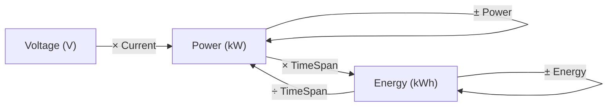
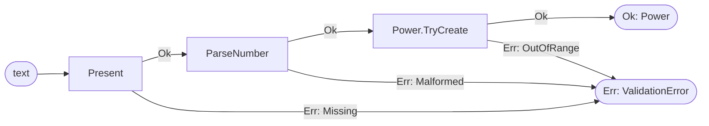
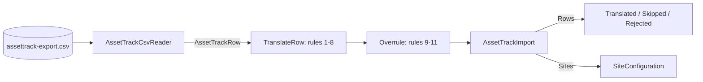

# Chapter 6. Value Objects and Entities

At 18:05 on a Tuesday, a driver at the West Garage forwards her receipt to support. It charges her for 22 kWh at 0.42 USD per kWh; her car says it took 11.3. A method `PriceEnergy(decimal kilowattHours, decimal rate)` was called with `connector.MaxPower`, a `decimal` that held 22, the connector's rating in kilowatts. Both values were `decimal`, so the compiler had nothing to say, and the unit test passed because its fixture used 22 for the rating and for the energy.

This is not a typo but a model that exists only in variable names. Nobody at Ohmline confuses a kilowatt with a kilowatt-hour, a rate with an amount; the code gave both one type and asked every caller to remember. The same gap lets a negative grid limit through, adds dollars to euros, passes a site code as a charge point id, and accepts a meter register that has gone backwards.

Chapters 4 and 5 found Ohmline's words and drew the boundaries between them. This chapter, the first of Part III, gives those words types that cannot hold nonsense. Chapter 7 builds aggregates out of them.

> **In this chapter you will:**
>
> - replace bare decimals with `Energy`, `Power`, `Current` and `Voltage`, and watch the compiler reject power plus energy;
> - write smart constructors that return `Result<T, ValidationError>` and chain them with `Bind`, so bad input becomes a value, not an exception;
> - keep money in one currency and round it only through a named `RoundingPolicy`;
> - give every cross-context identifier its own type, and find a meter register that went backwards anywhere in a history;
> - model a connector as an entity inside its charge point, compared by identity, not as an actor;
> - translate the AssetTrack export into site configurations or explicit rejections, and test value objects with CsCheck properties.

> **Starting point:** `ch05-s09`, ADR 0006 and the responsibility layers from section 5.9.
>
> ```bash
> git checkout ch05-s09
> ```

## 6.1 Primitive obsession in charging: kW versus kWh versus A

Every number in Ohmline has a unit: the depot's grid connection limit is 200 kW, a session delivers 19.753 kWh, a cable carries 32 A at 230 V. At `ch05-s09` they are all `decimal`, which cannot tell 22 kW from 22 kWh.

Martin Fowler and Kent Beck call this smell **Primitive Obsession** in [*Refactoring*](https://www.informit.com/store/refactoring-improving-the-design-of-existing-code-9780201485677) (1999, ch. 3 "Bad Smells in Code"): domain concepts carried as primitives, with their rules spread over every caller. Unit confusion is its most expensive form. NASA lost the Mars Climate Orbiter in 1999 because one program wrote impulse in pound-force seconds and another read it as newton-seconds ([Mishap Investigation Board, Phase I Report](https://llis.nasa.gov/llis_lib/pdf/1009464main1_0641-mr.pdf), section 4 "MCO Root Cause").

### The idea: whole values that know their dimension

A **value object** ([Evans 2003](https://www.informit.com/store/domain-driven-design-tackling-complexity-in-the-heart-9780321125217), ch. 5 "A Model Expressed in Software", section "Value Objects") is defined entirely by its attributes: it has no identity, two with equal attributes are interchangeable, and it never changes. Ward Cunningham's [*Whole Value* pattern](http://c2.com/ppr/checks.html#1) (1994) adds the point that matters here: a whole value captures "the whole quantity with all its implications beyond merely magnitude", so a number and its unit are one value, not two variables that must travel together.

Two of Evans's supple-design patterns (2003, ch. 10 "Supple Design"; summarized in his [*DDD Reference*](https://www.domainlanguage.com/wp-content/uploads/2016/05/DDD_Reference_2015-03.pdf)) shape the operations:

- **Closure of Operations.** The result has the arguments' type: energy plus energy is energy, so operations compose without new concepts.
- **Standalone Classes.** A class that depends on nothing else in the model is understood and tested alone.

Units add a rule from physics, **dimensional analysis**: quantities of different dimensions combine only where a law says what the result is. The diagram shows the combinations the kernel allows.



The loops are Closure of Operations within one unit (current and voltage have them too). The straight arrows are E = P × t, P = E / t and, for one phase, P = V × I. Anything without an arrow, such as power plus energy, should not compile.

### The code: units as readonly record structs

Tag `ch06-s01` adds four units under `src/Ohmline.SharedKernel/Units`. `Energy` shows the shape they share:

```csharp
// File: src/Ohmline.SharedKernel/Units/Energy.cs @ ch06-s01
public readonly record struct Energy :
    IAdditionOperators<Energy, Energy, Energy>,
    ISubtractionOperators<Energy, Energy, Energy>,
    IComparisonOperators<Energy, Energy, bool>,
    IAdditiveIdentity<Energy, Energy>
{
    public Energy(decimal kilowattHours) => KilowattHours = kilowattHours;

    public decimal KilowattHours
    {
        get;
        init => field = value >= 0m
            ? value
            : throw new ArgumentOutOfRangeException(
                nameof(KilowattHours), value, "Energy is never negative.");
    }
    // ...
    public static Energy Zero => default;

    static Energy IAdditiveIdentity<Energy, Energy>.AdditiveIdentity => Zero;
    // ...
    public static Energy operator +(Energy left, Energy right) =>
        new(left.KilowattHours + right.KilowattHours);
// ...
}
```

The `field`-backed `init` from section 3.2 puts the constructor and every `with` through one guard. Naming the amount `KilowattHours` answers this section's question wherever it is read. The generic-math interfaces from section 3.6 let generic code sum allocations or deliveries, and `Zero => default` is deliberate: a quantity's default is meaningful. `Power`, `Current` and `Voltage` have the same shape.

The laws between units live in one static class, so each unit stays standalone:

```csharp
// File: src/Ohmline.SharedKernel/Units/Dimensions.cs @ ch06-s01
public static class Dimensions
{
    extension(Power)
    {
        /// <summary>
        /// Energy delivered at a constant power. Counting in ticks keeps the arithmetic exact.
        /// </summary>
        public static Energy operator *(Power power, TimeSpan duration) =>
            new(power.Kilowatts * duration.Ticks / TimeSpan.TicksPerHour);

        public static Energy operator *(TimeSpan duration, Power power) => power * duration;
    }

    extension(Energy)
    {
        /// <summary>The average power over a duration. Over no time at all, it throws.</summary>
        public static Power operator /(Energy energy, TimeSpan duration) =>
            new(energy.KilowattHours * TimeSpan.TicksPerHour / duration.Ticks);
    }

    extension(Voltage)
    {
        /// <summary>Single-phase power, with a power factor of one.</summary>
        public static Power operator *(Voltage voltage, Current current) =>
            new(voltage.Volts * current.Amperes / 1000m);
    }
}
```

These are C# 14 extension operators: an `extension(Power)` block names a receiver type without a parameter, the form for static members, and callers write `power * duration` as if `Power` declared it. Ticks avoid `TotalHours`, which is a `double`, so 7.4 kW for 90 s is exactly 185 Wh. `Voltage × Current` brings the other two units into the analysis, and section 6.2 uses it.

What does not compile is the point. `UnitCompileErrors.cs` keeps three mistakes inside `#if DEMO_COMPILE_ERRORS`, as Chapter 3 did:

```text
$ dotnet build tests/Ohmline.SharedKernel.Tests -p:DefineConstants=DEMO_COMPILE_ERRORS
...(11,73): error CS0019: Operator '+' cannot be applied to operands of type 'Power' and 'Energy'
...(14,75): error CS0029: Cannot implicitly convert type '...Units.Energy' to '...Units.Power'
...(17,57): error CS0019: Operator '+' cannot be applied to operands of type 'Energy' and 'decimal'
```

The receipt bug from the opening now fails the build.

### Consequences

The units use `decimal`, so sums of readings and prices are exact at the resolution Ohmline cares about; section 6.8 finds where that stops. The guards throw, which is right for what they catch: a negative duration, or more energy taken away than there is, is a bug in the caller. Expected bad input needs the gentler door of section 6.2. The cost is conversion at the edges, such as watt-hours from chargers and converters for the journal (section 10.3).

> **Try it**
>
> ```bash
> git checkout ch06-s01
> git diff ch05-s09 ch06-s01 --stat
> dotnet test --solution Ohmline.slnx
> dotnet build tests/Ohmline.SharedKernel.Tests -p:DefineConstants=DEMO_COMPILE_ERRORS
> ```
>
> The diff shows `9 files changed, 399 insertions(+)`. The test run reports `total: 201`, `failed: 0`, with 17 new tests in `UnitTests` and `DimensionTests`. The last build fails with the three errors above, next to the two demos from Chapter 3 in the same project.

## 6.2 Smart constructors that return unions

An operator at the Ogden library types a connector's maximum power into the site settings form as `22 kW`, unit included. A confused charger sends the Device Gateway a meter value of `-5`. At `ch06-s01` both paths throw, yet typos are not bugs. A `catch` around every constructor flattens expected failures into one message, when the operator needs to know whether the value was missing, misshapen or out of range.

### The idea: parse once, into a type that cannot be wrong

A **smart constructor** is the only way to obtain a constrained type from raw input, and it returns either the value or a reason; Wlaschin ([2018](https://pragprog.com/titles/swdddf/domain-modeling-made-functional/), ch. 6 "Integrity and Consistency in the Domain") builds every constrained simple type this way. Alexis King's essay ["Parse, don't validate"](https://lexi-lambda.github.io/blog/2019/11/05/parse-don-t-validate/#the-power-of-parsing) (2019) names the difference: a validator answers yes or no and forgets what it learned, while a parser returns a more precise type that later steps can rely on.

Section 3.5 gave the kernel `Result<T, E>` and section 3.6 the contract `IValueObject<TSelf, TValue>` with a static abstract `TryCreate`. The error was a placeholder. Raw input can be wrong in exactly three ways: a number out of range, text without the right shape, or nothing at all. Those are three records with different data that never leave the process, which by ADR 0003 makes them a union.

### The code: `ValidationError` and `TryCreate`

Tag `ch06-s02` replaces Chapter 3's placeholder record:

```csharp
// File: src/Ohmline.SharedKernel/ValidationError.cs @ ch06-s02
namespace Ohmline.SharedKernel;

/// <summary>
/// Why a raw value is not a valid value object. Invalid input is expected, so a smart constructor
/// returns this inside a <see cref="Result{T, E}"/>; it never throws it.
/// </summary>
public union ValidationError(OutOfRange, Malformed, Missing)
{
    /// <summary>A sentence for logs and people. Code decides by the case, never by this.</summary>
    public string Message => this switch
    {
        OutOfRange error => FormattableString.Invariant(
            $"{error.Name} must be {error.Allowed}, not {error.Actual}."),
        Malformed error => $"{error.Name} must be {error.Expected}, not '{error.Input}'.",
        Missing error => $"{error.Name} is missing.",
        null => "This ValidationError is default: it holds no case.",
    };
}

/// <summary>A number outside the values the concept allows.</summary>
public sealed record OutOfRange(string Name, decimal Actual, string Allowed);

/// <summary>Text that does not have the concept's shape.</summary>
public sealed record Malformed(string Name, string Input, string Expected);

/// <summary>No value where one is required: null, empty or only white space.</summary>
public sealed record Missing(string Name);
```

The cases carry data, not prose, so code decides by the case. The union has a body, allowed because it declares no instance fields (section 3.4); `Message`, with the `null` arm every switch over a union needs, kept Chapter 3's `IValueObject.Create` compiling unchanged.

Each unit now implements the contract. In `Energy`:

```csharp
// File: src/Ohmline.SharedKernel/Units/Energy.cs @ ch06-s02
decimal IValueObject<Energy, decimal>.Value => KilowattHours;
// ...
public static Result<Energy, ValidationError> TryCreate(decimal kilowattHours) =>
    kilowattHours >= 0m
        ? Result.Ok(new Energy(kilowattHours))
        : Result.Fail<ValidationError>(
            new OutOfRange(nameof(Energy), kilowattHours, "0 kWh or more"));
```

`Value` is implemented explicitly, so generic code reads the raw amount while ordinary code says `KilowattHours`. `Result.Fail<ValidationError>` is section 3.5's explicit hop: union conversions do not chain.

### Chaining with `Bind`

Parsing a power typed into a form takes three steps, and each can fail differently. A test chains them:

```csharp
// File: tests/Ohmline.SharedKernel.Tests/Units/SmartConstructorTests.cs @ ch06-s02
private static Result<Power, ValidationError> ParseKilowatts(string? text) =>
    Present("Power", text).Bind(ParseNumber).Bind(Power.TryCreate);

private static Result<string, ValidationError> Present(string name, string? text) =>
    string.IsNullOrWhiteSpace(text)
        ? Result.Fail<ValidationError>(new Missing(name))
        : Result.Ok(text.Trim());

private static Result<decimal, ValidationError> ParseNumber(string text) =>
    decimal.TryParse(text, NumberStyles.Number, CultureInfo.InvariantCulture, out var number)
        ? Result.Ok(number)
        : Result.Fail<ValidationError>(new Malformed("Power", text, "a number of kilowatts"));
```

`Bind` runs the next step only on an `Ok` and passes an `Err` through untouched; Wlaschin calls this [railway-oriented programming](https://fsharpforfunandprofit.com/rop/), and draws the same two tracks in *Domain Modeling Made Functional*, ch. 10 "Implementation: Working with Errors":



Each step can switch to the `Err` track and nothing switches back, so the first failure is reported. A theory feeds the chain `"22"`, `null`, `"  "`, `"22 kW"` and `"-5"`, and each error case comes out of a different step. When a later step needs an earlier value, the lambdas nest. The tests' `Supply` helper binds a `Voltage`, then maps a `Current` to 6.1's `voltage * current`; with both figures negative, only the voltage's error appears. Section 6.7 nests five deep.

### Consequences

Every value object now has two doors: the throwing constructor (or section 3.6's `Create`) for values valid by construction (constants, test data), and `TryCreate` for anything from outside. Returning errors loses a stack trace that an expected failure does not need. `GOVERNANCE.md` records kernel version 2.0.0, major because `ValidationError`'s constructor is gone; that was safe only because the type never reached the wire or the journal, and as a union it never will.

> **Try it**
>
> ```bash
> git checkout ch06-s02
> git diff ch06-s01 ch06-s02 --stat
> git diff ch06-s01 ch06-s02 -- src/Ohmline.SharedKernel/Units/Energy.cs
> dotnet test --solution Ohmline.slnx
> ```
>
> The diff shows `10 files changed, 217 insertions(+), 9 deletions(-)`. The test run reports `total: 216`, `failed: 0`: 5 new tests in `ValidationErrorTests` and 10 cases in `SmartConstructorTests`.

## 6.3 Money, currency and rounding

A session at the West Garage delivers 19.753 kWh at 0.42 USD per kWh: 8.29626 USD. The receipt says 8.30, and nobody can point to the line that decided it. `Math.Round(8.285m, 2)` returns 8.28, because [.NET rounds midpoints to the even neighbour](https://learn.microsoft.com/en-us/dotnet/api/system.math.round#midpoint-values-and-rounding-conventions) unless told otherwise, so whoever writes `Math.Round` chooses a business rule without noticing. And a `decimal` total adds 3 EUR to 5 USD without complaint.

### The idea: no amount without its currency, no rounding without a policy

Fowler's [*Money* pattern](https://martinfowler.com/eaaCatalog/money.html) ([*Patterns of Enterprise Application Architecture*](https://www.informit.com/store/patterns-of-enterprise-application-architecture-9780321127426), 2002, ch. 18 "Base Patterns") is a Whole Value: an amount and a currency, with arithmetic only inside one currency. That is Closure of Operations with a boundary. Inside a price calculation, a second currency is a bug and deserves an exception; where two currencies can legitimately meet, such as a statement listing sessions under different tariffs, the mismatch is an expected outcome and belongs in a `Result`.

Rounding is the other half. Evans (2003, ch. 9 "Making Implicit Concepts Explicit") calls the remedy **making implicit concepts explicit**: a rule that lives only in scattered calls is a concept the model has not named. The finance team knows how a receipt is rounded; the code should say so in one type.

### The code: `Money` and `RoundingPolicy`

Tag `ch06-s03` adds `Currency`, `Money`, `CurrencyMismatch` and `RoundingPolicy` under `src/Ohmline.SharedKernel/Monetary`:

```csharp
// File: src/Ohmline.SharedKernel/Monetary/Money.cs @ ch06-s03
public readonly record struct Money :
    IAdditionOperators<Money, Money, Money>,
    ISubtractionOperators<Money, Money, Money>,
    IMultiplyOperators<Money, decimal, Money>,
    IComparisonOperators<Money, Money, bool>
{
    // ...
    public static Money Zero(Currency currency) => new(0m, currency);

    public Result<Money, CurrencyMismatch> TryAdd(Money other) =>
        Currency == other.Currency
            ? Result.Ok(this with { Amount = Amount + other.Amount })
            : Result.Fail(new CurrencyMismatch(Currency, other.Currency));

    public static Money operator +(Money left, Money right) =>
        new(left.Amount + right.Amount, CommonCurrency(left, right));

    public static Money operator -(Money left, Money right) =>
        new(left.Amount - right.Amount, CommonCurrency(left, right));

    /// <summary>Scales an amount, such as a price per kWh by the energy. Never rounds.</summary>
    public static Money operator *(Money money, decimal factor) =>
        money with { Amount = money.Amount * factor };
// ...
}
```

The operators go through a private `CommonCurrency`, which throws `InvalidOperationException`; `TryAdd` returns `Err<CurrencyMismatch>` instead. `CurrencyMismatch` is a record of its own with a `Message`, not a fourth `ValidationError` case, because neither raw value is invalid. Multiplying never rounds, so a test sees `8.29626 USD`. And `Money` has no `IAdditiveIdentity`: a zero needs a currency, so a generic sum such as section 3.6's `GenericMath.Sum<T>` cannot add up money by accident.

Rounding gets its own type:

```csharp
// File: src/Ohmline.SharedKernel/Monetary/RoundingPolicy.cs @ ch06-s03
/// <summary>
/// How amounts are rounded: to how many decimals, and which way. An implicit concept made
/// explicit: a tariff names its policy for its currency, and nothing else in Ohmline calls
/// <c>Math.Round</c> on money. Calculations stay unrounded until a policy rounds the result.
/// </summary>
public readonly record struct RoundingPolicy
{
    // ...
    /// <summary>Whole cents, halves away from zero, as on a receipt in dollars or euros.</summary>
    public static RoundingPolicy Cents { get; } = new(2, MidpointRounding.AwayFromZero);
    // ...
    public Money Round(Money money) =>
        money with { Amount = decimal.Round(money.Amount, Decimals, Mode) };
// ...
}
```

Guards and a `TryCreate` fill the elided lines. One test shows why the policy must be explicit: 8.285 USD is 8.29 under `Cents` and 8.28 under a policy with `MidpointRounding.ToEven`. Two reasonable policies disagree about one half-cent, so the tariff has to choose. Chapter 8 gives each tariff its policy, and section 8.3's price calculator rounds each line once and sums the rounded lines.

### Consequences

`Currency` states a rule every later text value object follows: the constructor takes the canonical form (`USD`), and `TryCreate` also accepts what people type (`" usd "`) and returns the canonical form.

`Money` and `RoundingPolicy` wrap two raw values each, so they do not implement the one-value `IValueObject`. The folder is `Monetary`, not `Money`, because a namespace `Ohmline.SharedKernel.Money` holding a type `Money` breaks callers inside `Ohmline.SharedKernel.*` with error CS0118.

> **Note:** attribute arguments cannot be `decimal`. `[InlineData(8.285, 8.29)]` passes the nearest `double`s, which arrive as 8.285000000000000142… and 8.289999999999999147…, and rounding tests fail for reasons unrelated to the model. The money theories use `TheoryData<decimal, decimal>` with `[MemberData]`.

> **Try it**
>
> ```bash
> git checkout ch06-s03
> git diff ch06-s02 ch06-s03 --stat
> dotnet test --solution Ohmline.slnx
> ```
>
> The diff shows `8 files changed, 370 insertions(+)`. The test run reports `total: 243`, `failed: 0`, with 27 new tests in `CurrencyTests`, `MoneyTests` and `RoundingPolicyTests`.

## 6.4 Identity: strongly typed identifiers

A method `ReserveConnector(string chargePointId, int connector, string token)` accepts its arguments in the wrong order without complaint, as does any method that receives a site code where a charge point id belongs. Identifiers also arrive in many spellings: a support agent types `ohm-slc-0042` from a ticket, and two RFID readers report the same card as `04a2b3c4` and `04A2B3C4`.

### The idea: identity is a value too

An **entity** (Evans 2003, ch. 5 "A Model Expressed in Software", section "Entities"; the [*DDD Reference*](https://www.domainlanguage.com/wp-content/uploads/2016/05/DDD_Reference_2015-03.pdf) speaks of "a thread of continuity and identity") is defined by identity and continuity, not by its attributes: a charge point stays the same charge point through every firmware update and change of state. The identity itself never changes, so it is a value object, and it deserves its own type so that a `SessionId` can never be passed as a `JourneyId`.

Choosing the identity is a modeling decision:

| Identifier | Kind | Why |
|---|---|---|
| `ChargePointId`, `SiteId` | Natural key | People read it off the device or the site plan |
| `ConnectorId` | Composite | Connector 1 means nothing without its charge point |
| `SessionId`, `JourneyId` | Generated (Guid v7) | Unique without coordination, in creation order |
| `TokenUid` | External | The card's UID, as the reader reports it |

Each crosses a context boundary, so it belongs in the Shared Kernel, which section 5.5 limits to units, money, cross-context identifiers and small building blocks such as `Result`.

### The code: six identifiers

Tag `ch06-s04` adds them under `src/Ohmline.SharedKernel/Identity`, next to section 3.8's `GuidV7`. `ChargePointId` is the clearest:

```csharp
// File: src/Ohmline.SharedKernel/Identity/ChargePointId.cs @ ch06-s04
public readonly partial record struct ChargePointId : IValueObject<ChargePointId, string>
{
    private const string Shape = "OHM-, an area code, a hyphen and four digits, like OHM-SLC-0042";

    public ChargePointId(string value) => Value = value;
    // ...
    public static Result<ChargePointId, ValidationError> TryCreate(string value)
    {
        if (string.IsNullOrWhiteSpace(value))
        {
            return Result.Fail<ValidationError>(new Missing(nameof(ChargePointId)));
        }

        var canonical = value.Trim().ToUpperInvariant();
        return Format().IsMatch(canonical)
            ? Result.Ok(new ChargePointId(canonical))
            : Result.Fail<ValidationError>(new Malformed(nameof(ChargePointId), value, Shape));
    }

    public override string ToString() => Value;

    [GeneratedRegex("^OHM-[A-Z]{3}-[0-9]{4}$")]
    private static partial Regex Format();
}
```

The elided `Value` property has the guarded `init` of the units. The regular expression is source-generated, hence `partial`, and uses `[0-9]` rather than `\d`, because in .NET `\d` matches any Unicode digit; a test proves it with `OHM-SLC-00٤2`, which contains an Arabic-Indic four.

`ConnectorId` pairs a `ChargePointId` with a `Number` of at least 1 and writes itself as `OHM-SLC-0042/1`. Its string `TryCreate` reads that form back:

```csharp
// File: src/Ohmline.SharedKernel/Identity/ConnectorId.cs @ ch06-s04
public static Result<ConnectorId, ValidationError> TryCreate(string value)
{
    if (string.IsNullOrWhiteSpace(value))
    {
        return Result.Fail<ValidationError>(new Missing(nameof(ConnectorId)));
    }

    return value.Split('/') is [var chargePoint, var number]
        && int.TryParse(number, out var parsed)
        ? ChargePointId.TryCreate(chargePoint).Bind(id => TryCreate(id, parsed))
        : Result.Fail<ValidationError>(
            new Malformed(nameof(ConnectorId), value, "a charge point id, /, a number"));
}
```

The list pattern insists on exactly two parts, and `Bind` hands over to `ChargePointId.TryCreate`, so a bad charge point inside `OHM-42/1` reports the `ChargePointId` error with its expected shape.

`SessionId` and `JourneyId` take their time from a clock that is passed in, `SessionId.New(TimeProvider clock)`, and share a new `GuidV7.Check`: version 7 is accepted, `Guid.Empty` is `Missing`, anything else `Malformed`. A test reads a `FakeTimeProvider`'s 2026-11-04 07:52 UTC back out of the id's first 12 hex digits. `SiteId` is kebab case starting with a three-letter area code (`slc-depot`), stricter than section 4.5's naming rules, which the tag updates. `TokenUid` is 4 to 10 bytes of upper-case hexadecimal.

### Consequences

A struct's default still exists: `default(ChargePointId).Value` is `null`, as a test shows. `ConnectorId`'s guard rejects a default charge point, but an uninitialized field of an identifier type still holds one, and no warning points at it. That is the price of small, allocation-free identifiers.

Natural keys have a risk that generated keys lack. If Ohmline relabels a charge point, its identity changes, and an identity that names an aggregate in the journal must never change (section 4.5). Generated keys have the opposite risk: nobody can read a Guid out on the phone. Exercise 2 weighs the two.

> **Try it**
>
> ```bash
> git checkout ch06-s04
> git diff ch06-s03 ch06-s04 --stat
> dotnet test --solution Ohmline.slnx
> ```
>
> The diff shows `14 files changed, 519 insertions(+), 1 deletion(-)`. The test run reports `total: 292`, `failed: 0`, with 49 new tests under `tests/Ohmline.SharedKernel.Tests/Identity`.

## 6.5 Meter readings: monotonic registers and time

A charge point does not report the energy of a session. It reports its register, a cumulative counter in watt-hours, like a car's odometer. At 07:52 the register behind `OHM-SLC-0042/1` reads 1,200,000 Wh, at 08:31 it reads 1,219,753 Wh, and the session has delivered 19.753 kWh. Then a meter is swapped mid-session and a reading of 50 Wh arrives; or the gateway, after a reconnect, forwards a reading taken before the last one it sent.

### The idea: a rule over a sequence

The glossary states the invariant: a meter register never decreases. Unlike the rules of sections 6.1 to 6.4, it concerns every adjacent pair of readings, not one value. A broken pair is also not invalid input in the sense of section 6.2: the reading really came from the meter, and rejecting it would discard evidence. So the operation returns a `Result` with a union of the two ways a pair can be wrong, and the caller decides; section 7.7 records a `MeterAnomalyDetected` event.

### The code: `MeterReading`, `MeterError` and `MeterHistory`

Tag `ch06-s05` adds the first behaviour to a context's domain project, under `src/Charging/Ohmline.Charging.Domain/Metering`:

```csharp
// File: src/Charging/Ohmline.Charging.Domain/Metering/MeterReading.cs @ ch06-s05
public sealed record MeterReading(Energy Register, DateTimeOffset At)
{
    // ...
    /// <summary>
    /// The energy delivered since an earlier reading. A reading taken before it, or a register
    /// lower than it, is not an exception: meters do this, and the caller decides what it means.
    /// </summary>
    public Result<Energy, MeterError> EnergySince(MeterReading previous)
    {
        if (At < previous.At)
        {
            return Result.Fail<MeterError>(new ReadingOutOfOrder(previous, this));
        }

        if (Register < previous.Register)
        {
            return Result.Fail<MeterError>(new RegisterWentBackwards(previous, this));
        }

        return Result.Ok(Register - previous.Register);
    }
}
```

`MeterReading` is a `sealed record`, not a struct, because no default reading makes sense. Time is checked first, and equal timestamps are in order. The error set carries both readings in each case:

```csharp
// File: src/Charging/Ohmline.Charging.Domain/Metering/MeterError.cs @ ch06-s05
public union MeterError(RegisterWentBackwards, ReadingOutOfOrder);

/// <summary>The later register is lower: a meter reset, a meter swap or a firmware fault.</summary>
public sealed record RegisterWentBackwards(MeterReading Previous, MeterReading Current);

/// <summary>The reading was taken before the one it should follow.</summary>
public sealed record ReadingOutOfOrder(MeterReading Previous, MeterReading Current);
```

A history needs every step checked, which is where list patterns earn their place:

```csharp
// File: src/Charging/Ohmline.Charging.Domain/Metering/MeterHistory.cs @ ch06-s05
/// <summary>Rules over a session's meter readings, oldest first.</summary>
public static class MeterHistory
{
    /// <summary>
    /// Checks every step of the history and reports the first that breaks the rules. Comparing
    /// only the first and last readings would miss a register that went down and back up.
    /// </summary>
    public static Result<Unit, MeterError> Check(ReadOnlySpan<MeterReading> history)
    {
        while (history is [var previous, var current, ..])
        {
            if (current.EnergySince(previous) is Err<MeterError> error)
            {
                return error;
            }

            history = history[1..];
        }

        return Result.Ok();
    }

    /// <summary>The energy delivered over the whole history, if every step is sound.</summary>
    public static Result<Energy, MeterError> EnergyDelivered(ReadOnlySpan<MeterReading> history) =>
        history switch
        {
            [] or [_] => Result.Ok(Energy.Zero),
            [var first, .., var last] => Check(history).Bind(_ => last.EnergySince(first)),
        };
}
```

`Check` matches the first two readings with `[var previous, var current, ..]`, slices one off the span and looks again. `return error;` converts the `Err<MeterError>` case into the method's `Result<Unit, MeterError>`, because a case converts implicitly to its union. In `EnergyDelivered`, `[] or [_]` and `[var first, .., var last]` together cover every length, so the switch needs no discard.

The doc comment of `Check` is the lesson. In a test, the history 1,200,000 Wh, 50 Wh, 1,201,230 Wh gives a plausible 1.23 kWh as last minus first; only the step-by-step check reports `RegisterWentBackwards` for the middle step.

### Consequences

A `ReadOnlySpan<MeterReading>` accepts arrays, collection expressions and an `ImmutableArray` through `AsSpan()` without a copy, so `MeterHistory` does not depend on the collection the aggregate chooses. The new `tests/Ohmline.Charging.Domain.Tests` needs a fixed `DateTimeOffset` and a few readings, and no actors, database or clock.

> **Try it**
>
> ```bash
> git checkout ch06-s05
> git diff ch06-s04 ch06-s05 --stat
> git diff ch06-s04 ch06-s05 -- src/Charging/Ohmline.Charging.Domain
> dotnet test --solution Ohmline.slnx
> ```
>
> The diff shows `7 files changed, 203 insertions(+)`. The test run reports `total: 302`, `failed: 0`, with 10 tests in the new `Ohmline.Charging.Domain.Tests`.

## 6.6 Entities inside an aggregate: a connector is a record, not an actor

Connector 1 on `OHM-SLC-0042` becomes occupied at 07:52. A week later, after a cable fault, a technician derates it from 22 kW to 11 kW. It is the same plug throughout, but a record compares every member, so to a record the occupied, derated connector is a different value. Chapter 2 suggests another shape: its `ConnectorActor` gave each connector a mailbox of its own.

### The idea: local identity inside a boundary

A connector is an entity: it keeps its identity while its state changes. It is also never addressed on its own. The design-level board of section 4.4 made `ChargePoint` the aggregate, and Evans (2003, ch. 6 "The Life Cycle of a Domain Object", section "Aggregates") lets outside objects hold references to the root only (the [*DDD Reference*](https://www.domainlanguage.com/wp-content/uploads/2016/05/DDD_Reference_2015-03.pdf) states the rule in one sentence). An entity inside the boundary therefore needs only a *local* identity, meaningful within the boundary and reached through the root. Rules that involve connectors, such as "one session per connector", are checked by the charge point, against state it owns.

Equality follows from that. Aggregate state is compared as a value: Chapter 7's tests fold events and compare whole states. So `Connector` keeps record equality, and identity questions go through a comparer.

### The code

Tag `ch06-s06` adds three small files under `src/Charging/Ohmline.Charging.Domain/ChargePoints`:

```csharp
// File: src/Charging/Ohmline.Charging.Domain/ChargePoints/Connector.cs @ ch06-s06
/// <summary>
/// A connector as its charge point sees it. An entity: it stays the same connector while its
/// state changes. Not an actor: it lives inside the charge point's state and only the charge
/// point changes it, so a rule such as "one session per connector" is checked in one place.
/// As a record it compares every member; to compare identities, use
/// <see cref="ConnectorComparer.ById"/>.
/// </summary>
public sealed record Connector(ConnectorId Id, Power MaxPower, ConnectorState State);
```

`ConnectorState` is a placeholder record with a static `Available`; section 7.3 turns it into a union whose cases carry only the data valid in them. The comparer is one expression:

```csharp
// File: src/Charging/Ohmline.Charging.Domain/ChargePoints/ConnectorComparer.cs @ ch06-s06
/// <summary>Entity equality for connectors: one id is one connector, whatever its state.</summary>
public static class ConnectorComparer
{
    // The key selector is also called for null, so a missing connector has a null key.
    public static EqualityComparer<Connector> ById { get; } =
        EqualityComparer<Connector>.Create(connector => connector?.Id);
}
```

A test uses it with a collection-expression argument from section 3.8:

```csharp
// File: tests/Ohmline.Charging.Domain.Tests/ChargePoints/ConnectorTests.cs @ ch06-s06
var derated = Available with { MaxPower = new Power(11m) };

HashSet<Connector> connectors = [with(ConnectorComparer.ById), Available, derated];

connectors.Count.ShouldBe(1);
connectors.Single().MaxPower.ShouldBe(new Power(22m));
```

The 11 kW version is the same connector, so the set keeps one: the first.

> **Version note:** the key-selector overload `EqualityComparer<T>.Create(Func<T, TKey>, IEqualityComparer<TKey>?)` sits beside .NET 8's `Create(Func<T?, T?, bool>, Func<T, int>?)`; the sample verified it by reflection on the .NET 11 RC3 runtime. The selector is also called with `null`, hence `connector?.Id`.

> **Anti-pattern: one actor per database row.** An actor per connector turns the charge point's rules into a conversation: each check becomes an `Ask`, two commands interleave between the asks, and no single mailbox owns the rule. Inside the charge point's state, the same rule is a pattern match. Section 7.9 returns to this.

### Consequences

Chapter 2's `ConnectorActor` taught how a mailbox removes a race. The product code moves the mailbox up to the charge point; section 7.1 weighs that one mailbox's throughput on the [Aggregate Design Canvas](https://github.com/ddd-crew/aggregate-design-canvas).

> **Try it**
>
> ```bash
> git checkout ch06-s06
> git diff ch06-s05 ch06-s06 --stat
> dotnet test --solution Ohmline.slnx
> ```
>
> The diff shows `4 files changed, 83 insertions(+)`. The test run reports `total: 306`, `failed: 0`, with 4 tests in `ConnectorTests`.

## 6.7 Value objects at the boundary: parsing a Big Ball of Mud

Site Energy needs a configuration for every site, and the only source is AssetTrack's export from section 5.6: the bus depot is `SLC-DEPOT`, `slc depot` and `SLC_DEPOT`, power is `200 kW`, `200000W` or `0.4 MW`, and a priority may be `F`, blank or `Pubic`. Parsing that inside a `SiteConfiguration` constructor would teach the model AssetTrack's words, and fixing it with guesses would one day serve a public driver before a fleet.

### The idea: a pure translator that ends in value objects

An **Anticorruption Layer** (ACL; Evans 2003, ch. 14 "Maintaining Model Integrity", section "Anticorruption Layer") translates an upstream model into the downstream's terms. Here it is a pure function from rows to outcomes, and the value objects of sections 6.1 to 6.4 are its target vocabulary: whatever crosses becomes a `SiteId`, a `Power`, a `ConnectorId` and a `PriorityClass`, or does not cross at all. It is ["parse, don't validate"](https://lexi-lambda.github.io/blog/2019/11/05/parse-don-t-validate/) at the scale of a file. Section 5.6's `docs/acl/assettrack.md` fixed the contract: eleven ordered rules, no guessing, and exactly one outcome per row, which makes the outcomes a union. The pipeline:



The reader splits CSV and judges nothing. `TranslateRow` applies the rules one row decides alone, and `Translate` then runs three `Overrule` passes for the rules that need all rows: duplicates, sites whose rows disagree, and connectors that need more than their site can give. Only `SiteConfiguration` values reach the model; the row outcomes are a report for the people who fix AssetTrack.

### The code: the Site Energy model and the ACL

Tag `ch06-s07` adds `SiteConfiguration`, `ConnectorConfiguration` and `PriorityClass` to `src/SiteEnergy/Ohmline.SiteEnergy.Domain/Sites`. `PriorityClass` is a `closed record` with sealed leaves `Fleet` and `Public`, because section 7.8 writes it into events. The configurations have private constructors and get-only properties, so `with` cannot bypass a rule such as "the minimum is not above the maximum", and `SiteConfiguration` compares its `ImmutableArray` of connectors element by element, which a record alone would not (section 3.1).

The ACL is a new project, `Ohmline.SiteEnergy.Acl.AssetRegistry`, that references only the Shared Kernel and the Site Energy domain. Its outcome type:

```csharp
// File: src/SiteEnergy/Ohmline.SiteEnergy.Acl.AssetRegistry/AssetRowTranslation.cs @ ch06-s07
public union AssetRowTranslation(Translated, Skipped, Rejected)
{
    public AssetTrackRow Row => this switch
    {
        Translated translated => translated.Row,
        Skipped skipped => skipped.Row,
        Rejected rejected => rejected.Row,
        null => throw new InvalidOperationException("This AssetRowTranslation is default."),
    };
}

/// <summary>An active connector, every field read with certainty.</summary>
public sealed record Translated(
    AssetTrackRow Row, SiteSettings Site, ConnectorConfiguration Connector);

/// <summary>A row not meant for Site Energy: retired, a test record, an exact duplicate.</summary>
public sealed record Skipped(AssetTrackRow Row, AssetTrackRule Rule, string Reason);

/// <summary>A row meant for Site Energy that cannot be trusted; a person has to fix it.</summary>
public sealed record Rejected(AssetTrackRow Row, AssetTrackRule Rule, string Reason);
```

For an active row, rules 2 to 8 are one `Bind` chain, nested because the last step needs every earlier value:

```csharp
// File: src/SiteEnergy/Ohmline.SiteEnergy.Acl.AssetRegistry/AssetTrackTranslator.cs @ ch06-s07
private static Result<Translated, Rejection> ReadActiveRow(AssetTrackRow row) =>
    ReadSiteId(row.SiteCode).Bind(siteId =>
        ReadPowers(row).Bind(CheckPlausibility).Bind(powers =>
            ReadTimeZone(row.TimeZone).Bind(timeZone =>
                ReadConnectorId(row.ChargerSerial, row.PlugNumber).Bind(connectorId =>
                    ReadPriority(row.Priority).Map(priority => new Translated(
                        row,
                        new SiteSettings(
                            siteId, powers.GridLimit, powers.SafetyMargin, timeZone),
                        ConnectorConfiguration.Create(
                            connectorId, powers.MinPower, powers.MaxPower, priority)))))));
```

Each `Read...` method returns `Result<T, Rejection>`, where `Rejection` is a private record of a rule number and a reason. The throwing `ConnectorConfiguration.Create` is safe because `CheckPlausibility` has already rejected a minimum above the maximum. The kernel's smart constructors are reused, not repeated: a private C# 14 extension member, `Under(rule)`, relabels a `ValidationError` as a rejection, so `ChargePointId.TryCreate(chargePoint).Under(AssetTrackRule.ChargePoint)` rejects a blank serial under rule 6 with the kernel's own message. The rest is small, rule-shaped functions: a power reader that rejects `3,7 kW` before its regular expression runs, rather than guess what the comma means, and reads `0.4 MW` as 400 kW, time-zone aliases, a list pattern `['#', .. var digits]` for plugs written `#2`, and a priority switch in which `Pubic` matches nothing.

### Consequences

The tests read the committed CSV as their fixture and reproduce the document's table line by line: 19 rows translated, 5 skipped, 16 rejected, four sites. One compares the whole Salt Lake depot configuration, built from rows with two spellings of the site, a time-zone alias, a serial without hyphens and a blank priority. Rejections tell a person what to fix, such as `Priority 'Pubic' is neither Fleet nor Public`; the cost, accepted in section 5.6, is 16 rows waiting for that person.

Purity has one asterisk: the translator reads the operating system's time zone database. `TimeZoneInfo.TryFindSystemTimeZoneById` proved case-sensitive on Linux in a fresh process (a filled cache hid this), so the translator searches `GetSystemTimeZones()` case-insensitively first. A file with the wrong header is not an export at all, so the reader throws `FormatException`. And `SiteConfiguration` exposes `ConfiguredCapacity`, grid limit minus margin, because the glossary's effective capacity also subtracts curtailment, which only `SitePowerBudget` knows (section 7.8).

> **Try it**
>
> ```bash
> git checkout ch06-s07
> git diff ch06-s06 ch06-s07 --stat
> git diff ch06-s06 ch06-s07 -- src/SiteEnergy/Ohmline.SiteEnergy.Domain
> dotnet test --solution Ohmline.slnx
> ```
>
> The diff shows `19 files changed, 1046 insertions(+)`. The test run reports `total: 381`, `failed: 0`: 11 tests in the new `Ohmline.SiteEnergy.Domain.Tests`, 63 in `Ohmline.SiteEnergy.Acl.AssetRegistry.Tests`, and one more architecture test for the ACL project's references.

## 6.8 Property-based tests for value objects

The tests so far check examples someone thought of: 50 kW for 30 minutes is 25 kWh. A value object promises more. Energy over its duration should give back the power for every power and duration, and rounding should never move an amount by more than half a cent.

### The idea: state the law, let the machine search

**Property-based testing**, introduced by Koen Claessen and John Hughes with [QuickCheck](https://doi.org/10.1145/351240.351266) (ICFP 2000), states a property that must hold for every input. A library generates inputs, and when one fails it shrinks it toward a small counterexample. Value objects have natural laws: associativity, commutativity, an identity element, monotonicity, bounded error, idempotence. These are Evans's **Assertions** (2003, ch. 10 "Supple Design", section "Assertions") in executable form: where a language cannot state an assertion directly, the [*DDD Reference*](https://www.domainlanguage.com/wp-content/uploads/2016/05/DDD_Reference_2015-03.pdf) says to "write automated unit tests for them". Section 9.4 applies the same idea to aggregates. The book uses [CsCheck 5.0.1](https://www.nuget.org/packages/CsCheck/5.0.1), a generator-first C# library that runs inside an ordinary `[Fact]`.

### The code: generators and properties

Tag `ch06-s08` adds CsCheck to `Directory.Packages.props` and three files to `Ohmline.SharedKernel.Tests`. The generators produce values at the resolution of real data:

```csharp
// File: tests/Ohmline.SharedKernel.Tests/Generators.cs @ ch06-s08
// Pins Gen to CsCheck's. Other property libraries have a Gen too (FsCheck's clashes with CS0104),
// and with the alias this file never depends on which namespaces happen to be imported.
using Gen = CsCheck.Gen;
// ...
internal static class Generators
{
    /// <summary>0 to 1 GWh, in watt-hours.</summary>
    public static readonly Gen<Energy> Energies =
        Gen.Long[0, 1_000_000_000].Select(wattHours => Energy.FromWattHours(wattHours));

    /// <summary>0 to 1 MW, in watts.</summary>
    public static readonly Gen<Power> Powers =
        Gen.Int[0, 1_000_000].Select(watts => Power.FromWatts(watts));
    // ...
    /// <summary>Amounts from -1,000 to 1,000 in one currency, to four decimal places.</summary>
    public static Gen<Money> AmountsIn(Currency currency) =>
        Gen.Long[-10_000_000, 10_000_000].Select(units => new Money(units / 10_000m, currency));

    public static readonly Gen<Money> Amounts = Currencies.SelectMany(AmountsIn);
}
```

The alias wins over `using CsCheck;` for the class `Gen`, while `Gen<T>` still comes from the namespace; with no other property library referenced, it is insurance. Watt-hours, watts and ten-thousandths of a currency unit keep `decimal` sums exact, so a failure points at the model, not at arithmetic noise. Two unit properties:

```csharp
// File: tests/Ohmline.SharedKernel.Tests/Units/UnitPropertyTests.cs @ ch06-s08
[Fact]
public void Adding_energy_is_associative()
{
    Gen.Select(Energies, Energies, Energies)
        .Sample((a, b, c) => ((a + b) + c).ShouldBe(a + (b + c)));
}
// ...
[Fact]
public void Energy_over_its_duration_gives_back_the_power_to_a_milliwatt()
{
    Gen.Select(Powers, Durations.Where(duration => duration > TimeSpan.Zero))
        .Sample((power, duration) =>
        {
            var average = power * duration / duration;
            Math.Abs(average.Kilowatts - power.Kilowatts).ShouldBeLessThan(0.000_001m);
        });
}
```

Written with exact equality, the second property fails, and CsCheck reports a counterexample with a seed that replays it:

```text
$ dotnet test --solution Ohmline.slnx
...
CsCheck.CsCheckException : Set seed: "4tjsd61cRvP6" ... (0 shrinks, 97 skipped, 100 total).
(41.03 kW, 23:58:27)
---- Shouldly.ShouldAssertException : average
    should be
41.03 kW
    but was
41.029999999999999999999999999 kW
```

`P × t` divides by `TimeSpan.TicksPerHour`, and `decimal` keeps 28 to 29 significant digits, so dividing back can be off in the 27th decimal. No receipt will ever see that, and the committed property allows a milliwatt. The rounding law needs a bound that depends on the policy:

```csharp
// File: tests/Ohmline.SharedKernel.Tests/Monetary/MoneyPropertyTests.cs @ ch06-s08
Gen.Select(Amounts, RoundingPolicies).Sample((money, policy) =>
{
    var step = new decimal(1, 0, 0, false, (byte)policy.Decimals);
    var limit = policy.Mode is MidpointRounding.ToEven or MidpointRounding.AwayFromZero
        ? step / 2
        : step;

    var error = Math.Abs(policy.Round(money).Amount - money.Amount);

    error.ShouldBeLessThanOrEqualTo(limit);
});
```

A step is one unit in the last kept decimal. Rounding to the nearest moves an amount by at most half a step, and the directed modes, such as `ToZero`, by less than a whole one. Other properties check that `P × t` grows with power and time.

### Consequences

Property names are sentences, such as `Adding_energy_is_associative`, because a property has no command for a `Given…When…Then` name. Shouldly's ordering assertions need `IComparable<T>`, which the units do not implement, so the properties compare raw amounts such as `KilowattHours`. The full message also suggests a replay through `CsCheck_Seed`, which the sample has not exercised; Exercise 5 tries it.

> **Try it**
>
> ```bash
> git checkout ch06-s08
> git diff ch06-s07 ch06-s08 --stat
> git diff ch06-s07 ch06-s08 -- Directory.Packages.props
> dotnet test --solution Ohmline.slnx
> ```
>
> The diff shows `6 files changed, 190 insertions(+)`. The test run reports `total: 393`, `failed: 0`, with 12 property tests in `UnitPropertyTests` and `MoneyPropertyTests`.

## Summary

- A number without its unit is Primitive Obsession; unit types make the receipt bug a compile error, and dimensional analysis lives in one place as extension operators.
- A smart constructor parses raw input once into a type that cannot be wrong, returning a union of error cases; constructors throw only for bugs.
- Money is an amount in one currency, and rounding is a named policy chosen by the tariff, not a side effect of whoever calls `Math.Round`.
- Identities are value objects too; natural, composite and generated keys answer different questions, and cross-context ones live in the governed Shared Kernel.
- A meter history is checked step by step, and a broken step is a reported fact, not an exception.
- An entity inside an aggregate is a record with local identity, compared by a key comparer; making it an actor scatters the aggregate's rules.
- An Anticorruption Layer can be a pure function that ends in value objects or explicit rejections, and property tests check the laws value objects promise for every input.

## DDD canon covered

Value Objects (smart constructors, unions); Entities; Supple design: Standalone Classes; Supple design: Closure of Operations; Supple design: Assertions; Making implicit concepts explicit; Shared Kernel; ACL; Big Ball of Mud; Anti-pattern catalog.

## Exercises

1. **Reflect.** Bidirectional charging lets a car feed energy back to the depot, but `Energy` is never negative. Allow negative `Energy`, add a type for flows, or keep one non-negative amount per direction? Weigh Closure of Operations, registers that never decrease, and what a receipt must show.
2. **Reflect.** Ohmline moves a charge point from the West Garage to the depot, and operations want a new label. Weigh the natural `ChargePointId` against a generated id with a separate label: support calls, persistence ids that never change (section 4.5), and AssetTrack rows that use the old label.
3. **Extend.** Starting from `ch06-s05`, add `MeterHistory.Anomalies`, which returns every broken step, not only the first. It worked when the history 1,200,000 Wh, 50 Wh, 1,201,230 Wh, 1,200,900 Wh reports two `RegisterWentBackwards` errors.
4. **Extend.** Starting from `ch06-s08`, write a generator for `ConnectorId` and the property that `ConnectorId.TryCreate(id.ToString())` returns `Result.Ok(id)` for every generated id; it worked when the property passes and fails as soon as `ToString` drops the slash.
5. **Break it.** At `ch06-s08`, change the milliwatt property in `UnitPropertyTests` to `average.ShouldBe(power)` and run the tests. Expect a `CsCheckException` with a seed and a counterexample, as in section 6.8. Then set `CsCheck_Seed` to that seed, as the message suggests, and check whether the same counterexample comes back.
6. **Break it.** At `ch06-s06`, change `connector?.Id` to `connector.Id` in `ConnectorComparer.cs` and build. Expect `error CS8602: Dereference of a possibly null reference`, because the key selector also receives `null`.

## Further reading

- Eric Evans, [*Domain-Driven Design: Tackling Complexity in the Heart of Software*](https://www.informit.com/store/domain-driven-design-tackling-complexity-in-the-heart-9780321125217) (Addison-Wesley, 2003). Chapter 5, "A Model Expressed in Software", for entities and value objects; chapters 9, "Making Implicit Concepts Explicit", and 10, "Supple Design", for implicit concepts and supple design; chapter 14, "Maintaining Model Integrity", for the Anticorruption Layer. His free [*DDD Reference*](https://www.domainlanguage.com/wp-content/uploads/2016/05/DDD_Reference_2015-03.pdf) (2015) summarizes each pattern.
- Vaughn Vernon, [*Implementing Domain-Driven Design*](https://www.informit.com/store/implementing-domain-driven-design-9780321834577) (Addison-Wesley, 2013). Chapter 5, "Entities", whose "Unique Identity" section compares identity strategies, and chapter 6, "Value Objects", a long case for values over what Vernon calls "entity-think".
- Scott Wlaschin, [*Domain Modeling Made Functional*](https://pragprog.com/titles/swdddf/domain-modeling-made-functional/) (Pragmatic Bookshelf, 2018). Chapter 6, "Integrity and Consistency in the Domain", for constrained types and smart constructors; chapter 10, "Implementation: Working with Errors", for [railway-oriented](https://fsharpforfunandprofit.com/rop/) error handling.
- Ward Cunningham, [*The CHECKS Pattern Language of Information Integrity*](http://c2.com/ppr/checks.html) (1994). [Whole Value](http://c2.com/ppr/checks.html#1) and its companions, the origin of section 6.1's point that a number and its unit belong in one value.
- Alexis King, [*Parse, don't validate*](https://lexi-lambda.github.io/blog/2019/11/05/parse-don-t-validate/) (2019). Why a check should return a more precise type.
- Martin Fowler, [*Money*](https://martinfowler.com/eaaCatalog/money.html), from [*Patterns of Enterprise Application Architecture*](https://www.informit.com/store/patterns-of-enterprise-application-architecture-9780321127426) (2002), ch. 18 "Base Patterns". The pattern behind section 6.3.
- Koen Claessen and John Hughes, [*QuickCheck: A Lightweight Tool for Random Testing of Haskell Programs*](https://doi.org/10.1145/351240.351266) (ICFP 2000). Where property-based testing began; CsCheck is at [github.com/AnthonyLloyd/CsCheck](https://github.com/AnthonyLloyd/CsCheck).
