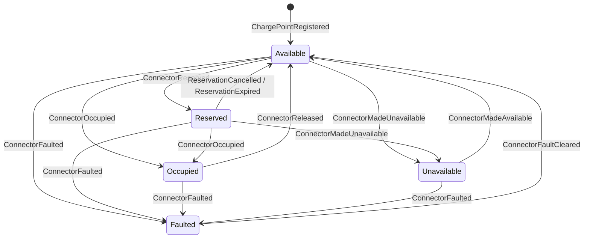
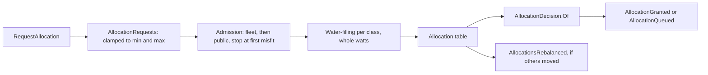
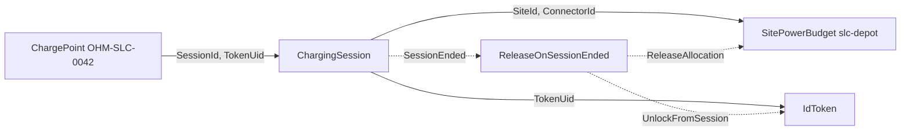

# Chapter 7. Aggregates and the Decider

At 08:07 on a Wednesday at the bus depot, three things arrive within a second. A driver's reservation on connector 1 of `OHM-SLC-0042`, made at 07:52, reaches its fifteenth minute as a van driver plugs into that connector; the timer that should expire the reservation has not fired yet. Two bays away, a fifth car asks the site for 50 kW while four others already share the 190 kW the site may draw. And a charge point that lost its connection for ten minutes reconnects and sends its buffered meter values, one of them with a register lower than the one before.

The operations team can answer each case in a sentence. The van may charge, because a reservation protects a connector up to its expiry time and not at it. All five cars get 38 kW. The low register is kept for someone to investigate, and the session keeps counting energy from the last good reading.

Chapter 6 gave those sentences their nouns: `Power`, `TokenUid`, `MeterReading`. It did not say where each rule lives, which data it may consult, or what orders two requests that arrive in the same instant. This chapter draws the consistency boundaries and writes the rules inside them as pure functions, with no actor, clock or journal involved; Chapter 10 puts those functions inside actors.

> **In this chapter you will:**
>
> - fill in an Aggregate Design Canvas and read its throughput as a mailbox rate and its size as a snapshot cadence;
> - write commands and events as closed hierarchies, and state and errors as unions whose cases carry only valid data;
> - express an aggregate's rules as a decision table that the compiler checks for every pair of state and command;
> - write an `Evolve` that never fails, and rebuild any state as a fold of its events;
> - implement `IDecider` for three aggregates, including one that records facts it cannot refuse;
> - explain the fair-share allocator and why the site power budget is Ohmline's hot aggregate.

> **Starting point:** `ch06-s08`, the value objects, identifiers and property tests of Chapter 6.
>
> ```bash
> git checkout ch06-s08
> ```

## 7.1 Finding the true invariants: the Aggregate Design Canvas

The design-level board of section 4.4 named four aggregates: `ChargePoint`, `ChargingSession`, `SitePowerBudget` and `IdToken`. A name is not yet a boundary. A connector hosts at most one session, so should the charge point own its sessions? Should the site power budget hold the sessions it powers? Every "yes" puts more rules in one place and makes that place busier.

### The idea: a boundary exists for the rules that cannot lapse

[Evans](https://www.informit.com/store/domain-driven-design-tackling-complexity-in-the-heart-9780321125217) (2003, ch. 6 "The Life Cycle of a Domain Object", section "Aggregates") defines an **aggregate** as a cluster of associated objects treated as a unit for data changes, entered only through its root. The boundary exists for **invariants**: rules that must hold whenever a change completes. Vaughn Vernon's ["Effective Aggregate Design"](https://www.dddcommunity.org/library/vernon_2011/) (2011) and [*Implementing Domain-Driven Design*](https://www.informit.com/store/implementing-domain-driven-design-9780321834577) (2013, ch. 10 "Aggregates", where each rule is a section heading) reduce the design to four rules:

1. Model true invariants in consistency boundaries.
2. Design small aggregates.
3. Reference other aggregates by identity.
4. Use eventual consistency outside the boundary.

The word *true* carries the first rule. A true invariant is one the business cannot let lapse even briefly: two sessions on one connector, or a depot drawing more than its grid connection allows, is an incident. Many rules only sound like invariants. "When a session ends, its power goes back to the others" can happen half a second later without anyone noticing. Vernon's test, a guideline he credits to Evans, is whose job the consistency is (["Ask Whose Job It Is"](https://www.dddcommunity.org/wp-content/uploads/files/pdf_articles/Vernon_2011_2.pdf#page=3), Part II of the essay, p. 3): if it is the job of the user issuing the command to make the data consistent, the rule belongs inside; if it is another user's job or the system's, it may be eventually consistent and belongs outside, as a policy (section 8.5).

With actors the stakes are physical. One aggregate becomes one entity actor (Chapter 10) that handles one message at a time, so the boundary is also the unit of concurrency. A boundary that is too wide queues unrelated work behind one mailbox. One that is too narrow spreads a true invariant over two mailboxes, where no single decision can check it.

The **Aggregate Design Canvas** from the [ddd-crew collection](https://github.com/ddd-crew/aggregate-design-canvas) turns these questions into fields: name, description, state transitions, enforced invariants, corrective policies, handled commands, created events, throughput and size. In an actor system the last two have a precise meaning. *Throughput* is the rate of commands into one instance, which is the mailbox rate of one entity actor. *Size* is the number of events one instance accumulates, which is what recovery replays and so what sets the snapshot cadence (section 11.2).

### The code: four canvases

Tag `ch07-s01` adds one canvas per aggregate to `docs/canvases/`. The charge point's invariants explain why the connector of section 6.6 is an entity inside it rather than an aggregate of its own:

*File: docs/canvases/aggregate-charge-point.md @ ch07-s01*

```text
1. A connector hosts at most one session at a time.
2. A reserved connector accepts only the token that holds the reservation, until the reservation
   expires. An expired reservation no longer protects the connector, even before the timer that
   expires it has fired.
3. A faulted connector accepts no reservation and no session until the fault is cleared.
4. A connector that operators took out of use accepts no reservation and no session.
5. A charge point is registered once.

All five rules need only the charge point's own state. Rule 1 is why the charge point, not the
connector, is the aggregate (section 6.6): a connector is an entity inside it, so "occupy" and
"reserve" for one connector are decided one at a time by one decider.
```

Rule 2 already answers the van driver's case from the opening. The session canvas answers the question of ownership with its throughput field: a session receives a meter value a minute, and a reconnecting charger can send a few hundred at once.

*File: docs/canvases/aggregate-charging-session.md @ ch07-s01*

```text
The mailbox rate is low and steady. Keeping sessions out of the charge point is what keeps it
that way: inside the charge point, every meter value would queue behind reservations and plug-ins
for the other connectors.
```

The four canvases side by side:

| Aggregate | Keyed by | Peak throughput | Size | Snapshot |
|---|---|---|---|---|
| Charge point | `ChargePointId` | A few commands a minute | About 10,000 events a year | Every 100 events |
| Charging session | `SessionId` | A burst of buffered meter values | 60 to 600 events, then none | Every 100 events |
| Site power budget | `SiteId` | Tens of requests a minute at shift change | Tens of thousands a year | 100, smaller at the depot |
| Id token | `TokenUid` | Two taps within a minute | A few hundred a year | Every 100 events |

The id token's code arrives in section 12.7, but its canvas shows a boundary drawn around a uniqueness rule. "A token has at most one active session" looks like a rule about all sessions in Ohmline. Keyed by the token's UID, it becomes a local check in one small aggregate.

### Consequences

The numbers are estimates; section 11.2 measures replay cost and revisits the cadence. One canvas raises a flag. The site power budget's rule 1 spans every connector at a site, so it cannot be split, and at the depot's shift change every request competes for the same capacity through one mailbox. Its canvas calls it Ohmline's **hot aggregate**; section 7.8 builds it and section 15.8 says what to measure before redesigning it.

> **Try it**
>
> ```bash
> git checkout ch07-s01
> git diff ch06-s08 ch07-s01 --stat
> dotnet test --solution Ohmline.slnx
> ```
>
> The diff shows `4 files changed, 403 insertions(+)`, all under `docs/canvases/`. The test run reports `total: 393`, `failed: 0`: a canvas changes no code.

## 7.2 Commands and events as closed hierarchies

At `ch06-s08` the hierarchies from section 4.6 compile but say nothing. `ReserveConnector` cannot tell which connector or for which token, and `ConnectorReserved` cannot remember until when. Filling them in forces three decisions: how a command names a connector, what an event must remember, and which types may sit inside a record that will stay in a journal for years.

### The idea: requests in, facts out

A **command** is a request in the imperative: `ReserveConnector`. The aggregate may refuse it. An **event** is a fact in the past tense: `ConnectorReserved`. It records what the aggregate decided, and nothing refuses it afterwards (section 7.5). The names come from the design-level board under the rules of section 4.5.

Both are closed hierarchies, the house style of section 3.4: a `closed record` base with `sealed` leaves, exhaustive across assemblies, and each case a subtype that Akka.NET can dispatch on and a serializer can tag. A hierarchy can have levels: all connector commands share a connector number, so they sit under a second closed record, `ConnectorCommand`, which section 7.4 handles in one row.

### The code: the charge point's protocol

Tag `ch07-s02` fills in the commands in `Ohmline.Charging.Contracts`, because other contexts send them:

```csharp
// File: src/Charging/Ohmline.Charging.Contracts/ChargePoints/ChargePointCommand.cs @ ch07-s02
public closed record ChargePointCommand(ChargePointId ChargePointId);

/// <summary>
/// Add a charge point and its connectors to Ohmline's network. Connectors are numbered from 1
/// without gaps, as the charge point itself numbers them, so connector n is the nth entry.
/// </summary>
public sealed record RegisterChargePoint(
    ChargePointId ChargePointId, SiteId SiteId, ImmutableArray<Power> ConnectorMaxPowers)
    : ChargePointCommand(ChargePointId);

/// <summary>A command about one connector of the charge point.</summary>
public closed record ConnectorCommand(ChargePointId ChargePointId, int ConnectorNumber)
    : ChargePointCommand(ChargePointId);

/// <summary>Keep a connector for one token until the reservation expires.</summary>
public sealed record ReserveConnector(
    ChargePointId ChargePointId, int ConnectorNumber, TokenUid TokenUid)
    : ConnectorCommand(ChargePointId, ConnectorNumber);

// ...

/// <summary>The reservation's time is up; sent by a timer, not by a person.</summary>
public sealed record ExpireReservation(ChargePointId ChargePointId, int ConnectorNumber)
    : ConnectorCommand(ChargePointId, ConnectorNumber);

// ...

/// <summary>Operators take a working connector out of use: maintenance, a closed bay.</summary>
public sealed record MakeConnectorUnavailable(ChargePointId ChargePointId, int ConnectorNumber)
    : ConnectorCommand(ChargePointId, ConnectorNumber);
```

A connector is addressed by its number, not by the `ConnectorId` of section 6.4: the charge point id is already on the base, and a `ConnectorId` would let a command for `OHM-SLC-0042` name a connector of `OHM-SLC-0041`. The shape removes that mistake before any rule has to catch it.

The last command is new. Without `MakeConnectorUnavailable` and `MakeConnectorAvailable`, nothing could put a connector into the glossary's *Unavailable* status, and an unreachable state is worse than none. They model an operator closing a bay; the glossary, the design-level board and the Charging canvas gained them in the same commit.

The events live in `Ohmline.Charging.Domain`. Their base record's summary states the rule for everything persisted: "They are written to the journal, so they hold plain data: value objects and closed records, never a union."

```csharp
// File: src/Charging/Ohmline.Charging.Domain/ChargePoints/ChargePointEvent.cs @ ch07-s02
public closed record ChargePointEvent(ChargePointId ChargePointId);

/// <summary>
/// The charge point joined the network with its connectors, numbered from 1 in order. Equal
/// when the values are equal: a record alone would compare the array by reference.
/// </summary>
public sealed record ChargePointRegistered(
    ChargePointId ChargePointId, SiteId SiteId, ImmutableArray<Power> ConnectorMaxPowers)
    : ChargePointEvent(ChargePointId)
{
    public bool Equals(ChargePointRegistered? other) =>
        other is not null
        && base.Equals(other)
        && SiteId == other.SiteId
        && ConnectorMaxPowers.SequenceEqual(other.ConnectorMaxPowers);

    public override int GetHashCode() =>
        HashCode.Combine(base.GetHashCode(), SiteId, ConnectorMaxPowers.Length);
}

/// <summary>Something happened to one connector of the charge point.</summary>
public closed record ConnectorEvent(ChargePointId ChargePointId, int ConnectorNumber)
    : ChargePointEvent(ChargePointId);

/// <summary>
/// The connector is held for one token until <paramref name="ExpiresAt"/>. The expiry time is
/// computed when the reservation is accepted and recorded here, so replaying the event later
/// gives the same expiry, whatever the clock says then.
/// </summary>
public sealed record ConnectorReserved(
    ChargePointId ChargePointId, int ConnectorNumber, TokenUid TokenUid, DateTimeOffset ExpiresAt)
    : ConnectorEvent(ChargePointId, ConnectorNumber);
```

`ConnectorReserved` carries `ExpiresAt`, a value the command never had: the event records the *decision*, including what was computed while making it (section 7.5).

### Why a persisted shape never holds a union

Section 3.9 showed the two failures: Akka.NET 1.5's default Newtonsoft serializer round-trips a union with `Value == null` and no exception, and System.Text.Json writes a union as its bare case with no discriminator. Unions suit state and errors, which never leave the process. ADR 0003 says so, and this tag turns the ADR into a test:

```csharp
// File: tests/Ohmline.ArchitectureTests/PersistedShapeTests.cs @ ch07-s02
/// <summary>
/// ADR 0003 as a test. A closed record hierarchy is what Ohmline tells, persists and puts on the
/// wire: commands, events, replies. A union cannot survive that trip (section 3.9), so no closed
/// hierarchy in a Contracts or Domain assembly may hold a union, however deep in its properties.
/// </summary>
public sealed class PersistedShapeTests
{
    public static TheoryData<string> Projects =>
        new(Repository.ContractsProjects.Concat(Repository.DomainProjects));

    [Theory]
    [MemberData(nameof(Projects))]
    public void A_closed_hierarchy_never_holds_a_union(string project)
    {
        var shapes = Repository.Load(project).GetTypes().Where(IsInClosedHierarchy);

        shapes.SelectMany(shape => UnionsIn(shape, shape.Name, [])).ShouldBeEmpty();
    }

    // ...
    private closed record Contraband;

    private sealed record Smuggler(IReadOnlyList<ValidationError> Errors) : Contraband;
}
```

`IsInClosedHierarchy` looks for the compiler's `IsClosedTypeAttribute` on a type or an ancestor, and `UnionsIn` walks properties, collection elements and nested Ohmline types, reporting anything that implements `IUnion`. A second test proves the walk finds the planted `Smuggler`'s list of `ValidationError`.

### Consequences

From now on every field of an event is a promise to the journal: renaming one later is a schema migration (Chapter 20). So the names are the glossary's, and the fields are the smallest set that later decisions need.

> **Try it**
>
> ```bash
> git checkout ch07-s02
> git diff ch07-s01 ch07-s02 --stat
> git diff ch07-s01 ch07-s02 -- src/Charging/Ohmline.Charging.Contracts
> dotnet test --solution Ohmline.slnx
> ```
>
> The diff shows `8 files changed, 278 insertions(+), 27 deletions(-)`. The test run reports `total: 407`, `failed: 0`: 10 new tests in `PersistedShapeTests` (nine assemblies and the planted `Smuggler`) and 4 in `ChargePointProtocolTests`.

## 7.3 State as a union: making illegal states unrepresentable

A charge point must remember, for each connector, enough to decide the next command: whether it is reserved, for whom and until when, or which session is using it. The obvious shape is a status plus a field for every piece of data any status might need:

```csharp
// Illustration (not in the sample)
public enum ConnectorStatus { Available, Reserved, Occupied, Faulted, Unavailable }

public sealed record ConnectorRow(
    ConnectorStatus Status, TokenUid? ReservedFor, DateTimeOffset? ReservedUntil,
    SessionId? SessionId, string? ErrorCode);
```

Five statuses and four nullable fields describe dozens of combinations, of which five make sense. An available connector that still names a session is a valid `ConnectorRow`, and every rule must first check that the fields agree with the status.

### The idea: one case per state, each with only its own data

Yaron Minsky's advice for typed functional code was to ["make illegal states unrepresentable"](https://blog.janestreet.com/effective-ml-revisited/) (a heading in his 2011 post "Effective ML Revisited"), and Scott Wlaschin's [*Domain Modeling Made Functional*](https://pragprog.com/titles/swdddf/domain-modeling-made-functional/) (2018, the chapters "Integrity and Consistency in the Domain" and "Modeling Workflows as Pipelines") made it a DDD habit: model a lifecycle as a choice between cases, and give each case only the data that is true in it. A reserved connector *has* a token and an expiry; an occupied one *has* a session; an available one has nothing. C# 15 unions (section 3.3) express this directly.

### The code: `ConnectorState` and `ChargePointState`

Tag `ch07-s03` replaces Chapter 6's placeholder with a union:

```csharp
// File: src/Charging/Ohmline.Charging.Domain/ChargePoints/ConnectorState.cs @ ch07-s03
/// <summary>
/// What a connector is doing now. Each case carries only the data that is true in it: only a
/// reserved connector has a token and an expiry, and only an occupied one has a session. A
/// connector that is available and still has a session cannot be written down.
/// </summary>
public union ConnectorState(Available, Reserved, Occupied, Faulted, Unavailable);

/// <summary>Free for the next driver.</summary>
public sealed record Available;

/// <summary>Held for one token until the expiry time.</summary>
public sealed record Reserved(TokenUid TokenUid, DateTimeOffset ExpiresAt)
{
    /// <summary>A reservation protects the connector up to its expiry time, not at it.</summary>
    public bool HasExpiredAt(DateTimeOffset now) => now >= ExpiresAt;
}

/// <summary>A car is plugged in, and this session is using the connector.</summary>
public sealed record Occupied(SessionId SessionId);

/// <summary>The charge point reported a fault; the code is the charge point's own.</summary>
public sealed record Faulted(string ErrorCode);

/// <summary>Operators took the connector out of use.</summary>
public sealed record Unavailable;
```

`HasExpiredAt` puts the opening's 08:07 question in one place, with `>=`. The canvas draws how a connector moves between these cases; each box is one case of the union and each arrow one event:

*File: docs/canvases/aggregate-charge-point.md @ ch07-s01*



Drawing the lifecycle as a state machine follows Evans's advice to draw on established formalisms when you can ([2003](https://www.informit.com/store/domain-driven-design-tackling-complexity-in-the-heart-9780321125217), ch. 10 "Supple Design", section "Draw on Established Formalisms, When You Can"); his own examples are accounting and math. Some arrows are missing on purpose: none leads from `Occupied` to `Unavailable`, because operators cannot close a bay while a car charges, and the only way out of `Faulted` is a repair. Section 7.4 turns missing arrows into refusals.

The charge point as a whole has two states. Before registration it remembers nothing, so its first case carries no data:

```csharp
// File: src/Charging/Ohmline.Charging.Domain/ChargePoints/ChargePointState.cs @ ch07-s03
public union ChargePointState(Unregistered, Registered)
{
    /// <summary>Where every charge point starts, and where recovery starts its fold.</summary>
    public static ChargePointState Initial { get; } = new Unregistered();
}

/// <summary>Not yet known to Ohmline.</summary>
public sealed record Unregistered;

/// <summary>
/// A charge point on the network: its site, by identity, and its connectors by number. Equal
/// when the values are equal: a record alone would compare the dictionary by reference.
/// </summary>
public sealed record Registered(
    ChargePointId ChargePointId, SiteId SiteId, ImmutableDictionary<int, Connector> Connectors)
// ...
```

A union body may not declare instance fields (`CS9373`), but a static property is allowed, so `Initial` lives with the union it starts. The connectors of section 6.6, keyed by number, now carry a `ConnectorState`.

### The null-arm discipline

A union is a struct, so `default(ChargePointState)` exists and holds no case at all: its `Value` is `null`. A field nobody initialized or an empty array slot produces one, and a switch without a `null` arm then throws `SwitchExpressionException` at run time, with no warning at compile time (section 3.3). The house rule is to give every switch that a default can reach a `null` arm, and never a discard. The test project shows the shape:

```csharp
// File: tests/Ohmline.Charging.Domain.Tests/ChargePoints/ChargePointStateTests.cs @ ch07-s03
private static string Describe(ConnectorState state) => state switch
{
    Available => "available",
    Reserved reserved => $"reserved for {reserved.TokenUid} until {reserved.ExpiresAt:HH:mm}",
    Occupied occupied => $"occupied by session {occupied.SessionId}",
    Faulted faulted => $"faulted: {faulted.ErrorCode}",
    Unavailable => "unavailable",
    null => "unknown",
};
```

A `_ =>` arm would also catch the default, but it would catch a sixth state too, and silence the `CS8509` error you want when someone adds one.

### Consequences

Every rule written against this state starts from a fact rather than a check. The cost is a pattern per access: a reserved connector's token is reached by matching `Reserved`, never by reading a field.

> **Try it**
>
> ```bash
> git checkout ch07-s03
> git diff ch07-s02 ch07-s03 --stat
> git diff ch07-s02 ch07-s03 -- src/Charging/Ohmline.Charging.Domain/ChargePoints/ConnectorState.cs
> dotnet test --solution Ohmline.slnx
> ```
>
> The diff shows `4 files changed, 162 insertions(+), 15 deletions(-)`. The test run reports `total: 413`, `failed: 0`, with 6 new tests in `ChargePointStateTests`, among them `Given_a_default_state_then_it_holds_no_case_and_only_a_null_arm_catches_it`.

## 7.4 Decide: business rules as an exhaustive decision table

Back at 08:07: connector 1 is `Reserved` for the driver's card until 08:07, and `OccupyConnector` arrives for the van and someone else's card. Five connector states meet nine connector commands: forty-five pairs, each needing an answer. Written as `if` statements in message handlers, the answers scatter, and nothing tells you which pair nobody answered.

### The idea: a decision table the compiler can check

[Evans](https://www.informit.com/store/domain-driven-design-tackling-complexity-in-the-heart-9780321125217) (2003, ch. 10 "Supple Design", section "Declarative Design") calls it **Declarative Design** when part of a program is written "as a kind of executable specification" ([*DDD Reference*](https://www.domainlanguage.com/wp-content/uploads/2016/05/DDD_Reference_2015-03.pdf#page=32), "Declarative Design", p. 25), a declaration of what holds rather than a procedure. For an aggregate that declaration is a decision table: one row per pair of state and command. A C# switch expression over the tuple `(state, command)` *is* that table, and with `CS8509` an error since section 3.3, the compiler refuses a table with a gap and names the missing pair.

Two habits keep the check honest. Guards (`when ...`) do not count toward exhaustiveness, so the guarded rows for a case come first and an unguarded row for the same case closes it. And no row uses a discard: states are spelled out, as in `Available or Occupied or Faulted or Unavailable`, so a sixth state breaks the build at every row that should have considered it.

The answer is a value, not an exception: `Result<ImmutableArray<ChargePointEvent>, ChargePointError>` from section 3.5, either zero or more events or one reason for refusal. And the clock becomes an input, as Chapter 1 promised:

```csharp
// File: src/Ohmline.SharedKernel/Deciders/DecisionContext.cs @ ch07-s04
/// <summary>
/// What a decider is told about the world when it decides: for now, only the time. The shell
/// reads its clock once per command and passes the reading in, so a decider never reads a clock
/// itself, and a test decides what time it is.
/// </summary>
public sealed record DecisionContext(DateTimeOffset Now)
{
    public static DecisionContext From(TimeProvider clock) => new(clock.GetUtcNow());
}
```

It is a `sealed record` rather than a struct, so no `default` context with a `Now` of `DateTimeOffset.MinValue` can exist.

### The code: two tables

Tag `ch07-s04` adds `ChargePoint.Decide`. The top-level table decides at the level of the charge point and hands connector commands to a second table:

```csharp
// File: src/Charging/Ohmline.Charging.Domain/ChargePoints/ChargePoint.cs @ ch07-s04
/// <summary>
/// The charge point's rules as a decision table: one row per (state, command) pair. The
/// first row is the factory: the only way a charge point comes into being.
/// </summary>
public static Result<ImmutableArray<ChargePointEvent>, ChargePointError> Decide(
    ChargePointState state, ChargePointCommand command, DecisionContext context) =>
    (state, command) switch
    {
        (Unregistered, RegisterChargePoint register) => Accept(new ChargePointRegistered(
            register.ChargePointId, register.SiteId, register.ConnectorMaxPowers)),
        (Unregistered, ConnectorCommand) =>
            Reject(new ChargePointError.NotRegistered(command.ChargePointId)),
        (Registered, RegisterChargePoint) =>
            Reject(new ChargePointError.AlreadyRegistered(command.ChargePointId)),
        (Registered chargePoint, ConnectorCommand onConnector) =>
            chargePoint.Connectors.TryGetValue(onConnector.ConnectorNumber, out var connector)
                ? Decide(connector.State, onConnector, context)
                : Reject(new ChargePointError.UnknownConnector(onConnector.ConnectorNumber)),
        (null, _) => throw DefaultState(),
    };
```

The first row is Evans's **Factory** ([2003](https://www.informit.com/store/domain-driven-design-tackling-complexity-in-the-heart-9780321125217), ch. 6 "The Life Cycle of a Domain Object", section "Factories") in its event-sourced form. A charge point is not constructed; it comes into being when `ChargePointRegistered` is accepted, and this row is the only place that can happen. The table needs no discard on the command either: the closed level `ConnectorCommand` from section 7.2 makes `RegisterChargePoint` and `ConnectorCommand` the complete set.

The connector table has 32 rows, grouped by command with a blank line between groups. Three groups show the pattern:

```csharp
// File: src/Charging/Ohmline.Charging.Domain/ChargePoints/ChargePoint.cs @ ch07-s04
private static Result<ImmutableArray<ChargePointEvent>, ChargePointError> Decide(
    ConnectorState state, ConnectorCommand command, DecisionContext context) =>
    (state, command) switch
    {
        (Available, ReserveConnector reserve) => Accept(Reservation(reserve, context)),
        (Reserved held, ReserveConnector reserve) when held.TokenUid == reserve.TokenUid =>
            NoChange,
        (Reserved held, ReserveConnector reserve) when held.HasExpiredAt(context.Now) =>
            Accept(Expiry(reserve, held), Reservation(reserve, context)),
        (Reserved held, ReserveConnector) => Reject(HeldForAnother(command, held)),
        (Occupied or Unavailable, ReserveConnector) => Reject(Unusable(command)),
        (Faulted fault, ReserveConnector) => Reject(Broken(command, fault)),
        // ...
        (Available, OccupyConnector occupy) => Accept(Occupation(occupy)),
        (Reserved held, OccupyConnector occupy) when held.TokenUid == occupy.TokenUid =>
            Accept(Occupation(occupy)),
        (Reserved held, OccupyConnector occupy) when held.HasExpiredAt(context.Now) =>
            Accept(Expiry(occupy, held), Occupation(occupy)),
        (Reserved held, OccupyConnector) => Reject(HeldForAnother(command, held)),
        (Occupied current, OccupyConnector occupy) when current.SessionId == occupy.SessionId =>
            NoChange,
        (Occupied or Unavailable, OccupyConnector) => Reject(Unusable(command)),
        (Faulted fault, OccupyConnector) => Reject(Broken(command, fault)),

        (Occupied current, ReleaseConnector release) => Accept(new ConnectorReleased(
            release.ChargePointId, release.ConnectorNumber, current.SessionId)),
        (Available or Reserved or Faulted or Unavailable, ReleaseConnector) => NoChange,
        // ...
        (null, _) => throw DefaultState(),
    };
```

Read the `OccupyConnector` group as the business would. Plugging into an available connector occupies it. The reservation holder may plug in. Anyone may plug in once the reservation has expired, and that single decision records two facts, `ReservationExpired` and then `ConnectorOccupied`, whether or not the expiry timer has fired. Otherwise the driver learns the connector is held for someone else. The same session plugging in twice changes nothing, which makes a repeated message from the Device Gateway harmless. `ConnectorReleased` takes its `SessionId` from the state, not the command, because the charger only knows the cable came out.

The helpers keep each row to one line of intent:

```csharp
// File: src/Charging/Ohmline.Charging.Domain/ChargePoints/ChargePoint.cs @ ch07-s04
/// <summary>The expiry is decided here, from the context's time, and recorded.</summary>
private static ConnectorReserved Reservation(
    ReserveConnector reserve, DecisionContext context) =>
    new(reserve.ChargePointId, reserve.ConnectorNumber, reserve.TokenUid,
        context.Now + ReservationHold);
// ...
private static Result<ImmutableArray<ChargePointEvent>, ChargePointError> NoChange { get; } =
    Accept();

private static Result<ImmutableArray<ChargePointEvent>, ChargePointError> Accept(
    params ImmutableArray<ChargePointEvent> events) => Result.Ok(events);
```

`params ImmutableArray<T>`, a C# 13 params collection, is what lets a row write `Accept(eventA, eventB)` or `Accept()`.

The reasons for refusal form `union ChargePointError` with six cases: `NotRegistered`, `AlreadyRegistered`, `UnknownConnector`, `ConnectorUnavailable`, `ReservedForAnotherToken` and `ConnectorFaulted`. The cases are nested inside the union, because some share a name with an event: `ConnectorFaulted` is a fact the charge point records, and `ChargePointError.ConnectorFaulted` is a reason to refuse a driver. `ReservedForAnotherToken` carries `Until`, so the driver learns when the other reservation runs out. Section 10.2 maps the cases to wire-safe replies.

### What the compiler catches

Leave one pair out and the build stops. The sample keeps a demonstration in the Charging test project behind `#if DEMO_COMPILE_ERRORS`; it arrived one tag later, at `ch07-s05`:

```csharp
// File: tests/Ohmline.Charging.Domain.Tests/ChargePoints/DecisionTableCompileErrors.cs @ ch07-s05
public static string OnRelease(ConnectorState state, ConnectorCommand command) =>
    (state, command) switch
    {
        (Occupied, ReleaseConnector) => "the session leaves the connector",
        (Available or Reserved or Faulted, ReleaseConnector) => "nothing changes",
        (_, not ReleaseConnector) => "another table",
        (null, _) => "a bug",
    };
```

```text
$ dotnet build tests/Ohmline.Charging.Domain.Tests -p:DefineConstants=DEMO_COMPILE_ERRORS
...(14,26): error CS8509: ... the pattern '(...Unavailable, ...ReleaseConnector)' is not covered.
```

The compiler names the missing *pair*, which is a row of the business's table, not a line of code.

### Testing every row

The tests have one method per row, 57 cases in all. Evolve does not exist yet, so a helper `With("reserved")` writes a registered charge point with connector 1 in the named state directly, and a C# 14 extension block adds `ShouldAccept` and `ShouldReject` to the `Result` type. The van's row:

```csharp
// File: tests/Ohmline.Charging.Domain.Tests/ChargePoints/ChargePointDecideTests.cs @ ch07-s04
public void Given_an_expired_reservation_when_another_driver_plugs_in_then_they_may_charge()
{
    var occupy = new OccupyConnector(Charger, 1, NextSession, SomeoneElsesCard);

    Decide(With("reserved"), occupy, at: Expiry.AddMinutes(3)).ShouldAccept(
        new ReservationExpired(Charger, 1, DriversCard),
        new ConnectorOccupied(Charger, 1, NextSession, SomeoneElsesCard));
}
```

The time is whatever the test says. `Given_another_time_in_the_context_when_reserved_then_the_expiry_moves_with_it` decides at noon and gets an expiry of 12:15.

### Consequences

The table is long, and that is the point: every pair has been considered, and the next state or command will be too, because the build lists the rows to write. Row order matters among guarded rows, and it encodes policy: the "same token" row comes before the "expired" row, so the holder reserving again changes nothing. Exercise 1 asks whether that is right after expiry.

> **Try it**
>
> ```bash
> git checkout ch07-s04
> git diff ch07-s03 ch07-s04 --stat
> git diff ch07-s03 ch07-s04 -- src/Charging/Ohmline.Charging.Domain
> dotnet test --solution Ohmline.slnx
> ```
>
> The diff shows `9 files changed, 601 insertions(+), 13 deletions(-)`. The test run reports `total: 470`, `failed: 0`, with 57 new cases from the 37 methods of `ChargePointDecideTests`.

## 7.5 Evolve: total, deterministic, never failing

The reservation decided at 07:52 is now an event in a journal: `ConnectorReserved` with an expiry of 08:07. At 10:00 the node restarts, and the charge point rebuilds its state by replaying that event and everything after it. If the code that applies events checked "is the connector available?", or computed the expiry again from the clock, the replay could fail, or produce a state nobody at the depot ever saw.

### The idea: apply facts, check nothing

`Evolve(state, event)` returns the state after one event. Three properties make it safe to replay:

- **Total.** Every pair of state and event gives a state. An event that `Decide` would never have produced in that state changes nothing; it does not throw.
- **Deterministic.** The same state and event always give the same result: no clock, no random numbers, no I/O.
- **Never validating.** The rules ran in `Decide` when the fact was accepted. Running them again on replay can only fail, and it will, the day a rule is tightened and an old event no longer passes.

`Decide` and `Evolve` are Evans's **Side-Effect-Free Functions** ([2003](https://www.informit.com/store/domain-driven-design-tackling-complexity-in-the-heart-9780321125217), ch. 10 "Supple Design", section "Side-Effect-Free Functions") taken all the way: each returns a value and changes nothing. With those properties, recovery is a **fold**: the state is `events.Aggregate(Initial, Evolve)`, which is how [Chassaing's Decider](https://thinkbeforecoding.com/post/2021/12/17/functional-event-sourcing-decider) (2021) rebuilds the current state (`List.fold evolve initialState events`) and how section 1.6 described the shell. Anything non-deterministic must therefore be decided once, in `Decide`, and recorded in the event. That is why `ConnectorReserved` carries `ExpiresAt`.

### The code: `Evolve`, `Next` and `Fold`

Tag `ch07-s05` adds them to `ChargePoint`:

```csharp
// File: src/Charging/Ohmline.Charging.Domain/ChargePoints/ChargePoint.cs @ ch07-s05
public static ChargePointState Evolve(ChargePointState state, ChargePointEvent @event) =>
    (state, @event) switch
    {
        (Unregistered, ChargePointRegistered registered) => Register(registered),
        (Registered chargePoint, ConnectorEvent happened) =>
            chargePoint.Connectors.TryGetValue(happened.ConnectorNumber, out var connector)
                ? chargePoint with
                {
                    Connectors = chargePoint.Connectors.SetItem(
                        happened.ConnectorNumber, connector with { State = Next(happened) }),
                }
                : chargePoint,
        (Registered, ChargePointRegistered) or (Unregistered, ConnectorEvent) => state,
        (null, _) => throw DefaultState(),
    };

/// <summary>
/// Recovery: the state is the fold of the history over <see cref="Evolve"/>, starting from
/// the initial state. The same history always gives the same state.
/// </summary>
public static ChargePointState Fold(IEnumerable<ChargePointEvent> events) =>
    events.Aggregate(ChargePointState.Initial, Evolve);
// ...
/// <summary>A connector's next state follows from the event alone.</summary>
private static ConnectorState Next(ConnectorEvent happened) => happened switch
{
    ConnectorReserved reserved => new Reserved(reserved.TokenUid, reserved.ExpiresAt),
    ConnectorOccupied occupied => new Occupied(occupied.SessionId),
    ConnectorFaulted faulted => new Faulted(faulted.ErrorCode),
    ConnectorMadeUnavailable => new Unavailable(),
    ReservationCancelled or ReservationExpired or ConnectorReleased
        or ConnectorFaultCleared or ConnectorMadeAvailable => new Available(),
};
```

A connector event for a connector that does not exist leaves the state alone; a second registration does too. `Next` needs no previous state at all, because every connector event fully determines what follows. It lists every `ConnectorEvent` and has no discard, so a tenth connector event will not compile until someone says what it means. The only throw is the `null` arm, which reports a bug in the caller, never a problem with history.

> **Warning:** an `Evolve` that validates, throws on an unexpected pair or reads the clock turns one awkward event into an aggregate that can never recover. Every restart replays the same event and fails at the same place; section 11.3 calls it a poison event.

### Tests that pin the fold

`ChargePointEvolveTests` keeps a history with one event of every type, and a reflection test fails as soon as a new event type exists that the history does not contain. Two tests carry this section's argument. The first decides a reservation at 07:52 and folds the result as if replaying it much later: the expiry stays 08:07.

```csharp
// File: tests/Ohmline.Charging.Domain.Tests/ChargePoints/ChargePointEvolveTests.cs @ ch07-s05
public void Given_a_reservation_made_this_morning_when_replayed_later_then_its_expiry_is_kept()
{
    var decided = ChargePoint.Decide(
        ChargePoint.Fold([Registration]),
        new ReserveConnector(Charger, 1, DriversCard),
        new DecisionContext(Morning));
    var events = decided.Value.ShouldBeOfType<Ok<ImmutableArray<ChargePointEvent>>>().Value;

    ChargePoint.Fold([Registration, .. events]).ShouldBe(Registered(
        Connector(1, 50m, new Reserved(DriversCard, Expiry)),
        Connector(2, 22m, new Available())));
}
```

The second, `Given_commands_handled_one_by_one_when_their_events_are_folded_then_all_agree`, plays six commands through `Decide` and `Evolve` the way a shell would, one of them refused, and checks that folding the five journal events gives the same state as the live loop. That equality is what recovery depends on.

### Consequences

`Decide` judges and `Evolve` remembers. The cost is that every computed value a later decision needs must be in an event.

> **Try it**
>
> ```bash
> git checkout ch07-s05
> git diff ch07-s04 ch07-s05 --stat
> dotnet test --solution Ohmline.slnx
> dotnet build tests/Ohmline.Charging.Domain.Tests -p:DefineConstants=DEMO_COMPILE_ERRORS
> ```
>
> The diff shows `3 files changed, 235 insertions(+)`. The test run reports `total: 486`, `failed: 0`, with 16 new cases in `ChargePointEvolveTests`. The last build fails with the `CS8509` error from section 7.4, naming `(Unavailable, ReleaseConnector)`.

## 7.6 The Decider abstraction

Two more aggregates are coming, and each needs an actor shell (section 10.10), a test harness (section 9.2) and recovery. They differ in their rules, but not in the questions a shell asks: where do you start, what does this command cause, and what do these events mean?

### The idea: one shape, static members

At its core, [Chassaing's Decider](https://thinkbeforecoding.com/post/2021/12/17/functional-event-sourcing-decider) is those three answers: an initial state, `decide` and `evolve`. His definition also names the command, event and state types and adds an `isTerminal` function, which `IDecider` leaves out. C# 11's static abstract interface members (section 3.6) let an interface require them without requiring an instance:

```csharp
// File: src/Ohmline.SharedKernel/Deciders/IDecider.cs @ ch07-s06
/// <summary>
/// The shape of every aggregate in Ohmline: where it starts, how it decides and how it changes.
/// The members are static: a decider has no instance and no fields, so nothing can hide between
/// two calls, and everything it knows arrives as arguments. One shape means one actor shell
/// (section 10.10) and one test harness (section 9.2) for every aggregate.
/// </summary>
public interface IDecider<TState, TCommand, TEvent, TError>
{
    /// <summary>The state before the first event.</summary>
    static abstract TState Initial { get; }

    /// <summary>The rules: the events a command causes in a state, or why it is refused.</summary>
    static abstract Result<ImmutableArray<TEvent>, TError> Decide(
        TState state, TCommand command, DecisionContext context);

    /// <summary>The memory: total, deterministic, and never checking anything again.</summary>
    static abstract TState Evolve(TState state, TEvent @event);
}
```

Generic code reaches a decider through a type parameter: `TDecider.Decide(...)`.

### The code: a generic fold and a sealed class

What can be written once for every decider is the fold, from the initial state or from a state already known:

```csharp
// File: src/Ohmline.SharedKernel/Deciders/Decider.cs @ ch07-s06
/// <summary>
/// Recovery from a state that is already known, such as a snapshot, and the events written
/// after it. Folding the tail onto the snapshot gives what folding everything would give.
/// </summary>
public static TState Fold<TDecider, TState, TCommand, TEvent, TError>(
    TState state, IEnumerable<TEvent> events)
    where TDecider : IDecider<TState, TCommand, TEvent, TError> =>
    events.Aggregate(state, TDecider.Evolve);
```

`TDecider.Evolve` converts to a delegate as a method group, with no lambda. The overload shown starts from a given state, which is what section 11.2 will pass a snapshot to; the other starts from `TDecider.Initial`. The charge point changes very little to fit:

```diff
# git diff ch07-s05 ch07-s06 -- src/Charging/Ohmline.Charging.Domain/ChargePoints/ChargePoint.cs
-public static class ChargePoint
+public sealed class ChargePoint
+    : IDecider<ChargePointState, ChargePointCommand, ChargePointEvent, ChargePointError>
 {
+    private ChargePoint()
+    {
+    }
+
+    public static ChargePointState Initial => ChargePointState.Initial;
+
```

A static class cannot be a type argument, so `ChargePoint` becomes a sealed class with a private constructor: "A class only so that it can be a type argument; it is never instantiated", as its summary now says.

`DeciderTests` proves the shape is enough for a shell. A private generic `Run<TDecider, TState, TCommand, TEvent, TError>` decides each command against the current state, keeps the accepted events and folds them in: the shell's loop without the actor. It runs `EnergyTally`, a test-only decider that counts energy up to 100 kWh, so the abstraction is tested without any one context's model. Fed 60, 50 and 40 kWh, it keeps 60 and 40 and refuses 50.

### Consequences

The type-argument lists are long (`Decider.Fold<ChargePoint, ChargePointState, ChargePointCommand, ChargePointEvent, ChargePointError>`), because C# cannot infer them from a constraint. Each aggregate wraps that call once in its own `Fold`. In return, Chapter 10 writes `DeciderActor<TDecider, ...>` once, and Chapter 9 writes one Given-When-Then harness.

> **Try it**
>
> ```bash
> git checkout ch07-s06
> git diff ch07-s05 ch07-s06 --stat
> git diff ch07-s05 ch07-s06 -- src/Charging/Ohmline.Charging.Domain/ChargePoints/ChargePoint.cs
> dotnet test --solution Ohmline.slnx
> ```
>
> The diff shows `7 files changed, 208 insertions(+), 3 deletions(-)`. The test run reports `total: 493`, `failed: 0`, with 5 new tests in `DeciderTests` and 2 in `ChargePointDeciderTests`.

## 7.7 The ChargingSession aggregate

The van driver from the opening plugs in, and a session starts with a spend cap of 40 USD. A meter value arrives every minute, the car pauses charging for a while, and a charger that lost its connection sends buffered readings at once, one with a register lower than the one before. When the driver unplugs, both the Device Gateway and the charging journey send `StopSession`.

### The idea: facts cannot be refused, and repeats change nothing

Most of what a session hears are reports of things that already happened, and refusing a meter reading does not send the electricity back. So when a reading breaks the rule that registers never decrease (hotspot H4 from section 4.2), the session records a different fact, `MeterAnomalyDetected`, keeps the reading for someone to investigate, and goes on counting from the last good one. Reaching the spend cap is also recorded rather than refused: `SpendCapReached` sits next to the reading that crossed it, and stopping the charger is a policy's job (section 8.5).

Repeats are answered by state: a stop after the end, the latest reading sent twice and a reading after the end all change nothing. Section 12.6 adds a window of recent command ids for the cases state cannot answer.

The tariff is locked at the start: `SessionStarted` carries the tariff's id, version and energy price, a placeholder until section 8.2 records a whole `TariffSnapshot`. The price is there because the spend cap cannot be checked without one.

### The code: state, table and the meter

Tag `ch07-s07` adds the `Sessions` folders to Contracts and Domain. The state union has one name the outline did not:

```csharp
// File: src/Charging/Ohmline.Charging.Domain/Sessions/SessionState.cs @ ch07-s07
public union SessionState(NoSession, Active, Suspended, Ended)
{
    public static SessionState Initial { get; } = new NoSession();
}

/// <summary>Nothing has started yet.</summary>
public sealed record NoSession;

/// <summary>The session is running, and energy may flow.</summary>
public sealed record Active(SessionTerms Terms, SessionMeter Meter);

/// <summary>Charging is paused; the car is still plugged in.</summary>
public sealed record Suspended(SessionTerms Terms, SessionMeter Meter, DateTimeOffset Since);

/// <summary>Over. Only the terms and the outcome remain.</summary>
public sealed record Ended(SessionTerms Terms, Energy EnergyDelivered, DateTimeOffset EndedAt);
```

The running state is `Active`, not `Charging`: a type named `Charging` fails with `error CS0118: 'Charging' is a namespace but is used like a type` anywhere outside its own namespace, the same trap as `Money` in section 6.3. `SessionMeter` holds two readings, the start and the latest accepted one; every reading in between lives in the journal. `Ended` drops the meter entirely.

The decision table:

```csharp
// File: src/Charging/Ohmline.Charging.Domain/Sessions/ChargingSession.cs @ ch07-s07
public static Result<ImmutableArray<SessionEvent>, SessionError> Decide(
    SessionState state, SessionCommand command, DecisionContext context) =>
    (state, command) switch
    {
        (NoSession, StartSession start) => Start(start, context),
        (NoSession, RecordMeterValue or SuspendCharging or ResumeCharging or StopSession) =>
            Reject(new SessionError.NotStarted(command.SessionId)),
        (Active or Suspended or Ended, StartSession) =>
            Reject(new SessionError.AlreadyStarted(command.SessionId)),

        (Active active, RecordMeterValue value) => Record(active.Terms, active.Meter, value),
        (Suspended paused, RecordMeterValue value) => Record(paused.Terms, paused.Meter, value),
        (Ended, RecordMeterValue) => NoChange,

        (Active, SuspendCharging suspend) =>
            Accept(new ChargingSuspended(suspend.SessionId, context.Now)),
        (Suspended, SuspendCharging) => NoChange,
        (Suspended, ResumeCharging resume) =>
            Accept(new ChargingResumed(resume.SessionId, context.Now)),
        (Active, ResumeCharging) => NoChange,
        (Ended, SuspendCharging or ResumeCharging) =>
            Reject(new SessionError.AlreadyEnded(command.SessionId)),

        (Active active, StopSession) => Accept(End(active.Terms, active.Meter, context)),
        (Suspended paused, StopSession) => Accept(End(paused.Terms, paused.Meter, context)),
        (Ended, StopSession) => NoChange,

        (null, _) => throw DefaultState(),
    };
```

`(Ended, StopSession) => NoChange` is the whole idempotency story for a duplicate stop. The factory, `Start`, refuses a spend cap of zero or less, or one in another currency than the price; that error is the shared kernel's `CurrencyMismatch` from section 6.3, used directly as a case of `SessionError`.

Recording a reading is where facts meet rules:

```csharp
// File: src/Charging/Ohmline.Charging.Domain/Sessions/ChargingSession.cs @ ch07-s07
private static Result<ImmutableArray<SessionEvent>, SessionError> Record(
    SessionTerms terms, SessionMeter meter, RecordMeterValue value)
{
    var reading = MeterReading.FromWattHours(value.RegisterWh, value.MeasuredAt);
    if (reading == meter.Latest)
    {
        return NoChange;
    }

    return reading.EnergySince(meter.Latest) switch
    {
        Ok<Energy> => SpendCapCrossed(terms, meter, meter.Advance(reading)) is { } reached
            ? Accept(Recorded(value), reached)
            : Accept(Recorded(value)),
        Err<MeterError> => Accept(new MeterAnomalyDetected(
            value.SessionId,
            value.RegisterWh,
            value.MeasuredAt,
            (long)meter.Latest.Register.WattHours,
            meter.Latest.At)),
        null => throw new InvalidOperationException("EnergySince returned a default Result."),
    };
}
// ...
/// <summary>The cap is reached by the reading that crosses it, and by no later one.</summary>
private static SpendCapReached? SpendCapCrossed(
    SessionTerms terms, SessionMeter before, SessionMeter after)
{
    var cost = terms.CostOf(after.Delivered);
    return terms.CostOf(before.Delivered) < terms.SpendCap && cost >= terms.SpendCap
        ? new SpendCapReached(terms.SessionId, cost, terms.SpendCap)
        : null;
}
```

Section 6.5 made `EnergySince` return `Result<Energy, MeterError>` instead of throwing, and here that choice pays off: a register that went backwards, or a reading taken before the latest one, is a value the session turns into an event. Both arms *accept*. `SpendCapCrossed` compares the cost before and after the reading, so the cap is recorded exactly once without a flag in state.

`Evolve` makes the opposite choice from the charge point's `Next`:

```csharp
// File: src/Charging/Ohmline.Charging.Domain/Sessions/ChargingSession.cs @ ch07-s07
public static SessionState Evolve(SessionState state, SessionEvent @event) =>
    (state, @event) switch
    {
        // ...
        // Anomalies and the spend cap are facts to remember in the journal, not in memory,
        // and an event that meets a state Decide would not have produced it in changes
        // nothing. Evolve never refuses.
        (NoSession or Active or Suspended or Ended, SessionEvent) => state,
        (null, _) => throw DefaultState(),
    };
```

Every state is listed, so a new state breaks the build here. A new *event* does not: it lands in this row and changes nothing. That is a deliberate trade for a short `Evolve`, which section 8.6 must remember when it adds events.

### Consequences

The session never consults the charge point or the site budget. A test folds an anomaly between two good readings and finds 15 kWh delivered, the 50 Wh register ignored.

Recording instead of refusing has a cost: anomalies and the spend cap live only in the journal, so asking which chargers sent backwards registers this week needs a read model (Chapter 13).

> **Try it**
>
> ```bash
> git checkout ch07-s07
> git diff ch07-s06 ch07-s07 --stat
> git diff ch07-s06 ch07-s07 -- src/Charging/Ohmline.Charging.Domain/Sessions
> dotnet test --solution Ohmline.slnx
> ```
>
> The diff shows `9 files changed, 671 insertions(+)`. The test run reports `total: 524`, `failed: 0`, with 31 new cases in `ChargingSessionTests`, among them `Given_a_reading_that_crosses_the_spend_cap_then_the_same_decision_records_the_cap` and `Given_an_ended_session_when_stopped_again_then_nothing_changes`.

## 7.8 The SitePowerBudget aggregate and the fair-share allocator

The depot's grid connection allows 200 kW, and Ohmline keeps a 10 kW safety margin, so 190 kW is available. Four cars share it at 47.5 kW each when a fifth asks for 50 kW; the domain primer of Chapter 1 (`docs/ohmline-primer.md`) says all five then get 38 kW. At 08:15 Northgate Grid asks the site to shed 40 kW, and each drops to 30 kW. At the bus depot's shift change the same arithmetic runs for dozens of buses, and fleet vehicles come before public drivers by contract.

### The idea: an invariant, and a mechanism to keep it

The canvas of section 7.1 states the true invariant: the sum of allocations never exceeds the **effective capacity**, the grid connection limit minus the active curtailment minus the safety margin. Each allocation also stays within its connector's minimum and maximum: a charger cannot deliver less than its minimum or more than its maximum, so a request below the minimum is raised to it. The state computes the capacity, never below zero:

```csharp
// File: src/SiteEnergy/Ohmline.SiteEnergy.Domain/Budgets/SitePowerBudgetState.cs @ ch07-s08
/// <summary>
/// Grid connection limit minus active curtailment minus safety margin; never below zero,
/// however deep the curtailment.
/// </summary>
public Power EffectiveCapacity =>
    Site.ConfiguredCapacity > Curtailment ? Site.ConfiguredCapacity - Curtailment : Power.Zero;
```

How to share the capacity is a separate question. *Max-min fairness* gives every request as much as possible without taking from one that has less. Bertsekas and Gallager's [*Data Networks*](https://web.mit.edu/dimitrib/www/datanets.html) (2nd ed., 1992, ch. 6 "Flow Control", section 6.5.2 "Max-Min Flow Control", pp. 524–527) [computes it](https://web.mit.edu/dimitrib/www/Flow_Control_Data_Nets.pdf) by starting every rate at zero and raising them together until some are saturated, then raising the rest, often pictured as water poured into vessels of different heights. Borrowing a known algorithm is Drawing on Established Formalisms again. [Evans](https://www.informit.com/store/domain-driven-design-tackling-complexity-in-the-heart-9780321125217) (2003, ch. 15 "Distillation", section "Cohesive Mechanisms") calls logic like this a **Cohesive Mechanism**: an algorithm that serves the model but can be stated, tested and replaced on its own. Section 5.8 listed the allocator as one, so it lives in its own class and knows nothing about sessions, events or actors.

### The code: admission with a labeled break, then water-filling

The `FairShareAllocator` works in two steps. **Admission** goes through fleet requests, then public ones, each class in arrival order, and admits a request at its minimum while the minimum still fits:

```csharp
// File: src/SiteEnergy/Ohmline.SiteEnergy.Domain/Budgets/FairShareAllocator.cs @ ch07-s08
public static ImmutableArray<PowerAllocation> Allocate(
    Power capacity, IReadOnlyList<AllocationRequest> requests)
{
    var levels = new Power?[requests.Count];
    var unallocated = capacity;
    var classes = Enumerable.Range(0, requests.Count)
        .GroupBy(index => Rank(requests[index].Priority))
        .OrderBy(priorityClass => priorityClass.Key)
        .Select(priorityClass => priorityClass.ToArray())
        .ToArray();

    admission:
    foreach (var priorityClass in classes)
    {
        foreach (var index in priorityClass)
        {
            if (requests[index].MinPower > unallocated)
            {
                break admission;
            }

            levels[index] = requests[index].MinPower;
            unallocated -= requests[index].MinPower;
        }
    }

    foreach (var priorityClass in classes)
    {
        unallocated = Fill(requests, levels, priorityClass, unallocated);
    }
    // ...
}
```

The first request whose minimum does not fit stops admission for everyone behind it, in its class *and* in every lower class. That is the canvas's third invariant: no request overtakes an earlier one that is still waiting. C# 15's labeled `break` says this in one statement. A plain `break` would leave only the inner loop and let a small public request in ahead of a waiting fleet bus. In an experiment that was not committed, that change (with the then-unused label removed) made exactly one test fail: `Given_a_fleet_request_that_does_not_fit_then_no_public_request_overtakes_it`.

**Water-filling** then pours what is left into the admitted requests, fleet first. Within a class everyone rises by the same amount, the smaller of an even share and the smallest remaining headroom, until each request is full or the power runs out:

```csharp
// File: src/SiteEnergy/Ohmline.SiteEnergy.Domain/Budgets/FairShareAllocator.cs @ ch07-s08
while (rising.Count > 0)
{
    var share = Power.FromWatts(decimal.Floor(unallocated.Watts / rising.Count));
    var raise = rising
        .Select(index => requests[index].MaxPower - levels[index]!.Value)
        .Append(share)
        .MinBy(power => power.Kilowatts);
    if (raise == Power.Zero)
    {
        break;
    }

    foreach (var index in rising)
    {
        levels[index] += raise;
    }

    unallocated -= Power.FromWatts(raise.Watts * rising.Count);
    rising.RemoveAll(index => levels[index] >= requests[index].MaxPower);
}
```

With 100 kW and requests capped at 10, 50 and 50 kW, everyone rises to 10, the first is full, and the other two rise to 45. Shares are rounded down to whole watts, so three requests sharing 200 kW get 66.666 kW each, 199.998 kW in all: rounding can never break the invariant. `MinBy` replaces `Min()`, which would throw because the unit types implement comparison operators but not `IComparable`.



The diagram follows one request through `SitePowerBudget.Decide`. The allocator runs over every open request, and an in-process union, `AllocationDecision(Granted, Reduced, Queued)`, reads the new request's row with a list pattern: no allocation is `Queued`, one at its maximum `Granted`, one below `Reduced`. The first two become `AllocationGranted`, the last `AllocationQueued`, and if any other allocation moved, `AllocationsRebalanced` records the whole table. The fifth car gets `AllocationGranted` with 38 kW of the 50 kW requested, and a table of five times 38 kW.

A curtailment is a fact from the grid, so it is never refused. It is recorded and followed by a rebalance, built with a spread in a collection expression:

```csharp
// File: src/SiteEnergy/Ohmline.SiteEnergy.Domain/Budgets/SitePowerBudget.cs @ ch07-s08
(Configured site, ApplyCurtailment same) when site.Curtailment == same.Reduction =>
    NoChange,
(Configured site, ApplyCurtailment curtail) => Accept(
    [
        new CurtailmentApplied(curtail.SiteId, curtail.Reduction),
        .. Rebalance(site with { Curtailment = curtail.Reduction }),
    ]),
```

When a curtailment is deeper than the admitted minimums, the rebalance leaves the last sessions out of the table, which queues them again: the canvas's corrective policy, applied instead of a refusal.

### Recorded, never recomputed

The events' base record states the rule that keeps replay honest: "Every allocation a decision produced is recorded, never recomputed on replay: a new version of the allocator must not change what the chargers were already told." `Evolve` applies `AllocationsRebalanced` by replacing the table and never calls the allocator. This is section 7.5's rule applied to an algorithm instead of a clock: an allocator improved next year is a new input to future decisions, not a rewrite of past ones.

`ConfigureSite` carries plain `ConnectorLimits`; the factory row rebuilds a `SiteConfiguration` with the smart constructors of section 6.7, so `SitePowerBudgetError` has the kernel's `ValidationError` union as a case. `PriorityClass` moved to the Site Energy contracts, because a command carries it. The test `Given_a_busy_morning_then_after_every_decision_the_allocations_fit_the_capacity` runs 17 mixed commands and checks the invariant after each one; section 9.4 generalizes it into a property.

### Consequences: the hot aggregate

Every request, release and curtailment runs the allocator over every open request at the site, and `AllocationsRebalanced` carries one entry per admitted request. At a car park with a dozen connectors that is nothing. At the depot, 300 buses at shift change mean 300 open requests in one state, one table per event, and every command for the site queued behind one mailbox. The allocator test `Given_three_hundred_buses_at_shift_change_then_the_invariant_holds_for_every_one` shows the arithmetic holds at that scale; whether the mailbox keeps up is a measurement, and section 15.8 lists what to measure.

> **Try it**
>
> ```bash
> git checkout ch07-s08
> git diff ch07-s07 ch07-s08 --stat
> git diff ch07-s07 ch07-s08 -- src/SiteEnergy/Ohmline.SiteEnergy.Domain/Budgets/FairShareAllocator.cs
> dotnet test --solution Ohmline.slnx
> ```
>
> The diff shows `24 files changed, 1186 insertions(+), 5 deletions(-)`. The test run reports `total: 566`, `failed: 0`, with 42 new tests in `Ohmline.SiteEnergy.Domain.Tests`: 13 in `FairShareAllocatorTests` and 29 cases in `SitePowerBudgetTests`.

## 7.9 Vernon's four rules in Ohmline

Vernon's rules from section 7.1 can now be checked against code rather than canvases.

**Model true invariants in consistency boundaries.** Each invariant needs only one aggregate's state: one session per connector, monotonic meters, the capacity sum. No decider asks another aggregate anything.

**Design small aggregates.** The charge point holds one state per connector, the session two meter readings, the site budget its open requests and one table. History lives in the journal, not in memory. The site budget is as small as its invariant allows, which at the depot is still large.

**Reference other aggregates by identity.** States and events hold a `SiteId`, a `SessionId`, a `TokenUid`, a `ConnectorId`: never an `IActorRef`, which names one incarnation of an actor and is meaningless after a restart or a shard rebalance (Chapter 12).

**Use eventual consistency outside the boundary.** A session and its power allocation are separate aggregates, even though they describe the same charge:



Solid arrows are identities held in state or events; dotted arrows are reactions after a decision. When a session ends, a policy (section 8.5) releases its allocation moments later, and the charging journey of Chapter 15 coordinates the start. For those moments the budget may hold power for a car that has left. That errs on the safe side, below capacity, so the business accepts it, which is exactly why it is not a true invariant.

> **Anti-pattern: anemic actor and logic in Receive.** Section 4.5 showed the anemic half: an actor that stores `SetConnectorStatus` has no rules, because its sender decided. The mirror image writes rules inside `Receive<T>` lambdas, between `Persist`, `Sender.Tell` and logging, where only an actor system can test them and the next handler forgets a check. The deciders here receive intentions such as `OccupyConnector`, and each has one table to read and test without Akka.NET; section 10.10 shows the branch that breaks this.

> **Anti-pattern: one actor per database row.** An actor per connector would spread rule 1 of the charge point over several mailboxes. Section 6.6 kept the connector a record; the decision table of section 7.4 is why that matters.

The practical takeaway: before adding a field to a state, name the invariant that needs it. If no invariant does, the field belongs in a read model (Chapter 13) or in another aggregate's events.

## Summary

- An aggregate is a boundary around invariants that must hold after every decision; on the Aggregate Design Canvas, throughput is a mailbox rate and size a snapshot cadence.
- Commands are refusable requests and events are facts that include what the decision computed; both are closed hierarchies, and a test keeps unions out of them.
- A state union whose cases carry only valid data removes whole classes of checks; a `null` arm, never a discard, guards against the default.
- `Decide` is a decision table over pairs of state and command; the compiler names any missing pair, and time arrives in a `DecisionContext`.
- `Evolve` is total, deterministic and never validates, so recovery is a fold; anything non-deterministic, from an expiry to an allocation table, is decided once and recorded.
- One static-member interface, `IDecider`, gives every aggregate one shape; facts a device reports are recorded rather than refused, and repeats are absorbed by state.
- The fair-share allocator is a pure Cohesive Mechanism whose results are recorded, never rerun, and whose cost makes the site budget the hot aggregate to measure.

## DDD canon covered

Aggregates and Vernon's 4 rules; Invariants; Aggregate Design Canvas; Factories; Domain Events; Entities; Supple design: Declarative Design; Supple design: Side-Effect-Free Functions; Supple design: Established Formalisms; Distillation (Cohesive Mechanisms); Event Sourcing; Idempotency and delivery semantics; Functional core / actor shell; Anti-pattern catalog.

## Exercises

1. **Reflect.** In `ChargePoint.Decide`, the "same token" row comes before the "expired" row, so a driver who reserves again after their reservation has expired gets `NoChange` and an expired reservation. Should that renew the hold instead? Weigh what the driver expects, drivers waiting for the connector, the timer of section 11.4 and the extra event in the journal.
2. **Reflect.** The session's `Evolve` ends in a catch-all row over every state, while the charge point's `Next` lists every event. Which would you choose for the site power budget, and why? Weigh a short `Evolve`, the build errors a new event should cause, and how section 8.6 will add events.
3. **Extend.** Starting from `ch07-s07`, write a test in `ChargingSessionTests` in which the first meter value has a higher register but is measured 30 s before the session's `StartedAt`. Expect `MeterAnomalyDetected`: the start reading is stamped with the context's time, later readings with the charger's clock. Then propose a change to `StartSession` that removes the anomaly, and make the test describe the behaviour you want.
4. **Break it.** At `ch07-s08`, add `public sealed record Emergency : PriorityClass;` to `PriorityClass.cs` and build. Expect `error CS8509` in `FairShareAllocator.Rank`, naming `Emergency` as not covered: a new priority class does not compile until it is ranked.
5. **Break it.** At `ch07-s08`, replace `break admission;` with `break;` in `FairShareAllocator.cs` and build. Expect `error CS0164: This label has not been referenced`. Remove the label too and run the tests: exactly one fails, `Given_a_fleet_request_that_does_not_fit_then_no_public_request_overtakes_it`, because a public request now overtakes a waiting fleet one.

## Further reading

- Eric Evans, [*Domain-Driven Design: Tackling Complexity in the Heart of Software*](https://www.informit.com/store/domain-driven-design-tackling-complexity-in-the-heart-9780321125217) (Addison-Wesley, 2003). Chapter 6 "The Life Cycle of a Domain Object" for aggregates and factories, chapter 10 "Supple Design" for Side-Effect-Free Functions, Declarative Design and established formalisms, chapter 15 "Distillation" for Cohesive Mechanisms. His free [*Domain-Driven Design Reference*](https://www.domainlanguage.com/wp-content/uploads/2016/05/DDD_Reference_2015-03.pdf) (2015) summarizes each pattern.
- Vaughn Vernon, [*Effective Aggregate Design*, Parts I to III](https://www.dddcommunity.org/library/vernon_2011/) (2011). The four rules, with the reasoning behind small aggregates; Part II has "Ask Whose Job It Is".
- Vaughn Vernon, [*Implementing Domain-Driven Design*](https://www.informit.com/store/implementing-domain-driven-design-9780321834577) (Addison-Wesley, 2013). Chapter 10 "Aggregates" extends the essays, down to "Reasons to Break the Rules"; chapter 11 "Factories" covers factories.
- ddd-crew, [*Aggregate Design Canvas*](https://github.com/ddd-crew/aggregate-design-canvas). The canvas used in section 7.1, with guidance on each field.
- Jérémie Chassaing, ["Functional Event Sourcing Decider"](https://thinkbeforecoding.com/post/2021/12/17/functional-event-sourcing-decider) (2021). The `Decide`, `Evolve` and initial-state triple behind `IDecider`.
- Scott Wlaschin, [*Domain Modeling Made Functional*](https://pragprog.com/titles/swdddf/domain-modeling-made-functional/) (Pragmatic Bookshelf, 2018). Choice types and making illegal states unrepresentable, especially the chapters "Integrity and Consistency in the Domain" and "Modeling Workflows as Pipelines".
- Dimitri Bertsekas and Robert Gallager, [*Data Networks*](https://web.mit.edu/dimitrib/www/datanets.html) (2nd ed., Prentice Hall, 1992), free from the author's site. Section 6.5.2 "Max-Min Flow Control" is the standard treatment of max-min fairness, the idea behind the water-filling allocator.
