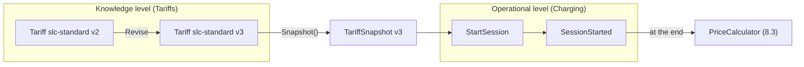
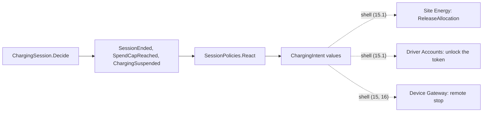
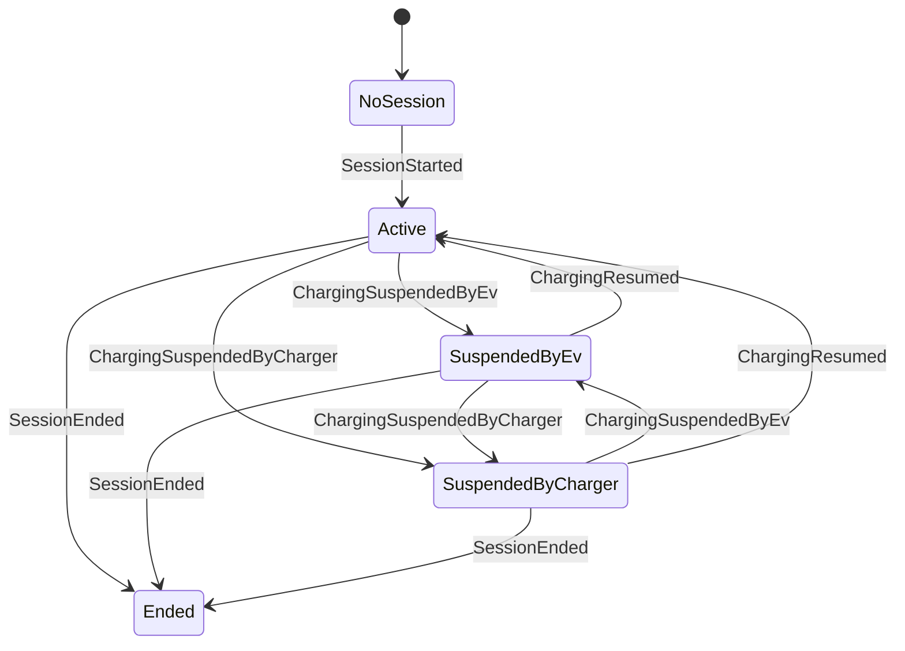

# Chapter 8. Domain Events, Services, Policies and Supple Design

On 2026-11-05 a support ticket reaches the Charging team. A fleet driver plugged in at the bus depot at 07:52 the day before, and her receipt shows 45 minutes of idle fees. She says she was never idle: at 08:15 Northgate Grid asked the depot to shed load, and the charge point paused her car until the curtailment ended. She also asks why she paid USD 0.42 per kWh when the depot's sign has shown USD 0.45 since 08:00 that morning.

To answer her, the support agent needs four facts: which tariff version the session used, when the charge was paused, who paused it, and which command caused each step. The decider of Chapter 7 records none of them reliably. `SessionStarted` holds a tariff id and one price, some events carry a timestamp and others none, and a suspension does not say who suspended. The rules the ticket is about have no home either. Pricing belongs to neither the session nor the tariff, "whenever charging pauses, warn the driver" is a reaction rather than an invariant, and the bands on the sign are in the depot's wall-clock time, which jumps twice a year.

Aggregates protect invariants. This chapter gives the other rules a place, with the rest of Evans's tactical patterns.

> **In this chapter you will:**
>
> - stamp every event with the command that caused it and the time it was decided, in one place per decider;
> - model tariffs as versioned data, a Knowledge Level, and lock a snapshot of one version into each session;
> - price a session with a pure domain service whose breakdown always adds up to its total;
> - write one business rule as a C# pattern and as a composable specification, and say which fits where;
> - turn "whenever X, then Y" policies into pure functions that return intents in Charging's own words;
> - split a state during a refactoring, let the compiler find what it touches, and price charges correctly through daylight-saving changes.

> **Starting point:** `ch07-s08`, the three deciders and the fair-share allocator of Chapter 7.
>
> ```bash
> git checkout ch07-s08
> ```

## 8.1 Domain events as facts experts care about

In the session's events, `SessionStarted` has a `StartedAt` and `SessionEnded` an `EndedAt`, but `SpendCapReached` has no time at all, and no event records why it happened. If the gateway retried a `SuspendCharging` after a timeout, nothing tells the agent whether the two attempts were one request or two.

### The idea: a fact, its inputs, its cause and its time

Evans's [*DDD Reference*](https://www.domainlanguage.com/wp-content/uploads/2016/05/DDD_Reference_2015-03.pdf#page=20) (2015, "Domain Events", p. 13) added **domain events** to the patterns of the 2003 book, marked as a term new since it: "Something happened that domain experts care about." The name is in the past tense and in the ubiquitous language (`ChargingSuspended`, never `SessionUpdated`), because it states a fact the business already recognizes and cannot refuse.

An event carries the *inputs of the decision*, not a dump of the state after it. `SessionEnded` names the site, connector and token so that whoever reacts needs nothing else (section 8.5), and `AllocationsRebalanced` records the table the allocator computed (section 7.8). A `SessionUpdated` holding the whole state does neither: every consumer must diff two states to learn what happened and is coupled to the aggregate's private shape. Granularity follows the experts' sentences. "The car stopped charging" is a fact; "the spend-cap check passed" is not one anybody cares about, and "the session changed" is too coarse to act on.

Two pieces of metadata belong on every event. [Vernon](https://www.informit.com/store/implementing-domain-driven-design-9780321834577) (*Implementing Domain-Driven Design*, 2013, ch. 8 "Domain Events") gives each event the time it occurred, the `occurredOn()` of the [`DomainEvent` interface](https://github.com/VaughnVernon/IDDD_Samples/blob/master/iddd_common/src/main/java/com/saasovation/common/domain/model/DomainEvent.java) in the book's samples; in a functional core that time comes from the `DecisionContext` (section 7.4), never from a clock read. The second is the **causation**, the id of the command that caused the event. A **command id** is a version 7 Guid that the *sender* creates, so a retry after a timeout carries the same id as the first attempt, which section 12.6 uses to recognize duplicates.

### The code: stamp once, after the table

Tag `ch08-s01` adds `CommandId` to the shared kernel, with the same version-7 guard as `SessionId`. Every command base takes it as its first positional member, so no command exists without one: `public closed record SessionCommand(CommandId CommandId, SessionId SessionId);`. Event bases get a body:

```csharp
// File: src/Charging/Ohmline.Charging.Domain/Sessions/SessionEvent.cs @ ch08-s01
public closed record SessionEvent(SessionId SessionId)
{
    /// <summary>The command that caused this event: its causation.</summary>
    public CommandId CommandId { get; init; }

    /// <summary>When it happened: the time of the decision, from its context.</summary>
    public DateTimeOffset OccurredAt { get; init; }
}
```

The deciders set both in one place, so no row of a decision table can forget them. Each public `Decide` became a wrapper around the old table, now called `DecisionTable`:

```csharp
// File: src/Charging/Ohmline.Charging.Domain/Sessions/ChargingSession.cs @ ch08-s01
public static Result<ImmutableArray<SessionEvent>, SessionError> Decide(
    SessionState state, SessionCommand command, DecisionContext context) =>
    DecisionTable(state, command, context).Map(events => Stamp(events, command, context));
// ...
private static ImmutableArray<SessionEvent> Stamp(
    ImmutableArray<SessionEvent> events, SessionCommand command, DecisionContext context) =>
    [.. events.Select(@event =>
        @event with { CommandId = command.CommandId, OccurredAt = context.Now })];
```

The table says what happened; the stamp says why and when. `with` on the closed base keeps the leaf type, so a stamped `SessionEnded` is still a `SessionEnded`. `ChargePoint` and `SitePowerBudget` got the same wrapper. The per-event times are gone and `Evolve` reads `OccurredAt` instead. Two times stayed, because they are not "when it happened": `MeterValueRecorded.MeasuredAt` is when the *charge point* measured, and `ConnectorReserved.ExpiresAt` is a decision about the future.

### Consequences

Determinism is now a tested property: `Given_the_same_command_in_the_same_state_and_context_then_the_events_are_equal` decides twice and compares. In the tests, a C# 14 extension block adds `At(time)` to every event, so an expected event reads `new ChargingResumed(Session).At(Later)`.

> **Note:** this section changed the shape of every event. That is free only because nothing has been written to a journal yet; from Chapter 10 on, such a change is a schema evolution (Chapter 20).

> **Try it**
>
> ```bash
> git checkout ch08-s01
> git diff ch07-s08 ch08-s01 --stat
> git diff ch07-s08 ch08-s01 -- src/Charging/Ohmline.Charging.Domain/Sessions
> dotnet test --solution Ohmline.slnx
> ```
>
> The diff shows `21 files changed, 525 insertions(+), 208 deletions(-)`. The test run reports `total: 573`, `failed: 0`; the new `DomainEventTests` include `Given_a_decision_with_two_events_then_each_records_the_command_and_the_time`.

## 8.2 Tariffs as a Knowledge Level

The pricing analyst wants the depot's prices to follow the grid: USD 0.60 per kWh from 16:00 to 21:00, USD 0.25 at night, USD 0.42 the rest of the time, and a cap of USD 60 per session. She does not want a release each time the bands move, and the driver from the opening must keep the price that applied when she plugged in, as the analyst settled during EventStorming (hotspot H9, section 4.2).

### The idea: rules as data, one level up

[Evans](https://www.informit.com/store/domain-driven-design-tackling-complexity-in-the-heart-9780321125217) (2003, ch. 16 "Large-Scale Structure", section "Knowledge Level") borrows the **Knowledge Level** from Martin Fowler's [*Analysis Patterns*](https://martinfowler.com/books/ap.html) (1997; see ch. 2 "Accountability", section "Accountability Knowledge Level"). The [*DDD Reference*](https://www.domainlanguage.com/wp-content/uploads/2016/05/DDD_Reference_2015-03.pdf#page=58) (p. 51) defines it as "A group of objects that describe how another group of objects should behave." A model splits into an *operational level*, the things that happen, and a *knowledge level* that describes how the operational level may behave, held as data that people edit. Section 4.7 kept Tariffs a supporting context because "the volatility is in the *data*, not in the model". A new band is new data; a new *kind* of rule is a code change.

So a tariff is a list of **tariff components**, and it is versioned: a published version never changes, a revision makes the next one, and a session copies the version in force when it starts, its **tariff snapshot**. A closed set of cases suggests a union, but the components form a closed record hierarchy, because a tariff is persisted inside `SessionStarted` and, from section 12.8, by the tariff book; ADR 0003 and section 7.2's `PersistedShapeTests` keep unions out of anything persisted. A switch over a closed hierarchy is equally exhaustive.

### The code: components, versions and the snapshot

Tag `ch08-s02` fills the Tariffs projects:

```csharp
// File: src/Tariffs/Ohmline.Tariffs.Contracts/TariffComponent.cs @ ch08-s02
public closed record TariffComponent;

/// <summary>
/// A price per kWh delivered. With a band it applies only inside the band; without one it
/// applies whenever no band of an energy rate does.
/// </summary>
public sealed record EnergyRate(Money PricePerKwh, TimeOfUseBand? Band = null) : TariffComponent;

/// <summary>A price per minute of charging, with or without a band, like an energy rate.</summary>
public sealed record TimeRate(Money PricePerMinute, TimeOfUseBand? Band = null) : TariffComponent;

/// <summary>A fixed amount for starting a session.</summary>
public sealed record SessionFee(Money Amount) : TariffComponent;

/// <summary>
/// A price per minute that the car stays plugged in after it has stopped charging, once the
/// grace period is over.
/// </summary>
public sealed record IdleFee(Money PricePerMinute, TimeSpan GracePeriod) : TariffComponent;
```

A **time-of-use (TOU) band** is a named window of the site's wall-clock time, `TimeOfUseBand(string Name, TimeOnly From, TimeOnly Until)`. Its `Contains` delegates to `TimeOnly.IsBetween`, which already treats a band that ends before it starts as running past midnight, so 22:00 to 06:00 is the night.

`Tariff` is a `sealed record` with a private constructor and a `TryCreate` returning `Result<Tariff, ValidationError>`, the smart constructor of section 6.2. Its rules are the analyst's: every amount in the tariff's currency and not negative, at most one session fee and one idle fee, a time zone that exists, and "every moment has at most one rate of a kind", so no two overlapping energy bands. Versions and snapshots are two short members:

```csharp
// File: src/Tariffs/Ohmline.Tariffs.Domain/Tariff.cs @ ch08-s02
/// <summary>The next version, with new rules. This version stays as it was.</summary>
public Result<Tariff, ValidationError> Revise(
    IEnumerable<TariffComponent> components, Money? priceCap) =>
    TryCreate(TariffId, Version + 1, Currency, components, priceCap, Rounding, TimeZoneId);

/// <summary>The copy a session keeps: this version, as it is now, for good.</summary>
public TariffSnapshot Snapshot() =>
    new(TariffId, Version, Currency, Components, PriceCap, Rounding, TimeZoneId);
```

`TariffSnapshot` holds everything pricing needs. `StartSession` and `SessionStarted` replace Chapter 7's placeholder (`TariffId`, `TariffVersion`, `PricePerKwh`) with one `TariffSnapshot Tariff`. The flow between the two levels:



The analyst edits the left side. Nothing she publishes reaches a session after `SessionStarted` is recorded, because the session holds a copy, not a reference.

### Where the types live

The component types and the snapshot live in `Ohmline.Tariffs.Contracts`, because `StartSession` in `Charging.Contracts` carries a snapshot and a context reaches another only through its contracts. So `ContractsPurityTests` now lets a contracts project reference another context's contracts, as the Customer/Supplier line from Tariffs to Charging on the context map implies (section 5.4).

Charging cannot call the price calculator, which lives in `Tariffs.Domain`, yet the spend cap of section 7.7 needs a cost after every reading. `SessionTerms.CostOf` therefore estimates high: every kWh at the snapshot's highest energy rate, plus the session fee. It leaves out time rates and idle fees, so a session can still cost more than its hold; policy P6 then records a debt (hotspot H3).

### Consequences

`SessionStarted` is now a large event, with a whole tariff in every session. That is the price of a session that can be priced and audited years later without asking the tariff book what version 3 said.

> **Try it**
>
> ```bash
> git checkout ch08-s02
> git diff ch08-s01 ch08-s02 --stat
> git diff ch08-s01 ch08-s02 -- src/Tariffs
> dotnet test --solution Ohmline.slnx
> ```
>
> The diff shows `21 files changed, 651 insertions(+), 36 deletions(-)`. The test run reports `total: 601`, `failed: 0`, including 27 tests in the new `Ohmline.Tariffs.Domain.Tests`, among them `Given_a_snapshot_taken_before_a_revision_then_the_revision_does_not_touch_it`.

## 8.3 Domain services: the price calculator

Step 10 of the domain primer prices the primer's charge: 27.6 kWh at USD 0.42 is USD 11.59 after rounding, plus the USD 1.00 session fee, plus ten idle minutes at USD 0.40, for USD 16.59. The session knows the energy but not the bands; the tariff knows the rules but has never seen a meter.

### The idea: an operation that belongs to no object

[Evans](https://www.informit.com/store/domain-driven-design-tackling-complexity-in-the-heart-9780321125217) (2003, ch. 5 "A Model Expressed in Software", section "Services") calls such an operation a **domain service** and gives it three marks: it is a concept of the domain that is "not a natural responsibility of an entity or value object" ([*DDD Reference*](https://www.domainlanguage.com/wp-content/uploads/2016/05/DDD_Reference_2015-03.pdf#page=21), "Services", p. 14), its interface is defined in terms of other model elements, and it is stateless. "Price a session" is in the analyst's vocabulary and takes and returns domain objects. Section 5.8 also named it a Cohesive Mechanism.

In a functional core a domain service is a pure function, which gives a sharp rule: *decide with the data you were given*. A "service" that does I/O, such as asking TallyPay whether a card is good, is not a domain service. It belongs in the shell as a port (section 15.4), and its result enters the model as a command or an event. An aggregate actor with an injected HTTP client waits on the network mid-decision, and a "service actor" that every aggregate asks becomes a god object.

### The code: one line per component

Tag `ch08-s03` adds `Tariffs.Domain/Pricing`. `SessionUsage` holds the metered intervals between consecutive readings and the idle time. The entry point:

```csharp
// File: src/Tariffs/Ohmline.Tariffs.Domain/Pricing/PriceCalculator.cs @ ch08-s03
/// <summary>
/// Prices a session: a domain service, because pricing is an operation of the domain that
/// belongs to no entity. It is a pure function of the data it is given. It reads no clock, asks
/// no tariff book and calls no service: whoever needs a price brings the tariff snapshot and the
/// usage (section 8.3).
/// </summary>
public static class PriceCalculator
{
    /// <summary>
    /// One line per component of the tariff that applies, in the tariff's order: energy and
    /// time are split across the time-of-use bands in site-local time, minute by minute. Each
    /// line is rounded once with the tariff's rounding policy, then the price cap applies.
    /// </summary>
    public static PriceBreakdown Price(TariffSnapshot tariff, SessionUsage usage)
    {
        var zone = TimeZoneInfo.FindSystemTimeZoneById(tariff.TimeZoneId);
        var portions = usage.Intervals
            .SelectMany(interval => Portions(interval, tariff, zone))
            .ToList();

        var lines = tariff.Components
            .SelectMany(component => Lines(component, portions, usage))
            .Select(line => line with { Amount = tariff.Rounding.Round(line.Amount) });

        return Capped(new PriceBreakdown(tariff.Currency, [.. lines]), tariff.PriceCap);
    }
```

`Portions` cuts every interval at each whole UTC minute, places each piece in the bands of its local time, and shares the interval's energy in proportion to time. Each component then becomes at most one line of the receipt:

```csharp
// File: src/Tariffs/Ohmline.Tariffs.Domain/Pricing/PriceCalculator.cs @ ch08-s03
private static IEnumerable<PriceLine> Lines(
    TariffComponent component, IReadOnlyList<Portion> portions, SessionUsage usage) =>
    component switch
    {
        EnergyRate rate => portions.Where(portion => portion.EnergyRate == rate)
            .Sum(portion => portion.KilowattHours) is var kWh and > 0m
            ? [new EnergyCharge(rate.Band, new Energy(kWh), rate.PricePerKwh,
                rate.PricePerKwh * kWh)]
            : [],
        TimeRate rate => portions.Where(portion => portion.TimeRate == rate)
            .Aggregate(TimeSpan.Zero, (time, portion) => time + portion.Length) is var time
            && time > TimeSpan.Zero
            ? [new TimeCharge(rate.Band, time, rate.PricePerMinute,
                rate.PricePerMinute * Minutes(time))]
            : [],
        SessionFee fee => [new SessionFeeCharge(fee.Amount)],
        IdleFee fee => WholeMinutes(usage.Idle - fee.GracePeriod) is var minutes and > 0
            ? [new IdleFeeCharge(minutes, fee.PricePerMinute, fee.PricePerMinute * minutes)]
            : [],
    };
```

The switch has no discard, so a new kind of component stops this file compiling until someone decides how to price it. Idle minutes are whole minutes after the grace period: 15.9 minutes under a 15-minute grace period cost nothing, 16 minutes cost one. Each line is rounded once with the tariff's `RoundingPolicy` (section 6.3); rounding the lines rather than only the total is what lets the printed lines add up to the printed total. A cap that the total passes appears as a negative `PriceCapApplied` line. `PriceBreakdown` never stores its total: `Total` is the sum of the lines, so a receipt that does not add up cannot be represented. The first test reproduces the primer's receipt line by line: USD 11.59 for 27.6 kWh, the USD 1.00 fee and USD 4.00 for ten idle minutes.

### Consequences

Because the calculator is pure, its properties can be checked over many random sessions. `PriceCalculatorProperties` uses CsCheck (section 6.8) to show that splitting across bands neither loses nor invents energy, within 10⁻⁹ kWh, that every line is in whole cents, and that the total never passes the cap.

Who runs the calculator, and when, is the charging journey's business (Chapters 15 and 16).

> **Try it**
>
> ```bash
> git checkout ch08-s03
> git diff ch08-s02 ch08-s03 --stat
> git diff ch08-s02 ch08-s03 -- src/Tariffs/Ohmline.Tariffs.Domain/Pricing
> dotnet test --solution Ohmline.slnx
> ```
>
> The diff shows `10 files changed, 441 insertions(+), 8 deletions(-)`. The test run reports `total: 616`, `failed: 0`; `Given_the_primers_charge_then_it_costs_16_dollars_59` is among the new tests.

## 8.4 Specifications: as classes and as patterns

Two rules keep coming up in the operations team's sentences. "The idle fee applies once the car has been suspended for the whole grace period." "A session needs a hold on the driver's card unless its tariff charges nothing." The first is needed inside the domain, by any screen that shows whose idle fee starts soon, and by whatever warns the driver. Written as an `if` in each place, the copies will drift.

### The idea: a predicate with a name

[Evans](https://www.informit.com/store/domain-driven-design-tackling-complexity-in-the-heart-9780321125217) (2003, ch. 9 "Making Implicit Concepts Explicit", section "Specification") introduces the **Specification**, developed with Martin Fowler in their [1997 paper *Specifications*](https://martinfowler.com/apsupp/spec.pdf): a predicate object that says whether a candidate satisfies a business rule. The paper names three uses, *selection*, *validation* and *building to order*; Ohmline needs the first two. Specifications combine with `And`, `Or` and `Not` (the paper's Composite Specification; Evans, ch. 10, "Extending Specifications in a Declarative Style"), so a composite rule reads like the expert's sentence.

C# changes the cost of the idea. A property or list pattern in a static method is already a named, type-checked predicate, with no object to build or pass around. An `ISpecification<T>` object earns its place only when the rule must be a *value*: passed to a projection or a router, combined at run time, logged or compared.

### The code: the rule once, two forms

Tag `ch08-s04` adds `ISpecification<in T>`, with one member `IsSatisfiedBy`, and three `sealed record` combinators to the shared kernel; as records, combined rules compare by value and print readably. One C# 14 extension block gives every specification the combinators:

```csharp
// File: src/Ohmline.SharedKernel/Specifications/Specification.cs @ ch08-s04
public static class Specification
{
    extension<T>(ISpecification<T> specification)
    {
        public ISpecification<T> And(ISpecification<T> other) =>
            new AndSpecification<T>(specification, other);

        public ISpecification<T> Or(ISpecification<T> other) =>
            new OrSpecification<T>(specification, other);

        public ISpecification<T> Not() => new NotSpecification<T>(specification);
    }
}
```

In Charging, each rule is written once, as a pattern:

```csharp
// File: src/Charging/Ohmline.Charging.Domain/Sessions/Specifications.cs @ ch08-s04
public static class SessionPredicates
{
    // ...
    public static bool IdleFeeApplies(SessionState session, DateTimeOffset at) =>
        session is Suspended { Since: var since, Terms.Tariff.Components: var components }
        && components.OfType<IdleFee>().SingleOrDefault() is { GracePeriod: var grace }
        && at >= since + grace;

    // ...
    public static bool RequiresPreAuthorization(StartSession start) =>
        start.Tariff.Components.Any(component => component is not (
            EnergyRate { PricePerKwh.Amount: 0m }
            or TimeRate { PricePerMinute.Amount: 0m }
            or SessionFee { Amount.Amount: 0m }
            or IdleFee { PricePerMinute.Amount: 0m }));

    // ...
    public static bool EndedWithoutEnergy(IReadOnlyList<SessionEvent> history) =>
        history is [SessionStarted, .., SessionEnded { EnergyDelivered.KilowattHours: 0m }];
}
```

`IdleFeeApplies` nests property patterns in a type pattern on a union case; `RequiresPreAuthorization` combines `not` and `or` over the closed `TariffComponent` hierarchy. `EndedWithoutEnergy` is a list pattern over a history, the settle-session board's policy P7: a session that delivered nothing has its hold voided rather than captured. A list pattern allows one slice (`CS8980` otherwise), so it can test the ends of a history but not search its middle.

The specification classes, `IdleFeeApplies(DateTimeOffset At)` and `RequiresPreAuthorization`, are records whose `IsSatisfiedBy` calls these predicates. They pay off where a rule is assembled at run time, as in a router that finds the sessions whose idle fee starts within five minutes:

```csharp
// File: tests/Ohmline.Charging.Domain.Tests/Sessions/SpecificationTests.cs @ ch08-s04
[Fact]
public void Given_sessions_at_the_depot_then_a_router_finds_those_whose_idle_fee_starts_soon()
{
    var now = Full.AddMinutes(12);
    ISpecification<SessionState> startsWithinFiveMinutes =
        new IdleFeeApplies(now.AddMinutes(5)).And(new IdleFeeApplies(now).Not());
    SessionState[] depot =
    [
        Session("active", WithIdleFee),
        Session("suspended", WithIdleFee),
        Session("suspended", WithIdleFee, suspendedAt: Full.AddMinutes(-10)),
        Session("suspended", WithIdleFee, suspendedAt: Full.AddMinutes(10)),
    ];

    depot.Where(startsWithinFiveMinutes.IsSatisfiedBy).ShouldBe([depot[1]]);
}
```

### Where each form fits

| Need | Pattern predicate | Specification object |
|---|---|---|
| A guard inside `Decide` or `Evolve` | Yes, a plain call | Rarely |
| A filter in a projection or router | Through a lambda | Yes |
| Rules combined at run time | No | Yes |
| Logging or comparing the rule | No | Yes |
| Exhaustiveness checking | Only in a switch expression | No |

The last row is a trap that section 8.6 walks into. An `is` pattern is not checked for exhaustiveness: if the state union gains a case, `session is Suspended {...}` still compiles and answers `false` for it.

### Consequences

`ISpecification<in T>` is contravariant, so a rule about every `SessionEvent` applies to each kind of event. The tests run both forms against the same theory rows.

> **Try it**
>
> ```bash
> git checkout ch08-s04
> git diff ch08-s03 ch08-s04 --stat
> git diff ch08-s03 ch08-s04 -- src/Charging/Ohmline.Charging.Domain/Sessions/Specifications.cs
> dotnet test --solution Ohmline.slnx
> ```
>
> The diff shows `9 files changed, 320 insertions(+)`. The test run reports `total: 636`, `failed: 0`, among them `Given_sessions_at_the_depot_then_a_router_finds_those_whose_idle_fee_starts_soon`.

## 8.5 Policies: 'whenever X then Y' as pure reactions

The settle-session board of section 4.3 has lilac stickies that no aggregate owns: whenever a session ends, release its power allocation (P1) and unlock its token (P5). Chapter 7 left two more open. `SpendCapReached` is recorded, but nothing stops the charger, and a suspended car starts the grace period without anyone telling the driver.

### The idea: an event in, intents out

Brandolini's EventStorming writes a **policy** as ["Whenever \[Event\] then \[Command\]"](https://speakerdeck.com/ziobrando/1-million-orange-stickies-later-devoxx-poland-2024?slide=62) (talk *1 Million Orange Stickies Later*, Devoxx Poland 2024, slide 62; see also [*Introducing EventStorming*](https://leanpub.com/introducing_eventstorming), ch. 14 "Process Modeling Building Blocks", "Policies"). It is not an invariant: a session that has ended and an allocation not yet released can coexist for a second, which is [Vernon's test](https://www.dddcommunity.org/wp-content/uploads/files/pdf_articles/Vernon_2011_2.pdf#page=3) from section 7.1 for keeping a rule outside the boundary ("Effective Aggregate Design", Part II, "Ask Whose Job It Is"). [Evans](https://www.informit.com/store/domain-driven-design-tackling-complexity-in-the-heart-9780321125217) (2003, ch. 12 "Relating Design Patterns to the Model", section "Strategy (A.K.A. Policy)") relates the Strategy design pattern to the model under the name **Policy**, a family of interchangeable rules behind one interface. Both meanings fit: each policy is a pure function `React(event) -> intents`, and the shell runs whichever policies apply without knowing which they are.

What a policy returns needs care. Charging's domain does not know Site Energy's or Driver Accounts' commands, and should not: their commands may need fields Charging does not have, and every policy would change whenever another team's contract does. So a policy returns **intents**, records in Charging's own words, and the shell translates each into the other context's command (section 15.1). Intents are never persisted, so they form a union.

### The code: four intents, three policies

Tag `ch08-s05` adds `Charging.Domain/Policies`:

```csharp
// File: src/Charging/Ohmline.Charging.Domain/Policies/ChargingIntent.cs @ ch08-s05
public union ChargingIntent(
    ChargingIntent.ReleaseSiteAllocation,
    ChargingIntent.UnlockToken,
    ChargingIntent.StopCharging,
    ChargingIntent.WarnOfIdleFee)
{
    /// <summary>The site's power budget can give this connector's power to the others.</summary>
    public sealed record ReleaseSiteAllocation(
        SiteId SiteId, ConnectorId ConnectorId, SessionId SessionId);

    /// <summary>The token may start another session.</summary>
    public sealed record UnlockToken(TokenUid TokenUid, SessionId SessionId);

    /// <summary>The charge point should stop delivering energy to this session.</summary>
    public sealed record StopCharging(SessionId SessionId);

    /// <summary>Tell the driver when the idle fee will start and what it costs a minute.</summary>
    public sealed record WarnOfIdleFee(
        SessionId SessionId, DateTimeOffset StartsAt, Money PricePerMinute);
}
```

`ReleaseSiteAllocation` and `UnlockToken` carry the session id, because the site power budget releases an allocation only for the session that holds it (section 7.8). The simplest policy needs nothing but the event:

```csharp
// File: src/Charging/Ohmline.Charging.Domain/Policies/ReleaseOnSessionEnded.cs @ ch08-s05
public sealed class ReleaseOnSessionEnded : ISessionPolicy
{
    public ImmutableArray<ChargingIntent> React(SessionEvent @event) => @event switch
    {
        SessionEnded ended =>
        [
            new ChargingIntent.ReleaseSiteAllocation(
                ended.SiteId, ended.ConnectorId, ended.SessionId),
            new ChargingIntent.UnlockToken(ended.TokenUid, ended.SessionId),
        ],
        _ => [],
    };
}
```

`SpendCapPolicy` turns `SpendCapReached` into `StopCharging`. `IdleFeePolicy(IdleFee Fee)` is configured by the Knowledge Level: on `ChargingSuspended` it warns that the fee starts at the event's `OccurredAt` plus the grace period, which works only because section 8.1 put a time on every event. Combining policies gives a policy:

```csharp
// File: src/Charging/Ohmline.Charging.Domain/Policies/SessionPolicies.cs @ ch08-s05
public static SessionPolicies For(SessionTerms terms) => new(
[
    new ReleaseOnSessionEnded(),
    new SpendCapPolicy(),
    .. terms.Tariff.Components.OfType<IdleFee>().Select(fee => new IdleFeePolicy(fee)),
]);

public ImmutableArray<ChargingIntent> React(SessionEvent @event) =>
    [.. policies.SelectMany(policy => policy.React(@event))];
```

Where the pieces will run once the shell exists:



Solid arrows are pure functions in `Charging.Domain`; dotted arrows are the shell's work in later chapters. Policies react to persisted events, never inside `Decide`, so a failed release cannot undo the end of a session.

### Consequences

This prepares both styles of coordination in Chapter 15. A policy that needs one event can run in a subscriber that reads the journal: choreography. A chain with memory and deadlines, from "token locked" to "payment captured", becomes the charging journey, a process manager. A subscriber may see an event twice after a restart, so the receivers of translated intents must be idempotent (section 15.6); the session id in each intent makes that possible.

> **Try it**
>
> ```bash
> git checkout ch08-s05
> git diff ch08-s04 ch08-s05 --stat
> git diff ch08-s04 ch08-s05 -- src/Charging/Ohmline.Charging.Domain/Policies
> dotnet test --solution Ohmline.slnx
> ```
>
> The diff shows `8 files changed, 244 insertions(+)`. The test run reports `total: 643`, `failed: 0`; `Given_the_policies_of_a_session_then_its_history_causes_the_intents_in_order` replays the primer's charge and gets `WarnOfIdleFee`, `ReleaseSiteAllocation` and `UnlockToken`, in that order.

## 8.6 Refactoring toward deeper insight: who suspended the charge?

Back to the ticket from the opening. At `ch08-s05` the model treats every pause alike: when a curtailment makes the charge point stop the fleet driver's car, the session goes to `Suspended`, `IdleFeePolicy` warns her, and `IdleFeeApplies` turns true fifteen minutes later. Operations raised it as hotspot H2 in section 4.2, the most-voted question on the board: no idle fee is due when Ohmline paused the charge.

### The idea: a split along the domain's contour

[Evans](https://www.informit.com/store/domain-driven-design-tackling-complexity-in-the-heart-9780321125217) devotes Part III of his book to **Refactoring Toward Deeper Insight**: refactorings driven not by code smells but by a better understanding of the domain (in the [*DDD Reference*](https://www.domainlanguage.com/wp-content/uploads/2016/05/DDD_Reference_2015-03.pdf#page=15)'s words, p. 8, "Refactoring can also be motivated by an insight into the domain"), often triggered by a phrase the experts use that the model cannot say (ch. 9, "Listen to Language"). Here the phrase is "suspended by the EV" versus "suspended by the charger". Charge points already report the difference; in the style of OCPP 1.6J they are the statuses `SuspendedEV` and `SuspendedEVSE` of a [`StatusNotification`](https://github.com/mobilityhouse/ocpp/blob/master/ocpp/v16/schemas/StatusNotification.json).

A flag inside `Suspended` would make every rule remember to read it. The two pauses differ in what is billable, so they are different states. [Evans](https://www.informit.com/store/domain-driven-design-tackling-complexity-in-the-heart-9780321125217) calls this following the **Conceptual Contours** (2003, ch. 10 "Supple Design", section "Conceptual Contours"): the model's seams should run where the domain's concepts divide, so that a business change touches one part instead of many. The contour here is who is idle.

### The code: the diff is the lesson

`SuspendCharging` gains a `SuspendedBy By` field, a closed hierarchy with the cases `ByEv` and `ByCharger`, shaped like `PriorityClass` from section 7.8. The event `ChargingSuspended` splits into `ChargingSuspendedByEv` and `ChargingSuspendedByCharger`, and the state union splits its case:

```diff
# git diff ch08-s05 ch08-s06 -- src/Charging/Ohmline.Charging.Domain/Sessions/SessionState.cs
@@ -7,7 +7,7 @@ namespace Ohmline.Charging.Domain.Sessions;
 /// <c>Charging</c>: a type named Charging would collide with the namespace <c>Ohmline.Charging</c>
 /// in every other namespace.
 /// </summary>
-public union SessionState(NoSession, Active, Suspended, Ended)
+public union SessionState(NoSession, Active, SuspendedByEv, SuspendedByCharger, Ended)
 {
     public static SessionState Initial { get; } = new NoSession();
 }
@@ -18,8 +18,18 @@ public sealed record NoSession;
 /// <summary>The session is running, and energy may flow.</summary>
 public sealed record Active(SessionTerms Terms, SessionMeter Meter);
 
-/// <summary>Charging is paused; the car is still plugged in.</summary>
-public sealed record Suspended(SessionTerms Terms, SessionMeter Meter, DateTimeOffset Since);
+/// <summary>
+/// The car has stopped charging and is still plugged in. Since then the driver has been idle:
+/// once the grace period is over, the idle fee applies.
+/// </summary>
+public sealed record SuspendedByEv(SessionTerms Terms, SessionMeter Meter, DateTimeOffset Since);
+
+/// <summary>
+/// The charge point has stopped charging at Ohmline's request, such as during a curtailment.
+/// The driver is waiting for Ohmline, not idle, so no idle fee applies.
+/// </summary>
+public sealed record SuspendedByCharger(
+    SessionTerms Terms, SessionMeter Meter, DateTimeOffset Since);
 
 /// <summary>Over. Only the terms and the outcome remain.</summary>
 public sealed record Ended(SessionTerms Terms, Energy EnergyDelivered, DateTimeOffset EndedAt);
```

The suspension rows of the decision table now read as the operations team's rules:

```csharp
// File: src/Charging/Ohmline.Charging.Domain/Sessions/ChargingSession.cs @ ch08-s06
(Active or SuspendedByCharger, SuspendCharging { By: ByEv } suspend) =>
    Accept(new ChargingSuspendedByEv(suspend.SessionId)),
(SuspendedByEv, SuspendCharging { By: ByEv }) => NoChange,
(Active or SuspendedByEv, SuspendCharging { By: ByCharger } suspend) =>
    Accept(new ChargingSuspendedByCharger(suspend.SessionId)),
(SuspendedByCharger, SuspendCharging { By: ByCharger }) => NoChange,
(SuspendedByEv or SuspendedByCharger, ResumeCharging resume) =>
    Accept(new ChargingResumed(resume.SessionId)),
```

The latest report says who. A curtailment that pauses an idle car turns it into `SuspendedByCharger`, and a car found full when the curtailment ends becomes `SuspendedByEv` from that moment, so its grace period starts then. Nested property patterns over the closed `SuspendedBy` count as exhaustive. The state machine after the split:



Every arrow is a row of `Evolve`, and the two arrows between the suspended states are the new insight. `IdleFeeApplies` now matches `SuspendedByEv` only, and `IdleFeePolicy` reacts to `ChargingSuspendedByEv` only.

### How the compiler guided the change

The change was made in two steps. First, the two new cases were added to the union while `Suspended` still existed. The build failed with exactly two `CS8509` errors, at the decision table and at `Evolve`, each naming `(SuspendedByEv, _)` as not covered. It found both switches over the state and nothing else: `IdleFeeApplies` is an `is` pattern and `IdleFeePolicy` ends in `_ => []`, and neither is checked (section 8.4).

Second, `Suspended` and `ChargingSuspended` were deleted, and 19 errors (`CS0246`, `CS8121`) pointed at the old rows in `ChargingSession.cs` and into `IdleFeePolicy.cs` and `Specifications.cs`. Exhaustiveness finds the switches; *deleting* the old case, rather than keeping it "for compatibility", finds the rest. The sample keeps the first kind of error reproducible inside `#if DEMO_COMPILE_ERRORS`, a `Describe(SessionState)` switch that knows only one suspended state:

```text
$ dotnet build tests/Ohmline.Charging.Domain.Tests -p:DefineConstants=DEMO_COMPILE_ERRORS
...
...(14,64): error CS8509: ... the pattern '...SuspendedByCharger' is not covered.
```

One place the compiler could not help is the catch-all row at the end of the session's `Evolve` (section 7.7). New events without rows of their own would have fallen into it and changed nothing; `Given_a_curtailment_and_then_a_full_car_then_the_driver_is_idle_from_when_full` is the test that guards it.

### Consequences

> **Warning:** `ChargingSuspended` could be deleted only because no journal exists yet. Once events are persisted (Chapter 10), an event type is never deleted: old `ChargingSuspended` events must stay readable and be upcast to one of the new events, a business decision about what old pauses meant, or replay of every old session fails. Chapter 20 shows how.

> **Try it**
>
> ```bash
> git checkout ch08-s06
> git diff ch08-s05 ch08-s06 --stat
> git diff ch08-s05 ch08-s06 -- src/Charging
> dotnet test --solution Ohmline.slnx
> dotnet build tests/Ohmline.Charging.Domain.Tests -p:DefineConstants=DEMO_COMPILE_ERRORS
> ```
>
> The diff shows `17 files changed, 209 insertions(+), 66 deletions(-)`. The test run reports `total: 654`, `failed: 0`, including the new case `("suspended by charger", 25, false)` in `SpecificationTests`. The last command fails with the `CS8509` above, next to Chapter 7's demonstration.

## 8.7 Time in the domain: site-local time, time-of-use and DST

The depot's tariff has a cheap band from 01:00 to 03:00 on the wall clock. In the depot's time zone, `America/Denver`, on 2026-03-08 the clocks jump from 02:00 to 03:00, and on 2026-11-01 they fall back from 02:00 to 01:00. A bus that charges from midnight to 04:00 on the wall clock charges for three real hours in March and five in November. A pricing rule that is vague about time either bills an hour that never happened or loses one that happened twice.

### The idea: the instant is the truth

**Site-local time** is the time on the wall at a site, in the site's IANA time zone such as `America/Denver`. What keeps it safe is direction. Converting an *instant* to a wall-clock time is a function: every instant has exactly one local time. The reverse is not: on the spring-forward night 02:30 never happens, and on the fall-back night 01:30 happens twice. So durations are measured between instants, money is charged for real minutes, and the wall clock is consulted only to ask which band an instant falls in.

The deciders follow the same discipline. No clock is read in `Decide` or `Evolve`: time arrives as `DecisionContext.Now`, is stamped as `OccurredAt` (section 8.1), and `Evolve` reads it back from the event, so replay gives the same state anywhere, at any time.

### The code: one conversion, in the kernel

Tag `ch08-s07` adds `SiteLocalTime` to the shared kernel:

```csharp
// File: src/Ohmline.SharedKernel/Time/SiteLocalTime.cs @ ch08-s07
/// <summary>
/// An instant as the clock on the wall at a site shows it, in the site's time zone (an IANA id
/// such as <c>America/Denver</c>). The instant stays the truth: durations are measured between
/// instants, and the wall-clock time is derived from one. That direction is always safe. The
/// other, from a wall-clock time to an instant, is not: on the night the clocks go forward an
/// hour of wall-clock time never happens, and on the night they go back an hour happens twice.
/// </summary>
public readonly record struct SiteLocalTime
{
    private SiteLocalTime(DateTimeOffset instant, TimeZoneInfo zone)
    {
        Instant = instant.ToUniversalTime();
        TimeZoneId = zone.Id;
        Local = TimeZoneInfo.ConvertTime(instant, zone);
        IsDaylightSavingTime = zone.IsDaylightSavingTime(instant);
    }
    // ...
    public DateOnly Date => DateOnly.FromDateTime(Local.DateTime);

    public TimeOnly TimeOfDay => TimeOnly.FromDateTime(Local.DateTime);
    // ...
}
```

It is built with `TryCreate(instant, timeZoneId)`, which returns a `ValidationError` for a missing or unknown zone, or with `Of`, which throws, for a zone that a valid tariff already checked. There is no API for the dangerous direction. The calculator's private conversion is gone; `Portions` now asks `SiteLocalTime.Of(minute.Start, tariff.TimeZoneId).TimeOfDay`. The calculator of section 8.3 was already right, because it only converted instants; this section names the rule and proves it.

The tests use `FakeTimeProvider` in two roles: as a clock that plays the charge point, reading 0.5 kWh every minute through the night, and, with `SetLocalTimeZone`, as an independent oracle that every `SiteLocalTime` must agree with.

```csharp
// File: tests/Ohmline.Tariffs.Domain.Tests/Pricing/DaylightSavingTests.cs @ ch08-s07
[Fact]
public void Given_a_charge_through_the_spring_forward_then_the_missing_hour_is_never_charged()
{
    // 00:00 MST to 04:00 MDT on 8 March: four hours on the wall clock, three in real time.
    var usage = ChargeEveryMinute(
        from: new DateTimeOffset(2026, 3, 8, 7, 0, 0, TimeSpan.Zero), hours: 3);

    var price = PriceCalculator.Price(Overnight, usage);

    price.Lines.ShouldBe(
    [
        new EnergyCharge(null, new Energy(60m), Usd(0.42m), Usd(25.20m)),
        new EnergyCharge(SmallHours, new Energy(30m), Usd(0.10m), Usd(3.00m)),
        new TimeCharge(null, TimeSpan.FromHours(3), Usd(0.01m), Usd(1.80m)),
    ]);
}
```

The two nights, with a base rate of USD 0.42, the 01:00 to 03:00 band at USD 0.10 and a time rate of USD 0.01 a minute:

| Night (2026) | Wall clock | Real time | Base rate | Band | Time charged |
|---|---|---|---|---|---|
| 8 March | 00:00 to 04:00 | 3 h | 60 kWh | 30 kWh | USD 1.80 |
| 1 November | 00:00 to 03:00 | 4 h | 30 kWh | 90 kWh | USD 2.40 |

In March the band holds only 01:00 to 02:00, because 02:00 to 03:00 never happens. In November it holds the 01:00 hour twice and then 02:00 to 03:00.

### Consequences

`TimeZoneInfo.TryFindSystemTimeZoneById` finds IANA ids on Linux, where the sample runs; the [.NET documentation for `FindSystemTimeZoneById`](https://learn.microsoft.com/en-us/dotnet/api/system.timezoneinfo.findsystemtimezonebyid#:~:text=Starting%20with%20.NET%206%2C%20Windows%20systems%20also%20support%20IANA%20time%20zone%20identifiers) states that Windows accepts them too from .NET 6 on, unless NLS or globalization-invariant mode is enabled, which the sample has not tested. Governments change clock rules, so keep the server's time zone data current, or band boundaries move to the wrong instant.

> **Try it**
>
> ```bash
> git checkout ch08-s07
> git diff ch08-s06 ch08-s07 --stat
> git diff ch08-s06 ch08-s07 -- src/Ohmline.SharedKernel/Time src/Tariffs
> dotnet test --solution Ohmline.slnx
> ```
>
> The diff shows `8 files changed, 246 insertions(+), 10 deletions(-)`. The test run reports `total: 662`, `failed: 0`; `Given_the_night_the_clocks_go_forward_then_two_oclock_never_shows_on_the_wall` and `Given_a_charge_through_the_fall_back_then_the_repeated_hour_is_charged_twice` are among the new tests.

## 8.8 The supple design checklist

[Evans](https://www.informit.com/store/domain-driven-design-tackling-complexity-in-the-heart-9780321125217) (2003, ch. 10 "Supple Design") calls a design **supple** when it is, in the [*DDD Reference*](https://www.domainlanguage.com/wp-content/uploads/2016/05/DDD_Reference_2015-03.pdf#page=26)'s words (p. 19), "a pleasure to work with, inviting to change", for the developer who uses it as much as for the one who changes it, and names the habits that make it so. At `ch08-s07` each appears in Ohmline:

| Pattern | What it asks | Where it is in Ohmline |
|---|---|---|
| Intention-Revealing Interfaces | Name by effect and purpose, not mechanism | `PriceCalculator.Price`, `Tariff.Revise`, `ISessionPolicy.React`, `ChargingSuspendedByEv` |
| Side-Effect-Free Functions | Return results; change nothing | Every `Decide` and `Evolve`, `PriceCalculator`, the policies, `FairShareAllocator` |
| Assertions | State what must hold after an operation | `Tariff`'s construction rules, `PriceBreakdown.Total`, the CsCheck properties |
| Conceptual Contours | Divide where the domain divides | `SuspendedByEv` and `SuspendedByCharger`; `PriceLine` cases that follow the receipt |
| Standalone Classes | Drop every dependency that is not essential | `Money`, `RoundingPolicy`, `TimeOfUseBand`, `SiteLocalTime`, `CommandId` |
| Closure of Operations | Return the type the operation takes | `Money + Money`, `ISpecification.And`, `SessionPolicies` |
| Declarative Design | Say what, not how | Decision tables, a tariff as a list of components, composed specifications |
| Drawing on Established Formalisms | Reuse proven mathematics | State machines over unions, Boolean algebra of specifications, water-filling, IANA time zones |

**Side-Effect-Free Functions** are this book's whole stance, and two tests check them directly by running the same input twice: `Given_the_same_snapshot_and_usage_then_the_price_is_the_same_every_time` and its decider twin from section 8.1.

**Assertions**, in [Evans's sense](https://www.domainlanguage.com/wp-content/uploads/2016/05/DDD_Reference_2015-03.pdf#page=29) (*DDD Reference*, p. 22), state "post-conditions of operations and invariants of classes and aggregates." Ohmline makes some of them structural, so they cannot be violated: a breakdown has no stored total to disagree with its lines, and an invalid `Tariff` cannot be constructed. The rest become property tests (section 9.4).

**Closure of Operations** lets small parts combine: `SessionPolicies` is a policy made of policies, so the shell holds one policy whatever the tariff, and `And`, `Or` and `Not` turn specifications into specifications.

Supple design has a cost: a model that follows the domain's contours must be refactored whenever the domain teaches you something, which event sourcing makes more expensive (Chapter 20). The practical takeaway: when a change feels harder than the business change behind it, look for the row of this table that the code is missing.

## Summary

- A domain event is a past-tense fact that carries the inputs of its decision; every event also records the command that caused it and the time it was decided, stamped once after the decision table.
- Tariffs are a Knowledge Level: versioned data built from a closed set of components, of which each session keeps a snapshot that later versions never touch.
- A domain service is a stateless domain operation; in a functional core it is a pure function of the data it is given, and anything that needs I/O belongs to the shell.
- A rule written once as a pattern predicate serves guards inside the core; wrapped in a specification object, it can be passed, combined and logged.
- Policies turn "whenever X, then Y" into pure reactions that return intents in the context's own words, for the shell to translate and deliver.
- Deeper insight is a split along the domain's contour: exhaustive switches find the decision tables, deleting the old case finds the rest, and once events are persisted the old event must stay readable.
- Supple design is already in the code; when a change feels harder than the business change behind it, look for the pattern that is missing.
- Instants are the truth and the wall clock is derived from them: bands come from local time, minutes are counted between instants, and no decider reads a clock.

## DDD canon covered

Domain Events; Large-scale structure (Knowledge Level); Domain Services; Distillation (Cohesive Mechanisms); Specifications; Making implicit concepts explicit (constraints, processes, policies/strategy); Refactoring Toward Deeper Insight; Supple design: Intention-Revealing Interfaces; Supple design: Side-Effect-Free Functions; Supple design: Assertions; Supple design: Standalone Classes; Supple design: Closure of Operations; Supple design: Declarative Design; Supple design: Conceptual Contours; Supple design: Established Formalisms; Idempotency and delivery semantics.

## Exercises

1. **Reflect.** `SessionTerms.CostOf` checks the spend cap against a high estimate, every kWh at the highest energy rate. The alternative is to let Charging run the real price calculation after every reading. Weigh how early a driver on a cheap night band is stopped, the risk of a hold running out, which context owns pricing, and the cost of pricing after every meter value.
2. **Reflect.** Section 8.6 gave `SuspendCharging` a `SuspendedBy` field instead of splitting it into two commands. Weigh the gateway's translation, the number of decision-table rows, exhaustiveness over the closed `SuspendedBy`, and what a third reason, such as a driver pausing from the app, would cost in each design.
3. **Extend.** Starting from `ch08-s03`, add `Given_a_charge_across_midnight_then_the_night_band_applies_on_both_sides` to `PriceCalculatorTests`: 18 kWh from `Local(21, 30)` to `Local(6, 30).AddDays(1)` under `BaseRate` and an energy rate in the `Night` band. Expect 16 kWh in the night band and 2 kWh at the base rate, which shows that `TimeOfUseBand.Contains` handles a band past midnight.
4. **Break it.** At `ch08-s03`, add `public sealed record ParkingFee(Money PricePerHour) : TariffComponent;` to `TariffComponent.cs` and build. Expect `error CS8509` in `Tariff.cs` and in `PriceCalculator.cs`, each naming `ParkingFee` as not covered. Repeat at `ch08-s04` and build `src/Charging/Ohmline.Charging.Domain` on its own: it compiles, because `RequiresPreAuthorization` uses an `is not` pattern, and it treats every parking fee as a charge, even a free one.
5. **Break it.** At `ch08-s01`, make `ChargingSession.Decide` return `DecisionTable(state, command, context)` without the `Map`, and run the tests. Expect `Given_a_session_that_ends_then_the_event_carries_what_its_reactions_need` and most of `ChargingSessionTests` to fail, because their expected events carry a command id and a time that nothing sets any more.

## Further reading

- Eric Evans, [*Domain-Driven Design: Tackling Complexity in the Heart of Software*](https://www.informit.com/store/domain-driven-design-tackling-complexity-in-the-heart-9780321125217) (Addison-Wesley, 2003), with resources at [domainlanguage.com](https://www.domainlanguage.com/ddd/). Chapters 5 "A Model Expressed in Software" (services), 9 "Making Implicit Concepts Explicit" (specifications), 10 "Supple Design", 12 "Relating Design Patterns to the Model" (Strategy as Policy) and 16 "Large-Scale Structure" (Knowledge Level), and Part III, "Refactoring Toward Deeper Insight".
- Eric Evans, [*Domain-Driven Design Reference*](https://www.domainlanguage.com/wp-content/uploads/2016/05/DDD_Reference_2015-03.pdf) (2015). Short definitions, including domain events (p. 13), marked as new since the original book.
- Eric Evans and Martin Fowler, [*Specifications*](https://martinfowler.com/apsupp/spec.pdf) (PLoP 1997). The paper behind section 8.4, including composite specifications.
- Martin Fowler, [*Analysis Patterns: Reusable Object Models*](https://martinfowler.com/books/ap.html) (Addison-Wesley, 1997). Where the knowledge and operational levels come from; see ch. 2 "Accountability", section "Accountability Knowledge Level".
- Vaughn Vernon, [*Implementing Domain-Driven Design*](https://www.informit.com/store/implementing-domain-driven-design-9780321834577) (Addison-Wesley, 2013). Chapter 8, "Domain Events": names, time and consumers.
- Alberto Brandolini, [*Introducing EventStorming*](https://leanpub.com/introducing_eventstorming) (Leanpub), ch. 14 "Process Modeling Building Blocks", "Policies", with [eventstorming.com](https://www.eventstorming.com/) and his talk [*1 Million Orange Stickies Later*](https://speakerdeck.com/ziobrando/1-million-orange-stickies-later-devoxx-poland-2024?slide=62) (Devoxx Poland 2024), whose slide 62 gives the lilac policy sticky its "Whenever \[Event\] then \[Command\]" grammar.
- Scott Wlaschin, [*Domain Modeling Made Functional*](https://pragprog.com/titles/swdddf/domain-modeling-made-functional/) (Pragmatic Bookshelf, 2018). Workflows as pure functions with I/O at the edges, the stance behind sections 8.3 and 8.5; see the chapters "Modeling Workflows as Pipelines" and "Persistence" ("Pushing Persistence to the Edges").
- IANA, [*Time Zone Database*](https://www.iana.org/time-zones). The source of `America/Denver` and its daylight-saving rules.
