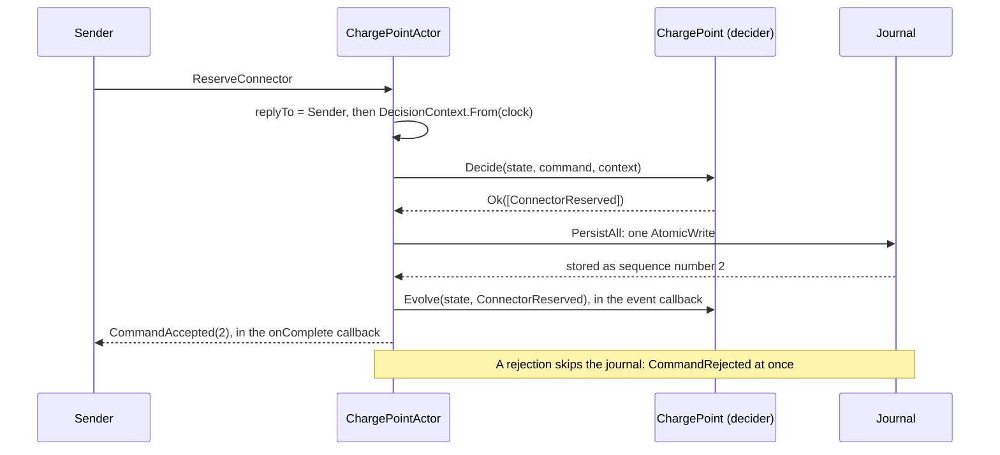
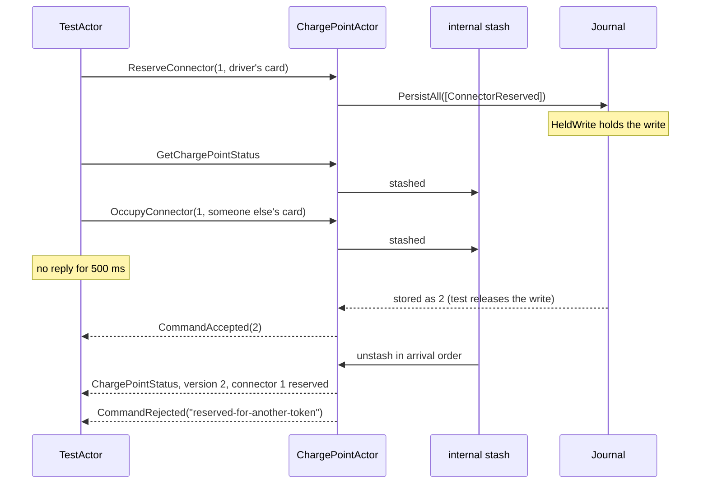
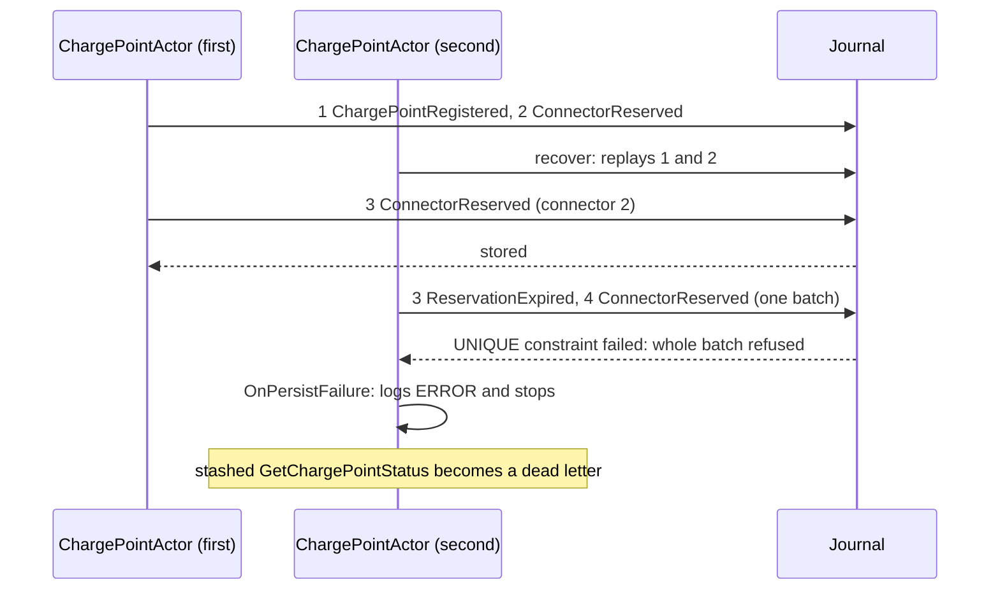

# Chapter 10. The Aggregate as a Persistent Actor: Commands, Events and the Journal

At 07:40 a bus driver at the Salt Lake City depot reserves connector 1 of charge point `OHM-SLC-0042` for fifteen minutes. `ChargePoint.Decide` is consulted and answers with one event, `ConnectorReserved`, valid until 07:55. Every test from Chapter 9 agrees that this is the right answer.

Then nothing happens. The event is a value in a test, and nobody keeps it. A second driver a second later finds no decision to respect. A restart at 07:41 erases the reservation. Nobody tells the driver's app that the answer was yes, because a pure function has no one to answer. The decider of Chapter 7 knows the rules and owns nothing else: no identity, no clock, no storage, no mailbox.

This chapter supplies all of that. It puts each decider inside an Akka.Persistence actor and follows one command, `ReserveConnector`, from the sender's `Tell` to a row in a SQLite file and back to a `CommandAccepted` carrying the aggregate's new version. On the way it makes the decisions that are expensive to change later: the reply vocabulary, the serializer, and the write call that keeps two drivers from both being told yes.

> **In this chapter you will:**
>
> - compose a node with Akka.Hosting, one `AddXxxContext()` extension per bounded context, and keep every union off the wire;
> - write events with a System.Text.Json serializer whose manifests and identifier are permanent, and freeze their shapes with golden files;
> - run a decider inside a `ReceivePersistentActor` and draw its command path, from `Decide` through `PersistAll` to the reply that carries the version;
> - prove what the actor does while a write is in flight, and choose between `Persist`, `PersistAsync`, `PersistAll` and `DeferAsync` for a given aggregate;
> - read the real journal rows that Akka.Persistence.Sql writes to SQLite, and see what the journal does when two incarnations of one aggregate both try to write;
> - extract a `DeciderActor` base class and put the session and site-budget deciders in it.

> **Starting point:** `ch09-s06`, the three deciders, their policies and the domain test suite of Chapter 9.
>
> ```bash
> git checkout ch09-s06
> ```

## 10.1 What the shell owns; a composition root with Akka.Hosting

The decider is deliberately incomplete. `ChargePoint.Decide(state, command, context)` needs someone to supply its inputs and act on the events it returns. Section 1.6 named that someone the actor shell. Before writing it, list exactly what it owns: everything on the list is something the decider must never touch.

### Five responsibilities, one place each

Gary Bernhardt's ["functional core, imperative shell"](https://www.destroyallsoftware.com/screencasts/catalog/functional-core-imperative-shell) (*Destroy All Software* screencast "Functional Core, Imperative Shell", 2012) splits a program into pure decisions and the code that performs effects. For an aggregate in a cluster, the shell's share comes to five responsibilities:

| The shell owns | Because the decider cannot | Mechanism in this book |
|---|---|---|
| Identity | A pure function has no address | Persistence id `charge-point-OHM-SLC-0042`, later a shard entity (Chapter 12) |
| Concurrency | Two calls at once would both see the old state | One mailbox, one message at a time |
| Durability | Returned events vanish with the process | `PersistAll` to a journal (sections 10.4 to 10.9) |
| Time | Reading a clock makes a function untestable | `TimeProvider`, read once per command into a `DecisionContext` |
| Messaging | Nobody can be answered by a return value | Wire-safe replies (section 10.2), serialized (section 10.3) |

None of the rows mentions a connector, a reservation or a token, which is why the shell stays thin.

### The composition root

The actors need a process to run in. Mark Seemann's [**composition root**](https://blog.ploeh.dk/2011/07/28/CompositionRoot/) ("Composition Root", 2011) is the single place where an application's object graph is assembled; for Ohmline it is a new Web SDK project, `src/Ohmline.Node`, which references `Ohmline.Charging.Actors` and nothing else of Charging. Tag `ch10-s01` adds it with Akka.Hosting, which builds an `ActorSystem` from the generic host's dependency injection and configuration:

```csharp
// File: src/Ohmline.Node/Program.cs @ ch10-s01
using Akka.Hosting;
using Ohmline.Charging.Actors;

var builder = WebApplication.CreateBuilder(args);

// The one clock of the node. Actors read it once per command into a DecisionContext.
builder.Services.AddSingleton(TimeProvider.System);

builder.Services.AddAkka("ohmline", akka => akka
    .ConfigureLoggers(loggers =>
    {
        loggers.ClearLoggers();
        loggers.AddLoggerFactory(); // Akka.NET logs through Microsoft.Extensions.Logging.
    })
    .AddChargingContext());

var app = builder.Build();

// Liveness only: the process is up and serving HTTP. Readiness arrives with the cluster.
app.MapGet("/alive", () => TypedResults.Text("alive"));

app.Run();
```

Three choices are visible here. The actor system is named `ohmline`, the name every node and clustered test will share. The clock is registered once as `TimeProvider.System`, so a test can register a `FakeTimeProvider` instead and change nothing else. And Charging arrives through one call, `AddChargingContext()`, which lives next to Charging's actors:

```csharp
// File: src/Charging/Ohmline.Charging.Actors/ChargingAkkaExtensions.cs @ ch10-s01
public static class ChargingAkkaExtensions
{
    extension(AkkaConfigurationBuilder akka)
    {
        /// <summary>
        /// Empty for now. Section 10.3 adds Charging's serializer and section 10.4 the charge
        /// point actor.
        /// </summary>
        public AkkaConfigurationBuilder AddChargingContext() => akka;
    }
}
```

The method is a C# 14 extension member (section 3.7). One extension per bounded context keeps each context's wiring with its code, and the test hosts of sections 10.7 to 10.9 call the same `AddChargingContext()` as the node. The tag also adds `Akka` to `Ohmline.ActorShell` and `Akka.Persistence.Hosting` to Central Package Management, pinned to `$(AkkaVersion)`, 1.5.73. The cost is one more project and a rule to keep: the node holds no domain logic.

> **Try it**
>
> ```bash
> git checkout ch10-s01
> git diff ch09-s06 ch10-s01 --stat
> dotnet run --project src/Ohmline.Node
> curl -i http://localhost:5180/alive     # in a second terminal
> ```
>
> The diff shows `9 files changed, 94 insertions(+)`. The node logs `Now listening on: http://localhost:5180`, and `curl` prints `HTTP/1.1 200 OK` followed by `alive`. Stopping the node logs `CoordinatedShutdown invoked due to [Reason:Akka.Actor.CoordinatedShutdown+ClrExitReason]`. The test total stays at 809.

## 10.2 Protocol: commands in, replies out, and the union trap

A driver's app sends `ReserveConnector` and waits. The answer crosses the cluster, perhaps between two versions of Ohmline during a rolling update, and the app must tell "yes, at version 2" from "no, it is reserved for someone else until 07:55" without parsing a sentence. The decider's answer is a `Result<ImmutableArray<ChargePointEvent>, ChargePointError>`, and no part of that union belongs on the wire.

### Replies are closed records

Section 3.9 showed why: a told union arrives boxed as the union struct, and Akka.NET 1.5's default serializer restores it with `Value == null`. ADR 0003's rule is that anything told, asked, replied with or persisted is a `closed record` hierarchy. Tag `ch10-s02` gives Charging its replies:

```csharp
// File: src/Charging/Ohmline.Charging.Contracts/Replies.cs @ ch10-s02
// ...
public closed record CommandReply;

/// <summary>
/// The command was decided and every event it caused is in the journal. The version is the
/// aggregate's sequence number afterwards: the number of events it has ever recorded. A command
/// that changed nothing answers with the version it found.
/// </summary>
public sealed record CommandAccepted(long Version) : CommandReply;

/// <summary>
/// The command was refused and nothing was recorded. The code is stable and meant for programs
/// (<c>reserved-for-another-token</c>); the message is a sentence for people and logs, and may
/// change wording at any time.
/// </summary>
public sealed record CommandRejected(string Code, string Message) : CommandReply;
```

`CommandAccepted` carries the aggregate's **version**, its sequence number after the command; section 10.9 shows why it can stand in for an optimistic-concurrency token. `CommandRejected` separates a code, which programs branch on and which is therefore published vocabulary, from a message, which people read. In the terms of Vernon's [*Reactive Messaging Patterns with the Actor Model*](https://www.informit.com/store/reactive-messaging-patterns-with-the-actor-model-applications-9780133846836) (ch. 6 "Message Construction", section "Request-Reply", p. 209), this is Request-Reply: the reply type is as much a part of the protocol as the command.

Questions get a family of their own: `GetChargePointStatus` derives from `ChargePointQuery`, a family of its own, as its doc comment says, "so that no decider ever sees a question", and its answer `ChargePointStatus` is plain data at a version, with connector states as strings such as `"reserved"`, never the union state.

### Mapping the error union in the shell

The decider refuses with a `ChargePointError` union of six cases. The shell maps it with one exhaustive switch:

```csharp
// File: src/Charging/Ohmline.Charging.Actors/ErrorMapping.cs @ ch10-s02
public static class ErrorMapping
{
    extension(ChargePointError error)
    {
        public string Code => error switch
        {
            ChargePointError.NotRegistered => "not-registered",
            ChargePointError.AlreadyRegistered => "already-registered",
            ChargePointError.UnknownConnector => "unknown-connector",
            ChargePointError.ConnectorUnavailable => "connector-unavailable",
            ChargePointError.ReservedForAnotherToken => "reserved-for-another-token",
            ChargePointError.ConnectorFaulted => "connector-faulted",
            null => throw DefaultError(nameof(ChargePointError)),
        };

        public CommandRejected ToReply() => new(error.Code, error.Message);
    }
// ...
}
```

Because the switch is an expression over a union, a seventh refusal reason does not compile until it has a code, and `ErrorMappingTests` checks by reflection that every case has a distinct kebab-case code. The `null` arm handles `default(ChargePointError)`, the trap from section 3.3.

The shell needs no inbound protocol union of its own: Akka.NET's `Command<T>` handlers already dispatch on the closed-record hierarchies. Its exhaustive switches are over the domain's unions instead: the `Result` from `Decide` (section 10.4), `ChargePointError` here, and `ChargePointState` in `StatusMapping`. A protocol union of unrelated types earns its place in the charging journey, whose inputs come from several contexts with no common base (section 15.2).

### A `Send` that never tells a union

When the value in hand *is* a union, it must be unwrapped before it is told. Section 3.7 previewed the extension member that enforces this; here is the real one:

```csharp
// File: src/Ohmline.ActorShell/Messaging/SendExtensions.cs @ ch10-s02
public static class SendExtensions
{
    extension(IActorRef recipient)
    {
        /// <summary>Tells the case, from the current actor (no one, outside an actor).</summary>
        public void Send<TProtocol>(TProtocol message)
            where TProtocol : IUnion =>
            recipient.Tell(CaseOf(message));

        /// <summary>Tells the union's case, from <paramref name="sender"/>.</summary>
        public void Send<TProtocol>(TProtocol message, IActorRef sender)
            where TProtocol : IUnion =>
            recipient.Tell(CaseOf(message), sender);
    }
// ...
}
```

The constraint `where TProtocol : IUnion` admits only unions, and `CaseOf` tells `.Value`, the case record, or throws for a default union before anything is told. `SendExtensionsTests` runs with `akka.actor.serialize-messages = on`, which sends every message through serialization as between nodes, and `Given_a_union_when_told_instead_of_sent_then_it_arrives_empty` shows the alternative. Nothing in production calls `Send` yet; the first caller is the journey in Chapter 15.

> **Anti-pattern: persisting or telling a union wrapper.** Branch `wrong/ch10-s02-union-on-the-wire` contains a shell that replies with `Sender.Tell(refusal)`, where `refusal` is a `ChargePointError`, instead of `Sender.Tell(refusal.ToReply())`. With `serialize-messages` on, the test receives a `ChargePointError` whose `Value` is `null`: the reason, the connector and the expiry are all gone, and nothing threw.

> **Try it**
>
> ```bash
> git checkout ch10-s02
> git diff ch10-s01 ch10-s02 --stat
> git diff ch10-s01 ch10-s02 -- src
> dotnet test --solution Ohmline.slnx
> git checkout wrong/ch10-s02-union-on-the-wire
> dotnet test --project tests/Ohmline.Charging.Actors.Tests
> ```
>
> The diff shows `12 files changed, 308 insertions(+)`, including the new projects `tests/Ohmline.ActorShell.Tests` and `tests/Ohmline.Charging.Actors.Tests`. The run reports `total: 822`, `failed: 0`. On the side branch, `Demonstrates_an_error_union_replied_as_it_is_arrives_empty` passes: it asserts that the reply's `Value` is `null`.

## 10.3 Serialization before the first persisted event

Section 10.4 will write the first `ConnectorReserved` to a journal, and every version of Ohmline that ever recovers `OHM-SLC-0042` will read that row. Its format is therefore chosen now, while the journal is empty and a mistake costs nothing.

### What Akka.NET writes by default

An event is stored as three things: the **identifier** of the serializer that wrote it, a **manifest** telling that serializer what it is reading, and the bytes. Akka.NET 1.5's default for user types is still Newtonsoft.Json, identifier 1, with an empty manifest. Branch `wrong/ch10-s03-default-serializer` registers no serializer of its own and shows the payload it writes for a reservation. It begins `{"$id":"1","$type":"Ohmline.Charging.Domain.ChargePoints.ConnectorReserved, Ohmline.Charging.Domain","TokenUid":{"$id":"2","$type":"Ohmline.SharedKernel.Identity.TokenUid, Ohmline.SharedKernel",...`: the CLR type and its assembly are in the data.

Three consequences follow, each observed in a real run:

- **A rename breaks replay.** With `.ConnectorReserved,` replaced by `.ConnectorHeld,` in the stored bytes, as renaming the class would leave them, reading fails with `Could not find type 'Ohmline.Charging.Domain.ChargePoints.ConnectorHeld' in assembly 'Ohmline.Charging.Domain, ...'`.
- **Value objects with private constructors do not come back.** Site Energy's `SiteConfiguration` is written, then refused with `Unable to find a constructor to use for type Ohmline.SiteEnergy.Domain.Sites.SiteConfiguration`.
- **Unions arrive empty**, as section 3.9 showed.

The fix separates the name a stored record is known by from the class that reads it. Akka.NET's `SerializerWithStringManifest` lets the serializer choose the manifest, and the [Akka.NET documentation](https://getakka.net/articles/serialization/serialization.html#serializer-with-string-manifest) (*Serialization*, section "Serializer with String Manifest") recommends it for data that must evolve: "This is especially useful for `Persistence`."

### A manifest serializer on System.Text.Json

Tag `ch10-s03` adds `ManifestJsonSerializer` to `Ohmline.ActorShell`, the base class of every context's serializer. Its constructor takes a hand-written registry and builds two frozen lookups from it:

```csharp
// File: src/Ohmline.ActorShell/Serialization/ManifestJsonSerializer.cs @ ch10-s03
public abstract class ManifestJsonSerializer : SerializerWithStringManifest
{
    private readonly FrozenDictionary<Type, string> _manifests;
    private readonly FrozenDictionary<string, Type> _types;
    private readonly JsonSerializerOptions _options;
// ...
    protected ManifestJsonSerializer(
        ExtendedActorSystem system,
        IReadOnlyDictionary<Type, string> manifests,
        Action<JsonSerializerOptions>? configure = null)
        : base(system)
    {
        _manifests = manifests.ToFrozenDictionary();
        _types = manifests
            .ToDictionary(pair => pair.Value, pair => pair.Key) // Throws on a manifest used twice.
            .ToFrozenDictionary();
        _options = CreateOptions(configure);
    }

    public override string Manifest(object o) =>
        _manifests.TryGetValue(o.GetType(), out var manifest)
            ? manifest
            : throw new ArgumentException(
                $"{GetType().Name} has no manifest for {o.GetType()}. Add one to its registry.",
                nameof(o));
```

The reverse map goes through `ToDictionary` first because building a `FrozenDictionary` from a sequence with a duplicate key silently keeps the last one; `ToDictionary` throws on a manifest used twice. A type without a manifest fails on writing, with a message that says what to do.

Reading is the mirror image, and the options are where the shape of the JSON is decided:

```csharp
// File: src/Ohmline.ActorShell/Serialization/ManifestJsonSerializer.cs @ ch10-s03
    public override object FromBinary(byte[] bytes, string manifest) =>
        _types.TryGetValue(manifest, out var type)
            ? JsonSerializer.Deserialize(bytes, type, _options)
                ?? throw new SerializationException($"The '{manifest}' payload is null.")
            : throw new SerializationException(
                $"{GetType().Name} ({Identifier}) does not know the manifest '{manifest}'.");

    private static JsonSerializerOptions CreateOptions(Action<JsonSerializerOptions>? configure)
    {
        var options = new JsonSerializerOptions
        {
            PropertyNamingPolicy = JsonNamingPolicy.CamelCase,
            RespectNullableAnnotations = true,
            RespectRequiredConstructorParameters = true,
            TypeInfoResolver = new DefaultJsonTypeInfoResolver(),
            Converters = { new ValueObjectConverter(), new JsonStringEnumConverter() },
        };
        configure?.Invoke(options);
        options.MakeReadOnly();
        return options;
    }
```

An unknown manifest throws `SerializationException`, which Akka.NET expects for a message it cannot read. The two `Respect...` options make the reader strict about what must be present while unknown properties are still ignored, the tolerant reader of section 20.2. `ValueObjectConverter` writes any `IValueObject<TSelf, TValue>` as its raw value, so a charge point id is `"OHM-SLC-0042"` and a power is `22`, and reads it back through `TSelf.Create` (section 3.6), so an invalid stored value is refused rather than smuggled past validation. The shared kernel takes no dependency on System.Text.Json.

Charging's serializer is a registry and an identifier:

```csharp
// File: src/Charging/Ohmline.Charging.Actors/Serialization/ChargingSerializer.cs @ ch10-s03
public sealed class ChargingSerializer(ExtendedActorSystem system)
    : ManifestJsonSerializer(system, Manifests)
{
    /// <summary>The name Akka.NET knows the serializer by, in configuration and logs.</summary>
    public const string Name = "charging";

    /// <summary>Every message whose type derives from one of these is written here.</summary>
    public static IReadOnlyList<Type> BoundTypes { get; } =
    [
        typeof(ChargePointCommand),
        typeof(ChargePointEvent),
        typeof(ChargePointQuery),
        typeof(ChargePointStatus),
        typeof(CommandReply),
    ];

    public static FrozenDictionary<Type, string> Manifests { get; } = new Dictionary<Type, string>
    {
        [typeof(RegisterChargePoint)] = "charging.register-charge-point.v1",
        [typeof(ReserveConnector)] = "charging.reserve-connector.v1",
// ...
        [typeof(ChargePointRegistered)] = "charging.charge-point-registered.v1",
        [typeof(ConnectorReserved)] = "charging.connector-reserved.v1",
// ...
        [typeof(CommandAccepted)] = "charging.command-accepted.v1",
        [typeof(CommandRejected)] = "charging.command-rejected.v1",
    }.ToFrozenDictionary();

    /// <summary>Permanent: Ohmline's serializer ids are listed in ADR 0007.</summary>
    public override int Identifier => 9101;
}
```

All 24 lines follow the scheme `{context}.{kebab-type-name}.v{N}`, and commands, queries and replies are registered beside the events because they cross the cluster too. `AddChargingContext()` registers the serializer and binds it to the five base types, so Akka.NET picks it for any leaf:

```csharp
// File: src/Charging/Ohmline.Charging.Actors/ChargingAkkaExtensions.cs @ ch10-s03
        public AkkaConfigurationBuilder AddChargingContext() =>
            akka.WithCustomSerializer(
                ChargingSerializer.Name,
                ChargingSerializer.BoundTypes,
                system => new ChargingSerializer(system));
```

### Freezing the shapes with golden files

A registry makes renames safe. It does not stop someone removing a field from `ConnectorReserved` and making every stored reservation unreadable. For that, each manifest gets a **golden file**, the exact JSON the message is written as, committed under `tests/golden/`:

*File: tests/golden/charging.connector-reserved.v1.json @ ch10-s03*

```json
{
  "tokenUid": "04A2B3C4D5E6F7",
  "expiresAt": "2026-11-04T07:55:00-07:00",
  "connectorNumber": 1,
  "chargePointId": "OHM-SLC-0042",
  "commandId": "019a4f6e-1c00-7d2a-9b3e-5c0a00000042",
  "occurredAt": "2026-11-04T07:40:00-07:00"
}
```

The leaf's members come before the base record's, System.Text.Json's order. `Golden.Verify(name, json)` in `Ohmline.Testing` compares the JSON with the file and fails with the rule itself: "A shape that has been written must stay readable: add a new manifest version instead of changing this one." Running the tests with `OHMLINE_ACCEPT_GOLDEN=1` writes the files instead, for a shape that was never released. `SerializationTests` checks every manifest four ways: `FindSerializerFor` picks identifier 9101, the message round-trips equal, its JSON matches the golden file, and the golden file reads back as the message. The golden corpus of section 20.5 extends this to every version ever written.

ADR 0007 records the permanent parts: identifiers 9100 to 9104, with 9105 to 9199 reserved, far above the low ids Akka.NET's documentation keeps for itself (its [*Serialization* guide](https://getakka.net/articles/serialization/serialization.html#creating-new-serializers) says 0 to 40, its [*Serializer ID Code Table*](https://getakka.net/articles/serialization/codes.html) 1 to 100), the manifest scheme, and what each change means. Renaming a C# type changes nothing on disk. Adding an optional field keeps the manifest. Any other change of shape is a new manifest version, read for ever beside the old one (section 20.3).

> **Anti-pattern: the default Newtonsoft serializer in the journal.** It works on the first day and fails on the first rename. Branch `wrong/ch10-s03-default-serializer` removes the registration from `AddChargingContext()`; its two `Demonstrates_` tests pass by asserting that the payload contains the assembly-qualified type and that a renamed type makes stored events unreadable.

The cost is ceremony: one registry line and one golden file per message type. The return is a journal that no longer depends on namespaces or assemblies, and a pull request that changes stored data shows up as a changed golden file.

> **Try it**
>
> ```bash
> git checkout ch10-s03
> git diff ch10-s02 ch10-s03 --stat
> git diff ch10-s02 ch10-s03 -- src/Ohmline.ActorShell
> dotnet test --solution Ohmline.slnx
> git checkout wrong/ch10-s03-default-serializer
> dotnet test --project tests/Ohmline.Charging.Actors.Tests
> ```
>
> The diff shows `38 files changed, 893 insertions(+), 4 deletions(-)`, 24 of them golden files. The run reports `total: 934`, `failed: 0`. On the side branch, both `Demonstrates_` tests in `DefaultSerializerTests` pass.

## 10.4 ReceivePersistentActor: Decide, PersistAll, Evolve, reply

The charge point can now get its actor. The question is one of order: deciding, storing, applying and answering must happen so that the driver hears yes only when the reservation would survive a crash, and the state in memory never runs ahead of the journal.

### The command path

Akka.Persistence's `ReceivePersistentActor` is an actor with a **persistence id**, the durable name its events are stored under, and a journal behind it. It registers `Recover<T>` handlers, which rebuild state from stored events, and `Command<T>` handlers, which handle live messages. The diagram shows one `ReserveConnector` going through the sample's actor, in the order its tests observe:



`PersistAll` hands all of a decision's events to the journal as one **atomic write**; each event's callback applies it with `Evolve` only after the journal has confirmed it, and the `onComplete` callback then replies with `LastSequenceNr`, now the aggregate's version. A rejection has nothing to store and is answered at once. A decision with no events, such as releasing a connector that is already free, is accepted at the version the actor found.

Evolve after the write, never before, is the heart of it. If the actor applied the event first and the write then failed, its memory would hold a reservation the journal does not, and the next command would be decided against a fiction.

### The actor

Tag `ch10-s04` writes the path into `ChargePointActor`. The constructor wires the handlers:

```csharp
// File: src/Charging/Ohmline.Charging.Actors/ChargePoints/ChargePointActor.cs @ ch10-s04
public sealed class ChargePointActor : ReceivePersistentActor
{
    private readonly ChargePointId _chargePointId;
    private readonly TimeProvider _clock;
    private ChargePointState _state = ChargePoint.Initial;

    public ChargePointActor(ChargePointId chargePointId, TimeProvider clock)
    {
        _chargePointId = chargePointId;
        _clock = clock;
        PersistenceId = PersistenceIdOf(chargePointId);

        Recover<ChargePointEvent>(Apply);

        // First match wins: questions are answered before anything is decided.
        Command<GetChargePointStatus>(_ =>
            Sender.Tell(_state.ToStatus(_chargePointId, LastSequenceNr)));
        Command<ChargePointCommand>(Handle);
    }

    /// <summary>Durable vocabulary: <c>charge-point-OHM-SLC-0042</c>, for ever.</summary>
    public override string PersistenceId { get; }

    public static string PersistenceIdOf(ChargePointId chargePointId) =>
        $"charge-point-{chargePointId}";
```

The persistence id is durable vocabulary: change its format and every charge point recovers empty. Recovery uses the same `Apply` as live commands, which is safe because `Evolve` is total and deterministic (section 7.5); Chapter 11 follows recovery in detail. Handlers are tried in registration order and the first match wins, so the query is registered before the command base type, a habit that matters the day a query and a command share a base.

The command handler is the diagram in code:

```csharp
// File: src/Charging/Ohmline.Charging.Actors/ChargePoints/ChargePointActor.cs @ ch10-s04
    private void Handle(ChargePointCommand command)
    {
        var replyTo = Sender;
        var decision = ChargePoint.Decide(_state, command, DecisionContext.From(_clock));
        switch (decision)
        {
            case Ok<ImmutableArray<ChargePointEvent>> { Value.IsEmpty: true }:
                replyTo.Tell(new CommandAccepted(LastSequenceNr));
                break;
            case Ok<ImmutableArray<ChargePointEvent>> accepted:
                // One decision, one atomic write. Each event is applied once it is stored, and
                // the sender hears yes only after the last one.
                PersistAll(
                    accepted.Value,
                    Apply,
                    () => replyTo.Tell(new CommandAccepted(LastSequenceNr)));
                break;
            case Err<ChargePointError> rejected:
                replyTo.Tell(rejected.Error.ToReply());
                break;
            case null:
                throw new InvalidOperationException("Decide returned a default Result.");
        }
    }

    private void Apply(ChargePointEvent @event) => _state = ChargePoint.Evolve(_state, @event);
```

What is persisted is `accepted.Value`, closed-record cases, never a union; the `Result` union is switched on and discarded inside the actor. The handler captures `replyTo` before persisting. The [Akka.NET documentation](https://getakka.net/articles/persistence/event-sourcing.html#:~:text=The%20sender%20of%20a%20persisted%20event) (*Event Sourcing*) says a persisted event's sender is the command's sender, which we have not tested for the newer `onComplete` callback; the captured variable makes the dependency explicit either way, so it is the house style. A loop of `Persist` calls in place of `PersistAll` would trip analyzer AK1006 (section 10.6).

Without sharding there is no shard region to start these actors, so `AddChargingContext()` registers a `ChargePointDirectory`, a parent that starts one `ChargePointActor` per charge point and forwards with the original sender; Chapter 12 deletes it. The node gets `.WithInMemoryJournal()`, commented "For now: forgets everything on restart (section 10.7 fixes that)".

### The first shell tests, serialized from the start

The shell tests use `PersistenceTestKit` from `Akka.Persistence.TestKit.Xunit`, which supplies an in-memory test journal, with the configuration every actor test in Ohmline shares:

```csharp
// File: tests/Ohmline.Testing/ActorTestConfig.cs @ ch10-s04
    public static Config Config { get; } = ConfigurationFactory.ParseString(
        $"""
        akka.actor.serialize-messages = on
        akka.actor.serialize-creators = off
        akka.test.timefactor = {TimeFactor.ToString(CultureInfo.InvariantCulture)}
        """);
```

`serialize-messages = on` makes a union or a type without a manifest fail in the test, not in the first cluster. Props are not serialized, because the constructor takes a clock, and `OHMLINE_TIMEFACTOR` scales timeouts on CI. The test that pins the version semantics:

```csharp
// File: tests/Ohmline.Charging.Actors.Tests/ChargePoints/ChargePointActorTests.cs @ ch10-s04
    [Fact]
    public async Task Given_accepted_commands_then_each_version_counts_the_events_persisted()
    {
        var chargePoint = Start();
        await Accept(chargePoint, Register(), version: 1);
        await Accept(chargePoint, Reserve(1, DriversCard), version: 2);
        _clock.Advance(TimeSpan.FromMinutes(16));

        // The lapsed reservation expires and the new one is made: two events in one decision.
        chargePoint.Tell(Reserve(1, SomeoneElsesCard), TestActor);

        await ExpectMsgAsync(new CommandAccepted(4), cancellationToken: Ct);
    }
```

The version jumps from 2 to 4 because one decision produced `ReservationExpired` and `ConnectorReserved`: the version counts events, not commands. Other tests show that a rejected `OccupyConnector` replies with code `reserved-for-another-token` and leaves the status at version 2, that a query sees the evolved state, and that a new incarnation recovers both events. None tests a reservation rule; those are Chapter 9's decider tests.

> **Try it**
>
> ```bash
> git checkout ch10-s04
> git diff ch10-s03 ch10-s04 --stat
> git diff ch10-s03 ch10-s04 -- src/Charging/Ohmline.Charging.Actors
> dotnet test --solution Ohmline.slnx
> ```
>
> The diff shows `16 files changed, 486 insertions(+), 21 deletions(-)`. The run reports `total: 944`, `failed: 0`; the new tests are in `ChargePointActorTests` and `ChargePointDirectoryTests`.

## 10.5 While the write is in flight: the internal stash

A journal write takes milliseconds, more on a busy database across a network, and during that time the reservation is decided but not applied. A second driver's `OccupyConnector` decided in that window would see connector 1 available, and both drivers would be told yes. The actor must decide nothing until the write is done, without losing or reordering what arrives meanwhile.

### The idea: a slow journal becomes mailbox latency

Between `PersistAll` and its last callback, Akka.Persistence parks every incoming message in an **internal stash**, a buffer of its own that is separate from the `IWithStash` stash an actor can use deliberately. When the callbacks have run, it puts the stashed messages back in front of the mailbox in arrival order. The diagram shows a held write with two messages arriving behind it, as tag `ch10-s05`'s test drives it:



The second driver is turned away because their command was decided after the reservation was applied, and the query reports the reservation because it was answered after it. A slow journal never becomes a race, only mailbox latency.

That gives three guarantees per persistence id. Events are written in the order `Decide` returned them. Their callbacks run in that order. And no command or query observes a half-applied decision, because nothing else is handled until the last callback has run.

### Holding a write in a test

To observe this, the test must hold a write open. Akka.Persistence.TestKit 1.5.73 offers `Pass`, `PassWithDelay` and the `Fail` and `Reject` families, but nothing that waits until the test says so. It does accept an `IJournalInterceptor`, called once per event, so `HeldWrite<TEvent>` awaits a gate the test opens. The test:

```csharp
// File: tests/Ohmline.Charging.Actors.Tests/ChargePoints/InFlightWriteTests.cs @ ch10-s05
        var slowJournal = HeldWrite<ConnectorReserved>.Create();
        await Journal.OnWrite.SetInterceptorAsync(slowJournal);

        chargePoint.Tell(Reserve(1, DriversCard), TestActor);
        await slowJournal.Reached.WaitAsync(Dilated(TimeSpan.FromSeconds(3)), Ct);
        chargePoint.Tell(Status(), TestActor);
        chargePoint.Tell(Occupy(1, SomeoneElsesCard), TestActor);

        await ExpectNoMsgAsync(Quiet, Ct);
        slowJournal.Release();

        await ExpectMsgAsync(new CommandAccepted(2), cancellationToken: Ct);
        var status = await ExpectMsgAsync<ChargePointStatus>(cancellationToken: Ct);
        status.Version.ShouldBe(2);
        status.Connectors[0].State.ShouldBe(ConnectorStatus.Reserved);
        status.Connectors[0].ReservedFor.ShouldBe(DriversCard);
        var rejected = await ExpectMsgAsync<CommandRejected>(cancellationToken: Ct);
        rejected.Code.ShouldBe("reserved-for-another-token");
```

`Quiet` is 500 ms. Waiting for `Reached` first guarantees that the next two messages arrive while the write is held, and `Dilated` bounds every wait, so a broken run fails instead of hanging.

> **Note:** `HeldWrite` keeps its gates in a static dictionary keyed by an id. With `serialize-messages` on, `SetInterceptorAsync` sends the interceptor to the journal in a message, so the journal holds a serialized copy, and a `TaskCompletionSource` completed in the copy does nothing for the test. Delegate predicates such as `FailIf` have the same problem, one reason section 10.6's learning tests run without `serialize-messages`.

### What the stash costs

The internal stash is unbounded by default, so a journal that stops answering makes every busy aggregate's stash grow. The [reference configuration's](https://github.com/akkadotnet/akka.net/blob/1.5.73/src/core/Akka.Persistence/persistence.conf#L19-L23) `akka.persistence.internal-stash-overflow-strategy` throws `StashOverflowException` when a bound is exceeded, but setting the bound is another matter: with `stash-capacity = 2` on the default mailbox, and on a per-actor deque-based mailbox, 1.5.73 still handled three stashed messages normally, so this book makes no claim about how to bound it. Treat a slow journal as a shared fault: one slow database backs up every mailbox it serves. The journal circuit breaker (section 11.3), the `stash` spans of section 17.6 (section 18.2 explains why mailbox depth misses this wait) and a journal connectivity check (section 18.5) are the tools for that.

> **Try it**
>
> ```bash
> git checkout ch10-s05
> git diff ch10-s04 ch10-s05 --stat
> dotnet test --solution Ohmline.slnx
> ```
>
> The diff shows `2 files changed, 103 insertions(+)`. The run reports `total: 945`, `failed: 0`, with `Given_a_write_in_flight_when_more_messages_arrive_then_they_wait_in_order` the new test.

## 10.6 Persist, PersistAsync, PersistAll and DeferAsync

Akka.Persistence offers four ways to write, and they differ in exactly the question of section 10.5: what the actor may do while a write is in flight. A meter reporting every few seconds does not need the charge point's caution, and a reservation cannot afford a meter's speed.

### Four calls in one table

| Call | Stashes new messages? | Callback order | Per-entity throughput | Right for |
|---|---|---|---|---|
| `Persist` | Yes, until its callback has run | Per call, in order | One write round trip per event | One event per command |
| `PersistAll` | Yes, until the last callback and `onComplete` | Event order, then `onComplete` | One atomic write per decision | Every decider (house rule) |
| `PersistAsync`, `PersistAllAsync` | No | In order, interleaved with new commands | Highest | Recording facts that are never refused |
| `DeferAsync` | No, and writes nothing | After every earlier `PersistAsync` callback | Not a write | An acknowledgement after async writes |

Tag `ch10-s06` pins these down in `learn/Ch10.PersistenceLab.Tests`, learning tests on tiny counter actors that reference nothing from `src/`. `StashingCounter` uses `Persist` and `InterleavingCounter` uses `PersistAsync`; otherwise their code is identical:

```csharp
// File: learn/Ch10.PersistenceLab.Tests/Counters/InterleavingCounter.cs @ ch10-s06
        Command<GetCount>(_ => Sender.Tell(new Count(_count)));
        Command<Increment>(_ =>
        {
            var replyTo = Sender;
            PersistAsync(new Incremented(), _ =>
            {
                _count++;
                replyTo.Tell(new Counted(_count));
            });
        });
```

With the journal held by an interceptor, `PersistStashesTests` sees no answer to `GetCount` for 300 ms and then `Counted(1)` followed by `Count(1)`. `PersistAsyncInterleavesTests` sees the opposite:

```csharp
// File: learn/Ch10.PersistenceLab.Tests/PersistAsyncInterleavesTests.cs @ ch10-s06
        counter.Tell(new Increment(), TestActor);
        await journal.Reached.WaitAsync(Dilated(TimeSpan.FromSeconds(3)), Ct);
        counter.Tell(new GetCount(), TestActor);

        // Answered while the event is still being written: the count does not include it.
        await ExpectMsgAsync(new Count(0), cancellationToken: Ct);
        journal.Release();
        await ExpectMsgAsync(new Counted(1), cancellationToken: Ct);
```

For a counter that is a stale read. For a decider it is a wrong decision, taken against state whose earlier event has not been applied.

### Where PersistAsync and DeferAsync belong

`PersistAsync` suits an actor that records facts and never refuses one, so it never needs its latest state before accepting the next. The lab's `MeterLog` stores `ReadingRecorded` for every `RecordReading`, and answers a `Checkpoint` with `DeferAsync`, which writes nothing and runs its handler after every earlier `PersistAsync` has completed. With every write delayed by 100 ms, `DeferAsyncOrderingTests` observes `stored 18204000 Wh`, `stored 18204350 Wh`, `checkpoint 07:45`, `stored 18204700 Wh`: the checkpoint waits for the writes before it, not the one after.

### PersistAll keeps one decision atomic

`PersistAll` hands the journal one `AtomicWrite` per decision, to be stored whole or not at all; `Persist` in a loop hands it one write per event. [Akka.Analyzers flags the loop](https://getakka.net/articles/debugging/rules/AK1006.html) (rule AK1006; message text in [`RuleDescriptors.cs`](https://github.com/akkadotnet/akka.analyzers/blob/dev/src/Akka.Analyzers/Utility/RuleDescriptors.cs)), and the lab's `OneByOneCounter` shows it when built with `-p:DefineConstants=DEMO_COMPILE_ERRORS`: ``error AK1006: Calling `Persist()` inside a loop is discouraged as it is non-performant. Collect all of your changes inside the loop and then call `PersistAll()` after the loop instead.`` The analyzer's reason is performance; the stronger reason is atomicity. `PersistAllAtomicTests` starts a counter at 2, sends a three-event increment to `OneByOneCounter` and fails the write of event 4; the recovered count is 3, because event 3 was a write of its own. A third of an increment is in the journal.

> **Warning:** the test journal does not write a batch atomically. In the lab's third test, a failure injected at event 4 of a three-event `PersistAll` still leaves event 3 stored. A database journal writes the batch in one database transaction, which section 10.9 demonstrates on SQLite. Test atomicity against the real journal, never against the in-memory one.

> **Version note:** the `PersistAll` overloads with an `onComplete` callback exist in 1.5.73; [Petabridge dates them](https://petabridge.com/blog/crud-to-cqrs-akka-persistence/), with the async handler overloads, to 1.5.57 (Aaron Stannard, "Migrating from CRUD to CQRS and Event-Sourcing with Akka.Persistence", section "New Akka.Persistence APIs: Async Event Handlers").

> **Anti-pattern: `PersistAsync` in a decider shell.** Branch `wrong/ch10-s06-persist-async-decider` changes one call in `ChargePointActor`, and two drivers can both be told yes for one connector.

```diff
# git diff ch10-s06 wrong/ch10-s06-persist-async-decider -- '*ChargePointActor.cs'
@@ -56,9 +56,9 @@ public sealed class ChargePointActor : ReceivePersistentActor
                 replyTo.Tell(new CommandAccepted(LastSequenceNr));
                 break;
             case Ok<ImmutableArray<ChargePointEvent>> accepted:
-                // One decision, one atomic write. Each event is applied once it is stored, and
-                // the sender hears yes only after the last one.
-                PersistAll(
+                // WRONG ON PURPOSE (branch wrong/ch10-s06-persist-async-decider): nothing waits
+                // for this write, so the next command is decided before these events are applied.
+                PersistAllAsync(
                     accepted.Value,
                     Apply,
                     () => replyTo.Tell(new CommandAccepted(LastSequenceNr)));
```

The branch's test holds the `ConnectorOccupied` write and sends two `OccupyConnector` commands for connector 1, with two sessions and two cards. Both are accepted, as versions 2 and 3: two cars on one plug.

The house rule follows: **deciders always use `PersistAll`.** None of Ohmline's aggregates accepts every input.

> **Try it**
>
> ```bash
> git checkout ch10-s06
> git diff ch10-s05 ch10-s06 --stat
> dotnet test --project learn/Ch10.PersistenceLab.Tests
> dotnet test --solution Ohmline.slnx
> git checkout wrong/ch10-s06-persist-async-decider
> dotnet test --project tests/Ohmline.Charging.Actors.Tests
> ```
>
> The diff shows `13 files changed, 413 insertions(+)`. The lab runs 7 tests, and the solution reports `total: 952`, `failed: 0`. On the side branch, `Demonstrates_two_drivers_both_occupy_one_connector` passes and `InFlightWriteTests` fails with `Expected no messages during 00:00:00.5000000, instead we received <ChargePointStatus { ... Version = 1 ... }>`: nothing was stashed.

## 10.7 Real storage: Akka.Persistence.Sql on SQLite

The node's in-memory journal forgets every reservation on restart, and the test journal hides how a database behaves under failure. The cluster of section 12.10 runs on PostgreSQL; a developer node gets the same plugin, the same tables and real bytes from a SQLite file, with nothing to install.

The plugin is **Akka.Persistence.Sql**, built on Linq2Db, serving SQLite, PostgreSQL, SQL Server and others from one code base. The older per-database plugins are being retired: [`Akka.Persistence.PostgreSql`](https://www.nuget.org/packages/Akka.Persistence.PostgreSql) and [`Akka.Persistence.SqlServer`](https://www.nuget.org/packages/Akka.Persistence.SqlServer) are deprecated as legacy on NuGet, which names Akka.Persistence.Sql as the alternative, and [`Akka.Persistence.Sqlite`](https://www.nuget.org/packages/Akka.Persistence.Sqlite), not marked, has had no release since 1.5.39. Tag `ch10-s07` pins `Akka.Persistence.Sql.Hosting` and `Microsoft.Data.Sqlite` 10.0.14 in `Directory.Packages.props` (10.0.0 pulls in a vulnerable SQLitePCLRaw) and replaces the node's in-memory journal:

```csharp
// File: src/Ohmline.Node/Program.cs @ ch10-s07
var journal = builder.Configuration.GetConnectionString("journal")
    ?? throw new InvalidOperationException(
        "ConnectionStrings:journal is not set. In Development, appsettings.Development.json " +
        "sets it to a SQLite file.");

builder.Services.AddAkka("ohmline", akka => akka
    .ConfigureLoggers(loggers =>
    {
        loggers.ClearLoggers();
        loggers.AddLoggerFactory(); // Akka.NET logs through Microsoft.Extensions.Logging.
    })
    .WithSqlPersistence(
        connectionString: journal,
        providerName: ProviderName.SQLiteMS,
        autoInitialize: true, // Creates missing tables; Chapter 20 owns the schema instead.
        tagStorageMode: TagMode.TagTable)
    .AddChargingContext());
```

`ProviderName.SQLiteMS` is the Linq2Db provider for Microsoft.Data.Sqlite, the most specific name available, as the [plugin's documentation](https://github.com/akkadotnet/Akka.Persistence.Sql#the-classic-way-using-hocon) advises: "For best performance, one should use the most specific provider name possible." `autoInitialize: true` creates missing tables, a convenience that section 20.8 replaces with owned migrations. `TagMode.TagTable` keeps event tags in a table of their own for Chapter 13. `appsettings.Development.json` sets `"journal": "Data Source=ohmline.db"`, and `.gitignore` gains `ohmline.db*`.

An idle node creates no database file: the journal starts with the first persistent actor. The node has no command endpoint until section 12.5, so a test shows the restart: `SqliteNode` starts a generic host with the same `WithSqlPersistence` and `AddChargingContext()` on a temporary file, and `NodeRestartTests` registers and reserves on one node, stops it, starts another on the same file, and reads version 2 with connector 1 still reserved.

> **Try it**
>
> ```bash
> git checkout ch10-s07
> git diff ch10-s06 ch10-s07 --stat
> git diff ch10-s06 ch10-s07 -- src/Ohmline.Node
> dotnet test --solution Ohmline.slnx
> ```
>
> The diff shows `9 files changed, 156 insertions(+), 3 deletions(-)`. The run reports `total: 953`, `failed: 0`; the new test is `Given_a_reservation_when_the_node_restarts_then_the_reservation_is_kept`.

## 10.8 A guided tour of the journal

During an incident an operator will open the production journal to see what happened to `OHM-SLC-0042` at 07:40, and should already know what the rows mean. Tag `ch10-s08` adds `JournalTourTests`, which starts a `SqliteNode` on a temporary file with the real `ChargingSerializer`, sends `RegisterChargePoint`, `ReserveConnector` and an `OccupyConnector` for someone else's card, and reads the tables with Microsoft.Data.Sqlite. The SELECT statements live in `JournalTourQueries`, for section 20.1's `Ohmline.JournalInspect` to reuse:

```csharp
// File: tests/Ohmline.Charging.Actors.Tests/JournalTour/JournalTourQueries.cs @ ch10-s08
    /// <summary>One aggregate's events in order. The message column is UTF-8 JSON.</summary>
    public const string Journal = """
        SELECT ordering, persistence_id, sequence_number, created, deleted,
               manifest, identifier, writer_uuid, message
        FROM journal
        WHERE persistence_id = $persistenceId
        ORDER BY sequence_number
        """;
```

### The tables

`autoInitialize` created three tables on first use. The test prints their DDL, and `docs/journal-tour.md` keeps it:

```sql
-- File: docs/journal-tour.md @ ch10-s08
CREATE TABLE [journal]
(
	[ordering]        INTEGER        NOT NULL PRIMARY KEY AUTOINCREMENT,
	[created]         INTEGER        NOT NULL,
	[deleted]         Bit            NOT NULL,
	[persistence_id]  NVarChar(255)  NOT NULL,
	[sequence_number] INTEGER        NOT NULL,
	[message]         VarBinary      NOT NULL,
	[manifest]        NVarChar(500)      NULL,
	[identifier]      INTEGER            NULL,
	[writer_uuid]     NVarChar(128)      NULL
)
CREATE UNIQUE INDEX journal_uq ON journal (persistence_id, sequence_number)
CREATE INDEX journal_created_idx ON journal (created)
CREATE INDEX journal_sequence_number_idx ON journal (sequence_number)
```

The unique index `journal_uq` matters most, and section 10.9 tests it. Beside the journal sit `tags`, keyed by `(ordering_id, tag)`, and `snapshot`, keyed by `(persistence_id, sequence_number)`. In tag-table mode the journal has no `tags` column at all.

### The rows

The two rows from a real run, as the tour document keeps them, without the payload lines:

```text
# File: docs/journal-tour.md @ ch10-s08
ordering=1 | persistence_id=charge-point-OHM-SLC-0042 | sequence_number=1
  | created=639294642278539950 (2026-11-05T08:30:27.8539950+00:00) | deleted=False
  | manifest=charging.charge-point-registered.v1 | identifier=9101
  | writer_uuid=2620fa9aa3da4417baa4f57738f9d859
# ...
ordering=2 | persistence_id=charge-point-OHM-SLC-0042 | sequence_number=2
  | created=639294642278638408 (2026-11-05T08:30:27.8638408+00:00) | deleted=False
  | manifest=charging.connector-reserved.v1 | identifier=9101
  | writer_uuid=2620fa9aa3da4417baa4f57738f9d859
# ...
tags: 0 rows
snapshot: 0 rows
```

Row 2's payload is the reservation as section 10.3's serializer wrote it: `{"tokenUid":"04A2B3C4D5E6F7","expiresAt":"2026-11-04T14:55:00+00:00","connectorNumber":1,...}`. The test reads each payload back with `Sys.Serialization.Deserialize(bytes, identifier, manifest)`, as recovery does.

Column by column:

| Column | What it holds | Used by |
|---|---|---|
| `ordering` | A position across all persistence ids, in insert order | Persistence Query's offset (Chapter 13) |
| `persistence_id` | The aggregate's durable name | Recovery; sharding (Chapter 12) |
| `sequence_number` | 1, 2, ... per persistence id, without gaps: the version | Recovery; `journal_uq` (section 10.9) |
| `created` | .NET ticks, UTC, when the journal wrote the row | Retention, incident timelines |
| `deleted` | Marks the highest row kept after a delete | `DeleteMessages` (section 11.7) |
| `manifest`, `identifier` | `charging.connector-reserved.v1` and `9101`, from our serializer | Choosing the reader on replay |
| `message` | The event as UTF-8 JSON | The serializer only |
| `writer_uuid` | One id per actor incarnation | The replay filter (section 10.9) |

Look closely at `created`: ticks, not ISO text, from the wall clock of the machine that wrote the row, not from the node's `TimeProvider`. The events' `occurredAt` is the fake clock's 14:40 on 2026-11-04, while `created` is the real run on 2026-11-05. The decision's time is a domain fact and lives in the event; `created` is a storage fact.

What is missing teaches as much. There is no row for the rejected `OccupyConnector`: a rejection is a reply, not an event. There is no command anywhere: the journal records what happened, never what was asked. `tags` stays empty until Chapter 13, and `snapshot` until section 11.2.

> **Warning:** reading these tables is for learning and for incident work. Application code never reads them and never writes them: it asks the aggregate, and from Chapter 13 it reads the read journal. A row edited by hand to fix a poison event breaks the guarantees of this whole chapter (section 11.3).

> **Try it**
>
> ```bash
> git checkout ch10-s08
> git diff ch10-s07 ch10-s08 --stat
> dotnet test --solution Ohmline.slnx
> ```
>
> The diff shows `4 files changed, 351 insertions(+)`. The run reports `total: 955`, `failed: 0`. `docs/journal-tour.md` holds the full rows and DDL as the test printed them; `writer_uuid`, `created` and `commandId` differ on every run.

## 10.9 One writer per persistence id: sequence numbers instead of locks

A repository over a relational table protects an aggregate with **optimistic concurrency**: load the row with its version, decide, and write back only if the version is unchanged, as in Vernon's [*Implementing Domain-Driven Design*](https://www.informit.com/store/implementing-domain-driven-design-9780321834577) (ch. 10 "Aggregates", section "Implementation", ["Optimistic Concurrency"](https://www.informit.com/articles/article.aspx?p=2020371&seqNum=8)). `ChargePointActor` has no expected-version check anywhere, and that needs justifying.

### The actor is the lock

The justification is the **single-writer guarantee**: at most one live incarnation of each persistence id at any moment. On one node, `ChargePointDirectory` gives it; in a cluster, sharding does, with the split-brain resolver deciding which side of a partition survives (sections 12.1 and 12.2). Helland's ["Life Beyond Distributed Transactions"](https://www.cidrdb.org/cidr2007/papers/cidr07p15.pdf) (CIDR 2007, section 2 "Entities") describes the same shape: an entity with a unique key, updated atomically by one owner, with no transaction spanning entities. ADR 0001 made it Ohmline's rule in Chapter 1.

Given one writer, `Decide` always sees every earlier event, applied in order before the next command left the stash. There is nothing for an optimistic check to catch: the mailbox serializes the decisions, and the sequence number is the aggregate's version, the `Version` in every `CommandAccepted`. An expected version still belongs where a person decided from a stale screen; the command can carry the version they saw (section 19.3).

### What two writers look like

If the guarantee were broken, say by a deployment that runs the same entities twice (section 21.8), both incarnations would recover to sequence number n and both would write n + 1. Tag `ch10-s09` stages that in `TwoIncarnationsTests`, bypassing the directory to start two `ChargePointActor`s for `OHM-SLC-0042`, named `first` and `second`:



`second` runs on a clock 16 minutes later, so from what it recovered the reservation of connector 1 has lapsed, and it accepts someone else's card with two events. The test then checks what happened:

```csharp
// File: tests/Ohmline.Charging.Actors.Tests/JournalTour/TwoIncarnationsTests.cs @ ch10-s09
        // Both are at sequence number 2. The first writes 3.
        await AcceptAsync(first, Reserve(2, DriversCard), 3);

        // The second decides from what it recovered: the reservation of connector 1 has lapsed,
        // so it writes ReservationExpired and ConnectorReserved as 3 and 4, in one batch.
        second.Tell(Reserve(1, SomeoneElsesCard), ActorRefs.NoSender);
        second.Tell(Status(), ActorRefs.NoSender); // Waits in the internal stash.
// ...
        rows.Select(row => row.SequenceNumber).ShouldBe([1, 2, 3]); // No 4: the batch failed.
// ...
        rows.Select(row => row.WriterUuid).Distinct().ShouldHaveSingleItem();
        failure.Cause.ShouldNotBeNull().GetBaseException().ShouldBeOfType<SqliteException>()
            .SqliteErrorCode.ShouldBe(19); // SQLITE_CONSTRAINT
```

The observed log line is `akka://ohmline/user/second: Failed to persist event type [Ohmline.Charging.Domain.ChargePoints.ReservationExpired] with sequence number [3] for persistenceId [charge-point-OHM-SLC-0042].`, with the cause `SQLite Error 19: 'UNIQUE constraint failed: journal.persistence_id, journal.sequence_number'.` Four consequences follow, each asserted:

- **The second write is refused whole.** Only sequence number 3 collided, yet there is no row 4: Akka.Persistence.Sql writes an atomic write in one database transaction. This is the atomicity that the test journal could not show in section 10.6.
- **`OnPersistFailure` stops the actor.** A watching probe sees `Terminated`, and the sender of the failed command gets no reply at all; it would time out.
- **Stashed messages become dead letters.** The status query waiting behind the write arrives on the event stream as `DeadLetter`. Chapter 11 turns this into a failure policy, with retries carrying the same idempotency key (section 12.6).
- **History stays linear.** The journal holds one row per sequence number, all with the first writer's `writer_uuid`, and a fresh incarnation recovers version 3.

If two writers ever did get rows in, on a journal without such an index, every row would still carry its writer's `writer_uuid`, and Akka.Persistence's replay filter, `repair-by-discard-old` in [1.5.73's reference configuration](https://github.com/akkadotnet/akka.net/blob/1.5.73/src/core/Akka.Persistence/persistence.conf#L142-L152), is documented to discard an older writer's events that overlap a newer one's and to log a warning. The sample does not exercise that path, because SQLite's index stops the second writer first.

> **Warning:** none of this is a concurrency strategy. It is the net under the single-writer guarantee, which sharding and the split-brain resolver provide. Never run the same entities in two clusters or two deployments at once (section 21.8).

> **Try it**
>
> ```bash
> git checkout ch10-s09
> git diff ch10-s08 ch10-s09 --stat
> dotnet test --solution Ohmline.slnx
> ```
>
> The diff shows `2 files changed, 156 insertions(+)`. The run reports `total: 956`, `failed: 0`. The "Two writers" section of `docs/journal-tour.md` quotes the test's output.

## 10.10 A reusable DeciderActor and the other aggregates

`ChargingSession` and `SitePowerBudget` need shells too. Copying `ChargePointActor` would leave three command paths to fix when Chapter 11 changes them, and three to drift. Every decider has the shape of `IDecider<TState, TCommand, TEvent, TError>` (section 7.6), so the shell can be written once.

### Extracting the shell

Tag `ch10-s10` moves the command path into `Ohmline.ActorShell` as an abstract base class. The constructor and the hooks:

```csharp
// File: src/Ohmline.ActorShell/Deciders/DeciderActor.cs @ ch10-s10
public abstract class DeciderActor<TDecider, TState, TCommand, TEvent, TError>
    : ReceivePersistentActor
    where TDecider : IDecider<TState, TCommand, TEvent, TError>
    where TCommand : class
    where TEvent : class
{
    private readonly TimeProvider _clock;
// ...
    protected DeciderActor(string typeName, string entityId, TimeProvider clock)
    {
        PersistenceId = $"{typeName}-{entityId}";
        _clock = clock;

        Recover<TEvent>(@event => State = TDecider.Evolve(State, @event));
        Recover<RecoveryCompleted>(_ => OnRecovered());
        Command<TCommand>(Handle);
    }

    public override string PersistenceId { get; }

    /// <summary>The fold of every event so far, changed only here, through Evolve.</summary>
    protected TState State { get; private set; } = TDecider.Initial;

    /// <summary>The reply to a command that was accepted, at the aggregate's new version.</summary>
    protected abstract object Accepted(long version);

    /// <summary>The reply to a command the decider refused: the error mapped to the wire.</summary>
    protected abstract object Rejected(TError error);
```

`TDecider.Decide` and `TDecider.Evolve` call static abstract members, so the decider stays a type with no instance. `Handle` is section 10.4's switch with `Accepted` and `Rejected` in place of concrete replies, and `Apply` evolves, then calls `OnEventApplied`, an empty hook that runs after each stored event but not during recovery; `OnRecovered` runs on `RecoveryCompleted`. Chapter 11 saves snapshots and arms timers from them.

The replies are hooks because `Ohmline.ActorShell` may reference no bounded context, so it cannot construct Charging's `CommandAccepted`. Site Energy has its own `BudgetCommandAccepted` and `BudgetCommandRejected` instead, at the cost of two reply hierarchies the HTTP edge of Chapter 12 must handle.

`ChargePointActor` shrinks from 75 lines to 38. The interesting part of the diff is the class declaration and constructor:

```diff
# git diff ch10-s09 ch10-s10 -- '*ChargePoints/ChargePointActor.cs'
-public sealed class ChargePointActor : ReceivePersistentActor
+public sealed class ChargePointActor
+    : DeciderActor<ChargePoint, ChargePointState, ChargePointCommand, ChargePointEvent,
+        ChargePointError>
 {
-    private readonly ChargePointId _chargePointId;
-    private readonly TimeProvider _clock;
-    private ChargePointState _state = ChargePoint.Initial;
+    /// <summary>Durable vocabulary: the shard type name and the persistence id prefix.</summary>
+    public const string TypeName = "charge-point";
 
     public ChargePointActor(ChargePointId chargePointId, TimeProvider clock)
-    {
-        _chargePointId = chargePointId;
-        _clock = clock;
-        PersistenceId = PersistenceIdOf(chargePointId);
-
-        Recover<ChargePointEvent>(Apply);
-
-        // First match wins: questions are answered before anything is decided.
+        : base(TypeName, chargePointId.Value, clock) =>
         Command<GetChargePointStatus>(_ =>
-            Sender.Tell(_state.ToStatus(_chargePointId, LastSequenceNr)));
-        Command<ChargePointCommand>(Handle);
-    }
+            Sender.Tell(State.ToStatus(chargePointId, LastSequenceNr)));
```

The rest of the diff deletes `Handle` and `Apply` and adds the two reply overrides. The base class now registers `Command<TCommand>` before the subclass's query handler, which is safe only because queries never derive from the command base; the class's remarks say so. `TypeName` becomes the durable shard type name of Chapter 12.

### The other aggregates

`ChargingSessionActor` is a type name, a constructor and the two overrides, with persistence ids `charging-session-` plus the session's Guid. `SitePowerBudgetActor` is the same for `site-power-budget-slc-depot`; its test configures the site, makes two allocation requests, and sees a 120 kW curtailment answered with `BudgetCommandAccepted(5)`, for `CurtailmentApplied` and `AllocationsRebalanced`.

Site Energy gets `SiteEnergySerializer`, identifier 9102, with 14 manifests `site-energy.<kebab-name>.v1` and golden files. Two converters read `SiteConfiguration` and `ConnectorConfiguration` back through their `Create` factories, which solves section 10.3's private-constructor problem without loosening the value objects: a stored configuration that breaks the rules is refused with `JsonException`. A `ClosedHierarchies` helper writes variant values inside messages, such as `PriorityClass`, with a `"$kind"` discriminator.

> **Note:** with `serialize-messages` on, Akka.Persistence copies its own journal-internal messages with Newtonsoft, events included, and that copy failed on `SiteConfiguration`'s private constructor. `ActorTestConfig.With` now installs a `BoundTypeJsonConverter` that hands such objects to their own serializer.

> **Anti-pattern: anemic actor and logic in Receive.** An anemic actor takes setter-like messages and leaves the rules to its callers. Its mirror image puts the rules in handlers, tangled with `Persist` and `Tell`, where only actor tests reach them. Branch `wrong/ch10-s10-logic-in-receive` gives `ChargePointActor` a `Command<ReserveConnector>` handler that rejects whenever the connector is reserved for another token, forgetting that reservations lapse. Every decider test still passes, because the decider is no longer asked; `LogicInReceiveTests` shows the next driver turned away after 16 minutes. On `main`, a `DeciderActor` subclass cannot do this by adding a handler: the base registered `Command<TCommand>` first, and the first match wins.

> **Try it**
>
> ```bash
> git checkout ch10-s10
> git diff ch10-s09 ch10-s10 --stat
> git diff ch10-s09 ch10-s10 -- '*ChargePoints/ChargePointActor.cs'
> dotnet test --solution Ohmline.slnx
> git checkout wrong/ch10-s10-logic-in-receive
> dotnet test --solution Ohmline.slnx
> ```
>
> The diff shows `62 files changed, 1560 insertions(+), 60 deletions(-)`. The run reports `total: 1093`, `failed: 0`. On the side branch, `Demonstrates_a_lapsed_reservation_still_turns_the_next_driver_away` passes, every decider test passes, and two shell tests fail: `Given_accepted_commands_then_each_version_counts_the_events_persisted` and the two-writers test.

## Summary

- The shell owns identity, concurrency, durability, time and messaging, and nothing else; every rule stays in the decider.
- Anything told, replied with or persisted is a closed record under a permanent manifest; unions stay inside the actor, where they give exhaustive switches over decisions, errors and state.
- The serializer and its manifests are part of the stored data, so they are chosen before the first event is written and frozen by golden files; a rename is free, a shape change is a new manifest version.
- A command is decided, its events are written as one atomic write, each is applied only after it is stored, and the sender hears yes with the aggregate's version after the last one; a rejection writes nothing.
- While a write is in flight the actor decides nothing: later messages wait in the internal stash and run in arrival order, so a slow journal costs latency, never correctness. `PersistAsync` gives that up and belongs only to recorders that refuse nothing.
- One live writer per persistence id makes the sequence number the aggregate's version and the actor its own lock; if two writers ever collide, the journal's unique index refuses the second whole and stops it.

## DDD canon covered

Functional core / actor shell; Aggregates and [Vernon's 4 rules](https://www.informit.com/articles/article.aspx?p=2020371) (*Implementing Domain-Driven Design*, ch. 10 "Aggregates"); Event Sourcing (snapshots, upcasting); Serialization strategy and serializer IDs; Split-brain resolver and the single-writer guarantee; Domain Events; Refactoring Toward Deeper Insight; Anti-pattern catalog.

## Exercises

1. **Reflect.** Charging replies with `CommandAccepted` and Site Energy with `BudgetCommandAccepted`, the same shape twice. Weigh one shared reply type in the shared kernel against one per context: who owns the codes, how many serializers write them, what an HTTP edge serving both must do, and what changes when a third context arrives.
2. **Extend.** Starting from `ch10-s10`, add a query `GetSitePowerBudgetStatus` to Site Energy with a `SitePowerBudgetStatus` answer, a manifest in `SiteEnergySerializer` and a golden file. Start in `Ohmline.SiteEnergy.Contracts`, register the handler in `SitePowerBudgetActor`'s constructor, and write a test that asks for the status after the curtailment and sees version 5.
3. **Extend.** Starting from `ch10-s08`, extend `JournalTourTests` with a `ReleaseConnector` for connector 2, which changes nothing. Before running it, predict the reply and the number of rows; expect `CommandAccepted(2)` and still two rows.
4. **Break it.** At `ch10-s03`, change the manifest of `ConnectorReserved` to `charging.connector-held.v1` and run the Charging actor tests. Expect the golden-file theory to fail for the new name with "There is no golden file", and explain from ADR 0007 what this change would have done to a journal that already held reservations.
5. **Break it.** At `ch10-s04`, make `ChargePointActor` reply to a rejection with `rejected.Error`, the union itself, instead of `rejected.Error.ToReply()`. Run `Given_a_reservation_when_someone_else_plugs_in_then_nothing_is_persisted` with `serialize-messages` on, then off. Expect a `ChargePointError` where a `CommandRejected` was expected both times, empty only with serialization on, and explain which run tells the truth about a cluster.

## Further reading

- Akka.NET, [*Event Sourcing*](https://getakka.net/articles/persistence/event-sourcing.html) (2026). Persist, PersistAll, PersistAsync, DeferAsync, the internal stash and the failure callbacks, from the source.
- Akka.NET, [*Serialization*](https://getakka.net/articles/serialization/serialization.html) (2026). `SerializerWithStringManifest`, serializer identifiers and the bindings `WithCustomSerializer` writes.
- Akka.NET, [*Akka.Persistence.Sql*](https://github.com/akkadotnet/Akka.Persistence.Sql) (2026). Providers, tag-table mode, `autoInitialize` and the schema this chapter toured.
- Aaron Stannard (Petabridge), [*Migrating from CRUD to CQRS and Event-Sourcing with Akka.Persistence*](https://petabridge.com/blog/crud-to-cqrs-akka-persistence/) (2025). The `PersistAll` overloads with `onComplete` and async handlers.
- Pat Helland, [*Life beyond Distributed Transactions: an Apostate's Opinion*](https://www.cidrdb.org/cidr2007/papers/cidr07p15.pdf) (CIDR 2007), especially section 2, "Entities". Entities with one owner and no transactions between them, the theory behind section 10.9.
- Vaughn Vernon, [*Reactive Messaging Patterns with the Actor Model: Applications and Integration in Scala and Akka*](https://www.informit.com/store/reactive-messaging-patterns-with-the-actor-model-applications-9780133846836) (Addison-Wesley, 2015), ch. 6 "Message Construction". Request-Reply and the message contracts that actor protocols are built from.
- Jérémie Chassaing, [*Functional Event Sourcing Decider*](https://thinkbeforecoding.com/post/2021/12/17/functional-event-sourcing-decider) (2021). The decider shape that lets one `DeciderActor` serve every aggregate.
