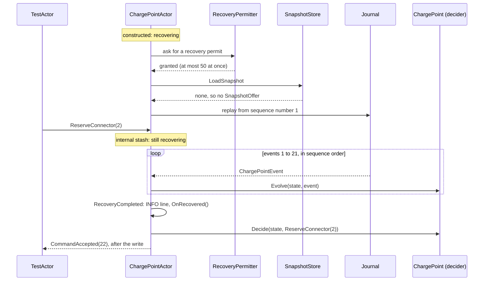
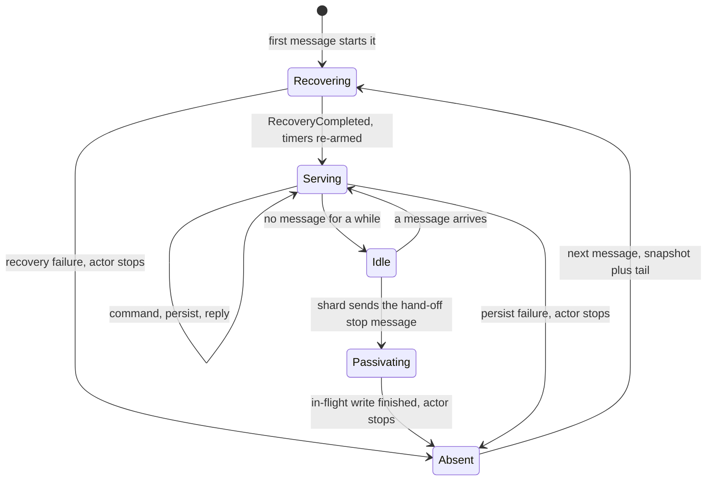
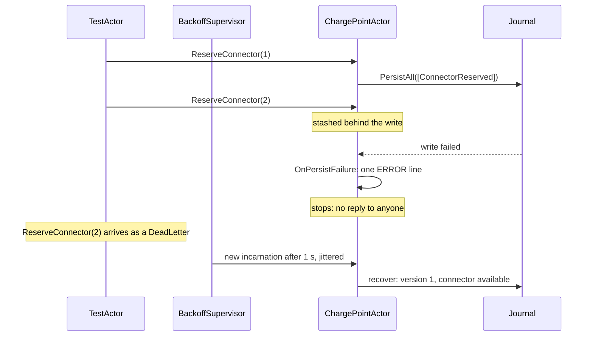
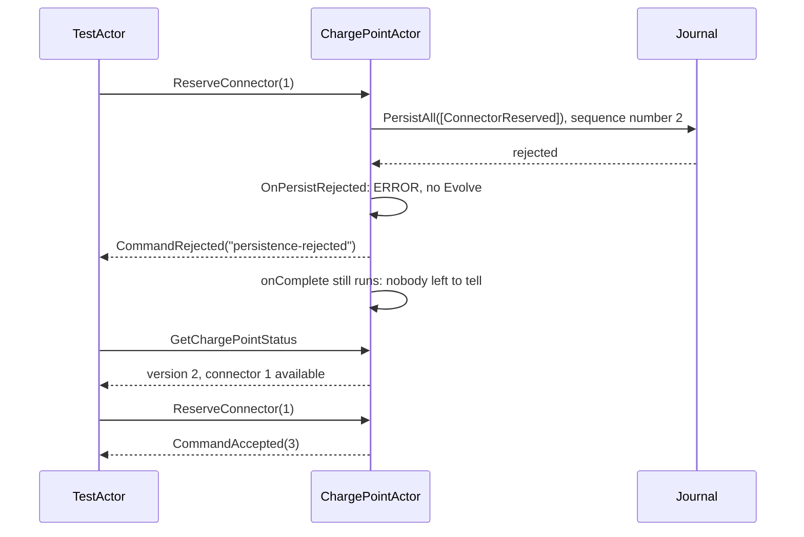

# Chapter 11. Recovery, Snapshots, Durable State and Failure

At 05:58 on a Monday the node that runs the Salt Lake City depot restarts after a patch. Two minutes later the night shift's buses start rolling in, and every one of them needs a connector. Before charge point `OHM-SLC-0042` can answer a single plug-in, it has to become again what it was at 05:57, and all it has to work with is the journal.

That journal is not small. The charge point writes about 30 events a day and has been installed for two years. A driver reserved connector 2 at 05:50 for fifteen minutes, and the timer that would have expired the reservation lived in the process that stopped. And one row near the end of the journal was written by Friday's release candidate before it was rolled back; it carries a manifest that today's serializer has never seen.

Chapter 10 followed one command to disk. This chapter follows the aggregate through the rest of its life: waking up, quickly and alongside hundreds of neighbours, keeping promises about time it cannot remember, failing in ways a caller can reason about, and, for one aggregate whose history nobody wants, forgetting on purpose.

> **In this chapter you will:**
>
> - draw what happens between an actor's construction and its first command, and prove that a command sent during recovery is answered after it;
> - add snapshots as a measured cache with their own manifests, and show that a snapshot plus its tail equals a full replay;
> - estimate and throttle a recovery storm, and diagnose a poison event from one log line without touching the journal;
> - re-arm reservation timers from recovered state, so a reservation expires across a restart;
> - give domain errors, persist failures and persist rejections each the outcome a caller can act on;
> - build a state-sourced listing as Akka.NET's honest stand-in for Durable State, and test any decider shell with a Given-When-Then spec.

> **Starting point:** `ch10-s10`, the reusable `DeciderActor` with the charge point, session and site-budget actors of Chapter 10.
>
> ```bash
> git checkout ch10-s10
> ```

## 11.1 Recovery in depth

After the restart, the first `GetChargePointStatus` for `OHM-SLC-0042` arrives at a new actor with an empty state. Before its first reply, the shell must rebuild the aggregate exactly, without deciding, answering or causing anything.

### Recovery is a fold

Evans names this **reconstitution** and gives it a section of its own, apart from creating objects ([*Domain-Driven Design*](https://www.informit.com/store/domain-driven-design-tackling-complexity-in-the-heart-9780321125217), ch. 6 "The Life Cycle of a Domain Object", section "Reconstituting Stored Objects"). Bringing a stored object back is not creating it, so no creation rules apply and nothing new happens in the domain. For an event-sourced aggregate, the state is the left fold of `Evolve` over the stored events, the same `Fold` Chapter 9's tests use. Akka.Persistence calls this **recovery** and [runs it whenever a persistent actor starts](https://getakka.net/articles/persistence/event-sourcing.html#recovery).

The fold is safe only because `Evolve` is what section 7.5 required: total, deterministic and silent. Total, because a replay that meets an event `Evolve` cannot handle cannot finish. Deterministic, because a fold that read a clock or a feature flag would rebuild a different state on Monday than the one decided on Friday. Silent, because recovery runs on every start: an `Evolve` that sent an email would send it again each time. Hence the rule written into this chapter's code: replay through `Evolve` only, never `Decide`, never a reply, never a side effect.

### The order of things

The diagram shows the recovery of a charge point with 21 stored events and no snapshot, while a `ReserveConnector` arrives mid-replay. It follows tag `ch11-s01`'s test, which holds the replay at its first event:



The actor waits for a permit (section 11.3 says why), then asks the snapshot store for the latest snapshot. With none, no `SnapshotOffer` arrives, and the journal replays every event from sequence number 1, in order, each to a `Recover<T>` handler. After the last one, `RecoveryCompleted` arrives through `Recover` too, and only then does the actor handle commands. The `ReserveConnector` that arrived meanwhile is section 10.5's story again: Akka.Persistence [parks it in the internal stash](https://getakka.net/articles/persistence/event-sourcing.html#internal-stash) and unstashes it in arrival order once recovery is over, so it is decided against all 21 events and accepted as version 22. No command is ever decided against half a history.

Three properties expose the actor's position. `IsRecovering` is true while the replay is under way. `LastSequenceNr` is the sequence number of the last event applied, which is why the shell uses it as the aggregate's version. `SnapshotSequenceNr` needs care: Akka.NET 1.5.73 [documents it as returning `LastSequenceNr`](https://github.com/akkadotnet/akka.net/blob/1.5.73/src/core/Akka.Persistence/Eventsourced.cs#L257-L260), the number a snapshot taken now would carry, not the number of the snapshot the actor recovered from. During recovery, [`Sender` is the dead-letters reference](https://getakka.net/articles/persistence/event-sourcing.html#recovery), one more reason replay never replies.

Two settings, read from the running node, bound recovery. If the journal delivers nothing for `recovery-event-timeout`, 30 s, recovery fails (section 11.3). And Akka.Persistence.Sql reads events in batches of `replay-batch-size`, 1,000, so a long history costs a round trip per thousand events plus deserializing and applying each.

### The shell measures its own recovery

Tag `ch11-s01` turns the recovery lambdas of section 10.10 into named methods and makes recovery visible:

```csharp
// File: src/Ohmline.ActorShell/Deciders/DeciderActor.cs @ ch11-s01
    protected DeciderActor(string typeName, string entityId, TimeProvider clock)
    {
        PersistenceId = $"{typeName}-{entityId}";
        _clock = clock;

        // Recovery: replay through Evolve only. Never Decide, never a reply, never a side effect.
        Recover<TEvent>(Replay);
        Recover<RecoveryCompleted>(_ => Recovered());
        Command<TCommand>(Handle);
    }
    // ...
    private void Replay(TEvent @event)
    {
        State = TDecider.Evolve(State, @event);
        _eventsReplayed++;
    }

    /// <summary>
    /// The last message of recovery. Commands that arrived since the actor started have waited
    /// in the internal stash and are handled after this, in the order they arrived.
    /// </summary>
    private void Recovered()
    {
        _log.Info(
            "{0} recovered to sequence number {1} in {2} ms: {3} events replayed",
            PersistenceId,
            LastSequenceNr,
            (long)Stopwatch.GetElapsedTime(_startedAt).TotalMilliseconds,
            _eventsReplayed);
        OnRecovered();
    }
```

`_startedAt` is taken at construction, so the reported time includes the wait for a permit: it answers how long the charge point was unavailable, not how fast the database was. Unlike the `Apply` of a live write, `Replay` never calls `OnEventApplied`; whatever an event caused the first time, it has caused already.

`RecoveryTests` records 21 events with one incarnation, stops it, and starts another with the same persistence id. One test reads the events back with `JournalProbe`, a helper that recovers a throwaway persistent actor and hands over what it replayed, and asserts that the new incarnation's status equals `ChargePoint.Fold(events).ToStatus(Charger, 21)`. Another sends a command into a held replay:

```csharp
// File: tests/Ohmline.Charging.Actors.Tests/RecoveryTests.cs @ ch11-s01
    [Fact]
    public async Task Given_a_command_sent_during_recovery_then_it_is_answered_after_it()
    {
        await RecordHistoryAsync();
        var slowReplay = HeldWrite<ChargePointRegistered>.Create();
        await Journal.OnRecovery.SetInterceptorAsync(slowReplay);

        var recovering = Start();
        await slowReplay.Reached.WaitAsync(Dilated(TimeSpan.FromSeconds(3)), Ct);
        recovering.Tell(Reserve(2, DriversCard), TestActor);

        await ExpectNoMsgAsync(Quiet, Ct);
        slowReplay.Release();

        await ExpectMsgAsync(new CommandAccepted(Recorded + 1), cancellationToken: Ct);
    }
```

`HeldWrite`, section 10.5's gate, is installed on `Journal.OnRecovery` this time. For 500 ms nothing comes back; then the reservation is accepted as version 22.

> **Try it**
>
> ```bash
> git checkout ch11-s01
> git diff ch10-s10 ch11-s01 --stat
> git diff ch10-s10 ch11-s01 -- src/Ohmline.ActorShell/Deciders/DeciderActor.cs
> dotnet test --solution Ohmline.slnx
> ```
>
> The diff shows `5 files changed, 190 insertions(+), 3 deletions(-)`. The run reports `total: 1096`, `failed: 0`, with the three tests of `RecoveryTests` new.

## 11.2 Snapshots: a cache with a cost model

The "size" row of the charge point's Aggregate Design Canvas (section 7.1) says about 10,000 events a year, for as long as the charger is on the wall. Recovery cost grows with that number without limit, and is paid on every restart, every shard rebalance and, from Chapter 12, every wake-up.

### The idea: remember the fold, keep the facts

A **snapshot** is the aggregate's state at one sequence number, stored so that recovery can start there. Recovery loads the latest snapshot, offers it to the actor as a `SnapshotOffer`, and replays only the **tail**, the events after it. The state is the same; only the work differs.

That makes a snapshot a cache. Pat Helland put it in two short sentences: ["The truth is the log. The database is a cache of a subset of the log."](https://www.cidrdb.org/cidr2015/Papers/CIDR15_Paper16.pdf) (*Immutability Changes Everything*, CIDR 2015, section 2.1 "'Append-Only' Computing", p. 1). A snapshot is derived from the journal and never replaces it: the events stay, for Chapter 13's projections and for the day the snapshot's shape changes (Chapter 20).

The cost model is simple. Recovery costs one snapshot load plus a tail of at most N − 1 events, however old the aggregate is; keeping snapshots costs a write every N events and one stored row. Choose N from the canvas's size estimate and the measured replay cost that section 11.1's INFO line reports. For a charge point, N = 100 means a snapshot about every three days. For the depot's `SitePowerBudget`, whose events bunch at shift change and often carry a whole allocation table, the canvas says "100, smaller at the depot"; measurement decides how much smaller.

### A snapshot is a DTO with its own manifest

The tempting snapshot is `SaveSnapshot(State)`, wrong twice: `ChargePointState` is a union (section 10.2), and an in-memory model that is stored can no longer change shape without a migration. So tag `ch11-s02` adds `ChargePointSnapshot` (id, site and an array of connectors) with this hierarchy for one connector:

```csharp
// File: src/Charging/Ohmline.Charging.Actors/ChargePoints/ConnectorSnapshot.cs @ ch11-s02
/// <summary>
/// One connector in a charge point's snapshot. The case is the connector's state, written as a
/// permanent <c>"$kind"</c>, and each case carries only the data that is true in that state, as
/// the state union's cases do.
/// </summary>
public closed record ConnectorSnapshot(int Number, Power MaxPower)
{
    public sealed record Available(int Number, Power MaxPower)
        : ConnectorSnapshot(Number, MaxPower);

    public sealed record Reserved(
        int Number, Power MaxPower, TokenUid TokenUid, DateTimeOffset ExpiresAt)
        : ConnectorSnapshot(Number, MaxPower);

    public sealed record Occupied(int Number, Power MaxPower, SessionId SessionId)
        : ConnectorSnapshot(Number, MaxPower);

    public sealed record Faulted(int Number, Power MaxPower, string ErrorCode)
        : ConnectorSnapshot(Number, MaxPower);

    public sealed record Unavailable(int Number, Power MaxPower)
        : ConnectorSnapshot(Number, MaxPower);
}
```

The connector's state union becomes the case of a closed record, written with a permanent `"$kind"`, each case carrying only what is true in that state. The manifest is `charging.charge-point-snapshot.v1`, next to the events in `ChargingSerializer`, with a golden file that holds one connector in each state. `ChargePointSnapshotMapping` converts in both directions with exhaustive switches; an unregistered charge point maps to `null`, meaning nothing worth keeping. `ChargingSession` and `SitePowerBudget` get the same treatment.

### Snapshots in the shell

`DeciderActor` accepts the offer first and cleans up after each save:

```csharp
// File: src/Ohmline.ActorShell/Deciders/DeciderActor.cs @ ch11-s02
        // Recovery: the latest snapshot, if there is one, then every later event, through Evolve
        // only. Never Decide, never a reply, never a side effect.
        Recover<SnapshotOffer>(offer =>
        {
            State = FromSnapshot(offer.Snapshot);
            _snapshotSequenceNr = offer.Metadata.SequenceNr;
        });
        Recover<TEvent>(Replay);
        Recover<RecoveryCompleted>(_ => Recovered());
        Command<TCommand>(Handle);

        // A new snapshot makes the older ones useless: keep one. A failure costs only replay time.
        Command<SaveSnapshotSuccess>(saved =>
            DeleteSnapshots(new SnapshotSelectionCriteria(saved.Metadata.SequenceNr - 1)));
```

`_snapshotSequenceNr` remembers which snapshot the actor recovered from, because `SnapshotSequenceNr` does not; the INFO line now says `snapshot at 100` or `no snapshot`. A successful save deletes every older snapshot, so one per aggregate is kept. A failed save is logged at WARNING and changes nothing else: it costs replay time on the next recovery, never a decision.

When to snapshot is the subclass's choice; how is the base class's:

```csharp
// File: src/Ohmline.ActorShell/Deciders/DeciderActor.cs @ ch11-s02
    /// <summary>
    /// A snapshot is saved after every event whose sequence number is a multiple of this: 100 by
    /// default. An aggregate chooses its own from its size and its measured replay cost; zero
    /// turns snapshots off.
    /// </summary>
    protected virtual int SnapshotEvery => 100;
    // ...
    private void Apply(TEvent @event)
    {
        State = TDecider.Evolve(State, @event);
        if (SnapshotEvery > 0 && LastSequenceNr % SnapshotEvery == 0
            && ToSnapshot(State) is { } snapshot)
        {
            // Asynchronous: the next command does not wait for the snapshot store.
            SaveSnapshot(snapshot);
        }

        OnEventApplied(@event);
    }
```

`SaveSnapshot` is asynchronous: the next command does not wait, and the result arrives later as a message. The check sits one line before the `OnEventApplied` hook rather than inside it, so a subclass that overrides the hook for timers (section 11.4) cannot switch snapshots off by forgetting `base`.

> **Warning:** keep `snapshot-is-optional` off, [its default](https://github.com/akkadotnet/akka.net/blob/1.5.73/src/core/Akka.Persistence/persistence.conf#L193-L200). Turned on, recovery skips a snapshot it cannot read and replays from event 1, which is harmless only while every event still exists. Section 11.7 builds an aggregate for which that is false.

`RecoveryTests` gains the test that matters: 105 events, a snapshot at 100, and a recovery that logs `: snapshot at 100, 5 events replayed` and reaches exactly the status of `ChargePoint.Fold` over all 105 events, read back by `JournalProbe`, which ignores snapshots. The journal tour of section 10.8 gains its missing row: after 200 commands on SQLite, `Given_200_events_then_one_snapshot_row_remains_and_every_event_stays` finds one row in the `snapshot` table:

| Column | Value |
|---|---|
| `persistence_id` | `charge-point-OHM-SLC-0042` |
| `sequence_number` | `200`; the snapshot at 100 was deleted |
| `created` | `639294661338809208`: .NET ticks, 2026-11-05T09:02:13Z |
| `manifest` | `charging.charge-point-snapshot.v1` |
| `serializer_id` | `9101`, the events' `ChargingSerializer` |
| `snapshot` | JSON: `{"chargePointId":"OHM-SLC-0042","siteId":"slc-depot",...` |

All 200 journal rows are still there.

> **Try it**
>
> ```bash
> git checkout ch11-s02
> git diff ch11-s01 ch11-s02 --stat
> git diff ch11-s01 ch11-s02 -- src/Ohmline.ActorShell/Deciders/DeciderActor.cs
> dotnet test --solution Ohmline.slnx
> ```
>
> The diff shows `27 files changed, 872 insertions(+), 12 deletions(-)`. The run reports `total: 1116`, `failed: 0`, including `Given_a_snapshot_and_a_tail_when_recovering_then_it_equals_a_full_replay`.

## 11.3 Recovery at scale: throttling, storms and the poison event

Back at 05:58, the depot's Device Gateway reconnects every charger at once. Each message starts an actor, each actor starts a replay, and hundreds of aggregates want the same database at the same moment.

### Throttling and estimating the storm

Akka.Persistence guards the journal with a **recovery permitter**: a persistent actor may not begin its replay until it holds one of a fixed number of permits, [`akka.persistence.max-concurrent-recoveries`, 50 by default](https://getakka.net/articles/persistence/event-sourcing.html#recovery). The 51st charge point waits, its messages stashed, until one of the first 50 finishes. Tag `ch11-s03` writes the default down in the composition root, so that it is a decision rather than an accident:

```csharp
// File: src/Ohmline.Node/Program.cs @ ch11-s03
builder.Services.AddAkka("ohmline", akka => akka
    // ...
    // At most this many persistent actors replay their journals at once; the rest wait for a
    // permit, so a node restart does not stampede the database (section 11.3). 50 is Akka.NET's
    // default, written down here so that it is a decision and not an accident.
    .AddHocon("akka.persistence.max-concurrent-recoveries = 50", HoconAddMode.Prepend)
```

A **recovery storm** is the burst of replays after a restart, a failover or a shard rebalance. Estimate it before it happens: entities × events per entity ÷ replay rate. Only measurement gives the replay rate, and section 11.1's INFO lines are that measurement. The other two terms are where design helps. Suppose a node hosts 1,000 charge points of the depot's age, 20,000 events each. Without snapshots, a storm replays 20 million events. With a snapshot every 100 events, it loads 1,000 snapshots and replays fewer than 100,000 events, two hundred times less work for the same states. Passivation (section 11.5) shrinks the first term, and Vernon's second rule, small aggregates ([*Implementing Domain-Driven Design*](https://www.informit.com/articles/article.aspx?p=2020371&seqNum=3), ch. 10 "Aggregates", "Rule: Design Small Aggregates"), keeps the second one modest.

### When the journal itself is sick

A database that is down does not fail fast on its own: each call waits for its timeout while stashes grow. Akka.Persistence [wraps each journal and snapshot store in a **circuit breaker**](https://github.com/akkadotnet/akka.net/blob/1.5.73/src/core/Akka.Persistence/persistence.conf#L136-L140), Michael Nygard's stability pattern from [*Release It!*](https://pragprog.com/titles/mnee2/release-it-second-edition/) (2nd ed., ch. 5 "Stability Patterns", "Circuit Breaker"): after a run of failures or timeouts it opens and fails calls at once, and after a pause it lets one call through to test the water. The defaults read from the node are `max-failures = 10`, `call-timeout = 10s` and `reset-timeout = 30s` for the journal (Akka.Persistence.Sql sets no breaker of its own, so these fallbacks apply), and 5, 20 s and 60 s for the snapshot store. An open breaker turns an outage into fast, uniform failures of recoveries and writes.

### When recovery fails

A replay fails when the journal cannot be read (an outage, or 30 s of silence), when an event cannot be deserialized, or when `Evolve` throws. Akka.Persistence then [calls `OnRecoveryFailure` and stops the actor](https://getakka.net/articles/persistence/event-sourcing.html#failures), the only safe choice for an actor that could not rebuild its state. The messages that waited for the replay become dead letters. `DeciderActor` overrides the callback to write one ERROR line an operator can act on:

```csharp
// File: src/Ohmline.ActorShell/Deciders/DeciderActor.cs @ ch11-s03
    protected override void OnRecoveryFailure(Exception reason, object? message = null)
    {
        var unknown = Causes(reason).OfType<UnknownManifestException>().FirstOrDefault();
        _log.Error(
            reason,
            "Recovery of {0} failed after sequence number {1}{2}{3}. The actor stops; see " +
            "docs/runbooks/poison-event.md",
            PersistenceId,
            LastSequenceNr,
            message is null ? "" : $" while applying {message.GetType().Name}",
            unknown is null ? "" : $", on an event with the unknown manifest '{unknown.Manifest}'");
    }
```

The line names the persistence id, the last sequence number recovered and, when known, the event type `Evolve` choked on or the manifest the serializer refused, which a new `UnknownManifestException` carries out of `ManifestJsonSerializer.FromBinary`.

### The poison event

Now replay Friday's mistake. Every time `OHM-SLC-0042` starts, its replay reaches the release candidate's row and fails. The next message starts it again, and it fails again, identically: its neighbours are fine, and this charge point times out on every request, forever. That row is a **poison event**.

`PoisonEventTests` builds exactly this on SQLite: it registers the charge point through a real node, stops the node, inserts a journal row by hand with sequence number 2, identifier 9101 and the manifest `charging.connector-teleported.v1`, restarts, and asks twice. Nobody gets an answer, and both attempts log the line the test asserts verbatim: `Recovery of charge-point-OHM-SLC-0042 failed after sequence number 0, on an event with the unknown manifest 'charging.connector-teleported.v1'. The actor stops; see docs/runbooks/poison-event.md`.

Read the sequence number with care. Event 1 is a valid registration, yet the line says 0: Akka.Persistence.Sql deserializes up to `replay-batch-size` rows before the actor sees any, so one bad row fails its whole batch. The number is a lower bound. `RecoveryFailureTests` covers the outage case with `WithJournalRecovery(recovery => recovery.Fail())`: the actor stops, a watching probe sees `Terminated`, and the status request that waited is never answered.

The new runbook, `docs/runbooks/poison-event.md`, says how to recognize the poison, find the row with one `SELECT`, and fix it, in order of preference: roll forward to a version whose serializer knows the manifest; teach the serializer the old shape, with the manifest registered again or an upcaster (Chapter 20) and a golden file; or make `Evolve` total if it threw.

> **Anti-pattern: editing journal rows to fix a poison event.** It looks like a five-minute fix. But projections have read that row and their offsets point past it, a deleted row leaves a gap nothing explains, and an edit changes history without an event to say so. If the domain needs a correction, a command makes it, through the decider, once the aggregate recovers.

The one row you may delete is an unreadable *snapshot*: it is a cache, and the aggregate recovers from its events. Section 11.7 meets the aggregate for which even that is false.

> **Try it**
>
> ```bash
> git checkout ch11-s03
> git diff ch11-s02 ch11-s03 --stat
> git diff ch11-s02 ch11-s03 -- src/Ohmline.Node/Program.cs
> dotnet test --solution Ohmline.slnx
> ```
>
> The diff shows `8 files changed, 312 insertions(+), 2 deletions(-)`. The run reports `total: 1119`, `failed: 0`; the new tests are the two in `RecoveryFailureTests` and `Given_an_unreadable_event_then_every_recovery_fails_and_says_which`.

## 11.4 Timers derived from state: reservation expiry

A driver reserves connector 2 at 07:40 for fifteen minutes, and if nobody else asks about connector 2, nothing notices 07:55 pass. Since section 7.4 the decider lets another driver take a lapsed reservation, but until someone tries, the status, Chapter 13's live board and every app still say "reserved", and no `ReservationExpired` fact exists. Some events happen because time passed, not because someone asked; Chapter 4's EventStorming board marks them with a lilac sticky and a clock.

### Time asks, the decider decides

The decider cannot act on time: it reads time only from the `DecisionContext` it is given. So the shell turns the passing of time into a command. When a reservation is made, the actor starts a timer due at `ExpiresAt`; when it fires, the actor sends itself `ExpireReservation`, which goes through `Decide` like any other command. The timer expires nothing. It asks, and the decider answers with its own rule, `held.HasExpiredAt(context.Now)`; a timer that fires early, or after the driver has plugged in, writes nothing.

Timers live in the actor's memory and die with it; nothing about them is in the journal. A new incarnation has no timers, but it has the state, which says which connectors are reserved and until when. So timers are not persisted; they are **derived from state**, armed after every event that changes a connector and re-armed after every recovery.

### The code

Tag `ch11-s04` makes `ChargePointActor` implement `IWithTimers`; Akka.NET sets its `Timers` property before the actor starts and cancels every timer when it stops. The constructor maps the timer's private message to a command:

```csharp
// File: src/Charging/Ohmline.Charging.Actors/ChargePoints/ChargePointActor.cs @ ch11-s04
        // Time asks, the decider decides: a lapsed timer is only a command like any other.
        Command<ReservationTimeUp>(timeUp => Handle(
            new ExpireReservation(CommandId.New(clock), chargePointId, timeUp.ConnectorNumber),
            ActorRefs.Nobody));
```

For that, the base class's private `Handle(TCommand)` became `protected void Handle(TCommand command, IActorRef replyTo)`; a timer passes `ActorRefs.Nobody`, because nobody waits for its answer. The two hooks of section 10.10 do the arming:

```csharp
// File: src/Charging/Ohmline.Charging.Actors/ChargePoints/ChargePointActor.cs @ ch11-s04
    /// <summary>Whatever happened to a connector, its timer follows its new state.</summary>
    protected override void OnEventApplied(ChargePointEvent @event)
    {
        if (@event is ConnectorEvent happened)
        {
            FollowReservation(happened.ConnectorNumber);
        }
    }

    /// <summary>
    /// A recovered actor has no timers: they lived in the incarnation that stopped. The state
    /// says which reservations are still running, so their timers start again from it.
    /// </summary>
    protected override void OnRecovered()
    {
        if (State.Value is Registered registered)
        {
            foreach (var connectorNumber in registered.Connectors.Keys)
            {
                FollowReservation(connectorNumber);
            }
        }
    }
```

`FollowReservation` is the one place that relates a timer to state:

```csharp
// File: src/Charging/Ohmline.Charging.Actors/ChargePoints/ChargePointActor.cs @ ch11-s04
    /// <summary>
    /// One timer per reserved connector, keyed by it, due when the reservation expires (at once
    /// if it already has); none for any other connector. Starting a timer with a key replaces
    /// the one before it.
    /// </summary>
    private void FollowReservation(int connectorNumber)
    {
        var key = $"reservation-{connectorNumber}";
        if (State.Value is Registered registered
            && registered.Connectors.TryGetValue(connectorNumber, out var connector)
            && connector.State.Value is Reserved held)
        {
            var due = held.ExpiresAt - _clock.GetUtcNow();
            Timers.StartSingleTimer(
                key, new ReservationTimeUp(connectorNumber), due > TimeSpan.Zero ? due : default);
        }
        else
        {
            Timers.Cancel(key);
        }
    }

    /// <summary>A note to itself. It never leaves the actor, so it is never serialized.</summary>
    private sealed record ReservationTimeUp(int ConnectorNumber)
        : INoSerializationVerificationNeeded;
```

Timers are keyed `reservation-{n}`, and starting one under an existing key replaces it. Any connector event makes its timer agree with the connector's new state: started if reserved, cancelled otherwise. The delay comes from the injected `TimeProvider`, and a reservation that lapsed while no actor existed gets a zero delay. `ReservationTimeUp` never leaves the actor, so it implements `INoSerializationVerificationNeeded`.

### Testing time on two clocks

The decider's clock is a `FakeTimeProvider`, but Akka's timers run on Akka's scheduler, which has its own clock. `ReservationExpiryTests` therefore runs on `ActorTestConfig.VirtualTime`, which swaps in Akka.TestKit's `TestScheduler`, and a helper advances both clocks together. Short real intervals would not do: the hold is a fixed 15 minutes in the decider, and no test should wait for it, or race it. The test that matters most lets the reservation lapse while no actor exists:

```csharp
// File: tests/Ohmline.Charging.Actors.Tests/ChargePoints/ReservationExpiryTests.cs @ ch11-s04
    [Fact]
    public async Task Given_a_reservation_that_lapsed_while_stopped_when_recovered_then_it_expires()
    {
        await StopAsync(await ReservedAsync());
        _clock.Advance(TimeSpan.FromMinutes(20)); // No actor, no timer: nothing happens.

        var restarted = Start();
        (await StatusAsync(restarted)).Version.ShouldBe(2); // Recovered; its timer is due now.
        Scheduler.Advance(TimeSpan.Zero); // Virtual time: even "now" waits for the test.

        var status = await StatusAsync(restarted);
        status.Version.ShouldBe(3);
        status.Connectors[0].State.ShouldBe(ConnectorStatus.Available);
    }
```

The new incarnation recovers version 2, re-arms the timer with a zero delay, and the timer fires as soon as the scheduler moves, even by zero; the decider then writes `ReservationExpired` as version 3. Four more tests cover expiry on time, no expiry a second early, none after a cancellation, and expiry after a restart with time left.

> **Note:** re-arming timers on recovery made an older test racy. `TwoIncarnationsTests` (section 10.9) recovered its second incarnation with a clock 16 minutes after the reservation, so the recovered timer wrote at once and raced the first incarnation for sequence number 3. It was fixed forward in `ch11-s04` and recorded in the errata. Recovered timers are behaviour, and behaviour shows up in tests that never mentioned it.

> **Try it**
>
> ```bash
> git checkout ch11-s04
> git diff ch11-s03 ch11-s04 --stat
> git diff ch11-s03 ch11-s04 -- '*ChargePoints/ChargePointActor.cs'
> dotnet test --solution Ohmline.slnx
> ```
>
> The diff shows `5 files changed, 234 insertions(+), 12 deletions(-)`. The run reports `total: 1124`, `failed: 0`, with the five tests of `ReservationExpiryTests` new.

## 11.5 Passivation and rehydration: an entity's life

Ohmline has thousands of charge points, most of them idle most of the day, and keeping each in memory forever would make a node grow with the business instead of its activity. Since an actor can be rebuilt at any moment from its snapshot and tail, and re-arms its own timers when it is, an idle one can be put away and brought back on demand. Chapter 12's cluster sharding automates this lifecycle; here is a preview:



An entity is **created by its first message**: nobody constructs charge point `OHM-SLC-0042`; a message addressed to it makes the shard start it. It **recovers**, then **serves**. When no message has arrived for a while ([120 s by default](https://github.com/akkadotnet/akka.net/blob/1.5.73/src/contrib/cluster/Akka.Cluster.Sharding/reference.conf#L31-L34) in Akka.NET's sharding), it is **idle**, and the shard **passivates** it: it buffers new messages for the entity and asks it to stop with its **hand-off stop message**. [Akka.NET's default for that message is `PoisonPill`](https://getakka.net/articles/clustering/cluster-sharding.html#shard-re-balancing); section 12.4 replaces it with an ordinary message that queues behind anything in the mailbox or the internal stash, so a write in flight finishes and its sender is answered first. Then the entity is **absent**: nothing of it in memory, all of it in the journal. The next message **rehydrates** it from its snapshot plus the tail. A failed write or recovery reaches the same absent state by a ruder path (section 11.6).

Three consequences follow. **Memory** holds only active entities, so a node's footprint follows traffic, not the catalog. **Timers** survive passivation although the actor does not: when any message rehydrates a charge point after 07:55, section 11.4's `OnRecovered` finds the lapsed reservation and expires it at once, which is the test `Given_a_reservation_that_lapsed_while_stopped_when_recovered_then_it_expires` with a plain stop standing in for passivation. Only a message wakes it, though; a process that must act on time with nobody asking needs to stay alive, which is why Chapter 15's journey actor uses remember-entities. And **recovery storms** (section 11.3) shrink, because a restart rehydrates the entities that receive messages, not all of them.

> **Anti-pattern: `Context.Stop(Self)` or PoisonPill in sharded or persistent actors.** [`PoisonPill` is handled by the actor cell itself](https://getakka.net/articles/persistence/event-sourcing.html#safely-shutting-down-persistent-actors), so it does not wait in the internal stash behind a write in flight: the actor can stop between `PersistAll` and its callbacks, and the commands stashed behind the write are lost. [`Context.Stop(Self)`](https://getakka.net/articles/clustering/cluster-sharding.html#passivation) leaves the shard believing the entity is alive, so messages sent meanwhile go to a dead actor. Section 12.4 replaces both with passivation through a custom stop message, and its branch `wrong/ch12-s04-context-stop` shows what is lost.

The practical rule: recovery must be cheap, because passivation makes it routine, and complete, because everything the actor needs after rehydration, including its promises about time, must follow from the journal.

## 11.6 Failure semantics: errors versus failures

One driver asks for a connector another driver holds, and the decider says `reserved-for-another-token`. At the same moment another reservation meets a journal that has lost its database. The first is the domain working as designed; the second is the system unable to keep a promise. Treating them alike would be wrong both ways.

### Three things that go wrong

Scott Wlaschin separates **domain errors**, outcomes the business expects and names, from infrastructure errors and panics ([*Domain Modeling Made Functional*](https://pragprog.com/titles/swdddf/domain-modeling-made-functional/), ch. 10 "Implementation: Working with Errors", section "Working with Domain Errors"). His post ["Against Railway-Oriented Programming"](https://fsharpforfunandprofit.com/posts/against-railway-oriented-programming/#when-should-you-use-result) restates the split and says infrastructure errors "are not part of any business process" (section "When should you use Result?"). [Akka.Persistence splits](https://getakka.net/articles/persistence/event-sourcing.html#failures) the second kind once more:

| What happened | Example | Akka.NET's response | The caller sees |
|---|---|---|---|
| Domain error | Connector reserved for another token | None: `Decide` returned an error | `CommandRejected` with the decider's code |
| Persist failure | Database down or timed out; a second writer (section 10.9) | `OnPersistFailure`, then the actor stops | No reply at all |
| Persist rejection | The journal refused the events before writing, such as a serialization error | `OnPersistRejected`; the actor lives on | `CommandRejected` with `persistence-rejected` |

The asymmetry is deliberate. After a **persist failure** the actor cannot know whether the write reached the database; the request may have timed out after the commit. Its memory may or may not match the journal, so it stops, and only a new incarnation that recovers what was actually stored can be trusted. A **rejection** happens before anything is written, so the actor knows where it stands: nothing stored, no event handler run.

### A failed write

The diagram combines two cases of `PersistenceFailureTests`: a command arrives behind the failing write, and, in a separate test, a backoff supervisor starts the actor again:



Nobody is told anything, and the stashed commands become dead letters. Every caller must cope with no reply anyway, because a node can die mid-request, and the cure is the same: retry with the same command id, which section 12.6 teaches the shell to recognize, Vernon's Idempotent Receiver from [*Reactive Messaging Patterns with the Actor Model*](https://www.informit.com/store/reactive-messaging-patterns-with-the-actor-model-applications-9780133846836) (ch. 9 "Message Endpoints", "Idempotent Receiver", p. 382).

### A rejected write

A rejection keeps the actor alive, but Akka.NET 1.5.73 has a surprise, which this section's tests exposed in Chapter 10's shell:



Akka.NET calls `OnPersistRejected` once per rejected event and then still runs `PersistAll`'s completion callback, so Chapter 10's shell, which replied from that callback, answered `CommandAccepted` for a write that was never stored. And the rejected event used up its sequence number: the journal holds one event, `LastSequenceNr` is 2, and the next accepted command is version 3. Versions are monotonic, not contiguous; callers compare them and never count them.

### The code

Tag `ch11-s06` remembers who waits for the write and answers once, from whichever callback comes first:

```csharp
// File: src/Ohmline.ActorShell/Deciders/DeciderActor.cs @ ch11-s06
    protected void Handle(TCommand command, IActorRef replyTo)
    {
        switch (TDecider.Decide(State, command, DecisionContext.From(_clock)))
        {
            case Ok<ImmutableArray<TEvent>> { Value.IsEmpty: true }:
                replyTo.Tell(Accepted(LastSequenceNr));
                break;
            case Ok<ImmutableArray<TEvent>> accepted:
                _writeFor = replyTo;
                PersistAll(accepted.Value, Apply, () => AnswerWrite(Accepted(LastSequenceNr)));
                break;
            case Err<TError> rejected:
                replyTo.Tell(Rejected(rejected.Error));
                break;
            case null:
                throw new InvalidOperationException("Decide returned a default Result.");
        }
    }
    // ...
    private void AnswerWrite(object reply)
    {
        _writeFor?.Tell(reply);
        _writeFor = null;
    }
```

A rejection is logged at ERROR, because it is a bug in the code or the serializer, not a domain outcome, and becomes a reply with the new `ShellRejectionCodes.PersistenceRejected`, through an abstract `Rejected(string code, string message)` each actor maps to its context's reply type:

```csharp
// File: src/Ohmline.ActorShell/Deciders/DeciderActor.cs @ ch11-s06
    protected override void OnPersistRejected(Exception cause, object @event, long sequenceNr)
    {
        _log.Error(
            cause,
            "{0} could not persist {1} with sequence number {2}: the journal rejected it. " +
            "Nothing changed, and the sender is told {3}",
            PersistenceId,
            @event.GetType().Name,
            sequenceNr,
            ShellRejectionCodes.PersistenceRejected);
        AnswerWrite(Rejected(
            ShellRejectionCodes.PersistenceRejected,
            $"The decision could not be stored ({cause.Message}). Nothing changed."));
    }
```

`OnPersistFailure` only logs; Akka.NET stops the actor when it returns. Something must start the actor again. Until Chapter 12, the only place the node creates charge points is `ChargePointDirectory`, so each charge point now runs under a `BackoffSupervisor` built with `Backoff.OnStop`, restarting after 1 s, then 2, 4 and so on up to 30 s, with a jitter of 0.2 and no retry limit. It is `OnStop` rather than `OnFailure` because a persistent actor that fails a write stops; it does not throw. The jitter keeps a thousand charge points that failed together from retrying together. The supervisor does not ask why its child stopped, so a charge point with a poison event (section 11.3) is restarted too, and its ERROR line repeats, soon about every 30 s, until the row is dealt with. From Chapter 12, the shard region does this job instead. ADR 0008, `docs/adr/0008-errors-versus-failures.md`, records the table above, its consequences, and the rule that no persistent actor is ever stopped with `PoisonPill`.

> **Note:** with `serialize-messages` on, the first versions of these tests hung. Akka.Persistence passes the journal's exception between its own internal actors, Akka's Newtonsoft copy cannot serialize an exception, and the message was dropped while the actor waited in its stash. `LocalExceptionJsonConverter` in `tests/Ohmline.Testing` lets the test copy keep the exception by reference; these messages never leave the process in production either.

> **Try it**
>
> ```bash
> git checkout ch11-s06
> git diff ch11-s04 ch11-s06 --stat
> git diff ch11-s04 ch11-s06 -- src/Ohmline.ActorShell/Deciders
> dotnet test --solution Ohmline.slnx
> ```
>
> The diff shows `10 files changed, 334 insertions(+), 4 deletions(-)`. The run reports `total: 1128`, `failed: 0`, with the four tests of `PersistenceFailureTests` new.

## 11.7 Durable State: the non-event-sourced alternative

Drivers arriving at the depot need a name they recognize, how to find the chargers (`Level -2, bays 14-19`), and the opening hours. Operators write this **charge point listing** and correct it when bays are renumbered, and nobody will ever ask how it read last March. Event sourcing it would keep every typo, and an upcaster for every old shape, forever, for a history with no reader.

### Choosing by the question, not the tool

Vlad Khononov's catalog of business-logic patterns runs from transaction script and active record to the event-sourced domain model, which persists the domain events describing each change, rather than the state, as the source of truth ([*Learning Domain-Driven Design*](https://www.oreilly.com/library/view/learning-domain-driven-design/9781098100124/), ch. 5 "Implementing Simple Business Logic" to ch. 7 "Modeling the Dimension of Time"). That pattern earns its cost where history is part of the business. So the question for each aggregate is not whether event sourcing is convenient but **whether anyone will ever ask what happened**. A charging session's events are its invoice, its dispute record and every read model's input: yes. The listing: no.

JVM Akka has a feature for the second answer. [**Durable State**](https://doc.akka.io/libraries/akka-core/current/typed/durable-state/persistence.html) is a persistent actor that keeps only its latest state: each write replaces the stored state, tagged with a revision number, in a durable state store. **Akka.NET 1.5.73 has no Durable State store, and neither has 1.6.0-beta5.** NuGet lists no such plugin, and a search of the `Akka.Persistence`, `Akka.Persistence.Query` and `Akka.Persistence.Sql` assemblies of both versions (2026-11-04, repeated 2026-11-05) finds no `DurableState` type. What follows is the closest honest equivalent, built from parts Ohmline already has, and not an Akka.NET feature. `docs/persistence-choices.md` compares the four options:

| | Event sourcing | State sourcing on the journal | State-stored repository behind an actor | No actor at all |
|---|---|---|---|---|
| History | Complete | Latest only | Latest only | What the service records |
| Projections | Yes (Chapter 13) | No: events are deleted | Poll, or an outbox | The service's outbox (Chapter 16) |
| Storage growth | With activity | One snapshot and one deleted row each | One row each | Up to the service |
| Schema evolution | Every event version, forever | The snapshot DTO, forever | Migrate the table | Migrate the table |
| Concurrency | One writer, sequence numbers | One writer, sequence numbers | Revision column, optimistic | Database transactions |
| In Ohmline | Core aggregates | `ChargePointListing` | Nothing | Billing (section 16.3) |

A state-stored repository behind an actor, one row written with `UPDATE ... WHERE revision = @expected`, is the closest match to JVM Durable State, but it needs a table, a migration and data-access code. **State sourcing on the journal** gets the same result with the parts already in place: persist each change as one event carrying the whole new state, snapshot after every write, and delete what came before.

### The listing decider

The listing is still a decider, and it still decides. Tag `ch11-s07` adds `Ohmline.Charging.Domain/Listings`: a union `ListingState(Unlisted, Listed)`, and one event, `ChargePointListingRevised`, that carries the display name, access instructions, opening hours and a `Revision`. `Decide` checks the text, records nothing when nothing changed, and numbers each revision; `Evolve` replaces the state, whatever it was:

```csharp
// File: src/Charging/Ohmline.Charging.Domain/Listings/ChargePointListing.cs @ ch11-s07
    public static Result<ImmutableArray<ChargePointListingEvent>, ListingError> Decide(
        ListingState state, ChargePointListingCommand command, DecisionContext context) =>
        (state, command) switch
        {
            (_, ReviseChargePointListing revise) when Check(revise) is { } error => Reject(error),
            (Listed listed, ReviseChargePointListing revise) when Unchanged(listed, revise) =>
                NoChange,
            (Unlisted, ReviseChargePointListing revise) => Revision(revise, 1, context),
            (Listed listed, ReviseChargePointListing revise) =>
                Revision(revise, listed.Revision + 1, context),
            (null, _) => throw DefaultState(),
        };

    /// <summary>Total, and a replacement: the latest revision is the whole state.</summary>
    public static ListingState Evolve(ListingState state, ChargePointListingEvent @event) =>
        @event switch
        {
            ChargePointListingRevised revised => new Listed(
                revised.ChargePointId,
                revised.DisplayName,
                revised.AccessInstructions,
                revised.OpeningHours,
                revised.Revision),
        };
```

A replacing `Evolve` is what makes state sourcing possible: the latest event alone is the state, so the ones before it can go. `Revision` is the listing's own counter, shown in `ChargePointListingView`; the journal's sequence number is still the `Version` in `CommandAccepted`. Seven domain tests on the Chapter 9 harness cover every arm.

### The state-sourced shell

`DeciderActor` gains a `protected virtual void OnSnapshotSaved(SnapshotMetadata saved)`, called on `SaveSnapshotSuccess`, whose default deletes older snapshots as before. The state-sourced variant changes two decisions, when to snapshot and what to delete afterwards:

```csharp
// File: src/Ohmline.ActorShell/Deciders/StateSourcedDeciderActor.cs @ ch11-s07
public abstract class StateSourcedDeciderActor<TDecider, TState, TCommand, TEvent, TError>
    : DeciderActor<TDecider, TState, TCommand, TEvent, TError>
    where TDecider : IDecider<TState, TCommand, TEvent, TError>
    where TCommand : class
    where TEvent : class
{
    private readonly ILoggingAdapter _log = Context.GetLogger();

    protected StateSourcedDeciderActor(string typeName, string entityId, TimeProvider clock)
        : base(typeName, entityId, clock)
    {
        Command<DeleteMessagesSuccess>(_ => { });
        Command<DeleteMessagesFailure>(failed => _log.Warning(
            failed.Cause,
            "{0} could not delete its events up to sequence number {1}; they stay until the " +
            "next snapshot",
            PersistenceId,
            failed.ToSequenceNr));
    }

    /// <summary>After every event: the snapshot is the state.</summary>
    protected sealed override int SnapshotEvery => 1;

    /// <summary>
    /// Only now, with the snapshot stored, are the older snapshots and the events it includes
    /// deleted: if the actor stops before this, recovery still has the events.
    /// </summary>
    protected override void OnSnapshotSaved(SnapshotMetadata saved)
    {
        base.OnSnapshotSaved(saved);
        DeleteMessages(saved.SequenceNr);
    }
}
```

Order is the safety argument. The event is persisted, and the command answered, as for any aggregate. The snapshot is saved after it, and only when the store confirms the save are the events up to it deleted. If the actor stops between any two steps, recovery finds the event or the snapshot. `ChargePointListingActor` adds a query handler and the usual overrides, with persistence id `charge-point-listing-OHM-SLC-0042` and five new manifests with golden files, among them `charging.charge-point-listing-revised.v1` and `charging.charge-point-listing-snapshot.v1`. Chapter 12 wires it into the node as the `charge-point-listing` shard.

### What the journal really keeps

Section 10.8 called the journal's `deleted` column a soft-delete flag, which raises a fair question: does Akka.Persistence.Sql delete rows physically, or only mark them? `StateSourcingTourTests` revises the listing three times on SQLite and reads the tables once the background deletes settle. The answer is both. Rows 1 and 2 are physically gone. Row 3 stays, marked `deleted = True` with its JSON payload intact, beside one snapshot row at sequence number 3. The auto-initialized SQLite schema has no `journal_metadata` table, so that kept row is how the journal still knows the highest sequence number: after a node restart the listing logs `snapshot at 3, 0 events replayed`, and the next revision is accepted as version 4.

> **Version note:** this is Akka.Persistence.Sql 1.5.73 on SQLite with `delete-compatibility-mode = false`, the default, as observed by a test that runs on every build. Other providers and settings may behave differently.

Three consequences follow. "Deleted" does not mean erased: the last payload is still readable, which matters for the privacy questions of section 20.10. No projection can rely on the listing's events, because a projection that falls behind finds the ones it missed deleted; a read model that needs a display name, such as the driver app's in section 14.6, must take it from the listing's current view, not from its events. And the snapshot is now the only copy of the state, so its DTO is as permanent as any event, `snapshot-is-optional` must stay off, and an unreadable listing snapshot is the one row the poison-event runbook forbids deleting.

If someone does ask one day who changed the access instructions, that question is the signal to move the listing to event sourcing. The move is small: the decider stays, and the actor's base class becomes `DeciderActor`.

> **Try it**
>
> ```bash
> git checkout ch11-s07
> git diff ch11-s06 ch11-s07 --stat
> git diff ch11-s06 ch11-s07 -- src/Ohmline.ActorShell/Deciders
> dotnet test --solution Ohmline.slnx
> ```
>
> The diff shows `27 files changed, 957 insertions(+), 3 deletions(-)`. The run reports `total: 1166`, `failed: 0`; the new tests include `Given_revisions_when_a_new_incarnation_starts_then_the_snapshot_is_enough` and `Given_three_revisions_then_a_snapshot_and_one_deleted_row_remain`.

## 11.8 Testing the shell with Akka.Persistence.TestKit

Chapter 10's actor tests built their history by sending commands and advancing clocks, and never looked at what reached the journal. This chapter's failures need a journal that misbehaves on cue, and three test classes were about to grow the same plumbing.

### A scriptable journal and snapshot store

Akka.Persistence.TestKit replaces the journal and snapshot store with in-memory versions whose behaviour a test scripts for the duration of a block ([built-in journal behaviors](https://getakka.net/articles/persistence/persistence-testing.html#built-in-journal-behaviors)). `WithJournalWrite` offers `Pass`, `Fail` and `Reject`, the last two also with a delay, a predicate or an event type, plus `SetInterceptorAsync` for anything else, such as section 10.5's held write. `WithJournalRecovery` has the `Pass` and `Fail` families and an interceptor, but no `Reject`. `WithSnapshotSave`, `WithSnapshotLoad` and `WithSnapshotDelete` do the same for snapshots. For xUnit v3 the packages are `Akka.TestKit.Xunit` and `Akka.Persistence.TestKit.Xunit`, both 1.5.73; the [Akka.NET documentation page on persistence testing](https://getakka.net/articles/persistence/persistence-testing.html) still names the legacy `Akka.Persistence.TestKit.Xunit2`.

> **Anti-pattern: using the in-memory journal, which hides serialization bugs.** The test journal stores objects, not bytes. An event the serializer cannot write passes every in-memory test and fails on the first real write. Every actor test in this book therefore runs with `akka.actor.serialize-messages = on` through `ActorTestConfig` (section 10.4), and `ChargePointActorTests` opens with a test asserting it; the SQLite tests of sections 11.2 and 11.7 add real rows.

### A Given-When-Then spec for the shell

Chapter 9's `DeciderSpec` states a decider's behaviour as given events, when a command, then events or an error. Tag `ch11-s08` adds its twin one layer out, `tests/Ohmline.Testing/PersistenceShellSpec`: given the events already in the journal, when the actor gets a message, then it replies this and persists exactly these events. It is an abstract base class deriving from `PersistenceTestKit`. A private seeding actor `PersistAll`s the given history under the persistence id and stops, so the actor under test recovers it exactly as in production. The assertion then runs the message under whatever journal and snapshot behaviour the test chose:

```csharp
// File: tests/Ohmline.Testing/PersistenceShellSpec.cs @ ch11-s08
        public Task<IActorRef> ThenAsync(object reply, params IEnumerable<object> persisted) =>
            ThenAsync<object>(actual => actual.ShouldBe(reply), persisted);

        /// <summary>
        /// It replies with a <typeparamref name="TReply"/> that passes the check, and persists
        /// exactly these events.
        /// </summary>
        public async Task<IActorRef> ThenAsync<TReply>(
            Action<TReply> check, params IEnumerable<object> persisted)
        {
            var kit = _scenario.Kit;
            var actor = await _scenario.StartAsync();
            await DuringAsync(async () =>
            {
                actor.Tell(_message, kit.TestActor);
                check(await kit.ExpectMsgAsync<TReply>(cancellationToken: Ct));
            });

            (await _scenario.PersistedSinceGivenAsync()).ShouldBe(persisted);
            return actor;
        }
```

Reading back is `JournalProbe` again, skipping the given events. A direct query of the test journal would be neater, but reflection over `Akka.Persistence.TestKit` 1.5.73 shows that its test journal exposes write, recovery and connect behaviours and no query of its contents, so recovering a probe is the portable way, and it works on SQLite too. Scripted behaviours apply only while the message is handled, never to seeding or reading back.

### Tests that read like the decision they check

The Chapter 10 test that sent two commands and advanced the clock 16 minutes now states its history directly:

```csharp
// File: tests/Ohmline.Charging.Actors.Tests/ChargePoints/ChargePointActorTests.cs @ ch11-s08
    [Fact]
    public async Task Given_accepted_commands_then_each_version_counts_the_events_persisted()
    {
        var later = Morning.AddMinutes(16);
        _clock.SetUtcNow(later);

        // The lapsed reservation expires and the new one is made: two events in one decision.
        await ChargePoint.Given(Registered(), Reserved(1, DriversCard))
            .When(Reserve(1, SomeoneElsesCard))
            .ThenAsync(
                new CommandAccepted(4),
                Stamped(new ReservationExpired(Charger, 1, DriversCard), later),
                Reserved(1, SomeoneElsesCard, later));
    }

    [Fact]
    public async Task Given_a_reservation_when_someone_else_plugs_in_then_nothing_is_persisted() =>
        await ChargePoint.Given(Registered(), Reserved(1, DriversCard))
            .When(Occupy(1, SomeoneElsesCard))
            .ThenAsync<CommandRejected>(
                rejected => rejected.Code.ShouldBe("reserved-for-another-token"));
```

The first test shows what Chapter 10 could only imply: the expiry and the new reservation are two events of one decision, and the version counts both. The second lists no events, so it asserts that a rejection persists nothing. The session and site-budget tests were rewritten the same way. Section 11.6's failure cases become one scenario each:

```csharp
// File: tests/Ohmline.Charging.Actors.Tests/PersistenceFailureTests.cs @ ch11-s08
    [Fact]
    public async Task Given_a_failed_write_then_the_actor_stops_and_its_sender_hears_nothing() =>
        await ChargePoint.Given(Registered())
            .When(Reserve(1, DriversCard))
            .WithJournalWrite(write => write.Fail())
            .ThenStopsAsync();
```

`ThenStopsAsync` asserts what a failed write does: the actor terminates, nobody hears back, and the journal gains nothing. The rejection scenario checks the ERROR line, the `persistence-rejected` reply and the skipped sequence number. `SnapshotFailureTests` gives 99 events, lets the 100th trigger a snapshot under `WithSnapshotSave(save => save.Fail())`, and asserts the WARNING, the unchanged `CommandAccepted(100)` and the persisted event; its second test checks that a state-sourced listing whose snapshot fails keeps its event.

### What not to test here

The spec is not a second home for business rules. Whether a lapsed reservation can be taken over, or how the allocator shares 120 kW, is a decider question, answered by the fast, synchronous tests of Chapter 9. A shell test asks what only the shell can get wrong: recovery, the mapping from decisions to replies, what reaches the journal, and what happens when the journal or snapshot store misbehaves. One rejection per error mapping is enough here. Tests that drive several incarnations, a held replay or virtual time step by step, such as `RecoveryTests` and `ReservationExpiryTests`, stay on the plain `PersistenceTestKit`, where each step is visible; section 10.5's in-flight test moved only its setup onto the spec.

> **Try it**
>
> ```bash
> git checkout ch11-s08
> git diff ch11-s07 ch11-s08 --stat
> git diff ch11-s07 ch11-s08 -- tests/Ohmline.Charging.Actors.Tests/ChargePoints
> dotnet test --solution Ohmline.slnx
> ```
>
> The diff shows `11 files changed, 496 insertions(+), 245 deletions(-)`. The run reports `total: 1170`, `failed: 0`, with the two tests of `SnapshotFailureTests` new and the rewritten classes passing on `PersistenceShellSpec`.

## Summary

- Recovery is a fold: the latest snapshot, then every later event through `Evolve` only. Commands that arrive meanwhile wait in the internal stash, so nothing is decided against half a history.
- A snapshot is a cache of that fold, stored as a DTO under its own manifest. It bounds recovery to one load plus a short tail, never replaces the events, and costs only time when it fails.
- Snapshot cadence comes from the canvas's size and the measured replay cost; recovery storms are bounded by permits, shrunk by snapshots and spread out by passivation.
- A row the serializer cannot read fails its aggregate on every start. That poison event is fixed in the code, with a serializer that knows the manifest or an upcaster, never by editing history.
- Timers are derived from state, never stored, and re-armed after each recovery, so promises about time survive restarts and passivation; the decider still decides.
- Domain errors and rejected writes are replies; a failed write stops the actor and dead-letters its stash, and callers recover by retrying with the same command id. Versions are monotonic, not contiguous.
- Akka.NET 1.5.73 ships no Durable State store. When nobody will ask what happened, state sourcing on the journal gives the same result with the same shell, at the price of a snapshot that is the only copy.
- Shell tests state the journal before and after one message and script the journal's failures; business rules stay in the decider tests.

## DDD canon covered

Event Sourcing (snapshots, upcasting); Business-logic pattern choice ([Khononov](https://www.oreilly.com/library/view/learning-domain-driven-design/9781098100124/)); Aggregate Design Canvas; Passivation; Aggregates and [Vernon's 4 rules](https://www.informit.com/articles/article.aspx?p=2020371); Functional core / actor shell; Idempotency and delivery semantics; Serialization strategy and serializer IDs; Anti-pattern catalog.

## Exercises

1. **Reflect.** The depot's `SitePowerBudget` writes tens of thousands of events a year, most of them at shift change, and each `AllocationsRebalanced` carries the whole allocation table. Choose its `SnapshotEvery`. Weigh the tail replayed on each recovery, the size and write cost of each snapshot, and how rarely the budget is idle.
2. **Reflect.** An auditor asks who changed the depot's access instructions on 2026-10-14. Decide whether to move `ChargePointListing` to event sourcing. Consider what the move recovers (nothing before it), what it costs from then on, and whether an audit log outside the aggregate would answer the question instead.
3. **Extend.** Starting from `ch11-s08`, add a listing scenario on `PersistenceShellSpec`: given one `ChargePointListingRevised`, when the same text is revised again, then `CommandAccepted(1)` and nothing persisted. Start from `SnapshotFailureTests`, which already builds a listing scenario. It works when the test passes, and fails as soon as you list an expected event.
4. **Extend.** Starting from `ch11-s02`, override `SnapshotEvery` in `SitePowerBudgetActor` to return 10, and write a recovery test in `Ohmline.SiteEnergy.Actors.Tests` modeled on `Given_a_snapshot_and_a_tail_when_recovering_then_it_equals_a_full_replay`. It works when the INFO line says `snapshot at 10` and the recovered budget equals the fold of all its events.
5. **Break it.** At `ch11-s04`, delete the `OnRecovered` override in `ChargePointActor` and run `ReservationExpiryTests`. Expect the three tests without a restart to pass and the two restart tests to fail with the version still 2: the reservation now outlives its fifteen minutes until another driver happens to try the connector.
6. **Break it.** At `ch11-s06`, make `Handle` reply from the completion callback again, `() => replyTo.Tell(Accepted(LastSequenceNr))`, and remove `_writeFor = replyTo;`. Run `PersistenceFailureTests`. Expect the rejected-write test to fail because a `CommandAccepted` arrives for a write the journal never stored, and explain from section 11.6 why.

## Further reading

- Akka.NET, [*Event Sourcing*](https://getakka.net/articles/persistence/event-sourcing.html) (2026). Recovery, the internal stash, persist failure versus rejection, and why a persistent actor is never stopped with `PoisonPill`.
- Akka.NET, [*Snapshots*](https://getakka.net/articles/persistence/snapshots.html) (2026). `SaveSnapshot`, `SnapshotOffer`, selection criteria and deletion.
- Akka.NET, [*Persistence Testing*](https://getakka.net/articles/persistence/persistence-testing.html) (2026). The scriptable journal and snapshot store; use the `.Xunit` packages, not the `.Xunit2` ones it names.
- Akka, [*Durable State*](https://doc.akka.io/libraries/akka-core/current/typed/durable-state/persistence.html) (2026). The JVM feature section 11.7 compares against.
- Pat Helland, [*Immutability Changes Everything*](https://www.cidrdb.org/cidr2015/Papers/CIDR15_Paper16.pdf) (CIDR 2015), section 2.1 "'Append-Only' Computing". Why the log is the truth and everything derived from it, snapshots included, is a cache.
- Vlad Khononov, [*Learning Domain-Driven Design*](https://www.oreilly.com/library/view/learning-domain-driven-design/9781098100124/) (O'Reilly, 2021), chs. 5-7 and ch. 10 "Design Heuristics". Business-logic patterns from active record to the event-sourced domain model, and how a subdomain chooses.
- Michael T. Nygard, [*Release It!*, 2nd ed.](https://pragprog.com/titles/mnee2/release-it-second-edition/) (Pragmatic Bookshelf, 2018), ch. 5 "Stability Patterns". Circuit breakers, timeouts and the stability patterns behind the journal's breaker and the backoff supervisor.
- Scott Wlaschin, [*Domain Modeling Made Functional*](https://pragprog.com/titles/swdddf/domain-modeling-made-functional/) (Pragmatic Bookshelf, 2018), ch. 10 "Implementation: Working with Errors". Domain errors versus infrastructure errors and panics, the distinction section 11.6 builds on.
