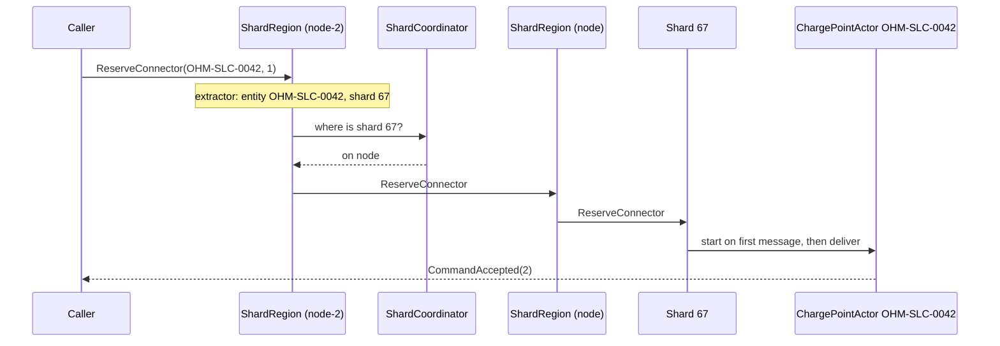
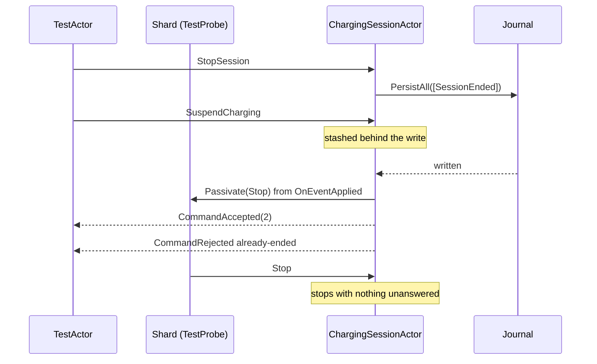
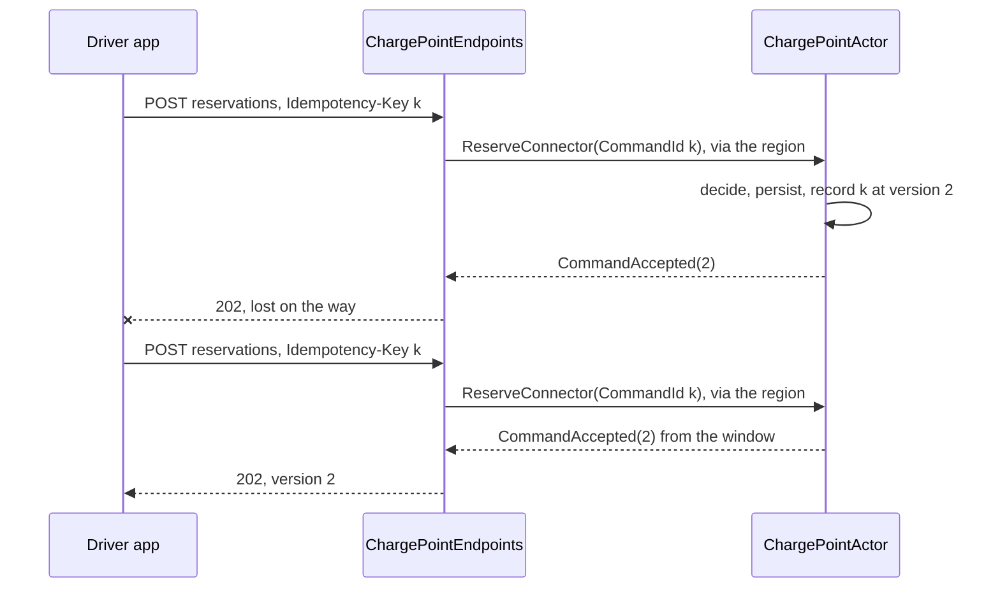
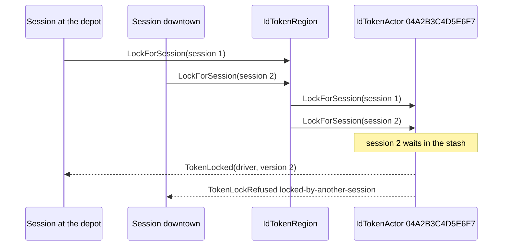
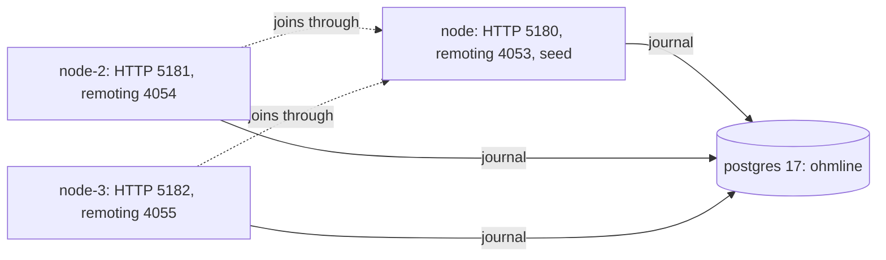

# Chapter 12. Cluster Sharding: The Shard Region as Repository

At 07:40 on a Tuesday the Salt Lake City depot's night shift returns, and forty buses ask for connectors within ten minutes. Every request lands on one Ohmline node. Last week an operating-system patch rebooted that node at 05:58, and for ninety seconds no charge point in the network had a home. Operations asks the obvious question: why not run three nodes?

Because Chapter 10's node would let you do something terrible. Start it twice against one journal, and each process's `ChargePointDirectory` happily starts its own actor for `OHM-SLC-0042`. Two incarnations would decide against two states and append to one persistence id, and section 10.9's sequence-number conflict would be all that stood between Ohmline and a connector reserved for two drivers.

A second problem waits at the edge. A driver in the depot's underground car park taps "reserve"; the reservation is stored, and the response dies on its way to a phone with one bar of signal. The app tries again, and the aggregate must recognize the second request as the first.

This chapter makes Ohmline a cluster in which every aggregate still has one writer, found by identity, behind an HTTP edge that is safe to retry.

> **In this chapter you will:**
>
> - start a node that joins a cluster with a role, a self-join for development and an explicit split-brain resolver, and explain when the one-writer guarantee can fail;
> - replace the hand-made directory with one shard region per aggregate, and name the durable vocabulary (type names, persistence ids, 100 shards) that must never change;
> - map HTTP requests to commands in minimal API endpoints that answer 202, 409, 422, 404 or 504 from an exhaustive switch;
> - make every command retryable with an `Idempotency-Key` that the shell remembers across restarts and snapshots;
> - enforce "one active session per token" with a token aggregate, and run the tariff book as a persistent cluster singleton;
> - test the real wiring in a one-node cluster, run three nodes on PostgreSQL under Aspire, and prove with Testcontainers that state survives a restart.

> **Starting point:** `ch11-s08`, the decider shell with snapshots, failure semantics and the persistence test kit spec of Chapter 11.
>
> ```bash
> git checkout ch11-s08
> ```

## 12.1 From one node to a cluster

The moment two processes can host aggregates, something must decide which process hosts which aggregate, and every process must agree on the answer.

### Membership, failure detection and downing

An Akka.NET **cluster** is a set of actor systems with the same name (`ohmline`) that talk over Akka.Remote and agree, by gossip, on a membership list. A node joins by contacting a **seed node** whose address it knows in advance; the first node of a new cluster joins itself. Each member carries **roles**, such as `charging`, and shard regions and singletons are placed by role.

Cluster sharding (section 12.2) starts the entity for `OHM-SLC-0042` on exactly one member, which is safe only while all members agree on the membership. A failure detector marks a silent member **unreachable**, which is not dead: a crash and a network partition look the same from inside. If both halves of a partition carried on, each would take over the other's shards and start a second `OHM-SLC-0042`.

Something must turn "unreachable" into **down**, the decision to remove a member for good. Akka.NET's **split-brain resolver** (SBR) makes it. [Since 1.5.2 its default strategy is **keep-majority**](https://getakka.net/articles/clustering/split-brain-resolver.html#:~:text=the%20keep%2Dmajority%20split%20brain%20resolution%20strategy%20is%20now%20enabled%20by%20default): once reachability has been stable for `stable-after` (20 s), the larger side downs the smaller, and the smaller side downs itself; on an even split, [the documentation says](https://getakka.net/articles/clustering/split-brain-resolver.html#:~:text=the%20one%20which%20contains%20the%20lowest%20address%2C%20will%20survive), the side with the lowest address survives. If reachability never settles, `down-all-when-unstable` downs everyone. [The documentation estimates the failover](https://getakka.net/articles/clustering/split-brain-resolver.html#:~:text=total%20failover%20time%20of%2045%20seconds) at about 45 s ("Expected Failover Time for Shards and Singletons").

### The code

Tag `ch12-s01` adds `Akka.Cluster.Hosting`, which brings clustering, sharding and remoting. The cluster setup is an extension of its own, so that section 12.9's tests run exactly the node's code:

```csharp
// File: src/Ohmline.Node/ClusterExtensions.cs @ ch12-s01
public AkkaConfigurationBuilder WithOhmlineCluster(
    IConfiguration configuration, IHostEnvironment environment)
{
    var hostname = configuration["Akka:Remote:Hostname"] ?? "localhost";
    var port = configuration.GetValue<int>("Akka:Remote:Port");
    var seedNodes =
        configuration.GetSection("Akka:Cluster:SeedNodes").Get<string[]>() ?? [];

    if (seedNodes is [] && !environment.IsDevelopment())
    {
        throw new InvalidOperationException(
            "Akka:Cluster:SeedNodes is empty. Only a development node may form a " +
            "cluster on its own.");
    }
```

A node with no seed nodes outside Development refuses to start. A production node that formed a cluster on its own would be a second cluster on the same journal: the opening's double writer. In Development a lone node is what you want, so it joins itself:

```csharp
// File: src/Ohmline.Node/ClusterExtensions.cs @ ch12-s01
akka
    .WithRemoting(hostname, port)
    .WithClustering(new ClusterOptions
    {
        Roles = [ClusterRoles.Charging],
        SeedNodes = seedNodes,
        // Akka.NET's defaults since 1.5.2, made explicit: after 20 s without a
        // change in reachability, the side with most nodes downs the other side.
        SplitBrainResolver = new KeepMajorityOption(),
    })
    .AddHocon(
        "akka.cluster.split-brain-resolver.stable-after = 20s",
        HoconAddMode.Prepend);

return seedNodes is []
    ? akka.AddStartup((system, _) =>
    {
        var cluster = Cluster.Get(system);
        cluster.Join(cluster.SelfAddress);
    })
    : akka;
```

The split-brain resolver is named although keep-majority is the default, because a default you did not write down is one an upgrade can change behind your back; Chapter 21 replaces it with a lease.

> **Version note:** `KeepMajorityOption` in Akka.Cluster.Hosting 1.5.73 has no `StableAfter` property, so the window is set with one line of HOCON. `NodeClusterTests` (section 12.9) reads the effective configuration back and asserts `keep-majority` and 20 s.

`Program.cs` gains one line, `.WithOhmlineCluster(builder.Configuration, builder.Environment)`, and the node's log tells the story of a cluster of one:

```text
$ dotnet run --project src/Ohmline.Node
[INFO][...] Remoting started; listening on addresses : [akka.tcp://ohmline@localhost:4053]
[INFO][...] ... - No seed-nodes configured, manual cluster join required
[INFO][...] ... - Node [akka.tcp://ohmline@localhost:4053] is JOINING itself (with roles [charging], version [1.0.0]) and forming a new cluster
[INFO][...] ... - Leader is moving node [akka.tcp://ohmline@localhost:4053] to [Up]
```

`version [1.0.0]` is the app version from the assembly, a default that Chapter 21 shows to be a trap.

### When the guarantee fails

The single-active-entity guarantee holds while the losing side of a partition stops before the winning side takes over its shards, which SBR's timings are designed to ensure. It fails with two clusters on one journal, which the guard above prevents in its commonest form; with a process frozen (a paused virtual machine, a debugger) for longer than detection plus `stable-after`, which wakes up believing it owns its shards; and with an operator downing a node that is still running. In each case the journal's unique `(persistence_id, sequence_number)` is the last line of defence: the second writer's write fails and that incarnation stops (section 10.9). It is an engineering guarantee with stated assumptions, not a law.

> **Try it**
>
> ```bash
> git checkout ch12-s01
> git diff ch11-s08 ch12-s01 --stat
> dotnet run --project src/Ohmline.Node
> dotnet test --solution Ohmline.slnx
> ```
>
> The diff shows `6 files changed, 94 insertions(+), 3 deletions(-)`. The node logs `is JOINING itself (with roles [charging], version [1.0.0]) and forming a new cluster`, and on Ctrl+C `Exiting completed.`. The tests still report `total: 1170`; section 12.9 tests the cluster setup.

## 12.2 The shard region is the repository

With three nodes, a reservation for `OHM-SLC-0042` can arrive at any of them, while the charge point's actor lives on one. Every node needs a way to deliver a command to the one actor for the charge point it names, starting it if nobody has.

### Evans's repository, without Load and Save

Evans describes a **repository** as an object that provides "[the illusion of an in-memory collection](https://www.domainlanguage.com/wp-content/uploads/2016/05/DDD_Reference_2015-03.pdf)" of aggregates, found by identity (*Domain-Driven Design*, ch. 6 "The Life Cycle of a Domain Object", section "Repositories"; the same words are in his *Domain-Driven Design Reference*, "Repositories", p. 17). In the object-relational shape you load an aggregate, call a method and save it. An actor turns that inside out: you send the aggregate a message. Loading is recovery (section 11.1), saving is `PersistAll` (section 10.4), and there is no `Save` to call or to mock (section 9.6).

Akka.NET's [**cluster sharding**](https://getakka.net/articles/clustering/cluster-sharding.html) is that repository for a cluster. An **entity** is the actor for one aggregate. A **shard** is a group of entities that move together, chosen by a hash of the entity id. A **shard region** on every node is the entry point for one entity type, and the **shard coordinator**, a cluster singleton, decides which node hosts which shard and moves shards when nodes come and go (**shard rebalancing**, not Site Energy's allocation rebalance). The first message for a shard goes through the coordinator; afterwards every region remembers where the shard lives:



The reply goes straight back because every hop forwards the original sender. In a test log the entity's path is `akka.tcp://ohmline@localhost:45051/system/sharding/charge-point/67/OHM-SLC-0042`: region `charge-point`, shard `67`, entity `OHM-SLC-0042`.

### The message extractor is the identity map

A region asks an `IMessageExtractor` which entity a message is for and which shard that entity is in. Tag `ch12-s02` adds one to `Ohmline.ActorShell`:

```csharp
// File: src/Ohmline.ActorShell/Sharding/EntityMessageExtractor.cs @ ch12-s02
public sealed class EntityMessageExtractor(Func<object, string?> entityIdOf)
    : HashCodeMessageExtractor(NumberOfShards)
{
    /// <summary>
    /// Durable: entities are spread over this many shards, and shards over the nodes. About ten
    /// times the most nodes Ohmline will ever run. It never changes while any node of the cluster
    /// runs, because the same id would then hash to another shard, and two nodes could each start
    /// an actor for the same aggregate.
    /// </summary>
    public const int NumberOfShards = 100;

    public override string? EntityId(object message) => entityIdOf(message);
}
```

The id is read from the message itself, with no envelope and no `IHasEntityId` interface on every contract. Each bounded context supplies the function as a switch over its own closed message families:

```csharp
// File: src/Charging/Ohmline.Charging.Actors/ChargingMessageExtractors.cs @ ch12-s02
public static EntityMessageExtractor ChargePoints { get; } = new(message => message switch
{
    ChargePointCommand command => command.ChargePointId.Value,
    ChargePointQuery query => query.ChargePointId.Value,
    _ => null,
});

public static EntityMessageExtractor Sessions { get; } = new(message => message switch
{
    SessionCommand command => command.SessionId.ToString(),
    _ => null,
});
```

A message no arm knows gets `null` and reaches no entity; `ChargingMessageExtractorsTests` checks that no event or reply is routed. Sharding's own messages, such as `ShardRegion.StartEntity`, are handled by Akka.NET before the extractor sees them; handling them yourself is the mistake [the AK2001 analyzer reports](https://getakka.net/articles/clustering/cluster-sharding.html#:~:text=will%20raise%20an%20analyzer%20warning).

The shard is the hash modulo `NumberOfShards`, and the comment on that constant is the rule. `EntityMessageExtractorTests` pins three answers (`OHM-SLC-0042` is shard `67`), which works because the hash is Akka.NET's own, not the per-process `string.GetHashCode`.

### One region per aggregate

The options every region starts from are created anew each time, because `ShardOptions` is mutable:

```csharp
// File: src/Ohmline.ActorShell/Sharding/EntityShardOptions.cs @ ch12-s02
public static ShardOptions Create() => new()
{
    Role = ClusterRoles.Charging,
    // Not Akka.NET 1.5's default, persistence, which is deprecated. Changing it later
    // needs a full cluster restart, so it is chosen before the first deployment.
    StateStoreMode = StateStoreMode.DData,
};
```

`Role = charging` places entities only on nodes with that role; a region elsewhere, such as the gateway's in Chapter 16, only forwards. `StateStoreMode.DData` keeps the coordinator's state in Distributed Data, because [Akka.NET 1.5 still defaults to the deprecated `persistence` mode and switching later means stopping the whole cluster](https://getakka.net/articles/clustering/cluster-sharding.html#:~:text=This%20setting%20is%20being%20deprecated%20after%201.5). `AddChargingContext()` registers a region per aggregate:

```csharp
// File: src/Charging/Ohmline.Charging.Actors/ChargingAkkaExtensions.cs @ ch12-s02
.WithShardRegion<ChargePointRegion>(
    ChargePointActor.TypeName,
    (_, _, resolver) =>
    {
        var clock = resolver.GetService<TimeProvider>();
        return entityId =>
            ChargePointActor.Props(new ChargePointId(entityId), clock);
    },
    ChargingMessageExtractors.ChargePoints,
    EntityShardOptions.Create())
```

`WithShardRegion<ChargePointRegion>` also registers the region in the `ActorRegistry` under `ChargePointRegion`, an empty class in `Ohmline.Charging.Contracts`, so that the HTTP edge (section 12.5) can find it without referencing the actors. Charging's regions are `charge-point`, `charging-session` and `charge-point-listing`; Site Energy adds `site-power-budget`. `ChargePointDirectory` and its backoff supervisor are deleted: after a failed write the shard sees the entity stop, and the next message starts a fresh incarnation.

### Durable vocabulary

`docs/adr/0009-durable-names.md` lists what outlives every deployment: the shard type name (`charge-point`), the persistence id format (`{shard type name}-{entity id}`), the written form of each entity id, the 100 shards and the state store mode. `ShardRegionTests` reads the persistence ids back from a real SQLite journal: `charge-point-OHM-SLC-0042`, `charge-point-listing-OHM-SLC-0042` and `charging-session-` plus a Guid.

> **Anti-pattern: changing `maxNumberOfShards`, PersistenceId formats or serializer IDs.** Renaming `charge-point` is not a refactoring: every charge point would wake up under a new persistence id with no history. A new shard count moves ids while old nodes still run, so two nodes can start the same aggregate (Exercise 5). A serializer id (section 10.3) is in every journal row.

Because the region finds entities by id, nothing needs to hold an actor reference to an aggregate. Branch `wrong/ch12-s02-actorref-as-identity` shows the alternative: a `ChargingSessionActor` that keeps the `IActorRef` of its site's power budget and tells it `ReleaseAllocation` when the session ends.

> **Anti-pattern: `IActorRef` used as identity.** An `IActorRef` names one incarnation on one node. Passivation, a shard rebalance or a restart ends it, and whatever is told to it afterwards is a dead letter, with no error at the sender. Store the id and send to the region. Branch: `wrong/ch12-s02-actorref-as-identity`.

> **Try it**
>
> ```bash
> git checkout ch12-s02
> git diff ch12-s01 ch12-s02 --stat
> git diff ch12-s01 ch12-s02 -- src/Ohmline.ActorShell/Sharding
> dotnet test --solution Ohmline.slnx
> git checkout wrong/ch12-s02-actorref-as-identity
> dotnet test --solution Ohmline.slnx
> ```
>
> The diff shows `23 files changed, 517 insertions(+), 166 deletions(-)`, and the tests report `total: 1235`, `failed: 0`. On the side branch, `ActorRefAsIdentityTests.Demonstrates_the_remembered_site_actor_is_gone_when_the_session_ends` passes by finding the `ReleaseAllocation` among the dead letters, addressed to the stopped incarnation.

## 12.3 Factories: domain versus actor

At `ch12-s02` each region's factory fetched a `TimeProvider` and passed it to a static `Props` method by hand, so a second service would change every region's wiring.

### Two factories, two jobs

Evans's **factory** encapsulates the creation of a complex object so that clients never assemble it (*Domain-Driven Design*, ch. 6 "The Life Cycle of a Domain Object", section "Factories"; summarized in his [*Domain-Driven Design Reference*](https://www.domainlanguage.com/wp-content/uploads/2016/05/DDD_Reference_2015-03.pdf), "Factories", p. 18). Ohmline creates two different things. The **domain factory** decides whether an aggregate may come into being; for a charge point it is the first row of the decision table, unchanged since section 7.4:

```csharp
// File: src/Charging/Ohmline.Charging.Domain/ChargePoints/ChargePoint.cs @ ch12-s03
(Unregistered, RegisterChargePoint register) => Accept(new ChargePointRegistered(
    register.ChargePointId, register.SiteId, register.ConnectorMaxPowers)),
(Unregistered, ConnectorCommand) =>
    Reject(new ChargePointError.NotRegistered(command.ChargePointId)),
```

The **actor factory** makes an incarnation, a `Props` that a shard uses on an entity's first message, after passivation and after a shard rebalance. It runs many times in an aggregate's life and decides nothing: an entity started for `OHM-SLC-9999` recovers to `Unregistered` and rejects everything but `RegisterChargePoint`. Existence is a domain fact recorded as an event.

### The container makes the entity

Akka.Hosting hands the region's factory an `IDependencyResolver` from Akka.DependencyInjection. Its `Props<T>(params object[] args)` has the container construct the actor: the arguments fill the constructor parameters of their types, and the container supplies the rest. Tag `ch12-s03` rewrites all four regions that way:

```csharp
// File: src/Charging/Ohmline.Charging.Actors/ChargingAkkaExtensions.cs @ ch12-s03
.WithShardRegion<ChargePointRegion>(
    ChargePointActor.TypeName,
    (_, _, resolver) => entityId =>
        resolver.Props<ChargePointActor>(new ChargePointId(entityId)),
    ChargingMessageExtractors.ChargePoints,
    EntityShardOptions.Create())
```

The region passes the typed id it routed on, and `ChargePointActor(ChargePointId chargePointId, TimeProvider clock)` gets its clock from the node's services, where `Program.cs` registers `TimeProvider.System` as the one clock of the process. A test replaces it in one place: `ShardRegionTests.Given_a_fake_clock_among_the_services_then_the_entities_decide_by_it` registers a `FakeTimeProvider`, advances it five minutes, reserves through the region, and reads `ReservedUntil` as `Morning` plus 20 minutes.

An actor lives as long as it likes, so a scoped service resolved into it would outlive its scope; Ohmline injects only singletons. The static `Props(id, clock)` methods stay for actor tests.

> **Try it**
>
> ```bash
> git checkout ch12-s03
> git diff ch12-s02 ch12-s03 --stat
> git diff ch12-s02 ch12-s03 -- src/Charging/Ohmline.Charging.Actors/ChargingAkkaExtensions.cs
> dotnet test --solution Ohmline.slnx
> ```
>
> The diff shows `9 files changed, 50 insertions(+), 26 deletions(-)`, most of it the four factories shrinking. The tests report `total: 1236`, `failed: 0`; the new one is the fake-clock test.

## 12.4 Passivation and remember-entities

Ohmline starts thousands of sessions a week, and each ended one is an actor whose state will never change again. Sharding provides section 11.5's lifecycle; this section configures it so that stopping never loses a message.

### How an entity is stopped

An entity is stopped by its **shard**, never by itself. When it has been idle for `PassivateIdleEntityAfter` ([120 s by default](https://github.com/akkadotnet/akka.net/blob/dev/src/contrib/cluster/Akka.Cluster.Sharding/reference.conf)), or when it asks by sending `Passivate(stopMessage)` to its parent, the shard stops routing to it, buffers whatever arrives for it, and sends it the stop message. Once it has stopped, the shard starts a fresh incarnation if anything was buffered. The same message stops entities for a **hand-off**, when the coordinator moves a shard, and at shutdown.

[Akka.NET's default stop message is `PoisonPill`](https://getakka.net/articles/clustering/cluster-sharding.html#:~:text=The%20default%20PoisonPill%20handoff%20message), which the actor cell handles without waiting behind a write in flight. Tag `ch12-s04` replaces it with an ordinary message:

```csharp
// File: src/Ohmline.ActorShell/Sharding/Stop.cs @ ch12-s04
/// <summary>
/// What the shard tells an entity when it must stop: after it has been idle too long
/// (passivation), before its shard moves to another node (hand-off), and at shutdown. An
/// ordinary message, unlike <c>PoisonPill</c>, which stops a persistent actor at once, even
/// with a write in flight. This one waits in the mailbox behind the commands that arrived
/// before it, and in the internal stash behind a write, so the entity answers them first.
/// </summary>
public sealed record Stop
{
    public static Stop Instance { get; } = new();
}
```

During a write, `Stop` waits in the internal stash like any command (section 10.5). `DeciderActor` handles it:

```csharp
// File: src/Ohmline.ActorShell/Deciders/DeciderActor.cs @ ch12-s04
// From the shard: passivation, a hand-off or shutdown (section 12.4). Its turn comes
// after everything that arrived before it, so the entity stops with nothing unanswered.
Command<Stop>(_ => Context.Stop(Self));
```

It also gives subclasses a way to ask for it early, by telling the parent, which in a node is the shard:

```csharp
// File: src/Ohmline.ActorShell/Deciders/DeciderActor.cs @ ch12-s04
protected void Passivate() => Context.Parent.Tell(new Passivate(Stop.Instance));
```

`EntityShardOptions` gains `HandOffStopMessage = Stop.Instance`, `PassivateIdleEntityAfter = TimeSpan.FromMinutes(2)` and `RememberEntities = false`. A charge point stays warm while drivers use it, but an ended session will never change, so `ChargingSessionActor` asks to leave at once:

```csharp
// File: src/Charging/Ohmline.Charging.Actors/Sessions/ChargingSessionActor.cs @ ch12-s04
protected override void OnEventApplied(SessionEvent @event)
{
    if (@event is SessionEnded)
    {
        Passivate();
    }
}
```

`PassivationTests` makes a `TestProbe` the entity's parent, so the probe plays the shard. The telling case holds the write of `SessionEnded` while a `SuspendCharging` arrives behind it:



A command arriving after the `Passivate` is buffered by the shard and starts a new incarnation; `ShardRegionTests.Given_an_ended_session_then_its_shard_stops_it_until_the_next_command` sees a late `StopSession` answered `CommandAccepted(2)` by an incarnation that logs `recovered to sequence number 2`.

> **Anti-pattern: `Context.Stop(Self)` or PoisonPill in sharded or persistent actors.** On branch `wrong/ch12-s04-context-stop` the session calls `Context.Stop(Self)` where main calls `Passivate()`. It stops inside the persist callback, before `PersistAll`'s completion replies, so even the `StopSession` that ended it is never answered, although `SessionEnded` is stored. The `SuspendCharging` stashed behind the write becomes a dead letter, and the shard, never asked, buffers nothing.

### Remember-entities

**Remember-entities** makes a shard record its running entities and start them all again after a shard rebalance or a restart, and [it switches idle passivation off](https://getakka.net/articles/clustering/cluster-sharding.html#:~:text=It%20is%20always%20disabled%20if%20Remembering%20Entities%20is%20enabled). For an aggregate that is the wrong trade. A charge point does nothing between commands (its timers are re-armed on recovery, section 11.4), so waking every entity after a shard rebalance would recreate section 11.3's recovery storm for nothing. Chapter 15's charging journey must act on a timeout with nobody asking, so its region opts in. The two-minute timeout has no test that waits two minutes; `EntityShardOptionsTests` asserts the options instead.

> **Try it**
>
> ```bash
> git checkout ch12-s04
> git diff ch12-s03 ch12-s04 --stat
> dotnet test --solution Ohmline.slnx
> git checkout wrong/ch12-s04-context-stop
> dotnet test --solution Ohmline.slnx
> ```
>
> The diff shows `7 files changed, 226 insertions(+), 1 deletion(-)`, and the tests report `total: 1242`, `failed: 0`. On the side branch `ContextStopTests` passes by catching the dead letter, and four tests from main fail, among them `PassivationTests.Given_a_session_that_ends_then_it_asks_its_shard_to_passivate_it` with `Timeout 00:00:03 while waiting for a message of type ...CommandAccepted`.

## 12.5 Application services at the HTTP edge

The aggregates now have a home on every node, but nothing outside the cluster can reach them. The driver app wants to reserve a connector, operators want to register charge points and read a site's budget, and none of them speaks Akka.

### Thin by design

[Evans keeps the application layer thin](https://learn.microsoft.com/en-us/dotnet/architecture/microservices/microservice-ddd-cqrs-patterns/ddd-oriented-microservice#the-application-layer): it coordinates a task and holds no business rules (*Domain-Driven Design*, ch. 4 "Isolating the Domain", section "Layered Architecture"). [Vernon](https://www.oreilly.com/library/view/implementing-domain-driven-design/9780133039900/ch14lev1sec2.html) (*Implementing Domain-Driven Design*, ch. 14 "Application", section "Application Services", p. 521) calls its members **application services**, the direct clients of the domain model. In Ohmline an application service is a minimal API handler that does four things:

1. read the request's fields into value objects with their smart constructors (section 6.2), reporting every invalid field at once;
2. build the command;
3. `Ask` the shard region, with an explicit timeout;
4. turn the reply into an HTTP result.

`Ask` belongs here and almost nowhere else: HTTP is request and response, so somebody must wait, while inside the cluster actors tell and reply (section 2.3). [Akka.NET's default ask timeout is infinite](https://github.com/akkadotnet/akka.net/blob/dev/src/core/Akka/Configuration/akka.conf) (`ask-timeout = infinite`), so every `Ask` names one.

### A handler

Tag `ch12-s05` fills `Ohmline.Charging.Api`. The reservation handler has the shape every command handler shares:

```csharp
// File: src/Charging/Ohmline.Charging.Api/ChargePointEndpoints.cs @ ch12-s05
public static async Task<Results<Accepted<CommandAcceptedResponse>, ProblemHttpResult>>
    ReserveAsync(
        string id,
        int number,
        ReservationRequest request,
        IRequiredActor<ChargePointRegion> chargePoints,
        TimeProvider clock,
        IOptions<ChargingApiOptions> options,
        CancellationToken cancellationToken)
{
    // ...
    var fields = new RequestFields();
    var tokenUid = fields.Read("tokenUid", TokenUid.TryCreate(request.TokenUid));
    if (!fields.AreValid)
    {
        return fields.Problem();
    }

    return await Edge.SendAsync(
        chargePoints.ActorRef,
        new ReserveConnector(CommandId.New(clock), chargePointId, number, tokenUid),
        $"/charge-points/{chargePointId}",
        options.Value.AskTimeout,
        cancellationToken);
}
```

`IRequiredActor<ChargePointRegion>` is the region, found by its key (section 12.2). A route id that is not a charge point id is a 404; a body field that fails its smart constructor is a 422. The common half lives in `Edge`:

```csharp
// File: src/Charging/Ohmline.Charging.Api/Edge.cs @ ch12-s05
public static async Task<Results<Accepted<CommandAcceptedResponse>, ProblemHttpResult>>
    SendAsync(
        IActorRef region,
        object command,
        string location,
        TimeSpan timeout,
        CancellationToken cancellationToken)
{
    try
    {
        var reply = await region.Ask<CommandReply>(command, timeout, cancellationToken);
        return reply switch
        {
            CommandAccepted accepted =>
                TypedResults.Accepted(location, new CommandAcceptedResponse(accepted.Version)),
            CommandRejected rejected => Problems.Rejected(rejected),
        };
    }
    catch (AskTimeoutException)
    {
        return Problems.Timeout(timeout);
    }
}
```

The switch over `CommandReply` has no discard arm. `CommandReply` is a closed hierarchy (section 3.4), so a third reply case added later makes every such switch a CS8509 build error until someone decides what HTTP says for it.

| Outcome | Status | Body |
|---|---|---|
| Accepted and stored | 202 Accepted, `Location` | `{"version": n}` |
| Rejected by the aggregate | 409 Conflict | problem details with the decider's `code` |
| A field is not valid | 422 Unprocessable Entity | every invalid field |
| No such resource | 404 Not Found | problem details |
| No answer in time | 504 Gateway Timeout | problem details |

Why 202 rather than 200? The events are in the journal, and that is all the server promises: Chapter 13's read models show the change a moment later, and the version in the body lets section 14.1 ask for "at least version n". The 504 is honest the other way: its detail says the command may still have been carried out.

```text
$ curl -i -X POST localhost:5180/charge-points -H 'Content-Type: application/json' -d '{"chargePointId":"OHM-SLC-0042","siteId":"slc-depot","connectorMaxPowersKw":[22,22]}'
HTTP/1.1 202 Accepted
Content-Type: application/json; charset=utf-8
Location: /charge-points/OHM-SLC-0042

{"version":1}
$ curl -i -X POST localhost:5180/charge-points ... -d '{"chargePointId":"OHM-0042","siteId":"Depot!","connectorMaxPowersKw":[-1]}'
HTTP/1.1 422 Unprocessable Entity
...
{..."errors":{"chargePointId":["ChargePointId must be OHM-, an area code, a hyphen and four digits, like OHM-SLC-0042, not 'OHM-0042'."],"siteId":["SiteId must be an area code and hyphenated words, like slc-depot, not 'Depot!'."],"connectorMaxPowersKw[0]":["Power must be 0 kW or more, not -1."]},...}
```

The 422 names all three problems in the words of the value objects. The same request sent twice gets a 409 whose `code` is `already-registered`.

### Settings checked at start

The timeout is configuration, under `Ohmline:Charging:AskTimeout`:

```csharp
// File: src/Charging/Ohmline.Charging.Api/ChargingApiOptions.cs @ ch12-s05
[Range(typeof(TimeSpan), "00:00:00.100", "00:01:00")]
public TimeSpan AskTimeout { get; set; } = TimeSpan.FromSeconds(5);
```

`AddChargingApi()` binds it with `ValidateDataAnnotations().ValidateOnStart()`, so a bad value stops the node instead of its first request: with `00:00:00` the host fails with `'AskTimeout' with the error: 'The field AskTimeout must be between 00:00:00.1000000 and 00:01:00.'`.

### The rest of the edge

`MapChargingEndpoints()` also maps registration, status, the listing (`GET` and `PUT`) and the session endpoints. A session's id is chosen by the client, so that a retried start names the same session, and its tariff is copied into `StartSession` from an `ITariffCatalog` (section 12.8). `Ohmline.SiteEnergy.Api` adds `POST /sites` and `GET /sites/{id}/budget`, with its own copy of the small HTTP helpers, because no context's API may depend on another's.

Until the Device Gateway connects real chargers (section 16.7), nothing reports a car plugging in. `DevScaffoldingEndpoints` pretends to be a charger under `/dev/charge-points/{id}/connectors/{number}` (`plug-in`, `unplug`, `fault`, `repaired`), and `Program.cs` maps it in Development only:

```csharp
// File: src/Ohmline.Node/Program.cs @ ch12-s05
if (app.Environment.IsDevelopment())
{
    app.MapDevScaffoldingEndpoints(); // A pretend charger, until section 16.7.
}
```

The handlers are static methods, so `Ohmline.Charging.Api.Tests` calls them directly with a `TestProbe` behind a fake `IRequiredActor<T>`.

> **Try it**
>
> ```bash
> git checkout ch12-s05
> git diff ch12-s04 ch12-s05 --stat
> dotnet test --solution Ohmline.slnx
> dotnet run --project src/Ohmline.Node
> curl localhost:5180/sites/slc-depot/budget
> ```
>
> The diff shows `56 files changed, 1926 insertions(+), 10 deletions(-)`, and the tests report `total: 1279`, `failed: 0`. The budget is a 404 until a `POST /sites` (a `SiteRequest`: grid limit, safety margin, time zone and connectors) configures the depot; in the recorded run it then answered `{"siteId":"slc-depot","version":1,"effectiveCapacityKw":190,"curtailmentKw":0,"requests":[]}`.

## 12.6 Idempotency keys and read-your-writes

Back in the car park: the reservation was stored as version 2, the response was lost, and the app sends the request again. Usually the decider sees a reservation the token already has and changes nothing. But if the driver cancelled from another screen in the meantime, the retried request would reserve the connector again for a driver who no longer wants it.

### Recognising the same command twice

No client can tell "not done" from "done, but the answer was lost". Akka.NET delivers at most once between actors, and section 11.6 showed that a failed write answers nobody. Retrying is the only cure, and it is safe only if the receiver recognizes a retry. [Helland](https://www.cidrdb.org/cidr2007/papers/cidr07p15.pdf) makes idempotent messages a precondition of working without distributed transactions ("Life beyond Distributed Transactions", section 5, "Retries and Idempotence"); [Vernon](https://www.informit.com/store/reactive-messaging-patterns-with-the-actor-model-applications-9780133846836) (*Reactive Messaging Patterns with the Actor Model*, ch. 9 "Message Endpoints", p. 382), using Hohpe and Woolf's [pattern name](https://www.enterpriseintegrationpatterns.com/patterns/messaging/IdempotentReceiver.html), calls the receiving side an **Idempotent Receiver**.

Some commands are idempotent by state, such as the `NoChange` row for a reservation the token already has (section 7.4). For the rest, the command needs an identity. Since section 8.1 every command carries a `CommandId`, a version 7 Guid created by the sender, and every event records the id of the command that caused it. A retry reuses the id; the shell remembers recent ids.

### A window of recent commands

Tag `ch12-s06` adds `RecentCommands` to `Ohmline.ActorShell`:

```csharp
// File: src/Ohmline.ActorShell/Deciders/RecentCommands.cs @ ch12-s06
public sealed class RecentCommands(int capacity = RecentCommands.DefaultCapacity)
{
    // ...
    public const int DefaultCapacity = 256;

    private readonly Dictionary<CommandId, LinkedListNode<RecentCommand>> _byId = [];
    private readonly LinkedList<RecentCommand> _byUse = new(); // The most recently used first.
    // ...
    /// <summary>Remembers the command at this version; a later event of it moves it on.</summary>
    public void Record(CommandId commandId, long version)
    {
        if (_byId.Remove(commandId, out var known))
        {
            _byUse.Remove(known);
        }

        _byId[commandId] = _byUse.AddFirst(new RecentCommand(commandId, version));
        if (_byId.Count > capacity)
        {
            _byId.Remove(_byUse.Last!.Value.CommandId);
            _byUse.RemoveLast();
        }
    }
```

The window keeps a version, not a reply, because an accepted command's reply is determined by its version. Only accepted commands that stored events are remembered, since those are exactly what the journal can rebuild the window from. A rejected command changed nothing, so deciding it again is safe, although the answer can differ if the world has moved on: a reservation refused because another driver had reserved the connector may be accepted on retry after that reservation is cancelled.

`DeciderActor.Handle` checks the window before it decides:

```csharp
// File: src/Ohmline.ActorShell/Deciders/DeciderActor.cs @ ch12-s06
protected void Handle(TCommand command, IActorRef replyTo)
{
    if (_recent.TryGetVersion(CommandIdOf(command), out var version))
    {
        // Sent again: a retry after a timeout, or a duplicate delivery. It gets the answer
        // it got the first time, and nothing is decided or stored again (section 12.6).
        replyTo.Tell(Accepted(version));
        return;
    }
```

`Apply` and `Replay` both record `CausationOf(@event)` at `LastSequenceNr`, so a new incarnation rebuilds the window from the events it replays. Snapshots carry it as an optional `RecentCommands` field, added to the four snapshot DTOs under their existing `.v1` manifests; a snapshot from before this tag reads with an empty window, a first taste of Chapter 20's tolerant reader. A retry that arrives while its original is still being written waits in the internal stash and is answered from the window once the write lands.

`IdempotencyTests` meets a duplicate in the same incarnation (reserve as version 2, cancel as version 3, the reserve again answers `CommandAccepted(2)` and the connector stays available), after a restart, and after a snapshot at event 100, where command 50 sent again answers `CommandAccepted(50)`.

### The key at the edge

A client names its command with the `Idempotency-Key` header, which the edge turns into the `CommandId`:

```csharp
// File: src/Charging/Ohmline.Charging.Api/RequestFields.cs @ ch12-s06
public CommandId CommandIdFrom(string? idempotencyKey, TimeProvider clock) =>
    idempotencyKey is null
        ? CommandId.New(clock)
        : Read(
            "Idempotency-Key",
            Guid.TryParse(idempotencyKey, out var key)
                ? CommandId.TryCreate(key)
                : Result.Fail<ValidationError>(
                    new Malformed("Idempotency-Key", idempotencyKey, "a version 7 Guid")));
```

Every command handler gains a `[FromHeader(Name = "Idempotency-Key")] string? idempotencyKey` parameter, and the 504 detail now ends "send it again with the same Idempotency-Key":



Against a running node, with another reservation in between to show that the retry gets its own first answer and not the latest version:

```text
$ curl -i -X POST localhost:5180/charge-points/OHM-SLC-0042/connectors/1/reservations -H 'Content-Type: application/json' -H 'Idempotency-Key: 019a4f6e-1c00-7d2a-9b3e-5c0a00000042' -d '{"tokenUid":"04A2B3C4D5E6F7"}'
HTTP/1.1 202 Accepted
Location: /charge-points/OHM-SLC-0042

{"version":2}
$ curl -X POST localhost:5180/charge-points/OHM-SLC-0042/connectors/2/reservations ... -d '{"tokenUid":"04FFEEDDCC"}'
{"version":3}
$ (the first request again, same key)
HTTP/1.1 202 Accepted
Location: /charge-points/OHM-SLC-0042

{"version":2}
```

A key that is not a version 7 Guid, such as `retry-1`, is a 422 naming the `Idempotency-Key` field.

Two limits are deliberate. The window holds 256 commands per aggregate, enough for retries within seconds; an older duplicate is decided again, and natural idempotency usually catches it. A key reused with a different body goes undetected; Chapter 19 closes that gap from the app's side.

### Read-your-writes, the aggregate's half

After a 202 the driver wants to see the reservation. `GET /charge-points/{id}` asks the aggregate, which is never stale: its `version` is at least the one in the 202. The price is a message to the entity, perhaps waking it from passivation: fine for one charge point, wrong for a screen of three hundred. Such screens read projections, which lag by design (Chapter 13), and the version in every 202 is what section 14.1 uses to complete read-your-writes on that side.

> **Try it**
>
> ```bash
> git checkout ch12-s06
> git diff ch12-s05 ch12-s06 --stat
> git diff ch12-s05 ch12-s06 -- src/Ohmline.ActorShell/Deciders
> dotnet test --solution Ohmline.slnx
> ```
>
> The diff shows `41 files changed, 753 insertions(+), 101 deletions(-)`, including four golden snapshot files that gained `recentCommands`. The tests report `total: 1293`, `failed: 0`, with `RecentCommandsTests`, `IdempotencyTests` and `IdempotencyKeyTests` new.

## 12.7 Uniqueness across aggregates: the IdToken aggregate

Token `04A2B3C4D5E6F7` is presented at the depot at 07:41, and a minute later the same UID is presented downtown: a cloned card. Ohmline's rule is one active session per token, but each session is its own aggregate, and no session can see the others.

### Turning the rule around

Checking "no other session uses this token" needs either a query over all sessions, which reads a lagging projection, or a write to two aggregates at once, which [Vernon's rules forbid](https://www.dddcommunity.org/wp-content/uploads/files/pdf_articles/Vernon_2011_1.pdf) ("a properly designed bounded context modifies only one aggregate instance per transaction in all cases": "Effective Aggregate Design, Part I"; *Implementing Domain-Driven Design*, ch. 10 "Aggregates") and a sharded cluster cannot do. This is set validation across aggregates, the classic place where aggregate design hurts.

The way out is to notice whom the rule is about: not every session, but one token. Make the token an aggregate keyed by its UID, as [Helland's entities](https://www.cidrdb.org/cidr2007/papers/cidr07p15.pdf) are keyed by a unique value ("Each entity has a unique identifier or key": section 1, "Scalable Apps Use Uniquely Identified 'Entities'"), and the rule becomes a check of one field. The token's mailbox orders concurrent requests, the first lock wins, and the second is refused. "A token belongs to one account" falls out the same way.

### The decider

Tag `ch12-s07` fills the Driver Accounts context, empty since section 5.2. The state is a union, `IdTokenState(Unknown, Active, Blocked)`, where `Active` and `Blocked` carry the driver and the session holding the token, if any. The registration and lock rows of the decision table carry the section's argument:

```csharp
// File: src/DriverAccounts/Ohmline.DriverAccounts.Domain/Tokens/IdToken.cs @ ch12-s07
(state, command) switch
{
    (Unknown, RegisterToken register) =>
        Accept(new TokenRegistered(register.TokenUid, register.Driver)),
    // ...
    (Active or Blocked, RegisterToken register) when state.Driver == register.Driver =>
        NoChange,
    (Active or Blocked, RegisterToken) =>
        Reject(new IdTokenError.RegisteredToAnotherDriver(command.TokenUid)),
    // ...
    (Active { ActiveSession: null }, LockForSession lockFor) =>
        Accept(new TokenLockedForSession(lockFor.TokenUid, lockFor.SessionId)),
    (Active active, LockForSession lockFor)
        when active.ActiveSession == lockFor.SessionId => NoChange,
    (Active { ActiveSession: { } other }, LockForSession) =>
        Reject(new IdTokenError.LockedByAnotherSession(command.TokenUid, other)),
    (Blocked, LockForSession) => Reject(new IdTokenError.TokenIsBlocked(command.TokenUid)),
    // ...
    (null, _) => throw DefaultState(),
};
```

A free active token is locked; the same session asking again changes nothing, which is natural idempotency for Chapter 15's journey; another session is refused, naming the one that holds the token. `Driver` and `ActiveSession` are members of the union, used in `when` clauses because C# 15 still forbids a variable inside an `or` pattern (CS8780).

### The shell answers in the journey's language

The journey that will send `LockForSession` needs to know whose account pays, or why it may not charge. `DeciderActor` gains two overridable hooks, `Accepted(command, version)` and `Rejected(command, error)`, and `IdTokenActor` uses them for the lock alone:

```csharp
// File: src/DriverAccounts/Ohmline.DriverAccounts.Actors/Tokens/IdTokenActor.cs @ ch12-s07
protected override object Accepted(IdTokenCommand command, long version) => command switch
{
    LockForSession lockFor when State.Driver is { } driver =>
        new TokenLocked(lockFor.TokenUid, lockFor.SessionId, driver, version),
    _ => Accepted(version),
};

protected override object Rejected(IdTokenError error) => error.ToReply();

protected override object Rejected(IdTokenCommand command, IdTokenError error) =>
    command switch
    {
        LockForSession lockFor => new TokenLockRefused(
            lockFor.TokenUid, lockFor.SessionId, error.Code, error.Message),
        _ => Rejected(error),
    };
```

Both replies belong to the closed `TokenCommandReply` hierarchy. The rest follows the other contexts: `DriverAccountsSerializer` with serializer id 9103 and fifteen `accounts.*.v1` manifests, an extractor keyed on the UID, and an `id-token` region. When two sessions race for one card, the region delivers both locks to the one entity, which handles them in turn:



`RegionTests.Given_a_token_when_two_sessions_ask_for_it_then_only_the_first_gets_it` (section 12.9) sends the two locks through a real region, one after the other, and receives `TokenLocked(..., Version: 2)` and then `locked-by-another-session`. `Ohmline.DriverAccounts.Api` adds `POST /tokens`, `POST /tokens/{uid}/block` and `GET /tokens/{uid}`:

```text
$ curl -i -X POST localhost:5180/tokens -H 'Content-Type: application/json' -d '{"tokenUid":"04a2b3c4d5e6f7","driver":"drv-7f3a91c2"}'
HTTP/1.1 202 Accepted
Location: /tokens/04A2B3C4D5E6F7

{"version":1}
$ curl -X POST localhost:5180/tokens/04A2B3C4D5E6F7/block
{"version":2}
$ curl -X POST localhost:5180/tokens ... '{"tokenUid":"04A2B3C4D5E6F7","driver":"drv-0b5e44d1"}'
{..."status":409,"detail":"Token 04A2B3C4D5E6F7 already belongs to another driver.","code":"registered-to-another-driver",...}
```

The UID comes back upper-case because the `TokenUid` smart constructor canonicalizes it, and the canonical form is part of the persistence id, `id-token-04A2B3C4D5E6F7`. A `DriverRef` such as `drv-7f3a91c2` is opaque, which keeps names out of events (section 20.10).

> **Sidebar: three answers to uniqueness**
>
> A **reservation aggregate** keyed by the unique value is what this section built. It is consistent by construction and fits the actor model, but it adds an aggregate whose only job is the constraint, and a workflow that touches two aggregates (lock the token, then start the session) must undo the first step when a later one fails, as Chapter 15's journey does.
>
> A **unique constraint in a database** is the textbook answer for a state-stored context. Billing (section 16.3) could let a unique index refuse the second insert. It is simple to reason about and unavailable in an event-sourced journal, whose only uniqueness is `(persistence_id, sequence_number)`.
>
> **Accept and compensate** lets both sessions start, detects the duplicate from a projection, and stops one. It suits duplicates that are rare and cheap to undo, not a token, where the second session is a theft in progress.
>
> Choose by the cost of a duplicate that slips through.

> **Try it**
>
> ```bash
> git checkout ch12-s07
> git diff ch12-s06 ch12-s07 --stat
> git diff ch12-s06 ch12-s07 -- src/DriverAccounts/Ohmline.DriverAccounts.Domain
> dotnet test --solution Ohmline.slnx
> ```
>
> The diff shows `60 files changed, 1720 insertions(+), 5 deletions(-)`. The tests report `total: 1408`, `failed: 0`, with three new projects: `Ohmline.DriverAccounts.Domain.Tests`, `.Actors.Tests` and `.Api.Tests`.

## 12.8 The Knowledge Level in the cluster: the tariff book singleton

Section 8.2 modeled tariffs as a **Knowledge Level**: versioned data that operators edit and that the operational level, the sessions, reads as a parameter. Every session copies one version, a `TariffSnapshot`, when it starts, so a price change at noon never reaches a session that started at 11:59. Section 12.5 copied from a Development stand-in with one hard-coded tariff.

### One book, one writer

Publishing a tariff makes its next version; retiring one stops new sessions from using it. Both are decisions with rules, so the book is an aggregate with a decider. It is also tiny and quiet: a few publications a month, one read per session start.

For such an aggregate Akka.NET offers the [**cluster singleton**](https://getakka.net/articles/clustering/cluster-singleton.html): exactly one instance in the cluster, [on the oldest node with a given role](https://getakka.net/articles/clustering/cluster-singleton.html#:~:text=always%20running%20on%20the%20oldest%20member%20with%20specified%20role). A **singleton proxy** on every node finds it, and [buffers messages](https://getakka.net/articles/clustering/cluster-singleton.html#:~:text=the%20proxy%20will%20buffer%20the%20messages%20sent%20to%20the%20singleton) while it moves to another node after the oldest one leaves. A singleton is a single mailbox and is unavailable for the seconds a hand-over takes; neither matters for a book written monthly. Nothing in the domain spans tariffs, so a region keyed by tariff id would also work, and is where the book would go if it became busy.

### The decider and the actor

Tag `ch12-s08` fills the Tariffs context. The decision table delegates validation to `Tariff.TryCreate`, the tariff's own rules from section 8.2, and numbers versions itself:

```csharp
// File: src/Tariffs/Ohmline.Tariffs.Domain/Book/TariffBook.cs @ ch12-s08
private static Result<ImmutableArray<TariffBookEvent>, TariffBookError> DecisionTable(
    TariffBookState state, TariffBookCommand command) =>
    command switch
    {
        PublishTariff publish => Tariff.TryCreate(
                publish.TariffId,
                NextVersion(state, publish.TariffId),
                publish.Currency,
                publish.Components,
                publish.PriceCap,
                publish.Rounding,
                publish.TimeZoneId)
            .Match(
                tariff => Accept(new TariffPublished(tariff.Snapshot())),
                invalid => Reject(invalid)),
        RetireTariff retire => state.Tariffs.GetValueOrDefault(retire.TariffId).Value switch
        {
            Published published =>
                Accept(new TariffRetired(retire.TariffId, published.Current.Version)),
            Retired => NoChange,
            _ => Reject(new TariffBookError.NotPublished(retire.TariffId)),
        },
    };
```

`NextVersion` continues a retired tariff's numbering, so a version number names one set of prices for ever. The actor is a `DeciderActor` with one question of its own:

```csharp
// File: src/Tariffs/Ohmline.Tariffs.Actors/Book/TariffBookActor.cs @ ch12-s08
/// <summary>Durable vocabulary: the singleton's name and its persistence id.</summary>
public const string Name = "tariff-book";

public TariffBookActor(TimeProvider clock)
    : base(Name, clock) =>
    Command<GetTariffSnapshot>(get =>
        Sender.Tell(new CurrentTariff(get.TariffId, State.Current(get.TariffId))));
```

A singleton has no entity id, so `DeciderActor` gains a constructor that takes the persistence id whole: `tariff-book`, another durable name in ADR 0009. `TariffsSerializer` has serializer id 9104 and nine `tariffs.*.v1` manifests.

### Wiring the singleton and its proxy

`AddTariffsContext()` starts the singleton and a proxy:

```csharp
// File: src/Tariffs/Ohmline.Tariffs.Actors/TariffsAkkaExtensions.cs @ ch12-s08
public AkkaConfigurationBuilder AddTariffsContext()
{
    var options = new ClusterSingletonOptions
    {
        Role = ClusterRoles.Charging,
        // Like an entity's hand-off: the book stops after what it is already writing.
        TerminationMessage = Stop.Instance,
    };
    return akka
        .WithCustomSerializer(
            TariffsSerializer.Name,
            TariffsSerializer.BoundTypes,
            system => new TariffsSerializer(system))
        .WithSingleton<TariffBookActor>(
            TariffBookActor.Name,
            (_, _, resolver) => resolver.Props<TariffBookActor>(),
            options,
            createProxyToo: false)
        .WithSingletonProxy<TariffBookProxy>(TariffBookActor.Name, options);
}
```

Like an entity, the book stops with `Stop.Instance`, so a hand-over waits for a write in flight. `createProxyToo: false` and a separate `WithSingletonProxy<TariffBookProxy>` register the proxy under a key that lives in `Ohmline.Tariffs.Contracts`, so the Charging API can ask the book without referencing the Tariffs actors. On a single node the log shows `Singleton manager started singleton actor [akka://ohmline/user/tariff-book/tariff-book]`.

In `Ohmline.Charging.Api`, `TariffBookCatalog` implements `ITariffCatalog` by asking the proxy with `GetTariffSnapshot`, replacing the stand-in; Charging is the customer of Tariffs on the context map (section 5.4) and only reads its model. `TariffEndpoints` adds `POST /tariffs` and `GET /tariffs/{id}`:

```text
$ curl -i -X POST localhost:5180/tariffs -H 'Content-Type: application/json' -d '{"tariffId":"slc-standard","currency":"USD","timeZoneId":"America/Denver","components":[{"kind":"energy-rate","price":0.42},{"kind":"session-fee","price":1.00},{"kind":"idle-fee","price":0.40,"graceMinutes":10}]}'
HTTP/1.1 202 Accepted
Location: /tariffs/slc-standard

{"version":1}
$ (publish again with a night band) -> {"version":2}
$ (timeZoneId "Mars/Olympus")
{..."status":409,"detail":"The tariff is not valid: Time zone must be an IANA time zone like America/Denver, not 'Mars/Olympus'.","code":"invalid-tariff",...}
```

A session started now copies version 2. The copy happens at the edge, before `StartSession` is sent: the session aggregate never asks another aggregate anything, and its own journal holds the prices it will be billed by. `RegionTests.Given_a_published_tariff_then_a_session_copies_it_from_the_singleton` (section 12.9) publishes through the proxy and starts a session with the copied snapshot.

> **Try it**
>
> ```bash
> git checkout ch12-s08
> git diff ch12-s07 ch12-s08 --stat
> git diff ch12-s07 ch12-s08 -- src/Tariffs/Ohmline.Tariffs.Actors
> dotnet test --solution Ohmline.slnx
> ```
>
> The diff shows `49 files changed, 1513 insertions(+), 51 deletions(-)`. The tests report `total: 1469`, `failed: 0`, with `TariffBookTests`, `TariffBookActorTests` and `TariffEndpointsTests` among the new ones.

## 12.9 Testing sharding locally with Akka.Hosting.TestKit

Actor tests that start entities themselves cannot catch a region registered under the wrong key, an extractor that misses a query, or a self-join that never happens. Wiring mistakes are found by running the wiring.

### A cluster of one inside a test

`Akka.Hosting.TestKit` starts a real generic host with Akka.Hosting, dependency injection and the `ActorRegistry` inside an xUnit v3 test, and its `PersistenceTestKit` adds the scriptable journal of section 11.8. Tag `ch12-s09` adds `tests/Ohmline.Node.Tests`, whose base class composes the node as `Program.cs` does:

```csharp
// File: tests/Ohmline.Node.Tests/ShardedNode.cs @ ch12-s09
protected override void ConfigureAkka(
    AkkaConfigurationBuilder builder, IServiceProvider provider)
{
    base.ConfigureAkka(builder, provider); // The test journal and snapshot store.
    var settings = new ConfigurationBuilder()
        .AddInMemoryCollection(new Dictionary<string, string?>
        {
            ["Akka:Remote:Hostname"] = "localhost",
            ["Akka:Remote:Port"] = "0", // Any free port: test classes run in parallel.
        })
        .Build();
    builder
        .WithOhmlineCluster(settings, new Development())
        .AddChargingContext()
        .AddSiteEnergyContext()
        .AddDriverAccountsContext()
        .AddTariffsContext();
}
```

The test runs the node's own `WithOhmlineCluster`, so it exercises the real self-join and split-brain settings. `BeforeTestStart` waits until the member is `Up`, and `ConfigureServices` registers a `FakeTimeProvider`, which section 12.3's container hands to every entity. Tests then ask regions exactly as endpoints do, by key from `ActorRegistry.GetAsync<TKey>`.

`NodeClusterTests` asserts section 12.1: one `Up` member with role `charging`, and an effective configuration with the split-brain resolver, `keep-majority` and 20 s. `RegionTests` goes through every region and the singleton proxy: a reservation that expires at `Morning` plus 15 minutes by the fake clock, a site budget of 190 kW, the token race of section 12.7, and the tariff copy of section 12.8. Its fifth test replaces the deleted backoff supervisor's: it scripts one failed write with `WithJournalWrite(write => write.Fail(), ...)`, waits for the ERROR line `Failed to persist ConnectorReserved with sequence number 2 for charge-point-OHM-SLC-0042`, then asks for the status until a fresh incarnation answers at version 1. Nobody restarted the entity; the shard saw it stop, and the next message started it.

> **Tip:** keep each attempt inside a retry loop shorter than the loop. That fifth test asks with a 10 s timeout inside a 10 s `AwaitAssertAsync`, so one question lost to the dying entity uses the whole window. At the Chapter 12 tags it fails now and then for that reason; a rerun passes.

> **Version note:** `Akka.Hosting.TestKit` must match the other Akka packages (1.5.73); [1.5.68 or later](https://github.com/akkadotnet/Akka.Hosting/releases/tag/1.5.68) is needed for parallel xUnit v3 runs.

> **Try it**
>
> ```bash
> git checkout ch12-s09
> git diff ch12-s08 ch12-s09 --stat
> dotnet test --project tests/Ohmline.Node.Tests
> dotnet test --solution Ohmline.slnx
> ```
>
> The diff shows `7 files changed, 302 insertions(+)`. The solution reports `total: 1476`, `failed: 0`; the seven new tests are `NodeClusterTests` (2) and `RegionTests` (5).

## 12.10 Postgres and a multi-node cluster on your laptop with Aspire

Some mistakes appear only with several nodes on PostgreSQL: a shard on another node, two nodes creating one table. Ohmline needs that topology on a laptop, from one command.

### The AppHost

Aspire's **AppHost** declares resources (containers, projects, databases) and starts them behind a dashboard. Tag `ch12-s10` adds `src/Ohmline.AppHost` on `Aspire.AppHost.Sdk/13.6.4`:

```csharp
// File: src/Ohmline.AppHost/AppHost.cs @ ch12-s10
// Ohmline on a laptop: PostgreSQL 17 and a cluster of three nodes (section 12.10).
var builder = DistributedApplication.CreateBuilder(args);

var postgres = builder.AddPostgres("postgres").WithImageTag("17");
var ohmline = postgres.AddDatabase("ohmline");

// The first node is the seed: it listens for Akka.Remote on a port fixed here, and every node,
// itself included, names that address as its seed. The seed joins itself and forms the
// cluster; the others join through it, once it is healthy (an Up member, and the journal's
// tables made). A node is a resource of its own because a replica made with WithReplicas gets
// its remoting port only at run time, and a static seed must be known in advance (ADR 0010).
var seed = Node("node", 0).WaitFor(ohmline);
Node("node-2", 1).WaitFor(seed);
Node("node-3", 2).WaitFor(seed);

builder.Build().Run();

IResourceBuilder<ProjectResource> Node(string name, int index) =>
    builder.AddProject<Projects.Ohmline_Node>(name, launchProfileName: null)
        .WithHttpEndpoint(port: 5180 + index, name: "http")
        .WithHttpHealthCheck("/health")
        .WithEnvironment("ASPNETCORE_ENVIRONMENT", "Development")
        .WithEnvironment("Akka__Remote__Port", Port(4053 + index))
        .WithEnvironment("Akka__Cluster__SeedNodes__0", "akka.tcp://ohmline@localhost:4053")
        .WithReference(ohmline);

static string Port(int port) => port.ToString(CultureInfo.InvariantCulture);
```

The topology it starts:



The nodes join through a **static seed**. `WithReplicas(3)` cannot do this, because each replica gets its port only when it starts (25725, 25727 and 25729 in one run), and [Akka.Aspire's bootstrap](https://www.nuget.org/packages/Akka.Aspire.Hosting) needs a discovery backend (Redis or Azure Table Storage, short of Kubernetes), outside Ohmline's approved packages; `docs/adr/0010-local-cluster-formation.md` records the choice. Chapter 21 replaces static seeds with Kubernetes discovery.

`node-2` and `node-3` wait for `node` to be healthy for a reason: three nodes starting at once on an empty database all run `autoInitialize`, and PostgreSQL refuses all but one: `23505: duplicate key value violates unique constraint "pg_class_relname_nsp_index"`, then `Failed to initialize SQL Journal.` Chapter 20's migrator removes the cause.

### The node on PostgreSQL

`WithReference(ohmline)` sets `ConnectionStrings:ohmline`, and the node picks its journal from its connection strings:

```csharp
// File: src/Ohmline.Node/JournalExtensions.cs @ ch12-s10
var (connectionString, provider) = configuration.GetConnectionString("ohmline") is
    { } postgres
    ? (postgres, ProviderName.PostgreSQL15)
    : (configuration.GetConnectionString("journal")
        ?? throw new InvalidOperationException(
            "Neither ConnectionStrings:ohmline nor ConnectionStrings:journal is " +
            "set. In Development, appsettings.Development.json sets the second."),
        ProviderName.SQLiteMS);
```

`ProviderName.PostgreSQL15` selects Linq2Db's PostgreSQL 15 dialect, which PostgreSQL 17 accepts. Both providers keep section 10.7's `autoInitialize: true` and `TagMode.TagTable`, and the node references `Npgsql` 10.0.3 itself, because the plugin does not bring the driver. `src/Ohmline.ServiceDefaults` (on `net11.0`) adds health checks, service discovery and HTTP resilience, with OpenTelemetry left for Chapter 17. Its `/alive` runs only the process's own check; `/health` runs every check, including the one `WithOhmlineCluster` now adds with `WithAkkaClusterReadinessCheck()`, healthy once the node is an `Up` member. That is what `WaitFor(seed)` waits for.

> **Version note:** with Aspire 13.6.4, pinning `Aspire.Hosting.AppHost` in `Directory.Packages.props` fails with NU1009, because the SDK references it implicitly, and the AppHost needs `<AspireUseCliBundle>true</AspireUseCliBundle>` to avoid warning ASPIRE010.

With the cluster up, a charge point registered through `node-3`, reserved through `node-2` and read through `node` answers version 2 with connector 1 reserved, wherever its shard lives, and a tariff published through one node reads back through another. The rows land in PostgreSQL 17.11:

```text
      persistence_id       | sequence_number |              manifest               | identifier
---------------------------+-----------------+-------------------------------------+------------
 charge-point-OHM-SLC-0042 |               1 | charging.charge-point-registered.v1 |       9101
 charge-point-OHM-SLC-0042 |               2 | charging.connector-reserved.v1      |       9101
 tariff-book               |               1 | tariffs.tariff-published.v1         |       9104
```

> **Try it**
>
> ```bash
> git checkout ch12-s10
> git diff ch12-s09 ch12-s10 --stat
> export DOCKER_HOST=unix:///run/user/$(id -u)/podman/podman.sock
> dotnet run --project src/Ohmline.AppHost
> curl localhost:5182/health
> ```
>
> The diff shows `12 files changed, 244 insertions(+), 14 deletions(-)`. All three nodes answer `Healthy` on `/health` and `/alive`. `dotnet test --solution Ohmline.slnx` still reports `total: 1476`; the AppHost gets system tests in section 16.9.

## 12.11 Integration tests against real Postgres

The claim that matters most to an event-sourced system is that a new process on the same database brings every aggregate back. It deserves a test with real PostgreSQL, real serializers and the real HTTP edge.

`Testcontainers.PostgreSql` 4.16.0 starts a container from a test, and `Testcontainers.XunitV3` makes it an xUnit v3 assembly fixture, one container for every test in `tests/Ohmline.IntegrationTests`:

```csharp
// File: tests/Ohmline.IntegrationTests/PostgresFixture.cs @ ch12-s11
[assembly: AssemblyFixture(typeof(Ohmline.IntegrationTests.PostgresFixture))]
// ...
public sealed class PostgresFixture(IMessageSink sink)
    : ContainerFixture<PostgreSqlBuilder, PostgreSqlContainer>(sink)
{
    protected override PostgreSqlBuilder Configure() =>
        new PostgreSqlBuilder("postgres:17-alpine").WithDatabase("ohmline");
// ...
```

`WebApplicationFactory<Program>` from `Microsoft.AspNetCore.Mvc.Testing` runs the node in memory, as `Program.cs` builds it; the node ends with `public partial class Program;` so that the test can name its top-level-statements class:

```csharp
// File: tests/Ohmline.IntegrationTests/OhmlineNode.cs @ ch12-s11
public sealed class OhmlineNode(PostgresFixture postgres) : WebApplicationFactory<Program>
{
    protected override void ConfigureWebHost(IWebHostBuilder builder) =>
        builder
            .UseEnvironment("Development")
            .UseSetting("ConnectionStrings:ohmline", postgres.ConnectionString)
            .UseSetting("Akka:Remote:Port", "0");
}
```

Disposing the factory stops the host, which runs coordinated shutdown: the shard hands off its entities, the node leaves its cluster of one, and the actor system terminates. A second factory on the same database is the node after a restart:

```csharp
// File: tests/Ohmline.IntegrationTests/RestartSurvivalTests.cs @ ch12-s11
[Fact]
public async Task Given_a_reservation_when_the_node_restarts_then_it_is_still_there()
{
    var chargePoint = Chargers.Next();
    await using (var before = new OhmlineNode(postgres))
    {
        var http = before.CreateClient();
        await http.PostAsJsonAsync("/charge-points", Chargers.Registration(chargePoint), Ct);
        await http.PostAsJsonAsync(
            $"/charge-points/{chargePoint}/connectors/1/reservations",
            Chargers.Reservation(),
            Ct);
    }

    await using var after = new OhmlineNode(postgres);
    var status = await after.CreateClient()
        .GetFromJsonAsync<Status>($"/charge-points/{chargePoint}", Ct);

    status.ShouldNotBeNull().Version.ShouldBe(2);
    status.Connectors[0].State.ShouldBe("reserved");
    status.Connectors[0].ReservedFor.ShouldBe("04A2B3C4D5E6F7");
}
```

A second test sends a reservation with an `Idempotency-Key` before the restart and again after it, and gets the same version both times, because the new incarnation rebuilt its window from PostgreSQL. `ChargePointApiTests` covers a reservation read back, a retried reservation and a 422.

Every class joins one xUnit collection, `PostgresFixture.OneNodeAtATime`, so no two nodes race in `autoInitialize` on the empty database; `DisableTestParallelization` is obsolete as an error in xUnit v3 4.0.2 (CS0619). The classes carry `[Trait("Category", "Integration")]`, which the fast loop of section 9.1 filters out.

> **Note:** with Podman, set `DOCKER_HOST` to its socket and run `systemctl --user enable --now podman.socket`. Ryuk, Testcontainers' reaper, worked rootless where the sample was verified; the [Testcontainers for .NET documentation](https://dotnet.testcontainers.org/) does not cover Podman, so if Ryuk fails, its [configuration page](https://dotnet.testcontainers.org/custom_configuration/) lists the settings to try (`TESTCONTAINERS_RYUK_DISABLED`, `TESTCONTAINERS_RYUK_CONTAINER_PRIVILEGED` and others).

> **Try it**
>
> ```bash
> git checkout ch12-s11
> git diff ch12-s10 ch12-s11 --stat
> export DOCKER_HOST=unix:///run/user/$(id -u)/podman/podman.sock
> dotnet test --solution Ohmline.slnx
> ```
>
> The diff shows `11 files changed, 255 insertions(+)`. The tests report `total: 1481`, `failed: 0`; the five integration tests run in about 14 s, the container's start included.

## Summary

- A cluster keeps one writer per aggregate only while its members agree on membership. The split-brain resolver turns "unreachable" into "down" (keep-majority after 20 s); when the guarantee's assumptions break, the journal's sequence numbers are the last defence.
- A shard region is the repository of an actor system: a command naming an aggregate reaches its one entity on whichever node hosts its shard. Loading is recovery, saving is persisting, and nothing holds an actor reference to an aggregate.
- Type names, persistence id formats, entity id forms, the shard count and the state store mode are durable names that never change on a live system.
- The domain factory decides whether an aggregate exists; the actor factory, run by the container, only builds an incarnation.
- Entities are stopped by their shard with an ordinary stop message that waits behind a write in flight; remember-entities is for processes that must run unasked, not for aggregates.
- Application services stay thin: fields to value objects, a command, an `Ask` with a timeout, and an exhaustive switch to 202, 409, 422, 404 or 504.
- An `Idempotency-Key` becomes the command id, and a window of recent ids, rebuilt from events and kept in snapshots, answers a retry with its first answer.
- Uniqueness across aggregates becomes local when the unique value is an aggregate's identity, and a rarely written Knowledge Level fits a persistent cluster singleton that sessions copy from.

## DDD canon covered

Repositories; Factories; Application Services; Idempotency and delivery semantics; Eventual consistency and UX; Large-scale structure (Knowledge Level); Invariants; Aggregates and Vernon's 4 rules; Aggregate = sharded persistent actor; Shard region as repository; Message extractor; Passivation; Remember-entities; Split-brain resolver and the single-writer guarantee; Serialization strategy and serializer IDs; Anti-pattern catalog.

## Exercises

1. **Reflect.** Compare the tariff book singleton with a `tariff` region keyed by tariff id, and with tariffs replicated to every node through Distributed Data. Weigh availability during a hand-over, the read on every session start, whether "the published tariffs" stays one consistent thing, and the moving parts each choice adds.
2. **Reflect.** The driver app may retry a command hours later (Chapter 19), but the window holds 256 ids. Choose between a count-based window, a time-based one, and natural idempotency for late duplicates, weighing snapshot size, which commands are not naturally idempotent, and what a too-late retry costs a driver.
3. **Extend.** Starting from `ch12-s08`, find out what `POST /sessions` returns when the tariff book does not answer in time, and make it a 504 like every other timeout. Start at `TariffBookCatalog.CurrentAsync` and `SessionEndpoints.StartAsync`; it works when a test in `Ohmline.Charging.Api.Tests` with a silent probe behind `TariffBookProxy` sees status 504.
4. **Extend.** Starting from `ch12-s06`, add a test to `IdempotencyTests` for the limit section 12.6 admits: a reservation rejected because another token has reserved the connector, sent again with the same command id after that reservation is cancelled, is accepted. It works when the first answer is a `CommandRejected` and the second a `CommandAccepted`.
5. **Break it.** At `ch12-s02`, set `EntityMessageExtractor.NumberOfShards` to 50 and run `EntityMessageExtractorTests`. Expect `Given_any_entity_id_then_its_shard_is_one_of_100` to fail, and the pinned shard of `OHM-SLC-0042` to move from `67` to `17` while `OHM-SLC-0043` and `slc-depot` stay put: in a rolling update, some aggregates would live in two places and others would not.
6. **Break it.** At `ch12-s06`, delete the `_recent.Record(...)` line from `DeciderActor.Replay` and run `IdempotencyTests`. Expect `Given_its_events_in_the_journal_when_sent_again_then_it_changes_nothing` to fail with `CommandAccepted(4)` instead of `CommandAccepted(2)`: the new incarnation has forgotten the id and reserves again. Explain why the snapshot test still passes.

## Further reading

- Eric Evans, [*Domain-Driven Design: Tackling Complexity in the Heart of Software*](https://www.informit.com/store/domain-driven-design-tackling-complexity-in-the-heart-9780321125217) (Addison-Wesley, 2003); author's page: [domainlanguage.com/ddd](https://www.domainlanguage.com/ddd/). Chapter 6, "The Life Cycle of a Domain Object", for repositories and factories; chapter 4, "Isolating the Domain" (section "Layered Architecture"), for the thin application layer; chapter 16, "Large-Scale Structure" (section "Knowledge Level"), for the Knowledge Level. His free [*Domain-Driven Design Reference*](https://www.domainlanguage.com/wp-content/uploads/2016/05/DDD_Reference_2015-03.pdf) (2015) summarizes the same patterns.
- Vaughn Vernon, [*Implementing Domain-Driven Design*](https://www.informit.com/store/implementing-domain-driven-design-9780321834577) (Addison-Wesley, 2013). Chapter 12, "Repositories", and chapter 14, "Application", repositories and application services from the object-relational side this chapter departs from; chapter 10, "Aggregates", for the rules of aggregate design, first published as ["Effective Aggregate Design"](https://www.dddcommunity.org/wp-content/uploads/files/pdf_articles/Vernon_2011_1.pdf) (2011).
- Vaughn Vernon, [*Reactive Messaging Patterns with the Actor Model: Applications and Integration in Scala and Akka*](https://www.informit.com/store/reactive-messaging-patterns-with-the-actor-model-applications-9780133846836) (Addison-Wesley, 2015). The Idempotent Receiver (chapter 9, "Message Endpoints", p. 382) and Guaranteed Delivery (chapter 5, "Messaging Channels", p. 175), with actors.
- Pat Helland, ["Life beyond Distributed Transactions: an Apostate's Opinion"](https://www.cidrdb.org/cidr2007/papers/cidr07p15.pdf) (CIDR 2007). Entities keyed by a unique value (sections 1 and 2), one atomic writer each, and messages that must be idempotent (section 5, "Activities: Coping with Messy Messages").
- Akka.NET, [*Cluster Sharding*](https://getakka.net/articles/clustering/cluster-sharding.html) (2026). Regions, shards, the coordinator, passivation, remember-entities and state store modes.
- Akka.NET, [*Split Brain Resolver*](https://getakka.net/articles/clustering/split-brain-resolver.html) (2026). The strategies, `stable-after`, `down-all-when-unstable` and failover timing.
- Akka.NET, [*Akka.Hosting*](https://github.com/akkadotnet/Akka.Hosting) (2026). `WithShardRegion`, `WithSingleton`, `IRequiredActor<T>`, dependency injection into actors and the hosting test kit; the singleton methods are documented in the [Akka.Cluster.Hosting README](https://github.com/akkadotnet/Akka.Hosting/blob/dev/src/Akka.Cluster.Hosting/README.md).
- [Testcontainers for .NET](https://dotnet.testcontainers.org/) (2026). Containers as test fixtures, and [the settings for Ryuk](https://dotnet.testcontainers.org/custom_configuration/).
