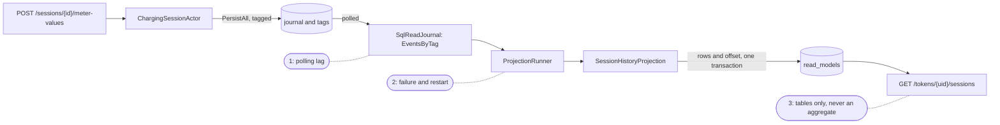
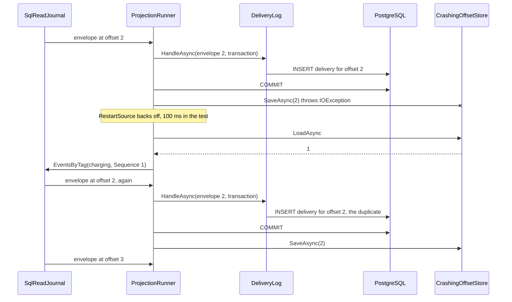

# Chapter 13. CQRS I: From Journal to Read Model

At 07:40 the Salt Lake City depot's night shift brings forty buses back, and the duty operator at Ohmline wants one screen: every connector at `slc-depot`, what it is doing, and how much power the site lets it draw. At the same moment a driver from the 06:10 route opens the driver app to find last month's sessions on her RFID card for an expense claim.

Neither question names an aggregate. Chapter 12 gave every charge point, session and site a home in the cluster, found by identity, and `GET /charge-points/OHM-SLC-0042` asks one entity for an answer that is never stale. The board would need that for every charge point at the depot, and nothing knows which those are without asking each one. The driver's sessions are spread over hundreds of `charging-session-…` persistence ids, and the journal has no index by token.

The write side was built to decide, one aggregate at a time. This chapter builds the other half: a read side that follows the journal, keeps tables shaped for the questions people ask, survives crashes without losing or double-counting an event, and runs in exactly one place in the cluster.

> **In this chapter you will:**
>
> - explain why an event-sourced write model cannot serve lists and dashboards, and draw the pipeline from a command to a query result with the three places where it lags or fails;
> - tag events on their way into the journal and read them back with Persistence Query, by persistence id or by tag, live or finite, from an exclusive offset;
> - run a projection that resumes from a stored offset after a crash, and show with a test why storing the offset first loses an event for good;
> - write a read model that tolerates every duplicate, with its rows and its offset committed in one database transaction;
> - run each projection stream once in the cluster as a sharded daemon process, and choose per projection between stopping and skipping when an event cannot be handled;
> - answer the site live board and a driver's session history from tables, through endpoints that never touch an aggregate.

> **Starting point:** `ch12-s11`, the three-node cluster on PostgreSQL with integration tests from Chapter 12.
>
> ```bash
> git checkout ch12-s11
> ```

## 13.1 Why the write model cannot answer your questions

### Asking every aggregate for the dashboard

The pieces for a first attempt are all there. A live-board endpoint could hold the depot's charge point ids, send `GetChargePointStatus` to each through the region and assemble forty replies. Follow that request through the cluster. Forty `Ask`s fan out across three nodes, and the endpoint answers when the slowest one does, or times out after five seconds if one entity is recovering. A charge point idle since the night has been passivated (section 12.4), so the question wakes it: a snapshot load, a replay of its tail, and a timer re-armed, all to read one status. Refresh the board every two seconds on ten screens and the reads outnumber the writes they observe, in the mailboxes that must answer the next `ReserveConnector` promptly: section 11.3's recovery storm, started by a dashboard.

The list itself is the deeper problem. "The charge points at `slc-depot`" is a fact about many aggregates, and no aggregate owns it. The driver's history is the same: "sessions of token `04A2B3C4D5E6F7`" crosses every session ever started. An aggregate answers questions about itself, not about its peers. The journal holds every fact, but as an append-only log keyed by persistence id, with events stored as opaque bytes behind a manifest (section 10.8). It replays one aggregate quickly and answers nothing else: there is no column for a site, a token or a status.

### Separate models for writing and reading

Bertrand Meyer's [command-query separation](https://martinfowler.com/bliki/CommandQuerySeparation.html) says a method should either change state or return a value, never both (Meyer, [*Object-Oriented Software Construction*](https://www.informit.com/store/object-oriented-software-construction-9780136291558), 2nd ed., ch. 23 "Principles of class design", section 23.1 "Side effects in functions"). Greg Young carried the idea from methods to objects: **CQRS**, command query responsibility segregation, is in his words, in the 2010 blog post ["CQRS, Task Based UIs, Event Sourcing agh!"](https://web.archive.org/web/20211124134459/http://codebetter.com/gregyoung/2010/02/16/cqrs-task-based-uis-event-sourcing-agh/), "simply the creation of two objects where there was previously only one": one that handles commands and one that answers queries (the same idea in Young, *[CQRS Documents](https://cqrs.files.wordpress.com/2010/11/cqrs_documents.pdf)*, 2010, chapter "Command and Query Responsibility Segregation", section "Origins", p. 17). The same 2010 post stresses how small the idea is: CQRS "is not eventual consistency, it is not eventing, it is not messaging, it is not having separated models for reading and writing, nor is it using event sourcing." It demands no second database, message bus or event sourcing, only that the object which protects invariants need not be the object that serves screens.

Vlad Khononov, in effect, makes the command execution model the single source of truth and every read model a projection of it, shaped for one consumer and disposable because it can be rebuilt ([*Learning Domain-Driven Design*](https://www.oreilly.com/library/view/learning-domain-driven-design/9781098100124/), ch. 8 "Architectural Patterns", section "Command-Query Responsibility Segregation"). Vaughn Vernon adds that the query model is updated by subscribers to the domain events, so it trails the command model ([*Implementing Domain-Driven Design*](https://www.informit.com/store/implementing-domain-driven-design-9780321834577), ch. 4 "Architecture", section "Command-Query Responsibility Segregation, or CQRS", including "Dealing with an Eventually Consistent Query Model"). In EventStorming terms the read models are Chapter 4's green stickies: what a person needs to know before the next command.

With event sourcing, CQRS stops being optional. A state-stored aggregate can at least be queried with SQL, badly; an event-sourced one only by replaying it. A **projection** is the code that builds one: it reads events in order and keeps a table up to date. Ohmline keeps both models in one PostgreSQL database, `ohmline`: the journal's tables in `public` and the read models in the schema `read_models`. They are separate models, not separate servers.

### The whole pipeline

The diagram follows one fact from a command to a query result, with the code's own names; every part of it appears in this chapter:



The write half is Chapters 10 to 12, plus section 13.2's tags; everything after the journal is new. The three dotted notes mark where latency and failure live:

1. **The read journal polls.** `SqlReadJournal` finds new events by querying the tables, once a second by default, so a read model is always some hundreds of milliseconds behind the journal (section 13.3; section 14.3 measures and tunes it).
2. **The runner and its projection can fail.** A database outage, a bug in a handler or an event the handler cannot understand stops the read model from moving while the write side carries on (sections 13.4 and 13.7).
3. **The query reads tables, never aggregates.** It answers in the time one `SELECT` takes, from data that may be stale by the sum of the first two (section 13.8).

### Fresh from the entity, or lagging from a view

`GET /charge-points/{id}` asks the aggregate, and its version is at least the one the last `202 Accepted` returned (section 12.6). That read is never stale, and it costs a message to an entity that may have to wake up: the right tool for one aggregate in the middle of a decision, such as "is connector 2 free before I reserve it".

A read model is the opposite trade: cheap for any number of rows, and behind by the pipeline's lag, so a driver who stops a session may not see it ended in her history yet. That gap is a property to design for, and Chapter 14 does: it asks a read model for "at least version n", chooses a guarantee per screen, and pushes changes to clients.

The practical rule: commands go to aggregates, and so may a question about one aggregate in the middle of a decision; every list, search, count and dashboard is answered by a read model.

## 13.2 Tagging events

The session history needs every session event and nothing else. A projection could read the whole journal in `ordering` order (section 10.8) and discard the rest, but then every projection would fetch and deserialize every event in the system.

### A tag is an index entry written with the event

A **tag** is a label stored beside an event when it is persisted, so that a query can ask for "all events tagged `charging-session`, in journal order" without reading the rest. Akka.Persistence carries tags in a wrapper, `Tagged(payload, tags)`: the journal stores the payload as usual and indexes the tags.

Tags are the read side's concern, and the actor should not know about them. A **write event adapter** sits between `PersistAll` and the journal, sees every event on its way in, and may return something else in its place. Tag `ch13-s02` adds one to Charging. The tag names, `ChargingTags.Charging` (`charging`) and `ChargingTags.ChargingSession` (`charging-session`), live in the context's contracts, so that the read side can use them without referencing the actors:

```csharp
// File: src/Charging/Ohmline.Charging.Actors/Persistence/ChargingTagger.cs @ ch13-s02
public sealed class ChargingTagger : IWriteEventAdapter
{
    /// <summary>The adapter's name in the journal's configuration.</summary>
    public const string Name = "charging-tagger";

    /// <summary>The event families the journal passes through this adapter.</summary>
    public static IReadOnlyList<Type> BoundTypes { get; } =
        [typeof(ChargePointEvent), typeof(ChargePointListingEvent), typeof(SessionEvent)];

    /// <summary>No manifest of its own: the serializer's manifest is the one that counts.</summary>
    public string Manifest(object evt) => string.Empty;

    public object ToJournal(object evt) => evt switch
    {
        ChargePointEvent or ChargePointListingEvent => new Tagged(evt, [ChargingTags.Charging]),
        SessionEvent => new Tagged(evt, [ChargingTags.ChargingSession]),
        _ => evt,
    };
}
```

`BoundTypes` tells the journal which types to route through the adapter: three closed base records cover the context. `Manifest` returns an empty string because the manifest is the serializer's business, and an adapter that set its own would change what recovery reads. `SiteEnergyTagger` has the same shape and tags every `SitePowerBudgetEvent` with `site-energy`. `ChargingTaggerTests` runs every serialization sample through the adapter: each event comes back as a `Tagged` holding the same instance and one tag, and everything else comes back untouched.

### Designing tags

Three decisions shape the tags.

**One tag per event, by aggregate family.** A projection usually wants the whole life of one kind of thing, which a family tag gives it. Tags per event type would make every projection merge several streams; a tag per site would partition work for a scale Ohmline does not have.

**Disjoint tags.** A session event carries `charging-session` and not also `charging`, so a projection that reads both never meets one event twice.

**Tags are durable vocabulary.** A tag is written with the event and never again. Renaming one strands every event stored under the old name, and a new tag applies only to events written after it is deployed; tagging history takes a one-off backfill. So the names sit in one class per context, and from tag `ch13-s06` also in ADR 0009's table of durable names. The tariff book and the id tokens are not tagged yet, because no projection reads them; `tariffs` and `accounts` are reserved for when one does.

### Where the adapter is registered

An event adapter belongs to a journal, which the host configures. Each context offers an extension on Akka.Hosting's journal builder, and the host composes them:

```csharp
// File: src/Charging/Ohmline.Charging.Actors/ChargingAkkaExtensions.cs @ ch13-s02
extension(AkkaPersistenceJournalBuilder journal)
{
    // ...
    public AkkaPersistenceJournalBuilder AddChargingTagger() =>
        journal.AddWriteEventAdapter<ChargingTagger>(
            ChargingTagger.Name, ChargingTagger.BoundTypes);
}
```

```csharp
// File: src/Ohmline.Node/JournalExtensions.cs @ ch13-s02
return akka.WithSqlPersistence(
    connectionString: connectionString,
    providerName: provider,
    autoInitialize: true, // Creates missing tables; Chapter 20 owns the schema instead.
    tagStorageMode: TagMode.TagTable,
    journalBuilder: journal => journal.AddChargingTagger().AddSiteEnergyTagger());
```

> **Version note:** registering the adapter inside `AddChargingContext()` would need `WithJournal(string journalId, ...)`, which Akka.Persistence.Hosting 1.5.73 marks obsolete, so `-warnaserror` fails with `error CS0618: ... is obsolete: 'Use WithJournal(journalOptions, configureBuilder) instead to combine options configuration with event adapters and health checks. This method will be removed in v1.6.'`

### The tags table

`TagMode.TagTable`, the node's setting since section 10.7, now has something to store. In this mode Akka.Persistence.Sql writes tags to a table of their own, `tags`; the journal table has no tags column at all. Section 10.8's journal tour now finds two rows there for `OHM-SLC-0042`:

```text
tags:
ordering_id=1 | tag=charging | persistence_id=charge-point-OHM-SLC-0042 | sequence_nr=1
ordering_id=2 | tag=charging | persistence_id=charge-point-OHM-SLC-0042 | sequence_nr=2
```

`ordering_id` is the journal row's `ordering`, which becomes the read side's offset in section 13.3. The primary key is `(ordering_id, tag)`. The message bytes do not change: the tag is not part of the event, and recovery never sees it. A second tour test finds a session's first event tagged `charging-session`.

> **Try it**
>
> ```bash
> git checkout ch13-s02
> git diff ch12-s11 ch13-s02 --stat
> git diff ch12-s11 ch13-s02 -- src/Charging/Ohmline.Charging.Actors
> dotnet test --solution Ohmline.slnx
> ```
>
> The diff shows `19 files changed, 330 insertions(+), 21 deletions(-)`. The run reports `total: 1545`, `failed: 0`; `JournalTourTests` writes the two tags rows above to its output.

## 13.3 Persistence Query: the read side of the journal

The tags are stored; something must read them back in order and keep reading as new events arrive. Doing that against the tables by hand would mean knowing their schema, the serializer registry and the gaps a concurrent insert can leave.

### The read journal

**Persistence Query** is Akka.Persistence's read API over a journal: a **read journal** that answers questions about stored events as Akka.Streams sources. Each journal plugin ships its own; Akka.Persistence.Sql's is `SqlReadJournal`, which queries the same `journal` and `tags` tables the actors write. Tag `ch13-s03` makes it one property away from any actor system, with a C# 14 extension property:

```csharp
// File: src/Charging/Ohmline.Charging.ReadModels/Query/ReadJournalAccess.cs @ ch13-s03
extension(ActorSystem system)
{
    // ...
    public SqlReadJournal ReadJournal =>
        PersistenceQuery.Get(system).ReadJournalFor<SqlReadJournal>(SqlReadJournal.Identifier);
}
```

A read journal answers questions about events, never about state, and its queries come in pairs:

| Query | Ends? | What Ohmline uses it for |
|---|---|---|
| `CurrentEventsByPersistenceId(id, from, to)` | Yes | One aggregate's history, in sequence order |
| `EventsByPersistenceId(id, from, to)` | No | Following one aggregate as it changes |
| `CurrentEventsByTag(tag, offset)` | Yes | Tests, reports, catching up once |
| `EventsByTag(tag, offset)` | No | Every projection in this chapter |
| `CurrentPersistenceIds()`, `PersistenceIds()` | Yes, No | Listing every entity the journal knows |

A `Current` query is **finite**: it returns what is stored when it runs, then completes. Its partner is **live**: it stays open and delivers each new event as it is stored, which is what a projection needs.

### The envelope and the offset

Each event arrives in an `EventEnvelope`: the `Event`, deserialized by the context's serializer; its `PersistenceId` and `SequenceNr`; a `Timestamp` from the journal row; and an `Offset`, its position in the stream.

In Akka.Persistence.Sql the offset is a `Sequence` holding the journal's `ordering`. That makes it **global**: one number orders a charge point's reservation against a session's meter value. And it is **exclusive**: `EventsByTag(tag, Offset.Sequence(n))` starts with the first event *after* n, so a projection stores the offset of the last event it handled and resumes from it; `Offset.NoOffset()` means from the beginning. `ReadJournalTourTests` pins the rule down on a temporary SQLite journal, after registering two charge points, reserving on the first and starting a session:

```csharp
// File: tests/Ohmline.Charging.ReadModels.Tests/ReadJournalTourTests.cs @ ch13-s03
var all = await CurrentByTagAsync(node, ChargingTags.Charging, Offset.NoOffset());
var afterFirst = await CurrentByTagAsync(node, ChargingTags.Charging, Offset.Sequence(1));

all.Select(OrderingOf).ShouldBe([1, 2, 3]); // The session's event is tagged otherwise.
afterFirst.Select(OrderingOf).ShouldBe([2, 3]); // The offset itself is excluded.
afterFirst.Select(envelope => (envelope.PersistenceId, envelope.SequenceNr)).ShouldBe(
[
    ("charge-point-OHM-SLC-0043", 1),
    ("charge-point-OHM-SLC-0042", 2),
]);
all.ShouldAllBe(envelope => envelope.Timestamp > 0);
```

The session's start is ordering 4 and does not appear, because its tag is `charging-session`. A tag's offsets are therefore not consecutive: in a busy journal the `charging` stream may jump from 1,204 to 1,377. Never treat the difference between two offsets as a number of events; section 13.7 counts tag rows instead.

The other tests ask the remaining questions. `CurrentEventsByPersistenceId` for `OHM-SLC-0042` returns sequence numbers 1 and 2. `CurrentPersistenceIds()` lists both charge points and the session. A live `EventsByTag`, run into a `Sink.Queue`, delivers the stored registration, then the reservation the test persists afterwards, at offset 2.

### Polling, and where lag comes from

That live test is the slowest of the four, because a live query is not notified of an insert; it polls. With nothing new to deliver, it asks again every `refresh-interval`, one second by default.

A second poller sits behind it. Two writes can commit out of order: ordering 41 may become visible before ordering 40, whose transaction is still open. A query that read up to 41 and stored that offset would never come back for 40. So the plugin's `JournalSequenceActor` polls the highest ordering below which it has found no gap, every `journal-sequence-retrieval.query-delay` (also one second), and the event queries read only up to it. The plugin's [reference configuration](https://github.com/akkadotnet/Akka.Persistence.Sql/blob/1.5.73/src/Akka.Persistence.Sql/persistence.conf#L390-L403) bounds that wait with `max-tries` (10): a gap still open after that many polls is taken to be a write that rolled back, and the reader moves past it. No test in the sample provokes such a gap. The plugin's README puts the resulting latency at 500 to 1,200 ms with the defaults and warns that tuning `refresh-interval` alone changes nothing ([Akka.Persistence.Sql README, "Tuning Akka.Persistence.Query for Low-Latency Projections"](https://github.com/akkadotnet/Akka.Persistence.Sql/blob/1.5.73/README.md#tuning-akkapersistencequery-for-low-latency-projections)). Section 14.3 tunes both and measures the effect.

> **Version note:** a finite query runs on the system's shared materializer, `system.Materializer()`. In Akka.NET 1.5 that materializer must never be disposed: `using var materializer = system.Materializer()` looks tidy and breaks every later stream of the system, the projections included. Akka.NET 1.6 makes its `Dispose` a no-op. The sample's test helper carries the warning in its summary.

> **Try it**
>
> ```bash
> git checkout ch13-s03
> git diff ch13-s02 ch13-s03 --stat
> dotnet test --project tests/Ohmline.Charging.ReadModels.Tests
> dotnet test --solution Ohmline.slnx
> ```
>
> The diff shows `9 files changed, 356 insertions(+)`, including the new project `tests/Ohmline.Charging.ReadModels.Tests`. Its four `ReadJournalTourTests` pass in about 11 s together, most of it the live query waiting for a poll. The solution reports `total: 1549`, `failed: 0`.

## 13.4 A resumable projection runner: offsets and at-least-once

A live `EventsByTag` from `Offset.NoOffset()` is a projection only until the node restarts; then it replays a year of meter values before the session history moves again. A projection must remember how far it got, and the hard part is a crash halfway through remembering.

### Load, read, handle, store

A projection is a loop: load the stored offset, read the tag's events after it, handle each one, store its offset. Two steps write, the handler its rows and the store the offset, and a process can die between them, so their order decides what a crash costs.

- **Offset first, then rows:** a crash between them leaves an offset that claims an event the read model never saw. The next start resumes after it, and the event is lost for good. That is **at-most-once** delivery.
- **Rows first, then offset:** a crash between them leaves rows that already include an event the offset does not mention. The next start delivers it again. That is **at-least-once** delivery.

A duplicate can be made harmless (section 13.5); a lost event cannot even be noticed. Ohmline's runner stores the offset after the write.

### The runner

Tag `ch13-s04` fills `Ohmline.Charging.ReadModels`. A projection says only what each event does to its tables; the runner owns the offset, the order and the restarts:

```csharp
// File: src/Charging/Ohmline.Charging.ReadModels/Projections/IProjectionHandler.cs @ ch13-s04
public interface IProjectionHandler
{
    // ...
    string ProjectionId { get; }

    /// <summary>The tags it reads. Each is a stream of its own, with its own offset.</summary>
    IReadOnlyList<string> Tags { get; }

    // ...
    Task HandleAsync(
        EventEnvelope envelope, NpgsqlTransaction transaction, CancellationToken cancellationToken);
}
```

`ProjectionId` is durable: offsets are stored under it, and a new version of a read model gets a new id (section 14.8). The unit with an offset is a `ProjectionStream`, one projection reading one tag, because section 13.8's live board reads two tags whose orderings interleave. Offsets live beside the read models, in `read_models.projection_offsets` with the primary key `(projection_id, tag)`. `ReadModelSchema.EnsureAsync` creates it under `pg_advisory_xact_lock`, because PostgreSQL's `IF NOT EXISTS` still fails when two sessions create one table at the same instant; section 20.8 replaces this stopgap with a migrator.

The runner builds the loop as one Akka.Streams graph:

```csharp
// File: src/Charging/Ohmline.Charging.ReadModels/Projections/ProjectionRunner.cs @ ch13-s04
public RunningProjection Start(IMaterializer materializer)
{
    var (killSwitch, completion) = RestartSource
        .OnFailuresWithBackoff(EventsAfterStoredOffset, backoff)
        .ViaMaterialized(KillSwitches.Single<long>(), Keep.Right)
        .ToMaterialized(Sink.Ignore<long>(), Keep.Both)
        .Run(materializer);
    return new RunningProjection(_stream, killSwitch, completion);
}

// ...
private Source<long, NotUsed> EventsAfterStoredOffset() =>
    Source.FromTask(offsets.LoadAsync(_stream, CancellationToken.None))
        .ConcatMany(offset => readJournal.EventsByTag(_stream.Tag, Offset.Sequence(offset)))
        .SelectAsync(1, HandleAsync);
```

`EventsAfterStoredOffset` is one run of the loop: load the offset, switch to the live `EventsByTag` after it (`ConcatMany`), and hand each envelope to `HandleAsync`. `SelectAsync(1, ...)` awaits one envelope at a time, so events are handled in journal order and a faulted task fails the stream.

`RestartSource.OnFailuresWithBackoff` takes the *method* and calls it again after every failure, so each restart loads the offset afresh. `DefaultBackoff` waits 1 s, doubling up to 30 s, with 20% randomness so that projections do not retry in step. `KillSwitches.Single` sits outside the restarts, the one handle that stops everything; `Keep.Both` returns it with the stream's completion task, as a `RunningProjection`.

The order of the two writes is in `HandleAsync`:

```csharp
// File: src/Charging/Ohmline.Charging.ReadModels/Projections/ProjectionRunner.cs @ ch13-s04
private async Task<long> HandleAsync(EventEnvelope envelope)
{
    var offset = ((Sequence)envelope.Offset).Value;
    try
    {
        await using (var connection = await dataSource.OpenConnectionAsync())
        await using (var transaction = await connection.BeginTransactionAsync())
        {
            await projection.HandleAsync(envelope, transaction, CancellationToken.None);
            await transaction.CommitAsync();
        }

        await offsets.SaveAsync(_stream, offset, CancellationToken.None);
        return offset;
    }
    catch (Exception exception)
    {
        // ...
        throw;
    }
}
```

If the projection throws, its transaction is disposed without a commit and its rows roll back. The offset is saved only after the commit. The `catch` logs and rethrows, so the restart happens.

### A crash in the worst place

`ProjectionRunnerTests` (trait `Integration`) runs the runner over a SQLite journal holding three `charging` events at offsets 1, 2 and 3, with the read side in a PostgreSQL 17 container, one database per test. The projection, `DeliveryLog`, inserts one row per delivery into an identity-keyed table, so duplicates and gaps show. `CrashingOffsetStore` throws `IOException("Crashed before storing offset 2.")` once instead of saving offset 2. The diagram follows that test:



The deliveries table ends as `[1, 2, 2, 3]`: nothing lost, one event twice. The node logs three lines for the one failure, the runner's own and two from Akka.Streams:

```text
[ERROR][...][ActorSystem(ohmline)] Projection delivery-log/charging failed on charge-point-OHM-SLC-0043 #1 at offset 2; it restarts from its offset
Cause: System.IO.IOException: Crashed before storing offset 2.
[ERROR][...][FlowShape`2([SelectAsync.in] [SelectAsync.out])(...)] An exception occured inside SelectAsync while executing Task. Supervision strategy: Stop
[WARNING][...][SourceShape`1([] [RestartWithBackoffSource.out])(...)] Restarting graph due to failure.
```

The other two tests check the boundaries. With offset 1 already stored, a fresh runner delivers `[2, 3]`. With a projection that throws once after its insert at offset 2, the result is `[1, 2, 3]`: the failed attempt's row was rolled back with its transaction.

> **Anti-pattern: saving a projection offset before the read-model write.** Branch `wrong/ch13-s04-offset-before-handler` moves `offsets.SaveAsync` above the transaction, the order that looks natural when you think "mark it as taken, then process it". Its test `Demonstrates_a_crash_after_the_offset_save_loses_the_event_for_good` uses the projection that fails once at offset 2. The offset is already stored when the write rolls back, the restart resumes after 2, and the deliveries are `[1, 3]` with stored offset 3: the registration of `OHM-SLC-0043` never reaches the read model, and nothing logs its absence. Two tests from main fail on the branch, one with `should be [1L, 2L, 3L] but was [1L, 3L]`.

At-least-once is the right default, but `[1, 2, 2, 3]` is not a read model anyone wants. Section 13.5 closes the gap from both ends.

> **Try it**
>
> ```bash
> git checkout ch13-s04
> git diff ch13-s03 ch13-s04 --stat
> export DOCKER_HOST=unix:///run/user/$(id -u)/podman/podman.sock
> dotnet test --solution Ohmline.slnx
> git checkout wrong/ch13-s04-offset-before-handler
> dotnet test --project tests/Ohmline.Charging.ReadModels.Tests
> ```
>
> The diff shows `14 files changed, 516 insertions(+), 1 deletion(-)`. The run reports `total: 1552`, `failed: 0`, and `ProjectionRunnerTests` logs the three lines above. On the side branch, the `Demonstrates_` test passes and two `ProjectionRunnerTests` fail: the one-time failure loses offset 2 (`[1L, 3L]`), and the crash test sees `[1L, 2L, 3L]` instead of `[1L, 2L, 2L, 3L]`.

## 13.5 Idempotent read models: upserts and the offset in one transaction

A driver plugs in at 07:40 with the register at 1,200,000 Wh, and at 08:40 the charger reports 1,207,350 Wh. If the session history adds each reading's increase to a running total, the duplicate delivery of section 13.4 shows her 14.7 kWh for 7.35 kWh of energy. At-least-once delivery is safe only for a read model that gives the same answer however many times it sees an event.

### Every handler is an idempotent receiver

Gregor Hohpe and Bobby Woolf call this an **[Idempotent Receiver](https://www.enterpriseintegrationpatterns.com/patterns/messaging/IdempotentReceiver.html)**: "one that can safely receive the same message multiple times" (*Enterprise Integration Patterns*, ch. 10 "Messaging Endpoints"). Vernon's [*Reactive Messaging Patterns with the Actor Model*](https://www.informit.com/store/reactive-messaging-patterns-with-the-actor-model-applications-9780133846836) builds it for actors (ch. 9 "Message Endpoints", "Idempotent Receiver"), and Helland's ["Life beyond Distributed Transactions"](https://www.cidrdb.org/cidr2007/papers/cidr07p15.pdf) makes it a rule: between entities that share no transaction, messages may arrive more than once, so every recipient must be idempotent. In his words, "any message ever sent may be delivered multiple times" (section 5, "Activities: Coping with Messy Messages", under "Retries and Idempotence"). A projection is such a recipient. Ohmline's read models get there by two defences.

**The rows and the offset in one transaction.** Then a crash cannot separate them: both are committed or neither is, so section 13.4's crash undoes the write it interrupted, and the redelivery writes it once. Tag `ch13-s05` gives `IOffsetStore.SaveAsync` a transaction parameter and moves the save inside it:

```diff
# git diff ch13-s04 ch13-s05 -- '*Projections/ProjectionRunner.cs'
         var offset = ((Sequence)envelope.Offset).Value;
         try
         {
-            await using (var connection = await dataSource.OpenConnectionAsync())
-            await using (var transaction = await connection.BeginTransactionAsync())
-            {
-                await projection.HandleAsync(envelope, transaction, CancellationToken.None);
-                await transaction.CommitAsync();
-            }
-
-            await offsets.SaveAsync(_stream, offset, CancellationToken.None);
+            await using var connection = await dataSource.OpenConnectionAsync();
+            await using var transaction = await connection.BeginTransactionAsync();
+            await projection.HandleAsync(envelope, transaction, CancellationToken.None);
+            await offsets.SaveAsync(_stream, offset, transaction, CancellationToken.None);
+            await transaction.CommitAsync();
             return offset;
         }
         catch (Exception exception)
```

The crash test, renamed `Given_a_crash_before_the_offset_save_then_the_write_is_undone_with_it`, now expects `[1, 2, 3]`. This works only because offsets and read models share one database.

**A guard on every row.** Duplicates still happen: a handler runs again after a failed attempt, an offset is reset to rebuild a read model (section 14.8), and two incarnations of a projection could overlap if the cluster's single-writer assumptions broke (section 13.6). So each row records `last_sequence_nr`, the source aggregate's sequence number when the row was last written. One aggregate's events arrive in sequence order, so a write that is not newer changes nothing.

### SessionHistory: the rules as a pure function

`read_models.session_history` has one row per session: `session_id` as its key, `token_uid`, `connector_id`, `status`, `energy_kwh`, `meter_start_wh`, `started_at`, `ended_at` and `last_sequence_nr`. What each event does to a row is a pure function, tested without a database:

```csharp
// File: src/Charging/Ohmline.Charging.ReadModels/SessionHistory/SessionHistoryRow.cs @ ch13-s05
public static SessionHistoryRow? Apply(
    SessionHistoryRow? row, SessionEvent @event, long sequenceNr)
{
    var next = (row, @event) switch
    {
        (null, SessionStarted started) => new SessionHistoryRow(
            started.SessionId.Value,
            started.TokenUid.Value,
            started.ConnectorId.ToString(),
            SessionHistoryStatus.Charging,
            EnergyKwh: 0m,
            started.MeterStartWh,
            started.OccurredAt,
            EndedAt: null,
            sequenceNr),
        (null, _) => null,
        (_, MeterValueRecorded recorded) => row with
        {
            EnergyKwh = DeliveredSince(row.MeterStartWh, recorded.RegisterWh).KilowattHours,
        },
        (_, ChargingSuspendedByEv) => row with { Status = SessionHistoryStatus.SuspendedByEv },
        (_, ChargingSuspendedByCharger) =>
            row with { Status = SessionHistoryStatus.SuspendedByCharger },
        (_, ChargingResumed) => row with { Status = SessionHistoryStatus.Charging },
        (_, SessionEnded ended) => row with
        {
            Status = SessionHistoryStatus.Ended,
            EnergyKwh = ended.EnergyDelivered.KilowattHours,
            EndedAt = ended.OccurredAt,
        },
        (_, SessionStarted or MeterAnomalyDetected or SpendCapReached) => row,
    };

    return next is null ? null : next with { LastSequenceNr = sequenceNr };
}
```

Energy is the register minus `MeterStartWh`, an absolute value, never an increment, so the same reading applied twice gives the same 7.35 kWh: the row is **naturally idempotent**, as the session's `(Ended, StopSession) => NoChange` arm is in section 7.7. And the switch has no `_` arm: it names every case of the closed `SessionEvent` hierarchy, so a new session event fails the build here (CS8509) until someone decides what it does to the history. `SessionHistoryRowTests` covers every arm, down to events that move only the version.

### The projection and the guarded upsert

The projection reads the row, applies the event and writes the result inside the runner's transaction:

```csharp
// File: src/Charging/Ohmline.Charging.ReadModels/SessionHistory/SessionHistoryProjection.cs @ ch13-s05
public async Task HandleAsync(
    EventEnvelope envelope, NpgsqlTransaction transaction, CancellationToken cancellationToken)
{
    if (envelope.Event is not SessionEvent @event)
    {
        return;
    }

    var row = await SessionHistoryTable.FindAsync(
        transaction, @event.SessionId.Value, cancellationToken);
    if (row?.LastSequenceNr >= envelope.SequenceNr)
    {
        return; // Seen it: a redelivery, or a replay from an older offset.
    }

    if (SessionHistoryRow.Apply(row, @event, envelope.SequenceNr) is { } next)
    {
        await SessionHistoryTable.UpsertAsync(transaction, next, cancellationToken);
    }
}
```

The early return saves the work, but the guard that counts is in the SQL, because it holds even if two writers race:

```csharp
// File: src/Charging/Ohmline.Charging.ReadModels/SessionHistory/SessionHistoryTable.cs @ ch13-s05
await using var upsert = new NpgsqlCommand(
    """
    INSERT INTO read_models.session_history AS current
        (session_id, token_uid, connector_id, status, energy_kwh, meter_start_wh,
         started_at, ended_at, last_sequence_nr)
    VALUES (@session_id, @token_uid, @connector_id, @status, @energy_kwh,
            @meter_start_wh, @started_at, @ended_at, @last_sequence_nr)
    ON CONFLICT (session_id) DO UPDATE SET
        status = excluded.status,
        energy_kwh = excluded.energy_kwh,
        ended_at = excluded.ended_at,
        last_sequence_nr = excluded.last_sequence_nr
    WHERE excluded.last_sequence_nr > current.last_sequence_nr
    """,
    transaction.Connection,
    transaction);
```

The upsert is keyed by the read model's own key, `session_id`, and the `WHERE` clause turns an older or repeated write into a no-op that still succeeds, so the offset moves on. `Given_the_same_envelope_twice_then_one_row_and_its_version_does_not_move` delivers a start (1), a reading (2), the reading again and the start again: one row, `last_sequence_nr` 2, 7.35 kWh, status `charging`. A second test runs the real runner over a real journal (start, a reading of 1,211,000 Wh thirty minutes later, stop) and finds the row `ended` with 11 kWh at version 3.

> **Note:** `UpsertAsync` writes `StartedAt.ToUniversalTime()`. Npgsql 6 and later accept only a zero-offset `DateTimeOffset` for a `timestamptz` parameter ([Npgsql 6.0 release notes, "Timestamp rationalization and improvements"](https://www.npgsql.org/doc/release-notes/6.0.html#timestamp-rationalization-and-improvements)), and events carry the offset of the clock that decided them.

That version is the glossary's **Version**, the sequence number every `CommandAccepted` returns (section 10.4). "Accepted, version 3" and `last_sequence_nr = 3` name the same moment, which lets section 14.1 ask a read model whether it has caught up with a write.

> **Try it**
>
> ```bash
> git checkout ch13-s05
> git diff ch13-s04 ch13-s05 --stat
> git diff ch13-s04 ch13-s05 -- src/Charging/Ohmline.Charging.ReadModels/Projections
> dotnet test --solution Ohmline.slnx
> ```
>
> The diff shows `14 files changed, 531 insertions(+), 60 deletions(-)`. The run reports `total: 1564`, `failed: 0`, among them the renamed crash test with deliveries `[1, 2, 3]`.

## 13.6 Running exactly one projector

Section 12.10's cluster has three nodes running the same `Program`. If each started a runner for `session-history-v1`, three streams would read every session event, three transactions would contend for each row, and a node that had fallen behind would store an older offset over a newer one. Section 13.5's guards would keep the rows correct, but correctness by contention is not a design.

### A singleton, or a daemon per stream

A **cluster singleton**, as section 12.8 used for the tariff book, runs one actor on the oldest node with a role and moves it when that node leaves. All projections in one singleton would share one node's capacity and pause together during a hand-over.

A **sharded daemon process** runs a fixed number of numbered instances, 0 to n − 1, as entities of an ordinary shard region. Sharding places them across the nodes with the role, keeps each on exactly one node, and moves it when a node leaves; a keep-alive message, every 10 s by default ([`keep-alive-interval`](https://github.com/akkadotnet/akka.net/blob/1.5.74/src/contrib/cluster/Akka.Cluster.Sharding/reference.conf#L260-L264) in Akka.Cluster.Sharding's reference configuration), starts any instance that is not running ([Akka.NET, *Sharded Daemon Process*](https://getakka.net/articles/clustering/cluster-sharded-daemon-process.html)). That is Chapter 12's single-writer guarantee applied to a **projection stream**, one instance per stream, so the session history and the two streams of section 13.8's live board can run on different nodes.

```csharp
// File: src/Charging/Ohmline.Charging.ReadModels/ChargingReadModelsExtensions.cs @ ch13-s06
public AkkaConfigurationBuilder AddChargingReadModels() =>
    akka.WithShardedDaemonProcess<ProjectionDaemon>(
        ProjectionDaemon.Name,
        Streams.Count,
        (_, _, resolver) =>
        {
            var dataSource = resolver.GetService<NpgsqlDataSource>();
            return index => ProjectionDaemon.Props(
                Streams[index].Projection,
                Streams[index].Tag,
                dataSource,
                ProjectionRunner.DefaultBackoff);
        },
        new ClusterDaemonOptions
        {
            Role = ClusterRoles.Charging,
            HandoffStopMessage = Stop.Instance,
        });
```

`Streams` lists every tag of every projection, and instance `i` runs `Streams[i]`, which makes the order durable: a projection inserted in the middle would give instance 1 different streams on old and new nodes during a rolling update, and one stream could run twice. The list is append only, `ChargingReadModelsExtensionsTests` pins it, and the name `projections` joins ADR 0009's durable names.

Each instance is a small `ProjectionDaemon` actor. In `PreStart` it pipes `ReadModelSchema.EnsureAsync` to itself, retrying every 5 s while PostgreSQL is unreachable, then starts its `ProjectionRunner`. The hand-off message `Stop` makes it stop itself, and `PostStop` shuts the kill switch. Everything a successor needs is the stored offset.

The node adds the read side only when `ConnectionStrings:ohmline` is set (`AddOhmlineReadModels` registers the `NpgsqlDataSource`, `WithOhmlineReadModels` the daemons), so the SQLite development node of section 10.7 has none; Aspire and the integration tests do. A node at `ch13-s08` against PostgreSQL 17 logs one line per stream:

```text
[INFO][...][akka.tcp://ohmline@localhost:4053/system/sharding/sharded-daemon-process-projections/0/0] session-history-v1/charging-session started on this node
[INFO][...][akka.tcp://ohmline@localhost:4053/system/sharding/sharded-daemon-process-projections/2/2] site-live-board-v1/site-energy started on this node
[INFO][...][akka.tcp://ohmline@localhost:4053/system/sharding/sharded-daemon-process-projections/1/1] site-live-board-v1/charging started on this node
```

`ProjectionDaemonTests` starts a session on a one-node cluster and waits for its row; nothing in the test creates a table or starts a runner.

> **Version note:** in Akka.Cluster.Hosting 1.5.73, `WithShardedDaemonProcess<TKey>` has exactly one overload: a name, the number of instances, a props factory `Func<ActorSystem, IActorRegistry, IDependencyResolver, Func<int, Props>>`, and `ClusterDaemonOptions` (`KeepAliveInterval`, `ShardingSettings`, `Role`, `HandoffStopMessage`).

### What "exactly one" means while a node fails

No test in the sample moves a daemon between nodes, so this describes the code and sharding's [documented behaviour](https://getakka.net/articles/clustering/cluster-sharded-daemon-process.html). When a node leaves gracefully, each daemon receives `Stop`, the kill switch ends its stream, and the event in flight commits with its offset or rolls back without it; the instance starts on another node and resumes from the stored offset. When a node crashes, its daemons are gone until the split-brain resolver downs it (section 12.1) and sharding starts them elsewhere. Either way the read model stands still for a while: seconds after a hand-off, longer after a crash.

What never happens, as long as the single-writer guarantee holds, is two live writers to one offset row. Should its assumptions break (section 12.1 lists how), the overlap costs repeated work rather than wrong rows: both incarnations write rows and offsets in single transactions, and every row's sequence guard refuses whatever the slower one tries to write twice.

> **Try it**
>
> ```bash
> git checkout ch13-s06
> git diff ch13-s05 ch13-s06 --stat
> dotnet test --solution Ohmline.slnx
> ```
>
> The diff shows `13 files changed, 415 insertions(+), 21 deletions(-)`. The run reports `total: 1567`, `failed: 0`; in `Ohmline.IntegrationTests`, `SessionHistoryTests` drives a session through HTTP (start, a reading of 1,207,350 Wh, stop) and finds its row `ended` with 7.35 kWh at version 3.

## 13.7 When a projection fails: restarts, poison events and lag

At 03:00 PostgreSQL restarts for a patch, and every write fails for twenty seconds. At 09:15 a release ships a `SessionHistoryRow` change that throws on sessions started before a certain date. Inside the runner both look the same: `HandleAsync` throws and the stream restarts from its offset. The first heals by itself. The second fails on the same envelope forever, while the session history shows every driver a frozen morning and nobody sees an error.

### Transient and permanent failures

A **transient** failure says nothing about the event: the connection broke, the server is starting. Retrying is right, for as long as it takes. A **permanent** failure is about the event: a handler bug, or an event the handler cannot interpret. It is the read side's **poison event**, the cousin of section 11.3's, and retrying changes nothing. After a few attempts a projection has two honest choices:

- **Stop loudly** at that event. The read model stays correct up to the event before it and stops moving, and someone fixes the projection.
- **Record the event and skip it.** The read model keeps moving without that event's effect, and the event is written down for repair.

Which is right depends on the read model, so tag `ch13-s07` makes it the projection's choice, as a C# 15 union:

```csharp
// File: src/Charging/Ohmline.Charging.ReadModels/Projections/ProjectionFailurePolicy.cs @ ch13-s07
public union ProjectionFailurePolicy(StopAfterRetries, RecordAndSkip)
{
    public int MaxRetries => this switch
    {
        StopAfterRetries stop => stop.MaxRetries,
        RecordAndSkip skip => skip.MaxRetries,
        null => 0,
    };
}

/// <summary>
/// Then stop, loudly, at that event: the read model stays correct up to it and stops moving.
/// For read models that must never be wrong. Fix the projection and restart the node; the
/// journal still has every event.
/// </summary>
public sealed record StopAfterRetries(int MaxRetries);

/// <summary>
/// Then write the event down in <c>read_models.projection_failures</c>, in the same transaction
/// as the offset that moves past it, and go on. For read models that must keep moving, where
/// one missing event is better than a frozen screen.
/// </summary>
public sealed record RecordAndSkip(int MaxRetries);
```

The session history chooses `StopAfterRetries(MaxRetries: 5)`: a driver's history must never be quietly wrong. Section 13.8's live board chooses `RecordAndSkip(MaxRetries: 5)`, because a board that freezes is worse than one that misses an event the next event for that connector corrects.

### Counting attempts per event

The runner counts failures per offset, not per restart, and it never counts a transient one:

```csharp
// File: src/Charging/Ohmline.Charging.ReadModels/Projections/ProjectionRunner.cs @ ch13-s07
catch (Exception exception) when (!IsTransient(exception))
{
    _failing = _failing.Offset == offset ? (offset, _failing.Attempts + 1) : (offset, 1);
    if (_failing.Attempts <= projection.FailurePolicy.MaxRetries)
    {
        // ...
        throw;
    }

    return await GiveUpAsync(envelope, offset, exception);
}
```

Past the retries, the policy decides, in a switch that names both cases and the `null` of a `default` union:

```csharp
// File: src/Charging/Ohmline.Charging.ReadModels/Projections/ProjectionRunner.cs @ ch13-s07
private Task<long> GiveUpAsync(EventEnvelope envelope, long offset, Exception exception) =>
    projection.FailurePolicy switch
    {
        RecordAndSkip => SkipAsync(envelope, offset, exception),
        StopAfterRetries => Task.FromException<long>(Stop(envelope, offset, exception)),
        null => throw new InvalidOperationException(
            $"Projection {_stream} has no failure policy."),
    };
```

`IsTransient` is `exception is NpgsqlException { IsTransient: true }`. A lost connection skips the `catch`, fails the stream, and the restart tries again without charging the event. Retries are counted here rather than with `RestartSettings.WithMaxRestarts`, because a restart limit would let a long outage stop a healthy projection.

`SkipAsync` writes a row to `read_models.projection_failures` (projection id, persistence id, sequence number, the exception text, the time) and the offset past the event, in one transaction as always. `Stop` logs, aborts the kill switch with a `ProjectionStoppedException`, and also returns that exception so the element itself fails. Both are needed: with the abort alone, `SelectAsync` can handle the next event before the abort arrives, store its offset, and skip the failing event for good (Exercise 6 provokes it). Stopping a stream *at* an element takes a failed element and a kill switch outside the restarts.

After a stop the `ProjectionDaemon` stays alive and idle. Were it to stop, the daemon process's keep-alive would start it again within seconds, and "stop loudly" would become a slow retry loop.

`ProjectionFailureTests` pins it down with a projection that throws at offset 2 of 3. Under `StopAfterRetries(2)` it makes three attempts, delivers `[1]`, keeps offset 1, and completes with `ProjectionStoppedException` at offset 2; a fixed projection started afterwards delivers `[1, 2, 3]`, because the journal still holds every event. Under `RecordAndSkip(2)` it delivers `[1, 3]` and records one failure. A connection lost three times under `StopAfterRetries(1)` goes through on the fourth attempt. The log:

```text
[ERROR][...][ActorSystem(ohmline)] Projection delivery-log/charging failed on charge-point-OHM-SLC-0043 #1 at offset 2 (2 of 2 retries); it restarts from its offset
[ERROR][...][ActorSystem(ohmline)] Projection delivery-log/charging stopped at charge-point-OHM-SLC-0043 #1, offset 2, after 2 retries. Its read model stays as it is until the projection is fixed and the node restarted
```

### Making a stuck projection visible

A stopped projection is invisible in its read model, whose rows are all there, only old. `GET /projections/status` in `Charging.Api` makes it a number, each stream's stored offset beside the journal:

```csharp
// File: src/Charging/Ohmline.Charging.Api/Queries/ProjectionStatusEndpoint.cs @ ch13-s07
private const string Status = """
    SELECT o.projection_id,
           o.tag,
           o.last_offset,
           (SELECT coalesce(max(j.ordering), 0) FROM journal j),
           (SELECT count(*) FROM tags t
            WHERE t.tag = o.tag AND t.ordering_id > o.last_offset),
           (SELECT count(*) FROM read_models.projection_failures f
            WHERE f.projection_id = o.projection_id),
           o.updated_at
    FROM read_models.projection_offsets o
    ORDER BY o.projection_id, o.tag
    """;
```

`eventsBehind` counts the tag rows after the stored offset. Comparing the offset with the journal's highest ordering instead would report a healthy stream as behind whenever other tags were written last, as section 13.8 shows. A caught-up stream reads 0; a stopped one reads a number that only grows. `NpgsqlOffsetStore.LoadAsync` now registers a stream at offset 0 when it first starts, so even one stuck on its first event is listed. `docs/runbooks/stuck-projection.md` turns this into steps and ends with the rule that matters most: never move a stored offset forward by hand to get past an event, because that is `RecordAndSkip` without the record.

> **Try it**
>
> ```bash
> git checkout ch13-s07
> git diff ch13-s06 ch13-s07 --stat
> dotnet test --solution Ohmline.slnx
> ```
>
> The diff shows `18 files changed, 676 insertions(+), 26 deletions(-)`. The run reports `total: 1573`, `failed: 0`; `ProjectionFailureTests` logs the "failed on", "stopped at" and "skipped" lines for offset 2.

## 13.8 Read models people use: a site live board and a query API

The depot's operator from the opening needs two facts per connector, and they live in two bounded contexts. Whether `OHM-SLC-0042/1` is occupied, and by which session, is Charging's; how many kilowatts it may draw is Site Energy's, decided by the fair-share allocator of section 7.8. No aggregate holds both, and no aggregate should. A read model can.

### Reading another context's events without its model

`SiteLiveBoardProjection` (id `site-live-board-v1`) reads two tags, `charging` and `site-energy`, as two streams with offsets of their own. The first is Charging's own vocabulary. The second is not: the dependency rules of section 5.2 forbid `Ohmline.Charging.ReadModels` to reference `Ohmline.SiteEnergy.Domain`, where the allocation events live, and section 5.7's `ContextBoundaryTests` enforces it. So Site Energy, as the upstream supplier, publishes a view of its events in its contracts:

```csharp
// File: src/SiteEnergy/Ohmline.SiteEnergy.Contracts/Budgets/ISiteAllocationEvent.cs @ ch13-s08
public interface ISiteAllocationEvent
{
    SiteId SiteId { get; }

    /// <summary>The connectors whose allocation the event sets.</summary>
    ImmutableArray<ConnectorAllocation> Allocations { get; }

    /// <summary>
    /// True when <see cref="Allocations"/> is every allocation at the site after the event: any
    /// other connector that has asked for power now waits, with nothing allocated.
    /// </summary>
    bool CoversWholeSite { get; }
}
```

Its four allocation events (`AllocationGranted`, `AllocationQueued`, `AllocationsRebalanced`, `AllocationReleased`) implement it **explicitly**. System.Text.Json writes public properties only, so the stored bytes are what they were and every Site Energy golden file is unchanged; the interface is a reading of the event, not a new field in it. The board matches on the interface and never on Site Energy's types:

```csharp
// File: src/Charging/Ohmline.Charging.ReadModels/SiteLiveBoard/SiteLiveBoardProjection.cs @ ch13-s08
switch (envelope.Event)
{
    case ChargePointEvent chargePoint:
        foreach (var change in ConnectorStatusChange.Of(chargePoint))
        {
            await SiteLiveBoardTable.ApplyAsync(
                transaction, change, envelope.SequenceNr, cancellationToken);
        }

        break;
    case ISiteAllocationEvent allocations:
        await SiteLiveBoardTable.ApplyAsync(
            transaction, allocations, envelope.SequenceNr, cancellationToken);
        break;
}
```

`ConnectorStatusChange.Of` is the board's rule for a charge point event, a pure function with one arm per event: a registration puts each connector on its site's board as `available`, an occupation shows `occupied` with the session, a fault shows `faulted`. Listing events and the site's configuration fall through both cases and change nothing.

### Two halves of a row, two guards

Each row of `read_models.site_live_board` is one connector, fed by two journals: the charge point's and the site budget's. Their sequence numbers are unrelated, so the row keeps one guard for each half, `status_sequence_nr` and `allocation_sequence_nr`, and each upsert compares only its own. The two streams also run independently, perhaps on different nodes, so either half may arrive first. `SiteLiveBoardProjectionTests` delivers a 32 kW grant before the registration: the allocation creates the row with status `unknown`, and the registration fills it in as `available`. Delivering every envelope again, in reverse order, leaves the board unchanged. Because `AllocationsRebalanced` covers the whole site, applying it also sets every other connector with a request at that site to 0 kW, guarded by the same sequence number.

### The end of the pipeline

The query endpoints are where the pipeline ends, and they are deliberately dull. `GET /sites/{id}/live-board` is one `SELECT ... WHERE site_id = @site_id ORDER BY connector_id`; `GET /tokens/{uid}/sessions` reads the session history, newest 50 first, through an index on `(token_uid, started_at DESC)`. Neither sends a message to an actor. They answer in the time a read takes however many charge points a site has, and they may be behind the aggregates by the projection's lag. A node at `ch13-s08` against PostgreSQL 17 answered like this after a charge point was registered at `slc-depot`, a car plugged in, and a session started, metered and stopped:

```text
$ curl localhost:5180/sites/slc-depot/live-board
{"siteId":"slc-depot","connectors":[{"connectorId":"OHM-SLC-0042/1","status":"occupied","sessionId":"019a5a3e-7c00-7d2a-9b3e-5c0a00000001","allocatedKw":null},{"connectorId":"OHM-SLC-0042/2","status":"available","sessionId":null,"allocatedKw":null}]}
$ curl localhost:5180/tokens/04A2B3C4D5E6F7/sessions
[{"sessionId":"019a5a3e-7c00-7d2a-9b3e-5c0a00000001","connectorId":"OHM-SLC-0042/1","status":"ended","energyKwh":7.35,"startedAt":"2026-11-05T11:40:42.3635+00:00","endedAt":"2026-11-05T11:40:54.317755+00:00","version":4}]
$ curl localhost:5180/projections/status
[{"projectionId":"session-history-v1","tag":"charging-session","storedOffset":8,"journalMaxOrdering":8,"eventsBehind":0,...},{"projectionId":"site-live-board-v1","tag":"charging","storedOffset":3,"journalMaxOrdering":8,"eventsBehind":0,...},{"projectionId":"site-live-board-v1","tag":"site-energy","storedOffset":6,"journalMaxOrdering":8,"eventsBehind":0,...}]
```

Three details reward a second look. The live board's `charging` stream has stored offset 3 while the journal is at 8, and it is 0 events behind, because orderings 4 to 8 carry other tags. The session's version is 4, not 3, because its first reading was taken before the session's start instant and recorded as `MeterAnomalyDetected`, an event that changes nothing shown but still moves the version. And `allocatedKw` is `null` because no session has asked the site for power: nothing does that over HTTP until the charging journey of Chapter 15, so `QueryApiTests` asks the `site-power-budget` region directly and then sees `occupied` with 22 kW on the board.

> **Try it**
>
> ```bash
> git checkout ch13-s08
> git diff ch13-s07 ch13-s08 --stat
> dotnet test --project tests/Ohmline.Charging.ReadModels.Tests -- --filter-not-trait "Category=Integration"
> dotnet test --solution Ohmline.slnx
> ```
>
> The diff shows `26 files changed, 881 insertions(+), 12 deletions(-)`. The fast loop runs 25 tests and needs no container; the solution reports `total: 1594`, `failed: 0`.

## Summary

- An event-sourced aggregate answers questions about itself. Lists, searches and dashboards need read models projected from the journal; that split is CQRS, whether or not the two models live in one database.
- A tag is an index entry written with each event by a write event adapter. Ohmline gives every event one family tag, disjoint across families, and treats tag names as durable because they are never rewritten.
- Persistence Query reads the journal as streams, finite or live, by persistence id or by tag. Akka.Persistence.Sql's offset is the global, exclusive `ordering`, found by polling, which is where a read model's lag begins.
- Storing a projection's offset after its write gives at-least-once delivery; storing it first loses an event silently on the next crash.
- Rows and offset committed in one transaction, and every row guarded by its source sequence number, make a read model reflect each event once however often it is delivered. That per-row number is the aggregate's version.
- A sharded daemon process runs each projection stream on exactly one node and moves it when the node leaves, which costs a short gap, never a second writer.
- A transient failure is retried for as long as it lasts; a poison event is retried a few times and then stops the projection or is recorded and skipped, a choice each read model makes. A status endpoint turns a stuck projection into a number.
- Query endpoints read tables and never touch an aggregate. A read model may combine two contexts' events when the upstream context publishes a view of them in its contracts.

## DDD canon covered

CQRS; Event Sourcing (snapshots, upcasting); Domain Events; Eventual consistency and UX; Idempotency and delivery semantics; Customer/Supplier; Supple design: Side-Effect-Free Functions; Projections via Persistence Query; Split-brain resolver and the single-writer guarantee; Functional core / actor shell; Anti-pattern catalog.

## Exercises

1. **Reflect.** Finance wants a daily energy-per-site report built from the `charging-session` tag. Choose its failure policy and say what its readers would notice under each. Weigh who acts on the numbers, whether a missing session is worse than a late report, and what a rebuild under a new projection id costs.
2. **Reflect.** At ten times today's traffic one `charging-session` stream may not keep up. Compare a tag per group of sites, several instances of one projection that each skip the others' sessions, and tuning the poll intervals. Weigh that tags apply only to events written after they exist, that order is guaranteed only within one persistence id, and how many offsets an operator must watch.
3. **Extend.** Starting from `ch13-s05`, add a CsCheck property (section 6.8) to `SessionHistoryRowTests`, with a `CsCheck` reference in the test project: applying the same event twice with the same sequence number gives the same row as applying it once, for any session event after a start. It works when the property passes, and fails if you change the `MeterValueRecorded` arm to add each reading's increase to the stored energy.
4. **Extend.** Starting from `ch13-s07`, make `GET /projections/status` count failures per stream rather than per projection. `read_models.projection_failures` has no `tag` column, so the live board's two streams report each other's skips. Start at `ReadModelSchema`, `RecordFailureAsync` and the status SQL; it works when a test in `ProjectionFailureTests` finds the failure row's tag to be `charging`.
5. **Break it.** At `ch13-s05`, delete the `WHERE excluded.last_sequence_nr > current.last_sequence_nr` line and run `SessionHistoryProjectionTests`. Expect it to pass, and explain why. Then also delete the early `return` for `row?.LastSequenceNr >= envelope.SequenceNr`: expect `Given_the_same_envelope_twice_then_one_row_and_its_version_does_not_move` to fail with `last_sequence_nr` 1 instead of 2, because the late `SessionStarted` overwrote the row's version. Say which of the two guards still protects the row when two incarnations of the projection overlap.
6. **Break it.** At `ch13-s07`, change the `StopAfterRetries` arm of `GiveUpAsync` so that it calls `Stop(...)` and then returns `Task.FromResult(offset)`: the kill switch is aborted, but the element no longer fails. Run `ProjectionFailureTests` a few times. Expect `Given_stop_after_retries_when_an_event_always_fails_then_it_stops_before_it` to fail, typically with deliveries `[1, 3]` instead of `[1]`: the next element was handled before the abort arrived, and offset 2 was skipped for good.

## Further reading

- Greg Young, [*CQRS Documents*](https://cqrs.files.wordpress.com/2010/11/cqrs_documents.pdf) (2010), chapter "Command and Query Responsibility Segregation", section "Origins" (p. 17). CQRS from its originator: two objects where there was one, and why that alone is the pattern. His blog post ["CQRS, Task Based UIs, Event Sourcing agh!"](https://web.archive.org/web/20211124134459/http://codebetter.com/gregyoung/2010/02/16/cqrs-task-based-uis-event-sourcing-agh/) (2010) says the same in a page.
- Vlad Khononov, [*Learning Domain-Driven Design*](https://www.oreilly.com/library/view/learning-domain-driven-design/9781098100124/) (O'Reilly, 2021), ch. 8 "Architectural Patterns", section "Command-Query Responsibility Segregation": one source of truth, many disposable projections.
- Vaughn Vernon, [*Implementing Domain-Driven Design*](https://www.informit.com/store/implementing-domain-driven-design-9780321834577) (Addison-Wesley, 2013), ch. 4 "Architecture", section "Command-Query Responsibility Segregation, or CQRS": the query model, updated by event subscribers and eventually consistent.
- Vaughn Vernon, [*Reactive Messaging Patterns with the Actor Model*](https://www.informit.com/store/reactive-messaging-patterns-with-the-actor-model-applications-9780133846836) (Addison-Wesley, 2015), ch. 9 "Message Endpoints" (Idempotent Receiver) and ch. 5 "Messaging Channels" (Guaranteed Delivery): the two patterns, with actors.
- Pat Helland, ["Life beyond Distributed Transactions: an Apostate's Opinion"](https://www.cidrdb.org/cidr2007/papers/cidr07p15.pdf) (CIDR 2007), section 3 "Messaging Across Entities" and section 5 "Activities: Coping with Messy Messages". Why messages between entities arrive more than once, and why their recipients must not mind.
- Gregor Hohpe and Bobby Woolf, ["Idempotent Receiver"](https://www.enterpriseintegrationpatterns.com/patterns/messaging/IdempotentReceiver.html), from [*Enterprise Integration Patterns*](https://www.informit.com/store/enterprise-integration-patterns-designing-building-9780321200686) (Addison-Wesley, 2003), ch. 10 "Messaging Endpoints". The pattern every projection handler implements.
- Akka.NET, [*Persistence Query*](https://getakka.net/articles/persistence/persistence-query.html). Read journals, the standard queries, offsets and envelopes.
- Akka.NET, [*Akka.Persistence.Sql*](https://github.com/akkadotnet/Akka.Persistence.Sql), in particular the README's section ["Tuning Akka.Persistence.Query for Low-Latency Projections"](https://github.com/akkadotnet/Akka.Persistence.Sql/blob/1.5.73/README.md#tuning-akkapersistencequery-for-low-latency-projections). Tag-table mode, and the polling settings behind a projection's lag.
