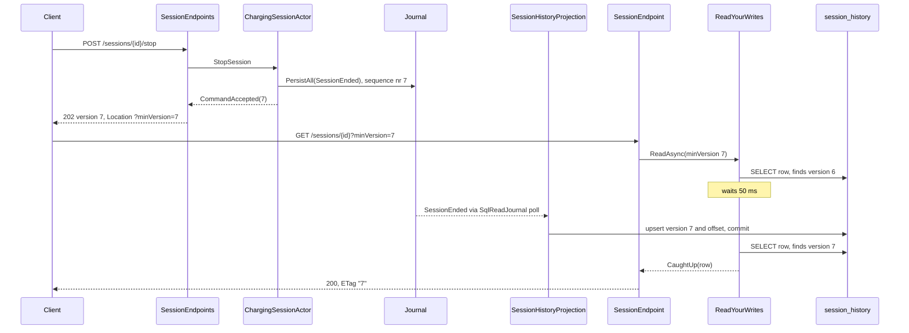
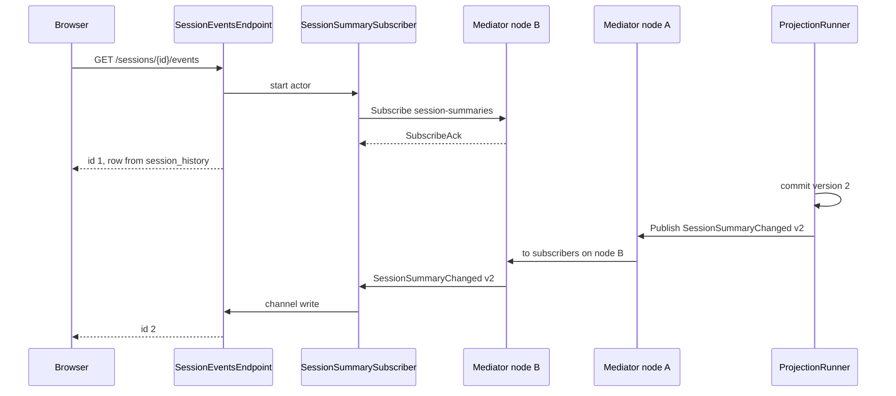
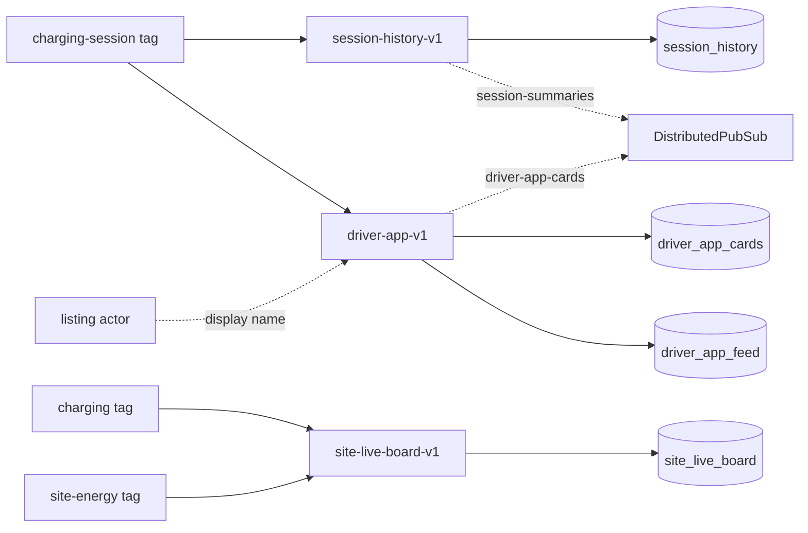

# Chapter 14. CQRS II: Living with Eventual Consistency

At 18:05 a driver at the Salt Lake City depot's public bays taps "Stop charging" in the driver app. The server answers at once: `202 Accepted`, version 3. The app reloads her session and shows "Charging, 7.35 kWh", because the session history has not yet seen the stop. She taps "Stop" again. The session has already ended, so the decider accepts the second stop as a change of nothing, still version 3, and the reloaded screen still says "Charging". For most of a second the app told her something false, and nothing in its design said that could happen.

Upstairs, the duty operator's site live board refreshes every few seconds. Nobody acts on one connector's status within a second, so there the same lag is harmless. A third reader is about to arrive: Chapter 19's phone, on a cellular link in an underground car park, which cannot afford ten requests to draw one screen and will miss every push sent while it was out of signal.

Chapter 13 built read models that trail the journal by design. This chapter makes that trail a designed property instead of a surprise. Every command already returns the aggregate's version, and every read-model row already stores it, so the gap can be measured, waited out, announced or pushed across, screen by screen.

> **In this chapter you will:**
>
> - follow a command's `Location` header to a read that waits until the read model shows at least the version the command produced, and that answers an honest 202 when it does not;
> - choose, screen by screen, between asking the aggregate, reading a read model at a minimum version and reading it as it is, and say in the UI what the user sees while it is stale;
> - tune the read journal's two polling intervals together and read each projection's measured lag from `GET /projections/status`;
> - push committed changes to browsers with Server-Sent Events and to app clients with SignalR, with DistributedPubSub carrying them to whichever node holds the connection;
> - build a third read model from the same events, shaped for one screen of the driver app, with a per-token change feed for catch-up;
> - test projection rules without a database, replay the journal into all three read models and get identical rows.

> **Starting point:** `ch13-s08`, the session history, the site live board and the query API from Chapter 13.
>
> ```bash
> git checkout ch13-s08
> ```

## 14.1 Read-your-writes with the version a command returns

### The stale screen after a stop

Follow the driver's stop. `ChargingSessionActor` persists `SessionEnded` as the session's third event and replies `CommandAccepted(3)` (section 10.4), which the endpoint turns into `202 Accepted` with `{"version":3}`. Some hundreds of milliseconds later `SqlReadJournal` polls, and `SessionHistoryProjection` commits row version 3 with its offset (section 13.5). The receipt, the history list and the home-screen card all read that table, so reading it straight after the 202 is a race the app usually loses.

### A version is a causal token

The way out is already in both halves. The reply says "version 3", and the row says `last_sequence_nr = 3` when it shows that event. So the client can ask a question the read model can answer exactly: show me this session **at least at version 3**. The server has three honest answers:

- the row is at version 3 or later: here it is;
- it is behind, but will very likely catch up within a moment: wait briefly, then answer;
- it is still behind after that: say so, with the version it has, and tell the client when to ask again.

Terry and colleagues named this guarantee **read-your-writes** in their [session guarantees for the Bayou system](https://doi.org/10.1109/PDIS.1994.331722) (1994, section 3.1, "Read Your Writes"): a read reflects every write made earlier in the same session. Werner Vogels's ["Eventually Consistent"](https://www.allthingsdistributed.com/2008/12/eventually_consistent.html#:~:text=Read%2Dyour%2Dwrites%20consistency) (2008) lists it among the variations of eventual consistency that are important to consider. It is weaker than strong consistency, since another driver's writes may still be missing, and it is exactly what a person who tapped a button a moment ago expects. The version acts as a **causal token**: a value the server hands out after a write and the client hands back to say "at least this much has happened". Because the aggregate is the single writer of its sequence numbers (section 10.9), the token needs no clock.

The alternative is section 12.6's: ask the aggregate. It is always current, but it answers for one entity at a time and wakes a passivated one to read one status. A minimum-version read costs a few one-row queries, and only while the projection is behind.

### The flow

The sequence diagram follows a stop that takes a session to version 7, the case `SessionEndpointsTests` pins down; the integration test does the same at version 2. While the endpoint is waiting, the projection commits the row.



The client never computes the version; it follows the `Location` the 202 gave it. `SessionEndpoint` owns the HTTP, and `ReadYourWrites` only the waiting. Had the projection not committed within the timeout, `ReadAsync` would return `StillBehind(6)` and the last arrow would be a 202 carrying version 6 and `Retry-After: 1`.

### The command's location carries the version

Tag `ch14-s01` gives `Edge.SendAsync` a second overload whose location is a function of the new version, and the three session commands (start, meter value, stop) pass this:

```csharp
// File: src/Charging/Ohmline.Charging.Api/SessionEndpoints.cs @ ch14-s01
/// <summary>
/// Where to read the session after a command: its history row, at least at
/// <paramref name="version"/>, so a client that follows it reads its own write.
/// </summary>
public static string SessionLocation(SessionId sessionId, long version) =>
    $"/sessions/{sessionId}?minVersion={version}";
```

Charge point and listing commands keep a plain `Location`, because `GET /charge-points/{id}` asks the aggregate and is never behind.

### Waiting, with a deadline

`ReadYourWrites` does the waiting. It knows nothing about sessions: it takes a function that reads a row and one that extracts its version.

```csharp
// File: src/Charging/Ohmline.Charging.Api/Queries/ReadYourWrites.cs @ ch14-s01
public sealed class ReadYourWrites(TimeProvider clock, IOptions<ReadModelOptions> options)
{
    /// <summary>How often the read model is asked again while it is behind.</summary>
    public static TimeSpan PollInterval { get; } = TimeSpan.FromMilliseconds(50);

    // ...
    public async Task<CatchUp<T>> ReadAsync<T>(
        Func<CancellationToken, Task<T?>> read,
        Func<T, long> versionOf,
        long minVersion,
        CancellationToken cancellationToken)
        where T : class
    {
        var deadline = clock.GetUtcNow() + options.Value.ReadYourWritesTimeout;
        while (true)
        {
            var row = await read(cancellationToken);
            var version = row is null ? 0 : versionOf(row);
            if (row is not null && version >= minVersion)
            {
                return new CaughtUp<T>(row);
            }

            if (clock.GetUtcNow() >= deadline)
            {
                return new StillBehind(version);
            }

            await Task.Delay(PollInterval, clock, cancellationToken);
        }
    }
}
```

A missing row is version 0, since a new session may have no history row yet. Even the delay takes its time from `TimeProvider`, so `ReadYourWritesTests` runs on a fake clock: a projection that never catches up is read 41 times, "at 0 ms, every 50 ms after it, and once more at 2 s", in no real time. The result is a union, because it stays in process and its consumer must handle both outcomes:

```csharp
// File: src/Charging/Ohmline.Charging.Api/Queries/CatchUp.cs @ ch14-s01
public union CatchUp<T>(CaughtUp<T>, StillBehind);

/// <summary>The read model has the version asked for, or a newer one.</summary>
public sealed record CaughtUp<T>(T Row);
// ...
public sealed record StillBehind(long Version);
```

The timeout is `Ohmline:ReadModels:ReadYourWritesTimeout`, 2 s by default, limited to 0 to 10 s and validated when the host starts, so `00:01:00` stops the node instead of letting requests hang for a minute. Its summary gives the rule for choosing it: "a few times the projection's usual lag: long enough that a client almost never sees 202, short enough that a stuck projection does not hold requests open."

### Two answers on the wire

`SessionEndpoint.GetAsync` maps the union to HTTP. Without `minVersion` it is the plain read of Chapter 13, 200 or 404. With it:

```csharp
// File: src/Charging/Ohmline.Charging.Api/Queries/SessionEndpoint.cs @ ch14-s01
    var read = await readYourWrites.ReadAsync(
        token => FindAsync(readModels, sessionId, token),
        row => row.Version,
        atLeast,
        cancellationToken);
    return read switch
    {
        CaughtUp<SessionResponse> caughtUp => Current(caughtUp.Row, response),
        StillBehind behind => NotYet(sessionId, behind.Version, atLeast, response),
        null => throw new InvalidOperationException("A read found neither answer."),
    };
}

// ...
private static Ok<SessionResponse> Current(SessionResponse row, HttpResponse response)
{
    response.Headers.ETag = $"\"{row.Version}\"";
    return TypedResults.Ok(row);
}

/// <summary>Not yet: ask the same question again in a second.</summary>
private static Accepted<ReadModelBehindResponse> NotYet(
    SessionId sessionId, long version, long minVersion, HttpResponse response)
{
    response.Headers.RetryAfter = "1";
    return TypedResults.Accepted(
        SessionEndpoints.SessionLocation(sessionId, minVersion),
        new ReadModelBehindResponse(version, minVersion));
}
```

The 200 carries the version as its `ETag`. The 202 on a GET needs a defence: a 503 would say the server is unwell when it is merely behind, and a 200 with the old row would be the stale screen again. "Accepted, not done yet, ask again here after `Retry-After`" is what 202 means, and the body says how far the read model has got: `{"version":1,"minVersion":2}`.

A node at `ch14-s07` against PostgreSQL 17 answered a stop after a start and one meter value like this (`Date` and `Server` headers trimmed):

```text
$ curl -i -X POST localhost:5180/sessions/019a5a3e-7c00-7d2a-9b3e-5c0a00000014/stop
HTTP/1.1 202 Accepted
Content-Type: application/json; charset=utf-8
Location: /sessions/019a5a3e-7c00-7d2a-9b3e-5c0a00000014?minVersion=3
...
{"version":3}

$ curl -i 'localhost:5180/sessions/019a5a3e-7c00-7d2a-9b3e-5c0a00000014?minVersion=3'
HTTP/1.1 200 OK
Content-Type: application/json; charset=utf-8
ETag: "3"
...
{"sessionId":"019a5a3e-...","status":"ended","energyKwh":7.35,...,"version":3}
```

### Forcing the slow path

The integration `ReadYourWritesTests` pauses the session history without touching its code: it opens a database transaction and runs `SELECT last_offset FROM read_models.projection_offsets WHERE projection_id = 'session-history-v1' FOR UPDATE`. The projection's next database transaction writes the history row and then blocks at its offset upsert, uncommitted. PostgreSQL readers do not wait for row locks, so the endpoint keeps reading the committed row at version 1, and after 2 s answers 202 with `Retry-After: 1` and `{version: 1, minVersion: 2}`. Rolling back the test's transaction lets the projection commit, and the same URL then answers 200 with `ended`.

### What it costs

While a projection is behind, each minimum-version request holds a connection for up to 2 s and runs up to 41 one-row queries; a stopped projection turns every post-command read into a 2 s wait and a 202, and the client must then do something sensible (section 14.2). The token must also be copied, never computed: a client that sends `minVersion=1000` for a session at version 3 gets 202 for ever, and the server cannot tell it from a lagging projection.

> **Try it**
>
> ```bash
> git checkout ch14-s01
> git diff ch13-s08 ch14-s01 --stat
> git diff ch13-s08 ch14-s01 -- src/Charging/Ohmline.Charging.Api/Edge.cs
> dotnet test --solution Ohmline.slnx
> ```
>
> The diff shows `15 files changed, 593 insertions(+), 10 deletions(-)`. The solution reports `total: 1607`, `failed: 0`, among them `Given_a_paused_projection_when_read_at_the_new_version_then_202_for_now`.

## 14.2 Consistency choices per screen

### One guarantee does not fit every screen

Section 14.1 cannot be applied everywhere. The operator's live board has no token to send, because the operator did not cause its changes. The connector a driver is about to reserve needs more than read-your-writes: a read model current with her own writes can still show a connector as free that another driver took a second ago.

The useful question is what a wrong answer costs the person looking at the screen. Pat Helland and Dave Campbell's ["Building on Quicksand"](https://www.cidrdb.org/cidr2009/Paper_133.pdf) (CIDR 2009, section 5.7, "Memories, Guesses, and Apologies") argues that a replica acting on the part of the truth it knows is only guessing, and that businesses cope when a guess turns out wrong, with an apology if needed. A screen is a guess shown to a person; some are cheap to get wrong, and some strand a driver at a blocked connector at 23:00.

### The decision table

Tag `ch14-s02` adds `docs/consistency-per-screen.md`; a new screen gets a row there before it gets an endpoint. Its rule: "Choose by what a wrong answer costs the person looking at the screen." If acting on a stale value strands someone or costs them money, read the aggregate; if they have changed something and will look for it, read at least at the version they caused; otherwise read the read model as it is, and push changes. Its table, with cells shortened:

| Screen | Read source | Guarantee | While stale, the user sees |
|---|---|---|---|
| Operator: site live board | `site_live_board` | Eventual, pushed | The board as it was, with the time of its last change |
| Driver: the active session | `?minVersion=n`, then pushes | Read-your-writes, then pushed | "Updating…" beside the last known state |
| Driver: receipt of an ended session | `session_history`, price from Billing | Eventual | "Your receipt is being prepared" |
| Driver: is this connector free | `GET /charge-points/{id}` | Up to date, one charge point | Nothing stale; the reservation may still be rejected |
| Driver: session history | `session_history` | Eventual | The list without a session started a moment ago |
| Driver app: cards and recent sessions | `/app/v1` cards and feed, then pushes | Eventual, pushed, with catch-up | Cards marked "updating…" until the feed catches up |
| Operations: projection status | `GET /projections/status` | Up to date | Events behind and lag, read from offsets and the journal |

Each row in the file also names an owning team from `docs/context-map.md`. The connector row reads the aggregate because a stale "available" sends a driver walking to a reserved bay, and even then the reservation command checks again and may be rejected: a query never makes a later command safe; the aggregate's invariant does. The receipt row turns lag into a named state rather than an error. And the document admits one gap: the live board's push is "the design, not yet the code", so the operator console polls it for now.

### Three tools and their costs

Every row uses one of three tools, and the document prices each:

| Tool | Guarantee | Cost | Use it for |
|---|---|---|---|
| Ask the aggregate | Up to date | One entity per question; wakes a passivated one; a list is a fan-out | A decision about one thing whose staleness has a price |
| Read model at a minimum version | Your own write, or an honest 202 | A few one-row reads every 50 ms while behind; a request held up to 2 s | The screen a user lands on right after a command |
| Read model as it is | Eventual | One query, however many entities | Lists, boards, history: everything else |

Pushes (sections 14.4 and 14.5) are not a fourth tool. The document says so plainly: a push "does not change the guarantee of the screen it updates. It removes polling. It never replaces the read on (re)connect", because pushes sent while the client was away are gone.

Udi Dahan's ["Clarified CQRS"](https://udidahan.com/2009/12/09/clarified-cqrs/#:~:text=once%20data%20has%20been%20shown%20to%20a%20user) (2009) makes the underlying point: once data has been shown to a user, another actor may already have changed it, so it is stale, and the design question is how stale, and with what consequence. Vernon ([*Implementing Domain-Driven Design*](https://www.informit.com/store/implementing-domain-driven-design-9780321834577), ch. 4 "Architecture", section "Dealing with an Eventually Consistent Query Model") and Khononov ([*Learning Domain-Driven Design*](https://www.oreilly.com/library/view/learning-domain-driven-design/9781098100124/ch08.html), ch. 8 "Architectural Patterns", section "Projecting Read Models") describe query models that trail the command model; this table is where Ohmline decides by how much, per reader.

### The words on the screen

The last part of the document is about language, because lag is a user-experience problem first:

- **Say "updating…", not nothing.** A read that answered 202 shows the last state it has, marked as updating, and asks again after `Retry-After`.
- **Never fake certainty.** Showing the state the client expects as if the server had confirmed it is a lie that sometimes turns out true. An optimistic value is allowed only with a visible pending mark, removed by the read model rather than by the command's 202 (Chapter 19 builds it).
- **Show the age when it matters.** A board that has not changed for a while says when it last did, so an operator can tell a quiet site from a stopped projection.
- **Do not spin for ever.** After a few 202s in a row the screen says the history is late and offers to try again.

The driver in the opening would have seen "Charging, updating…" for half a second, then "Ended, 7.35 kWh", and would not have tapped twice.

> **Try it**
>
> ```bash
> git checkout ch14-s02
> git diff ch14-s01 ch14-s02 --stat
> cat docs/consistency-per-screen.md
> ```
>
> The diff shows `1 file changed, 53 insertions(+)`: the tag adds a document and no code, so `dotnet test --solution Ohmline.slnx` still reports `total: 1607`, `failed: 0`.

## 14.3 Tuning and measuring projection lag

### Half a second, from two pollers

At `ch13-s08` the node runs Akka.Persistence.Sql's defaults, and the stop in the opening took most of a second to reach the history. That comes from the two pollers of section 13.3: the event poll, `akka.persistence.query.journal.sql.refresh-interval`, and the `JournalSequenceActor`'s search for the highest ordering without gaps, `journal-sequence-retrieval.query-delay`, both [1 s by default](https://github.com/akkadotnet/Akka.Persistence.Sql/blob/1.5.73/src/Akka.Persistence.Sql/persistence.conf#L363-L400).

An event waits for both: for the sequence poll to move the safe maximum past it, then for the event poll to fetch it. Tune only the event poll to 10 ms and the stream asks a hundred times a second for events it may not yet read; tune only the sequence poll and the maximum is fresh but nobody asks. The default configuration that Akka.Persistence.Sql 1.5.73 ships, [`persistence.conf`](https://github.com/akkadotnet/Akka.Persistence.Sql/blob/1.5.73/src/Akka.Persistence.Sql/persistence.conf#L390-L400), warns "Tuning only refresh-interval will NOT reduce latency" and gives the numbers: "Default (1s/1s) = 500-1200ms, Optimized (10ms/10ms) = 20-100ms".

### Two settings, validated together

Tag `ch14-s03` makes both configuration, under `Ohmline:Projections`:

```csharp
// File: src/Charging/Ohmline.Charging.ReadModels/Projections/ProjectionOptions.cs @ ch14-s03
public sealed class ProjectionOptions
{
    public const string Section = "Ohmline:Projections";

    /// <summary><c>akka.persistence.query.journal.sql.refresh-interval</c>.</summary>
    [Range(typeof(TimeSpan), "00:00:00.010", "00:00:10")]
    public TimeSpan RefreshInterval { get; set; } = TimeSpan.FromMilliseconds(100);

    /// <summary>
    /// <c>akka.persistence.query.journal.sql.journal-sequence-retrieval.query-delay</c>.
    /// </summary>
    [Range(typeof(TimeSpan), "00:00:00.010", "00:00:10")]
    public TimeSpan QueryDelay { get; set; } = TimeSpan.FromMilliseconds(100);

    /// <summary>The settings as HOCON for the read journal.</summary>
    public string ToHocon() => $$"""
        akka.persistence.query.journal.sql {
          refresh-interval = {{RefreshInterval.TotalMilliseconds:0}}ms
          journal-sequence-retrieval.query-delay = {{QueryDelay.TotalMilliseconds:0}}ms
        }
        """;
}
```

`AddChargingReadModels(options)` prepends that HOCON, because Akka.NET reads HOCON rather than `IOptions`, and the node also binds the section with `ValidateOnStart()`, so a `RefreshInterval` of 1 ms or a `QueryDelay` of a minute stops it at start.

The sample settles for 100 ms rather than 10 ms because each setting is a query on a timer. At 100 ms, the four projection streams of this chapter's end ask for events about forty times a second between them while idle, and each node that runs one adds ten sequence queries a second. At 10 ms that is tenfold, against the database that also holds the journal. The summary of `ProjectionOptions` states the trade: "Lower is possible, at more load on the database."

### Measuring instead of guessing

A tuned number nobody measures is a hope. The glossary defines **projection lag** as the time between an event entering the journal and a read model reflecting it, and the runner now records both ends in the offset row it already writes in the read model's database transaction. The start is `EventEnvelope.Timestamp`, which turned out to be the writing node's `DateTime.UtcNow` in ticks, not Unix milliseconds and not the actor's `TimeProvider`; `ProjectionRunner.WrittenAt` turns it into a `DateTimeOffset`.

The end is `updated_at`, which `NpgsqlOffsetStore.SaveAsync` now sets to `clock_timestamp()`, the time of the statement, rather than `now()`, the time the database transaction began. `GET /projections/status` subtracts:

```csharp
// File: src/Charging/Ohmline.Charging.Api/Queries/ProjectionStatusEndpoint.cs @ ch14-s03
o.updated_at,
o.last_event_at,
round(extract(epoch FROM o.updated_at - o.last_event_at) * 1000)::bigint
```

`ProjectionLagTests` times a session's history row from the 202 and asserts under 1 s. Three runs at `ch14-s03` logged "In its history 102 ms after the 202; measured lag 98 ms", then 90 and 90 ms, then 92 and 92 ms; the defaults' 500 to 1,200 ms is the plugin's figure, not re-measured. The manual run at `ch14-s07` reported every stream (trimmed; the live board's `site-energy` stream, which had handled nothing, reported `null`):

```text
$ curl localhost:5180/projections/status
[{"projectionId":"driver-app-v1",...,"lagMs":180},{"projectionId":"session-history-v1",...,"lagMs":179},...]
```

### What the number does and does not say

Read `lagMs` with three caveats. It describes the **last event a stream handled**, so a stream stopped an hour ago still shows its last good lag; read it beside `eventsBehind` (section 13.7). It subtracts **two clocks**, the writing node's and the database's, so skew shows up as lag. And it ends at the **offset write, not the commit**, although the endpoint's summary says commit. The session history's 179 ms above belongs to the stop that section 14.1's pause held back for about five seconds: `clock_timestamp()` is evaluated when the upsert begins, before it waits for the lock. Normally nothing else locks an offset row and the commit follows within a millisecond, but under contention the number is too low.

Chapter 18 builds the metrics and dashboards around them and leaves turning this lag into a gauge, and an alert that pages someone when the history stops moving, as an exercise.

> **Try it**
>
> ```bash
> git checkout ch14-s03
> git diff ch14-s02 ch14-s03 --stat
> git diff ch14-s02 ch14-s03 -- src/Charging/Ohmline.Charging.ReadModels/Projections
> dotnet test --solution Ohmline.slnx
> ```
>
> The diff shows `15 files changed, 312 insertions(+), 25 deletions(-)`. The solution reports `total: 1614`, `failed: 0`; `Given_tuned_polling_then_a_started_session_is_in_its_history_within_1_s` writes its two numbers to the test output, around 90 to 100 ms each in the coder's runs.

## 14.4 Live push with Server-Sent Events

### Who announces a change

A driver who scans the QR code on a charger can follow the session in a browser. Polling `GET /sessions/{id}` every second works, mostly to hear "no change"; the page wants to be told.

The aggregate is the wrong announcer. When `ChargingSessionActor` persists version 2, the history may still show version 1, so a browser told "version 2" that reads the history gets the stale screen again, now caused by the push. The **projection** is the right source, and only **after its database transaction commits**: then every pushed version is readable. The push is a notification, not a source of truth, as the summary of `LiveUpdate` says: "what it says can always be read back from the read model, at that version or a newer one."

### The runner publishes after the commit

Only the runner knows when the commit happens, because it owns the database transaction (section 13.5). So tag `ch14-s04` makes `IProjectionHandler.HandleAsync` return `ImmutableArray<LiveUpdate>`, what changed, and the runner publishes it after the commit:

```csharp
// File: src/Charging/Ohmline.Charging.ReadModels/Projections/ProjectionRunner.cs @ ch14-s04
private async Task WriteAsync(
    EventEnvelope envelope, Func<NpgsqlTransaction, Task<ImmutableArray<LiveUpdate>>> write)
{
    await using var connection = await dataSource.OpenConnectionAsync();
    await using var transaction = await connection.BeginTransactionAsync();
    var changes = await write(transaction);
    await offsets.SaveAsync(
        _stream,
        OffsetOf(envelope),
        WrittenAt(envelope),
        transaction,
        CancellationToken.None);
    await transaction.CommitAsync();
    foreach (var change in changes)
    {
        publish(change);
    }
}
```

A crash between the commit and the loop loses the notification, never the row: the right way round, and the reason every client in this chapter reads before it listens. `ProjectionRunnerTests` crashes the offset store at offset 2 and finds the published versions are exactly `[1, 2, 3]`: the rolled-back first attempt announced nothing. `SessionHistoryProjection` returns `[]` for a duplicate, and otherwise one `SessionSummaryChanged` with the row's version, status and energy.

### DistributedPubSub carries it to the right node

The projection stream runs on the node the sharded daemon process chose (section 13.6); the browser is connected to whichever node the load balancer picked. Akka.NET's [**DistributedPubSub**](https://getakka.net/articles/clustering/distributed-publish-subscribe.html) carries the change between them. Every node runs a mediator actor, subscribers register with their local mediator for a topic, and a `Publish` on any node reaches every subscriber on every node, because the mediators gossip their registries. The node enables it with `.WithDistributedPubSub(ClusterRoles.Charging)`, and `ProjectionDaemon` hands the runner a publish function:

```csharp
// File: src/Charging/Ohmline.Charging.ReadModels/Projections/ProjectionDaemon.cs @ ch14-s04
var mediator = DistributedPubSub.Get(Context.System).Mediator;
// ...
    change => mediator.Tell(new Publish(LiveTopics.Of(change), change)),
```

The mediator is fetched in the constructor because the runner calls the function from stream threads, where `Context` is unavailable. The update crosses nodes, so it is a wire message: a `closed record` in `Ohmline.Charging.Contracts/Live` with the manifest `charging.session-summary-changed.v1` and a golden file. `LiveTopics.Of` maps each case to its durable topic, `session-summaries`, in an exhaustive switch.

```csharp
// File: src/Charging/Ohmline.Charging.Contracts/Live/LiveUpdate.cs @ ch14-s04
public closed record LiveUpdate;
// ...
public sealed record SessionSummaryChanged(
    SessionId SessionId, long Version, string Status, decimal EnergyKwh) : LiveUpdate;
```

### One subscriber actor per request

[**Server-Sent Events**](https://html.spec.whatwg.org/multipage/server-sent-events.html) (SSE) is the browser's built-in one-way stream: a long-lived `GET` whose response is a sequence of text events with optional `id:` and `data:` lines. `EventSource` reconnects by itself and sends the last id it saw as [`Last-Event-ID`](https://html.spec.whatwg.org/multipage/server-sent-events.html#the-last-event-id-header). ASP.NET Core 10 [added `TypedResults.ServerSentEvents`](https://learn.microsoft.com/aspnet/core/release-notes/aspnetcore-10.0#:~:text=TypedResults.ServerSentEvents), which writes an `IAsyncEnumerable<SseItem<T>>` in that format.

Between the actor world and that enumerable sits a short-lived actor per request. `SessionSummarySubscriber` subscribes in `PreStart`, writes its own session's changes to a channel, and unsubscribes and completes the channel in `PostStop`:

```csharp
// File: src/Charging/Ohmline.Charging.Api/Live/SessionSummarySubscriber.cs @ ch14-s04
    Receive<SubscribeAck>(_ => subscribed.TrySetResult());
    Receive<SessionSummaryChanged>(
        changed => changed.SessionId == sessionId, changed => _changes.TryWrite(changed));
    Receive<SessionSummaryChanged>(_ => { }); // Another session's.
}
// ...
protected override void PreStart() =>
    _mediator.Tell(new Subscribe(LiveTopics.SessionSummaries, Self));

protected override void PostStop()
{
    _mediator.Tell(new Unsubscribe(LiveTopics.SessionSummaries, Self));
    _changes.TryComplete();
}
```

The endpoint turns the channel into events; the order of the first statements is the design decision:

```csharp
// File: src/Charging/Ohmline.Charging.Api/Live/SessionEventsEndpoint.cs @ ch14-s04
try
{
    // Subscribed first, then read: a change committed in between arrives on the channel.
    await subscribed.Task.WaitAsync(cancellationToken);
    var current = await SessionEndpoint.FindAsync(readModels, sessionId, cancellationToken);
    var summaries = changes.Reader.ReadAllAsync(cancellationToken)
        .Select(SessionSummaryDto.From);
    if (current is not null)
    {
        summaries = summaries.Prepend(SessionSummaryDto.From(current));
    }

    await foreach (var summary in summaries)
    {
        if (summary.Version <= seen)
        {
            continue; // Sent already, or older than what was sent.
        }

        seen = summary.Version;
        yield return new SseItem<SessionSummaryDto>(summary)
        {
            EventId = summary.Version.ToString(CultureInfo.InvariantCulture),
        };
        if (summary.Status == Ended)
        {
            yield break;
        }
    }
}
finally
{
    system.Stop(subscriber);
}
```

`Select` and `Prepend` are the BCL's own LINQ over `IAsyncEnumerable`, [part of .NET since version 10](https://learn.microsoft.com/dotnet/core/compatibility/core-libraries/10.0/asyncenumerable), so the API project needs no extra package for them.

Reading the row before subscribing would leave a window in which a commit is in neither the row nor the channel. Subscribing first closes it, at the price of maybe seeing a version twice, which the `seen` check drops. The event id is the version, so a reconnecting browser's `Last-Event-ID: 1` means "I have version 1". When it has already seen `ended`, `GetAsync` answers `204 No Content`, which the [SSE specification](https://html.spec.whatwg.org/multipage/server-sent-events.html#:~:text=a%20client%20can%20be%20told%20to%20stop%20reconnecting) defines as the signal to stop reconnecting. The channel holds 16 summaries with `DropOldest`; each summary is complete, so dropping older ones loses nothing.

The diagram follows one change from the projection's node to a browser on another node; `SessionEventsTests` exercises the same flow on one node:



In the manual run at `ch14-s07`, `curl -N` started before the meter value got the row and two pushes, and a reconnect with the last id got 204:

```text
$ curl -N localhost:5180/sessions/019a5a3e-7c00-7d2a-9b3e-5c0a00000014/events
data: {"sessionId":"019a5a3e-...","version":1,"status":"charging","energyKwh":0}
id: 1

data: {"sessionId":"019a5a3e-...","version":2,"status":"charging","energyKwh":7.35}
id: 2

data: {"sessionId":"019a5a3e-...","version":3,"status":"ended","energyKwh":7.35}
id: 3

$ curl -i -H 'Last-Event-ID: 3' localhost:5180/sessions/019a5a3e-7c00-7d2a-9b3e-5c0a00000014/events
HTTP/1.1 204 No Content
```

### What it costs

DistributedPubSub delivers at most once, like [Akka.NET messaging in general](https://getakka.net/articles/concepts/message-delivery-reliability.html#the-general-rules): a restarting node, a mediator that has not yet heard of a subscriber, or a crash after the commit each loses a notification, which the design accepts because every client can read. The single topic also carries every session's summaries, so every open stream's actor receives every change and discards most; a topic per session would cut that traffic at a larger scale. Each open stream holds an actor, a subscription and an HTTP connection for the length of a session.

> **Try it**
>
> ```bash
> git checkout ch14-s04
> git diff ch14-s03 ch14-s04 --stat
> git diff ch14-s03 ch14-s04 -- src/Charging/Ohmline.Charging.ReadModels/Projections
> dotnet test --solution Ohmline.slnx
> ```
>
> The diff shows `24 files changed, 555 insertions(+), 20 deletions(-)`. The solution reports `total: 1626`, `failed: 0`, among them `Given_a_browser_that_has_seen_the_end_when_it_reconnects_then_204`.

## 14.5 Live push to app clients with SignalR

### What an app client needs

The driver app of Chapter 19 is a .NET client that shows several sessions at once, loses its network in car parks, and should appear in the server's traces. It wants one connection carrying several subscriptions, reconnection built in, and a traced client. ASP.NET Core [**SignalR**](https://learn.microsoft.com/aspnet/core/signalr/introduction) provides those: a **hub** is a server class that clients reach over WebSockets, SSE or long polling; a [**group**](https://learn.microsoft.com/aspnet/core/signalr/groups) is a named set of connections the server sends to; and the .NET client, `Microsoft.AspNetCore.SignalR.Client`, can [reconnect automatically](https://learn.microsoft.com/aspnet/core/signalr/dotnet-client#automatically-reconnect) and has an [`ActivitySource` for tracing](https://learn.microsoft.com/aspnet/core/signalr/diagnostics#:~:text=SignalR%20has%20an%20ActivitySource).

### The hub: groups per session and per token

Tag `ch14-s05` maps `ChargingHub` at `/hubs/charging`. A client joins the groups of what it shows:

```csharp
// File: src/Charging/Ohmline.Charging.Api/Live/ChargingHub.cs @ ch14-s05
public static string SessionGroup(SessionId sessionId) => $"session-{sessionId}";

public static string TokenGroup(TokenUid tokenUid) => $"token-{tokenUid}";

/// <summary>From now on, this connection hears about the session.</summary>
public Task JoinSession(Guid sessionId) =>
    SessionId.TryCreate(sessionId).TryGet(out var id, out var error)
        ? Groups.AddToGroupAsync(Context.ConnectionId, SessionGroup(id))
        : throw new HubException(error.Message);

/// <summary>From now on, this connection hears about the token's sessions.</summary>
public Task JoinToken(string tokenUid) =>
    TokenUid.TryCreate(tokenUid).TryGet(out var uid, out var error)
        ? Groups.AddToGroupAsync(Context.ConnectionId, TokenGroup(uid))
        : throw new HubException(error.Message);
```

The hub is an edge, so its arguments pass through the smart constructors (section 6.2), and a `HubException` carries the message to the client: `LiveHubTests` joins `not-a-card` and gets "TokenUid must be 4 to 10 bytes of hexadecimal, like 04A2B3C4, not 'not-a-card'." The hub path, group names and client method names are durable names in ADR 0009, because apps in drivers' pockets are built against them.

### DistributedPubSub is the backplane

A SignalR server knows only its own connections, and a group may have members on every node, which is why [SignalR scale-out](https://learn.microsoft.com/aspnet/core/signalr/scale) normally needs a **backplane** such as Redis or Azure SignalR Service. Ohmline already has one. `LiveUpdatesBridge`, one actor per node, subscribes to the same topic as the SSE streams and sends each update to the group on its own node:

```csharp
// File: src/Charging/Ohmline.Charging.Api/Live/LiveUpdatesBridge.cs @ ch14-s05
public LiveUpdatesBridge(IHubContext<ChargingHub> hub)
{
    ReceiveAsync<SessionSummaryChanged>(changed => hub.Clients
        .Group(ChargingHub.SessionGroup(changed.SessionId))
        .SendAsync(ChargingHub.SessionSummaryChanged, SessionSummaryDto.From(changed)));
    Receive<SubscribeAck>(_ => { });
}

protected override void PreStart() =>
    DistributedPubSub.Get(Context.System).Mediator
        .Tell(new Subscribe(LiveTopics.SessionSummaries, Self));
```

Every node hears every update and pushes it to its own clients, so no Redis is needed. `ReceiveAsync` handles one update at a time, keeping a session's versions in order. A send that throws restarts the bridge, which subscribes again; that update is lost, and clients catch up by reading. The node starts the bridge with `AddChargingLiveUpdates()` and adds `AddSignalR()` and `MapChargingHub()`.

### No replay, so read after every connect

SignalR keeps nothing for a client that is away. The hub's remarks state the consequence: "a client reads the current state after each (re)connect, as it does on start, and joins its groups again: a reconnect is a new connection, in no group." The [groups documentation](https://learn.microsoft.com/aspnet/core/signalr/groups#:~:text=Group%20membership%20isn) says the same. [`WithAutomaticReconnect()`](https://learn.microsoft.com/aspnet/core/signalr/dotnet-client#automatically-reconnect) retries after 0, 2, 10 and 30 s by default, then gives up. Section 14.6 gives the app a feed to catch up from.

`LiveHubTests` connects a real `HubConnection` through `node.Server.CreateHandler()` with long polling, since a WebSocket cannot pass through the test server's HTTP handler, joins a session's group, stops the session, and hears `sessionSummaryChanged` at version 2, `ended`. The server side of SignalR is [part of the ASP.NET Core shared framework](https://learn.microsoft.com/aspnet/core/signalr/hubs#:~:text=SignalR%20server%2Dside%20assemblies), so the hub needs no package; the tag adds only the client, `Microsoft.AspNetCore.SignalR.Client`, to central package management, referenced by `Ohmline.IntegrationTests` now and by the driver app from Chapter 19.

> **Version note:** `Microsoft.AspNetCore.SignalR.Client` is pinned at 11.0.0-rc.3.26522.148, the same release candidate as the SDK. When .NET 11 reaches general availability, it moves with the SDK on Appendix A's re-pin checklist.

### SSE or SignalR

Both are fed by the same topic on every node; they differ in what the client gets:

| | Server-Sent Events | SignalR |
|---|---|---|
| Client | Any browser's `EventSource` | .NET, JavaScript and Java clients |
| Subscriptions | One session per stream | Groups: `session-{id}`, `token-{uid}` |
| Missed messages | Resumed from `Last-Event-ID` (the version) | None replayed; read after reconnect |
| Reconnect | Automatic, by the browser | `WithAutomaticReconnect`, then rejoin groups |
| End of stream | 204 once the session has ended | The client leaves |
| Tracing | Ordinary HTTP request spans | Client `ActivitySource` per invocation |

Use SSE for a page that follows one thing, and SignalR for an app that holds a connection open and shows many.

> **Try it**
>
> ```bash
> git checkout ch14-s05
> git diff ch14-s04 ch14-s05 --stat
> git diff ch14-s04 ch14-s05 -- src/Ohmline.Node/Program.cs
> dotnet test --solution Ohmline.slnx
> ```
>
> The diff shows `8 files changed, 194 insertions(+), 1 deletion(-)`. The solution reports `total: 1628`, `failed: 0`; the two new tests are in `LiveHubTests`.

## 14.6 Many read models from one stream, including one for the driver app

### A screen on a cellular link

The driver app's home screen shows the active session and the last few, each with the charge point's display name, "Salt Lake bus depot, public bays", not `OHM-SLC-0042/1`. From the generic API that is `GET /tokens/{uid}/sessions` plus one listing request per charge point: several round trips of a few hundred milliseconds on a weak cellular link, each a chance to leave the screen half drawn.

A read model is cheap to add. Khononov's case for CQRS is that a single model can rarely serve all of a system's needs, and that a read model can be wiped and regenerated from scratch ([*Learning Domain-Driven Design*](https://www.oreilly.com/library/view/learning-domain-driven-design/9781098100124/ch08.html), ch. 8 "Architectural Patterns", sections "Polyglot Modeling" and "Projecting Read Models"). Tag `ch14-s06` adds one shaped for exactly this screen, with the name already joined in, "so a phone on a cellular link makes one request, not one per charge point", as the summary of `DriverAppCard` puts it.

The `charging-session` tag now feeds two read models, and the charge point events feed a third:



Each projection has its own id, offsets, failure policy and rebuild story. The session history stops after five retries, because a driver's bill must never be quietly wrong (section 13.7); the driver app records and skips, because "Cards that stop moving for every driver are worse than one card that misses an event: the session's next event corrects it." One can stall while the others carry on.

### The display name, from the listing's current view

The display name belongs to the state-sourced listing of section 11.7. Section 13.2 named this projection as one that also reads the listing's events from the `charging` tag, but it cannot: the listing deletes its events as soon as its snapshot is saved, and the tag query skips deleted rows, so a `ChargePointListingRevised` never reaches a projection, as section 11.7 warned. So `driver-app-v1` reads only `charging-session` and asks the listing actor, through an `IChargePointNames` port, when it makes a card. A projection is constructed before the actor system exists, so a new default interface member lets it pick up what it needs when it runs:

```csharp
// File: src/Charging/Ohmline.Charging.ReadModels/DriverApp/DriverAppProjection.cs @ ch14-s06
/// <summary>In a node, names come from the listings' shard region.</summary>
public IProjectionHandler RunningIn(ActorSystem system) =>
    new DriverAppProjection(new ListingDisplayNames(system));
```

`RunningIn` returns `this` by default, and `ProjectionDaemon` passes `projection.RunningIn(Context.System)` to the runner. `ListingDisplayNames` asks the listing region with a 3 s timeout and returns `null` on a timeout rather than failing the event. The handler has the session history's shape, with two writes and one more question:

```csharp
// File: src/Charging/Ohmline.Charging.ReadModels/DriverApp/DriverAppProjection.cs @ ch14-s06
var card = await DriverAppTables.FindCardAsync(
    transaction, @event.SessionId.Value, cancellationToken);
if (card?.Version >= envelope.SequenceNr)
{
    return []; // Seen it: a redelivery, or a replay from an older offset.
}

var displayName = card?.ChargePointDisplayName
    ?? await NameAsync(ChargePointOf(card, @event), cancellationToken);
if (DriverAppCard.Apply(card, @event, envelope.SequenceNr, displayName) is not { } next)
{
    return [];
}

await DriverAppTables.UpsertCardAsync(transaction, next, cancellationToken);
var position =
    await DriverAppTables.AppendToFeedAsync(transaction, next, cancellationToken);
return [Changed(next, position)];
```

The name is asked when the card is made, and again only while the card has none. `DriverAppCard.Apply` keeps the first name, so a card shows the name the charge point had when the session started, like a printed receipt; `DriverAppCardTests` renames the listing and checks that the card does not change. Denormalising means choosing whose truth a copy keeps, and here the choice is written in a test. Note where the question is asked: inside the open database transaction, so a listing that takes its full 3 s holds the whole stream for 3 s. That happens once per session start, and again on that session's later events only while a timed-out question has left the card without a name; a busier system would cache the names.

### A change feed for catch-up

A phone back from an underground car park has missed pushes that SignalR will not replay. A per-token **change feed** lets it catch up cheaply: every new version of a card is also appended to `read_models.driver_app_feed` with a `bigserial` position, and the app asks for what came after the last position it saw.

```csharp
// File: src/Charging/Ohmline.Charging.ReadModels/DriverApp/DriverAppTables.cs @ ch14-s06
/// <summary>
/// Appends the card to its token's change feed and returns the entry's position. The
/// projection is one stream, which handles one event at a time, so positions are committed
/// in order: an app that has read up to a position never later finds an entry below it. A
/// rolled-back append leaves a gap, which a reader never notices.
/// </summary>
public static async Task<long> AppendToFeedAsync(
    NpgsqlTransaction transaction, DriverAppCard card, CancellationToken cancellationToken)
{
    await using var insert = new NpgsqlCommand(
        """
        INSERT INTO read_models.driver_app_feed (token_uid, session_id, version, payload)
        VALUES (@token_uid, @session_id, @version, @payload)
        RETURNING position
        """,
        transaction.Connection,
        transaction);
    // ...
    insert.Parameters.AddWithValue(
        "payload", NpgsqlDbType.Jsonb, JsonSerializer.Serialize(card, Web));
    return (long)(await insert.ExecuteScalarAsync(cancellationToken))!;
}
```

A sequence is safe here, unlike in the journal (section 13.3), because the feed has exactly one writer, the projection stream. Positions come from one sequence for all tokens, so a token's positions have gaps and a client cannot count them to notice a missed push; only reading the feed after its stored position finds one. `GET /app/v1/tokens/{uid}/cards` returns the active card, up to ten recent ones and the feed position, read in one `REPEATABLE READ` database transaction so the position matches the cards. `GET .../feed?after={position}&limit={n}` returns entries oldest first, 100 by default, at most 500. After the manual run's two sessions at `ch14-s07` (trimmed):

```text
$ curl localhost:5180/app/v1/tokens/04A2B3C4D5E6F7/cards
{"active":null,"recent":[{"sessionId":"019a5a3e-...-5c0a00000015",...,"version":2},...],"position":5}
$ curl "localhost:5180/app/v1/tokens/04A2B3C4D5E6F7/feed?after=0&limit=2"
{"entries":[{"position":1,"card":{...,"version":1}},{"position":2,"card":{...}}],"position":2}
```

Each card carries `"chargePointDisplayName":"Salt Lake bus depot, public bays"`. The projection also returns a `DriverCardChanged` for the topic `driver-app-cards`, which `LiveUpdatesBridge` pushes to the group `token-{uid}` as `driverCardChanged`, shaped like a feed entry, so the app applies both alike.

### The server still owns the contract

A screen-shaped API is not the app's model on the server. It is part of Charging's Open Host Service (OHS), under a durable prefix, `/app/v1`, where a breaking change becomes `/app/v2` beside it. The driver app is a downstream customer that can ask for changes, such as this feed. Its DTOs live in `Ohmline.Charging.Api/App/Dtos` for now; Chapter 19 extracts them into a Published Language. `DriverAppTests` checks the path end to end: one session produces a row in all three read models, and an app in the token's group hears the stop as an entry equal to the feed's last.

> **Try it**
>
> ```bash
> git checkout ch14-s06
> git diff ch14-s05 ch14-s06 --stat
> git diff ch14-s05 ch14-s06 -- src/Charging/Ohmline.Charging.ReadModels/DriverApp
> dotnet test --solution Ohmline.slnx
> ```
>
> The diff shows `28 files changed, 1187 insertions(+), 7 deletions(-)`. The solution reports `total: 1655`, `failed: 0`, among them `Given_one_session_then_it_has_a_row_in_all_three_read_models`.

## 14.7 Testing projections

### Pure rules, over the events the actors really write

Every projection in the sample keeps its rules in a pure function, in the spirit of the functional core (section 1.6): `SessionHistoryRow.Apply` (section 13.5), `ConnectorStatusChange.Of` (section 13.8) and now `DriverAppCard.Apply`, with thirteen cases in `DriverAppCardTests`. Those tests construct events by hand. That is their strength and their blind spot: if `ChargingSessionActor` wrote a `MeterValueRecorded` with a different register than the test assumes, both would pass.

Tag `ch14-s07` closes the gap without a database. `Akka.Persistence.Query.InMemory` (1.5.73) is the read side of Akka.NET's in-memory journal. `MemoryJournal`, a test helper, starts a host with `.WithInMemoryJournal(journal => journal.AddChargingTagger())`, so events are tagged exactly as the node tags them, and sets the in-memory read journal's `refresh-interval` to 50 ms instead of its [default 3 s](https://github.com/akkadotnet/akka.net/blob/1.5.73/src/contrib/persistence/Akka.Persistence.Query.InMemory/reference.conf#L11). `ProjectionRulesTests` then drives Charging's real actors, reads their events back with `CurrentEventsByTag`, and folds them through the rules with each projection's version check in front:

```csharp
// File: tests/Ohmline.Charging.ReadModels.Tests/Projections/ProjectionRulesTests.cs @ ch14-s07
[Fact]
public async Task Given_every_event_again_then_neither_the_row_nor_the_card_changes()
{
    await using var journal = await MemoryJournal.StartAsync(Ct);
    var events = await ChargeForHalfAnHourAsync(journal);
    var twice = events.Concat(events).ToList();

    twice.Aggregate((SessionHistoryRow?)null, ApplyToHistory)
        .ShouldBe(events.Aggregate((SessionHistoryRow?)null, ApplyToHistory));
    twice.Aggregate((DriverAppCard?)null, ApplyToCard)
        .ShouldBe(events.Aggregate((DriverAppCard?)null, ApplyToCard));
}
// ...
/// <summary>What <see cref="SessionHistoryProjection"/> does, without its table.</summary>
private static SessionHistoryRow? ApplyToHistory(SessionHistoryRow? row, EventEnvelope next) =>
    row?.LastSequenceNr >= next.SequenceNr
        ? row
        : SessionHistoryRow.Apply(row, (SessionEvent)next.Event, next.SequenceNr);
```

A projection is a left fold over its events, and `Aggregate` says so in one word. The other tests in the class fold a half-hour session (start, a reading of 1,211,000 Wh, stop) into an `ended` row and card of 11 kWh at version 3, and a charge point's registration and reservation into the board's two connectors. Each runs in milliseconds with no container, so they belong to the fast loop.

> **Note:** the in-memory read journal numbers a tag's events from 0, while Akka.Persistence.Sql's offsets are the journal's global ordering from 1, and it reads `Offset.Sequence(0)` as "from the start". The runner stores 0 for "nothing handled yet", so on the in-memory journal a restarted runner gets the first event again. An idempotent projection does not notice; a test that expects exact offsets does.

### The runner, and replaying everything

The runner's purpose is one database transaction for rows and offset, so `InMemoryRunnerTests` still needs PostgreSQL, from the Testcontainers fixture of section 12.11, for the read model and carries the `Integration` trait. It is fast in a different sense: events come from memory, with no journal file and no cluster, and the test resumes from a stored offset, keeps up with an event written while it runs, and finishes in about 645 ms.

The strongest test is the plainest. `ReplayTests` in `Ohmline.IntegrationTests` runs a node that registers a listed charge point, plugs in a car, and charges, meters and stops a session. It records the test's rows in `session_history`, `site_live_board` and `driver_app_cards` as JSON, the feed's length and every stream's offset, and stops the node. Then it runs `UPDATE read_models.projection_offsets SET last_offset = 0` for the three projection ids, starts a new node, waits until every stream is back at its offset, and compares. The rows and the feed length are identical.

They are identical because every row's version guard skipped every replayed event. Section 13.5 argued that guard from first principles; this test shows it on the whole pipeline, with all three projections and both kinds of guard (the live board's two halves included). It is also the first half of a rebuild, which section 14.8 takes further.

> **Try it**
>
> ```bash
> git checkout ch14-s07
> git diff ch14-s06 ch14-s07 --stat
> dotnet test --project tests/Ohmline.Charging.ReadModels.Tests -- --filter-not-trait "Category=Integration"
> dotnet test --solution Ohmline.slnx
> ```
>
> The diff shows `9 files changed, 474 insertions(+)`. The fast loop runs 45 tests with no container (25 at `ch13-s08`); the solution reports `total: 1661`, `failed: 0`, among them `Given_every_event_replayed_from_the_start_then_the_same_rows`.

## 14.8 Rebuilding a read model: a preview

Because the journal keeps every event, no read model is precious. Finance will one day want the session history with the tariff's name in each row, or a bug will have written wrong energy into a thousand cards. Either way the answer is the same: build the read model again from the journal.

There are two ways to start. Resetting a projection's offsets to 0 replays every event into the **same** tables, which is what `ReplayTests` did; it repairs nothing that the version guards protect, because they skip every event a row has already seen. A real change of shape gets a **new projection id**, such as `session-history-v2`, with its own table and its own offsets from 0. That is why `ProjectionId` is durable and why the comment on each projection's id says "A new table shape gets a new id."

The new version is built **side by side**, not by truncating the live table. A rebuild takes time proportional to the number of events, all read from the journal that commands are writing to, in batches of the SQL read journal's `max-buffer-size` ([500 by default](https://github.com/akkadotnet/Akka.Persistence.Sql/blob/1.5.73/src/Akka.Persistence.Sql/persistence.conf#L358-L361)). Truncating `session_history` first would show every driver an empty history for that whole time. Built beside it, the new table catches up while the old one serves, and readers move when the new projection's events behind reach zero.

What survives a rebuild depends on where a number came from. Every row's version is the source aggregate's sequence number, so a rebuilt card for a session at version 3 says version 3 again, and a client holding "version 3" from a 202 or a cache compares correctly against old and new tables alike. The feed's `position` is different: a `bigserial` of one table, local to one projection run. A `driver-app-v2` would number its feed from 1 again, and an app holding position 1,207 would ask for entries after 1,207 in a feed where they do not exist, or are different ones. Clients **must** detect a new feed epoch and start again from `GET /cards`. Nothing in the sample does that yet: the feed's DTO has no epoch field.

A driver-app rebuild also asks every listing for its name again, so rebuilt cards carry the names of the day the rebuild ran, not the day each session started. Whether that matters is the kind of question section 14.2's table exists to answer. Section 20.9 completes the story with `SessionHistoryV2`, the projection version kept in the offset store, and a configuration switch that moves reads to the new table.

The practical takeaway: treat every read model as disposable, and every number you hand a client as part of a contract. Versions taken from the journal survive a rebuild; positions a projection invents do not, unless you version them too.

## Summary

- A command's reply carries the aggregate's version, and every read-model row stores it, so a read can ask for "at least version n" and get the row, a short wait, or an honest 202 with `Retry-After` and the version it has.
- How stale a screen may be is a design decision made per screen, by what a wrong answer costs its user: ask the aggregate before an action that can strand someone, read at a minimum version after the user's own command, and read the read model as it is everywhere else.
- Projection lag comes from two pollers, and only tuning both `refresh-interval` and `query-delay` lowers it; at 100 ms each a session reached its history in about 100 ms, at the price of steady polling queries.
- Lag is measured, not guessed: from the event's journal timestamp to the projection's offset write, per stream, beside the count of events behind.
- Pushes come from the projection after its commit, so every pushed version can be read back. DistributedPubSub carries them to every node, which makes it the backplane for both SSE and SignalR.
- No push replaces a read: SSE resumes from the version in `Last-Event-ID`, while SignalR replays nothing, so app clients read after every (re)connect.
- One event stream can feed many read models, each shaped for its reader, with its own id, offsets, failure policy and rebuild story; a screen-shaped one with a change feed suits a phone on a weak link.
- Versions from the journal survive any replay or rebuild; positions a projection invents do not.

## DDD canon covered

CQRS; Eventual consistency and UX; Projections via Persistence Query; Idempotency and delivery semantics; OHS; Published Language; Customer/Supplier; Supple design: Side-Effect-Free Functions; Functional core / actor shell.

## Exercises

1. **Reflect.** Every SSE stream and every bridge hears every session's summary and discards most of them. Compare a topic per session, DistributedPubSub's `Send` to an actor path, and today's single topic. Weigh the number of topics the mediators must gossip about, what happens when a session's topic has no subscribers, and how many sessions are live at Ohmline's busiest hour.
2. **Reflect.** The driver card keeps the display name the charge point had when the session started, but a rebuild gives it today's name. Decide which a driver should see in their history a year later, and what the receipt in Billing should say. Weigh receipts as records, the cost of storing the name in the session's events, and section 11.7's choice to keep no listing history.
3. **Extend.** Starting from `ch14-s01`, make `GET /sessions/{id}` answer `304 Not Modified` when the request's `If-None-Match` equals the row's ETag. Start at `SessionEndpoint.Current`; it works when a new case in the integration `ReadYourWritesTests` reads the row twice, sends the first `ETag` back, and gets 304 with an empty body.
4. **Extend.** Starting from `ch14-s07`, give the driver app's feed an epoch: a value that changes whenever the feed is rebuilt, returned by `/cards` and `/feed`, with `/feed` answering 409 when a client sends an epoch that is not the current one. Start at `DriverAppFeedDto` and `GetFeedAsync`; it works when a test that empties `driver_app_feed` and resets the projection's offsets sees the old epoch rejected.
5. **Break it.** At `ch14-s04`, move the `foreach (var change in changes)` loop in `ProjectionRunner.WriteAsync` above `offsets.SaveAsync`. Run `ProjectionRunnerTests`. Expect `Given_a_crash_before_the_commit_then_the_change_is_published_once_after` to fail: version 2 is now published by the first attempt, whose transaction was rolled back, and again by the retry, so a client was told about a row that did not yet exist.
6. **Break it.** At `ch14-s06`, add a new case `public sealed record SiteBoardChanged(string SiteId, long Version) : LiveUpdate;` to `LiveUpdate.cs` and build. Expect `error CS8509` in `LiveTopics.cs`, naming the new record as not covered: a live update without a topic cannot ship, because the topic name is durable and must be chosen on purpose.

## Further reading

- Werner Vogels, [*Eventually Consistent*](https://www.allthingsdistributed.com/2008/12/eventually_consistent.html) (2008; on All Things Distributed as "Eventually Consistent - Revisited"), the author's revision for *ACM Queue*. The client's view of eventual consistency and its variations, read-your-writes among them.
- Douglas B. Terry, Alan J. Demers, Karin Petersen, Mike J. Spreitzer, Marvin M. Theimer and Brent B. Welch, [*Session Guarantees for Weakly Consistent Replicated Data*](https://doi.org/10.1109/PDIS.1994.331722) (PDIS 1994), pp. 140–149. Section 3.1 defines Read Your Writes.
- Pat Helland and Dave Campbell, [*Building on Quicksand*](https://arxiv.org/abs/0909.1788) (CIDR 2009; [PDF](https://www.cidrdb.org/cidr2009/Paper_133.pdf)). Section 5.7, "Memories, Guesses, and Apologies": why a system that answers before it knows for certain is normal, not broken.
- Vlad Khononov, [*Learning Domain-Driven Design*](https://www.oreilly.com/library/view/learning-domain-driven-design/9781098100124/ch08.html) (O'Reilly, 2021). Chapter 8, "Architectural Patterns", section "Command-Query Responsibility Segregation": polyglot modeling and projecting read models.
- Vaughn Vernon, [*Implementing Domain-Driven Design*](https://www.informit.com/store/implementing-domain-driven-design-9780321834577) (Addison-Wesley, 2013). Chapter 4, "Architecture", section "Dealing with an Eventually Consistent Query Model".
- Udi Dahan, [*Clarified CQRS*](https://udidahan.com/2009/12/09/clarified-cqrs/) (2009). Staleness as one of the two forces behind CQRS, and a UI that acknowledges a command before it has been processed.
- Akka.NET, [*Distributed Publish Subscribe in Cluster*](https://getakka.net/articles/clustering/distributed-publish-subscribe.html) (2026). The mediator, its gossiped registry, topics and the Publish and Send modes used for live updates; delivery is at most once, as in [*Message Delivery Reliability*](https://getakka.net/articles/concepts/message-delivery-reliability.html).
- Microsoft, [*ASP.NET Core SignalR .NET client*](https://learn.microsoft.com/aspnet/core/signalr/dotnet-client) (2026). Automatic reconnect and its default delays; [*Manage users and groups in SignalR*](https://learn.microsoft.com/aspnet/core/signalr/groups) explains why groups must be joined again after a reconnect.
- WHATWG, [*HTML Living Standard: Server-sent events*](https://html.spec.whatwg.org/multipage/server-sent-events.html) (2026). The event-stream format, `Last-Event-ID`, and the 204 that stops reconnection.
