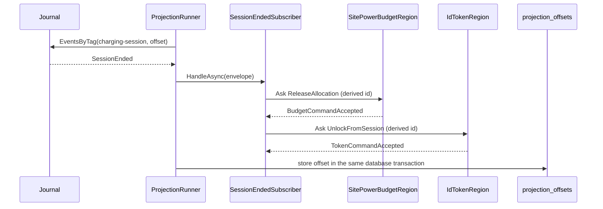
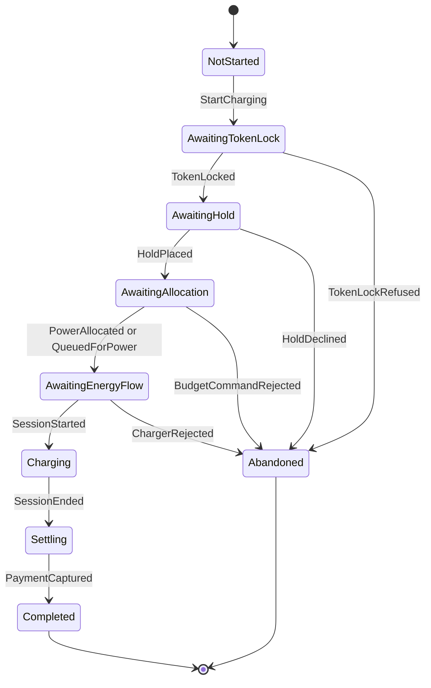
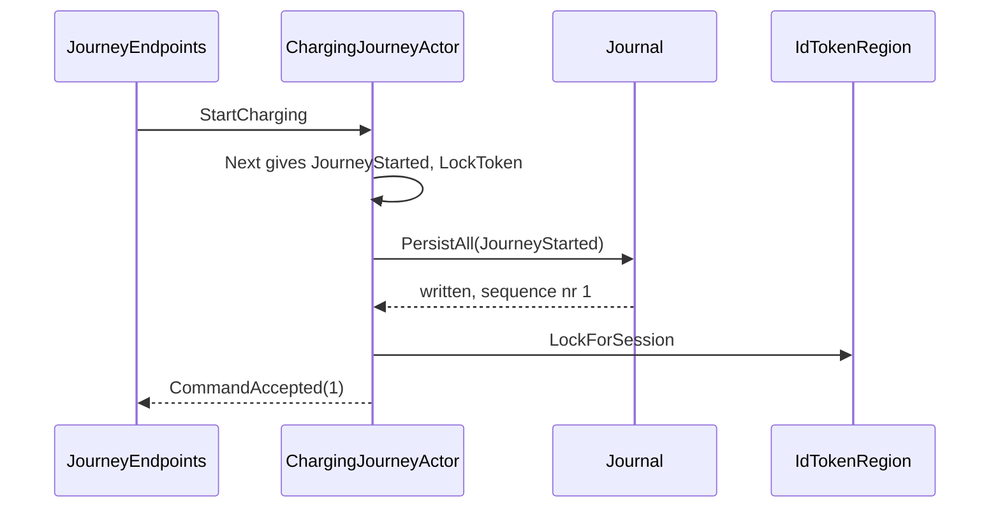
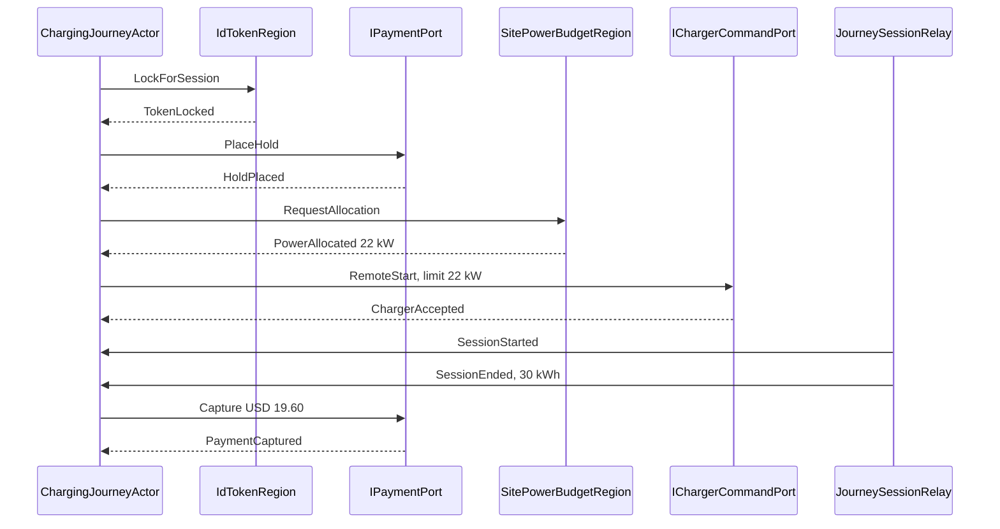

# Chapter 15. Process Managers and Sagas

At 07:52 a driver at `slc-west-garage` taps "Start charging" on connector `OHM-SLC-0107/2`. Three contexts say yes. Driver Accounts locks her card's token for the new session, the payment side holds USD 50.00 on her card, and Site Energy allocates 22 kW to the connector. Then nothing happens: the cable is not seated in the car's inlet, and no energy flows. After five minutes she drives to another garage, where the charger refuses her card because its token is still locked to a session that never began. Back at `slc-west-garage`, 22 kW of the site's budget sits on an idle connector while a delivery van's request waits in the queue, and her bank shows USD 50.00 pending.

Every aggregate kept its own rules. The token refused a second session, as section 12.7 designed it to; the site's allocations fit its capacity, as section 7.8 proved. What failed was the charge as a whole: a sequence of steps across three contexts, with a deadline and a way back, which no aggregate owns and nothing at the end of Chapter 14 coordinates.

This chapter gives that sequence an owner, starting with the cheapest coordination there is, a subscriber that reacts to one event, and ending with the charging journey: a pure state machine in a persistent, sharded actor with timers.

> **In this chapter you will:**
>
> - turn a session's end into other contexts' commands with a subscriber that sends the same command ids however often it runs;
> - write the charging journey as one pure `Next` function over a union of inputs from four projects, with effects as data, tested by plain comparisons;
> - host it in a persistent actor that stores each step before acting, re-arms its timers after recovery and survives a shard rebalance;
> - reach the payment side and the charge points through ports, and play whole contexts in tests with probes and autopilots;
> - make every request safe to repeat with an idempotency key, and compensate in the domain's own events when a deadline passes or a capture keeps failing;
> - test a two-minute timeout without waiting two minutes, with a transition table for the pure machine and virtual time for the actor.

> **Starting point:** `ch14-s07`, the read models, live push and projection tests from Chapter 14.
>
> ```bash
> git checkout ch14-s07
> ```

## 15.1 Saga or process manager? Choreography first

### A session ends, and two other contexts must hear of it

Section 8.5 wrote the lilac sticky "whenever a session ends, release its power allocation and unlock its token" as a pure policy, `ReleaseOnSessionEnded`, which returns Charging's own intents. Nothing runs it yet, so every ended session keeps its connector's power and its driver's token for ever. The two reactions are independent: neither needs the other, neither has a deadline anyone notices within seconds, and neither remembers anything between events. That shape decides how much machinery the coordination deserves.

### Three words for coordination

Garcia-Molina and Salem's [*Sagas*](https://dl.acm.org/doi/10.1145/38713.38742) (SIGMOD 1987, section 1 "Introduction" and section 4 "Backward Recovery") split a long-lived database transaction into short transactions T1 to Tn, each with a compensating transaction that semantically undoes it, so a failure at step k runs Ck-1 down to C1 instead of holding locks for hours. Today "saga" names any long-running process across consistency boundaries that compensates instead of rolling back. Hohpe and Woolf's [*Enterprise Integration Patterns*](https://www.informit.com/store/enterprise-integration-patterns-designing-building-9780321200686) (2003, ch. 7 "Message Routing") describe the [**Process Manager**](https://www.enterpriseintegrationpatterns.com/patterns/messaging/ProcessManager.html), a central unit that keeps a sequence's state and decides its next step; Vernon ([*Reactive Messaging Patterns with the Actor Model*](https://www.informit.com/store/reactive-messaging-patterns-with-the-actor-model-applications-9780133846836), 2015, ch. 7 "Message Routing", section "Process Manager") implements it as an actor. Khononov ([*Learning Domain-Driven Design*](https://www.oreilly.com/library/view/learning-domain-driven-design/9781098100124/ch09.html), 2021, ch. 9 "Communication Patterns", sections "Saga" and "Process Manager") draws the practical line, in effect: a saga maps events to commands along a linear flow, and once the next step branches on accumulated state, you want a process manager. A process manager does the work of Helland's **activity** from Chapter 1, the state through which an entity manages its workflow with its partners ([*Life Beyond Distributed Transactions*](https://www.cidrdb.org/cidr2007/papers/cidr07p15.pdf), section "Entities Manage Per-Partner State (“Activities”)").

Below both sits **choreography**: no coordinator, each context reacting by itself to the facts it cares about. Its opposite, **orchestration**, has one participant tell the others what to do.

| Question | Choreography | Process manager |
|---|---|---|
| Where the flow lives | Spread across subscribers | In one state machine |
| State between events | None | Explicit, persisted |
| Deadlines | Hard to express | Timers it owns |
| Compensation | Each subscriber for itself | Decided in one place |
| "Where is this charge now?" | Reconstructed from logs | One query |

"Whenever a session ends" needs none of the right-hand column, so it gets the smallest thing that works.

### A subscriber is a projection with no table

A subscriber is a projection (section 13.4) whose handler sends commands instead of writing rows. Tag `ch15-s01` adds `SessionEndedSubscriber`, projection id `session-ended-subscriber-v1`, on the `charging-session` tag, as the fifth of `ChargingReadModelsExtensions.Streams`, so one instance runs in the cluster (section 13.6). It uses `RecordAndSkip(MaxRetries: 5)` (section 13.7), because a missed release keeps one connector's power from the others, while a stopped subscriber keeps every connector's. The translation is a pure static function:

```csharp
// File: src/Charging/Ohmline.Charging.ReadModels/Policies/SessionEndedSubscriber.cs @ ch15-s01
public static ImmutableArray<SessionEndedCommand> CommandsFor(SessionEvent @event) =>
[
    .. Policy.React(@event)
        .Select(intent => Translate(intent, @event.CommandId))
        .OfType<SessionEndedCommand>(),
];

/// <summary>
/// Charging's intents in the other contexts' words: the subscriber is where Charging conforms
/// to their contracts, so the policy never has to.
/// </summary>
private static SessionEndedCommand? Translate(ChargingIntent intent, CommandId cause) =>
    intent switch
    {
        ChargingIntent.ReleaseSiteAllocation release => new ReleaseAllocation(
            CommandId.Derive(cause, "release-allocation"),
            release.SiteId,
            release.ConnectorId,
            release.SessionId),
        ChargingIntent.UnlockToken unlock => new UnlockFromSession(
            CommandId.Derive(cause, "unlock-token"), unlock.TokenUid, unlock.SessionId),

        // Not this subscriber's: ReleaseOnSessionEnded never intends them.
        ChargingIntent.StopCharging or ChargingIntent.WarnOfIdleFee => null,
        null => null,
    };
```

The result is a union, `public union SessionEndedCommand(ReleaseAllocation, UnlockFromSession);`, because the two commands come from two projects and share no base type; `SendAsync` switches over it and asks each case's shard region, with a 5 s timeout. The intents this subscriber never receives map to `null` explicitly, so a new kind of intent is a compile error here rather than a silent drop.

### The same command every time

The runner stores the offset after the handler, so delivery is at least once: a crash after the commands went out and before the offset committed sends them again. Fresh command ids would make the repeat a new command to the receiving shell, so the ids are derived from the cause instead, through a new kernel function (kernel version 2.8.0):

```csharp
// File: src/Ohmline.SharedKernel/Identity/CommandId.cs @ ch15-s01
/// <summary>
/// The id of a command that follows from another, such as the release a subscriber sends
/// when a session ends: derived from the cause's id and the command's purpose, so whoever
/// sends it again sends it with the same id, and its receiver deduplicates it (section 15.1).
/// </summary>
public static CommandId Derive(CommandId cause, string purpose) =>
    new(GuidV7.Derive(cause.Value, purpose));
```

`GuidV7.Derive` keeps the origin's timestamp and fills the other bits from a SHA-256 hash of origin and purpose, so the result is still a version 7 Guid that sorts where its cause does. The test `Given_the_same_event_read_twice_then_its_commands_carry_the_same_ids` pins the property. Two layers make the repeat harmless: the receiving shell answers a known command id with its first answer (section 12.6), and the deciders treat a second release or a second unlock as no change.

`SubscriberRunTests` runs the real `ProjectionRunner` with stand-ins under the two regions' keys:



The offset moves only after both answers. If an ask times out, the handler throws, the runner restarts from the stored offset, and both commands go out again with the same ids. After five failed tries the runner records the event in `projection_failures` and moves on.

A flow that must wait for an answer, or undo step two when step three fails, has nowhere in a subscriber to keep what it knows.

> **Try it**
>
> ```bash
> git checkout ch15-s01
> git diff ch14-s07 ch15-s01 --stat
> git diff ch14-s07 ch15-s01 -- src/Charging/Ohmline.Charging.ReadModels/Policies
> dotnet test --solution Ohmline.slnx
> ```
>
> The diff shows `11 files changed, 360 insertions(+), 1 deletion(-)`. The solution reports `total: 1669`, `failed: 0`, among them `Given_the_same_event_read_twice_then_its_commands_carry_the_same_ids` and the integration test `Given_an_ended_session_then_the_others_are_told_and_the_offset_moves_past_it`.

## 15.2 The charging journey as a pure state machine

### A chain with memory

Starting a charge, as section 4.3's start-charging board tells it, is a chain: lock the token, hold money, ask for power, start the charger, wait for the car to draw, wait for the session to end, capture what it cost. Each step waits for another context's answer, which decides the next step, and a failure late in the chain must undo the earlier steps. That is branching over accumulated state, [Khononov's signal](https://www.oreilly.com/library/view/learning-domain-driven-design/9781098100124/ch09.html) for a process manager, and Ohmline's glossary already names it: the **charging journey**.

Before any actor, the journey is a function. Unlike section 7.6's decider, a process manager also asks others to act, so its function returns three things: the new state, the events that record the step, and the **effects**, what to do next, as data.



Sections 15.5 and 15.6 add timer arrows to the waiting states. There is no `Started` state: the journey asks for the lock in the same step that starts it, so a "started, nothing asked yet" state would never hold a journey. `NotStarted` is the initial state instead.

### The best use of a union

The inputs come from everywhere: Charging's own `StartCharging` command, Driver Accounts' `TokenLocked` reply, Site Energy's `PowerAllocated`, the payment port's `HoldPlaced`, the session's `SessionStarted`, the journey's own `JourneyTimerElapsed`. They live in four projects and share no base type, so no closed hierarchy can gather them. A C# 15 union can (section 3.3):

```csharp
// File: src/Charging/Ohmline.Charging.Domain/Journeys/JourneyInput.cs @ ch15-s02
/// <summary>
/// Everything a charging journey reacts to, from wherever it comes: the edge's command, Driver
/// Accounts' and Site Energy's replies in their own published words, the results of the
/// journey's own ports, the events of its session, and its timers. These records share no base
/// type and live in four projects; a union makes them one closed set, so the journey's decision
/// table must say what each does in each state.
/// </summary>
public union JourneyInput(
    StartCharging,
    TokenLocked,
    TokenLockRefused,
    HoldPlaced,
    HoldDeclined,
    HoldVoided,
    PowerAllocated,
    QueuedForPower,
    BudgetCommandRejected,
    ChargerAccepted,
    ChargerRejected,
    SessionStarted,
    SessionEnded,
    PaymentCaptured,
    CaptureFailed,
    JourneyTimerElapsed);
```

This is the use ADR 0003 reserved for unions: a closed set of existing types, decided in one place, never sent or persisted. A new case does not compile until the decision table handles it. `Ohmline.Charging.Domain` now references the Site Energy and Driver Accounts contracts projects, as the architecture allows a downstream context, and still no actor package. Site Energy gained the replies `PowerAllocated` and `QueuedForPower`, named apart from its events `AllocationGranted` and `AllocationQueued` as Driver Accounts' reply `TokenLocked` is from `TokenLockedForSession`.

The states form a second union, `JourneyState`, whose waiting cases hold the journey's `JourneyTerms` (journey, session, token, connector, site, maximum power, hold), what earlier steps produced, and `Since`, when the step began. `Abandoned(JourneyState From, string Reason, string Detail)` keeps the state it was abandoned from, a union inside a record, which is fine because state is never persisted. The effects are a third union, `JourneyEffect`, with one nested record for each thing the shell can do: `LockToken`, `PlaceHold`, `RequestAllocation`, `StartCharger`, `StartTimer`, `CancelTimer`, `ReleaseAllocation`, `VoidHold`, `CapturePayment` and `UnlockToken`.

### Next: decide, evolve, enter

```csharp
// File: src/Charging/Ohmline.Charging.Domain/Journeys/ChargingJourney.cs @ ch15-s02
public static JourneyStep Next(
    JourneyState state, JourneyInput input, DecisionContext context)
{
    ImmutableArray<JourneyEvent> events =
        [.. Decide(state, input).Select(@event => @event with { OccurredAt = context.Now })];
    if (events.IsEmpty)
    {
        return new JourneyStep(state, [], []);
    }

    var next = events.Aggregate(state, Evolve);
    return new JourneyStep(next, events, Enter(next, context.Now));
}
```

`Next` decides the events, stamps them with the time from the `DecisionContext`, folds them into the new state with `Evolve`, and asks the new state what to do: the textbook `Next(state, input) -> (state, effects)`, plus the time in and the events out. The decision table pairs states with inputs:

```csharp
// File: src/Charging/Ohmline.Charging.Domain/Journeys/ChargingJourney.cs @ ch15-s02
private static ImmutableArray<JourneyEvent> Decide(JourneyState state, JourneyInput input) =>
    (state, input) switch
    {
        (NotStarted, StartCharging start) => [Started(start)],

        (AwaitingTokenLock waiting, TokenLocked locked)
            when locked.SessionId == waiting.Terms.SessionId =>
            [new TokenSecured(waiting.Terms.JourneyId, locked.Driver)],
        (AwaitingTokenLock waiting, TokenLockRefused refused)
            when refused.SessionId == waiting.Terms.SessionId =>
            [Abandon(waiting.Terms, AbandonReasons.TokenRefused, refused.Message)],

        // ...
        (null, _) => throw DefaultState(),
        (_, null) => throw new ArgumentException("The input is default: it holds no case."),

        // Anything else changes nothing: a reply that is late, repeated or for another
        // session, a void's confirmation, a timer this step does not use.
        _ => [],
    };
```

Every reply that names a session is matched to the journey's own with a `when` guard; the ports' results need none, because only this journey's calls are piped back to it. The last arm turns everything else into nothing: a reply that is late, repeated or meant for another journey. That arm is half of idempotency, and section 15.6 builds on it. The step events are `TokenSecured`, `HoldSecured`, `PowerSecured`, `EnergyFlowStarted` and `SettlementDue`, in the journey's words, because `TokenLocked` was already Driver Accounts' reply.

The effects come from the state the journey enters, not from the input that moved it:

```csharp
// File: src/Charging/Ohmline.Charging.Domain/Journeys/ChargingJourney.cs @ ch15-s02
private static ImmutableArray<JourneyEffect> Enter(JourneyState state, DateTimeOffset now) =>
    state switch
    {
        NotStarted or Completed => [],
        AwaitingTokenLock waiting =>
            [new JourneyEffect.LockToken(waiting.Terms.TokenUid, waiting.Terms.SessionId)],
        // ...
        AwaitingEnergyFlow waiting =>
        [
            new JourneyEffect.StartCharger(
                waiting.Terms.ConnectorId,
                waiting.Terms.TokenUid,
                waiting.Terms.SessionId,
                waiting.Allocated),
            StartTimer(JourneyTimer.EnergyFlow, waiting.Since + EnergyFlowTimeout, now),
        ],
        Charging => [new JourneyEffect.CancelTimer(JourneyTimer.EnergyFlow)],
        Settling settling =>
            [new JourneyEffect.CapturePayment(settling.HoldId, settling.Amount)],
        Abandoned abandoned => GiveBack(abandoned.From),
        null => throw DefaultState(),
    };
```

Whoever enters `AwaitingHold` asks for a hold. That pays off twice: a recovered journey asks its current state what it was waiting for (section 15.3), and a journey whose answer was lost asks again with the same `Enter` (section 15.6). The energy-flow timer is computed from `Since`, so a late start still elapses two minutes after the step began.

### The start event carries its data

A journey restarted on another node after a shard rebalance has only its journal, so the first event must hold everything it was started with:

```csharp
// File: src/Charging/Ohmline.Charging.Domain/Journeys/JourneyEvent.cs @ ch15-s02
public sealed record JourneyStarted(
    JourneyId JourneyId,
    CommandId CommandId,
    SessionId SessionId,
    TokenUid TokenUid,
    ConnectorId ConnectorId,
    SiteId SiteId,
    Power MaxPower,
    Money Hold)
    : JourneyEvent(JourneyId);
```

Nobody chooses `SessionId`: `ChargingJourney.SessionOf(journeyId)` is the journey's own Guid, so the session the journey starts is named after it and its events can be routed to the journey with no lookup (section 15.4).

Because effects are data, a test is three comparisons: given the history up to a step, when an input arrives, then these events, this state and these effects. The journey is deliberately not an `IDecider`: it refuses nothing, so a decider's error type would have no use. `Given_every_step_then_folding_its_events_gives_the_state_next_returned` checks the law both shapes share: replaying the events gives the state `Next` returned.

> **Try it**
>
> ```bash
> git checkout ch15-s02
> git diff ch15-s01 ch15-s02 --stat
> git diff ch15-s01 ch15-s02 -- src/Charging/Ohmline.Charging.Domain/Journeys
> dotnet test --solution Ohmline.slnx
> ```
>
> The diff shows `23 files changed, 1002 insertions(+), 6 deletions(-)`. The solution reports `total: 1699`, `failed: 0`; 18 of the 30 new tests are in `ChargingJourneyTests`, among them `Given_a_journey_past_a_step_when_its_reply_comes_again_then_nothing_changes`.

## 15.3 The journey actor: persistent, sharded, with timers

### Store first, then act

`Next` reads no clock, sends nothing and stores nothing; a shell must, and the order matters. A shell that sent `LockForSession` and crashed before storing `JourneyStarted` would leave a token locked for a journey its journal never heard of. Stored first, the same crash leaves a journal that says "awaiting token lock", and the recovered journey asks again. So the rule is **persist before acting**. Its price is that an effect may be carried out twice, before a crash and after recovery, which section 15.6 makes harmless.

Tag `ch15-s03` adds `ChargingJourneyActor`, a `ReceivePersistentActor` with `IWithTimers`. It is not a `DeciderActor` (section 10.10), because the journey is not a decider. Its constructor maps each message family to a `JourneyInput` with an exhaustive switch over that family's closed hierarchy, and every input goes through one method:

```csharp
// File: src/Charging/Ohmline.Charging.Actors/Journeys/ChargingJourneyActor.cs @ ch15-s03
private void Hear(JourneyInput? input, IActorRef? replyTo = null)
{
    var step = input is { } heard
        ? ChargingJourney.Next(_state, heard, DecisionContext.From(_clock))
        : new JourneyStep(_state, [], []);
    if (step.Events.IsEmpty)
    {
        Done(step, replyTo);
        return;
    }

    PersistAll(
        step.Events,
        @event => _state = ChargingJourney.Evolve(_state, @event),
        () => Done(step, replyTo));
}

private void Done(JourneyStep step, IActorRef? replyTo)
{
    foreach (var effect in step.Effects)
    {
        CarryOut(effect);
    }

    replyTo?.Tell(new CommandAccepted(LastSequenceNr));
    PassivateIfDone();
}
```

`PersistAll` stashes incoming messages until the write completes (section 10.5), and the edge's `CommandAccepted` carries the journey's sequence number as its version. `CarryOut` is a switch expression over `JourneyEffect` returning `Unit`, so a new kind of effect does not compile until the shell can carry it out. Region commands are told with the journey as sender, so replies come back to it; port calls return tasks, piped back with `PipeTo` and never awaited in the mailbox (section 2.8).



The diagram follows `Given_no_journey_when_charging_starts_then_it_is_stored_and_the_token_asked`. Its twin, `Given_a_journal_that_fails_the_write_then_nobody_is_asked_anything`, scripts the persistence test kit to fail the write (section 11.8): the actor stops, and the token probe hears nothing.

### Recovery re-asks and re-arms

On `RecoveryCompleted` the actor carries out `ChargingJourney.Resume(state, now)`, which is `Enter` again: the effects of the current state, as if newly entered. A journey recovered in `AwaitingHold` places the hold again; one in `AwaitingEnergyFlow` tells the charger to start again and restarts its energy-flow timer from `Since`, so it elapses at the original deadline. This is section 11.4's rule, timers derived from state, applied to a process.

### Remember-entities: on, for journeys only

Section 12.4 left remember-entities off for aggregates, which have nothing to do until someone sends them a command. A journey waiting for its energy-flow timeout must wake up even if no message ever arrives, and after a shard rebalance or the loss of its node nothing would send it one. So its region remembers its entities:

```csharp
// File: src/Charging/Ohmline.Charging.Actors/ChargingAkkaExtensions.cs @ ch15-s03
/// <summary>
/// The journeys' region remembers its entities (section 15.3): a journey that waits for a
/// reply or a timer is started again after a rebalance or the loss of its node, and
/// recovers, rather than wait for a message that is not coming. That switches idle
/// passivation off, so a journey passivates itself once it is over.
/// </summary>
// ...
private static ShardOptions JourneyShardOptions()
{
    var options = EntityShardOptions.Create();
    options.RememberEntities = true;
    options.RememberEntitiesStore = RememberEntitiesStore.DData;
    return options;
}
```

A waiting journey therefore stays in memory. One with nothing left to do passivates itself: in `NotStarted`, `Completed` or `Abandoned` it sends `Passivate(Stop.Instance)` to its shard, and the region forgets it. Memory follows journeys in flight, not the history of every charge.

> **Note:** By default the list lives in distributed data's durable store, files on each node's disk that need a volume per pod. In the journal (`RememberEntitiesStore.Eventsourced`), the sharding coordinator persists an event of its own as the region starts; when the sample tried it, that event took a place in the journal's global ordering, and thirteen existing tests that check orderings failed (`should be [1L, 2L, 3L] but was [1L, 3L, 4L]`). The sample keeps the list in distributed data in memory: it survives a shard rebalance and the loss of a node, but not the loss of every charging node at once.

### The edge names the journey

`POST /journeys` takes a token UID and a connector id, looks up the connector's site and maximum power at the charge point, and sends `StartCharging` with a hold of `ChargingApiOptions.HoldAmount`, USD 50 by default. The journey's id is `new JourneyId(GuidV7.Derive(commandId.Value, "journey"))`, so the same request repeated with the same `Idempotency-Key` names the same journey, which answers without starting again. At this tag nothing stands behind the journey's ports yet, so the node cannot create a journey and `POST /journeys` times out with 504; section 15.4 fixes that.

> **Try it**
>
> ```bash
> git checkout ch15-s03
> git diff ch15-s02 ch15-s03 --stat
> git diff ch15-s02 ch15-s03 -- src/Charging/Ohmline.Charging.Actors/Journeys
> dotnet test --solution Ohmline.slnx
> ```
>
> The diff shows `52 files changed, 1428 insertions(+), 12 deletions(-)`, 19 of them golden JSON files for the journey's new manifests. The solution reports `total: 1830`, `failed: 0`, among them `Given_a_journal_that_fails_the_write_then_nobody_is_asked_anything` and `Given_a_journey_waiting_for_its_hold_when_it_recovers_then_it_asks_again`.

## 15.4 Ports to other contexts

### Two partners that are not shard regions

Driver Accounts and Site Energy are shard regions in the same cluster. Payments belong to Billing, a separate service without actors (ADR 0005), and charge points sit behind the Device Gateway; both arrive in Chapter 16. The journey reaches them through Cockburn's [**ports and adapters**](https://alistair.cockburn.us/hexagonal-architecture/) ("The Hexagonal (Ports & Adapters) Architecture", 2005): it defines the interface it needs, in its own words, and an adapter outside the domain translates, which is where Chapter 16's Anticorruption Layers will sit.

```csharp
// File: src/Charging/Ohmline.Charging.Actors/Journeys/Ports/IPaymentPort.cs @ ch15-s04
public interface IPaymentPort
{
    /// <summary>Hold this much on the card of the driver's account.</summary>
    Task<PaymentPortResult> PlaceHoldAsync(
        DriverRef driver, Money amount, CancellationToken cancellationToken);

    /// <summary>Take this much from the hold.</summary>
    Task<PaymentPortResult> CaptureAsync(
        string holdId, Money amount, CancellationToken cancellationToken);

    /// <summary>Release the hold, taking nothing.</summary>
    Task<PaymentPortResult> VoidAsync(string holdId, CancellationToken cancellationToken);
}
```

The answers are `PaymentPortResult` cases, closed records because they are piped back to the actor as messages. `IChargerCommandPort` has the same shape, with `RemoteStartAsync`, `RemoteStopAsync` and `SetChargingProfileAsync` answering `ChargerAccepted` or `ChargerRejected`.

The region has the container make each journey, so the container decides what stands behind each port. Tag `ch15-s04` registers `AddDevelopmentJourneyPorts()` in `Program.cs` only when the environment is Development: `InMemoryPaymentPort` keeps holds in a dictionary and captures at most what is held, and `LoggingChargerCommandPort` agrees to everything and logs it. Outside Development nothing stands behind the ports until sections 16.5 and 16.7 put Billing and the gateway there.

### The inbound side: the session's events

The journey also needs `SessionStarted` and `SessionEnded`, and the session knows nothing of journeys. Tag `ch15-s04` adds a second subscriber, `JourneySessionRelay`, with the durable projection id `journey-session-relay-v1` (ADR 0009):

```csharp
// File: src/Charging/Ohmline.Charging.ReadModels/Journeys/JourneySessionRelay.cs @ ch15-s04
public async Task<ImmutableArray<LiveUpdate>> HandleAsync(
    EventEnvelope envelope, NpgsqlTransaction transaction, CancellationToken cancellationToken)
{
    if (envelope.Event is SessionStarted or SessionEnded)
    {
        var running = system ?? throw new InvalidOperationException(
            $"{nameof(JourneySessionRelay)} tells journeys only when it runs in a node.");
        var journeys = await ActorRegistry.For(running)
            .GetAsync<ChargingJourneyRegion>(cancellationToken);
        await journeys.Ask<CommandReply>(envelope.Event, AskTimeout, cancellationToken);
    }

    return [];
}
```

The journey region's extractor routes a `SessionEvent` by its session id, which is the journey's id, so the event finds its journey with no lookup. The journey answers once it has stored the step, and only then does the offset move: at least once, and a repeat finds no row in the decision table.

On a normal end the journey captures but neither releases the allocation nor unlocks the token: the subscriber of section 15.1 already does both on `SessionEnded`. Choreography and orchestration sit side by side, and the journey compensates only when it abandons.

### Fake contexts from test probes

A test of the journey's conversations needs four partners that answer like the real ones. A `TestProbe` with an **autopilot** is one: the probe runs a function from each message to a reply and keeps every message for the test. The ports become thin classes that `Ask` a probe (`ProbePaymentPort`):

```csharp
// File: tests/Ohmline.Charging.Actors.Tests/Journeys/FakeContextTests.cs @ ch15-s04
private FakeContexts Contexts(Func<PortCall, PaymentPortResult> payments)
{
    var contexts = new FakeContexts(
        CreateTestProbe("driver-accounts"),
        CreateTestProbe("site-energy"),
        CreateTestProbe("payments"),
        CreateTestProbe("charge-points"));
    AnswerWith(contexts.Tokens, message => message switch
    {
        LockForSession lockFor =>
            new TokenLocked(lockFor.TokenUid, lockFor.SessionId, Driver, Version: 2),
        _ => new TokenCommandAccepted(Version: 3),
    });
// ...
/// <summary>The probe answers every message it gets, and keeps it for the test.</summary>
private static void AnswerWith(TestProbe probe, Func<object, object> answer) =>
    probe.SetAutoPilot(new DelegateAutoPilot((sender, message) =>
    {
        sender.Tell(answer(message));
        return AutoPilot.KeepRunning;
    }));
```

`Given_contexts_that_say_yes_then_a_journey_runs_to_a_settled_payment` drives the whole happy path through these fakes, the test playing the relay, and reads seven events back from the journal:



In the node the relay tells the session's events; the integration test `Given_a_charger_a_site_and_a_token_then_a_journey_runs_to_a_settled_payment` runs the same flow over HTTP to `"step":"completed"` at version 7. USD 19.60 is 30 kWh at the sample tariff's highest energy rate, USD 0.62, plus a USD 1.00 session fee: the journey captures `SessionTerms.CostOf`, the spend cap's estimate, since `Charging.Domain` cannot reach the price calculator. Chapter 16's receipts reuse the rule.

> **Try it**
>
> ```bash
> git checkout ch15-s04
> git diff ch15-s03 ch15-s04 --stat
> git diff ch15-s03 ch15-s04 -- src/Charging/Ohmline.Charging.Actors/Journeys/Ports
> dotnet test --solution Ohmline.slnx
> ```
>
> The diff shows `14 files changed, 742 insertions(+), 12 deletions(-)`. The solution reports `total: 1838`, `failed: 0`, among them `Given_contexts_that_say_yes_then_a_journey_runs_to_a_settled_payment` and `Given_a_card_that_is_declined_then_the_token_is_unlocked_and_it_gives_up`.

## 15.5 Timeouts and compensation

### When the answer is silence

The driver in the opening was failed by an event that never happened. A refusal arrives as a message; silence needs a deadline. The journey already starts an energy-flow timer when it tells the charger to start, so tag `ch15-s05` gives that timer a row, and a failing capture one too.

### Compensation is a new fact, not an undo

Garcia-Molina and Salem's compensating transaction does not erase the step it compensates ([*Sagas*](https://dl.acm.org/doi/10.1145/38713.38742), section 1: it "undoes, from a semantic point of view," what its step did, without returning the database to the state before it); it is a new step with the opposite business effect, so a voided hold leaves a hold and a void on the driver's statement. Helland and Campbell's [*Building on Quicksand*](https://www.cidrdb.org/cidr2009/Paper_133.pdf) (CIDR 2009) calls such corrections apologies (section 5.7, "Memories, Guesses, and Apologies"). For an event-sourced process, compensations are domain events, decided by the same table as everything else.

### The new rows

```csharp
// File: src/Charging/Ohmline.Charging.Domain/Journeys/ChargingJourney.cs @ ch15-s05
(AwaitingEnergyFlow waiting, JourneyTimerElapsed { Timer: JourneyTimer.EnergyFlow }) =>
[
    Abandon(
        waiting.Terms,
        AbandonReasons.EnergyFlowTimedOut,
        $"No energy flowed within {EnergyFlowTimeout.TotalMinutes:0} minutes."),
],
// ...
(Settling settling, CaptureFailed failed)
    when settling.FailedCaptures + 1 < MaxCaptureAttempts =>
[
    new CaptureAttemptFailed(
        settling.Terms.JourneyId,
        settling.FailedCaptures + 1,
        failed.Code,
        failed.Message),
],
(Settling settling, CaptureFailed failed) =>
[
    new DebtRecorded(
        settling.Terms.JourneyId,
        settling.Amount,
        $"Capture failed {MaxCaptureAttempts} times; last: {failed.Message}"),
],
```

The energy-flow row records `JourneyAbandoned` with the reason `energy-flow-timed-out`, and the state `Abandoned` gives back what the journey obtained: entering it from `AwaitingEnergyFlow` cancels the timer, releases the allocation, voids the hold and unlocks the token, the last obtained first. The abandonment is stored before any of that is sent, so a journey that crashes halfway through compensating recovers into `Abandoned` and gives everything back again. The same timer arriving later, once the session has started, finds no row (`Given_a_charging_session_when_a_stale_energy_timer_elapses_then_nothing_changes`).

A failed capture is not a reason to abandon: the energy has been delivered. The journey records `CaptureAttemptFailed` with the attempt number, and `Enter` for a `Settling` state with failures starts a `CaptureRetry` timer for `CaptureBackoff(n)`, 30 s doubled after each failure (30, 60, 120 s). The retry timer changes no state, so it is handled by a new function, `Again`, which returns the effects of an input that records nothing; here, the capture once more. The fourth failure records `DebtRecorded`, whose comment says why it is an event: "The compensation for a payment that cannot be taken is a fact, recorded like any other." The journey completes with nothing captured and the amount owed, and the actor logs it at Warning.

### Consequences

The deadline and the retry policy are the business's numbers in one file: two minutes for energy to flow, four attempts at a capture. Two simplifications are worth knowing. The journey records the whole amount as owed, while domain story 03 in `docs/domain-stories` has the billing specialist capture what the hold allows and record only the rest; and a recorded debt leaves the hold neither captured nor voided. Exercise 3 picks up the first. A capture retry pending during recovery also restarts its full pause rather than the time left, which only delays the next attempt.

The actor test of a failed capture runs on the real scheduler, so it sees only the first attempt; section 15.7 moves time instead of waiting for it.

> **Try it**
>
> ```bash
> git checkout ch15-s05
> git diff ch15-s04 ch15-s05 --stat
> git diff ch15-s04 ch15-s05 -- src/Charging/Ohmline.Charging.Domain/Journeys
> dotnet test --solution Ohmline.slnx
> ```
>
> The diff shows `13 files changed, 287 insertions(+), 10 deletions(-)`. The solution reports `total: 1859`, `failed: 0`, among them `Given_three_failed_captures_when_the_fourth_fails_then_the_amount_is_owed`.

## 15.6 Delivery guarantees and idempotency keys

### A message that never arrives

The journey tells Driver Accounts `LockForSession` and waits. If the token's node fails while the message is on its way, or its shard is handed off, or the entity stops with the message in its stash after a failed write (section 11.6), the message is gone. Akka.NET delivers a `Tell` **at most once** (["Message Delivery Reliability"](https://getakka.net/articles/concepts/message-delivery-reliability.html), "The General Rules"), and nothing reports the loss; at `ch15-s05` the journey would wait for ever. A capture is worse: when the port's call times out, nobody knows whether money moved.

No transport delivers exactly once across failures. "Done once, as far as anyone can tell" is at-least-once delivery to an **idempotent receiver**, [Hohpe and Woolf's name](https://www.enterpriseintegrationpatterns.com/patterns/messaging/IdempotentReceiver.html) (*Enterprise Integration Patterns*, ch. 10 "Messaging Endpoints") for a receiver that can safely get the same message twice; Helland's [*Idempotence Is Not a Medical Condition*](https://queue.acm.org/detail.cfm?id=2187821) (*ACM Queue* 10(4), 2012) stresses that the receiver must be designed for it. A repeat must look like the original, so tag `ch15-s06` gives every request an **idempotency key** derived from the journey and the step:

```csharp
// File: src/Charging/Ohmline.Charging.Domain/Journeys/IdempotencyKey.cs @ ch15-s06
public readonly record struct IdempotencyKey
{
    public const string Lock = "lock";
    public const string Hold = "hold";
    public const string Allocation = "allocation";
    public const string Charger = "charger";
    public const string Release = "release";
    public const string Capture = "capture";
    public const string Unlock = "unlock";

    private IdempotencyKey(JourneyId journeyId, string step) =>
        (JourneyId, Step) = (journeyId, step);

    public JourneyId JourneyId { get; }

    public string Step { get; }

    /// <summary>The key as the payment side and the charge points see it.</summary>
    public string Value => $"{JourneyId}-{Step}";

    /// <summary>
    /// The key as Driver Accounts and Site Energy see it: the id of the command, the same every
    /// time, so their shells answer a command sent again with the first answer (section 12.6).
    /// </summary>
    public CommandId CommandId => new(GuidV7.Derive(JourneyId.Value, Step));

    public static IdempotencyKey Of(JourneyId journeyId, string step) => new(journeyId, step);
```

Every request effect now carries a `Key`. The payment side and the charge points receive it as text, the form TallyPay's `X-Idempotency-Key` header takes in section 16.4; Driver Accounts and Site Energy receive it as the command's id, which their shells recognize (section 12.6). Timers need no key, because restarting a `JourneyTimer` replaces the running one. ADR 0009 makes the key format durable.

### Asking again, and giving back what was asked for

A step that waits for an answer also starts a `Reply` timer of 10 s. When it elapses, `Again` returns `Enter(state, now)`: the same request under the same key, and a fresh reply timer. After a minute without an answer (`StepTimeout`), the table abandons with the reason `no-reply`. Compensation changes to match:

```csharp
// File: src/Charging/Ohmline.Charging.Domain/Journeys/ChargingJourney.cs @ ch15-s06
/// <summary>
/// The compensations: everything the journey asked for up to the step it was abandoned in,
/// given back, the last first. What it asked for, not what it was told it got: an answer
/// may have been lost, and giving back what was never given changes nothing, because every
/// receiver ignores what does not apply (section 15.6).
/// </summary>
private static ImmutableArray<JourneyEffect> GiveBack(JourneyState from) => from switch
{
    AwaitingTokenLock { Terms: var terms } => [Unlock(terms)],
    AwaitingHold { Terms: var terms } => [Void(terms), Unlock(terms)],
    AwaitingAllocation { Terms: var terms } => [Release(terms), Void(terms), Unlock(terms)],
    AwaitingEnergyFlow { Terms: var terms } =>
    [
        new JourneyEffect.CancelTimer(JourneyTimer.EnergyFlow),
        Release(terms),
        Void(terms),
        Unlock(terms),
    ],

    // A step a journey is never abandoned in.
    NotStarted or Charging or Settling or Completed or Abandoned => [],
    null => throw DefaultState(),
};
```

At `ch15-s05` the journey gave back what it had been told it got. With lost answers, a hold may exist although `HoldPlaced` never arrived, so a journey abandoned while waiting for a hold now voids it anyway, naming the hold by the key it was placed under. Giving back what was never given is safe because every receiver ignores what does not apply: an unlock for another session, a release of an allocation the site lacks, a void with no hold under the key.

A capture whose call fails is piped back as `CaptureFailed` with the code `port-failed` ("Captured or not, nobody knows; the capture's key makes asking again safe"), so section 15.5's retry asks again under the same key, and a capture that did happen is answered, not repeated.

> **Warning:** An idempotent receiver must remember outcomes, not transient failures. `InMemoryPaymentPort.CaptureAsync` stores whatever its first call answered, `CaptureFailed` included. Its failures are permanent (`unknown-hold`, `exceeds-hold`), so that is harmless here. An adapter that remembered "provider unavailable" under `{journeyId}-capture` would answer every retry with the same failure, and the fourth would record a debt for a payment that could have succeeded. The adapters of sections 16.4 and 16.5 must remember only captures that happened or were refused for good.

### Why not Akka.Delivery

Akka.NET's [reliable delivery](https://getakka.net/articles/actors/reliable-delivery.html) has a producer controller resend each message until a consumer controller confirms it, with [sharded](https://getakka.net/articles/clustering/cluster-sharding-delivery.html) and event-sourced variants. ADR 0011 records why the journey does not use it: a consumer controller would sit in front of every `SitePowerBudgetActor`, every other sender of budget commands would go through it or around it, and each journey would keep a second durable queue of requests its own events already describe. The journey already knows which answer it waits for and decides in domain terms when to stop asking.

> **Version note:** `ShardingProducerController`, `ShardingConsumerController` and `EventSourcedProducerQueue` are in the Akka.NET 1.5.73 assemblies; the sample never ran them.

> **Try it**
>
> ```bash
> git checkout ch15-s06
> git diff ch15-s05 ch15-s06 --stat
> git diff ch15-s05 ch15-s06 -- src/Charging/Ohmline.Charging.Domain/Journeys docs/adr
> dotnet test --solution Ohmline.slnx
> ```
>
> The diff shows `22 files changed, 586 insertions(+), 129 deletions(-)`. The solution reports `total: 1871`, `failed: 0`, among them `Given_a_step_without_an_answer_for_a_minute_then_it_gives_back_what_it_asked_for` and `Given_a_released_allocation_when_it_is_released_again_then_nothing_changes`.

## 15.7 Testing time-driven processes

### Time is an input

The journey's deadlines run from ten seconds to two minutes. Tests that waited for them would be slow, and tests that shortened them would test different numbers. The machine needs neither: a timer reaches `Next` as `JourneyTimerElapsed`, an input like any other, decided at a time that is a value in the `DecisionContext`. Tag `ch15-s07` turns the machine into one readable table:

```csharp
// File: tests/Ohmline.Charging.Domain.Tests/Journeys/JourneyTransitionTableTests.cs @ ch15-s07
public static readonly TheoryData<string, string, string, string> Transitions = new()
{
    // In this step, when this happens, then this step, doing this.
    { "not started", "start charging", "awaiting token lock", "lock token; start reply timer" },
    { "not started", "session started", "not started", "nothing" },
    { "awaiting token lock", "token locked", "awaiting hold", "place hold; start reply timer" },
    { "awaiting token lock", "token lock refused", "abandoned", "unlock token" },
    {
        "awaiting token lock", "reply timer", "awaiting token lock",
        "lock token; start reply timer"
    },
    { "awaiting token lock", "start charging", "awaiting token lock", "nothing" },
// ...
[Theory]
[MemberData(nameof(Transitions))]
public void In_a_step_when_something_happens_then_the_journey_moves_and_acts(
    string step, string happens, string then, string doing)
{
    var (state, at) = Step(step);

    var next = ChargingJourney.Next(state, Input(happens), new DecisionContext(at));

    (Name(next.State), Describe(next.Effects)).ShouldBe((then, doing));
}
```

Twenty-eight rows read "in this step, when this happens, then this step, doing this", in words a product owner can check against the start-charging board. Every row is decided ten seconds into its step, when a reply timer first elapses and no step has waited a minute yet. `Given_the_table_then_every_step_and_every_kind_of_input_is_in_it` reads the case types of both unions from their one-parameter constructors and fails if a state or a kind of input has no row.

### Virtual time for the actor

The shell's timers run on Akka's scheduler, which the TestKit's `TestScheduler` replaces (`akka.scheduler.implementation = "Akka.TestKit.TestScheduler, Akka.TestKit"`, in `ActorTestConfig.VirtualTime`, the setting of the TestKit's own [`TestScheduler.conf`](https://github.com/akkadotnet/akka.net/blob/dev/src/core/Akka.TestKit/Configs/TestScheduler.conf)): nothing scheduled happens until the test advances it. The journey's decisions read a `FakeTimeProvider`, and the test moves both together:

```csharp
// File: tests/Ohmline.Charging.Actors.Tests/Journeys/ChargingJourneyActorTests.cs @ ch15-s07
[Fact]
public async Task Given_a_lock_without_an_answer_when_ten_seconds_pass_then_it_asks_again()
{
    var (tokens, scenario) = JourneyWith(new StubPaymentPort()); // Driver Accounts is silent.
    var journey = await scenario.StartAsync();
    journey.Tell(Start(), TestActor);
    await ExpectMsgAsync(new CommandAccepted(1), cancellationToken: Ct);
    var first = await tokens.ExpectMsgAsync<LockForSession>(cancellationToken: Ct);
    await journey.Ask<ActorIdentity>(new Identify(1), PortCall.Timeout, Ct); // The barrier.

    Advance(ChargingJourney.ReplyTimeout);

    (await tokens.ExpectMsgAsync<LockForSession>(cancellationToken: Ct)).ShouldBe(first);
    first.CommandId.ShouldBe(IdempotencyKey.Of(Journey, IdempotencyKey.Lock).CommandId);
}
// ...
/// <summary>Moves the decisions' clock and the actor's timers on together.</summary>
private void Advance(TimeSpan by)
{
    _clock.Advance(by);
    Scheduler.Advance(by);
}
```

The `Identify` question is the **barrier**. The journey sends `LockForSession` before it starts its reply timer, so the probe can hold the request while the timer does not yet exist. Once the actor has answered a question sent after `StartCharging`, it has finished that step, timer included. Advancing earlier would move time past an unscheduled timer, and the test would pass or fail with the machine's speed.

Another test stops a journey after one virtual minute and recovers it in a new incarnation, which still waits 59 s later and abandons a second after that: `Resume` re-armed the timer for the time left.

Three rules keep these tests honest: move the fake clock and the scheduler together, or decisions and timers disagree about the time; never move time while an `Ask` is pending, because its timeout runs on the same scheduler; and never use the `TestScheduler` with clustering, because it drives gossip and failure detection too.

> **Try it**
>
> ```bash
> git checkout ch15-s07
> git diff ch15-s06 ch15-s07 --stat
> git diff ch15-s06 ch15-s07 -- tests/Ohmline.Charging.Actors.Tests/Journeys
> dotnet test --solution Ohmline.slnx
> ```
>
> The diff shows `7 files changed, 468 insertions(+), 81 deletions(-)`. The solution reports `total: 1905`, `failed: 0`, among them the 28 rows of `In_a_step_when_something_happens_then_the_journey_moves_and_acts` and `Given_a_journey_waiting_for_energy_when_it_restarts_then_its_timer_runs_on`.

## 15.8 Hot and huge aggregates

### Measuring the depot

Every journey at a site sends its `RequestAllocation` through one site budget's mailbox, and sections 7.1 and 7.8 flagged `slc-depot` as Ohmline's hot aggregate. Each request, release and curtailment runs the fair-share allocator over every open request, and `AllocationsRebalanced` carries the whole allocation table. If 300 buses plug in at shift change, the k-th request sees k open requests, so the 300 decisions examine 1 + 2 + ... + 300 = 45,150 requests between them and persist up to as many allocation entries, one per admitted request. A curtailment from Northgate Grid in the middle of it is one more command that recomputes all 300 allocations at once, queued behind the requests.

`Given_three_hundred_buses_at_shift_change_then_the_invariant_holds_for_every_one` proves the numbers fit the capacity; it says nothing about time, and the sample has no benchmark. Before changing the design, measure during a replayed shift change with a curtailment: how long a command waits behind the budget's writes (section 17.6's `stash` spans), how long `Decide` takes at 300 open requests, the size and write latency of `AllocationsRebalanced`, and recovery time with and without a snapshot (section 11.2). If the journey's 10 s reply timer starts firing at the depot, the measurement is overdue.

### Three ways out

**Split by the physics.** A depot's grid connection usually feeds several transformers or feeders, each with its own rating. If each feeder's limit is a true invariant, each feeder can be its own budget aggregate, keyed `slc-depot/feeder-2`. The site's total then needs a static partition (feeder limits adding up to at most the grid limit, wasting an idle feeder's headroom) or a site budget that lends capacity to feeders through a process manager like this chapter's, which makes the site total eventually consistent. Only the domain experts can say whether that is acceptable.

**Scope by time.** Some aggregates are not hot but huge, like a fleet operator's account that accumulates every session for years. If the rule protected is "a monthly statement balances", the aggregate is the month, `fleet-statement-{fleet}-{2026-11}`, closed when the month ends and small for ever after. The canvas's Size questions (section 7.1) reveal this first; snapshots (section 11.2) are the alternative when a rule really spans all of time.

**Relax the rule and correct it.** [Vernon's first rule](https://www.dddcommunity.org/wp-content/uploads/files/pdf_articles/Vernon_2011_1.pdf) ("Model True Invariants In Consistency Boundaries", Part I of "Effective Aggregate Design"; section 7.1) asks whether an invariant is true. "Fleet before public" is a business preference: a public car served at its full share for a few seconds before the next allocation rebalance corrects it harms nobody, and a corrective policy can do that work outside the boundary. "The sum of allocations never exceeds the effective capacity" is a legal and physical limit, and it stays inside one consistency boundary however hot that boundary gets.

A hot aggregate is a measurement first and a redesign second, and every redesign starts by asking which of its rules are true invariants.

## Summary

- Choreography suffices when reactions to an event are independent, keep no memory and have no deadline; a subscriber is then a projection with no table whose commands carry ids derived from their cause, so a redelivery is the same command.
- A process manager is the stateful alternative: one place that knows where a multi-context flow stands, decides the next step, owns the deadlines and decides the compensation.
- Written as a pure `Next(state, input, context)` over a union of inputs from several contexts, the journey returns its state, the events to persist and its effects as data, so its whole behaviour is tested with comparisons and read as a transition table.
- The shell persists each step before carrying out its effects; recovery carries out the current state's effects again and re-arms its timers for the time left, so a crash at any point leads to repetition, never to loss.
- Remember-entities suits a process that must wake without a message, not aggregates that wait for commands; the journey passivates itself when done.
- Delivery between actors is at most once; retries under keys derived from the journey and the step, to receivers idempotent by state, command id and key, make it effectively once.
- Compensations, retries and debts are domain events decided by the same table as the happy path, and compensation gives back everything that was asked for.
- A hot aggregate is measured before it is split, and only an invariant the business can relax is relaxed.

## DDD canon covered

Process Manager vs Saga; Process manager actor with timers; Idempotency and delivery semantics; Eventual consistency and UX; Remember-entities; Passivation; Layered / Hexagonal / Clean; Projections via Persistence Query; Domain Events; Aggregates and Vernon's 4 rules; Making implicit concepts explicit (constraints, processes, policies/strategy); Functional core / actor shell.

## Exercises

1. **Reflect.** On a normal end, the subscriber of section 15.1 releases the allocation and unlocks the token, and the journey only captures. Decide whether the journey should do both on entering `Settling` instead. Weigh one place to read the whole flow against two senders of the same release, and sessions started without a journey (Development's `POST /sessions`).
2. **Reflect.** A journey abandoned with `no-reply` sends `ReleaseAllocation`. If its earlier `RequestAllocation` was delayed rather than lost and arrives after the release, the site grants power nobody will release. Decide what, if anything, should guard against this. Weigh the ordering Akka.NET gives messages between two actors (and whether a shard region in between keeps it), an expiry on allocations whose session never starts, and a reconciliation report.
3. **Extend.** Starting from `ch15-s07`, implement domain story 03: when a capture fails with `exceeds-hold`, capture the hold's amount (`Terms.Hold`) and record only the remainder as `DebtRecorded`. Start in the `(Settling, CaptureFailed)` arms of `ChargingJourney.Decide`; it works when a new test in `TimeoutAndCompensationTests` sees a capture of the hold followed, after `PaymentCaptured`, by a debt of the difference, and the transition table still covers every state and input.
4. **Extend.** Starting from `ch15-s07`, make a recovered `Settling` journey wait only the time left of its capture pause, as the energy-flow timer does. Record when the last attempt failed and compute the delay in `Enter`; it works when a new virtual-time test in `ChargingJourneyActorTests` fails a capture, advances 20 s, restarts the journey, advances 10 s and sees the second capture.
5. **Break it.** At `ch15-s03`, change `ChargingJourneyActor.Hear` to carry out `step.Effects` before calling `PersistAll`. Run `Given_a_journal_that_fails_the_write_then_nobody_is_asked_anything`. Expect it to fail: the token probe receives a `LockForSession` for a journey whose start the journal refused, the stranded token of section 15.3.
6. **Break it.** At `ch15-s01`, replace `CommandId.Derive(cause, "release-allocation")` in `SessionEndedSubscriber.Translate` with `new CommandId(Guid.CreateVersion7())`. Run `SessionEndedSubscriberTests`. Expect `Given_the_same_event_read_twice_then_its_commands_carry_the_same_ids` and `Whenever_a_session_ends_then_site_energy_releases_and_driver_accounts_unlocks` to fail: every redelivery would be a new command to Site Energy's shell.

## Further reading

- Hector Garcia-Molina and Kenneth Salem, [*Sagas*](https://dl.acm.org/doi/10.1145/38713.38742) (Proceedings of ACM SIGMOD 1987). The original: a long-lived database transaction as steps with compensating transactions.
- Gregor Hohpe and Bobby Woolf, [*Process Manager*](https://www.enterpriseintegrationpatterns.com/patterns/messaging/ProcessManager.html), from [*Enterprise Integration Patterns*](https://www.informit.com/store/enterprise-integration-patterns-designing-building-9780321200686) (2003), ch. 7 "Message Routing". The central unit that keeps a sequence's state and decides its next step.
- Vaughn Vernon, [*Reactive Messaging Patterns with the Actor Model*](https://www.informit.com/store/reactive-messaging-patterns-with-the-actor-model-applications-9780133846836) (2015). Process Manager (ch. 7 "Message Routing"), Idempotent Receiver (ch. 9 "Message Endpoints") and Guaranteed Delivery (ch. 5 "Messaging Channels") implemented with actors.
- Vlad Khononov, [*Learning Domain-Driven Design*](https://www.oreilly.com/library/view/learning-domain-driven-design/9781098100124/) (2021). [Chapter 9, "Communication Patterns"](https://www.oreilly.com/library/view/learning-domain-driven-design/9781098100124/ch09.html), on sagas, process managers and the outbox.
- Pat Helland, [*Idempotence Is Not a Medical Condition*](https://queue.acm.org/detail.cfm?id=2187821) (*ACM Queue* 10(4), 2012). Why retries are inevitable and receivers must be designed for them.
- Akka.NET, [*Reliable Akka.NET Message Delivery with Akka.Delivery*](https://getakka.net/articles/actors/reliable-delivery.html) and [*Reliable Delivery over Akka.Cluster.Sharding*](https://getakka.net/articles/clustering/cluster-sharding-delivery.html) (2026). Producer and consumer controllers, the alternative ADR 0011 declined.
- Akka.NET, [*Testing Actor Systems*](https://github.com/akkadotnet/akka.net/blob/dev/docs/articles/actors/testing-actor-systems.md) (2026). Test probes ("Using Multiple Probe Actors"), autopilots ("Auto-Pilot") and, through its "Configuration" section, the [`TestScheduler` reference configuration](https://github.com/akkadotnet/akka.net/blob/dev/src/core/Akka.TestKit/Configs/TestScheduler.conf).
