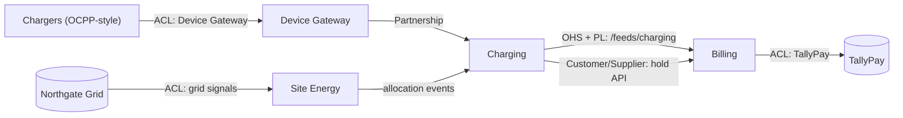
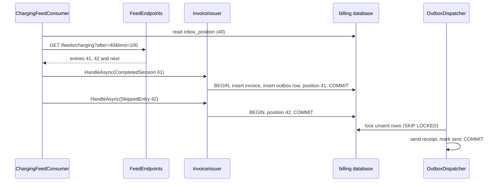
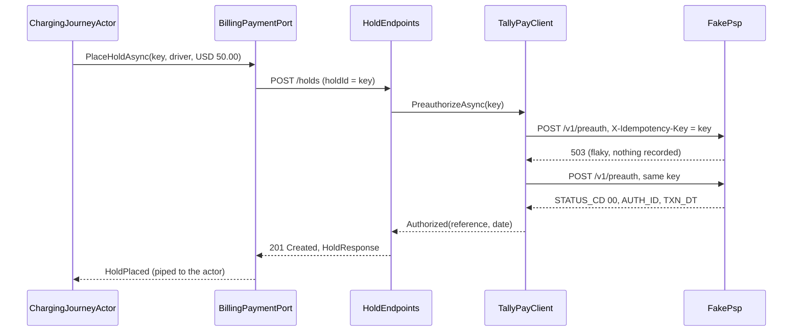
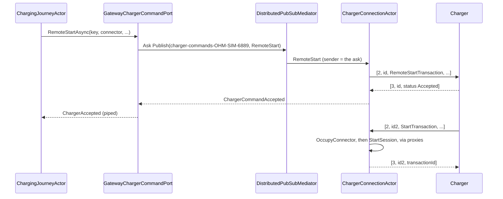

# Chapter 16. Integrating Bounded Contexts: Anticorruption Layers, Open Host and the Outbox

At 21:14 a Chargewell CW-11 at the bus depot sends its first meter reading of the evening: `"1210.5"`, in `kWh`, with no OCPP transaction id and a timestamp with no offset. Every other charger there reports watt-hours, and a gateway that assumed them would see the register fall from 1,200,000 Wh to 1,210 Wh and record a `MeterAnomalyDetected` (section 7.7) instead of 10.5 kWh. Two minutes later Northgate Grid announces that the depot must draw 60 kW less until 23:00, in a document full of `eventID`, `modificationNumber` and `PT2H`. At 23:40 TallyPay answers a capture with `{"STATUS_CD":"00","TXN_DT":"20261104"}`. And Billing, which must turn the session into an invoice and a receipt, has heard none of it: it runs in another process, against another database, and nothing tells it anything.

Each of these is a different conversation. The charger speaks a standard bent by its vendor; TallyPay and Northgate speak APIs Ohmline cannot change; Billing is Ohmline's own, but a separate bounded context with its own model. If any of these languages leaks into Charging, a word like "transaction" starts to mean three things, and Chapter 5's boundaries stop meaning anything.

This chapter builds each of these relationships in code: a Published Language and an Open Host Service on Charging's side, a deliberately plain Billing, and three Anticorruption Layers in front of what Ohmline does not control.

> **In this chapter you will:**
>
> - publish facts to other contexts through a versioned Published Language written by a projection, so the journal is the only write and a crash neither loses nor invents an event;
> - serve that language as a pull feed with positions, ETags and cacheable pages, and consume it in a service without actors that bills each session once however often it reads it;
> - put a payment provider, a charger protocol and a grid operator behind Anticorruption Layers whose translators are pure functions tested as tables;
> - connect chargers over WebSockets through one actor per connection, reach Charging's shard regions through proxies, and send commands back through a topic per charge point;
> - run the whole system from a simulated charger to a receipt in one Aspire test, and pin the Published Language with golden files and a consumer test.

> **Starting point:** `ch15-s07`, the charging journey with ports behind in-memory fakes, from Chapter 15.
>
> ```bash
> git checkout ch15-s07
> ```

## 16.1 Domain events versus integration events: the journal is the outbox

### The conversations on the map

Chapter 5 drew Ohmline's context map and named a pattern for every line on it. This chapter builds the lines below:



Read each arrow as "talks to, in this pattern". Billing, Site Energy and the gateway each translate an outsider's language at their edge, so nothing inside them sees a `STATUS_CD`, a `venID` or an OCPP `transactionId`.

### Two kinds of event

Billing must invoice every finished session, and the quickest integration lets it subscribe to Charging's `SessionEnded`. That would make `SessionEnded` part of Billing's model, though its shape serves Charging's decisions: a `SessionId` struct, an `Energy` value object, no price, no start time. Every refactoring toward deeper insight, like section 8.6's split of one event into two, would break another service.

So the canon separates two things. A **domain event** is a context's own record of a decision, private and free to evolve with its model. An **integration event** is a fact the context promises to others: named and versioned for them, carrying what they need without calling back, and never changed in place. [Vernon (2013)](https://www.informit.com/store/implementing-domain-driven-design-9780321834577) treats what crosses a context's boundary, and the Published Language it travels in, in chapter 13, "Integrating Bounded Contexts" (section "Exchanging Information across System Boundaries"), and [Khononov (2021)](https://www.oreilly.com/library/view/learning-domain-driven-design/9781098100124/ch09.html) calls the step between the two models **model translation** (chapter 9, "Communication Patterns", section "Model Translation"). Together the integration events form Charging's **Published Language**, whose naming rules section 5.5 wrote down. Tag `ch16-s01` adds the first:

```csharp
// File: src/Charging/Ohmline.Charging.Contracts/Integration/ChargingIntegrationEvent.cs @ ch16-s01
[JsonPolymorphic(TypeDiscriminatorPropertyName = "type")]
[JsonDerivedType(typeof(SessionCompleted), SessionCompleted.WireName)]
public closed record ChargingIntegrationEvent(Guid EventId, DateTimeOffset OccurredAt);
// ...
public sealed record SessionCompleted(
    Guid EventId,
    DateTimeOffset OccurredAt,
    Guid SessionId,
    string TokenUid,
    string ConnectorId,
    decimal EnergyKwh,
    PriceBreakdown Price,
    DateTimeOffset StartedAt,
    DateTimeOffset EndedAt)
    : ChargingIntegrationEvent(EventId, OccurredAt)
{
    public const string WireName = "ohmline.charging.session-completed.v1";
}
```

The base is a `closed record`, because integration events are serialized (ADR 0003), and section 3.9 showed that System.Text.Json drops a derived type's fields unless the hierarchy declares them. The wire name comes from a constant, written once and never derived from a C# name. The fields are plain values with units in their names, and `PriceBreakdown` holds a currency code, a total and `PriceLine`s rather than `Money`, so a consumer needs no Ohmline type to read it.

### Where an integration event is written

The obvious place to publish is the session's actor: persist `SessionEnded`, then send the integration event. Those are two writes to two systems with nothing holding them together. A crash between them and Billing never hears of the session; reverse the order and a crash publishes a session the journal does not contain. This is the **dual write**, and no retry inside either write repairs it.

[Richardson's **transactional outbox**](https://microservices.io/patterns/data/transactional-outbox.html) fixes dual writes in a state-stored service: write the message to an outbox table in the same database transaction as the state change, and let a relay deliver it later. An event-sourced context already has that table. The event *is* the state change, stored atomically, and anything that reads the journal from a stored offset can deliver it later. **The journal is the outbox**, and the relay is a projection from Chapter 13 with a different handler:

```csharp
// File: src/Charging/Ohmline.Charging.ReadModels/Outbox/IntegrationEventRelay.cs @ ch16-s01
public sealed class IntegrationEventRelay : IProjectionHandler
{
    /// <summary>Durable: its offsets are kept under it.</summary>
    public const string Id = "integration-relay-v1";

    public string ProjectionId => Id;

    public IReadOnlyList<string> Tags { get; } = [ChargingTags.ChargingSession];
    // ...
    public ProjectionFailurePolicy FailurePolicy { get; } = new StopAfterRetries(MaxRetries: 5);
    // ...
    public async Task<ImmutableArray<LiveUpdate>> HandleAsync(
        EventEnvelope envelope, NpgsqlTransaction transaction, CancellationToken cancellationToken)
    {
        switch (envelope.Event)
        {
            case SessionStarted started:
                await OutboxTables.KeepSessionAsync(
                    transaction, RelayedSession.From(started), cancellationToken);
                break;
            case SessionEnded ended:
                var session = await OutboxTables.FindSessionAsync(
                    transaction, ended.SessionId.Value, cancellationToken)
                    ?? throw new InvalidOperationException(
                        $"Session {ended.SessionId} ended, but the relay never saw it start.");
                await OutboxTables.AppendAsync(
                    transaction,
                    SessionCompletedTranslation.Translate(session, ended),
                    cancellationToken);
                await OutboxTables.ForgetSessionAsync(
                    transaction, ended.SessionId.Value, cancellationToken);
                break;
        }

        return [];
    }
```

`IntegrationEventRelay` runs on the `charging-session` tag as `integration-relay-v1`, one instance in the cluster (section 13.6). `SessionEnded` names neither the start time nor the rates, so the relay keeps a working row per running session, a stateful translation in Khononov's terms (*Learning Domain-Driven Design*, [chapter 9, "Stateful Model Translation"](https://www.oreilly.com/library/view/learning-domain-driven-design/9781098100124/ch09.html), p. 141). Every write joins the runner's database transaction, which also stores the offset (section 13.5). The policy is `StopAfterRetries` (section 13.7): a skipped session would be one nobody is billed for.

The translation itself is pure:

```csharp
// File: src/Charging/Ohmline.Charging.ReadModels/Outbox/SessionCompletedTranslation.cs @ ch16-s01
public static SessionCompleted Translate(RelayedSession session, SessionEnded ended)
{
    // ...
    return new SessionCompleted(
        EventIdOf(ended.SessionId),
        ended.OccurredAt,
        session.SessionId,
        session.TokenUid,
        session.ConnectorId,
        kWh,
        new PriceBreakdown(total.Currency.Code, total.Amount, lines),
        session.StartedAt,
        ended.OccurredAt);
}

public static Guid EventIdOf(SessionId sessionId) =>
    GuidV7.Derive(sessionId.Value, SessionCompleted.WireName);
```

The event id is derived from the session id and the wire name, so the same session is always the same event. `OutboxTables.AppendAsync` inserts into `read_models.integration_outbox` (a `bigserial` position, a unique `event_id`) with `ON CONFLICT (event_id) DO NOTHING`: at least once from the journal, once in the table. The table is named for what leaves Charging, but the guarantee comes from the journal: the row commits with the relay's offset, so a crash undoes both or neither.

The elided lines price the session by `SessionTerms.CostOf`'s rule, which the journey captures by (section 15.4), because Charging's read side cannot reach the Tariffs price calculator. Receipt and capture agree because they share a rule, not because it is the best one, and the price is not rounded: 7.35 kWh at USD 0.42 is published as `3.087`.

> **Anti-pattern: dual writes.** Branch `wrong/ch16-s01-dual-write` gives the relay a `publish` function that sends the event straight to "a broker", outside the runner's database transaction. Its test `Demonstrates_a_crash_after_publishing_publishes_the_event_twice` reuses Chapter 13's `CrashingOffsetStore(crashAt: 1)`: the event is published, the offset is not stored, and the restarted runner publishes it again. Its comment names the other order: publish after the commit, and the same crash tells Billing nothing.

The journal-as-outbox costs latency (the projection lag of section 14.3, then each consumer's poll) and a second copy of each fact; that is the price of a crash-proof hand-over without a distributed transaction.

> **Try it**
>
> ```bash
> git checkout ch16-s01
> git diff ch15-s07 ch16-s01 --stat
> git diff ch15-s07 ch16-s01 -- src/Charging/Ohmline.Charging.ReadModels/Outbox
> export DOCKER_HOST=unix:///run/user/$(id -u)/podman/podman.sock
> dotnet test --solution Ohmline.slnx
> git checkout wrong/ch16-s01-dual-write
> dotnet test --project tests/Ohmline.Charging.ReadModels.Tests
> ```
>
> The diff shows `14 files changed, 637 insertions(+), 10 deletions(-)`. The run reports `total: 1914`, `failed: 0`, among them `The_price_is_what_the_journey_captures` and the integration test `Given_the_journal_read_again_from_the_start_then_nothing_is_published_twice`. On the side branch the `Demonstrates_` test passes, and both `IntegrationEventRelayTests` fail because the outbox stays empty.

## 16.2 Open Host Service: a notification feed

### Publish once, for every reader

Charging could post each outbox row to Billing's API, and then know Billing's address, retry its outages and track its acknowledgements, and do it all again for the data warehouse next quarter.

Evans's **Open Host Service** (OHS) turns this around: define one protocol that gives access to what several contexts need, keep it open to anyone, and extend it when a new need appears ([Evans, *Domain-Driven Design*](https://www.informit.com/store/domain-driven-design-tackling-complexity-in-the-heart-9780321125217), ch. 14 "Maintaining Model Integrity", section "Open Host Service"; [*Domain-Driven Design Reference*](https://www.domainlanguage.com/wp-content/uploads/2016/05/DDD_Reference_2015-03.pdf), p. 35). [Vernon (2013)](https://www.informit.com/store/implementing-domain-driven-design-9780321834577) publishes a context's events as a **notification log** (chapter 8, "Domain Events", sections "Publishing Notifications as RESTful Resources" and "Publishing the NotificationLog"): an HTTP resource of numbered notifications that each consumer reads from where it last stopped. Charging keeps no list of readers; a new one starts at position 0 without asking.

### The feed

Tag `ch16-s02` serves `read_models.integration_outbox` at `GET /feeds/charging?after={position}&limit={n}`. The rules of a page are pure and kept apart from the database:

```csharp
// File: src/Charging/Ohmline.Charging.Api/Feeds/FeedPaging.cs @ ch16-s02
public static class FeedPaging
{
    public const int DefaultLimit = 100;

    public const int MaxLimit = 500;
    // ...
    public static string NextLink(string path, long after, int limit, long? last) =>
        $"{path}?after={last ?? after}&limit={limit}";
    // ...
    public static string ETag(long after, long? last) => $"\"{after}-{last ?? after}\"";
    // ...
    public static string CacheControl(int count, int limit) =>
        count == limit ? "public, max-age=31536000, immutable" : "no-cache";
}
```

The `next` link starts after the page's last position; at the end of the feed the page is empty and `next` asks the same question again, so a consumer at the head polls one URL. A page is named by where it starts and its last position. Positions are never reused or filled in later, so `"40-45"` always means the events at positions 41 to 45: a correct ETag, and a full page can be cached by any HTTP cache for a year. A page with room left is `no-cache`, because the next event will land in it. The endpoint applies these rules over one query:

```csharp
// File: src/Charging/Ohmline.Charging.Api/Feeds/FeedEndpoints.cs @ ch16-s02
var (from, count) = (after ?? 0, limit ?? FeedPaging.DefaultLimit);
if (from < 0 || count is < 1 or > FeedPaging.MaxLimit)
{
    return Problems.Invalid(new Dictionary<string, string[]>
    {
        [from < 0 ? "after" : "limit"] =
            [from < 0 ? "A position is 0 or more." : $"From 1 to {FeedPaging.MaxLimit}."],
    });
}

var entries = await EntriesAsync(readModels, from, count, cancellationToken);
long? last = entries is [.., var newest] ? newest.Position : null;
var etag = FeedPaging.ETag(from, last);
http.Response.Headers.ETag = etag;
http.Response.Headers.CacheControl = FeedPaging.CacheControl(entries.Count, count);
if (http.Request.Headers.IfNoneMatch.Contains(etag))
{
    return TypedResults.StatusCode(StatusCodes.Status304NotModified);
}

return TypedResults.Ok(new ChargingFeedPage(
    [.. entries],
    FeedPaging.NextLink(ChargingFeedPage.Path, from, count, last)));
```

Each entry is a `ChargingFeedEntry(long Position, JsonElement Event)`. The event stays raw JSON with its `type` inside, so the page never has to know every event type: a reader deserializes the wire names it understands and steps over the rest (section 16.3). `ChargingFeedPage` sits beside the events in `Charging.Contracts/Integration`, which makes the page shape part of the Published Language too. A fix at `ch16-s05` put `[JsonIgnore]` on the entry's computed `Type`, which had been written beside every event.

`docs/feeds.md` is the contract a new consumer reads: paging, caching, the wire names published, and four guarantees. Positions only grow and may have gaps; delivery is at least once, so every event carries an `eventId`; unknown types and fields are skipped; the feed can be read from 0 at any time.

> **Warning:** The order guarantee rests on one writer. A `bigserial` position is taken at insert and becomes visible at commit. With two writers, row 12 can commit while row 11 is still open; a consumer reads 12, stores 12, and never sees 11. The relay is the only writer of `read_models.integration_outbox`, and the projection daemon keeps it to one instance (section 13.6). Never add a second process that inserts into the table.

> **Sidebar: a broker instead of a feed**
>
> A broker such as Kafka pushes instead of being polled and partitions a stream for parallel consumers; it is the usual choice once a dozen services read the same events. The relay would not change, writing to a topic instead of a table (Akka.Streams.Kafka 1.5.73 offers producer sinks, such as [`KafkaProducer.PlainSink`](https://github.com/akkadotnet/Akka.Streams.Kafka/blob/1.5.73/README.md#plainsink), that could follow a projection's stream; the sample has not tried them). Everything around it would: the broker is infrastructure to run and secure, "read from 0" becomes a retention setting, and order holds only within a partition, so the partition key becomes a durable choice.

> **Try it**
>
> ```bash
> git checkout ch16-s02
> git diff ch16-s01 ch16-s02 --stat
> git diff ch16-s01 ch16-s02 -- src/Charging/Ohmline.Charging.Api/Feeds docs/feeds.md
> dotnet test --solution Ohmline.slnx
> ```
>
> The diff shows `8 files changed, 450 insertions(+), 3 deletions(-)`. The run reports `total: 1923`, `failed: 0`, among them `Given_the_end_of_the_feed_then_the_next_page_is_the_same_question_again` and the integration test `Given_a_page_already_read_then_its_etag_answers_not_modified`.

## 16.3 Billing, deliberately simple

### A context that does not need actors

Billing places, captures and voids payment holds for the journey, and turns each completed session into an invoice and a receipt. Its rules fit on a card: no capture without a hold, never more than the hold, at most once; one invoice per session. Its users are accountants, who want rows and an audit trail. Section 4.7 classified it as supporting, and ADR 0004 chose transaction scripts over Npgsql, no event sourcing, no actors.

Billing is the fourth column of section 11.7's table, no actor at all, and `docs/persistence-choices.md` now says so. Its state is the current truth in rows, and history is kept only where someone asks for it: the invoice and the receipt.

Billing moves money, which [Khononov's heuristic](https://speakerdeck.com/vladikk/7-years-of-domain-driven-design) sends toward event sourcing (his talk "7 Years of Domain-Driven Design", 2018; *Learning Domain-Driven Design* returns to the choice in [chapter 10, "Design Heuristics"](https://www.oreilly.com/library/view/learning-domain-driven-design/9781098100124/ch10.html), section "Business Logic Implementation Patterns"); section 4.8 called its pattern a judgment call. The argument is where the history already lives: every amount comes from a `SessionCompleted` whose facts are in Charging's journal, every hold carries TallyPay's reference, and accountants audit invoices and receipts, which Billing keeps whole. The cost is real: a hold row shows only its latest status and `updated_at`, so "when was this hold voided, and after what?" has no answer in Billing's tables. If Finance IT starts asking, the hold is the first candidate for event sourcing.

### Read, decide, write

Without an actor, nothing serializes the requests for one hold, so the database becomes the single writer. Each request reads the row, decides with a pure function, and writes only if the row is still as it was read. The decision is a union, `HoldDecision(Proceed, AlreadyDone, Refuse)`, and the rules are section 7.4's decider without the events:

```csharp
// File: src/Billing/Ohmline.Billing/Holds/HoldRules.cs @ ch16-s03
public static HoldDecision Capture(Hold hold, decimal amount, string currency) => hold switch
{
    { Status: HoldStatus.Voided } => Refused(
        StatusCodes.Status409Conflict,
        HoldProblemCodes.HoldVoided,
        $"Hold {hold.HoldId} was voided."),
    { Status: HoldStatus.Captured } when hold.Captured == amount && hold.Currency == currency
        => new AlreadyDone(hold),
    { Status: HoldStatus.Captured } => Refused(
        StatusCodes.Status409Conflict,
        HoldProblemCodes.AlreadyCaptured,
        $"Hold {hold.HoldId} was captured for {hold.Captured} {hold.Currency}."),
    _ when currency != hold.Currency || amount < 0m || amount > hold.Amount => Refused(
        StatusCodes.Status409Conflict,
        HoldProblemCodes.ExceedsHold,
        $"{amount} {currency} is not within the {hold.Amount} {hold.Currency} held."),
    _ => new Proceed(),
};
```

`AlreadyDone` is idempotency by state. `HoldStore.MoveAsync` writes with `WHERE hold_id = @hold_id AND status = @expected`, optimistic concurrency with the status as the version, inside one loop the endpoints share:

```csharp
// File: src/Billing/Ohmline.Billing/Holds/HoldEndpoints.cs @ ch16-s03
while (true)
{
    if (await holds.FindAsync(holdId, cancellationToken) is not { } hold)
    {
        return Problems.NotFound(HoldProblemCodes.UnknownHold, $"No hold {holdId}.");
    }

    switch (decide(hold))
    {
        case Proceed:
            var changed = change(hold);
            if (await holds.MoveAsync(hold, changed, cancellationToken))
            {
                return TypedResults.Ok(changed.ToResponse());
            }

            continue;
        case AlreadyDone done:
            return TypedResults.Ok(done.Hold.ToResponse());
        case Refuse refusal:
            return Problems.Refused(refusal);
        case null:
            throw new InvalidOperationException("The decision is default: no case.");
    }
}
```

A request that loses a race reads and decides again. Placing a hold is an insert with `ON CONFLICT (hold_id) DO NOTHING`, and the caller names it: `PlaceHoldRequest.HoldId` is the journey's idempotency key (section 15.6), so placing twice holds once and a void needs only the key. That unique key is what section 12.7's sidebar said an event-sourced journal cannot give.

### An inbox for the feed

`ChargingFeedConsumer`, a `BackgroundService`, reads Charging's feed from the position Billing stored last, a page at a time, pausing 1 s on an empty page and 5 s after a failure. It is a **tolerant reader** ([Fowler's term](https://martinfowler.com/bliki/TolerantReader.html)): `ChargingFeedReader` turns the one wire name Billing bills for into a `CompletedSession` and anything else into a `SkippedEntry`, cases of the union `FeedItem` that both carry a position. Each item then goes to Billing's **idempotent receiver** ([Hohpe and Woolf](https://www.enterpriseintegrationpatterns.com/patterns/messaging/IdempotentReceiver.html), [*Enterprise Integration Patterns*](https://www.informit.com/store/enterprise-integration-patterns-designing-building-9780321200686), ch. 10 "Messaging Endpoints", p. 528; Vernon, [*Reactive Messaging Patterns with the Actor Model*](https://www.informit.com/store/reactive-messaging-patterns-with-the-actor-model-applications-9780133846836), 2015, ch. 9 "Message Endpoints", p. 382):

```csharp
// File: src/Billing/Ohmline.Billing/Invoicing/InvoiceIssuer.cs @ ch16-s03
public async Task HandleAsync(FeedItem item, CancellationToken cancellationToken)
{
    await using var connection = await database.OpenConnectionAsync(cancellationToken);
    await using var transaction = await connection.BeginTransactionAsync(cancellationToken);
    if (item.Value is CompletedSession completed)
    {
        var invoice = Invoice.From(completed.Event, clock.GetUtcNow());
        if (await InvoiceStore.TryAddAsync(transaction, invoice, cancellationToken))
        {
            await BillingOutbox.AppendAsync(
                transaction,
                ReceiptIssued.Type,
                new ReceiptIssued(
                    invoice.SessionId, invoice.TokenUid, invoice.Total, invoice.Currency),
                cancellationToken);
        }
    }

    await Inbox.MoveToAsync(
        transaction, Inbox.ChargingFeed, item.Position, cancellationToken);
    await transaction.CommitAsync(cancellationToken);
}
```

The invoice, the receipt message and the new position are one database transaction. `InvoiceStore.TryAddAsync` inserts with `ON CONFLICT (session_id) DO NOTHING`, so an entry delivered again finds its invoice, adds no receipt and only moves the position, which `Inbox.MoveToAsync` never moves back. Billing keeps the feed's at-least-once promise and still bills each session once.

### Billing's own outbox

The receipt goes into `billing.outbox` in that same database transaction: [Richardson's outbox](https://microservices.io/patterns/data/transactional-outbox.html) in its classic form, because Billing has no journal to play the part. `OutboxDispatcher` locks up to 50 unsent rows with `FOR UPDATE SKIP LOCKED`, sends each, marks it sent and commits. A crash between a send and the commit sends it again, so a receiver of receipts must tolerate a copy.

In the sample `IReceiptSender` only logs; a mail adapter would sit behind the same interface. Akka.Delivery's `EventSourcedProducerQueue`, the canon's other durable queue, needs an actor system, which Billing does not run (ADR 0005).



The consumer commits per entry, so a crash resumes after the last entry whose effects were committed, and no receipt is ever sent for an invoice that rolled back. One cost to watch: the dispatcher holds its row locks while it sends, harmless for a logging sender and batches of 50; with a slow mail gateway, claim rows in a short transaction and send outside it.

> **Try it**
>
> ```bash
> git checkout ch16-s03
> git diff ch16-s02 ch16-s03 --stat
> git diff ch16-s02 ch16-s03 -- src/Billing/Ohmline.Billing
> dotnet test --solution Ohmline.slnx
> ```
>
> The diff shows `46 files changed, 1775 insertions(+)`. The run reports `total: 1951`, `failed: 0`, among them `Given_the_same_session_delivered_twice_then_it_is_billed_once`, `Given_a_hold_when_it_is_placed_again_under_its_id_then_it_is_the_same_hold` and `Given_an_invoice_then_its_receipt_is_sent_once`.

## 16.4 The payment provider ACL

### TallyPay's words

A real hold is TallyPay's pre-authorization on the driver's card, and TallyPay's API is what payment APIs often are: amounts in minor units (`AMT_MINOR`), dates as `yyyyMMdd`, a two-digit `STATUS_CD` on every answer (`00` approved, `05` do not honour, `91` issuer not answering), messages in capitals. Billing must not start thinking in two-digit codes.

Evans's **Anticorruption Layer** (ACL) speaks the other system's language on one side and the downstream model's on the other ([*Domain-Driven Design*](https://www.informit.com/store/domain-driven-design-tackling-complexity-in-the-heart-9780321125217), ch. 14 "Maintaining Model Integrity", section "Anticorruption Layer"; [*Domain-Driven Design Reference*](https://www.domainlanguage.com/wp-content/uploads/2016/05/DDD_Reference_2015-03.pdf), p. 34). Billing's lives in `src/Billing/Ohmline.Billing/TallyPay/`: TallyPay's message shapes, `internal` to the folder; a pure translator; and a typed `HttpClient` that turns every ending of a call into one of Billing's outcomes.

### Three outcomes, not two

```csharp
// File: src/Billing/Ohmline.Billing/TallyPay/PaymentOutcome.cs @ ch16-s04
public union PaymentOutcome(Authorized, Declined, ProviderUnavailable);
// ...
public sealed record Authorized(string Reference, DateOnly On);
// ...
public sealed record Declined(string Code, string Message);
// ...
public sealed record ProviderUnavailable(string Reason);
```

A payment call can be approved, refused, or end with nobody knowing: a timeout, a 503, a body that does not parse. Calling that a refusal would void holds TallyPay approved; calling it an approval would capture money never reserved. `ProviderUnavailable` means "ask again", safe only because every call carries an idempotency key and TallyPay answers a repeated key with its first answer. The translator is a switch over the status code:

```csharp
// File: src/Billing/Ohmline.Billing/TallyPay/TallyPayTranslator.cs @ ch16-s04
public static PaymentOutcome Translate(TallyPayReply reply) => reply.StatusCode switch
{
    "00" when reply.AuthorizationId is { Length: > 0 } reference
        && DateOf(reply.TransactionDate) is { } on => new Authorized(reference, on),
    "00" => new ProviderUnavailable(
        $"TallyPay approved without a reference or a date: {reply}."),
    "05" => Declined("do-not-honour", "The card's issuer refused the payment."),
    "51" => Declined("insufficient-funds", "There is not enough money on the card."),
    "54" => Declined("card-expired", "The card has expired."),
    "12" => Declined("unknown-authorization", "TallyPay knows no open authorization."),
    "13" => Declined("invalid-amount", "TallyPay refused the amount."),
    "91" => new ProviderUnavailable("The card's issuer is not answering (91)."),
    "96" => new ProviderUnavailable("TallyPay reported a malfunction (96)."),
    var other => Declined(
        "declined-by-provider", $"TallyPay refused with a code Billing does not know: {other}"),
};

/// <summary>
/// TallyPay counts in minor units: cents. A price with fractions of a cent is rounded half
/// away from zero here, at the border, and nowhere inside Billing.
/// </summary>
public static long ToMinorUnits(decimal amount) =>
    (long)decimal.Round(amount * 100m, 0, MidpointRounding.AwayFromZero);
```

`"00"` without a reference or a date is not trusted. A code Billing has never seen is a refusal: when in doubt about money, take none. The cost is that a new code meaning "try again" would fail a hold a retry could have placed (exercise 3).

`Each_answer_of_TallyPay_is_an_outcome_of_Billing` is twelve rows of reply and outcome, and `Amounts_go_to_TallyPay_in_whole_cents` pins the rounding: `3.087` becomes 309 cents. Decimal tables use `TheoryData<decimal, long>`, because `[InlineData(3.085)]` passes a `double` that arrives as `3.0849999999999999644728632120`.

### One retry loop, not two

`TallyPayClient` sends `X-Idempotency-Key` on every call: the hold id for the pre-authorization, `{holdId}-capture` and `{holdId}-void` for the others. It turns `HttpRequestException`, `JsonException`, and an `OperationCanceledException` or `TimeoutException` the caller did not cause into `ProviderUnavailable`. Retries come from `Microsoft.Extensions.Http.Resilience` 10.11.0, already in `Directory.Packages.props` since `ch12-s10` for ServiceDefaults; Billing adds only a `PackageReference`:

```csharp
// File: src/Billing/Ohmline.Billing/TallyPay/TallyPayExtensions.cs @ ch16-s04
            // The host's default handler (AddServiceDefaults) would wrap this one: two retry
            // loops, up to 16 calls for one. RemoveAllResilienceHandlers is still experimental
            // in Microsoft.Extensions.Http.Resilience 10.11 (EXTEXP0001); section 16.4.
#pragma warning disable EXTEXP0001
            services
                .AddHttpClient<TallyPayClient>((provider, http) =>
                    http.BaseAddress = provider
                        .GetRequiredService<IOptions<TallyPayOptions>>().Value.BaseAddress)
                .RemoveAllResilienceHandlers()
                .AddStandardResilienceHandler(Configure);
#pragma warning restore EXTEXP0001
```

The handler's `Configure` sets 3 s per attempt, three retries from 250 ms and 15 s in all; retrying a `POST` is safe only because of the key. `RemoveAllResilienceHandlers()` is there because `AddServiceDefaults` (section 12.10) already puts a standard handler on every `HttpClient`, and a second would nest inside it: one call could become 16. `Given_TallyPay_down_then_one_retry_loop_tries_four_times_and_gives_up` wires the client as the host does and counts four requests, all under `019a-hold-capture`.

> **Version note:** In Microsoft.Extensions.Http.Resilience 10.11.0, `RemoveAllResilienceHandlers` is experimental and fails a warnings-as-errors build with `EXTEXP0001`; the sample suppresses it with a `#pragma` and a comment naming this section.

### The endpoints in front of TallyPay

`POST /holds` now pre-authorizes before storing a hold, and stores it, with TallyPay's reference, only on `Authorized`; `Declined` is a 402, and `ProviderUnavailable` a 503 after which the same request may be sent again. Capture and void call TallyPay inside the `Proceed` arm of section 16.3's loop. Section 15.6 warned that an idempotent receiver must remember outcomes, not transient failures: Billing moves a row only after TallyPay has answered for good, and the stand-in `tools/Ohmline.FakePsp` replays the first answer for a key, while a flaky request, chosen with probability `FLAKY_RATE`, answers 503 before anything is recorded.

> **Try it**
>
> ```bash
> git checkout ch16-s04
> git diff ch16-s03 ch16-s04 --stat
> git diff ch16-s03 ch16-s04 -- src/Billing/Ohmline.Billing/TallyPay tools/Ohmline.FakePsp
> dotnet test --solution Ohmline.slnx
> ```
>
> The diff shows `30 files changed, 993 insertions(+), 51 deletions(-)`. The run reports `total: 1981`, `failed: 0`, among them `Given_TallyPay_failing_twice_then_the_third_try_is_authorized_under_one_key` and `Given_TallyPay_down_then_the_hold_is_unavailable_and_can_be_asked_again`.

## 16.5 Charging to Billing: Customer/Supplier

### Who plans for whom

Since `ch15-s04` an in-memory fake has answered the journey's `IPaymentPort`. Charging and Billing meet twice: for session facts Charging is upstream and Billing reads, and for payments Billing is upstream, owning the hold API the journey calls.

Evans's **Customer/Supplier** fits both: the downstream team is the customer, its needs go on the upstream team's backlog, and the two agree on acceptance tests for the interface ([*Domain-Driven Design*](https://www.informit.com/store/domain-driven-design-tackling-complexity-in-the-heart-9780321125217), ch. 14 "Maintaining Model Integrity", section "Customer/Supplier Development Teams"; [*Domain-Driven Design Reference*](https://www.domainlanguage.com/wp-content/uploads/2016/05/DDD_Reference_2015-03.pdf), p. 32). Section 5.4 drew both rows: sections 16.1 and 16.2 built the one where Charging supplies `SessionCompleted`, and this section builds the one where Billing supplies holds. The journey's needs already shaped Billing's API: the caller names the hold, and every refusal carries a stable code from `HoldProblemCodes`, append-only because the port maps each one. Section 16.10 turns the agreement into tests.

### The port's adapter

Tag `ch16-s05` adds `BillingPaymentPort` to `Charging.Actors`, which now references `Ohmline.Billing.Contracts` and nothing else of Billing:

```csharp
// File: src/Charging/Ohmline.Charging.Actors/Journeys/Ports/BillingPaymentPort.cs @ ch16-s05
public async Task<PaymentPortResult> PlaceHoldAsync(
    IdempotencyKey key, DriverRef driver, Money amount, CancellationToken cancellationToken)
{
    var request = new PlaceHoldRequest(
        key.Value, driver.Value, amount.Amount, amount.Currency.Code);
    using var response = await billing.PostAsJsonAsync("/holds", request, cancellationToken);
    return response.StatusCode switch
    {
        HttpStatusCode.Created or HttpStatusCode.OK =>
            Placed(await ReadAsync<HoldResponse>(response, cancellationToken)),
        HttpStatusCode.PaymentRequired =>
            Declined(await ReadAsync<HoldProblem>(response, cancellationToken)),
        _ => throw NoAnswer(response),
    };
}
// ...
/// <summary>A hold Billing never placed is a hold with nothing to release.</summary>
public async Task<PaymentPortResult> VoidAsync(
    IdempotencyKey hold, CancellationToken cancellationToken)
{
    using var response = await billing.PostAsync(
        $"/holds/{hold.Value}/void", content: null, cancellationToken);
    return response.StatusCode switch
    {
        HttpStatusCode.OK or HttpStatusCode.NotFound => new HoldVoided(hold.Value),
        _ => throw NoAnswer(response),
    };
}
```

The adapter is Charging's small Anticorruption Layer toward Billing: status codes and Billing's DTOs in, the journey's own inputs (`HoldPlaced`, `HoldDeclined`, `PaymentCaptured`, `CaptureFailed`, `HoldVoided`) out. A refusal is an answer and becomes an input. No answer is not: a 503, a 500 or a timeout throws, the task piped to the journey fails, and the journey's own machinery (the reply timer of section 15.6 for a hold, the capture retries of section 15.5) asks again under the same key. A capture refused with 402, 404 or 409 becomes `CaptureFailed` with Billing's code. A void of a hold Billing never placed answers 404, which the port treats as voided: there is nothing to release.

`AddJourneyPorts()` in the node registers the adapter with `AddHttpClient<IPaymentPort, BillingPaymentPort>` at `http://billing`, which service discovery resolves to the Aspire resource. This client keeps the host's standard resilience handler: a repeated request is safe because Billing is idempotent by hold id. `InMemoryPaymentPort` leaves the node but stays in the integration and node tests, which test a journey without Billing or TallyPay.

The AppHost adds a `billingdb` database, Billing, and `fakepsp` with `FLAKY_RATE` 0.1, so one TallyPay request in ten fails. A hold placed through all three, with one flaky answer:



The journey never sees the 503: the retry happens two layers down, under a key the journey chose. Had every attempt failed, Billing would have answered 503 and the journey would have asked again later, with the same key all the way down.

> **Try it**
>
> ```bash
> git checkout ch16-s05
> git diff ch16-s04 ch16-s05 --stat
> git diff ch16-s04 ch16-s05 -- src/Charging/Ohmline.Charging.Actors/Journeys/Ports
> dotnet test --solution Ohmline.slnx
> dotnet run --project src/Ohmline.AppHost
> ```
>
> The diff shows `12 files changed, 301 insertions(+), 23 deletions(-)`. The run reports `total: 1991`, `failed: 0`, among them the 11 cases of `BillingPaymentPortTests`, such as `Given_no_answer_from_Billing_then_the_task_fails_and_the_journey_asks_again`. With the AppHost running, register a tariff, a charge point, a site and a token on `http://localhost:5180` and post to `/journeys`: `GET /journeys/{id}` reports `"step":"awaiting-energy-flow"` at version 4, the hold placed through Billing and the TallyPay stand-in. Finishing the session takes the journey to `"completed"` at version 7, Billing's `GET /receipts/{sessionId}` returns the receipt, and the feed shows the session:
>
> ```text
> $ curl "http://localhost:5180/feeds/charging?after=0&limit=5"
> {"entries":[{"position":1,"event":{"type":"ohmline.charging.session-completed.v1","price":{...},
> ...,"connectorId":"OHM-SLC-0101/1"}}],"next":"/feeds/charging?after=1&limit=5"}
> ```
>
> The keys come back in `jsonb`'s order, shortest first, which is why `PublishedLanguage.Json` sets `AllowOutOfOrderMetadataProperties`: System.Text.Json otherwise expects the `type` discriminator first.

## 16.6 The Device Gateway: OCPP frames to domain commands

### A protocol bent by its vendors

Charge points talk to their operator over a WebSocket in a protocol shaped like [OCPP 1.6J](https://openchargealliance.org/protocols/open-charge-point-protocol/), where every message is a JSON array ([OCPP-J 1.6 specification](https://github.com/mobilityhouse/ocpp/blob/master/docs/v16/ocpp-j-1.6-specification.pdf), section 4.2, "Message structures for different message types"): `[2, "id", "Action", {payload}]` for a call, `[3, "id", {payload}]` for its result, `[4, "id", "ErrorCode", "description", {details}]` for its error. **Ohmline's gateway speaks a simplified subset in the style of OCPP 1.6J. It is not OCPP and makes no claim of conformance to any version.** It keeps the frame shapes and ten action names so the patterns look like the real thing.

Section 5.6 called the chargers a second Big Ball of Mud: each vendor bends the protocol. The fixtures record two fictional vendors. A Voltaris VX-22 reports the register in Wh with a `measurand` and an OCPP transaction id; a Chargewell CW-11 reports `"value":"1210.5","unit":"kWh"` with neither, sends lower-case tokens and times without an offset. And OCPP calls a charging session a "transaction" and numbers it with an integer. The Device Gateway is the ACL in front of all of it, and here the outsider talks first and expects answers.

### Frames and translations as unions

`Ohmline.DeviceGateway.Ocpp` references no Akka. `OcppFrameParser.Parse` returns `Result<OcppFrame, FrameError>`, where `OcppFrame` is a union of `Call`, `CallResult` and `CallError`: a frame is parsed, matched and answered, never persisted or told (ADR 0003). The payload stays a `JsonElement` until the translator knows its action.

`OcppTranslator.Translate(call, context, now, commandId)` returns a `Translation`: `Translated` (commands for Charging, the charger's reply, the next `ChargerContext`), `Ignored` or `Malformed`, each with a reply, because a charger always gets an answer. The commands are `public union ChargingCommand(ChargePointCommand, SessionCommand);`, two closed hierarchies with no common base made into one set. `ChargerContext` holds what the gateway remembers about one charger: connector statuses, starts Ohmline asked for, and each open OCPP transaction with its session. Time and command id come in as arguments, so this is section 7.4's decider shape, applied to a protocol.

### What a status means

A `StatusNotification` is a command only when it changes something Charging knows:

```csharp
// File: src/DeviceGateway/Ohmline.DeviceGateway.Ocpp/Translation/OcppTranslator.cs @ ch16-s06
var connector = status.ConnectorId;
var before = context.Statuses.GetValueOrDefault(connector);
var session = context.OnConnector(connector)?.SessionId;
var chargePoint = context.ChargePointId;
ChargingCommand? change = (before, status.Status, session) switch
{
    (_, "Faulted", _) =>
        new ReportConnectorFault(commandId, chargePoint, connector, status.ErrorCode),
    ("Faulted", "Available", _) =>
        new ClearConnectorFault(commandId, chargePoint, connector),
    ("Finishing", "Available", _) =>
        new ReleaseConnector(commandId, chargePoint, connector),
    (_, "SuspendedEV", { } suspended) =>
        new SuspendCharging(commandId, suspended, new ByEv()),
    (_, "SuspendedEVSE", { } suspended) =>
        new SuspendCharging(commandId, suspended, new ByCharger()),
    ("SuspendedEV" or "SuspendedEVSE", "Charging", { } resumed) =>
        new ResumeCharging(commandId, resumed),
    _ => null,
};

return new Translated(
    change is { } changed ? [changed] : [],
    Reply(call, Empty),
    context with { Statuses = context.Statuses.SetItem(connector, status.Status) });
```

The tuple switch reads like Chapter 7's decision tables: a fault, a repair, a car gone after `Finishing`, a pause by the car or by the charger (section 8.6), a resume. Everything else is remembered and answered with `{}`; nine rows of `A_status_is_a_command_only_when_it_changes_something_Charging_knows` cover it.

`StartTransaction` is where OCPP's words stop. The gateway accepts a start only if `PendingStarts` holds that token on that connector, because only a journey holds the money a session needs; a start nobody asked for is answered `Invalid`. It answers with an OCPP transaction id taken from 31 bits of the session id, so the same session gets the same number after a reconnection, and sends `OccupyConnector` to the charge point and `StartSession` to the session. From here on Charging hears only of sessions.

### Vendor quirks, normalized at the border

```csharp
// File: src/DeviceGateway/Ohmline.DeviceGateway.Ocpp/Translation/OcppTranslator.cs @ ch16-s06
private static long WattHours(SampledValue sample)
{
    var value = decimal.Parse(sample.Value, NumberStyles.Float, CultureInfo.InvariantCulture);
    return sample.Unit switch
    {
        null or "Wh" => (long)decimal.Round(value, MidpointRounding.AwayFromZero),
        "kWh" => (long)decimal.Round(value * 1000m, MidpointRounding.AwayFromZero),
        var unit => throw new FormatException($"A register in {unit} is not energy."),
    };
}
```

A sample without a `measurand` counts as the energy register, a reading without an OCPP transaction id belongs to the open OCPP transaction on its connector, `TokenUid` upper-cases the token, and `OcppJson` reads a time without an offset as UTC, never as the gateway machine's local time. `Given_a_meter_reading_then_the_session_records_its_register_in_Wh` runs once per vendor on recorded frames, and both produce `RecordMeterValue` with 1,210,500 Wh at 15:00Z: the opening's Chargewell reading, without the anomaly. `docs/acl/ocpp-subset.md` lists the actions, the words that stop at the gateway, and each quirk with its vendor.

Section 5.9 suggested per-vendor rules as a Pluggable Component Framework, chosen from the boot notification. The sample does not need one yet, because the two vendors' quirks never contradict each other; the day they do, the rules split by `BootNotification`'s `chargePointVendor`.

> **Try it**
>
> ```bash
> git checkout ch16-s06
> git diff ch16-s05 ch16-s06 --stat
> git diff ch16-s05 ch16-s06 -- src/DeviceGateway/Ohmline.DeviceGateway.Ocpp
> dotnet test --solution Ohmline.slnx
> ```
>
> The diff shows `31 files changed, 1235 insertions(+)`, eleven of them recorded frames. The run reports `total: 2031`, `failed: 0`, among them both vendor rows of `Given_a_meter_reading_then_the_session_records_its_register_in_Wh`.

## 16.7 Connection actors and the charger simulator

### A socket that lives for days

A charger keeps its WebSocket open for days. Its frames must reach Charging in order, each must be answered, and when the line dies everything the gateway knew about it goes too. Meanwhile the journey's `RemoteStart` must find the one gateway node that holds the socket.

That is a description of an actor. **One `ChargerConnectionActor` per WebSocket** owns the connection's `ChargerContext`, takes frames one at a time, and keeps timers for silence and unanswered calls. It is neither sharded nor persistent: its identity is the socket, and a charger that reconnects gets a new actor that learns again from the boot notification. Sections 2.6 and 2.7 sketched it as `ChargerTwin`.

### Joining the cluster without hosting Charging

The gateway joins the nodes' Akka.NET cluster with the role `gateway` (ADR 0005), through `WithOhmlineCluster`, which moved into `Ohmline.ActorShell/Clustering` and now takes the role. `AddChargingProxies()` registers Charging's serializer and a `WithShardRegionProxy` for `charge-point`, `charging-session` and `charging-journey`, with the regions' type names and extractors; a proxy routes to entities on the charging nodes and hosts none (section 12.2). Nothing uses the journey's proxy yet at this tag. Shared cluster, contracts and serializer ids are the Partnership on the map: the teams must plan releases together (section 21.7).

`ChargerSockets` maps `/ocpp/{chargePointId}`, creates one actor per socket, and keeps the socket's two loops outside it: received frames are told to the actor, and a `WebSocketLink` writes what it sends.

### In order, one call at a time

When a call translates into commands, the actor sends them and stashes everything else until they are answered:

```csharp
// File: src/DeviceGateway/Ohmline.DeviceGateway/Connections/ChargerConnectionActor.cs @ ch16-s07
/// <summary>A call's commands are on their way to Charging: everything else waits.</summary>
private void Forwarding()
{
    // ...
    Receive<Disconnected>(_ => Context.Stop(Self));
    ReceiveAny(_ => Stash.Stash());
}
// ...
private void Translated(Call call, Translated translated)
{
    var before = _context;
    _context = translated.Context;
    // ...
    if (translated.Commands.IsEmpty)
    {
        Send(translated.Reply);
        return;
    }

    SendToChargingAsync(_regions, translated.Commands, _options.AskTimeout).PipeTo(
        Self,
        success: rejected => new Forwarded(translated.Reply, rejected),
        failure: cause => new ForwardFailed(call.MessageId, before, cause));
    Become(Forwarding);
}
```

`SendToChargingAsync` asks the proxies one command at a time, in order, and its result is piped back as `Forwarded` or `ForwardFailed`; nothing is awaited inside the mailbox (section 2.8). Only then is the charger answered. If Charging does not answer, the actor restores its previous context and replies with an OCPP `InternalError`, so the charger sends the call again. `Given_a_started_session_then_Charging_hears_it_in_the_chargers_order` checks the order.

### Commands to a charger, wherever it is

A shard region would put an entity for `OHM-SLC-0042` on *some* gateway node, not necessarily the one holding its socket. So the connection actor subscribes at boot to the **DistributedPubSub** topic `charger-commands-{chargePointId}`, and Charging publishes there. Tag `ch16-s07` adds `RemoteStart`, `RemoteStop` and `SetChargingProfile` to `Charging.Contracts/Chargers`, with five new manifests, and implements the journey's charger port over the mediator:

```csharp
// File: src/Charging/Ohmline.Charging.Actors/Journeys/Ports/GatewayChargerCommandPort.cs @ ch16-s07
private async Task<ChargerCommandResult> AskAsync(
    ChargerCommand command, CancellationToken cancellationToken)
{
    var mediator = DistributedPubSub.Get(system).Mediator;
    var publish = new Publish(ChargerTopics.Of(command.ConnectorId.ChargePointId), command);
    for (var attempt = 1; ; attempt++)
    {
        try
        {
            var reply = await mediator.Ask<ChargerCommandReply>(
                publish, Attempt, cancellationToken);
            return reply switch
            {
                ChargerCommandAccepted accepted => new ChargerAccepted(accepted.ConnectorId),
                ChargerCommandRejected rejected =>
                    new ChargerRejected(rejected.ConnectorId, rejected.Reason),
            };
        }
        catch (AskTimeoutException) when (attempt < Attempts)
        {
            // Not yet known on this node, or the charger is slow: ask again.
        }
    }
}
```

The first real run shaped this method twice. The mediator ran only on `charging` nodes (section 14.4), so the gateway's subscription was invisible; `WithDistributedPubSub(role: "")` now runs it everywhere.

The first simulated charge then timed out: the node logged `Message [RemoteStart] wrapped in [$DeadLetterWithNoSubscribers]` 0.26 s after the gateway logged the subscription, because the mediator's registry spreads by gossip, in about a second. Hence seven asks of 5 s, 35 s in all, longer than the gateway's 30 s `CallTimeout`, so a silent charger comes back as a refusal. A `Publish` sent with `Ask` reaches the subscriber with the asker as `Sender`, which `GatewayChargerCommandPortTests` verifies on a real mediator.

Seven asks must not mean seven calls. `ChargerConnectionActor.Ask` keeps the requests in flight: a repeated ask joins the pending call, one timer per message id refuses everyone if the charger stays silent, and the charger's answer answers all who joined. `RemoteStart` also remembers its answer under the journey's idempotency key.



The started session returns from the charger as an ordinary `StartTransaction`, accepted because `PendingStarts` holds it. `StartSession` needs a site, a tariff and a spend cap that `RemoteStart` does not carry, so the gateway asks the charge point region and the tariff book at boot and on each heartbeat, and takes the tariff id and spend cap from `Ohmline:Gateway` (`slc-standard`, 50). That is a shortcut; exercise 1 asks where the terms belong.

### A charger you can run

`tools/Ohmline.Simulator` plays N chargers and their drivers: each sets up its own charge point `OHM-SIM-nnnn` through the node's API, connects to the gateway, boots, and runs `plug-in-and-charge` (12.5 kWh in three readings), `fault` or `disconnect`. The AppHost adds the gateway and the simulator, the latter with `WithExplicitStart()`. `DevScaffoldingEndpoints` from section 12.5 is deleted; integration tests now tell the charge point region `OccupyConnector`, as the gateway would.

> **Try it**
>
> ```bash
> git checkout ch16-s07
> git diff ch16-s06 ch16-s07 --stat
> git diff ch16-s06 ch16-s07 -- src/DeviceGateway/Ohmline.DeviceGateway
> dotnet test --solution Ohmline.slnx
> dotnet run --project src/Ohmline.AppHost
> dotnet run --project tools/Ohmline.Simulator -- --chargers 3 --scenario plug-in-and-charge
> ```
>
> The diff shows `53 files changed, 2055 insertions(+), 226 deletions(-)`. The run reports `total: 2070`, `failed: 0`, among them `Given_the_same_start_asked_again_then_the_charger_is_asked_once`. With the AppHost running, the simulator prints (session ids differ):
>
> ```text
> $ dotnet run --project tools/Ohmline.Simulator -- --chargers 3 --scenario plug-in-and-charge
> 3 charger(s), scenario plug-in-and-charge, gateway http://localhost:5190/, node ...
> OHM-SIM-6889: session 01a1ac7d-4844-79ab-bbee-de5124df566c, completed
> OHM-SIM-8107: session 01a1ac7d-4844-7b0a-82f9-3a99b02b0c23, completed
> OHM-SIM-3059: session 01a1ac7d-4844-7463-b188-766661f8d459, completed
> ```
>
> Billing's receipt for the first shows `"energyKwh":12.5` and one line, `"code":"energy","quantity":12.5,"unit":"kWh","unitPrice":0.42,"amount":5.250`.

## 16.8 The grid operator ACL and a projection-fed dispatcher

### A signal in someone else's words

Domain story 02 (section 4.1) is the curtailment of the bus depot. Northgate publishes demand-response events in an OpenADR-like shape, played by `tools/Ohmline.FakeGridOperator` at `GET /signals?since={sequence}`: revisions with an `eventID`, a `modificationNumber`, an `eventStatus`, targets named by Northgate's `venID`s, and `LOAD_DISPATCH` intervals with a `dtstart`, an ISO 8601 `duration` such as `PT2H` and a negative `payload` in kW (or, from older systems, W or MW). Site Energy knows `ApplyCurtailment(SiteId, Power)` and `EndCurtailment(SiteId)` (section 7.8), and none of the rest.

The ACL is a new project, `Ohmline.SiteEnergy.Acl.GridOperator`: a pure translator and an actor that polls. Unlike the gateway, which keeps its translator in the Akka-free `Ohmline.DeviceGateway.Ocpp`, this project holds both, so it references `Akka.Cluster.Hosting`.

### What each site should be doing now

The translator answers one question: given the latest revision of every event, by how much should each site be curtailed now? `GridSignalTranslator.Desired` maps each VEN to a site through configuration (`NG-VEN-0042` to `slc-depot`), groups the revisions by site, and decides:

```csharp
// File: src/SiteEnergy/Ohmline.SiteEnergy.Acl.GridOperator/GridSignalTranslator.cs @ ch16-s08
/// <summary>The deepest cut in force wins; with none, the last event restores.</summary>
private static GridInstruction Instruction(
    SiteId site, IReadOnlyList<DemandResponseEvent> revisions, DateTimeOffset now)
{
    var inForce = revisions
        .Select(revision => (Revision: revision, Reduction: ReductionAt(revision, now)))
        .Where(cut => cut.Reduction is not null)
        .OrderByDescending(cut => cut.Reduction!.Value.Kilowatts)
        .FirstOrDefault();
    if (inForce.Revision is { } deepest)
    {
        return new Curtail(
            site, inForce.Reduction!.Value, deepest.EventId, deepest.ModificationNumber);
    }

    var latest = revisions.MaxBy(revision => revision.Sequence)!;
    return new Restore(site, latest.EventId, latest.ModificationNumber);
}
```

`GridInstruction` is a union of `Curtail` and `Restore`, each naming its event revision. `Command(instruction)` derives the command id from the site, the event, its modification number and the purpose, so a revision is always the same command and the budget's recent-command window (section 12.6) answers a repeat as before. A nine-row table of events and moments tests it.

`GridSignalPoller` runs as the cluster singleton `grid-signal-poller`. Every 5 s it pipes the next page of signals to itself, keeps the latest revision of each event, and tells a site only when what it should be doing has changed, never while an earlier command to it is in flight. A failed poll still re-evaluates, because time moves anyway. What it remembers is in memory; a poller that takes over reads Northgate from the start and tells every site once, which the derived ids make harmless.

### From allocations to chargers

A curtailment lowers the depot's effective capacity, and `SitePowerBudget` rebalances its allocations (section 7.8): `AllocationsRebalanced` gives some connectors less power. That is a fact in Site Energy's journal, and the chargers do not know it yet. The bridge has the shape of section 15.1's subscriber, a projection with no table:

```csharp
// File: src/Charging/Ohmline.Charging.ReadModels/Dispatch/ChargingProfileDispatcher.cs @ ch16-s08
public async Task<ImmutableArray<LiveUpdate>> HandleAsync(
    EventEnvelope envelope, NpgsqlTransaction transaction, CancellationToken cancellationToken)
{
    if (envelope.Event is not ISiteAllocationEvent allocations)
    {
        return [];
    }

    var port = chargers ?? throw new InvalidOperationException(
        $"{nameof(ChargingProfileDispatcher)} tells chargers only when it runs in a node.");
    await Task.WhenAll(ProfilesFor(allocations, envelope.SequenceNr).Select(profile =>
        port.SetChargingProfileAsync(
            profile.ConnectorId, profile.Limit, profile.Version, cancellationToken)));
    return [];
}
// ...
public static ImmutableArray<SetChargingProfile> ProfilesFor(
    ISiteAllocationEvent allocations, long version) =>
    [
        .. allocations.Allocations
            .Where(allocation => allocation.Allocated is not null)
            .Select(allocation => new SetChargingProfile(
                allocation.ConnectorId, allocation.Allocated!.Value, version)),
    ];
```

`ChargingProfileDispatcher` runs on the `site-energy` tag as `charging-profile-dispatcher-v1`, and reads Site Energy's events only through `ISiteAllocationEvent`, the view Site Energy publishes in its contracts. Every connector with an allocation gets a `SetChargingProfile`, zero for one that waits; a released connector gets none. The version is the envelope's sequence number, the site budget's aggregate version. A lost answer means the event is handled again, so delivery is at least once; `ChargerConnectionActor.Profile` (`ch16-s07`) answers a version the connector already has, or an older one, without calling the charger.

```mermaid
flowchart LR
    Northgate[(FakeGridOperator)] -- "GET /signals" --> Poller[GridSignalPoller]
    Poller -- "ApplyCurtailment" --> Budget[SitePowerBudgetActor]
    Budget -- "AllocationsRebalanced" --> Journal[(Journal)]
    Journal -- "site-energy tag" --> Dispatcher[ChargingProfileDispatcher]
    Dispatcher -- "SetChargingProfile v7" --> Port[GatewayChargerCommandPort]
    Port -- "charger-commands topic" --> Connection[ChargerConnectionActor]
    Connection -- "OCPP SetChargingProfile" --> Charger[Charger]
```



Northgate's words stop at the poller, Site Energy decides in its own language and records it, and the dispatcher carries the result to the gateway, where it becomes OCPP again.

The policy is `RecordAndSkip(MaxRetries: 3)`: a charger that cannot be told keeps its old limit until the next allocation, while a stopped dispatcher would leave every charger on its old one. The consequence deserves plain words. A disconnected charger has no subscriber, so its profile fails only after the port's seven asks, and `Task.WhenAll` holds the event and the stream behind it that long on every retry: one offline charger delays every later allocation by minutes before the event is recorded in `projection_failures` and skipped. Exercise 4 removes the delay.

> **Try it**
>
> ```bash
> git checkout ch16-s08
> git diff ch16-s07 ch16-s08 --stat
> git diff ch16-s07 ch16-s08 -- src/SiteEnergy/Ohmline.SiteEnergy.Acl.GridOperator
> dotnet test --solution Ohmline.slnx
> dotnet run --project src/Ohmline.AppHost
> ```
>
> The diff shows `31 files changed, 1082 insertions(+), 5 deletions(-)`. The run reports `total: 2090`, `failed: 0`, among them `Given_two_events_in_force_then_the_deepest_cut_wins` and `Given_a_revision_that_cancels_the_event_then_the_site_is_restored`. With the AppHost running and `slc-depot` configured, post an event for `NG-VEN-0042` with a 60 kW reduction to the fake grid's `/signals` (its port is assigned at start; the dashboard shows it). About 8 s later `GET /sites/slc-depot/budget` shows `"version":2,"effectiveCapacityKw":130,"curtailmentKw":60`; post the same event as `cancelled` and it shows `"version":3,"effectiveCapacityKw":190,"curtailmentKw":0`.

## 16.9 System tests with Aspire

### What no other test covers

Every test so far stops at a process boundary: probes play the regions, a stand-in serves Billing the feed, an in-memory port plays Billing. Each is right for its layer (section 9.1), and together they leave the joints untested: the gateway joining the cluster, a topic gossiped between processes, a real WebSocket, Billing reading the seed's feed, TallyPay failing one call in ten. A **system test** starts the system and drives it from outside, in the domain's words: plug in, charge, get a receipt.

`Aspire.Hosting.Testing` 13.6.4 starts the AppHost of section 12.10 inside a test, with the PostgreSQL container and every project as a process (except the simulator, which waits for an explicit start), configured by the same AppHost code that `dotnet run` uses. Tag `ch16-s09` adds the package and `tests/Ohmline.SystemTests`, which references the AppHost, the simulator and `Ohmline.Billing.Contracts`:

```csharp
// File: tests/Ohmline.SystemTests/ChargeToReceiptTests.cs @ ch16-s09
[Fact]
public async Task Given_a_charger_and_a_driver_then_a_charge_ends_with_a_receipt()
{
    var appHost = await DistributedApplicationTestingBuilder
        .CreateAsync<Projects.Ohmline_AppHost>(Ct);
    await using var app = await appHost.BuildAsync(Ct).WaitAsync(Startup, Ct);
    await app.StartAsync(Ct).WaitAsync(Startup, Ct);
    // In the order the AppHost starts them: each waits for what it needs (WaitFor), and
    // healthy means an Up member of the cluster for a node and the gateway.
    foreach (var resource in new[] { "node", "billing", "gateway" })
    {
        await app.ResourceNotifications.WaitForResourceHealthyAsync(resource, Ct)
            .WaitAsync(Startup, Ct);
    }

    var options = new SimulatorOptions(
        app.GetEndpoint("gateway", "http"),
        app.GetEndpoint("node", "http"),
        Chargers: 1,
        SimulatorOptions.PlugInAndCharge);
    var charged = await Scenarios.PlugInAndChargeAsync(options, number: 1, Ct);

    charged.Outcome.ShouldBe("completed");
    var receipt = await ReceiptAsync(app.CreateHttpClient("billing"), charged.SessionId!.Value);
    receipt.ConnectorId.ShouldBe($"{charged.ChargePointId}/1");
    receipt.EnergyKwh.ShouldBe(12.5m);
    receipt.Total.ShouldBe(5.25m);
    receipt.Lines.ShouldBe([new ReceiptLine("energy", 12.5m, "kWh", 0.42m, 5.25m)]);
}
```

The test runs the simulator's own `PlugInAndChargeAsync` against the gateway and the node, and polls Billing for the receipt for up to 60 s. The assertion is what the driver sees: 12.5 kWh, USD 5.25, one energy line. The test carries `[Trait("Category", "System")]`, so the fast loop leaves it out; it took 35.5 s on its first run.

### The launch-profile gotcha

`app.CreateHttpClient("billing")` and `app.GetEndpoint("gateway", "http")` need an endpoint by that name. [Aspire derives a project's endpoints from its launch profile](https://aspire.dev/integrations/dotnet/launch-profiles/), naming each after its scheme, so a project started with `launchProfileName: null` and no `WithHttpEndpoint` has none. The nodes cannot share a profile, which would give all three one address. So Billing and the gateway gain launch profiles (`http://localhost:5185`, `http://localhost:5190`) and drop their explicit endpoints, while each node keeps `launchProfileName: null` and declares `WithHttpEndpoint(port: 5180 + index, name: "http")`. Fixed ports break section 12.9's rule that tests take any free port; a system test owns its machine, which is its honest price.

### WaitFor, and what the first run found

`WaitFor` holds a resource back until another is healthy; the log's `3D000: database "billing" does not exist` while PostgreSQL boots is Aspire's health probe asking early, and normal.

The same run found a real race. Billing's consumer asked the seed node for the feed before the node's projection daemons had created `read_models.integration_outbox`, and the node answered 500 with `42P01`. The consumer retried 5 s later and the test passed, but a 500 at startup misreports what happened. The fix forward is in two places. The AppHost starts Billing only once the seed is an Up member:

```csharp
// File: src/Ohmline.AppHost/AppHost.cs @ ch16-s09
// Billing reads the feed from the seed node, so it starts once the seed is an Up member.
billing.WithReference(seed).WaitFor(seed);
```

The feed answers `503 Service Unavailable` with `Retry-After: 1` while the table is missing, which `Given_a_node_whose_outbox_is_not_made_yet_then_the_feed_says_try_again` checks. Chapter 20's migrator creates the schema before any node starts and removes the race for good.

> **Warning:** A system test is the slowest and least specific test you have. When it fails, the cause can be in any process the AppHost started, and the logs are the only witness. Keep business rules in the layers below, where a failure names its rule, and keep system tests to a few journeys that cross every boundary.

A few SQLite-backed actor tests have been seen to time out while the system test runs on the same machine, one more reason to run the `System` trait on its own rather than beside the rest of the solution.

> **Try it**
>
> ```bash
> git checkout ch16-s09
> git diff ch16-s08 ch16-s09 --stat
> git diff ch16-s08 ch16-s09 -- src/Ohmline.AppHost tests/Ohmline.SystemTests
> export DOCKER_HOST=unix:///run/user/$(id -u)/podman/podman.sock
> dotnet test --project tests/Ohmline.SystemTests
> dotnet test --solution Ohmline.slnx
> ```
>
> The diff shows `10 files changed, 191 insertions(+), 13 deletions(-)`. The system test project reports one test, `Given_a_charger_and_a_driver_then_a_charge_ends_with_a_receipt`, passed after 35 to 40 s. The whole solution reports `total: 2092`, `failed: 0`.

## 16.10 Contract tests for the Published Language

### The rename that every test would let through

Suppose the Charging team renames `EnergyKwh` to `Energy` on `SessionCompleted`. Every Charging test passes, because the relay and Charging's tests use the same type. Billing, released on its own cycle (ADR 0005) against the old contract, finds no `energyKwh` and reads 0, so every receipt shows 0 kWh beside a correct price. A Billing rebuilt on the new contract fares no better with the entries already in the table. A Published Language needs tests that fail when its *wire* shape changes, and tests of what consumers actually read.

The first kind is the golden file of section 10.3, applied to integration events. The second is a **consumer-driven contract** ([Robinson, 2006](https://martinfowler.com/articles/consumerDrivenContracts.html)): the consumer states what it needs from the provider, and the provider's build checks that it still gives it. Tools such as [Pact](https://docs.pact.io/) exchange those expectations between repositories. Ohmline's consumer and provider live in one repository, so a single test project that references both is enough.

### Charging's side

`tests/Ohmline.ContractTests` holds a sample of every integration event and every Billing DTO, and a golden file for each. `PublishedLanguageTests.Every_wire_name_Charging_publishes_has_a_sample_and_a_golden_file` reads the `[JsonDerivedType]` attributes of `ChargingIntegrationEvent` by reflection, so a new event without a sample and a golden file fails the test run. Each event must serialize exactly as its golden file says, and the golden file must read back as the event:

*File: tests/golden/published-language/ohmline.charging.session-completed.v1.json @ ch16-s10*

```json
{
  "type": "ohmline.charging.session-completed.v1",
  "sessionId": "019a4f6e-1c40-7a51-8e2f-3b1d00000a01",
  "tokenUid": "04A2B3C4D5E6F7",
  "connectorId": "OHM-SLC-0042/1",
  "energyKwh": 30,
  "price": {
    "currency": "USD",
    "total": 13.60,
    "lines": [
      {
        "code": "energy",
        "quantity": 30,
        "unit": "kWh",
        "unitPrice": 0.42,
        "amount": 12.60
      },
      {
        "code": "session-fee",
        "quantity": 1,
        "unit": "session",
        "unitPrice": 1,
        "amount": 1
      }
    ]
  },
  "startedAt": "2026-11-04T14:40:00+00:00",
  "endedAt": "2026-11-04T15:25:00+00:00",
  "eventId": "019a4f6e-1c40-7f3e-9c2a-5d1b00000b01",
  "occurredAt": "2026-11-04T15:25:00+00:00"
}
```

The rename above fails `An_integration_event_is_written_as_its_golden_file_says` at once. Accepting the change with `OHMLINE_ACCEPT_GOLDEN=1` is possible and wrong: the test's own summary says the fix is a `.v2` beside the old version, never an edit of `.v1`. Section 20.9 publishes the first `.v2` and runs both through the relay during the transition. The same project also pins the feed page, `charging-feed-page.json`, and Billing's five request and response DTOs.

### Billing's side

The consumer test runs Billing's real reader, `ChargingFeedReader`, over Charging's golden feed page, not over a copy Billing keeps of its own:

```csharp
// File: tests/Ohmline.ContractTests/BillingReadsTheFeedTests.cs @ ch16-s10
[Fact]
public void Given_a_version_and_a_kind_of_event_Billing_does_not_know_then_it_steps_over_them()
{
    var page = GoldenJson();
    var entries = page["entries"]!.AsArray();
    var v2 = entries[0]!.DeepClone();
    v2["position"] = 42;
    v2["event"]!["type"] = "ohmline.charging.session-completed.v2";
    entries.Add(v2);
    entries.Add(new JsonObject
    {
        ["position"] = 43,
        ["event"] = new JsonObject { ["type"] = "ohmline.charging.tariff-changed.v1" },
    });

    var items = ChargingFeedReader.Read(Read(page.ToJsonString()));

    items.Select(item => item.Value.GetType().Name).ShouldBe(
        [nameof(CompletedSession), nameof(SkippedEntry), nameof(SkippedEntry)]);
    items.Select(item => item.Position).ShouldBe([41L, 42L, 43L]);
}
```

This is the tolerant-reader promise of `docs/feeds.md`, checked: a `.v2` of a known event and an event of a kind Billing has never heard of are both stepped over, and their positions still advance. Two more tests read the golden page into the `SessionCompleted` Billing expects, and turn it into the receipt drivers see, `Invoice.From(...).ToReceipt()` compared with the golden `receipt-response`. The fourth adds fields Billing does not know (`roamingPartner`, `price.vatIncluded`) and expects the same session, which is what lets Charging add a field without asking Billing first.

The two halves fail for different people: Charging's side when Charging changed its contract, Billing's side when Billing's reader no longer understands it. Neither needs the other service running.

> **Try it**
>
> ```bash
> git checkout ch16-s10
> git diff ch16-s09 ch16-s10 --stat
> git diff ch16-s09 ch16-s10 -- tests/Ohmline.ContractTests tests/golden/published-language
> dotnet test --solution Ohmline.slnx
> ```
>
> The diff shows `15 files changed, 419 insertions(+)`. The run reports `total: 2111`, `failed: 0`, among them `Given_a_version_and_a_kind_of_event_Billing_does_not_know_then_it_steps_over_them`.

## Summary

- A domain event is a context's private record of a decision; an integration event is a versioned promise in its Published Language, with a wire name written once and plain values, translated by a pure function.
- With event sourcing the journal is the outbox: a projection writes integration events in the database transaction that stores its offset, and a derived event id makes at-least-once delivery one row. Publishing beside the persist is a dual write.
- An Open Host Service publishes once for every reader. A feed with positions, a `next` link that repeats at the end and ETags that name a page by its range lets consumers keep their own place and caches full pages for good, if one writer numbers the rows.
- A supporting context can stay plain: rows, pure decisions, a status guard that makes the database the single writer, and an inbox whose position commits with each entry's effects.
- An Anticorruption Layer is a pure translator plus plumbing; its outcome needs a case for "nobody knows", which may be retried only under an idempotency key and by one retry loop.
- Customer/Supplier can run both ways between two contexts; the customer's needs shape the supplier's API, and its adapter turns refusals into inputs and silence into retries.
- One actor per WebSocket owns a connection's state and order; proxies reach Charging's aggregates, and a topic per charge point reaches the node holding the socket, if the sender outlasts the gossip delay and the receiver deduplicates.
- A few system tests prove the joints between processes; contract tests pin the wire shape and check the consumer's reading of it, each failing for the team that broke it.

## DDD canon covered

Context Map; ACL; OHS; Published Language; Customer/Supplier; Partnership; Big Ball of Mud; Large-scale structure: Pluggable Component Framework; Domain vs Integration events; Outbox (journal-as-outbox, Akka.Delivery); Idempotency and delivery semantics; Business-logic pattern choice (Khononov: transaction script / active record / domain model / event-sourced domain model); ACL translating actor; Projections via Persistence Query; Functional core / actor shell.

## Exercises

1. **Reflect.** The gateway chooses each session's tariff and spend cap from its configuration, because `RemoteStart` carries neither (section 16.7). Decide whether `RemoteStart` should carry the journey's terms instead. Weigh where the hold amount already lives, whether an Anticorruption Layer should make business choices, and the cost of changing a published command.
2. **Reflect.** Charging wants to publish `ohmline.charging.connector-faulted.v1` from the `charging` tag, and adding that tag to `IntegrationEventRelay` gives it a second stream with its own offset. Decide how to publish it. Weigh section 16.2's one-writer warning, a second outbox table and feed, a tag covering both kinds of event (tags apply only to events written after they exist), and what Billing's reader does with an unknown type.
3. **Extend.** Starting from `ch16-s04`, suppose TallyPay adds code `19`, "re-enter transaction", meaning try again. Make it `ProviderUnavailable` in `TallyPayTranslator`. It works when a new row in `Each_answer_of_TallyPay_is_an_outcome_of_Billing` passes. Then decide whether `TallyPayLedger` should remember a `19` at all (section 15.6's warning).
4. **Extend.** Starting from `ch16-s08`, stop one disconnected charger from holding up `ChargingProfileDispatcher`: send each connector's profile independently and log a failed one instead of failing the event. It works when a new `ChargingProfileDispatcherTests` case, with a port that throws for one connector, sees `HandleAsync` complete and the other connectors' profiles sent.
5. **Break it.** At `ch16-s07`, delete the `if (_requests.TryGetValue(request, out var inFlight))` block at the top of `ChargerConnectionActor.Ask` and run `ChargerConnectionActorTests`. Expect `Given_the_same_start_asked_again_then_the_charger_is_asked_once` to fail: the charger side receives a second `RemoteStartTransaction` where the test expects none.
6. **Break it.** At `ch16-s03`, remove `ON CONFLICT (session_id) DO NOTHING` from `InvoiceStore.TryAddAsync` and run `InvoiceIssuerTests`. Expect `Given_the_same_session_delivered_twice_then_it_is_billed_once` to fail with a `PostgresException` whose SQL state is `23505`, a unique violation. Explain what the feed consumer would then do with that entry, forever.

## Further reading

- Eric Evans, [*Domain-Driven Design: Tackling Complexity in the Heart of Software*](https://www.informit.com/store/domain-driven-design-tackling-complexity-in-the-heart-9780321125217) (Addison-Wesley, 2003). Chapter 14, "Maintaining Model Integrity": Customer/Supplier Development Teams, Anticorruption Layer, Open Host Service and Published Language.
- Eric Evans, [*Domain-Driven Design Reference*](https://www.domainlanguage.com/wp-content/uploads/2016/05/DDD_Reference_2015-03.pdf) (2015). Part IV, "Context Mapping for Strategic Design" (pp. 28-38): every context-mapping pattern, including Partnership and Big Ball of Mud.
- Vaughn Vernon, [*Implementing Domain-Driven Design*](https://www.informit.com/store/implementing-domain-driven-design-9780321834577) (Addison-Wesley, 2013). Chapter 13, "Integrating Bounded Contexts", and chapter 8, "Domain Events", for the notification log.
- Vlad Khononov, [*Learning Domain-Driven Design*](https://www.oreilly.com/library/view/learning-domain-driven-design/9781098100124/) (O'Reilly, 2021). Chapter 9, "Communication Patterns": model translation and the outbox.
- Chris Richardson, [*Pattern: Transactional outbox*](https://microservices.io/patterns/data/transactional-outbox.html), described at length in [*Microservices Patterns*](https://www.manning.com/books/microservices-patterns) (Manning, 2018). The classic outbox and the dual write it prevents.
- Ian Robinson, [*Consumer-Driven Contracts: A Service Evolution Pattern*](https://martinfowler.com/articles/consumerDrivenContracts.html) (2006). Why consumers should state what a contract must keep.
- Martin Fowler, [*TolerantReader*](https://martinfowler.com/bliki/TolerantReader.html) (2011). Read only what you need, and ignore what you do not know.
- Aspire documentation, [*Write your first test*](https://aspire.dev/testing/write-your-first-test/). `DistributedApplicationTestingBuilder` and resource waits.
