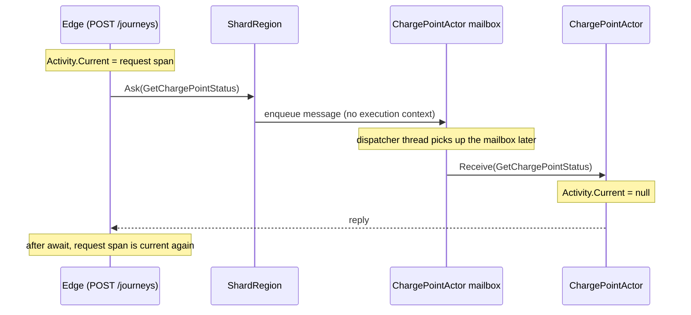
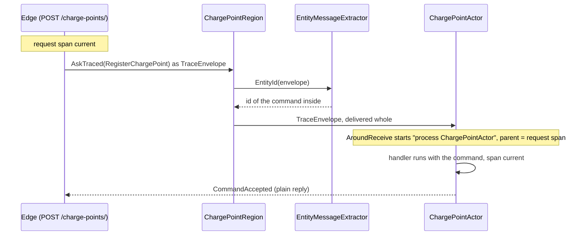
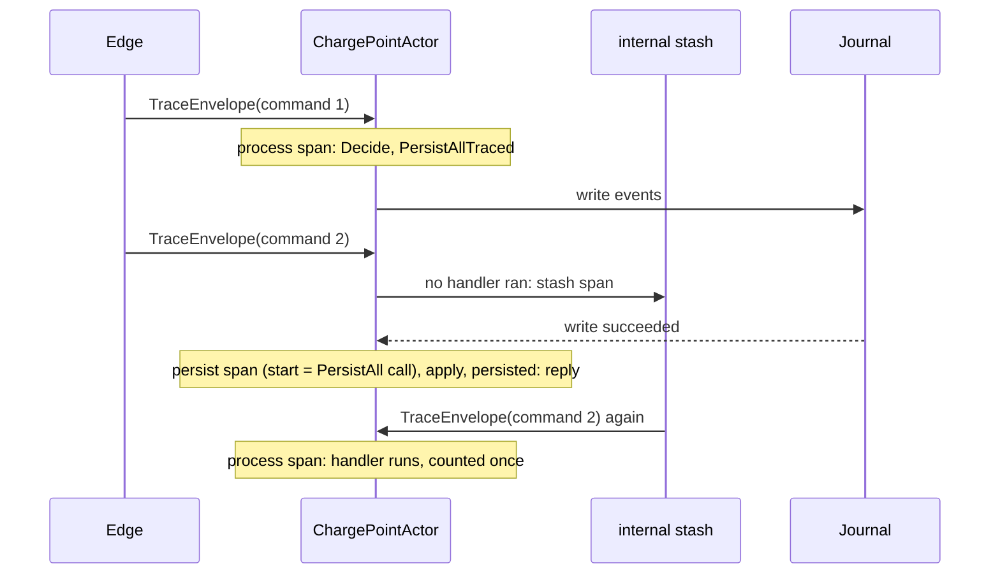
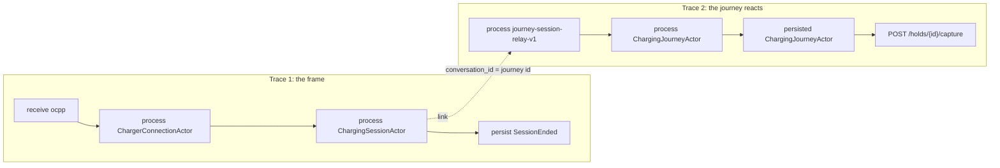

# Chapter 17. Tracing Through the Mailbox

At 07:52 a bus driver at the depot taps "Start charging" for connector `OHM-SLC-0042/1`. The app shows "Starting…", and two minutes later "Could not start". The driver moves to the next connector, which works, and the bus leaves late. By 09:00 support has a ticket: "start failed at 0042/1, no reason shown".

The on-call engineer turns on ASP.NET Core's tracing and finds that start's trace. It is one span long: `POST /journeys`, answered `202 Accepted` in 4 ms. Everything that decided the outcome happened after that, in actors. The edge asked the charge point, a journey locked the token and asked Site Energy for power, placed a hold through a port and sent `RemoteStart` towards the charger, and a timer finally gave up. Some of that ran on another node, and all of it went through a mailbox. The logs are there, thousands of lines from three processes, and nothing joins the ones about this start.

Chapters 10 to 16 made each step correct. This chapter makes them visible as one distributed trace that follows a charge through shard regions, actors, the journal and the projections. .NET's tracing stops at the first mailbox, and most of this chapter is about why, and what the shell must do about it.

> **In this chapter you will:**
>
> - give each bounded context one `ActivitySource` and one meter, using BCL types only, and wire the OpenTelemetry SDK in one place, `Ohmline.ServiceDefaults`;
> - show with a test that `Activity.Current` is null inside an actor after a plain `Tell`, and carry the W3C `traceparent` across mailboxes, nodes and the journal in a `TraceEnvelope` with its own durable serializer;
> - process each traced message in a CONSUMER span opened by the actor shell, count a stashed command once, and keep persist callbacks inside the trace;
> - decide, hop by hop, whether a span is the child of the one before or a new trace linked to it, and tie a journey's traces together with a conversation id;
> - assert the shape of whole traces with OpenTelemetry's in-memory exporter against a real node and PostgreSQL;
> - write down when buying Phobos would beat maintaining your own tracing.

> **Starting point:** `ch16-s10`, the integrated system with its contract tests, from Chapter 16.
>
> ```bash
> git checkout ch16-s10
> ```

## 17.1 Signals in .NET and observability as a port

### Where telemetry code may live

Before you wire any exporter, decide which projects may mention telemetry at all. Ohmline's domain projects reference no package (section 5.3). A span named "process ChargePointActor" or a counter of rejected commands describes how the model runs, not what it means, and `Decide` should stay a pure function.

This is the hexagonal architecture's question in a new place. In [Cockburn's ports and adapters](https://alistair.cockburn.us/hexagonal-architecture/) ("Hexagonal Architecture", 2005), the application is developed and tested in isolation from its eventual devices and databases: it talks to the outside world through a **port**, and a technology-specific **adapter** converts between that port and the technology. In .NET, the composition root is where the adapter is plugged in. For telemetry, .NET already draws that line. The BCL defines the recording APIs, and OpenTelemetry's .NET SDK is a listener that plugs into them:

| Signal | BCL API you record with | What the SDK adds |
|---|---|---|
| Traces | `ActivitySource`, `Activity` (one span) | sampling, processors, exporters |
| Metrics | `Meter`, `Counter<T>`, `Histogram<T>` | aggregation, readers, exporters |
| Logs | `ILogger` | a logging provider that exports records |

A **span** is one timed operation with a name, a kind, attributes and a parent; .NET calls it an `Activity`. A **trace** is the tree of spans that share one trace id.

### One source and one meter per context

Tag `ch17-s01` adds a diagnostics class beside each context's actors, or in the host for Billing and the Device Gateway, which have no actors project. The actor shell gets its own, `Ohmline.ActorShell`, because it knows no context. Charging's class is the pattern for all seven:

```csharp
// File: src/Charging/Ohmline.Charging.Actors/Diagnostics/ChargingDiagnostics.cs @ ch17-s01
public static class ChargingDiagnostics
{
    /// <summary>Durable: dashboards, alerts and the hosts find it by this name.</summary>
    public const string Name = "Ohmline.Charging";

    /// <summary>The meter's name: the same as the source's, one of each per context.</summary>
    public const string MeterName = Name;

    /// <summary>
    /// Static, as the BCL's own sources are: <c>StartActivity</c> returns null until a listener
    /// asks for <see cref="Name"/>.
    /// </summary>
    public static ActivitySource ActivitySource { get; } = new(Name);

    /// <summary>
    /// The context's meter, made by the host's <see cref="IMeterFactory"/> rather than with
    /// <c>new</c>: the factory owns it, disposes it with the host, and lets a test watch one
    /// host's instruments without seeing another's.
    /// </summary>
    public static Meter CreateMeter(IMeterFactory meters) => meters.Create(MeterName);
}
```

The name is durable, like a shard type name. Hosts subscribe to it, dashboards filter by it, and ADR 0009 lists it. The `ActivitySource` is static. `StartActivity` returns `null` until some listener asks for `Ohmline.Charging`, so every call site writes `span?.SetTag(...)`, and an unobserved span costs a null check.

The meter is different: the host's `IMeterFactory` makes it, caches it by name and disposes it with the host, as the doc comment says. This section only names the meter; the instruments arrive in section 18.1.

Why one per context, rather than one per actor class or one for all of Ohmline? The bounded context is already the boundary of a language and a team (Chapter 5), so one name per context gives an operator a meaningful switch, such as sampling Site Energy differently. A source per class would make every new actor a configuration change; one for everything would make the switch useless.

The third signal, `ILogger`, needs no class; section 18.4 routes Akka.NET's logging into it with the trace id attached. The domain cannot record a span, and that is the point: what a decider decided is visible in its events and in the spans the shell records around it. The price of a static source is that tests cannot each have their own; section 17.3 isolates them by trace id instead.

> **Version note:** .NET 11 adds `services.AddTracing(...)`, which registers `ActivityListener`s and rules that select the sources and activities each listener receives, and an `ActivitySourceFactory` that creates sources through DI (["Configure distributed tracing in .NET"](https://learn.microsoft.com/en-us/dotnet/core/diagnostics/distributed-tracing-configuration)). The page warns that these rules do not affect listeners that telemetry exporters create. How all this interacts with the SDK's `AddSource` is untested here, so Ohmline keeps the static source.

> **Try it**
>
> ```bash
> git checkout ch17-s01
> git diff ch16-s10 ch17-s01 --stat
> git diff ch16-s10 ch17-s01 -- src/Charging/Ohmline.Charging.Actors/Diagnostics
> dotnet test --solution Ohmline.slnx
> ```
>
> The diff shows `14 files changed, 382 insertions(+)`. The run reports 2,121 tests and no failures, among them `Given_the_hosts_meter_factory_then_the_meter_is_made_and_owned_by_it`.

## 17.2 Wiring OpenTelemetry into ServiceDefaults and the Aspire dashboard

### One adapter for every host

The sources exist, and nothing listens to them, so nothing is recorded. Three hosts run Ohmline's code: `Ohmline.Node`, `Ohmline.DeviceGateway` and `Ohmline.Billing`. Each already calls `AddServiceDefaults()` from `Ohmline.ServiceDefaults` (section 12.10 and Chapter 16), so that library is the one place the adapter goes. Tag `ch17-s02` pins five OpenTelemetry 1.20.1 packages in `Directory.Packages.props`: the hosting extensions, the OTLP exporter, and the ASP.NET Core, HttpClient and runtime instrumentation. Only `Ohmline.ServiceDefaults` references them, and the architecture test `Only_the_service_defaults_reference_an_OpenTelemetry_package` keeps it so. It checks direct references only, because Akka.Hosting 1.5.73 already brings OpenTelemetry 1.12.0 transitively.

### The pipeline

`ConfigureOpenTelemetry` sets up all three signals:

```csharp
// File: src/Ohmline.ServiceDefaults/ServiceDefaultsExtensions.cs @ ch17-s02
public TBuilder ConfigureOpenTelemetry()
{
    builder.Logging.AddOpenTelemetry(logging =>
    {
        logging.IncludeFormattedMessage = true;
        logging.IncludeScopes = true;
    });

    var telemetry = builder.Services.AddOpenTelemetry()
        .ConfigureResource(resource => resource
            .AddService(
                serviceName: ServiceName(builder),
                serviceVersion: ServiceVersion(),
                // Aspire and Kubernetes say which instance in OTEL_RESOURCE_ATTRIBUTES.
                autoGenerateServiceInstanceId: false)
            .AddAttributes(
            [
                new("deployment.environment.name", builder.Environment.EnvironmentName),
            ]))
        .WithTracing(tracing => tracing
            .AddSource(OhmlineTelemetry)
            .AddAspNetCoreInstrumentation(aspNetCore =>
                aspNetCore.Filter = context => !IsProbe(context.Request.Path))
            .AddHttpClientInstrumentation())
        .WithMetrics(metrics => metrics
            .AddMeter(OhmlineTelemetry)
            .AddAspNetCoreInstrumentation()
            .AddHttpClientInstrumentation()
            .AddRuntimeInstrumentation());

    if (!string.IsNullOrWhiteSpace(builder.Configuration[OtlpEndpointKey]))
    {
        // Traces, metrics and logs, to OTEL_EXPORTER_OTLP_ENDPOINT, in one call.
        telemetry.UseOtlpExporter();
    }

    return builder;
}
```

Logs go through the OpenTelemetry logging provider. The **resource** describes the process that produced the telemetry: `service.name` is the name Aspire gives the project (`node`, `gateway`, `billing`) in `OTEL_SERVICE_NAME`; `service.version` is the informational version, which MinVer sets in Chapter 21 so a canary can be told from the stable release; and `deployment.environment.name` is the current semantic-convention name, replacing `deployment.environment`, which [semantic conventions 1.28.0 deprecated](https://github.com/open-telemetry/semantic-conventions/blob/main/CHANGELOG.md#v1280).

Tracing and metrics listen to `OhmlineTelemetry`, the constant `"Ohmline.*"`. The SDK [accepts the wildcard](https://github.com/open-telemetry/opentelemetry-dotnet/blob/main/docs/trace/customizing-the-sdk/README.md#activity-source), so it covers all seven sources from section 17.1 and any added later. Its doc comment names the most common tracing bug in .NET: a source that is not listened to records nothing, and nothing warns you. The Aspire ServiceDefaults template (`Extensions.cs` in [Aspire.ProjectTemplates 13.6.4](https://www.nuget.org/packages/Aspire.ProjectTemplates/13.6.4)) registers only `AddSource(builder.Environment.ApplicationName)`, which would never match `Ohmline.Charging`. `ServiceDefaultsTelemetryTests` pins the rule from both sides: a fresh `Ohmline.Probe…` source has listeners after `AddServiceDefaults`, and an `Elsewhere.Probe…` source has none.

> **Version note:** the `aspire-servicedefaults` template of [Aspire 13.6.4](https://www.nuget.org/packages/Aspire.ProjectTemplates/13.6.4) still generates a `net10.0` project with OpenTelemetry 1.17.0. If you start a host from it, raise both to `net11.0` and 1.20.1.

The ASP.NET Core instrumentation skips `/health` and `/alive`, whose probes would bury real requests. `UseOtlpExporter()` exports all three signals in one call, configured by the standard `OTEL_EXPORTER_OTLP_*` variables, and [cannot be combined with the per-signal `AddOtlpExporter()`](https://github.com/open-telemetry/opentelemetry-dotnet/blob/main/src/OpenTelemetry.Exporter.OpenTelemetryProtocol/README.md#enable-otlp-exporter-for-all-signals) (OTLP exporter README, "Enable OTLP Exporter for all signals"). It is added only when an endpoint is configured, so a test or a laptop without a collector runs the same code.

### Metrics need a reader; traces do not

With no exporter, the meter provider enables no instrument at all: a counter on an `Ohmline.*` meter reports `Enabled == false`, which a theory in `ServiceDefaultsTelemetryTests` pins. The tracer provider is different: its [default sampler](https://github.com/open-telemetry/opentelemetry-dotnet/blob/main/docs/trace/customizing-the-sdk/README.md#samplers), `ParentBased(root=AlwaysOn)`, starts spans even when nothing will export them. That is why, from section 17.4 on, every integration test carries real trace context, exporter or not.

### The Aspire dashboard

The AppHost from section 12.10 needs no change. For every project resource, Aspire sets `OTEL_EXPORTER_OTLP_ENDPOINT` and `OTEL_SERVICE_NAME` ([Aspire telemetry docs](https://aspire.dev/fundamentals/telemetry/), "OpenTelemetry environment variables") and runs its dashboard as the OTLP receiver, so `dotnet run --project src/Ohmline.AppHost` puts each host's traces, metrics and logs side by side. The system tests start this AppHost at every tag, but its dashboard was not inspected for this book; check its Traces page yourself. The dashboard keeps them in memory, with limits: a development tool, which section 18.7 complements with a production-shaped stack. The stand-ins for TallyPay and Northgate Grid deliberately do not call `AddServiceDefaults`, because a real provider would not export into Ohmline's dashboard either.

> **Try it**
>
> ```bash
> git checkout ch17-s02
> git diff ch17-s01 ch17-s02 --stat
> git diff ch17-s01 ch17-s02 -- src/Ohmline.ServiceDefaults
> dotnet test --solution Ohmline.slnx
> ```
>
> The diff shows `5 files changed, 209 insertions(+), 5 deletions(-)`. The run reports 2,126 tests and no failures, among them `Given_the_defaults_then_every_Ohmline_source_is_listened_to_and_no_other`.

## 17.3 Why traces stop at the mailbox

### The trace that ends at 202

With the SDK listening at `ch17-s02`, a journey started over HTTP leaves a trace that holds `POST /journeys` and nothing under it. The edge asked the charge point's shard region with `GetChargePointStatus`, then the journey's region with `StartCharging`; actors decided, events were written, and none of it joined the request's trace. The cause is not a missing registration.

`Activity.Current` is stored in an `AsyncLocal<Activity>`, which lives in the **execution context**. .NET copies that context wherever asynchronous work continues: across an `await`, into `Task.Run`, into a thread-pool work item. A `Tell` copies nothing. It puts a message object into a mailbox and returns. Later, the dispatcher runs the mailbox on one of its threads, and that one run processes messages from many senders in turn. There is no single execution context it could restore, so it restores none. The [XML documentation of `AkkaTraceContextProcessor`](https://github.com/akkadotnet/Akka.Hosting/blob/dev/src/Akka.Hosting/Logging/AkkaTraceContextProcessor.cs#L20-L21) in Akka.Hosting 1.5.73 says the same: `Activity.Current` does not flow across actor mailbox boundaries because it uses `AsyncLocal<T>`.

The edge's status query, step by step:



The edge keeps its span across the `await`, which restores the edge's own execution context. Only the actor's side is lost.

### A test that proves it

Tag `ch17-s03` adds a test project, `tests/Ohmline.Telemetry.Tests`, whose first class states the problem as a test:

```csharp
// File: tests/Ohmline.Telemetry.Tests/MailboxLosesTraceTests.cs @ ch17-s03
public sealed class MailboxLosesTraceTests(ITestOutputHelper output)
    : TestKit(ActorTestConfig.Config, nameof(MailboxLosesTraceTests), output)
{
    private static readonly ActivitySource Source = new("Ohmline.Telemetry.Tests.Mailbox");

    [Fact]
    public async Task Given_a_span_when_a_message_is_told_then_the_actor_sees_no_current_activity()
    {
        using var recorder = new SpanRecorder(Source.Name);
        var witness = Sys.ActorOf(Witness.Props, "witness");

        using (var request = Source.StartActivity("POST /journeys"))
        {
            request.ShouldNotBeNull();
            witness.Tell(new WhatIsCurrent(), TestActor);
        }

        var seen = await ExpectMsgAsync<Seen>(cancellationToken: Ct);
        seen.ActivityId.ShouldBeNull();
    }
    // ...
    /// <summary>Answers with the id of whatever activity is current while it runs.</summary>
    private sealed class Witness : ReceiveActor
    {
        public Witness() =>
            Receive<WhatIsCurrent>(_ => Sender.Tell(new Seen(Activity.Current?.Id)));

        public static Props Props { get; } = Akka.Actor.Props.Create(() => new Witness());
    }
```

`SpanRecorder` is a BCL `ActivityListener` that samples everything from the named sources; without it, `StartActivity` would return `null`. Listeners are process-wide and tests run in parallel, so every later test reads only the spans of its own trace id. A second test asks instead of telling, and a third contrasts `Task.Run`, where the span does arrive.

### What this means

Nothing here is wrong in Akka.NET. A message is data, and location transparency means it may be bound for another node, where no execution context could follow it anyway. If the trace is to cross, the trace context must become data too, travelling with the message. Akka.NET 1.5.73 has no `ActivitySource` or `Meter` of its own for messaging, so the shell must do this itself, or a product such as Phobos must do it (section 17.9).

> **Try it**
>
> ```bash
> git checkout ch17-s03
> git diff ch17-s02 ch17-s03 --stat
> git diff ch17-s02 ch17-s03 -- tests/Ohmline.Telemetry.Tests
> dotnet test --solution Ohmline.slnx
> ```
>
> The diff shows `4 files changed, 126 insertions(+)`. The run reports 2,129 tests and no failures, among them `Given_a_span_when_a_message_is_told_then_the_actor_sees_no_current_activity`.

## 17.4 A W3C trace envelope

### Trace context as data

If the execution context cannot cross the mailbox, the message must carry the trace. The [W3C Trace Context recommendation](https://www.w3.org/TR/trace-context/) already defines the format (sections 3.2 "Traceparent Header" and 3.3 "Tracestate Header"): a `traceparent` header, `00-{trace id}-{parent span id}-{flags}`, and a `tracestate` header for vendor data. In .NET, `Activity.Id` is the `traceparent` string whenever the activity uses the W3C format, the default. Two strings cross a mailbox, Akka.Remote, a shard region and a journal unchanged.

Hohpe and Woolf call the design an [**Envelope Wrapper**](https://www.enterpriseintegrationpatterns.com/patterns/messaging/EnvelopeWrapper.html) (*Enterprise Integration Patterns*, ch. 8 "Message Transformation"): application data wrapped in an envelope that suits the messaging infrastructure, here headers carried around a payload without changing it. The alternative, a `TraceParent` property on every command, would put infrastructure into Charging's contracts and every decider's input. With the envelope, `StartCharging` stays a sentence in the ubiquitous language, and the receivers pay instead: they must open envelopes, which the shell does once, in section 17.5.

Tag `ch17-s04` adds the envelope to `Ohmline.ActorShell/Tracing`:

```csharp
// File: src/Ohmline.ActorShell/Tracing/TraceEnvelope.cs @ ch17-s04
public sealed record TraceEnvelope(object Message, string TraceParent, string? TraceState)
{
    /// <summary>
    /// The message in an envelope with the current span, or the message itself when there is no
    /// current span: untraced traffic is sent, and costs, as before.
    /// </summary>
    public static object Wrap(object message) =>
        message is not TraceEnvelope
        && Activity.Current is { IdFormat: ActivityIdFormat.W3C } current
            ? new TraceEnvelope(message, current.Id!, current.TraceStateString)
            : message;

    /// <summary>The message inside an envelope, or the message itself.</summary>
    public static object Unwrap(object message) =>
        message is TraceEnvelope envelope ? envelope.Message : message;

    /// <summary>
    /// The sender's span, as the parent or the link of the receiver's (section 17.7); default
    /// when <see cref="TraceParent"/> is not a W3C traceparent.
    /// </summary>
    public ActivityContext ParentContext =>
        ActivityContext.TryParse(TraceParent, TraceState, isRemote: true, out var context)
            ? context
            : default;
}
```

`Wrap` adds an envelope only when a W3C span is current and the message is not wrapped already. Anything sent with no span current is sent, and costs, exactly as before. `ParentContext` parses the strings back with `isRemote: true`, which tells the SDK that the parent span lives in another process, or here, beyond a mailbox.

Senders use two extension members, written with C# 14's `extension` blocks on `IActorRef`:

```csharp
// File: src/Ohmline.ActorShell/Tracing/TracedMessagingExtensions.cs @ ch17-s04
extension(IActorRef recipient)
{
    /// <summary>Tells the message, in an envelope if a span is current.</summary>
    public void TellTraced(object message, IActorRef? sender = null) =>
        recipient.Tell(TraceEnvelope.Wrap(message), sender ?? ActorRefs.NoSender);

    /// <summary>
    /// Asks with the message in a <see cref="TraceEnvelope"/> if a span is current. The
    /// reply comes back plain: the asker's span is still current where it awaits it.
    /// </summary>
    public Task<TReply> AskTraced<TReply>(
        object message,
        TimeSpan? timeout = null,
        CancellationToken cancellationToken = default) =>
        recipient.Ask<TReply>(TraceEnvelope.Wrap(message), timeout, cancellationToken);
}
```

The reply comes back plain, and section 17.3's second test showed why that is enough: the asker's span survives its own `await`.

### The shard region looks through it

A shard region asks its message extractor for an entity id, and Chapter 12's `EntityMessageExtractor` asks a context's function that knows only that context's messages. It now routes by the message inside, and still delivers the whole envelope, so the entity can carry on the trace:

```diff
# git diff ch17-s03 ch17-s04 -- src/Ohmline.ActorShell/Sharding/EntityMessageExtractor.cs
@@ -24,5 +27,6 @@ public sealed class EntityMessageExtractor(Func<object, string?> entityIdOf)
     /// </summary>
     public const int NumberOfShards = 100;
 
-    public override string? EntityId(object message) => entityIdOf(message);
+    public override string? EntityId(object message) =>
+        entityIdOf(TraceEnvelope.Unwrap(message));
 }
```

`EntityMessage` is not overridden, so the entity receives the envelope as sent. The shard id needs nothing more: it is computed from `EntityId`, and `HashCodeMessageExtractor.ShardId(object)` has been [obsolete since Akka.NET 1.5.15](https://github.com/akkadotnet/akka.net/blob/1.5.73/src/contrib/cluster/Akka.Cluster.Sharding/ClusterSharding.cs#L177).

### A serializer that keeps the inner one

Across nodes, and from section 17.7 in the journal, the envelope must be serialized. Its `Message` is typed `object`, and a general-purpose serializer would write a CLR type name for it, which ADR 0007 forbids (section 10.3). Each context's messages already have a serializer with permanent manifests (9101 to 9104), so `TraceEnvelopeSerializer` stores the inner serializer's identifier, manifest and bytes beside the trace. Its own identifier is 9100 and its manifest `ohmline.trace-envelope.v1`:

```csharp
// File: src/Ohmline.ActorShell/Tracing/TraceEnvelopeSerializer.cs @ ch17-s04
public override byte[] ToBinary(object obj)
{
    _ = Manifest(obj);
    var envelope = (TraceEnvelope)obj;
    var inner = system.Serialization.FindSerializerFor(envelope.Message);
    var wire = new Wire(
        envelope.TraceParent,
        envelope.TraceState,
        inner.Identifier,
        Akka.Serialization.Serialization.ManifestFor(inner, envelope.Message),
        inner.ToBinary(envelope.Message));
    return JsonSerializer.SerializeToUtf8Bytes(wire, Json);
}
// ...
/// <summary>
/// The envelope as written: the trace, and the message as its own serializer wrote it.
/// </summary>
private sealed record Wire(
    string TraceParent, string? TraceState, int SerializerId, string Manifest, byte[] Payload);
```

`FromBinary` reverses it with `system.Serialization.Deserialize(payload, serializerId, manifest)`. The golden file `tests/golden/ohmline.trace-envelope.v1.json` shows a status query inside: serializer 9101, manifest `charging.get-charge-point-status.v1`, and Charging's own JSON in base64. Identifier 9100 and the manifest are durable names now, recorded in ADR 0009, and `WithOhmlineCluster` registers the serializer on every node and the gateway.

### Switching the senders

The rest of the commit switches senders to `AskTraced` and `TellTraced` wherever a span may be current: `Edge.cs`, through which every Charging endpoint asks, the other endpoints, the ports, the projections that send commands and the journey's `Send`. `GatewayChargerCommandPort` wraps the command it publishes through DistributedPubSub.

One finding forced a change on the receiving side in the same commit. ASP.NET Core creates an `Activity` for each request even when no tracing listener is registered, because logging asks for one, so from this tag every endpoint sends envelopes, in tests too. `DeciderActor`, `ChargingJourneyActor` and `ChargerConnectionActor` got a temporary one-line `AroundReceive` that unwraps the message.

> **Warning:** in a running cluster, ship the reader before the writer. A node that does not know serializer 9100 cannot read an envelope, and the message is lost. Release the serializer and the unwrapping receivers first and the traced senders later: the read-path-before-write-path order of section 20.2.

> **Try it**
>
> ```bash
> git checkout ch17-s04
> git diff ch17-s03 ch17-s04 --stat
> git diff ch17-s03 ch17-s04 -- src/Ohmline.ActorShell
> dotnet test --solution Ohmline.slnx
> ```
>
> The diff shows `27 files changed, 525 insertions(+), 31 deletions(-)`. The run reports 2,148 tests and no failures, among them `Given_an_envelope_when_written_then_the_message_keeps_its_own_serializer`.

## 17.5 Consumer spans in AroundReceive

### Where the shell can intercept

The envelope arrives, and the actor still has no current span; `TraceEnvelopeTests` asserts exactly that. Akka.NET gives every actor one place that sees each message before any handler does: `ActorBase.AroundReceive(Receive receive, object message)`, which is `protected virtual`. The shell owns everything between the mailbox and the decider (section 10.1), so turning the envelope into a span is its job.

[OpenTelemetry's semantic conventions for messaging spans](https://opentelemetry.io/docs/specs/semconv/messaging/messaging-spans/), still marked Development, describe the span: kind CONSUMER, named `{operation} {destination}`, so `process ChargePointActor`, with `messaging.system.name` (renamed from `messaging.system` in [semantic conventions 1.45.0](https://github.com/open-telemetry/semantic-conventions/blob/main/CHANGELOG.md#v1450)) and `messaging.operation.name` required. The conventions' [well-known values for `messaging.system.name`](https://opentelemetry.io/docs/specs/semconv/messaging/messaging-spans/#process-span) include none for Akka.NET and allow a custom value, so Ohmline writes `akka`. The destination should have [low cardinality](https://opentelemetry.io/docs/specs/semconv/messaging/messaging-spans/#span-name): the actor type qualifies, while the path, which contains the entity id, is a span attribute and never a metric tag (section 18.1).

### Two traced base classes

Tag `ch17-s05` adds `TracedPersistentActor` and a twin for plain actors, `TracedReceiveActor`:

```csharp
// File: src/Ohmline.ActorShell/Tracing/TracedPersistentActor.cs @ ch17-s05
public abstract class TracedPersistentActor : ReceivePersistentActor
{
    private readonly string _actorType;

    protected TracedPersistentActor() => _actorType = GetType().Name;

    protected override bool AroundReceive(Receive receive, object message)
    {
        if (message is not TraceEnvelope envelope)
        {
            return base.AroundReceive(receive, message);
        }

        using var span = ConsumerSpans.Start(_actorType, envelope, Self);
        try
        {
            return base.AroundReceive(receive, envelope.Message);
        }
        catch (Exception exception)
        {
            ConsumerSpans.Failed(span, exception);
            throw;
        }
    }
}
```

A message without an envelope passes through untouched. For an envelope, `StartActivity` makes the new span `Activity.Current`, `base.AroundReceive` runs the handler with the message inside, and disposing the span restores the previous current activity, none. The span covers the handler exactly, so whatever the handler logs or sends with `TellTraced` belongs to the trace. If the handler throws, the span records the error, and the supervisor decides as before.

The internal `ConsumerSpans.Start` builds the span with those two attributes, `messaging.operation.type` and `messaging.destination.name` (the actor type), plus `akka.message.type` and `akka.actor.path`, skipping them when the sampler wants the span only for propagation (`IsAllDataRequested` is false). `MessageNames.Of` names the message by its type, or, for a C# 15 union sent by mistake (ADR 0003), by the case it holds, through the `IUnion` interface.

`DeciderActor` now derives from `TracedPersistentActor`, so every aggregate from section 10.10 on gets consumer spans without a line of its own. `ChargingJourneyActor` derives from it too, and the gateway's `ChargerConnectionActor` from `TracedReceiveActor`. The one-line unwraps from section 17.4 are gone. A request now flows like this:



`ConsumerSpanTests` checks the shape for a plain and a persistent actor: name, kind, `ParentSpanId` equal to the sender's span, `HasRemoteParent`, and that the handler saw this span as `Activity.Current`. The persistent case at first saw two spans for one message: the actor was still recovering, Akka.Persistence stashed the message, and it came through `AroundReceive` again afterwards. The tests now warm the actor up with an untraced message, and section 17.6 deals with the cause.

> **Note:** a span started in `AroundReceive` ends when the handler returns. For a `ReceiveAsync` or `CommandAsync` handler, that is at the first `await`, long before the work is done. Ohmline's aggregates are synchronous and send I/O through `PipeTo`, the choice section 2.8 explained, so none is affected. ADR 0012 lists async handlers among the gaps.

> **Try it**
>
> ```bash
> git checkout ch17-s05
> git diff ch17-s04 ch17-s05 --stat
> git diff ch17-s04 ch17-s05 -- src/Ohmline.ActorShell/Tracing
> dotnet test --solution Ohmline.slnx
> ```
>
> The diff shows `10 files changed, 318 insertions(+), 16 deletions(-)`. The run reports 2,156 tests and no failures, among them `Given_a_traced_message_then_it_is_processed_in_a_child_consumer_span`.

## 17.6 Stash, persist and the double count

### Two passes for one command

Section 10.5 showed the internal stash: between `PersistAll` and its last callback, Akka.Persistence parks every incoming command and replays them afterwards. It parks the mailbox's message as it arrived, which is the `TraceEnvelope`. That is good news for the trace, which survives the wait, but each parked command now passes through `AroundReceive` twice: once when it is stashed, with no handler running, and once when it is replayed. Commands that arrive during recovery do the same. Three commands in quick succession can make five passes, and a counter in `AroundReceive` would say five.

The shell cannot ask whether a message was stashed, but it can notice whether a handler ran. Tag `ch17-s06` wraps the `receive` delegate it hands down:

```csharp
// File: src/Ohmline.ActorShell/Tracing/TracedPersistentActor.cs @ ch17-s06
protected override bool AroundReceive(Receive receive, object message)
{
    var started = Stopwatch.GetTimestamp();
    var envelope = message as TraceEnvelope;
    var inner = envelope?.Message ?? message;
    using var span = envelope is null ? null : ConsumerSpans.Start(_actorType, envelope, Self);
    _handlerInvoked = false;
    try
    {
        var handled = base.AroundReceive(
            next =>
            {
                _handlerInvoked = true;
                return receive(next);
            },
            inner);
        if (_handlerInvoked)
        {
            OnMessageHandled(inner, Stopwatch.GetElapsedTime(started));
        }
        else
        {
            ConsumerSpans.Stashed(span, _actorType);
        }

        return handled;
    }
    catch (Exception exception)
    {
        ConsumerSpans.Failed(span, exception);
        throw;
    }
}
```

If the wrapper ran, a handler got the message, and `OnMessageHandled` is called once with the duration; Chapter 18 counts commands where the decision is visible. If not, the pass only stashed the message. Its span is renamed `stash ChargePointActor` and tagged `akka.message.stashed`, rather than dropped, because it records how long the command waited behind a write. The journal's own replies pass through too and run no handler, so they are never counted.

### Callbacks that run outside the span

The second subtlety is the callbacks. `PersistAll(events, handler, onComplete)` runs `handler` and `onComplete` later, when the journal's reply arrives, after the `process` span has ended and nothing is current. `DeciderActor` replies to the edge from `onComplete`, so the reply, and any log written there, fell out of the trace. `PersistAllTraced` captures the current span when it is called and records the write's spans from the callbacks:

```csharp
// File: src/Ohmline.ActorShell/Tracing/WriteSpans.cs @ ch17-s06
/// <summary>
/// The event is in the journal: a span from the moment Persist was called until now, which
/// ends as soon as it is recorded, so it is never current.
/// </summary>
public void Stored(object @event, long sequenceNr)
{
    using var persist = ActorShellDiagnostics.ActivitySource.StartActivity(
        $"persist {MessageNames.Of(@event)}",
        ActivityKind.Internal,
        _parent,
        startTime: _startedAt);
    persist?.SetTag("akka.persistence.id", _persistenceId);
    persist?.SetTag("akka.persistence.sequence_nr", sequenceNr);
    persist?.SetTag("akka.event.type", MessageNames.Of(@event));
}
```

The `persist` span is recorded retroactively. It starts at the moment `PersistAll` was called, through the explicit `startTime`, and ends as soon as the journal has answered, so it is never current and leaves nothing dangling. Around each event's handler an `apply {EventType}` span is current, and around `onComplete` a `persisted {ActorType}` span, so replies and logs stay in the trace. All three are children of the command's `process` span, even though they are recorded after it has ended. `PersistTraced` does the same for a single event:



`DeciderActor.Handle` and `ChargingJourneyActor` now call `PersistAllTraced`. `StashAndPersistTests` holds the first write back with a journal interceptor until at least two `stash Meter` spans exist, then expects exactly three handled commands and three `process Meter` spans. A second test checks that `persist`, `apply` and `persisted` are children of `process`, and that the reply was sent inside `persisted`.

> **Try it**
>
> ```bash
> git checkout ch17-s06
> git diff ch17-s05 ch17-s06 --stat
> git diff ch17-s05 ch17-s06 -- src/Ohmline.ActorShell/Tracing
> dotnet test --solution Ohmline.slnx
> ```
>
> The diff shows `8 files changed, 336 insertions(+), 12 deletions(-)`. The run reports 2,159 tests and no failures, among them `Given_commands_that_wait_behind_a_write_then_each_is_handled_once`.

## 17.7 Parents versus links

### Not every hop is a child

So far every span has been the child of its sender's, which is right when someone waits for the answer. It is wrong in three places. `SessionHistoryProjection` reads `SessionEnded` a second after the write, or days later in a rebuild (section 14.8), and making it a child would stretch the request's trace across days. A journey's `EnergyFlow` timer fires minutes after the step that started it. A charger's WebSocket request span lasts as long as the connection, which is hours.

OpenTelemetry has a second relation: a **span link**, a reference to another span's context that records causality without joining its trace. The messaging conventions make links the default for consumers and allow a parent, as an opt-in, for single-message processing (["Consumer spans"](https://opentelemetry.io/docs/specs/semconv/messaging/messaging-spans/#consumer-spans): a process span "SHOULD link to the message’s creation context", and "Exclusively for single messages scenarios" MAY use it as its parent). Ohmline's rule: a **parent** when the work answers someone in the same request, a **link** when it runs on its own schedule and answers no one.

### Links in the shell

Tag `ch17-s07` adds a `continuesTrace` choice to `ConsumerSpans.Start`:

```csharp
// File: src/Ohmline.ActorShell/Tracing/ConsumerSpans.cs @ ch17-s07
var span = continuesTrace
    ? ActorShellDiagnostics.ActivitySource.StartActivity(
        $"process {actorType}", ActivityKind.Consumer, envelope.ParentContext)
    : ActorShellDiagnostics.ActivitySource.StartActivity(
        $"process {actorType}",
        ActivityKind.Consumer,
        parentContext: default,
        links: [new ActivityLink(envelope.ParentContext)]);
```

`TracedPersistentActor` asks two virtual members per message: `ContinuesTrace(message)`, true by default, and `ConversationId`, null by default. The journey overrides both and wraps the message of each timer it starts:

```csharp
// File: src/Charging/Ohmline.Charging.Actors/Journeys/ChargingJourneyActor.cs @ ch17-s07
protected override string ConversationId => _journeyId.ToString();
// ...
protected override bool ContinuesTrace(object message) => message is not JourneyTimerElapsed;
// ...
private Unit StartTimer(JourneyEffect.StartTimer timer)
{
    Timers.StartSingleTimer(
        timer.Timer, TraceEnvelope.Wrap(new JourneyTimerElapsed(timer.Timer)), timer.Delay);
    return Unit.Value;
}
```

`messaging.message.conversation_id` carries the journey's id on every span the journey processes a message in. It is the [**Correlation Identifier**](https://www.enterpriseintegrationpatterns.com/patterns/messaging/CorrelationIdentifier.html) of Hohpe and Woolf (*Enterprise Integration Patterns*, ch. 5 "Message Construction"); the [conventions](https://opentelemetry.io/docs/specs/semconv/messaging/messaging-spans/#process-span) say of the attribute that it is "Sometimes called “Correlation ID”". Because a session's id is its journey's id (section 15.2), the session subscribers set the same value, and one search for a journey id finds every trace of that charge.

Traced timers exposed a bug: Akka.NET 1.5.73 hands `AroundReceive` a timer's message still inside its internal `TimerScheduler+TimerMsg` wrapper and takes it out only on the way to the handler. A traced timer message reached the handlers unopened and went unhandled. `LinkTests` caught it, and the shell now also opens an envelope inside the wrapped `receive` delegate (`TracedPersistentActor.Invoke`), where the timer's message finally appears.

### Storing the deciding span with the event

A projection reads from the journal, so the trace must be stored there. Akka.NET 1.5.73 has no event metadata, and a write adapter runs in the journal actor, where no span is current. So `PersistAllTraced` now persists `TraceEnvelope.Wrap(event)`, the event with the `process` span that decided it, written by serializer 9100 around the event's own bytes. Recovery opens the envelopes with `Recover<TraceEnvelope>`; untraced writes are stored as before.

That broke tagging. The journal picks one write adapter by the type of what was persisted, so `ChargingTagger` never saw an envelope, and traced events reached the journal without tags, invisible to every projection. The shell adds an abstract composite, and the node binds one subclass to `TraceEnvelope`, listing every context's tagger:

```csharp
// File: src/Ohmline.ActorShell/Tracing/TraceEnvelopeTagger.cs @ ch17-s07
public object ToJournal(object evt)
{
    if (evt is TraceEnvelope envelope)
    {
        foreach (var tagger in taggers)
        {
            if (tagger.ToJournal(envelope.Message) is Tagged tagged)
            {
                return new Tagged(envelope, tagged.Tags);
            }
        }
    }

    return evt;
}
```

```csharp
// File: src/Ohmline.Node/TracedEventTagger.cs @ ch17-s07
public sealed class TracedEventTagger()
    : TraceEnvelopeTagger(new ChargingTagger(), new SiteEnergyTagger());
```

> **Warning:** `Akka.Persistence.Journal.Tagged` is a struct. A first version used LINQ's `FirstOrDefault`, which returned a default `Tagged` with null tags when no tagger matched, and the SQL journal failed every write of an untagged context with `ArgumentNullException`. Match with `is Tagged`, as the loop does.

### Projections, frames and one charge

`ProjectionRunner` now starts a span for every traced event it reads:

```csharp
// File: src/Charging/Ohmline.Charging.ReadModels/Projections/ProjectionSpans.cs @ ch17-s07
public static Activity? Start(ProjectionStream stream, EventEnvelope envelope)
{
    if (envelope.Event is not TraceEnvelope traced)
    {
        return null;
    }

    // A root, whatever the stream's thread had current: the write is a link, not a parent.
    Activity.Current = null;
    var span = ChargingDiagnostics.ActivitySource.StartActivity(
        $"process {stream.ProjectionId}",
        ActivityKind.Consumer,
        parentContext: default,
        links: [new ActivityLink(traced.ParentContext)]);
```

It clears `Activity.Current` first, because the stream's thread may carry anything, and links to the stored span. Every projection gets this span from the runner, including the subscribers and `IntegrationEventRelay`, which fills Charging's feed (section 16.1). The span stays current while the projection runs, so the asks of `JourneySessionRelay` and `SessionEndedSubscriber` become its children. At the gateway, `FrameSpans` starts a root `receive ocpp` span for each frame, linked to the connection's request span. One charge ended from the charger then looks like this:



The relay projection reads the stored `SessionEnded` and starts trace 2 with a link back. The journey's call to Billing carries trace 2 in a `traceparent` header, and Billing issues the receipt from Charging's feed on its own schedule, in a third trace. Replies are not traced (ADR 0012), so a journey step triggered by a reply such as `TokenLocked` runs in no span. Section 19.8 extends the request side of this story back to a tap on the driver's phone.

> **Try it**
>
> ```bash
> git checkout ch17-s07
> git diff ch17-s06 ch17-s07 --stat
> git diff ch17-s06 ch17-s07 -- src/Ohmline.ActorShell/Tracing src/Ohmline.Node
> dotnet test --solution Ohmline.slnx
> ```
>
> The diff shows `22 files changed, 803 insertions(+), 46 deletions(-)`. The run reports 2,169 tests and no failures, among them `Given_a_timer_started_in_a_trace_then_it_fires_in_a_new_trace_linked_to_it`.

## 17.8 Testing traces

### The real pipeline, observed

The tests so far prove each mechanism with test actors and a BCL listener. An operator's question is different: does a real node, wired by `AddServiceDefaults`, export one trace from an HTTP request to a journal row? Tag `ch17-s08` adds OpenTelemetry's in-memory exporter, 1.20.1, and hosts the node in memory:

```csharp
// File: tests/Ohmline.Telemetry.Tests/TracedNode.cs @ ch17-s08
protected override void ConfigureWebHost(IWebHostBuilder builder) =>
    builder
        .UseEnvironment("Development")
        .UseSetting("ConnectionStrings:ohmline", postgres.ConnectionString)
        .UseSetting("Akka:Remote:Port", "0")
        // A node that has just started is slow over its first commands while every test
        // assembly runs at once: more than production's 5 s before the edge gives up.
        .UseSetting("Ohmline:Charging:AskTimeout", "00:00:20")
        .UseSetting("Ohmline:SiteEnergy:AskTimeout", "00:00:20")
        .UseSetting("Ohmline:DriverAccounts:AskTimeout", "00:00:20")
        .ConfigureTestServices(services => services
            .AddSingleton<IPaymentPort, InMemoryPaymentPort>()
            .AddSingleton<IChargerCommandPort, LoggingChargerCommandPort>()
            .ConfigureOpenTelemetryTracerProvider(tracing =>
                tracing.AddInMemoryExporter(new QueueCollection(_exported))));
```

This is section 12.11's `WebApplicationFactory<Program>` on a Testcontainers PostgreSQL, with the payment and charger ports replaced and the edge's asks given 20 s instead of production's 5 s. `ConfigureOpenTelemetryTracerProvider` adds one exporter to the node's own provider, so the test sees what production would send over OTLP, in a queue it can read while spans arrive.

Each request carries a `traceparent` header with a fresh trace id made by the test. ASP.NET Core continues it, so the request's spans land in a trace the test chose, apart from everything else the node is doing. The journey test reads the shape:

```csharp
// File: tests/Ohmline.Telemetry.Tests/TraceShapeTests.cs @ ch17-s08
started.StatusCode.ShouldBe(HttpStatusCode.Accepted);
var journeyId = started.Headers.Location!.ToString()["/journeys/".Length..];
var spans = await SpansAsync(node, trace, "process IdTokenActor");
var request = spans.Single(span => span.Kind == ActivityKind.Server);
var asked = spans.Single(span => span.DisplayName == "process ChargePointActor");
var journey = spans.Single(span => span.DisplayName == "process ChargingJourneyActor");
var persisted = spans.Single(span => span.DisplayName == "persisted ChargingJourneyActor");
var told = spans.Single(span => span.DisplayName == "process IdTokenActor");
asked.ParentSpanId.ShouldBe(request.SpanId);
journey.ParentSpanId.ShouldBe(request.SpanId);
persisted.ParentSpanId.ShouldBe(journey.SpanId);
told.ParentSpanId.ShouldBe(persisted.SpanId);
journey.GetTagItem("messaging.message.conversation_id").ShouldBe(journeyId);
```

The edge's status query and the journey are children of the server span. The journey's `persisted` span is the parent of the `IdTokenActor` command it told, and the conversation id is the journey id from the `Location` header. Two more tests check the path from `POST /charge-points/` through `process ChargePointActor` to its `persist`, `apply` and `persisted` children, with a journal row whose `identifier` is 9100 and whose `manifest` is `ohmline.trace-envelope.v1`; and that some `Ohmline.Charging` consumer span, in another trace and with no parent, links to the span that decided the stored event.

### What to assert

Assert relations: `ParentSpanId` against `SpanId`, the contexts in `Links`, `Kind`, `Source.Name` and names. Do not assert durations or total span counts, which depend on timing. Spans end asynchronously, so each helper polls with a deadline. A parent can even end after its child: the journey's `persisted` span ends when its handler returns, and the `IdTokenActor` it told may already be done. So `SpansAsync` waits until the named span and every ancestor up to the server span have been exported.

> **Note:** these tests carry `[Trait("Category", "Integration")]` and need Podman or Docker.

> **Try it**
>
> ```bash
> git checkout ch17-s08
> git diff ch17-s07 ch17-s08 --stat
> git diff ch17-s07 ch17-s08 -- tests/Ohmline.Telemetry.Tests
> dotnet test --solution Ohmline.slnx
> ```
>
> The diff shows `5 files changed, 312 insertions(+), 2 deletions(-)`. The run reports 2,172 tests and no failures, among them `Given_a_journey_then_what_it_tells_other_actors_stays_in_the_request_trace`.

## 17.9 Buy versus build: Phobos

The shell's tracing cost a few hundred lines and four surprises, each found by a test, and it still leaves gaps, which ADR 0012 lists. Replies and `PipeTo` results come back plain, because an envelope would break `Ask<T>`. Akka.Streams stages and DistributedPubSub publishes other than the charger commands are not traced. `ReceiveAsync` handlers would end their span at the first `await`. `ChargerConnectionActor` stashes frames itself, so such a frame is processed in two spans.

Petabridge's **Phobos** is the commercial alternative. According to its [release notes](https://phobos.petabridge.com/articles/releases/RELEASE_NOTES.html), read on 2026-11-04 and not compiled for this book because it needs a licence, version 2.12.1 (2026-08-27) upgrades to Akka.NET 1.5.71; Phobos 2.0 moved its tracing and monitoring to OpenTelemetry, and 2.12.0 added trace-context propagation through Akka.Streams. Its [tracing documentation](https://phobos.petabridge.com/articles/tracing/index.html) says it creates spans "each time your actor receives a message" and propagates trace context over Akka.Remote without configuration. Its [installation guide](https://phobos.petabridge.com/articles/installation.html) says the packages come from a private Sdkbin feed, whose URL you find in your Sdkbin account after purchasing a licence. The 1.0.0 notes say Phobos "no longer has any per-node licensing"; current pricing and feed mechanics are unconfirmed, and the notes say nothing about Akka.NET 1.6.

Tag `ch17-s09` records the decision as ADR 0012: keep the manual tracing, which is vendor-neutral, tested and instructive, and re-evaluate when an incident's trace stops at one of the gaps, when Ohmline adopts streams or async handlers, or when the shell's tracing changes in consecutive releases. A purchase must first answer eight questions in writing:

| Criterion | The question |
|---|---|
| Coverage | Do `TraceShapeTests` pass against it, with the gaps closed? |
| Version lag | How soon after an Akka.NET release does it follow, and what of 1.6? |
| Distribution | Can CI restore it, and can the sample build without a licence? |
| Cost | Does the licence cost less than the time spent on the shell? |
| Overhead | What does it add per message, and can it sample by actor type? |
| Data | Does it put message contents on spans, against Ohmline's privacy rules? |
| The journal | Does serializer 9100 stay registered while envelope rows exist? |
| Exit | Does everything still run with tracing off if the licence lapses? |

The journal row is the easiest to miss: stored events contain trace envelopes, so any replacement must leave their serializer in place and never wrap a message twice.

> **Try it**
>
> ```bash
> git checkout ch17-s09
> git diff ch17-s08 ch17-s09 --stat
> git diff ch17-s08 ch17-s09 -- docs/adr
> dotnet test --solution Ohmline.slnx
> ```
>
> The diff shows `3 files changed, 107 insertions(+)`, all documentation. The run still reports 2,172 tests and no failures.

## Summary

- Telemetry is a port: contexts record through the BCL's `ActivitySource` and `Meter`, one of each per context under a durable name, and only the host defaults reference the OpenTelemetry SDK, listening to `Ohmline.*`.
- `Activity.Current` travels with the execution context, which a mailbox does not carry, so trace context must travel with the message as W3C strings.
- A `TraceEnvelope` with a permanent serializer that keeps the inner message's own crosses mailboxes, nodes and the journal without touching the contracts; the shard extractor routes through it.
- The shell opens envelopes in `AroundReceive` and records CONSUMER spans; wrapping the receive delegate tells a stash pass from a handled message, and retroactive `persist` spans keep callbacks in the trace.
- A span is a child when someone waits for the answer and a linked root when the work runs on its own schedule; a conversation id ties a journey's traces together.
- Whole-trace tests run the real node with an in-memory exporter, choose their trace id through `traceparent`, and assert relations rather than timings.

## DDD canon covered

Layered / Hexagonal / Clean; Functional core / actor shell; Message extractor; Serialization strategy and serializer IDs; Projections via Persistence Query; Process manager actor with timers.

## Exercises

1. **Reflect.** Replies are not traced, so the journey step after `TokenLocked` runs in no span. Decide whether to change that. Weigh wrapping replies (which breaks `Ask<T>`), a trace field in the reply contracts, a link to the span stored with the journey's last event, and how often an incident would need that span.
2. **Reflect.** `LinkTests.Given_a_timer_started_in_a_trace_then_it_fires_in_a_new_trace_linked_to_it` warms the `Alarm` up with an untraced `Arm` and then waits for that arm's `Rang` before it sends the traced one. Explain what could reach `TestActor` first without that wait on a loaded machine, why the test looks the ring's span up by its trace id with `SingleAsync` instead of searching the spans recorded so far, and how a warm-up message that starts no timer would remove the need for both.
3. **Extend.** Starting from `ch17-s07`, carry the trace through `PipeTo` in `ChargingJourneyActor.Pipe`: capture the envelope before the task runs and wrap its result. Write a test in `Ohmline.Telemetry.Tests` with a persistent actor that pipes a task's result to itself and expects the result's `process` span to be the child of the span that started the task.
4. **Break it.** At `ch17-s02`, change `AddSource(OhmlineTelemetry)` to `AddSource(builder.Environment.ApplicationName)` and run `Ohmline.Node.Tests`. Expect `Given_the_defaults_then_every_Ohmline_source_is_listened_to_and_no_other` to fail where it asserts that the `Ohmline.Probe…` source has listeners.
5. **Break it.** At `ch17-s08`, remove `.AddTraceEnvelopeTagger<TracedEventTagger>()` from `WithOhmlineJournal` and run the integration tests. Expect `Given_a_stored_event_then_a_projection_links_to_the_span_that_decided_it` to fail after its 20 s deadline with no linked span, because traced events are now stored without tags and no projection reads them. Note which other read-model tests fail with it.

## Further reading

- W3C, [*Trace Context*](https://www.w3.org/TR/trace-context/), W3C Recommendation (2021), sections 3.2 "Traceparent Header" and 3.3 "Tracestate Header". The `traceparent` and `tracestate` formats the envelope carries.
- OpenTelemetry, [*Semantic conventions for messaging spans*](https://opentelemetry.io/docs/specs/semconv/messaging/messaging-spans/) (2026). Span names, kinds, attributes, and when to link rather than parent.
- Alistair Cockburn, [*Hexagonal Architecture*](https://alistair.cockburn.us/hexagonal-architecture/) (2005). Ports and adapters, the idea behind telemetry as a port.
- Gregor Hohpe and Bobby Woolf, [*Enterprise Integration Patterns*](https://www.informit.com/store/enterprise-integration-patterns-designing-building-9780321200686) (Addison-Wesley, 2003); pattern catalog at [enterpriseintegrationpatterns.com](https://www.enterpriseintegrationpatterns.com/). Envelope Wrapper (ch. 8 "Message Transformation") and Correlation Identifier (ch. 5 "Message Construction"), the two patterns this chapter builds.
- Vaughn Vernon, [*Reactive Messaging Patterns with the Actor Model*](https://www.informit.com/store/reactive-messaging-patterns-with-the-actor-model-applications-9780133846836) (Addison-Wesley, 2015), ch. 6 "Message Construction" (Correlation Identifier) and ch. 8 "Message Transformation" (Envelope Wrapper). The same patterns implemented with actors.
- Benjamin H. Sigelman et al., [*Dapper, a Large-Scale Distributed Systems Tracing Infrastructure*](https://research.google/pubs/dapper-a-large-scale-distributed-systems-tracing-infrastructure/) (Google technical report, 2010), section 2.1 "Trace trees and spans" and section 4.4 on sampling. The paper behind spans, trace trees and sampling.
- OpenTelemetry, [*OpenTelemetry .NET*](https://opentelemetry.io/docs/languages/dotnet/) (2026). The SDK, exporters and instrumentation used here.
- Petabridge, [*Phobos release notes*](https://phobos.petabridge.com/articles/releases/RELEASE_NOTES.html) (2026). What the commercial alternative automates, release by release.

