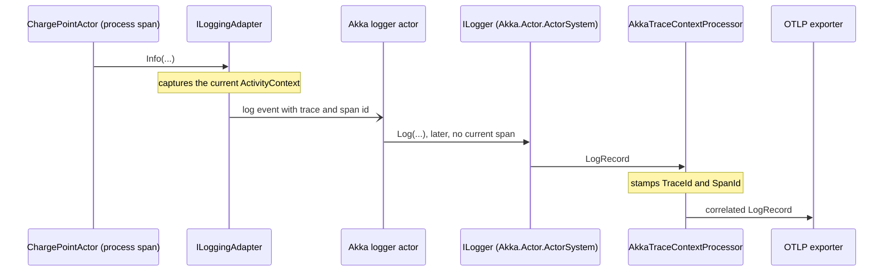
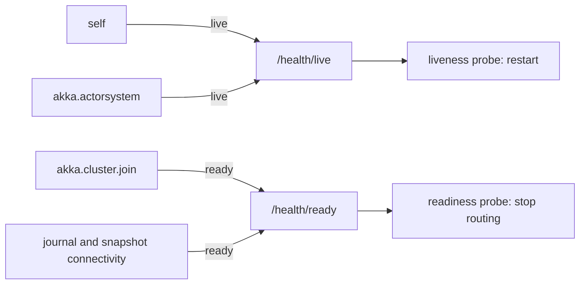
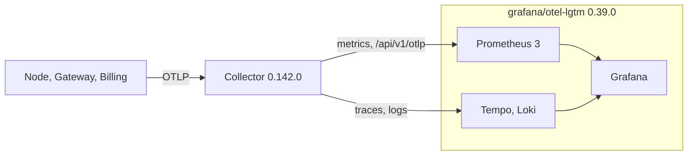
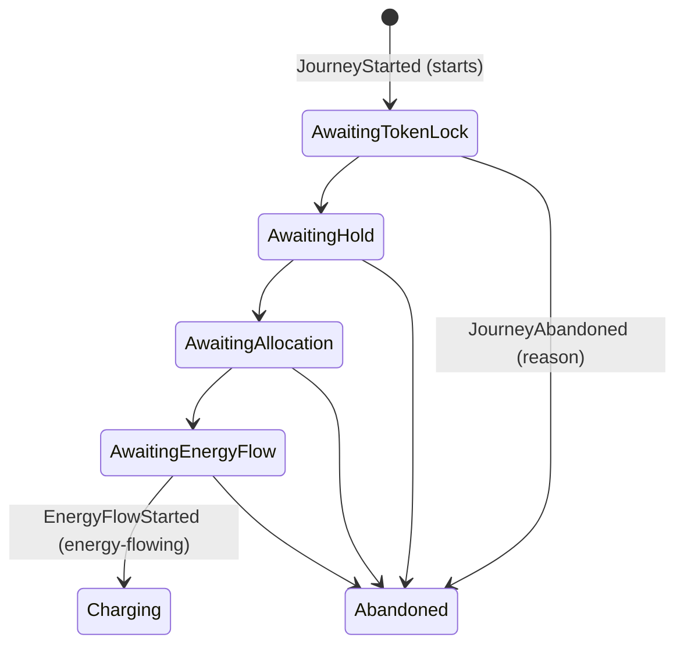

# Chapter 18. Metrics, Logs, Health Checks and Dashboards

At 07:41 on a Monday the depot's PostgreSQL fails over, and for ninety seconds the journal cannot write. Every bus on the morning shift is plugged in. The load balancer keeps sending "start charging" to all three nodes, because each answers `/health` with `Healthy`: it is a cluster member, and that is all the check asks. The commands time out one after another.

By 08:15 the operations lead has three questions. How many drivers waited more than a minute for energy? Which refusals went up, and for what reason? Is any site at its power limit now? Chapter 17's traces tell the story of one charge in detail. These questions are about rates and totals over thousands of charges. Someone suggests adding the charge point's id to every counter "so we can drill down", and a month later the metrics bill has tripled.

This chapter completes the telemetry picture, from domain metrics with a budget to a service level objective taken from the journey's own events.

> **In this chapter you will:**
>
> - record commands, refusals by error case, sessions and energy in kWh, with every tag value drawn from a list the code names;
> - count dead letters, actor lifecycles, recovery times and shard sizes, and explain why mailbox depth is left out;
> - assert on metrics with `MetricCollector<T>` and prove that an actor's log carries its trace id;
> - separate liveness from readiness, so a database outage takes a node out of rotation without restarting it;
> - run a Collector, Prometheus 3 and Grafana locally, and bind Petabridge.Cmd to loopback;
> - derive a "time to energy flow" SLO from journey events and alert on its error budget.

> **Starting point:** `ch17-s09`, the traced system with ADR 0012, from Chapter 17.
>
> ```bash
> git checkout ch17-s09
> ```

## 18.1 Domain metrics with a cardinality budget

### Questions about many charges

A **metric** is a number measured over time and stored as **time series**, one for each distinct combination of its tag values. A backend such as Prometheus indexes, stores and bills each series separately. The number of series a metric produces is its **cardinality**: the product of how many values each tag can take.

Three aggregate types, twenty command types and fifteen refusal reasons give at most 900 combinations, and far fewer in practice, because each command can be refused for only a few reasons. Add a charge point id and the count grows with every charger Ohmline installs; add a session id and it grows with every charge, forever. A span or a log line stores an id once, but a metric turns every id into a new series. Ohmline therefore keeps a **cardinality budget**: every tag value comes from a short list that the code itself names, and ids go on spans and in logs.

### The domain already names the reasons

Section 7.4 made `Decide` return an error union whose cases, such as `ReservedForAnotherToken`, `ConnectorUnavailable` and `NotRegistered`, form a closed set the compiler checks. They are also the words Ohmline's people use for a refused charge. As tag values they are cheap, and they carry the ubiquitous language into dashboards. Evans asks a team to exercise that language ["relentlessly in all communication within the team and in the code"](https://www.domainlanguage.com/wp-content/uploads/2016/05/DDD_Reference_2015-03.pdf#page=11) (Evans, [*Domain-Driven Design*](https://www.informit.com/store/domain-driven-design-tackling-complexity-in-the-heart-9780321125217), 2003, ch. 2 "Communication and the Use of Language", section "Ubiquitous Language"; the wording is from his *Domain-Driven Design Reference*, 2015, p. 4), and a dashboard is part of that communication. Energy is counted in kWh because that is what Ohmline sells, so `ohmline.charging.energy.delivered` is a business metric. The [core subdomain](https://www.oreilly.com/library/view/learning-domain-driven-design/9781098100124/ch01.html) (Khononov, *Learning Domain-Driven Design*, 2021, ch. 1 "Analyzing Business Domains", section "Types of Subdomains") earns panels in its own units.

Tag `ch18-s01` adds `ChargingMetrics`, created on the meter that the host's `IMeterFactory` makes (section 17.1):

```csharp
// File: src/Charging/Ohmline.Charging.Actors/Diagnostics/ChargingMetrics.cs @ ch18-s01
public sealed class ChargingMetrics
{
    public const string Commands = "ohmline.charging.commands";
    public const string CommandsRejected = "ohmline.charging.commands.rejected";
    public const string SessionsStarted = "ohmline.charging.sessions.started";
    public const string EnergyDelivered = "ohmline.charging.energy.delivered";
    // ...
    private static readonly double[] EnergyBoundaries = [1, 2, 5, 10, 20, 30, 40, 60, 80, 120];
    // ...
    public ChargingMetrics(IMeterFactory meters)
        : this(ChargingDiagnostics.CreateMeter(meters))
    {
    }

    private ChargingMetrics(Meter meter)
    {
        _commands = meter.CreateCounter<long>(
            Commands, "{command}", "Commands decided by Charging's aggregates");
        _rejected = meter.CreateCounter<long>(
            CommandsRejected, "{command}", "Commands refused by a rule, by reason");
        _sessionsStarted = meter.CreateCounter<long>(
            SessionsStarted, "{session}", "Charging sessions started");
        _energyDelivered = meter.CreateHistogram(
            EnergyDelivered,
            "kWh",
            "Energy delivered per charging session",
            tags: null,
            new InstrumentAdvice<double> { HistogramBucketBoundaries = EnergyBoundaries });
    }
```

The bucket boundaries are advice to the exporter. The defaults are made for milliseconds, so without this advice most sessions would fall into a few coarse buckets and every percentile would be a guess. `Decided` is where the budget is enforced:

```csharp
// File: src/Charging/Ohmline.Charging.Actors/Diagnostics/ChargingMetrics.cs @ ch18-s01
public void Decided<TEvent, TError>(
    string aggregateType, object command, Result<ImmutableArray<TEvent>, TError> decision)
{
    var tags = new TagList
    {
        { AggregateTag, aggregateType },
        { CommandTag, MessageNames.Of(command) },
    };
    _commands.Add(1, tags);
    if (decision is Err<TError> { Error: { } error })
    {
        tags.Add(ReasonTag, MessageNames.Of(error));
        _rejected.Add(1, tags);
    }
}
```

`MessageNames.Of` (section 17.5) unwraps a union to its case name, so `reason` is `ReservedForAnotherToken` rather than the union's type name.

### Recorded by the shell

The decider knows nothing about meters. `DeciderActor` gains a hook, `OnDecided(TCommand command, Result<ImmutableArray<TEvent>, TError> decision)`, and calls it once for each decided command:

```diff
# git diff ch17-s09 ch18-s01 -- src/Ohmline.ActorShell/Deciders/DeciderActor.cs
@@ -242,7 +253,9 @@ public abstract class DeciderActor<TDecider, TState, TCommand, TEvent, TError>
             return;
         }
 
-        switch (TDecider.Decide(State, command, DecisionContext.From(_clock)))
+        var decision = TDecider.Decide(State, command, DecisionContext.From(_clock));
+        OnDecided(command, decision);
+        switch (decision)
         {
             case Ok<ImmutableArray<TEvent>> { Value.IsEmpty: true }:
                 replyTo.Tell(Accepted(command, LastSequenceNr));
```

The hook is not called during recovery, or for a duplicate command (section 12.6), which nobody decided again. Counting in section 17.6's `OnMessageHandled` would be simpler, but that hook never sees the decision, and counting refusals needs it. Each Charging actor overrides `OnDecided` with one line, `_metrics.Decided(TypeName, command, decision)`. The shell cannot do it itself, because it does not know Charging's instruments. Sessions are counted as their events are stored:

```csharp
// File: src/Charging/Ohmline.Charging.Actors/Sessions/ChargingSessionActor.cs @ ch18-s01
protected override void OnEventApplied(SessionEvent @event)
{
    switch (@event)
    {
        case SessionStarted:
            _metrics.SessionStarted();
            break;
        case SessionEnded ended:
            _metrics.SessionEnded(ended.EnergyDelivered);
            Passivate();
            break;
    }
}
```

`OnEventApplied` runs only for new events, so a session that recovers does not start twice, as `Given_a_session_that_recovers_then_its_start_is_not_counted_again` checks.

### A gauge with no site in it

Site Energy's number for the wall is how full the fullest site is. An **observable gauge** records nothing as allocations change. Instead, the meter calls back when the exporter collects:

```csharp
// File: src/SiteEnergy/Ohmline.SiteEnergy.Actors/Diagnostics/SiteEnergyMetrics.cs @ ch18-s01
public void Budgeted(SiteId site, SitePowerBudgetState state)
{
    if (state.Value is Configured configured)
    {
        var capacity = configured.EffectiveCapacity.Kilowatts;
        _utilization[site] = capacity > 0
            ? (double)(configured.Allocated.Kilowatts / capacity)
            : 1.0;
    }
}

private IEnumerable<Measurement<double>> ObserveUtilization() =>
    _utilization.IsEmpty ? [] : [new(_utilization.Values.Max())];
```

The site is a key in memory, never a tag, so the gauge reports the fullest site on this node, and queries take `max` across nodes. A passivated budget leaves its figure behind, which is still true. After a shard rebalance, the node that handed a site over keeps reporting the old figure until it restarts. To find out which site is full, and by how much, use the site live board of section 13.8.

> **Anti-pattern: high-cardinality metric tags.** Branch `wrong/ch18-s01-high-cardinality-tags` adds the persistence id as `aggregate.id` to the command counters. Its test `Demonstrates_entity_ids_as_tags_make_a_series_per_charge_point` registers twenty charge points and asserts twenty series of one measurement each, where `main` has one series of twenty. In production, every charge point, session and listing becomes a series that the backend keeps until its retention period expires.

> **Try it**
>
> ```bash
> git checkout ch18-s01
> git diff ch17-s09 ch18-s01 --stat
> git diff ch17-s09 ch18-s01 -- src/Charging/Ohmline.Charging.Actors/Diagnostics
> dotnet test --project tests/Ohmline.Charging.Actors.Tests -- --filter-class "*ChargingMetricsTests"
> git checkout wrong/ch18-s01-high-cardinality-tags
> dotnet test --project tests/Ohmline.Charging.Actors.Tests
> ```
>
> The diff shows `15 files changed, 624 insertions(+), 29 deletions(-)`. The filtered run reports `total: 4, failed: 0`, and a full solution run at the tag reports 2,180 tests passing. On the branch, all 556 tests in the project pass, including `Demonstrates_entity_ids_as_tags_make_a_series_per_charge_point`, which asserts the twenty series.

## 18.2 Actor and cluster metrics

### What the runtime was doing

During the failover, passivated charge points recovered slowly, and replies to `Ask` calls that had already timed out went nowhere. Akka.NET 1.5.73 has no built-in meter for any of this. It does publish events on the actor system's event stream, and the sharding extension answers questions about its regions. Tag `ch18-s02` turns both into instruments in `Ohmline.ActorShell/Telemetry`, under the same budget as section 18.1: actor types, message types and shard type names.

### Mailbox depth, left out

Mailbox depth is the metric people ask for first, and Ohmline does not record it. Reading it means casting the actor's context to `ActorCell`, a public class that is still an implementation detail of Akka.NET. Tracking it across thousands of entities is costly. Worst, it misses the wait that matters: while a persistent actor's write is in flight, new commands wait in its internal stash (section 10.5), not its mailbox. The `stash` spans of section 17.6 already measure that wait, and Phobos (section 17.9) records mailbox depth if you need it.

### One set of instruments per actor system

Passing `IMeterFactory` to every decider would change the constructors of every context's actors, and their tests. An **Akka.NET extension**, an object created once per actor system that any actor can look up, avoids that. `ActorShellMetrics` finds the factory in the container that Akka.Hosting gives the actor system:

```csharp
// File: src/Ohmline.ActorShell/Telemetry/ActorShellMetrics.cs @ ch18-s02
/// <summary>The actor system's shell metrics, made the first time it is asked for.</summary>
public static ActorShellMetrics For(ActorSystem system) =>
    system.WithExtension<ActorShellMetrics, Provider>();
// ...
private sealed class Provider : ExtensionIdProvider<ActorShellMetrics>
{
    public override ActorShellMetrics CreateExtension(ExtendedActorSystem system) =>
        system.Settings.Setup.Get<DependencyResolverSetup>() is { HasValue: true } setup
        && setup.Value.DependencyResolver.GetService<IMeterFactory>() is { } meters
            ? new ActorShellMetrics(meters)
            : new ActorShellMetrics(new Meter(ActorShellDiagnostics.MeterName));
}
```

A TestKit actor system has no container, so it gets a meter of its own. `DeciderActor` now records the recovery time that section 11.1 measured, with `ActorShellMetrics.For(Context.System).Recovered(GetType(), took)`. The time runs from the actor's start, so it includes any wait for a recovery permit (section 11.3).

### Dead letters, lifecycles and shards

A **dead letter** is a message that reached no actor: a reply to an asker that gave up, or a command to an entity that stopped with commands in its stash. Akka.NET logs only the first few, but the event stream publishes all of them:

```csharp
// File: src/Ohmline.ActorShell/Telemetry/DeadLetterMetricsListener.cs @ ch18-s02
public sealed class DeadLetterMetricsListener : ReceiveActor
{
    public DeadLetterMetricsListener(ActorShellMetrics metrics) =>
        Receive<DeadLetter>(letter => metrics.DeadLetter(letter.Message));

    protected override void PreStart() =>
        Context.System.EventStream.Subscribe<DeadLetter>(Self);

    protected override void PostStop() => Context.System.EventStream.Unsubscribe(Self);
}
```

`SuppressedDeadLetter` and `Dropped` are losses that were expected, so they are not counted. `LifecycleMetricsListener` counts `ActorStarted`, `ActorStopped` and `ActorRestarted`, which Akka.NET publishes when `akka.actor.telemetry.enabled` is on, for types in Ohmline's namespaces only. A type whose starts keep exceeding its stops is leaking actors, and one that restarts is failing. The listener subscribes with `Subscribe(Self, typeof(IActorTelemetryEvent))`. The generic `Subscribe<T>` is an extension method in `Akka.Event`, and in a file without `using Akka.Event;` the compiler sees only the non-generic method and reports CS0308, `The non-generic method 'EventStream.Subscribe(IActorRef, Type)' cannot be used with type arguments`.

`ShardStatsPoller` asks each shard region on its node, on a timer, for statistics across the cluster:

```csharp
// File: src/Ohmline.ActorShell/Telemetry/ShardStatsPoller.cs @ ch18-s02
private void PollRegions()
{
    var sharding = ClusterSharding.Get(Context.System);
    var timeout = _interval / 2;
    foreach (var typeName in sharding.ShardTypeNames)
    {
        sharding.ShardRegion(typeName)
            .Ask<ClusterShardingStats>(new GetClusterShardingStats(timeout), _interval)
            .PipeTo(Self, success: stats => new Polled(typeName, stats));
    }
}
```

`GetClusterShardingStats` reaches every region in the cluster, so a poll every 30 s is enough. Because every node reports the same totals, queries take `max` across nodes, not `sum`. A region appears only once one of its shards is allocated. The node calls `.WithShellMetrics().WithShardStats()`. The gateway hosts no shards and calls only the first. Actor telemetry costs one event-stream message per actor start and stop, so measure it before you enable it on nodes with many short-lived entities.

> **Try it**
>
> ```bash
> git checkout ch18-s02
> git diff ch18-s01 ch18-s02 --stat
> git diff ch18-s01 ch18-s02 -- src/Ohmline.ActorShell/Telemetry
> dotnet test --solution Ohmline.slnx
> ```
>
> The diff shows `12 files changed, 565 insertions(+), 2 deletions(-)`. The run reports 2,185 tests and no failures, among them `Given_an_actor_that_starts_fails_and_stops_then_each_is_counted_by_type` and `Given_charge_points_in_their_region_then_the_gauges_count_them_by_type`.

## 18.3 Testing metrics

### Parallel tests, one process

xUnit runs test classes in parallel in one process, and each one creates a meter named `Ohmline.Charging`. A plain `MeterListener` hears every meter in the process, so it would pick up the other tests' measurements too. Meters made by an `IMeterFactory` carry the factory as their `Scope`, and the hand-written `InstrumentRecorder` in `tests/Ohmline.Testing/Metrics`, which the tests of sections 18.1 and 18.2 use, relies on that to enable only its own factory's instruments. Tag `ch18-s03` adds the supported tool: `MetricCollector<T>` from `Microsoft.Extensions.Diagnostics.Testing` 10.11.0, which listens to one instrument of one factory's meters.

Each test builds a container that stands in for the host, as far as metrics go:

```csharp
// File: tests/Ohmline.Telemetry.Tests/MetricTests.cs @ ch18-s03
private static ServiceProvider Host() =>
    new ServiceCollection()
        .AddMetrics()
        .AddSingleton<ChargingMetrics>()
        .AddSingleton<SiteEnergyMetrics>()
        .BuildServiceProvider();
```

The actor under test gets that container's instruments, and the collector listens to that container's factory:

```csharp
// File: tests/Ohmline.Telemetry.Tests/MetricTests.cs @ ch18-s03
[Fact]
public async Task Given_a_refused_command_then_the_collector_has_it_with_its_reason()
{
    using var refused = new MetricCollector<long>(
        Meters, ChargingDiagnostics.MeterName, ChargingMetrics.CommandsRejected);
    var chargePoint = Sys.ActorOf(ChargePointActor.Props(
        Charger, _clock, _host.GetRequiredService<ChargingMetrics>()));

    await chargePoint.Ask<CommandRejected>(
        new ReserveConnector(CommandId.New(_clock), Charger, 1, new("04A2B3C4D5E6F7")),
        Patience,
        Ct);

    var measurement = refused.LastMeasurement.ShouldNotBeNull();
    measurement.Value.ShouldBe(1);
    measurement.MatchesTags(
            Tag(ChargingMetrics.AggregateTag, ChargePointActor.TypeName),
            Tag(ChargingMetrics.CommandTag, nameof(ReserveConnector)),
            Tag(ChargingMetrics.ReasonTag, "NotRegistered"))
        .ShouldBeTrue();
}
```

The collector handles the other instrument kinds too. `EvaluateAsCounter()` adds up a counter's measurements. `Instrument` exposes a histogram's unit and its bucket advice. `RecordObservableInstruments()` reads a gauge the way an exporter's collection would. Four traps came up while writing these tests:

- `WaitForMeasurementsAsync(count, CancellationToken)` waits forever if nothing arrives, and it hung the run. Use the `TimeSpan` overload.
- `MatchesTags(new(...), ...)` with target-typed `new` is ambiguous (CS0121), so the tests use a `Tag(key, value)` helper.
- `ActorRefs.Nobody.Tell(...)` produces no dead letter. Tell a stopped actor instead.
- The constructor's first parameter is `object meterScope`, and the factory works there because it is its meters' scope.

Unit tests do not prove the wiring. `NodeMetricTests` takes the real node's `IMeterFactory`, posts a charge point over HTTP, and finds both the command and a `ChargePointActor` recovery measurement. That second measurement proves the shell's extension found the host's factory.

> **Try it**
>
> ```bash
> git checkout ch18-s03
> git diff ch18-s02 ch18-s03 --stat
> git diff ch18-s02 ch18-s03 -- tests/Ohmline.Telemetry.Tests
> dotnet test --solution Ohmline.slnx
> ```
>
> The diff shows `4 files changed, 259 insertions(+), 1 deletion(-)`. The run reports 2,191 tests and no failures, among them `Given_two_hosts_in_one_process_then_each_collector_sees_only_its_own`.

## 18.4 Logs that correlate

### Written later, on another thread

To follow Chapter 17's support ticket into the logs, each log line needs the trace id. Akka.NET's `ILoggingAdapter` does not write when called. It publishes a log event to a **logger actor**, which writes it a moment later on another thread, after the `process` span has stopped being `Activity.Current`. Akka.Hosting routes these logs into `Microsoft.Extensions.Logging` (MEL), as the node has done since section 10.1, and it also captures the current `ActivityContext` when the log call is made. `AddAkkaTraceCorrelation()` registers a log processor that stamps it onto the exported record. Tag `ch18-s04` adds it to the node and the gateway:

```csharp
// File: src/Ohmline.Node/Program.cs @ ch18-s04
// Akka.NET logs from a logger actor, later and on another thread, so each log keeps the trace
// that was current when it was written, and this stamps it on the record (section 18.4). Ahead
// of the service defaults, so it runs before every exporter they add.
builder.Logging.AddOpenTelemetry(logging => logging.AddAkkaTraceCorrelation());
builder.AddServiceDefaults();
builder.Services.AddOhmlineReadModels(builder.Configuration);
builder.Services.AddJourneyPorts(); // Billing, and the Device Gateway's charge points.
builder.Services.AddGridOperator(builder.Configuration); // Northgate's signals, if enabled.

builder.Services.AddAkka("ohmline", akka => akka
    .ConfigureLoggers(loggers =>
    {
        loggers.ClearLoggers();
        // Akka.NET logs through Microsoft.Extensions.Logging, every one under the category
        // Akka.Actor.ActorSystem, whatever actor wrote it (section 18.4).
        loggers.AddLoggerFactory();
    })
```

Processors run in the order they are registered, so the correlation goes before every exporter that `AddServiceDefaults()` adds. Billing shares those defaults and has no Akka.NET, so the call sits in each Akka.NET host's `Program.cs`. The sequence diagram below follows one log line, as `LogCorrelationTests` checks it:



The ids are captured while the span is current and stamped after the write, before any exporter sees the record.

Every Akka.NET log arrives under the MEL category `Akka.Actor.ActorSystem`, whichever actor wrote it, so a filter on `Ohmline.Charging` never touches an actor's log. Filter on the `LogSource` attribute instead, and set a level for the `Akka` category, as both `appsettings.json` files now do. Akka.NET's own `LogLevel` is a second filter, and a message must pass both.

### Messages declared once

A call such as `_log.Info("{0} abandoned ({1}): {2}", ...)` cannot be queried by name, formats its arguments even when the level is off, and is worded a little differently at each call site. The `[LoggerMessage]` source generator fixes all three. You declare each message once, and the generated method checks the level first, boxes nothing, and records named properties under a stable event id:

```csharp
// File: src/Charging/Ohmline.Charging.Actors/Diagnostics/ChargingLog.cs @ ch18-s04
internal static partial class ChargingLog
{
    [LoggerMessage(1001, LogLevel.Information,
        "RemoteStart {Key} on {Connector} for {Token}, session {Session}, at most {Limit}")]
    public static partial void RemoteStartLogged(
        this ILogger log,
        IdempotencyKey key,
        ConnectorId connector,
        TokenUid token,
        SessionId session,
        Power limit);
    // ...
    [LoggerMessage(1011, LogLevel.Information,
        "Journey {JourneyId} abandoned ({Reason}): {Detail}")]
    public static partial void JourneyAbandoned(
        this ILogger log, JourneyId journeyId, string reason, string detail);
```

Ids, which no metric may carry, are welcome here: `JourneyId` becomes a property you can search for. A call site reads `_log.JourneyAbandoned(_journeyId, abandoned.Reason, abandoned.Detail)`, an [intention-revealing interface](https://www.informit.com/store/domain-driven-design-tackling-complexity-in-the-heart-9780321125217) (Evans, *Domain-Driven Design*, 2003, ch. 10 "Supple Design", section "Intention-Revealing Interfaces"; *Domain-Driven Design Reference*, p. 20). `GatewayLog` does the same for the Device Gateway, with event ids 2001 to 2009. The generator needs an `ILogger`, so `ChargingJourneyActor` and `ChargerConnectionActor` now take an `ILogger<T>` from the container. It writes synchronously, while the actor's `process` or `apply` span (section 17.6) is current, and needs no help with correlation. The shell's own logs stay on Akka.NET's adapter.

`LogCorrelationTests` runs a host configured like the node, with a processor that copies each record, and a `Speaker` actor that logs while it handles a traced `Ask`:

```csharp
// File: tests/Ohmline.Telemetry.Tests/LogCorrelationTests.cs @ ch18-s04
[Fact]
public async Task Given_trace_correlation_then_an_actors_log_carries_the_trace_it_was_made_in()
{
    using var spans = new SpanRecorder(ActorShellDiagnostics.Name);
    await using var node = await LoggingNode.StartAsync(correlate: true);
    using var request = new Activity("request").Start();

    var record = await node.SpeakAsync(request.TraceId);

    record.TraceId.ShouldBe(request.TraceId);
    var process = await spans.SingleAsync(request.TraceId, ActorShellDiagnostics.Name);
    record.SpanId.ShouldBe(process.SpanId);
}
```

The record carries the request's trace id and the `process` span's id. Without correlation its trace id is the default, and a third test pins its category to `Akka.Actor.ActorSystem`.

> **Note:** the `ch18-s04` commit also rewords the comments of three SQLite journal test helpers. Their `Ask` timeouts are 20 s, scaled by the test time factor, at every tag since the helpers arrived in Chapters 10 and 11, because a node that creates its tables and forms its cluster takes seconds while the whole solution runs.

> **Try it**
>
> ```bash
> git checkout ch18-s04
> git diff ch18-s03 ch18-s04 --stat
> git diff ch18-s03 ch18-s04 -- src/Ohmline.Node/Program.cs src/Charging/Ohmline.Charging.Actors
> dotnet test --solution Ohmline.slnx
> ```
>
> The diff shows `15 files changed, 397 insertions(+), 76 deletions(-)`. The run reports 2,195 tests and no failures, among them `Given_trace_correlation_then_an_actors_log_carries_the_trace_it_was_made_in` and `Given_an_actors_log_then_its_category_is_the_actor_systems_not_the_actors`.

## 18.5 Health checks that tell the truth

### Two questions

An orchestrator such as Kubernetes (Chapter 21) asks a process two different questions. **Liveness** asks whether it can work at all; if not, the orchestrator restarts it. **Readiness** asks whether it should receive work now; if not, traffic goes elsewhere until it can. A database outage is a readiness problem. Put the journal in liveness and every node restarts at once, and when PostgreSQL returns, every entity recovers at once.

Readiness must actually reach the database, and that is where the trap is. Akka.Persistence's journal health check asks the journal *actor*, which stays alive and answers while PostgreSQL is down, so it reports `Healthy` through the outage. Akka.Persistence.Sql's `WithConnectivityCheck()` opens a connection instead. Tag `ch18-s05` uses it, and writes every check's tags explicitly, because each package's defaults differ:

```csharp
// File: src/Ohmline.ActorShell/Clustering/ClusterExtensions.cs @ ch18-s05
.WithActorSystemLivenessCheck(tags: [HealthTags.Live, "akka"])
.WithAkkaClusterReadinessCheck(tags: [HealthTags.Ready, "akka", "akka.cluster"])
```

```csharp
// File: src/Ohmline.Node/JournalExtensions.cs @ ch18-s05
journalBuilder: journal => journal
    .AddChargingTagger()
    .AddSiteEnergyTagger()
    .AddTraceEnvelopeTagger<TracedEventTagger>()
    .WithConnectivityCheck(tags: [HealthTags.Ready, "akka", "persistence"]),
snapshotBuilder: snapshots => snapshots
    .WithConnectivityCheck(tags: [HealthTags.Ready, "akka", "persistence"]));
```

`HealthTags` in the actor shell and `ServiceDefaults` each name the same two strings, since neither knows the other, and `HealthTagsTests` checks that they agree. `MapDefaultEndpoints()` maps `/health/live` and `/health/ready`, each filtered strictly by its tag, so a check with no tag runs at neither. They are mapped in every environment, unlike the Aspire template's Development-only endpoints, and the AppHost now probes `/health/ready`:



Nothing that touches PostgreSQL feeds `/health/live`. A node whose database disappears keeps its actor system and its cluster membership, and returns to rotation when the connectivity checks pass.

> **Warning:** do not install the `Akka.HealthCheck*` packages. They are deprecated, they conflict with the checks built into Akka.Hosting, and they can crash the host at startup (Aaron Stannard, ["You Don't Need to Use Akka.HealthChecks Anymore"](https://petabridge.com/blog/you-dont-need-akka-healthchecks-anymore/), Petabridge, 2025, section "Why We Deprecated Akka.HealthChecks").

`HealthTests` starts a node on a PostgreSQL container of its own, then stops the container:

```csharp
// File: tests/Ohmline.IntegrationTests/HealthTests.cs @ ch18-s05
[Fact]
public async Task Given_the_journals_database_stops_then_the_node_is_live_but_not_ready()
{
    await using var node = new Node(_postgres.GetConnectionString());
    var http = node.CreateClient();
    await StatusAsync(http, ServiceDefaultsExtensions.ReadyPath, HttpStatusCode.OK);

    await _postgres.StopAsync(Ct);

    await StatusAsync(
        http, ServiceDefaultsExtensions.ReadyPath, HttpStatusCode.ServiceUnavailable);
    (await http.GetAsync(ServiceDefaultsExtensions.LivePath, Ct))
        .StatusCode.ShouldBe(HttpStatusCode.OK);
}
```

Ready goes from 200 to 503, and live stays 200. The node's log names `Akka.Persistence.Sql.Journal.sql.Connectivity` as failing. Billing registers no check tagged `ready` yet, so its `/health/ready` answers `Healthy` whenever the process runs; exercise 2 fixes it.

> **Try it**
>
> ```bash
> git checkout ch18-s05
> git diff ch18-s04 ch18-s05 --stat
> git diff ch18-s04 ch18-s05 -- src/Ohmline.ServiceDefaults src/Ohmline.Node/JournalExtensions.cs
> dotnet test --solution Ohmline.slnx
> ```
>
> The diff shows `8 files changed, 164 insertions(+), 16 deletions(-)`. The run reports 2,197 tests and no failures, among them `Given_the_journals_database_stops_then_the_node_is_live_but_not_ready`.

## 18.6 .NET 11 AddTracing and ActivitySourceFactory

Ohmline's meters come from `IMeterFactory`, but its spans come from static sources. .NET 11 offers the same factory pattern for tracing. `services.AddTracing()` registers an `ActivitySourceFactory` that scopes sources to a container, and `ITracingBuilder` rules enable or disable sources, as logging filters do. `ActivitySource` is no longer sealed, so the factory can return a subclass. Tag `ch18-s06` checks how this works with the OpenTelemetry SDK, in ADR 0013 and five `AddTracingTests`, on SDK 11.0.100-rc.3 with OpenTelemetry 1.20.1.

[The documentation's sample](https://learn.microsoft.com/en-us/dotnet/core/whats-new/dotnet-11/libraries#activity-tracing-configuration) leaves out a `using`. `AddTracing` is in `Microsoft.Extensions.DependencyInjection`, but the rule methods are extensions in `Microsoft.Extensions.Diagnostics.Tracing`. Without that namespace the build fails with CS1061, `'ITracingBuilder' does not contain a definition for 'DisableTracing'`.

Part of the news is good. The SDK exports a factory-made source, because `AddSource` matches by name, and the factory returns the same source for the same name, with itself as `Scope`. Two tests show the problems. The first is that rules do not reach the SDK:

```csharp
// File: tests/Ohmline.Telemetry.Tests/AddTracingTests.cs @ ch18-s06
[Fact]
public void Given_a_rule_that_disables_a_source_then_the_SDK_still_exports_its_spans()
{
    var exported = new List<Activity>();
    using var host = Services(
        exported, tracing => tracing.DisableTracing("Ohmline.Spike.Disabled"));
    var source = Factory(host).Create(new ActivitySourceOptions("Ohmline.Spike.Disabled"));

    using (source.StartActivity("probe"))
    {
    }

    exported.ShouldHaveSingleItem(); // The rules govern the factory's listeners, not the SDK's.
}
```

The SDK registers its own `ActivityListener`, which `DisableTracing` does not govern, so the rules, the main reason to adopt the API, do nothing for export. The second is that a factory's source dies with its container: once the container is disposed, `StartActivity` returns `null`. Ohmline starts spans in places the container does not create, such as the shell's base classes, the projection runner inside an Akka.NET stream and the gateway's socket loop. A further test shows that no host registers the factory unless asked.

ADR 0013 keeps the static sources and names three conditions for adopting the factory: .NET 11 is released, the SDK honours the rules, and a test-isolation problem appears that trace ids cannot solve. Until then, a noisy source is turned off in the SDK's own configuration, by leaving it out of `AddSource` or by filtering in the Collector (section 18.7), not with `DisableTracing`. Meters are different, because measurements carry no trace id, so their tests need the factory (section 18.3).

> **Version note:** these APIs are in .NET 11 RC3. Re-run `AddTracingTests` on the GA SDK and on newer OpenTelemetry releases; the test that disables a source is the one most likely to change.

> **Try it**
>
> ```bash
> git checkout ch18-s06
> git diff ch18-s05 ch18-s06 --stat
> git show ch18-s06:docs/adr/0013-dotnet11-addtracing.md
> dotnet test --solution Ohmline.slnx
> ```
>
> The diff shows `2 files changed, 170 insertions(+)`. The run reports 2,202 tests and no failures, among them `Given_a_rule_that_disables_a_source_then_the_SDK_still_exports_its_spans`.

## 18.7 Production-shaped telemetry locally

The Aspire dashboard of section 17.2 keeps telemetry in memory, and it has no query language, no alert rules and no dashboards you can commit. In production, services export OTLP to one endpoint. An **OpenTelemetry Collector** at that endpoint routes each signal, and backends store them: Prometheus for metrics, Tempo for traces and Loki for logs, with Grafana in front of all three. Sampling, scrubbing attributes or adding a second backend then means changing the Collector's configuration, not redeploying the services. Prometheus 3 accepts OTLP itself when started with `--web.enable-otlp-receiver` ([Prometheus, "Using Prometheus as your OpenTelemetry backend"](https://prometheus.io/docs/guides/opentelemetry/#enable-the-otlp-receiver)). Services then need no scrape endpoint and no `OpenTelemetry.Exporter.Prometheus.AspNetCore`, which at the time of writing (November 2026) is still a beta.

Tag `ch18-s07` runs this shape on a laptop with two containers, `otel/opentelemetry-collector-contrib:0.142.0` and `grafana/otel-lgtm:0.39.0`. The second runs Prometheus, Tempo, Loki and Grafana in one container, which is a convenience for a laptop and never for production:



The Collector's configuration is where the routing lives:

```yaml
# File: deploy/observability/collector-config.yaml @ ch18-s07
processors:
  # ...
  filter/probes:
    error_mode: ignore
    traces:
      span:
        - 'attributes["url.path"] != nil and IsMatch(attributes["url.path"], "^/health")'
# ...
exporters:
  # ...
  otlphttp/prometheus:
    endpoint: http://lgtm:9090/api/v1/otlp
    tls:
      insecure: true
# ...
service:
  pipelines:
    metrics:
      receivers: [otlp]
      processors: [memory_limiter, batch]
      exporters: [otlphttp/prometheus]
    traces:
      receivers: [otlp]
      processors: [memory_limiter, filter/probes, batch]
      exporters: [otlp/lgtm]
```

`filter/probes` drops health-probe spans as a second guard behind the services' own filter, `memory_limiter` refuses data before the Collector runs out of memory, and metrics go over OTLP/HTTP to Prometheus's receiver.

### From instrument names to PromQL

Prometheus translates each OTLP name. Dots become underscores, the unit becomes a suffix, braces such as `{command}` are dropped, and counters gain `_total`. Tags become labels in the same way, and the resource attribute `service.name` becomes `service_name` and `job`. These are names observed at `ch18-s07`:

| Instrument | Unit | Prometheus series |
|---|---|---|
| `ohmline.charging.commands.rejected` | `{command}` | `ohmline_charging_commands_rejected_total` |
| `ohmline.charging.energy.delivered` | `kWh` | `ohmline_charging_energy_delivered_kWh_bucket` |
| `ohmline.site_energy.allocation.utilization` | `1` | `ohmline_site_energy_allocation_utilization_ratio` |
| `ohmline.akka.recovery.duration` | `s` | `ohmline_akka_recovery_duration_seconds_bucket` |

`kWh` is not a unit Prometheus knows, so it stays as written, and the dimensionless `1` becomes `_ratio`. Write queries against the names Prometheus shows you. The dashboard *Ohmline: Charging*, provisioned from `dashboards/ohmline-charging.json`, uses queries such as these:

*File: docs/observability.md @ ch18-s07*

```text
sum by (reason) (rate(ohmline_charging_commands_rejected_total[5m]))
histogram_quantile(0.95, sum by (le) (rate(ohmline_charging_energy_delivered_kWh_bucket[1h])))
max(ohmline_site_energy_allocation_utilization_ratio)
max by (sharding_type) (ohmline_akka_sharding_entities)
```

The last two take `max` on purpose: each node reports its fullest site, and every node's poller reports the whole cluster (section 18.2). The dashboard has 14 panels at this tag, covering the business, the commands and the actor shell, and each panel's description is written in the domain's words.

> **Try it**
>
> ```bash
> git checkout ch18-s07
> git diff ch18-s06 ch18-s07 --stat
> podman compose -f deploy/observability/compose.yaml up -d
> OTEL_EXPORTER_OTLP_ENDPOINT=http://localhost:4317 OTEL_SERVICE_NAME=node \
>   OTEL_METRIC_EXPORT_INTERVAL=5000 dotnet run --project src/Ohmline.Node
> ```
>
> The diff shows `5 files changed, 638 insertions(+)`, deployment files and docs only. The Collector logs `Everything is ready`, and the node listens on its launch profile's port, 5180. After you register a charge point and try three times to reserve its connector 9, which does not exist, Prometheus at `http://localhost:9090` holds `ohmline_charging_commands_rejected_total{aggregate_type="charge-point", command_type="ReserveConnector", reason="UnknownConnector", ...} 3`, and Grafana at `http://localhost:3000` (admin/admin) lists the dashboard. Stop the stack with `podman compose -f deploy/observability/compose.yaml down`.

## 18.8 Petabridge.Cmd, bound safely

Metrics describe the past. Sometimes an operator needs to ask the running cluster which members it has, or what a shard region holds. Petabridge.Cmd runs a small host inside the actor system, and the `pbm` client connects to it over TCP. Command **palettes** add groups of commands. Some of those commands, such as `cluster leave` and `cluster down-unreachable`, remove members. The host has no authentication, and by default it binds to `0.0.0.0:9110`, which means every network interface. Anyone who can reach that port can down your cluster.

Tag `ch18-s08` adds `Petabridge.Cmd.Host`, `.Cluster` and `.Cluster.Sharding` 1.5.2, and binds the host to loopback in the node and the gateway:

```csharp
// File: src/Ohmline.Node/Program.cs @ ch18-s08
.AddPetabridgeCmd(
    new PetabridgeCmdOptions
    {
        Host = "127.0.0.1",
        Port = builder.Configuration.GetValue("PetabridgeCmd:Port", 9110),
    },
    commands =>
    {
        commands.RegisterCommandPalette(ClusterCommands.Instance);
        commands.RegisterCommandPalette(ClusterShardingCommands.Instance);
    })
```

The port comes from configuration because the AppHost runs four Akka.NET processes on one machine: 9110 to 9112 for the nodes and 9120 for the gateway. In Kubernetes (Chapter 21) you would run `kubectl port-forward pod/<node-pod> 9110:9110` and then `pbm 127.0.0.1:9110`, so reaching the host takes access to the cluster's API, with its authentication and role-based access control. `docs/runbooks/operator-commands.md` records what a Development node answered:

```text
$ pbm 127.0.0.1:9110 cluster show
akka.tcp://ohmline@localhost:38967 | [charging] | up |  | 1.0.0
Count: 1 nodes
```

`actor alive` counts live actors by type, from the telemetry events that section 18.2 switched on. If the port is taken, the host logs `FATAL. petabridge.cmd host failed to bind` and only the command actor stops; the node keeps running. You would discover that when you need `pbm`, so check the log after each deployment. `OperatorCommandsTests` checks the binding: it connects to `127.0.0.1`, and expects the connection to be refused on every other IPv4 address of the machine.

> **Try it**
>
> ```bash
> git checkout ch18-s08
> git diff ch18-s07 ch18-s08 --stat
> git diff ch18-s07 ch18-s08 -- src/Ohmline.Node/Program.cs
> dotnet test --solution Ohmline.slnx
> ```
>
> The diff shows `8 files changed, 192 insertions(+)`. The run reports 2,203 tests and no failures, among them `Given_a_running_node_then_pbm_is_reachable_on_loopback_and_nowhere_else`. A node started with `dotnet run --project src/Ohmline.Node` logs `petabridge.cmd host bound to [127.0.0.1:9110]`.

## 18.9 SLOs from the domain

### The wait a driver feels

The operations lead's first question was how many drivers waited more than a minute for energy. `POST /journeys` answers in 4 ms (Chapter 17), while the driver waits for a token lock, a payment hold, a power allocation and the charger. The wait begins with `JourneyStarted` and ends with `EnergyFlowStarted`, two events the journey already stores. The second is the journey's view of "Session started", which the Big Picture EventStorming of section 4.2 marked as a pivotal event: one of the few most significant events in the flow, in Brandolini's sense (his essay "Discovering Bounded Contexts with EventStorming", ch. 6 of [*Introducing EventStorming*](https://leanpub.com/introducing_eventstorming), as summarised in the DDD Crew's [EventStorming glossary](https://github.com/ddd-crew/eventstorming-glossary-cheat-sheet#big-picture-eventstorming)).

Google's SRE practice gives the vocabulary (Beyer et al., [*Site Reliability Engineering*](https://sre.google/sre-book/service-level-objectives/#service-level-terminology-2ksJcd), 2016, ch. 4 "Service Level Objectives", section "Service Level Terminology"). A **service level indicator** (SLI) is the share of good events, the ratio of good events to all events that [the Workbook recommends](https://sre.google/workbook/implementing-slos/#what-to-measure-using-slis) (Beyer et al. 2018, ch. 2 "Implementing SLOs", section "What to Measure: Using SLIs"): journeys whose energy flowed within 60 s. A **service level objective** (SLO) is its target over a window: 99% over 28 days. The remaining 1% is the **error budget**. A journey abandoned because the charger never answered counts as bad. One abandoned because the token was refused or the card declined the hold is the driver's outcome, not Ohmline's failure, and counts neither way. The abandon reasons of section 15.2 make that distinction without parsing any text.

### Measured by the journey, from its events

Tag `ch18-s09` adds `ohmline.charging.journey.time_to_energy_flow`, a histogram in seconds tagged with `outcome`: `energy-flowing` or one of six abandon reasons. Its boundaries include 60, because a histogram counts "at most 60 s" exactly only at a boundary:

```csharp
// File: src/Charging/Ohmline.Charging.Actors/Diagnostics/ChargingMetrics.cs @ ch18-s09
private static readonly double[] WaitBoundaries = [5, 10, 15, 20, 30, 45, 60, 90, 120, 180];
// ...
public void EnergyWaitEnded(TimeSpan waited, string outcome) =>
    _timeToEnergyFlow.Record(
        waited.TotalSeconds, new KeyValuePair<string, object?>(OutcomeTag, outcome));
```

`ChargingJourneyActor` measures as each event is stored:

```csharp
// File: src/Charging/Ohmline.Charging.Actors/Journeys/ChargingJourneyActor.cs @ ch18-s09
private void Measure(JourneyState before, JourneyEvent @event)
{
    if (_startedAt is not { } startedAt)
    {
        return;
    }

    switch (@event, before.Value)
    {
        case (EnergyFlowStarted flowing, _):
            _metrics.EnergyWaitEnded(
                flowing.OccurredAt - startedAt, ChargingMetrics.EnergyFlowing);
            break;
        case (JourneyAbandoned abandoned,
            AwaitingTokenLock or AwaitingHold or AwaitingAllocation or AwaitingEnergyFlow):
            _metrics.EnergyWaitEnded(abandoned.OccurredAt - startedAt, abandoned.Reason);
            break;
    }
}
```

Both times come from the events' `OccurredAt`, the time the shell read when the journey decided, so the measurement reads no clock of its own. The match is on the state before the event, so an abandonment after energy has flowed is not counted twice. The start time is remembered during recovery too, so a journey that moves to another node still knows how long its driver has waited, but measurements are taken only for newly stored events. The state diagram below marks where the measurement starts and ends:



Every way out of the four waiting states records one measurement. The 120 s energy-flow timeout of section 15.5 means no journey waits forever uncounted, and `Given_a_charger_that_never_starts_then_the_wait_counts_with_its_reason` expects 120 s with `energy-flow-timed-out`.

### Alerting on the budget

Paging someone for every slow journey would page on noise. [The SRE Workbook](https://sre.google/workbook/alerting-on-slos/#6-multiwindow-multi-burn-rate-alerts) (Beyer et al. 2018, ch. 5 "Alerting on SLOs", section "6: Multiwindow, Multi-Burn-Rate Alerts") recommends alerting on the **burn rate**, how fast the budget is spent, over a long and a short window together. A burn rate of 1 spends exactly the budget over the 28 days; a burn rate of 10 means 10% of journeys are failing, and the budget is gone in under three days. `deploy/observability/alerts/ohmline-slo.yaml` records the error ratio over 5 minutes, 30 minutes, 1 hour and 6 hours, and defines two alerts:

```yaml
# File: deploy/observability/alerts/ohmline-slo.yaml @ ch18-s09
- record: ohmline:time_to_energy_flow:error_ratio5m
  expr: |
    1 - (
      (sum(rate(ohmline_charging_journey_time_to_energy_flow_seconds_bucket{
        outcome="energy-flowing", le="60"}[5m])) or vector(0))
      /
      sum(rate(ohmline_charging_journey_time_to_energy_flow_seconds_count{
        outcome!~"token-refused|hold-declined"}[5m]))
    )
# ...
# 14.4 times the budget's rate spends 2% of 28 days' budget in one hour.
- alert: TimeToEnergyFlowBudgetBurningFast
  expr: |
    ohmline:time_to_energy_flow:error_ratio1h > (14.4 * 0.01)
    and
    ohmline:time_to_energy_flow:error_ratio5m > (14.4 * 0.01)
  labels:
    severity: page
```

A burn rate of 14.4 for an hour spends about 2% of 28 days' budget and would exhaust it in about two days, so it pages. Six times the rate over 6 hours opens a ticket here, where the Workbook's table of recommended windows pages for it too. The short window lets an alert stop soon after its cause does.

`or vector(0)` was added after a manual test failed. When no journey reaches energy at all, the good-events series does not exist, the division has no value, and the alerts stay inactive through a total outage. With the clause the ratio is 1. When no journey starts at all, there is nothing to divide by and the alerts stay quiet, which is right: no driver waited. In a manual check against the stack of section 18.7, a Development node without Billing abandoned a real journey with `no-reply` after 60.15 s, and a second failing journey made both alerts fire. The dashboard gains a row for the SLO: the SLI over 24 hours, the burn rate, and the wait's 50th and 95th percentiles.

ADR 0009 now lists the chapter's instrument names, units, tag names and the `energy-flowing` value as durable. A renamed instrument breaks no build; it silently empties a panel and disables an alert. Section 14.3's projection lag is still served only by `GET /projections/status`; exercise 3 turns it into a metric.

> **Try it**
>
> ```bash
> git checkout ch18-s09
> git diff ch18-s08 ch18-s09 --stat
> dotnet test --solution Ohmline.slnx
> podman run --rm --entrypoint /otel-lgtm/prometheus/promtool \
>   -v ./deploy/observability/alerts:/a:ro,Z docker.io/grafana/otel-lgtm:0.39.0 \
>   check rules /a/ohmline-slo.yaml
> ```
>
> The diff shows `11 files changed, 559 insertions(+), 9 deletions(-)`. The run reports 2,206 tests and no failures, among them `Given_a_journey_that_recovered_when_its_session_starts_then_the_wait_counts`, which records 42 s with `energy-flowing`. `promtool` reports `SUCCESS: 6 rules found`.

## Summary

- A metric costs one series per combination of tag values, so tag values come from lists the code names: aggregate types, command types, error cases. Ids belong on spans and in logs.
- The shell counts domain facts: decisions in `OnDecided`, sessions and energy as events are stored, never as they are replayed. The decider stays free of telemetry.
- The runtime is observed through its event stream and sharding queries. Mailbox depth misses commands held in a persistent actor's internal stash.
- `MetricCollector<T>` hears only one factory's meters, which keeps parallel tests apart; a test against the real node proves the wiring.
- Akka.NET writes logs later, so correlation captures the trace at the call; every Akka.NET log arrives under `Akka.Actor.ActorSystem`, and `[LoggerMessage]` gives messages names, ids and queryable properties.
- Liveness never depends on another system. Readiness must reach the database itself, which the journal actor's check does not.
- A Collector decides where signals go, Prometheus 3 takes OTLP directly, operator tools listen on loopback only, and .NET 11's factory rules do not reach the OpenTelemetry SDK.
- An SLO from journey events measures the wait the driver feels; alert on the burn rate, and make sure the ratio has a value when nothing succeeds.

## DDD canon covered

Ubiquitous Language; Subdomains: core / supporting / generic; Domain Events; Supple design: Intention-Revealing Interfaces; EventStorming (Big Picture / Process / Design Level); Layered / Hexagonal / Clean; Functional core / actor shell; Process manager actor with timers; Anti-pattern catalog.

## Exercises

1. **Reflect.** The operations lead wants utilization per site. Choose between a `site` tag (about 300 values, growing), a coarser tag such as the kind of site (depot, workplace, car park), and the site live board of section 13.8. Weigh the number of series and how it grows, whether Prometheus must alert on it, how stale a figure may be after a shard rebalance, and who maintains the list of values.
2. **Extend.** Starting from `ch18-s05`, give Billing a readiness check tagged `ready` that opens a connection to its database. Write a test in the style of `HealthTests` that stops Billing's PostgreSQL container and expects 503 from `/health/ready` and 200 from `/health/live`.
3. **Extend.** Starting from `ch18-s09`, turn the projection lag of section 14.3 into an observable gauge in seconds, tagged by projection name, and add a rule that alerts when the session history has not moved for five minutes. Test the gauge with `MetricCollector<double>` and `RecordObservableInstruments()`, and check the rule with `promtool`.
4. **Break it.** At `ch18-s05`, remove `HealthTags.Ready` from both `WithConnectivityCheck` calls and run the integration tests. Expect `Given_the_journals_database_stops_then_the_node_is_live_but_not_ready` to fail after 60 s with `GET /health/ready` still `OK`: a check without the `ready` tag runs at neither endpoint, and the cluster readiness check alone stays healthy.
5. **Break it.** At `ch18-s09`, delete `or vector(0)` from the 5-minute and 1-hour rules, start the stack and a Development node without Billing, and start two journeys. Expect both to be abandoned with `no-reply` while `TimeToEnergyFlowBudgetBurningFast` stays inactive at `http://localhost:9090/alerts`.

## Further reading

- Eric Evans, [*Domain-Driven Design: Tackling Complexity in the Heart of Software*](https://www.informit.com/store/domain-driven-design-tackling-complexity-in-the-heart-9780321125217) (Addison-Wesley, 2003), ch. 2 "Communication and the Use of Language" (section "Ubiquitous Language") and ch. 10 "Supple Design" (section "Intention-Revealing Interfaces"). The short summaries are in his free [*Domain-Driven Design Reference*](https://www.domainlanguage.com/wp-content/uploads/2016/05/DDD_Reference_2015-03.pdf) (2015), pp. 3-4 and 20.
- Alberto Brandolini, [*Introducing EventStorming*](https://leanpub.com/introducing_eventstorming) (Leanpub), ch. 6 "Discovering Bounded Contexts with EventStorming". Pivotal events, which make natural SLI boundaries.
- Betsy Beyer et al. (eds.), *Site Reliability Engineering* (2016), [ch. 4 "Service Level Objectives"](https://sre.google/sre-book/service-level-objectives/). SLIs, SLOs and error budgets.
- Betsy Beyer et al. (eds.), *The Site Reliability Workbook* (2018), [ch. 5 "Alerting on SLOs"](https://sre.google/workbook/alerting-on-slos/), section ["6: Multiwindow, Multi-Burn-Rate Alerts"](https://sre.google/workbook/alerting-on-slos/#6-multiwindow-multi-burn-rate-alerts). Multiwindow, multi-burn-rate alerts and the factor 14.4.
- OpenTelemetry, [*Collector*](https://opentelemetry.io/docs/collector/) and its [*Configuration*](https://opentelemetry.io/docs/collector/configuration/) page. Receivers, processors, exporters and pipelines.
- Prometheus, [*Using Prometheus as your OpenTelemetry backend*](https://prometheus.io/docs/guides/opentelemetry/). The OTLP receiver and name translation.
- Aaron Stannard, ["You Don't Need to Use Akka.HealthChecks Anymore"](https://petabridge.com/blog/you-dont-need-akka-healthchecks-anymore/) (Petabridge, 2025). The health checks built into Akka.Hosting, and why the old packages were deprecated.
- Microsoft, [*What's new in .NET libraries for .NET 11*](https://learn.microsoft.com/en-us/dotnet/core/whats-new/dotnet-11/libraries), section ["Activity tracing configuration"](https://learn.microsoft.com/en-us/dotnet/core/whats-new/dotnet-11/libraries#activity-tracing-configuration). `AddTracing` and `ActivitySourceFactory`.
