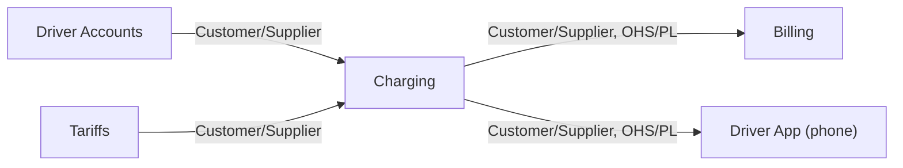
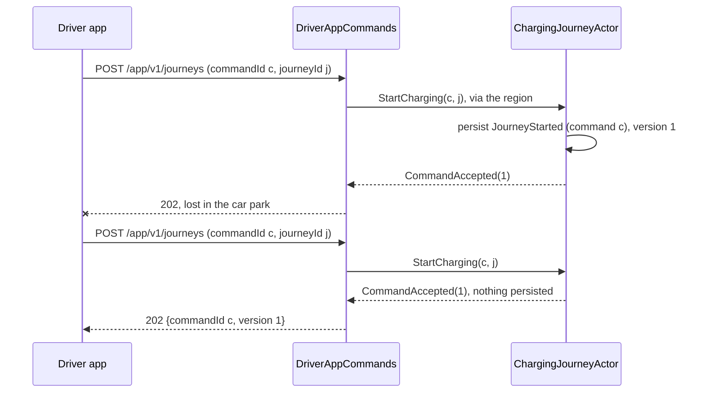
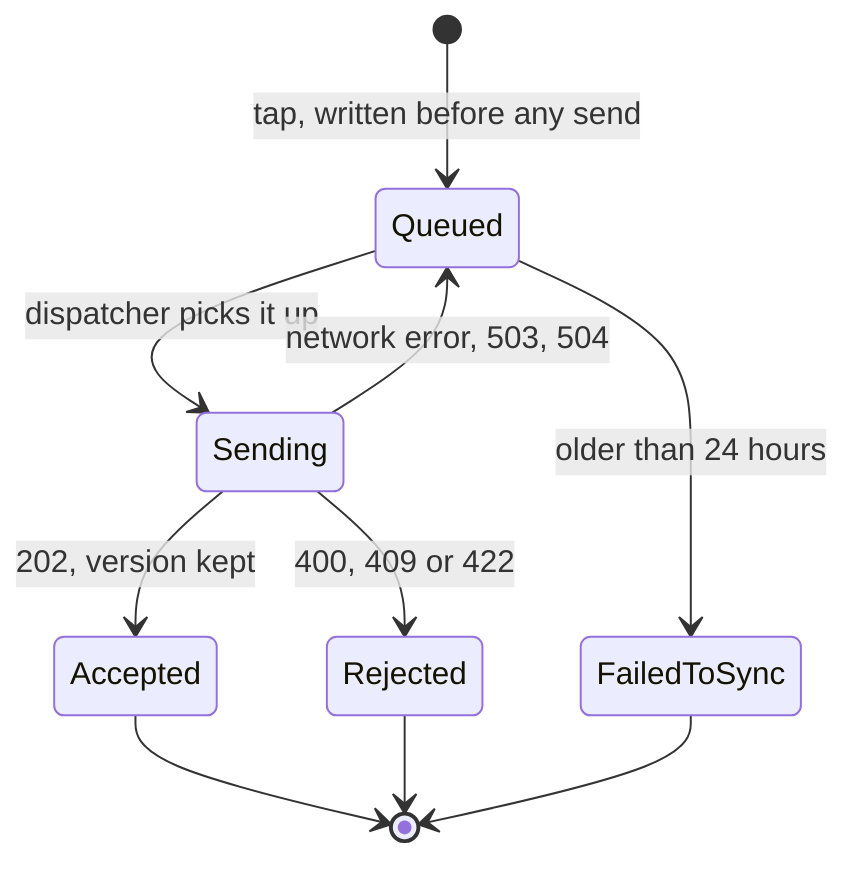
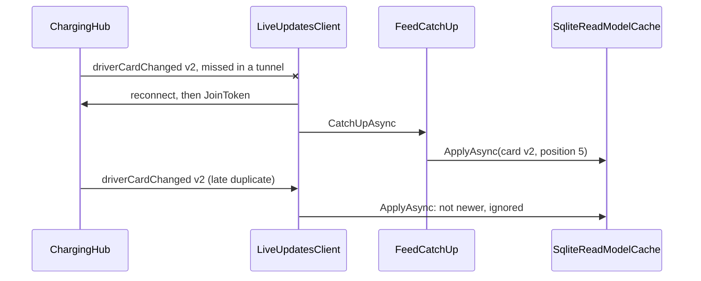

# Chapter 19. The Mobile Edge: An Offline-First .NET MAUI Driver App

At 06:52 a delivery driver backs her van into bay 12 of the underground car park beneath the depot, two floors below the last bar of signal. She scans the connector's label, `OHM-SLC-0042/1`, leaves the spend cap at 40 USD and taps *Start charging*. The prototype app spins for thirty seconds and says "Network error". Upstairs, with one bar, she taps again, and the app says "409 Conflict".

Both taps did something. The first request left the phone moments before the signal died: the server started a journey and held 40 USD on her card, and its 202 never came back. The second tap made a new command with new ids, and the charge point refused it, because the connector was busy with her own first charge. The prototype could not tell "not done" from "done, but the answer was lost", and it showed her a status code.

At the next planning meeting someone asks the obvious question: the app is C# on .NET 11, like the server, so why not put the `ChargePoint` aggregate on the phone, let it decide offline, and sync later? This chapter answers it. The domain stays on the server, and the app becomes a bounded context of its own, with a short list of DDD and actor ideas that do pay off on a phone.

> **In this chapter you will:**
>
> - place the driver app on Ohmline's context map as a downstream bounded context, and name five reasons why aggregates stay on the server;
> - extract a Published Language that the phone can reference, and test it with golden JSON;
> - make every app command safe to send twice, and write the server's side of that contract down;
> - build a plain `net11.0` core library with tests on any machine, and a thin .NET MAUI head for Android;
> - keep the driver's intent in a durable SQLite outbox, drained in order by a single-reader `Channel`;
> - show cached read models with a pending overlay that disappears only when the server's facts arrive, and follow one trace from the tap to the journal.

> **Starting point:** `ch18-s09`, the observed system with its SLO, from Chapter 18.
>
> ```bash
> git checkout ch18-s09
> ```

## 19.1 Where the domain lives: the driver app as its own bounded context

### The question behind the prototype

The tempting answer to the planning meeting goes like this. A `ChargePoint` decider is a pure function (section 7.4), so ship `Ohmline.Charging.Domain` in the app, let it decide "start charging" offline, store the events in SQLite and upload them later.

Follow one invariant to see why this fails: a connector hosts at most one session. On the server that rule holds because one `ChargePointActor`, behind the shard region, sees every command for its charge point, one at a time (section 12.2). A phone sees only its own driver's commands. If two drivers in the same car park start charging offline on connector 1, both phones say yes, and the server must later turn one "yes" into a "no". The phone's decision was a guess.

### Five reasons the aggregates stay on the server

ADR 0014, added at tag `ch19-s01`, records the decision and five facts behind it.

1. **The client is untrusted.** A rule checked on the phone must be checked again on the server, so a shared aggregate gives two enforcement points of which only one counts.
2. **Version skew.** Apps stay on old builds for months. An aggregate in the app would tie the domain's releases to the slowest app store; a contract can grow additively, an aggregate's rules cannot.
3. **The phone sees projections, not event streams.** Its read models are shaped for screens (section 14.6). An aggregate there would be empty, or would need an event history holding other drivers' sessions.
4. **A different consistency model.** On the server an aggregate decides at once and alone (ADR 0001); on the phone everything is provisional until the server accepts it, and a copy that pretends to decide produces "it said yes, and then it wasn't" bugs.
5. **Trimming and packaging.** Everything the app references must survive trimming and ahead-of-time compilation, and section 19.10 shows that Akka.NET 1.5.73 does not.

### The Driver App as a bounded context

The phone is not a degraded copy of Charging; it has its own model and words that the server never uses. A command is **pending** until the server answers it. The app is **syncing** while it sends pending commands or catches up. A command it could not send within a day has **failed to sync**. The phone is **offline** when it believes it has no usable network, a hint and never proof. A bounded context is the boundary inside which a model and its language apply ([Evans 2003](https://www.informit.com/store/domain-driven-design-tackling-complexity-in-the-heart-9780321125217), ch. 14 "Maintaining Model Integrity", section "Bounded Context"), and these words apply only on the phone. Tag `ch19-s01` adds the context to `docs/context-map.md`:



Charging is upstream. Its `/app/v1` endpoints and the SignalR hub at `/hubs/charging` form an **Open Host Service** (OHS), one protocol offered to every client, speaking a **Published Language** (PL) that knows nothing of aggregates ([Evans 2003](https://www.informit.com/store/domain-driven-design-tackling-complexity-in-the-heart-9780321125217), ch. 14 "Maintaining Model Integrity", sections "Open Host Service" and "Published Language"). The relationship is **Customer/Supplier**: the Mobile team is the customer, and what its screens need, such as section 14.6's change feed, goes onto the Sessions team's backlog ([Vernon 2013](https://www.informit.com/store/implementing-domain-driven-design-9780321834577), ch. 3 "Context Maps", p. 92; Evans 2003, ch. 14, section "Customer/Supplier Development Teams"). Inside the app a thin **Anticorruption Layer** (ACL) turns DTOs into view state and rejection codes into sentences. The executable map of section 5.7 gains a row naming the artifacts that the rest of this chapter builds, from the client contracts to the app's `RejectionText`.

### What the device owns

The phone keeps four things of its own: the driver's **intent** until the server has answered it, in a durable outbox of commands whose ids the phone makes; a disposable **read-model cache**; **input validation** for fast feedback; and its **language**. `docs/canvases/bc-driver-app.md` records this in a [Bounded Context Canvas](https://github.com/ddd-crew/bounded-context-canvas) (ddd-crew, V5) whose role line reads "not an enforcer", and `docs/glossary.md` gains a Driver App section, plus a row warning that *pending* means something else in an actor's persist cycle.

> **Try it**
>
> ```bash
> git checkout ch19-s01
> git diff ch18-s09 ch19-s01 --stat
> git show ch19-s01:docs/adr/0014-the-domain-stays-on-the-server.md
> dotnet test --solution Ohmline.slnx
> ```
>
> The diff shows `4 files changed, 192 insertions(+)`, all under `docs/`. Nothing in the code changes, so the full run still reports 2,206 tests passing, as at `ch18-s09`.

## 19.2 A Published Language for client apps

### What the phone may reference

Since section 14.6 the driver app's endpoints have answered with DTOs in `Ohmline.Charging.Api/App/Dtos`. A phone cannot reference that project, which would pull in ASP.NET Core, Akka.NET and the domain. Nor should it reference `Ohmline.Charging.Contracts`, whose messages carry Shared Kernel types such as `ConnectorId` and `Money`. A Shared Kernel is a deliberate, jointly governed overlap between two contexts (section 5.5); the server's Shared Kernel is not the phone's, and a type there that changed shape would break every app in the store.

Tag `ch19-s02` therefore creates `Ohmline.Charging.Client.Contracts`, a project with no `ProjectReference`, no `PackageReference` and `IsAotCompatible` set to `true`, so the trimming and AOT analyzers check it on every build. `ClientContractsTests` in the architecture tests enforce all three. Every field is a primitive: a connector is its printed form, an amount is a `decimal` beside an ISO 4217 code, an id is a `Guid`:

```csharp
// File: src/Charging/Ohmline.Charging.Client.Contracts/Requests/StartChargingRequest.cs @ ch19-s02
public sealed record StartChargingRequest(
    Guid CommandId,
    Guid JourneyId,
    string ConnectorId,
    string TokenUid,
    decimal SpendCapAmount,
    string Currency);
```

The app makes both ids at the tap, so a request sent again names the same command and journey (section 19.3). Acceptance is `CommandAcceptedDto(Guid CommandId, long Version)`, the app's id and the aggregate version after it. The project also holds the read-model and push DTOs and `RejectionCodes`, stable strings such as `already-ended` that the app turns into sentences (section 19.5).

### Serialization without reflection

On a phone, reflection-based `System.Text.Json` is a liability, because the trimmer cannot see which properties reflection reads. The source generator writes the code at compile time:

```csharp
// File: src/Charging/Ohmline.Charging.Client.Contracts/ChargingClientJsonContext.cs @ ch19-s02
[JsonSourceGenerationOptions(JsonSerializerDefaults.Web)]
[JsonSerializable(typeof(StartChargingRequest))]
[JsonSerializable(typeof(StopChargingRequest))]
[JsonSerializable(typeof(ReserveConnectorRequest))]
[JsonSerializable(typeof(CommandAcceptedDto))]
[JsonSerializable(typeof(ProblemDto))]
[JsonSerializable(typeof(DriverSessionCard))]
[JsonSerializable(typeof(DriverSessionCards))]
[JsonSerializable(typeof(DriverFeedEntry))]
[JsonSerializable(typeof(DriverFeedPage))]
[JsonSerializable(typeof(ChargePointListingDto))]
[JsonSerializable(typeof(SessionSummaryChanged))]
[JsonSerializable(typeof(DriverCardChanged))]
public sealed partial class ChargingClientJsonContext : JsonSerializerContext;
```

The server uses the same context: `AddChargingApi` puts it first in the minimal API's `TypeInfoResolverChain`, so both ends share one definition of every shape. `tests/Ohmline.ContractTests` pins each DTO with a golden file (section 16.10), checks that every exported type is in the context, and reads an answer carrying a field the app does not know yet:

*File: tests/golden/client/start-charging-request.json @ ch19-s02*

```json
{
  "commandId": "019a4f6e-1c40-7c11-9a2b-3c4d00000c01",
  "journeyId": "019a4f6e-1c40-7d22-8b3c-4d5e00000d01",
  "connectorId": "OHM-SLC-0042/1",
  "tokenUid": "04A2B3C4D5E6F7",
  "spendCapAmount": 40,
  "currency": "USD"
}
```

### The edge translates

The `/app/v1` endpoints in `DriverAppCommands` are a thin translation. They read every field through the server's own value objects and report all invalid fields at once, look up the connector on its charge point, and tell the journey `StartCharging` with the hold as `new Money(spendCap, currency)`. A new `Edge.SendForAppAsync` turns the reply into the app's mapping, recorded in the project's `README.md`:

| Answer | Status | What the app does |
|---|---|---|
| Accepted | 202 with `CommandAcceptedDto` | Done; wait for a read at that version |
| Refused by the aggregate | 409, problem with `code` | Final; show the code's sentence |
| Invalid or unknown | 422, problem with `code` | Final |
| No answer in time | 504 | Transient; send again, same id |
| Unavailable | 503 | Transient |

An unknown connector is 422 `unknown-connector` here, not the operator endpoint's 404, so that every refusal the app sees carries a code. The app reads problems through its own `ProblemDto`, because ASP.NET Core's `ProblemDetails` belongs to the server.

The README closes with five versioning rules for apps that stay in pockets for months. Add fields, never rename or remove one. The server tolerates missing fields. The app tolerates unknown fields and unknown codes. `RejectionCodes` values are append-only. A breaking change is `/app/v2` beside `/app/v1`. Sections 20.9 and 21.1 return to these rules.

> **Try it**
>
> ```bash
> git checkout ch19-s02
> git diff ch19-s01 ch19-s02 --stat
> git diff ch19-s01 ch19-s02 -- src/Charging/Ohmline.Charging.Api/Edge.cs
> dotnet test --project tests/Ohmline.ContractTests -- --filter-class "*ClientContractsTests"
> dotnet test --solution Ohmline.slnx
> ```
>
> The diff ends `60 files changed, 1357 insertions(+), 166 deletions(-)`. The filtered run reports `total: 39, failed: 0`, and the full run 2,264 tests passing.

## 19.3 Commands you can send twice

### Not done, or done and unheard

In the car park, the first request reached the server and its 202 was lost; from the phone, that looks exactly like a request that never arrived. A 504 is no clearer, because the journey may carry out the start a moment after the edge gave up waiting. The phone's one safe move is to send **the same command** again, and the server's one safe answer is to recognize it. Helland makes the same point about any messaging that retries: the receiver must make a repeated message harmless (Helland, ["Idempotence Is Not a Medical Condition"](https://queue.acm.org/detail.cfm?id=2187821), *ACM Queue* 10(4), 2012).



### The aggregates already remember

Charge points and sessions already deduplicate. Section 12.6 gave every `DeciderActor` a window of the last 256 command ids, rebuilt on recovery because every event records the id of the command that caused it. Check and write are one decision of one single writer: a retry that arrives during the first persist waits in the mailbox and then finds its id, with no lock and no table of processed commands. This is the Idempotent Receiver pattern as Vernon presents it for actors ([Vernon 2015](https://www.informit.com/store/reactive-messaging-patterns-with-the-actor-model-applications-9780133846836), ch. 9 "Message Endpoints", section "Idempotent Receiver", p. 382).

The journey, a process manager (Chapter 15), had no window. Tag `ch19-s03` makes it idempotent through the journey id the app gives it:

```csharp
// File: src/Charging/Ohmline.Charging.Domain/Journeys/ChargingJourney.cs @ ch19-s03
public static JourneyStep Next(
    JourneyState state, JourneyInput input, DecisionContext context)
{
    if (input.Value is StartCharging start && state.Terms is { } terms)
    {
        return StartedAlready(state, start, terms);
    }
// ...
private static JourneyStep StartedAlready(
    JourneyState state, StartCharging start, JourneyTerms terms) =>
    new(state, [], [])
    {
        Answer = start.CommandId == terms.StartedBy
            ? new AcceptedAsBefore()
            : new Refused(
                JourneyRefusals.JourneyExists,
                $"Journey {terms.JourneyId} was started by another command."),
    };
```

`JourneyTerms` keeps `StartedBy`, the command id stored in `JourneyStarted`, so the journey recognizes a repeat for its whole life. Another command with the same journey id is refused with `journey-exists`: the app makes both ids together, so that is a bug in the app, never a second driver. The new domain union `JourneyAnswer(AcceptedNow, AcceptedAsBefore, Refused)` becomes a reply in the shell:

```csharp
// File: src/Charging/Ohmline.Charging.Actors/Journeys/ChargingJourneyActor.cs @ ch19-s03
private CommandReply AnswerTo(JourneyStep step) => step.Answer switch
{
    AcceptedNow => new CommandAccepted(LastSequenceNr),
    AcceptedAsBefore => new CommandAccepted(_startedVersion),
    Refused refused => new CommandRejected(refused.Code, refused.Message),
    null => throw new InvalidOperationException("The answer is default: it holds no case."),
};
```

`_startedVersion` is taken from `LastSequenceNr` when `JourneyStarted` is stored or replayed. Before this tag a repeated start got the journey's *current* version, which would mislead a phone waiting for a read model at that version.

### One id, in the body

Section 12.6 took the command id from an `Idempotency-Key` header and left a gap: a key reused with a different body went undetected. For the app, the id moves into the body, where it is part of the Published Language and is stored with the request, and the edge copies it into the command unchanged. A client may still send the header, but a header that names another command is refused with 400 `idempotency-key-mismatch` before anything reaches an actor, because a request with two ids would become two commands when sent again. The server still does not compare a repeated command's body with the first; the app rules that out by storing the request once and sending the stored bytes every time.

### The contract, written down

`docs/idempotency-contract.md` states both sides. The app makes ids at the tap, writes the command to its outbox before the first send, sends it again with the same ids after a network error, 503 or 504, never after 202, 409 or 422, and gives up after 24 hours. The server copies the id unchanged, answers a known command with its first answer, and remembers ids **for longer than the app sends them**.

That last rule needs arithmetic. A busy charge point with two connectors accepts about a hundred commands a day, well inside 256. A session accepts none after the stop that ends it, so the app's stop is always among its last commands, and the journey remembers its start for ever. If an aggregate ever accepted 256 commands within a day, a late duplicate would be decided again: a reservation would be refused as reserved for another token, its own.

Ohmline's three app commands need only deduplication, because "reserve connector 1" means the same whatever the phone last showed. A command decided against what the driver *saw* is different. Changing the spend cap of a running session would be one, since a cap chosen at 7 kWh may be wrong at 40 kWh. It would carry an `expectedVersion` and could be refused as `stale` (section 10.9 pointed ahead to this case). Ohmline has no such command yet.

The tests use real storage. `JourneySentTwiceTests` starts the journey actor on the SQLite journal of section 10.7, outside a shard region so the test decides when it stops, sends the same start twice, stops the actor, recovers it and sends the start a third time: all three replies are `CommandAccepted(1)` and the journal holds one `charging.journey-started.v1`. `RestartSurvivalTests` does the same for a stop against PostgreSQL across a node restart, and gets the same body back.

> **Try it**
>
> ```bash
> git checkout ch19-s03
> git diff ch19-s02 ch19-s03 -- src/Charging/Ohmline.Charging.Domain/Journeys
> dotnet test --project tests/Ohmline.Charging.Domain.Tests -- --filter-class "*SendTwiceTests"
> dotnet test --project tests/Ohmline.Charging.Actors.Tests -- --filter-class "*JourneySentTwiceTests"
> dotnet test --solution Ohmline.slnx
> ```
>
> The two filtered runs report `total: 12` and `total: 2`, all passing. The full run reports 2,283 tests passing.

## 19.4 A plain core library and a thin MAUI head

### Most of an app is not its pages

A .NET MAUI project builds only where its workload, an Android SDK and a JDK are installed, and emulator tests are slow and fragile. Yet almost everything worth testing in the driver app has nothing to do with pages. The split follows the hexagonal shape of section 5.2. A plain library holds the logic and declares small ports for what only the platform provides; a thin **head**, the platform project in .NET MAUI terms, holds pages, dependency injection and adapters.

Tag `ch19-s04` creates `src/Mobile/Ohmline.Mobile.Core`, a `net11.0` library in `Ohmline.slnx` with `IsAotCompatible` on, one package, CommunityToolkit.Mvvm 8.4.2, and one project reference, the client contracts. The toolkit generates observable properties and commands from partial declarations, a form that C# 13's partial properties made possible:

```csharp
// File: src/Mobile/Ohmline.Mobile.Core/Listings/ChargePointListingViewModel.cs @ ch19-s04
public sealed partial class ChargePointListingViewModel(ChargingApiClient api) : ObservableObject
{
    /// <summary>The charge point to show, as printed on it: <c>OHM-SLC-0042</c>.</summary>
    [ObservableProperty]
    public partial string ChargePointId { get; set; } = "";
    // ...
    [RelayCommand]
    private async Task LoadAsync(CancellationToken cancellationToken)
    {
        IsLoading = true;
        Message = null;
        try
        {
            Listing = await api.GetListingAsync(ChargePointId.Trim(), cancellationToken);
            Message = Listing is null ? $"{ChargePointId} is not listed yet." : null;
        }
        catch (HttpRequestException)
        {
            Message = "Ohmline cannot be reached. Check your connection and try again.";
        }
        finally
        {
            IsLoading = false;
        }
    }
}
```

`[ObservableProperty]` generates the property's body and its change notification; `[RelayCommand]` turns `LoadAsync` into a `LoadCommand` the page binds to. `ChargingApiClient` is a typed client over an `HttpClient` the head provides, reading every body with `ChargingClientJsonContext`. The tests replace the server with `FakeServer`, an `HttpMessageHandler` that answers from a queue. Two ports complete the library: `IConnectivity`, "a hint, never proof", because a phone on a captive Wi-Fi reports internet it does not have, and `IAppDispatcher`, whose one method posts work to the UI thread.

### The head, in a solution of its own

The head, `mobile/Ohmline.Mobile`, is not in `Ohmline.slnx`, or every build at the root would need the MAUI workload. A second solution at the root fails a bare `dotnet build` with MSB1011, and a solution filter only subtracts from a solution that would then contain the head. So `mobile/Ohmline.Mobile.slnx` lists the contracts, the core, its tests and the head, and `mobile/Directory.Build.props` imports the root file, so warnings as errors and CS8509 apply unchanged, then clears `TargetFramework` so the head's own frameworks apply (and turns off XAML incremental hot reload; see the version note in section 19.5):

```xml
<!-- File: mobile/Ohmline.Mobile/Ohmline.Mobile.csproj @ ch19-s04 -->
<PropertyGroup>
  <TargetFrameworks>net11.0-android</TargetFrameworks>
  <!-- ... -->
  <UseMaui>true</UseMaui>
  <SingleProject>true</SingleProject>
  <ApplicationTitle>Ohmline</ApplicationTitle>
  <ApplicationId>example.ohmline.driver</ApplicationId>
<!-- ... -->
</PropertyGroup>

<PropertyGroup Condition="$([MSBuild]::IsOSPlatform('osx'))">
  <TargetFrameworks>$(TargetFrameworks);net11.0-ios;net11.0-maccatalyst</TargetFrameworks>
</PropertyGroup>

<PropertyGroup Condition="$([MSBuild]::IsOSPlatform('windows'))">
  <TargetFrameworks>$(TargetFrameworks);net11.0-windows10.0.19041.0</TargetFrameworks>
</PropertyGroup>
<!-- ... -->
<PropertyGroup Condition="'$(TfmPlatform)' == 'android'">
  <SupportedOSPlatformVersion>24.0</SupportedOSPlatformVersion>
</PropertyGroup>
```

Android is always built; iOS and Mac Catalyst only on a Mac, Windows only on Windows. API 24 is the oldest Android that .NET 11 supports. `MauiProgram` registers the core's services and one `HttpClient` whose base address, `http://10.0.2.2:5180`, comes from an embedded `appsettings.json`: the emulator reaches the development machine at `10.0.2.2`, and only Debug builds may use plain HTTP to it. MAUI's global usings bring a `Microsoft.Maui.Networking.IConnectivity`, so `MauiProgram` aliases the app's port. `ListingPage.xaml` declares `x:DataType`, so its bindings are compiled and checked at build time.

### Building on Linux, and without MAUI

On Linux the head needs `dotnet workload install maui-android`, an Android SDK and a JDK; `mobile/README.md` shows how `InstallAndroidDependencies` fetches both. Without them, everything at the root still builds and tests, and only the mobile solution fails:

```text
$ MSBuildEnableWorkloadResolver=false dotnet build mobile/Ohmline.Mobile.slnx
...
error NETSDK1208: The target platform identifier android was not recognized. ...
```

`tools/verify-tags.sh` builds the mobile solution at every tag that has it, and stops early if `ANDROID_HOME` or `JAVA_HOME` is unset, unless `OHMLINE_SKIP_MOBILE=1`. `MobileTests` enforce ADR 0014 from the phone's side: the core references no Ohmline assembly but the client contracts and no Akka.NET, MAUI or ASP.NET Core server assembly, and no mobile project references an `Akka` package.

> **Version note:** MAUI 11 is at `11.0.0-rc.2.26505.5`; the RC3 SDK's workload set ships MAUI rc.2, and there is no MAUI rc.3. The build proves only that the head compiles and packages an APK. The sample has not been run on an emulator or a device, and iOS and Mac Catalyst were not built.

> **Try it**
>
> ```bash
> git checkout ch19-s04
> git diff ch19-s03 ch19-s04 --stat -- . ':!mobile/Ohmline.Mobile/Resources' ':!mobile/Ohmline.Mobile/Platforms'
> dotnet test --project tests/Ohmline.Mobile.Core.Tests
> dotnet build mobile/Ohmline.Mobile.slnx -warnaserror
> ```
>
> Without the template's resources and platform files the diff is `30 files changed, 768 insertions(+)`. The core's tests report `total: 6, failed: 0`, and a full solution run reports 2,294. With the Android toolchain, the mobile build ends with `0 Warning(s)` and `0 Error(s)` and writes `example.ohmline.driver-Signed.apk`.

## 19.5 The ubiquitous language on the phone: value objects and unions

### Value objects that run before a command exists

The start-charging screen asks for the connector, scanned or typed from its label, `OHM-SLC-0042/1`, and a spend cap, and it answers in Ohmline's words: a driver at a connector held for someone else reads "This connector is reserved for another driver.", never "409". Evans asks the team to exercise the ubiquitous language "relentlessly in all communication within the team and in the code" ([Evans 2003](https://www.informit.com/store/domain-driven-design-tackling-complexity-in-the-heart-9780321125217), ch. 2 "Communication and the Use of Language"; [*DDD Reference*](https://www.domainlanguage.com/wp-content/uploads/2016/05/DDD_Reference_2015-03.pdf#page=11), "Ubiquitous Language", p. 4), and a driver's screens are where most people meet it.

A mistyped code should be caught at the charger, offline too, and never become a command. The app gets value objects of its own, shaped like the server's smart constructors (section 6.2) but returning the app's own `union ParseResult<T>(Parsed<T>, Invalid)`, where `Invalid` carries a sentence:

```csharp
// File: src/Mobile/Ohmline.Mobile.Core/Charging/ConnectorCode.cs @ ch19-s05
public static ParseResult<ConnectorCode> TryParse(string? text)
{
    if (string.IsNullOrWhiteSpace(text))
    {
        return new Invalid("Scan or type the code on the connector's label.");
    }

    var match = Printed().Match(text.Trim().ToUpperInvariant());
    return match.Success
        ? new Parsed<ConnectorCode>(
            new ConnectorCode(match.Groups[1].Value, int.Parse(match.Groups[2].Value)))
        : new Invalid(
            $"'{text.Trim()}' is not a connector code. It looks like OHM-SLC-0042/1.");
}
```

The rules duplicate the server's `ConnectorId` on purpose, and the type's remarks say so. That is not a Shared Kernel: the phone's copy exists for feedback, the server's is authoritative, and when they disagree the server's rejection settles it. `SpendCap` does the same for the amount, from 1 to 500 USD in whole cents, parsed in the phone's culture, so a phone set to German reads `40,50` as 40.50 USD.

`StartChargingViewModel` builds a request only when both fields parse:

```csharp
// File: src/Mobile/Ohmline.Mobile.Core/Charging/StartChargingViewModel.cs @ ch19-s05
if ((connector.Value, spendCap.Value) is not
    (Parsed<ConnectorCode> code, Parsed<SpendCap> cap))
{
    return null;
}

var now = clock.GetUtcNow();
return new StartChargingRequest(
    CommandId: Guid.CreateVersion7(now),
    JourneyId: Guid.CreateVersion7(now),
    ConnectorId: code.Value.ToString(),
    TokenUid: token.Uid,
    SpendCapAmount: cap.Value.Amount,
    Currency: SpendCap.Currency);
```

The positional pattern over two union values reads as the rule: unless both are parsed, there is no request. Both ids are version 7 Guids made from the injected clock at the tap, so they sort by time in the journal, the outbox and the logs.

### Unions for what a screen can be

A screen is waiting, ready, offline or failed; a command is queued, sending, accepted, rejected or failed to sync. Booleans such as `IsLoading` and `HasError` allow combinations that mean nothing, and Wlaschin's advice is to make such states unrepresentable ([Wlaschin 2018](https://pragprog.com/titles/swdddf/domain-modeling-made-functional/), ch. 6 "Integrity and Consistency in the Domain", and ch. 7 "Modeling Workflows as Pipelines", section "Modeling an Order as a Set of States"). C# 15 unions do, with the Driver App's glossary as case names:

```csharp
// File: src/Mobile/Ohmline.Mobile.Core/Charging/CommandStatus.cs @ ch19-s05
public union CommandStatus(Queued, Sending, Accepted, Rejected, FailedToSync);

/// <summary>Kept on the phone, waiting to be sent; tried this many times so far.</summary>
public sealed record Queued(int Attempts);

/// <summary>Being sent now: this attempt.</summary>
public sealed record Sending(int Attempt);

/// <summary>The server accepted it; the aggregate is at this version.</summary>
public sealed record Accepted(long Version);
// ...
public sealed record Rejected(string Code, string Text);

/// <summary>Not sent within its maximum age; never sent again.</summary>
public sealed record FailedToSync;
```

`ScreenState` is `union ScreenState(Loading, Ready, Offline, Failed)`. Neither crosses the wire: they are in-process state, as ADR 0003's house rule demands. The head renders a union through a small `StateView` that asks an `IStateTemplates` for the template of the current case and binds it to the case:

```csharp
// File: mobile/Ohmline.Mobile/Views/ScreenStateTemplates.cs @ ch19-s05
public (DataTemplate Template, object Case) Select(object state) => (ScreenState)state switch
{
    Loading loading => (Loading, loading),
    Ready ready => (Ready, ready),
    Offline offline => (Offline, offline),
    Failed failed => (Failed, failed),
    null => throw new InvalidOperationException("The screen state is default."),
};
```

Add a case to `ScreenState` and this switch stops compiling, because CS8509 is an error in the head too; the `null` arm covers `default(ScreenState)` (section 3.3). The page gives one template per case, each compiled against its case's type, and binds two `StateView`s to the view model:

```xaml
<!-- File: mobile/Ohmline.Mobile/Pages/StartChargingPage.xaml @ ch19-s05 -->
  <views:ScreenStateTemplates.Offline>
    <DataTemplate x:DataType="charging:Offline">
      <Label Text="You are offline. Charging can start once the phone has a signal." />
    </DataTemplate>
  </views:ScreenStateTemplates.Offline>
<!-- ... -->
<views:StateView State="{Binding Screen}" Templates="{StaticResource ScreenTemplates}" />
<views:StateView State="{Binding Status}" Templates="{StaticResource StatusTemplates}" />
```

MAUI 11's XAML source generator rejects `required` and `init` properties set from XAML (MAUIX2005), so the template properties are plain settable ones. `ExhaustivenessDemo.cs` in the core's tests leaves out the `Offline` arm inside `#if DEMO_COMPILE_ERRORS`:

```text
$ dotnet build tests/Ohmline.Mobile.Core.Tests -p:DefineConstants=DEMO_COMPILE_ERRORS
...
.../ExhaustivenessDemo.cs(13,63): error CS8509: The switch expression does not handle all ...
... For example, the pattern 'Ohmline.Mobile.Core.Charging.Offline' is not covered.
```

### Codes become sentences

`RejectionText.For` is the app's half of the ACL for refusals: a switch from each `RejectionCodes` constant to a sentence, such as `already-ended` to "This charge has already ended.", with a discard arm for codes a newer server may send, as section 19.2's rules require. `RejectionTextTests` check that every code in `RejectionCodes.All` has its own sentence and that `"stale"`, an empty string and `null` get the fallback. At this tag the view model still sends directly through `ChargingApiClient`; section 19.6 replaces that.

> **Version note:** `mobile/Directory.Build.props` sets `EnableMauiIncrementalHotReload` to `false`. MAUI 11 rc.2's XAML incremental hot reload generator fails with `error CS0200: Property or indexer 'ShellItem.Items' cannot be assigned to` in `AppShell.xaml.uc.xsg.cs` when the compiler server has already built a different `AppShell.xaml` at the same path, which is what checking out another tag does. Classic XAML hot reload still works. Re-check the setting when you move to a later MAUI release.

> **Try it**
>
> ```bash
> git checkout ch19-s05
> git diff ch19-s04 ch19-s05 -- src/Mobile/Ohmline.Mobile.Core/Charging
> dotnet test --project tests/Ohmline.Mobile.Core.Tests
> dotnet build tests/Ohmline.Mobile.Core.Tests -p:DefineConstants=DEMO_COMPILE_ERRORS
> ```
>
> The core's tests report `total: 47, failed: 0`, and a full solution run reports 2,335. The build with the demo symbol fails with the CS8509 above.

## 19.6 Offline first: a durable outbox drained by a mailbox

### Intent that survives a dead network and a killed app

Two floors underground the driver taps *Start charging*, pockets the phone, and Android, short of memory, kills the app in the background. [The MAUI documentation](https://learn.microsoft.com/en-us/dotnet/maui/fundamentals/app-lifecycle#cross-platform-lifecycle-events) warns that after `Window.Stopped` there is no guarantee an app will resume, because the operating system may terminate it ("App lifecycle", section "Cross-platform lifecycle events"). A request in flight or a retry timer held in memory is gone.

The answer is section 16.3's outbox, turned around. Billing's outbox makes a fact durable before telling anyone; **the app's outbox** makes the driver's *intent* durable before any network call, and sending becomes a separate job that can happen now, in an hour, or after a restart. Tag `ch19-s06` adds `Microsoft.Data.Sqlite` 10.0.14, the repo's single CPM version, to the core library, and `SqliteOutbox` with one table, `outbox(command_id TEXT PRIMARY KEY, kind, aggregate_key, payload, created_utc, attempts, status, version, code, reason, trace_parent)`, in WAL mode so screens can read while the dispatcher writes:

```csharp
// File: src/Mobile/Ohmline.Mobile.Core/Outbox/SqliteOutbox.cs @ ch19-s06
public async Task<bool> EnqueueAsync(
    OutboxCommand command, DateTimeOffset now, CancellationToken cancellationToken)
{
    await using var connection = await OpenAsync(cancellationToken);
    await using var insert = connection.CreateCommand();
    insert.CommandText = """
        INSERT OR IGNORE INTO outbox
            (command_id, kind, aggregate_key, payload, created_utc, attempts, status)
        VALUES ($id, $kind, $key, $payload, $created, 0, 'queued')
        """;
    insert.Parameters.AddWithValue("$id", command.CommandId.ToString());
    insert.Parameters.AddWithValue("$kind", command.Kind);
    insert.Parameters.AddWithValue("$key", command.AggregateKey);
    insert.Parameters.AddWithValue("$payload", command.Payload);
    insert.Parameters.AddWithValue("$created", Stamp(now));
    return await insert.ExecuteNonQueryAsync(cancellationToken) == 1;
}
```

The payload is the request already serialized in the Published Language, so a retry sends the same bytes, and `INSERT OR IGNORE` makes a second enqueue of the same command a no-op. `StartChargingViewModel` now enqueues and nudges instead of sending, and it keeps the request made at the first tap until the driver edits a field or the server refuses it, so a double tap is one command with one id and one row. "Sending" is never stored: a command being sent when the app dies is still queued.



These are `CommandStatus`'s cases. Only the transient path loops back, with the same command id.

### One reader, the actor's shape

The tap, a connectivity change, the app returning to the foreground and a retry timer all want to trigger a send. If each sent on its own, two could send the same row at once, or out of order. Section 2.2 built the cure by hand: a `Channel` with a single reader, whose one loop is the only code that acts. `OutboxDispatcher` is that shape again, with no actor framework:

```csharp
// File: src/Mobile/Ohmline.Mobile.Core/Outbox/OutboxDispatcher.cs @ ch19-s06
private readonly Channel<Signal> _mailbox =
    Channel.CreateUnbounded<Signal>(new UnboundedChannelOptions { SingleReader = true });
// ...
public void Nudge() => _mailbox.Writer.TryWrite(new Nudged());
// ...
private async Task ReceiveAsync(CancellationToken stopping)
{
    await foreach (var signal in _mailbox.Reader.ReadAllAsync(stopping))
    {
        await DrainAsync(stopping);
        if (signal.Value is FlushRequested flush)
        {
            flush.Done.TrySetResult();
        }
    }
}
```

`Nudge()` writes a message and returns at once; whoever calls it never waits and never locks. The dispatcher's channel carries a private `union Signal(Nudged, FlushRequested)`, where `FlushRequested` lets a test or a pull-to-refresh wait for the drain.

### Draining in order

The drain first gives up on old commands, then sends the rest oldest first:

```csharp
// File: src/Mobile/Ohmline.Mobile.Core/Outbox/OutboxDispatcher.cs @ ch19-s06
private async Task DrainAsync(CancellationToken stopping)
{
    foreach (var expired in await outbox.ExpireAsync(clock.GetUtcNow() - MaxAge, stopping))
    {
        Publish(expired, new FailedToSync());
    }

    if (!connectivity.IsOnline)
    {
        return;
    }

    foreach (var row in await outbox.ReadQueuedAsync(stopping))
    {
        var attempt = row.Attempts + 1;
        await outbox.MarkAttemptAsync(row.CommandId, stopping);
        Publish(row.CommandId, new Sending(attempt));
```

Connectivity only saves the battery: offline, the drain sends nothing. An attempt is counted before it is made, so one the app dies in still counts. The answer is a third union, `SendOutcome(SendAccepted, SendRejected, SendTransientFailure)`:

```csharp
// File: src/Mobile/Ohmline.Mobile.Core/Outbox/OutboxDispatcher.cs @ ch19-s06
        switch (await sender.SendAsync(row, stopping))
        {
            case SendAccepted accepted:
                await outbox.MarkAcceptedAsync(row.CommandId, accepted.Version, stopping);
                Publish(row.CommandId, new Accepted(accepted.Version));
                break;
            case SendRejected rejected:
                await outbox.MarkRejectedAsync(
                    row.CommandId, rejected.Code, rejected.Reason, stopping);
                Publish(
                    row.CommandId,
                    new Rejected(rejected.Code, RejectionText.For(rejected.Code)));
                break;
            case SendTransientFailure:
                Publish(row.CommandId, new Queued(attempt));
                _timer!.Period = Backoff(++_failures, Random.Shared.NextDouble());
                return; // Keep the order: nothing after it goes first.
            case null:
                throw new InvalidOperationException("The outcome is default.");
        }
    }

    _failures = 0;
    _timer!.Period = Idle;
}
```

An accepted row records the server's version, which section 19.7 needs. A rejected row is final and does not hold up the next command. A transient failure **stops the drain**: while the first command's fate is unknown, sending the second could reach the server out of the driver's order. The timer retries after 2 s, doubling to at most 5 minutes, spread by ±20% jitter so that a thousand phones that lost the network together do not return in the same second. `StatusChanged` goes through `IAppDispatcher.Post`, so view models hear it on the UI thread.

`HttpCommandSender` maps HTTP to a `SendOutcome` by section 19.2's table: 202 is accepted, 400, 409 and 422 are rejected with the problem's code, and everything else, including 408, 429, every 5xx, a timeout and no network, is transient, because the command may or may not have been carried out.

### The window drives the dispatcher

The head ties the dispatcher to the window's lifecycle:

```csharp
// File: mobile/Ohmline.Mobile/App.xaml.cs @ ch19-s06
protected override Window CreateWindow(IActivationState? activationState)
{
    var window = new Window(new AppShell());
    window.Created += (_, _) => Resume();
    window.Resumed += (_, _) => Resume();
    window.Stopped += async (_, _) => await _dispatcher.StopAsync();
    return window;
}

private void Resume()
{
    _dispatcher.Start();
    _dispatcher.Nudge();
}
```

The dispatcher itself nudges on `IConnectivity.ConnectivityChanged`, which keeps that behaviour testable in the core. The head passes the database, `Path.Combine(FileSystem.AppDataDirectory, "ohmline-driver.db3")`, as a connection string, so the library never touches MAUI.

> **Warning:** The outbox is the phone's only durable record of the driver's intent. An app update that drops or recreates the file loses commands the driver believes were given. Treat its file and tables as durable names, as ADR 0009 does from tag `ch19-s08`: drain or migrate them across app versions, never delete them.

> **Try it**
>
> ```bash
> git checkout ch19-s06
> git diff ch19-s05 ch19-s06 --stat
> dotnet test --project tests/Ohmline.Mobile.Core.Tests -- --filter-class "*OutboxDispatcherTests"
> dotnet test --project tests/Ohmline.Mobile.Core.Tests
> ```
>
> The diff ends `22 files changed, 1163 insertions(+), 139 deletions(-)`. The dispatcher's tests report `total: 11, failed: 0`, among them `Given_a_transient_failure_then_the_commands_after_it_wait_their_turn` and `Given_a_command_older_than_24_hours_then_it_fails_to_sync_unsent`. The core reports `total: 73`, and a full solution run reports 2,361.

## 19.7 Read models on the device: a cache, live updates and optimistic UI

### A card that shows at once, and is never ahead of the facts

Opened in the car park, the app should show the session card at once with the last known energy, not a spinner. Tag `ch19-s07` caches the driver-app read model of section 14.6 in `SqliteReadModelCache`, a table `session_card(token_uid, session_id, version, json)` in the outbox's file, with a version-guarded upsert like the server's projections (section 13.5):

```csharp
// File: src/Mobile/Ohmline.Mobile.Core/ReadModels/SqliteReadModelCache.cs @ ch19-s07
upsert.CommandText = """
    INSERT INTO session_card (token_uid, session_id, version, json)
    VALUES ($token, $session, $version, $json)
    ON CONFLICT (token_uid, session_id) DO UPDATE
        SET version = excluded.version, json = excluded.json
        WHERE session_card.version < excluded.version
    """;
```

A push that arrives twice, late or out of order changes nothing, and a `feed_position` row per token moves only forward in the same database transaction. The cache is disposable: drop both tables and the server's feed fills them again.

### Pushes, and the pull that covers their gaps

`LiveUpdatesClient` connects to section 14.5's hub, joins the token's group and applies each `driverCardChanged` to the cache. SignalR keeps nothing for an absent client, and a reconnect is a new connection in no group (["Manage users and groups in SignalR"](https://learn.microsoft.com/en-us/aspnet/core/signalr/groups#add-or-remove-connections-from-a-group)). `WithAutomaticReconnect` tries four times, after 0, 2, 10 and 30 s, then closes, and it never retries the first start (["ASP.NET Core SignalR .NET client"](https://learn.microsoft.com/en-us/aspnet/core/signalr/dotnet-client#automatically-reconnect), section "Automatically reconnect"). So the client has its own loop, and after every connect it rejoins and pulls what it missed from `GET /app/v1/tokens/{uid}/feed?after=`:

```csharp
// File: src/Mobile/Ohmline.Mobile.Core/ReadModels/LiveUpdatesClient.cs @ ch19-s07
private async Task ConnectAsync(CancellationToken stopping)
{
    while (_hub.State == HubConnectionState.Disconnected)
    {
        try
        {
            await _hub.StartAsync(stopping);
        }
        catch (Exception failed) when (failed is not OperationCanceledException)
        {
            await Task.Delay(RetryEvery, _clock, stopping);
            continue;
        }

        await JoinAndCatchUpAsync(stopping);
    }
}

private async Task JoinAndCatchUpAsync(CancellationToken stopping)
{
    await _hub.InvokeAsync("JoinToken", _token.Uid, stopping);
    try
    {
        if (await _catchUp.CatchUpAsync(_token.Uid, stopping) > 0)
        {
            _ui.Post(() => CardsChanged?.Invoke());
        }
    }
    catch (HttpRequestException)
    {
        // The pushes still come; the next reconnect or resume catches up again.
    }
}
```

`Reconnected` calls `JoinAndCatchUpAsync`, and `Closed` returns to `ConnectAsync` while the client runs. `FeedCatchUp` reads pages from the cached position until one is empty. The head starts the client on `Created` and `Resumed` and stops it on `Stopped`, because no phone keeps a socket open in the background; reaching a closed app would need the platforms' push services, left out here.



`FeedCatchUpTests` checks that a simulated reconnect reads only the missed entries, and `DriverAppLiveTests` runs the app's `LiveUpdatesClient` against the real node: catch-up brings the card at version 1, the stop's push version 2, `ended`.

### Optimistic, without lying

Section 14.2 set the rule: an optimistic value needs a visible pending mark, removed by the read model rather than by the command's 202. In Helland's terms the app shows a guess, which must look like one until the facts arrive (Helland, ["Memories, Guesses, and Apologies"](https://web.archive.org/web/20090331110649/http://blogs.msdn.com/pathelland/archive/2007/05/15/memories-guesses-and-apologies.aspx), blog post, 15 May 2007). `SessionCardView.Merge` is a pure fold over the cached cards and the outbox rows of the last 24 hours, oldest first:

```csharp
// File: src/Mobile/Ohmline.Mobile.Core/ReadModels/SessionCardView.cs @ ch19-s07
bySession.TryGetValue(Guid.Parse(command.AggregateKey), out var card);
(pending, problem) = command.ToStatus() switch
{
    Queued or Sending => (overlay, null),
    Accepted accepted when !Shows(card, command.Kind, accepted.Version) =>
        (overlay, null),
    Accepted => (pending, null),
    Rejected rejected => (pending, rejected.Text),
    FailedToSync => (pending, NotSent),
    null => throw new InvalidOperationException("The status is default."),
};
```

While a stop is queued or sending, the card says "Stopping...". After the server accepts it at version 3, the overlay **stays** until the cached card has version 3, because a 202 means the aggregate decided, not that the read model shows it. A start's overlay goes when its session has a card, found by the journey id (section 15.3 names the session after the journey). A rejected command shows its `RejectionText` instead.

`SessionCardViewModel` refreshes on every `CardsChanged` and `StatusChanged`, one refresh at a time behind a `SemaphoreSlim`; otherwise a refresh that read before a push could finish last and put a stale overlay back.

> **Try it**
>
> ```bash
> git checkout ch19-s07
> git diff ch19-s06 ch19-s07 -- src/Mobile/Ohmline.Mobile.Core/ReadModels
> dotnet test --project tests/Ohmline.Mobile.Core.Tests
> dotnet test --solution Ohmline.slnx
> ```
>
> The core reports `total: 88, failed: 0`, including `Given_a_stop_when_the_pushed_card_catches_up_then_the_overlay_goes` and `Given_a_rejected_stop_then_the_card_says_why_in_the_drivers_words`. The full run, with `DriverAppLiveTests` against PostgreSQL, reports 2,377.

## 19.8 One trace from tap to journal

### A trace that starts in the driver's hand

Chapter 17's traces begin at the HTTP edge, which for the app is too late: a start sent three hours after the tap should still be one story. Tag `ch19-s08` adds `MobileDiagnostics` to the core, one `ActivitySource` named `Ohmline.Mobile`, BCL types only like the server's diagnostics classes (section 17.1). The tap starts `tap start-charging`, the outbox stores its `traceparent` in the `trace_parent` column, and each send attempt starts its own span:

```csharp
// File: src/Mobile/Ohmline.Mobile.Core/Diagnostics/MobileDiagnostics.cs @ ch19-s08
public static Activity? StartSend(
    string kind, Guid commandId, int attempt, string? tap, bool sameProcess)
{
    var tapped = ActivityContext.TryParse(tap, null, out var context) ? context : default;
    var span = sameProcess || tapped == default
        ? ActivitySource.StartActivity($"send {kind}", ActivityKind.Internal, tapped)
        : ActivitySource.StartActivity(
            $"send {kind}",
            ActivityKind.Internal,
            parentContext: default,
            links: [new ActivityLink(tapped)]);
    return span?.SetTag(CommandIdTag, commandId.ToString())
        .SetTag(CommandKindTag, kind)
        .SetTag(AttemptTag, attempt);
}
```

In the same process the attempt is the tap's child. After a restart the tap's span died with its process, so the attempt starts a trace of its own with a **link** to the tap, section 17.7's relationship for work caused by, but not part of, an earlier operation. `SqliteOutbox.EnqueuedByThisProcess` tells the cases apart.

From there the trace follows Chapter 17's paths: `HttpClient`'s handler injects `traceparent`, as on any .NET platform (not yet observed on a device), ASP.NET Core extracts it, and section 17.4's trace envelope carries it through the shard region into the journey. `TapToJournalTraceTests` runs the app's outbox and dispatcher against a node in memory and writes the span tree to its test output; one recorded run, ids cut to four hex digits:

| Source | Span | Id | Parent |
|---|---|---|---|
| `Ohmline.Mobile` | `tap start-charging` | `1ccd` | none |
| `Ohmline.Mobile` | `send start-charging` | `5186` | `1ccd` |
| `Microsoft.AspNetCore` | `POST /app/v1/journeys` (server) | `e940` | `5186` |
| `Ohmline.ActorShell` | `stash ChargingJourneyActor` | `ad71` | `e940` |
| `Ohmline.ActorShell` | `process ChargingJourneyActor` | `d741` | `e940` |
| `Ohmline.ActorShell` | `persist JourneyStarted` | `14e3` | `d741` |

All thirteen spans of the run share one trace id; `stash` is section 17.6's span for a start that arrived while the journey was recovering. The node's SDK exports the app's spans too, because its `AddSource("Ohmline.*")` matches in the same process, and since the in-memory test server injects no `traceparent`, the test adds a `DelegatingHandler` that does what `HttpClient`'s handler does on a phone.

Pushes do not parent client work, so `DriverCardChanged` gains an optional, additive `TraceParent` from `DriverAppProjection`'s span, and the app links its `apply driverCardChanged` span to it. SignalR's own invocations, such as `JoinToken`, carry the trace in hub message headers under the `Microsoft.AspNetCore.SignalR.Client` source.

### The SDK lives in the head, and must be started by hand

The OpenTelemetry SDK is a host concern, so it lives in the head, and `MobileTests` now forbid it in the core. MAUI never starts hosted services, so nothing builds the tracer provider unless the head asks:

```csharp
// File: mobile/Ohmline.Mobile/MauiProgram.cs @ ch19-s08
        var app = builder.Build();
        // MAUI never starts hosted services, so the SDK's own hosted service never builds the
        // tracer provider. Resolving it does, and from then on it listens (MauiTracingTests).
        _ = app.Services.GetRequiredService<TracerProvider>();
        return app;
    // ...
    private static void AddTracing(MauiAppBuilder builder, AppSettings settings) =>
        builder.Services.AddOpenTelemetry()
            .ConfigureResource(resource => resource.AddService("mobile"))
            .WithTracing(tracing =>
            {
                tracing
                    .AddSource(MobileDiagnostics.Name, "Microsoft.AspNetCore.SignalR.Client")
                    .AddHttpClientInstrumentation();
#if !DEBUG
                tracing.SetSampler(new ParentBasedSampler(new TraceIdRatioBasedSampler(0.1)));
#endif
                if (settings.OtlpEndpoint is { } endpoint)
                {
                    tracing.AddOtlpExporter(otlp =>
                    {
                        otlp.Endpoint = endpoint;
                        otlp.Protocol = OtlpExportProtocol.HttpProtobuf;
                    });
                }
            });
```

`MauiTracingTests` verifies this without MAUI: a span started before the provider is resolved is `null`, and the one after is exported. Release builds keep one trace in ten, because phones are many, and no span carries what the driver typed. The exporter exists only when `Ohmline:OtlpEndpoint` is set, since a phone has no environment variables; `docs/observability.md` explains how to point an emulator at the local Collector; in production a phone exports to a public, authenticated Collector, never to a dashboard. `Aspire.Hosting.Maui` is still a preview and could not be verified without an emulator, so the AppHost is unchanged.

> **Try it**
>
> ```bash
> git checkout ch19-s08
> git diff ch19-s07 ch19-s08 --stat
> dotnet test --project tests/Ohmline.Telemetry.Tests -- --filter-class "*MauiTracingTests"
> dotnet test --solution Ohmline.slnx
> ```
>
> The diff ends `29 files changed, 576 insertions(+), 32 deletions(-)`. The filtered run reports `total: 1, failed: 0`. The full run reports 2,384 tests passing; among them, `TapToJournalTraceTests` asserts the chain from the tap to `persist JourneyStarted`, and the link after a simulated restart.

## 19.9 Persistence and CQRS: the server versus the phone

Both sides of Ohmline now store data and separate writing from reading:

| Concern | Server (Charging) | Phone (Driver App) |
|---|---|---|
| Source of truth | The journal | Nothing on the phone |
| What is stored | Events and snapshots | Commands (`outbox`); cached cards |
| Who decides | Aggregates, in `Decide` | Nobody; the app validates input |
| Read models | Projections from the journal | A disposable cache fed by the feed and pushes |
| Single writer | A sharded persistent actor | `OutboxDispatcher`'s single-reader channel |
| Consistency | Authoritative, immediate | Provisional until accepted |
| Identity | Sequence numbers (`Version`) | Command ids from the tap; server versions |
| Schema evolution | Events are kept for ever (Chapter 20) | Drop the cache; drain or migrate the outbox |
| Failure | Supervision and recovery | Process death at the OS's whim |

The first two rows differ in kind. On the server, `JourneyStarted` in the journal *is* what happened, and every read model can be rebuilt from it (section 14.8). On the phone, delete `session_card` and `feed_position` and `FeedCatchUp` refills them. The outbox cannot be treated that way, because until the server answers, its rows are the only record that the driver asked for anything. Yet it holds commands, not events: `start-charging` may be refused, and the phone never writes "charging started".

Identity shows the same split. The server numbers each aggregate's events, and that sequence number is the version every reply carries. The phone names commands with version 7 Guids and learns versions only from the server: `outbox.version` holds the version a command was accepted at, `session_card.version` the version the card shows, and section 19.7's overlay rule compares exactly those two.

The rule both sides share fits in one line: **commands are intent, events are fact, and only the server writes facts.** If you find yourself writing an event on the phone, you are either building the local-first case of section 19.10, or you are about to show a driver something the server may later contradict.

## 19.10 Should the phone run actors? Local-first as the exception

### The evidence

The dispatcher has the actor's shape, which raises the question of running Akka.NET itself on the phone. The research behind this chapter published a minimal program that creates an `ActorSystem`, asks a `ReceiveActor` and terminates, in several ways, on linux-x64 standing in for a phone's trimming and AOT toolchain:

| Akka.NET | Publish mode | Runs |
|---|---|---|
| 1.5.73 | Partial trimming (MAUI's default) | Yes |
| 1.5.73 | Full trimming | No: `ConfigurationErrorsException` |
| 1.5.73 | NativeAOT | No: the same exception |
| 1.6.0-beta5 | Full trimming | Yes |
| 1.6.0-beta5 | NativeAOT | Yes |

Under full trimming and NativeAOT, 1.5.73 fails inside `ActorSystem.Create` when System.Configuration cannot initialize; issue [akkadotnet/akka.net#5153](https://github.com/akkadotnet/akka.net/issues/5153) has reported the same error under Xamarin since 2021. MAUI's default partial trimming keeps Akka.NET whole and it runs, but an app that opts into full trimming or NativeAOT, an option on Apple platforms and experimental on Android in .NET 11, cannot use it. None of this was run on a device, and iOS's own runtime was not tried.

Other costs add up. Akka.Hosting relies on hosted services that MAUI never starts ([dotnet/maui#2244](https://github.com/dotnet/maui/issues/2244)), so `AddAkka` is unavailable; MAUI support for 1.6 is a draft pull request, [akkadotnet/akka.net#8790](https://github.com/akkadotnet/akka.net/pull/8790). Akka.NET 1.5.73 adds about 2.4 MB of assemblies and a scheduler that ticks every 10 ms. And a backgrounded process may be killed at any time, so actor state would have to be rebuilt from local storage on every resume, the work the outbox already does.

> **Version note:** 1.6.0-beta5 trims a trivial actor with no warnings and runs it under NativeAOT with three warnings left (measured on linux-x64); the full AOT work is tracked in [akkadotnet/akka.net#7246](https://github.com/akkadotnet/akka.net/issues/7246). Re-test when 1.6 is stable and MAUI hosting support has shipped.

### The verdict

On phones: actor thinking yes, actor framework no. A single-reader `Channel` gives the app serialized processing without locks or dependencies, and `MobileTests` keeps `Akka` packages out of every mobile project. Kiosks, desktops and edge boxes are different: a depot site controller on mains power and a trusted LAN, with a long-lived process, is a reasonable home for a local actor system, especially once 1.6 is stable.

### When the device must decide

The genuine exception is not about frameworks. Some devices must decide while disconnected, and their decisions must stand. A field technician logging "connector 2 cable damaged" in a basement records a fact the moment she makes it; documents edited offline on several devices are another case. Kleppmann and colleagues call this **local-first software** ([Kleppmann et al. 2019](https://www.inkandswitch.com/essay/local-first/), Onward! 2019), and put conflict-free replicated data types (CRDTs) forward as its foundation. In this book's terms, the device owns its own aggregate and event log, and changes merge later through those CRDTs or a server-side reconciliation that can accept every device's facts.

Ohmline's driver commands are not that case. "One session per connector" and "the site stays within its power budget" are invariants over shared state that no single phone can see: another driver, another app, an RFID card at the same charger. A phone that decided "charging started" offline would be guessing about state it does not hold, and the server would have to apologize later. That is why the app keeps intent, and the server keeps facts.

## Summary

- The domain stays on the server, where one writer sees every command. The phone is the Driver App, a downstream bounded context with its own words, reached through Charging's Open Host Service.
- A Published Language that references nothing, with a source-generated JSON context and golden files, is all the phone shares with the server. It only grows: fields are added, codes are appended, and a break is `/app/v2`.
- A phone cannot tell "not done" from "unheard", so every command carries an id made at the tap and is sent again unchanged; the aggregates answer a known id with their first answer, and they remember ids longer than the app retries.
- Value objects turn bad input into sentences before a command exists, and unions with CS8509 force every screen state to be rendered.
- Writing the command to SQLite before any network call makes intent survive a dead network and a killed process; one single-reader `Channel` drains it in order, stopping at the first transient failure.
- The phone's read models are a disposable cache kept newest by aggregate version; pushes are pulled again after every reconnect, and a pending overlay stays until the cached card reaches the accepted version.
- A trace can start at the tap: store its `traceparent` with the command, and parent or link every send to it.
- Akka.NET 1.5.73 does not survive full trimming or NativeAOT and cannot be hosted in MAUI; on phones, keep the actor's shape and leave the framework on the server, unless the device must make decisions of its own that stand.

## DDD canon covered

Bounded Context; Ubiquitous Language; Context Map; Customer/Supplier; ACL; OHS; Published Language; Shared Kernel; Bounded Context Canvas V5; Value Objects (smart constructors, unions); Invariants; Application Services; Layered / Hexagonal / Clean; CQRS; Outbox (journal-as-outbox, Akka.Delivery); Eventual consistency and UX; Idempotency and delivery semantics.

## Exercises

1. **Reflect.** A fleet manager wants drivers to change the spend cap of a running session. Decide between deduplication alone and an `expectedVersion` with a `stale` rejection, weighing what the driver saw, how long the command may wait in the outbox, and what the driver sees when it is refused.
2. **Reflect.** The outbox stops at the first transient failure to keep per-device order. Consider ordering per aggregate key instead, weighing how often commands for different aggregates depend on each other and how much harder the dispatcher becomes to test.
3. **Extend.** Starting from `ch19-s07`, delete accepted, rejected and failed-to-sync outbox rows older than seven days at the start of each drain. Write a test in `SqliteOutboxTests` that enqueues rows at different times on a `FakeTimeProvider` and checks that only old final rows go and that a queued row of any age stays.
4. **Extend.** Starting from `ch19-s06`, add a reserve-connector screen that goes through the outbox (`OutboxKinds.ReserveConnector` and `HttpCommandSender.RouteOf` already know the route). Prove it with a view-model test in the style of `StartChargingViewModelTests` that a double tap enqueues one row with the aggregate key `OHM-SLC-0042/1`.
5. **Break it.** At `ch19-s06`, change the `SendTransientFailure` case in `OutboxDispatcher.DrainAsync` from `return` to `break`, so the drain carries on after a failure. Expect `Given_a_transient_failure_then_the_commands_after_it_wait_their_turn` to fail: the second command is sent while the first is still unanswered.
6. **Break it.** At `ch19-s07`, replace `card.Version >= accepted` in `SessionCardView.Shows` with `true`. Expect `Given_a_stop_when_the_pushed_card_catches_up_then_the_overlay_goes` to fail, because "Stopping..." disappears at the 202 while the card still says charging.

## Further reading

- Eric Evans, [*Domain-Driven Design: Tackling Complexity in the Heart of Software*](https://www.informit.com/store/domain-driven-design-tackling-complexity-in-the-heart-9780321125217) (Addison-Wesley, 2003). Chapter 14, "Maintaining Model Integrity", defines Bounded Context, Customer/Supplier, Open Host Service, Published Language and Anticorruption Layer.
- Vaughn Vernon, [*Implementing Domain-Driven Design*](https://www.informit.com/store/implementing-domain-driven-design-9780321834577) (Addison-Wesley, 2013). Chapter 3, "Context Maps", and chapter 13, "Integrating Bounded Contexts", on integrating them through a Published Language.
- Vaughn Vernon, [*Reactive Messaging Patterns with the Actor Model*](https://www.informit.com/store/reactive-messaging-patterns-with-the-actor-model-applications-9780133846836) (Addison-Wesley, 2015). The Idempotent Receiver (ch. 9 "Message Endpoints", p. 382) and Guaranteed Delivery (ch. 5 "Messaging Channels", p. 175) patterns behind the outbox and the command-id window.
- Pat Helland, ["Idempotence Is Not a Medical Condition"](https://queue.acm.org/detail.cfm?id=2187821), *ACM Queue* 10(4) (2012). Why retried messages force idempotent receivers.
- Pat Helland, ["Life Beyond Distributed Transactions: An Apostate's Opinion"](https://queue.acm.org/detail.cfm?id=3025012), *ACM Queue* 14(5) (2016), section "Remembering Messages as State". Entities that remember the messages they have seen, the server's half of this chapter.
- Martin Kleppmann, Adam Wiggins, Peter van Hardenberg and Mark McGranaghan, ["Local-first software: You own your data, in spite of the cloud"](https://www.inkandswitch.com/essay/local-first/) (Onward! 2019). The case where the device owns its data and merges with CRDTs.
- Microsoft, [*App lifecycle*](https://learn.microsoft.com/en-us/dotnet/maui/fundamentals/app-lifecycle#cross-platform-lifecycle-events) (.NET MAUI, 2026), section "Cross-platform lifecycle events". What `Stopped` and `Resumed` promise, and what they do not.
- Microsoft, [*ASP.NET Core SignalR .NET client*](https://learn.microsoft.com/en-us/aspnet/core/signalr/dotnet-client#automatically-reconnect) (2026), section "Automatically reconnect". Automatic reconnect, its delays, and why the first start needs its own retry loop.
