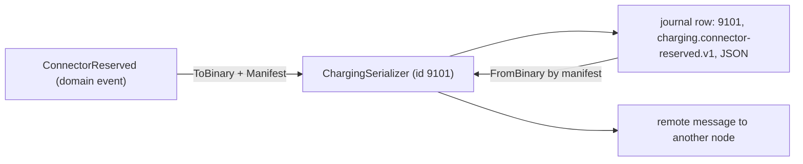
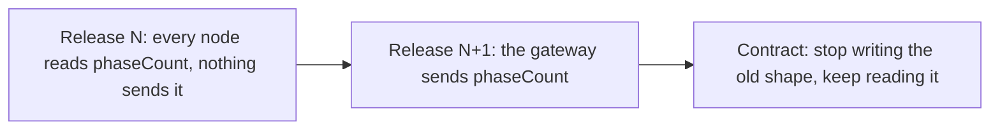
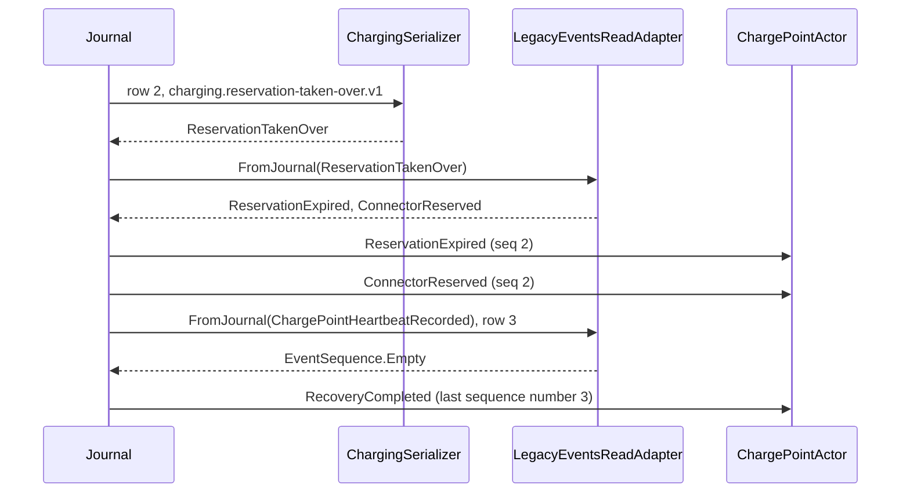
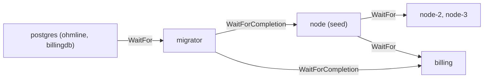

# Chapter 20. Events Are Forever: Evolving Schemas, Snapshots and Read Models

On a Tuesday afternoon in staging, a one-line change stopped every charging session that had started before lunch. Site Energy had asked how many phases each car charges on, so a developer added `int? PhaseCount` to `SessionStarted`. The build was green and the new golden file was accepted. Then the first node restarted, and System.Text.Json refused every `SessionStarted` already in the journal: the new property was missing from all of them, and a nullable constructor parameter without a default is still required.

Nobody had touched a stored byte; only the code that reads them had changed. When operations later asked to stop saying "fault" and say "out of order", the same developer hesitated before renaming `ConnectorFaulted`, and was right to.

In an event-sourced system, every stored event is a message to every future version of your code. The C# types are yours to refactor; the bytes, manifests, persistence ids and published contracts are promises. This chapter changes Ohmline's model ten ways and does not rewrite one row of history.

> **In this chapter you will:**
>
> - read any journal row on PostgreSQL or SQLite with a small tool, and name which of its parts can never change;
> - add a field to a stored event so that old rows, old nodes and new nodes all keep working;
> - upcast an old manifest version inside the serializer, and split or drop legacy events with a read event adapter;
> - keep a golden corpus that proves every shape ever written still reads, and let an unreadable snapshot fall back to replay;
> - rename a domain concept, hand the schema to a migrator, and build a new read model and a new contract version beside the old ones;
> - keep personal data out of events, and plan a restore that accounts for what already left the system.

> **Starting point:** `ch19-s08`, the driver app with its end-to-end trace, from Chapter 19.
>
> ```bash
> git checkout ch19-s08
> ```

## 20.1 What is really in your journal, and the contracts that never die

### The incident view

At 07:40 a charge point at the bus depot refuses a driver, and the on-call engineer opens the production database to see what `OHM-SLC-0042` recorded. Section 10.8 toured the journal on SQLite through a test; production runs PostgreSQL (section 12.10), and the engineer needs the same view there without trusting today's code to interpret yesterday's bytes.

### Three schemas, not one

What the engineer sees is not a `ConnectorReserved`. An event lives in three shapes, and only one of them belongs to you alone:

| Schema | Where it lives | Free to change? |
|---|---|---|
| Domain event | a `sealed record` in `*.Domain`, read by `Decide` and `Evolve` | Yes, as long as the serializer still maps its manifest to it |
| Persisted representation | a journal row: serializer id, manifest, payload bytes | Never in place; a new shape is a new manifest version |
| Wire message | the same bytes between two nodes in a rolling update | Only in two steps: every node reads it, then a node sends it |

Wlaschin draws the same line: domain types stay inside, and serialization goes through DTOs at the boundary, so the inside can change freely ([*Domain Modeling Made Functional*](https://pragprog.com/titles/swdddf/domain-modeling-made-functional/), 2018, ch. 11 "Serialization", section "Designing for Serialization"; also his post ["Serializing your domain model"](https://fsharpforfunandprofit.com/posts/serializing-your-domain-model/)). `ChargingSerializer` is that boundary, which is why no C# type name appears in the journal. The diagram follows one event across it:



The serializer is an Anticorruption Layer (ACL) between your model and its own past: everything to its right in the diagram is read by code you have not written yet.

### The permanent list

Tag `ch20-s01` lists what lives in stored data or in other teams' code, in `docs/contracts-that-never-die.md`. Changing any of it is a data migration, never a refactoring:

- **serializer ids** 9100 to 9104 (ADR 0007) and **manifests**: a row nobody can read is a poison event (section 11.3);
- **persistence id formats**, `{shard type name}-{entity id}`: a new prefix orphans the history;
- **shard type names** and **`maxNumberOfShards`** = 100: a change routes one entity to two places during a rolling update;
- **event tags**, **projection ids** and the projection daemon's stream order (Chapter 13);
- **Published Language** wire names, outbox positions and the driver app's **client contracts** (Chapters 16 and 19).

### A tool that knows no Ohmline type

Tag `ch20-s01` adds `tools/Ohmline.JournalInspect`, a console tool that reads the journal or snapshot table over plain ADO.NET with the SELECT statements of section 10.8's tour. Akka.Persistence.Sql names its tables alike on both databases, so only the parameter syntax changed:

```csharp
// File: tools/Ohmline.JournalInspect/JournalQueries.cs @ ch20-s01
public static class JournalQueries
{
    /// <summary>One aggregate's events in order. The message column holds the payload.</summary>
    public const string Journal = """
        SELECT ordering, persistence_id, sequence_number, created, deleted,
               manifest, identifier, writer_uuid, message
        FROM journal
        WHERE persistence_id = @persistenceId
        ORDER BY sequence_number
        """;
    // ...
}
```

The tool references neither Akka.NET nor any Ohmline project, so it shows what is stored, not what today's serializer makes of it. Most rows are trace envelopes (section 17.7), which `StoredPayload` opens:

```csharp
// File: tools/Ohmline.JournalInspect/StoredPayload.cs @ ch20-s01
public static StoredPayload Read(int? serializerId, string? manifest, byte[] bytes)
{
    if (serializerId == TraceEnvelopeSerializerId && manifest == TraceEnvelopeManifest)
    {
        var envelope = JsonSerializer.Deserialize<EnvelopeShape>(bytes, Web)
            ?? throw new JsonException("The trace envelope is null.");
        var outer = new StoredPayload(serializerId, manifest, "", envelope.TraceParent);
        return Read(envelope.SerializerId, envelope.Manifest, envelope.Payload) with
        {
            TraceParent = envelope.TraceParent,
            Envelope = outer,
        };
    }

    return new StoredPayload(serializerId, manifest, AsText(bytes));
}
```

The integration test `JournalInspectTests` registers a charge point and reserves a connector through a node on PostgreSQL 17, reads the rows with `JournalReader`, and writes each one with `RowFormat.Line`, exactly as the tool prints it. Wrapped and trimmed:

```text
$ dotnet test --project tests/Ohmline.IntegrationTests -- \
    --filter-class "*JournalInspectTests" --show-live-output on
ordering=1 | persistence_id=charge-point-OHM-ITG-7273 | sequence_nr=1 | ...
  | serializer_id=9100>9101
  | manifest=ohmline.trace-envelope.v1>charging.charge-point-registered.v1
  | payload={"siteId":"slc-depot","connectorMaxPowers":[22,22],...}
ordering=2 | persistence_id=charge-point-OHM-ITG-7273 | sequence_nr=2 | ...
  | serializer_id=9100>9101
  | manifest=ohmline.trace-envelope.v1>charging.connector-reserved.v1
  | payload={"tokenUid":"04A2B3C4D5E6F7","expiresAt":"2026-11-05T23:00:28...",...}
```

`9100>9101` reads "an envelope from serializer 9100 holding a message from 9101": both layers are contracts. The columns are the SQLite tour's in PostgreSQL types, with `message` as `bytea`.

> **Try it**
>
> ```bash
> git checkout ch20-s01
> git diff ch19-s08 ch20-s01 --stat
> git show ch20-s01:docs/contracts-that-never-die.md
> dotnet test --project tests/Ohmline.JournalInspect.Tests
> dotnet test --solution Ohmline.slnx
> ```
>
> The diff ends `18 files changed, 882 insertions(+)`. The tool's own tests report `total: 8, failed: 0`, and the full run, which includes `JournalInspectTests` against PostgreSQL, reports 2,394 tests passing.

## 20.2 Tolerant readers and expand/contract

### The phase count

At the same current, a car charging on one phase draws about a third of the power it would on three, so Site Energy wants each session to record its phase count. The obvious home is `SessionStarted`, of which thousands are already stored without it.

### Be strict about what you need, lenient about the rest

Three kinds of reader meet every stored shape, each running code of a different age: recovery reads every old event with today's code, a node in a rolling update reads the next release's messages with yesterday's code, and consumers of the Published Language read with code you do not deploy. Martin Fowler calls the discipline that serves them all the **[Tolerant Reader](https://martinfowler.com/bliki/TolerantReader.html#:~:text=only%20take%20the%20elements%20you%20need)**: take only what you need and ignore what you do not recognize (Fowler, "TolerantReader", 2011).

`ManifestJsonSerializer` has read this way since section 10.3; tag `ch20-s02` states it, with an explicit `UnmappedMemberHandling.Skip` and a summary of the rules:

```csharp
// File: src/Ohmline.ActorShell/Serialization/ManifestJsonSerializer.cs @ ch20-s02
private static JsonSerializerOptions CreateOptions(Action<JsonSerializerOptions>? configure)
{
    var options = new JsonSerializerOptions
    {
        PropertyNamingPolicy = JsonNamingPolicy.CamelCase,
        UnmappedMemberHandling = JsonUnmappedMemberHandling.Skip,
        RespectNullableAnnotations = true,
        RespectRequiredConstructorParameters = true,
        TypeInfoResolver = new DefaultJsonTypeInfoResolver(),
        Converters = { new ValueObjectConverter(), new JsonStringEnumConverter() },
    };
    // ...
}
```

The asymmetry is deliberate. An unknown member is skipped, so an older node can read a newer shape. A missing member is refused unless its constructor parameter has a default, so an event never silently loses a field it was written with. That is the staging trap: `int? PhaseCount` alone is nullable but still required. The test record `Gong(string Text, int? Volume)` shows it, failing on older JSON with "JSON deserialization for type 'Ohmline.ActorShell.Tests.Serialization.Gong' was missing required properties including: 'volume'."

### Adding the field the right way

The field goes at the end of the record, with a default:

```csharp
// File: src/Charging/Ohmline.Charging.Domain/Sessions/SessionEvent.cs @ ch20-s02
/// <param name="PhaseCount">
/// The phases the car charges on, added in section 20.2. Optional, with a default, because
/// every session started before then was stored without it, and those events are read for ever.
/// </param>
public sealed record SessionStarted(
    SessionId SessionId,
    SiteId SiteId,
    ConnectorId ConnectorId,
    TokenUid TokenUid,
    TariffSnapshot Tariff,
    Money SpendCap,
    long MeterStartWh,
    int? PhaseCount = null)
    : SessionEvent(SessionId);
```

Every session started before today has no phase count, and the domain needs one. The gap is filled in exactly one place, where events become state:

```csharp
// File: src/Charging/Ohmline.Charging.Domain/Sessions/ChargingSession.cs @ ch20-s02
/// <summary>
/// The terms the session started with. A session stored before the phase count was
/// recorded has none, and gets the assumed one: Evolve fills the gap, Decide never sees it.
/// </summary>
private static SessionTerms Terms(SessionStarted started) =>
    new(started.SessionId, started.SiteId, started.ConnectorId, started.TokenUid,
        started.Tariff, started.SpendCap)
    {
        PhaseCount = started.PhaseCount ?? SessionTerms.AssumedPhaseCount,
    };
```

`SessionTerms.AssumedPhaseCount` is 3, the most any Ohmline connector supplies. That is a business decision, so it is a named constant in the domain, not a default buried in JSON; `Decide` never sees a missing value. The snapshot DTO gains the same optional property and applies the same constant.

### Read before you write

If the gateway started sending `PhaseCount` in the same release, nodes of the previous release would drop it during the rollout, and a rollback would leave events whose new field the old code ignores. The safe order is what Danilo Sato calls **[parallel change](https://martinfowler.com/bliki/ParallelChange.html)**, or expand and contract (Sato, "ParallelChange", 2014):



Each arrow is a deployment that can be rolled back on its own. Tag `ch20-s02` is release N: `StartSession` accepts an optional `PhaseCount` and the decider records it, but the gateway sends none yet. For stored events the contract step never removes the old reader.

ADR 0015, new at this tag, makes this five rules: only add, and only optional fields; read before you write; never change a field's meaning, unit or type in place; expand, migrate, contract; and freeze the old golden file before accepting the new one. So the old `charging.session-started.v1` JSON is copied to `tests/golden/corpus/` before its golden file gains `"phaseCount": 3`, and `OlderShapeTests` reads the frozen copy.

> **Try it**
>
> ```bash
> git checkout ch20-s02
> git diff ch20-s01 ch20-s02 --stat
> git show ch20-s02:docs/adr/0015-event-evolution-rules.md
> dotnet test --project tests/Ohmline.Charging.Actors.Tests -- --filter-class "*OlderShapeTests"
> dotnet test --solution Ohmline.slnx
> ```
>
> The diff ends `22 files changed, 485 insertions(+), 12 deletions(-)`. The filtered run reports `total: 3, failed: 0`: the frozen `SessionStarted`, `StartSession` and session snapshot all read, the snapshot with three phases assumed. The full run reports 2,402 tests passing.

## 20.3 Upcasting inside the serializer

### A change that cannot be additive

Since section 7.7, `MeterValueRecorded` has stored the charger's register as `long RegisterWh`, the integer count of watt-hours that OCPP-style chargers send. Everything downstream converts it to `Energy` in kWh, and every conversion is a chance to divide by the wrong power of ten. Some chargers can also report a register per phase, which the old shape cannot express. Rule 3 of ADR 0015 forbids changing a field's unit or type in place, so the new shape is a new manifest version: `charging.meter-value-recorded.v2`.

### The idea: upcasting

Greg Young's [*Versioning in an Event Sourced System*](https://leanpub.com/esversioning) calls the technique **upcasting**: when an old version of an event is read, convert it to the current one before any code past the reader sees it (Young 2017, chapter ["Basic Type Based Versioning"](https://leanpub.com/read/esversioning/leanpub-auto-basic-type-based-versioning), section "Define a Version of an Event"). Nothing on disk is rewritten; the conversion costs a little CPU on every replay and saves a migration of history.

Ohmline owns its serializers, so the natural place to upcast is `FromBinary`, where the manifest says which shape the bytes are in. Tag `ch20-s03` adds a small abstraction to the actor shell:

```csharp
// File: src/Ohmline.ActorShell/Serialization/Upcaster.cs @ ch20-s03
public abstract class Upcaster
{
    private protected Upcaster()
    {
    }

    /// <summary>The shape the old manifest's JSON was written in.</summary>
    public abstract Type From { get; }

    /// <summary>The type written today, which the upcaster gives back.</summary>
    public abstract Type To { get; }

    /// <summary>Reads the JSON as <typeparamref name="TOld"/>, then converts it.</summary>
    public static Upcaster Create<TOld, TNew>(Func<TOld, TNew> upcast)
        where TOld : class
        where TNew : class =>
        new Typed<TOld, TNew>(upcast);

    /// <summary>Converts what was read from the old JSON into today's type.</summary>
    public abstract object Upcast(object old);
    // ...
}
```

The domain event now speaks the domain's units:

```csharp
// File: src/Charging/Ohmline.Charging.Domain/Sessions/SessionEvent.cs @ ch20-s03
public sealed record MeterValueRecorded(
    SessionId SessionId, Energy Register, DateTimeOffset MeasuredAt, string? Phase = null)
    : SessionEvent(SessionId);
```

The old shape survives only inside the serializer's project, `internal`, with its conversion beside it:

```csharp
// File: src/Charging/Ohmline.Charging.Actors/Serialization/Upcasting/MeterValueRecordedV1.cs @ ch20-s03
internal sealed record MeterValueRecordedV1(
    SessionId SessionId, long RegisterWh, DateTimeOffset MeasuredAt)
{
    public CommandId CommandId { get; init; }

    public DateTimeOffset OccurredAt { get; init; }

    /// <summary>Wh to kWh, exactly; a v1 reading was always the total over every phase.</summary>
    public static Upcaster Upcaster { get; } =
        Upcaster.Create<MeterValueRecordedV1, MeterValueRecorded>(v1 =>
            new MeterValueRecorded(
                v1.SessionId, Energy.FromWattHours(v1.RegisterWh), v1.MeasuredAt, Phase: null)
            {
                CommandId = v1.CommandId,
                OccurredAt = v1.OccurredAt,
            });
}
```

`ChargingSerializer` now writes `MeterValueRecorded` as `.v2` and maps `charging.meter-value-recorded.v1` to `MeterValueRecordedV1.Upcaster` in a new `Upcasters` dictionary. `FromBinary` tries the written manifests first, then the upcasters, and only then gives up with the `UnknownManifestException` of section 11.3:

```csharp
// File: src/Ohmline.ActorShell/Serialization/ManifestJsonSerializer.cs @ ch20-s03
public override object FromBinary(byte[] bytes, string manifest)
{
    if (_types.TryGetValue(manifest, out var type))
    {
        return Read(bytes, type, manifest);
    }

    if (_upcasters.TryGetValue(manifest, out var upcaster))
    {
        return upcaster.Upcast(Read(bytes, upcaster.From, manifest));
    }

    throw new UnknownManifestException(GetType().Name, Identifier, manifest);
}

private object Read(byte[] bytes, Type type, string manifest) =>
    JsonSerializer.Deserialize(bytes, type, _options)
        ?? throw new SerializationException($"The '{manifest}' payload is null.");
```

The constructor refuses two mistakes at startup: a manifest that is both written and upcast ("a manifest is one or the other"), and an upcast to a type that has no manifest of its own.

### What the domain sees

`Evolve` advances the meter only for `MeterValueRecorded { Phase: null }`, the total over every phase and all the gateway sends today; a per-phase register changes no state. No decider or read model ever meets `MeterValueRecordedV1`. `UpcastReplayTests` writes a v1 row by hand into a SQLite journal, restarts the node and stops the session: the stored `SessionEnded` reports 7.4 kWh, computed from a register written in Wh.

The `.v1` golden file moves to `tests/golden/corpus/`; the new `.v2` file has `"register": 18210.35` where v1 had `"registerWh": 18210350`. `UpcastTests` reads the frozen bytes and checks that every upcast manifest is an older version of one written today.

> **Tip:** keep upcasters pure and total. One that reads a clock or a database turns replay into something that can give different answers on different days.

> **Try it**
>
> ```bash
> git checkout ch20-s03
> git diff ch20-s02 ch20-s03 --stat
> git diff ch20-s02 ch20-s03 -- src/Ohmline.ActorShell/Serialization
> dotnet test --project tests/Ohmline.Charging.Actors.Tests -- --filter-class "*UpcastTests"
> dotnet test --solution Ohmline.slnx
> ```
>
> The diff ends `26 files changed, 458 insertions(+), 54 deletions(-)`. The filtered run reports `total: 4, failed: 0`, and the full run 2,412 tests passing, including `UpcastReplayTests`.

## 20.4 Upcasting with read event adapters

### Rows that do not fit one-to-one

Before the model settled, a pilot at the bus depot stored two event types that today's model lacks. `ReservationTakenOver` recorded, as one event, a lapsed reservation that a second driver took; Charging now records two facts for that, an expiry and a new reservation. `ChargePointHeartbeatRecorded` stored every heartbeat; a heartbeat is liveness, not a decision, and Charging now keeps none. A serializer upcaster cannot help: `FromBinary` returns one object per row, and these rows must become two events, or none.

### The idea: a read event adapter

Akka.Persistence has a second interception point. After the journal has deserialized a row, and before the actor sees it, it passes the object through any **read event adapter** bound to its type. An `IReadEventAdapter` returns an `IEventSequence` of zero or more events: `EventSequence.Single` for one event, `EventSequence.Create` for several, and `EventSequence.Empty` for none (Akka.NET documentation, ["Event Adapters"](https://getakka.net/articles/persistence/event-adapters.html), which shows `FromJournal` on `IEventAdapter`; `IReadEventAdapter` is in [`EventAdapters.cs`](https://github.com/akkadotnet/akka.net/blob/1.5.73/src/core/Akka.Persistence/Journal/EventAdapters.cs#L75) and `Create` in the [`EventSequence` source](https://github.com/akkadotnet/akka.net/blob/1.5.73/src/core/Akka.Persistence/Journal/EventSequences.cs#L176-L212)). Tag `ch20-s04` gives the pilot's shapes a closed hierarchy of their own, `LegacyChargingEvent`, in `Charging.Actors/Persistence/Legacy`, and an adapter that translates them:

```csharp
// File: src/Charging/Ohmline.Charging.Actors/Persistence/LegacyEventsReadAdapter.cs @ ch20-s04
public sealed class LegacyEventsReadAdapter : IReadEventAdapter
{
    /// <summary>The adapter's name in the journal's configuration.</summary>
    public const string Name = "charging-legacy-events";

    /// <summary>The journal passes events of these types through this adapter.</summary>
    public static IReadOnlyList<Type> BoundTypes { get; } = [typeof(LegacyChargingEvent)];

    public IEventSequence FromJournal(object evt, string manifest) => evt switch
    {
        ReservationTakenOver taken => EventSequence.Create(
            Stamped(
                new ReservationExpired(
                    taken.ChargePointId, taken.ConnectorNumber, taken.PreviousTokenUid),
                taken),
            Stamped(
                new ConnectorReserved(
                    taken.ChargePointId, taken.ConnectorNumber, taken.TokenUid, taken.ExpiresAt),
                taken)),
        ChargePointHeartbeatRecorded => EventSequence.Empty,
        _ => EventSequence.Single(evt),
    };

    private static ChargePointEvent Stamped(ChargePointEvent @event, LegacyChargingEvent from) =>
        @event with { CommandId = from.CommandId, OccurredAt = from.OccurredAt };
}
```

Each translated event keeps the old `CommandId` and `OccurredAt`, so the window of recent commands (section 12.6) survives. `AddChargingLegacyEvents()` registers the adapter with `journal.AddReadEventAdapter<LegacyEventsReadAdapter>(Name, BoundTypes)`, and the node calls it in its journal builder next to the tagger of section 13.2. The sequence below follows one recovery of `OHM-SLC-0042` whose journal holds a registration at 1, the pilot's takeover at 2 and a heartbeat at 3:



Both events from row 2 replay under sequence number 2, and the dropped heartbeat still advances the sequence number. `LegacyReplayTests` writes these rows by hand into a SQLite journal and restarts the node: the charge point reports version 3, connector 1 reserved for the second driver.

### Which place to upcast

Tag `ch20-s04` records the trade-off in `docs/contracts-that-never-die.md`:

| | Serializer `Upcaster` | `IReadEventAdapter` |
|---|---|---|
| Sees | bytes and manifest | an object a serializer already read |
| Old CLR type needed | no, private to the serializer | yes, deserializable and bound |
| One row becomes | exactly one object | any number of events, or none |
| Rows from a serializer you do not own | cannot help | the way to adapt them |
| Applies to | every read, including remote messages | the journal's replay |

Ohmline upcasts in the serializer by default and uses an adapter only where a row must become several events or none. The adapter is also the only tool for rows written before you owned the serializer, such as the Newtonsoft `$type` rows of section 10.3's `wrong/` branch; the sample covers that case only in the table.

> **Warning:** read adapters are bound by type and see what the serializer returned. A traced event arrives as a `TraceEnvelope` (section 17.7), so an adapter bound to an event type would not see it; the pilot's rows predate tracing. Whether the SQL read journal's `EventsByTag` applies adapters is not tested in the sample.

### The alternative branch

The branch `alt/ch20-s04-adapter-only` redoes section 20.3 with an adapter alone: `MeterValueRecordedV1` becomes public with its own manifest and binding, and the adapter maps it with `EventSequence.Single(v1.ToV2())`. `UpcastReplayTests` passes unchanged. The cost: anything that reads the bytes without the journal, such as a remote message, sees the old type, which must stay public as long as one such row exists.

> **Try it**
>
> ```bash
> git checkout ch20-s04
> git diff ch20-s03 ch20-s04 --stat
> dotnet test --project tests/Ohmline.Charging.Actors.Tests -- --filter-class "*ReadAdapterTests"
> dotnet test --solution Ohmline.slnx
> git checkout alt/ch20-s04-adapter-only
> git diff ch20-s04 alt/ch20-s04-adapter-only --stat
> dotnet test --solution Ohmline.slnx
> ```
>
> The diff ends `12 files changed, 271 insertions(+), 1 deletion(-)`. The filtered run reports `total: 3, failed: 0`, and the full run 2,428 tests passing. On the branch the diff is `7 files changed, 68 insertions(+), 75 deletions(-)`, and its full run reports 2,433 tests passing.

## 20.5 The golden corpus

### What golden files stopped proving

Section 10.3's golden files freeze what each manifest is written as *now*. Once `.v2` was accepted, only a test written for that one upcast proved `.v1` still reads. Across four contexts and years of releases, "does today's build read everything we ever stored?" would have no answer short of replaying production.

### The idea: a corpus that only grows

A **golden corpus** is a folder of committed payloads, one per manifest version ever written, deserialized by every build, for ever. Its files are never edited and never deleted; a file that stops reading is a journal that stops replaying, and the fix is always in the serializer. Akka.NET's [documentation for its 1.6 line](https://github.com/akkadotnet/akka.net/blob/a683c7067907e8b360c8c2b58a70daa1d19f598a/docs/articles/serialization/source-generated-serialization.md#wire-format) describes a similar corpus for its own serializers, a "committed wire-format snapshot corpus" ("Source-Generated MessagePack Serialization", section "Wire Format").

Tag `ch20-s05` fills `tests/golden/corpus/` with 119 files: every manifest's JSON as at `ch19-s08`, the last tag before this chapter changed a stored shape, plus the three manifests added since. Its `README.md` gives the rules: never edit or delete a file, and add one when a manifest first ships.

### Checking it in both directions

`CorpusTests` lives in `Ohmline.Node.Tests`, which references every context through the node, and builds an `ActorSystem` with the node's five serializers. It first computes what the node reads today:

```csharp
// File: tests/Ohmline.Node.Tests/CorpusTests.cs @ ch20-s05
private static FrozenDictionary<string, Type> ReadToday { get; } =
    ByContext.Values
        .SelectMany(serializer => serializer.Manifests)
        .Select(pair => (Manifest: pair.Value, Type: pair.Key))
        .Concat(ChargingSerializer.Upcasters
            .Select(pair => (Manifest: pair.Key, Type: pair.Value.To)))
        .Append((
            Manifest: TraceEnvelopeSerializer.EnvelopeManifest,
            Type: typeof(TraceEnvelope)))
        .ToFrozenDictionary(read => read.Manifest, read => read.Type);

[Theory]
[MemberData(nameof(CorpusFiles))]
public void Every_file_in_the_corpus_is_still_read(string manifest)
{
    var bytes = Encoding.UTF8.GetBytes(Golden.Read($"corpus/{manifest}"));

    var read = _system.Serialization.Deserialize(bytes, IdentifierOf(manifest), manifest);

    read.ShouldBeOfType(ReadToday[manifest]);
}
```

The theory runs once per file. Two facts close the loop in both directions: every manifest the node reads has its first JSON in the corpus, and every manifest in the corpus is still one the node reads.

The fourth test answers a different question: is every persisted type registered at all? A serializer bound to a base type such as `ChargePointEvent` receives every subclass, and refuses any without a manifest, at the moment it is first persisted.

```csharp
// File: tests/Ohmline.Node.Tests/CorpusTests.cs @ ch20-s05
[Fact]
public void Every_type_derived_from_a_persisted_base_type_is_registered()
{
    var missing = ByContext.Values.SelectMany(serializer => serializer.BoundTypes
            .SelectMany(root => root.Assembly.GetTypes())
            .Where(type => !type.IsAbstract)
            .Where(type => serializer.BoundTypes.Any(root => root.IsAssignableFrom(type)))
            .Where(type => !serializer.Manifests.ContainsKey(type)))
        .Select(type => type.FullName);

    missing.ShouldBeEmpty();
}
```

A new event case added without its manifest line now fails this test on the build server, instead of failing its first `PersistAll` in production.

### Consequences

The corpus turns ADR 0007 from a policy into a build failure. Never editing or deleting a corpus file is a review rule today, which a CI step could enforce. The corpus holds payloads, not rows: it proves the serializers read every shape, not that `Evolve` still makes sense of every event, which the replay tests of sections 20.3, 20.4 and 20.7 cover.

> **Try it**
>
> ```bash
> git checkout ch20-s05
> git diff ch20-s04 ch20-s05 --stat
> ls tests/golden/corpus | wc -l
> dotnet test --project tests/Ohmline.Node.Tests -- --filter-class "*CorpusTests"
> dotnet test --solution Ohmline.slnx
> ```
>
> The diff ends `118 files changed, 1279 insertions(+)`. The folder holds 120 entries, 119 JSON files and the README. The filtered run reports `total: 122, failed: 0`, one row per file plus three facts, and the full run 2,550 tests passing.

## 20.6 Snapshots are a cache

### Two reasons a snapshot stops reading

Operators reading a snapshot in an incident want to see how long each reservation had left, not an expiry to compare with a clock. So tag `ch20-s06` writes `charging.charge-point-snapshot.v2`, which records `TakenAt` and gives each reservation an `ExpiresIn`; `.v1` is read through an upcaster, as in section 20.3. The second reason is a rollback: code that finds a snapshot in a version it has never heard of fails the load, and the charge point cannot start.

### The idea: a cache can be thrown away

Section 11.2 called a snapshot a cache, after [Helland's line](https://www.cidrdb.org/cidr2015/Papers/CIDR15_Paper16.pdf) that the truth is the log (*Immutability Changes Everything*, CIDR 2015, section 2.1). An unreadable cache entry is a miss: skip it and replay the events. Akka.NET's [`snapshot-is-optional`](https://github.com/akkadotnet/akka.net/blob/1.5.73/src/core/Akka.Persistence/persistence.conf#L194-L200) does that, and section 11.2 told you to keep it off, because it is unsafe once events are deleted (its own comment: "Don't set to true if events are deleted"), as section 11.7's listing deletes its own. Turning it on takes the setting and a check that the history is whole.

The setting goes through the plugins' common fallback, so it applies to every snapshot store:

```csharp
// File: src/Ohmline.ActorShell/Deciders/OptionalSnapshots.cs @ ch20-s06
public static class OptionalSnapshots
{
    /// <summary>On for every snapshot store, through the plugins' common fallback.</summary>
    public const string Hocon =
        "akka.persistence.snapshot-store-plugin-fallback.snapshot-is-optional = on";

    extension(AkkaConfigurationBuilder akka)
    {
        public AkkaConfigurationBuilder WithOptionalSnapshots() =>
            akka.AddHocon(Hocon, HoconAddMode.Prepend);
    }
}
```

The node calls `.WithOptionalSnapshots()` before `WithSqlPersistence`. The skip cannot be the actor's choice: a snapshot that loads is applied and replay starts after it; only a failed load, here the serializer's `UnknownManifestException`, sends recovery back to event 1. The check goes into `DeciderActor`, the shell every aggregate shares, at the end of recovery:

```csharp
// File: src/Ohmline.ActorShell/Deciders/DeciderActor.cs @ ch20-s06
protected bool RecoveredWholeHistory =>
    _snapshotSequenceNr > 0 || (_firstReplayed ?? LastSequenceNr + 1) == 1;
// ...
private void Recovered()
{
    if (!RecoveredWholeHistory)
    {
        _log.Error(
            "{0} cannot recover: no snapshot was read, and its events start at sequence " +
            "number {1}, not 1. It stops rather than run on part of its history; see " +
            "docs/runbooks/poison-event.md",
            PersistenceId,
            _firstReplayed ?? LastSequenceNr + 1);
        Context.Stop(Self);
        return;
    }
    // ...
    if (_snapshotSequenceNr == 0 && SnapshotEvery > 0 && _eventsReplayed >= SnapshotEvery
        && ToSnapshot(State, _recent.ToSnapshot()) is { } snapshot)
    {
        SaveSnapshot(snapshot);
    }
```

`_firstReplayed` is the first sequence number `Replay` saw. A recovery is whole if it started from a snapshot, or if its first event was number 1. Otherwise the aggregate logs an error and stops rather than serve commands from part of its history. When a recovery replayed at least `SnapshotEvery` events without a snapshot, the shell saves one at once instead of waiting for `SnapshotEvery` more.

`UnreadableSnapshotTests` rewrites stored manifests by hand to `.v9`: for a charge point with 100 events, and for a listing whose earlier events are deleted. After a restart (trimmed):

```text
$ dotnet test --project tests/Ohmline.Charging.Actors.Tests -- \
    --filter-class "*UnreadableSnapshotTests" --show-live-output on
[INFO][...][.../sharding/charge-point/67/OHM-SLC-0042] Snapshot load error for persistenceId
  [charge-point-OHM-SLC-0042]. Replaying all events since snapshot-is-optional=true
[INFO][...] charge-point-OHM-SLC-0042 recovered to sequence number 100 in 53 ms: no snapshot,
  100 events replayed
[ERROR][...] charge-point-listing-OHM-SLC-0042 cannot recover: no snapshot was read, and its
  events start at sequence number 3, not 1. It stops rather than run on part of its history; ...
```

The charge point answers at version 100 and a readable `.v2` snapshot at 100 is back in the table. The listing refuses to start empty, which is the right failure: its runbook entry, `docs/runbooks/poison-event.md`, now covers both cases.

> **Version note:** Akka.NET 1.5.73 [logs the skipped snapshot at INFO](https://github.com/akkadotnet/akka.net/blob/1.5.73/src/core/Akka.Persistence/Eventsourced.Recovery.cs#L133), not WARNING, so a warnings dashboard will not show it; watch the shell's "no snapshot, N events replayed" line instead. Akka.Hosting 1.5.73 has no option for `snapshot-is-optional`; it is set in HOCON only.

> **Try it**
>
> ```bash
> git checkout ch20-s06
> git diff ch20-s05 ch20-s06 --stat
> dotnet test --project tests/Ohmline.Charging.Actors.Tests -- --filter-class "*UnreadableSnapshot*"
> dotnet test --solution Ohmline.slnx
> ```
>
> The diff ends `20 files changed, 476 insertions(+), 58 deletions(-)`. The filtered run reports `total: 2, failed: 0`, and the full run 2,557 tests passing.

## 20.7 Renaming a concept when events are forever

### The language moved

Field technicians say a connector with a broken cable is *out of order*, and later *repaired*, never "faulted". Operations asked for their words on the board, and the code should follow. Evans's **Ubiquitous Language** pattern says so directly: ["Recognize that a change in the language is a change to the model"](https://www.domainlanguage.com/wp-content/uploads/2016/05/DDD_Reference_2015-03.pdf#page=11), then refactor the code, "renaming classes, methods, and modules to conform to the new model" (*Domain-Driven Design Reference*, "Ubiquitous Language", p. 4; [Evans 2003](https://www.informit.com/store/domain-driven-design-tackling-complexity-in-the-heart-9780321125217), ch. 2 "Communication and the Use of Language"). Part III of his book, "Refactoring Toward Deeper Insight", makes that transformation of model and code a continuing discipline. In an event-sourced system the question is what "the code" includes.

### The idea: names in C#, promises on disk

C# names are the first schema of section 20.1 and follow the language. Manifests, status values, rejection codes, shard type names and persistence ids are promises, and stay. Tag `ch20-s07` sorts each name into one of three bins:

| Before | After (C#) | Stored or sent name |
|---|---|---|
| `ConnectorFaulted` | `ConnectorOutOfOrder` | new manifest `charging.connector-out-of-order.v1`; the old one still read |
| `ConnectorFaultCleared` | `ConnectorRepaired` | manifest kept |
| `ReportConnectorFault`, `ClearConnectorFault` | `ReportConnectorOutOfOrder`, `ReportConnectorRepaired` | manifests kept |
| state `Faulted`, `ConnectorStatus.Faulted` | `OutOfOrder` | in memory, and the value `"faulted"` on the wire |
| refusal `ConnectorFaulted`, snapshot case `Faulted` | `ConnectorOutOfOrder`, `OutOfOrder` | code `connector-faulted` and `$kind` `"faulted"` kept |

Only `ConnectorOutOfOrder` gets a new manifest, so rows written from now on carry the new word. Reading the old manifest needs no conversion, only a second name for the same shape, so `Upcaster` gains an alias:

```diff
# git diff ch20-s06 ch20-s07 -- src/Ohmline.ActorShell/Serialization/Upcaster.cs
@@ -24,6 +24,14 @@ public abstract class Upcaster
         where TNew : class =>
         new Typed<TOld, TNew>(upcast);
 
+    /// <summary>
+    /// For a type that was renamed under a new manifest (section 20.7): the same shape, read
+    /// under the manifest it was stored with.
+    /// </summary>
+    public static Upcaster Alias<T>()
+        where T : class =>
+        new Typed<T, T>(stored => stored);
+
     /// <summary>Converts what was read from the old JSON into today's type.</summary>
     public abstract object Upcast(object old);
 
```

`ChargingSerializer` marks every renamed line:

```csharp
// File: src/Charging/Ohmline.Charging.Actors/Serialization/ChargingSerializer.cs @ ch20-s07
    // Renamed in section 20.7: written under its new name, and read under its old one too
    // (Upcasters). Every node must read the new manifest before any node writes it.
    [typeof(ConnectorOutOfOrder)] = "charging.connector-out-of-order.v1",
    // Renamed in section 20.7, but only in C#: the manifest stays.
    [typeof(ConnectorRepaired)] = "charging.connector-fault-cleared.v1",
    // ...
public static FrozenDictionary<string, Upcaster> Upcasters { get; } =
    new Dictionary<string, Upcaster>
    {
        ["charging.meter-value-recorded.v1"] = MeterValueRecordedV1.Upcaster,
        ["charging.charge-point-snapshot.v1"] = ChargePointSnapshotV1.Upcaster,
        ["charging.connector-faulted.v1"] = Upcaster.Alias<ConnectorOutOfOrder>(),
    }.ToFrozenDictionary();
```

`RenamedEventTests` inserts the corpus JSON of `charging.connector-faulted.v1` into a SQLite journal, restarts the node, and finds connector 2 out of order with its code; a new report is then stored as `charging.connector-out-of-order.v1`, so the journal holds both names, in order. `docs/glossary.md` records the new terms and the old word, and the Device Gateway's ACL now translates OCPP's `Faulted` into `ReportConnectorOutOfOrder`.

### What the rename costs

Writing a new manifest in the same release that first reads it breaks rule 2 of ADR 0015: during a rolling update (section 21.7), a shard that moves to an old node would replay a manifest that node cannot read. The serializer's comment says so. In production, split it: release one registers the alias and keeps writing the old manifest; release two writes the new one.

The driver app's `RejectionCodes.ConnectorFaulted` and the status value `"faulted"` stay, because phones in pockets read them (section 19.2). And a rename leaks into telemetry: the `command.type` tag of section 18.1 is the command's type name, so the `ReportConnectorFault` series stop and `ReportConnectorOutOfOrder` series start at the deploy. Tell whoever owns the dashboards.

> **Anti-pattern: changing `maxNumberOfShards`, PersistenceId formats or serializer IDs.** A rename is where section 12.2's warning tempts most. `charge-point`, `charge-point-OHM-SLC-0042` and serializer 9101 say nothing about faults, so they stay.

> **Try it**
>
> ```bash
> git checkout ch20-s07
> git diff ch20-s06 ch20-s07 --stat
> git diff ch20-s06 ch20-s07 -- src/Charging/Ohmline.Charging.Domain
> dotnet test --project tests/Ohmline.Charging.Actors.Tests -- --filter-class "*RenamedEventTests"
> dotnet test --solution Ohmline.slnx
> ```
>
> The diff ends `34 files changed, 292 insertions(+), 140 deletions(-)`. The filtered run reports `total: 1, failed: 0`, and the full run 2,561 tests passing.

## 20.8 Owning the journal schema: migrations

### Three stopgaps and a privilege

Ohmline's tables have been created by whoever got there first. `autoInitialize` makes the journal, and three nodes racing on an empty database fail with `23505` (section 12.10). `ReadModelSchema` creates the read models under an advisory lock (section 13.4), and the feed answers 503 until its table exists (section 16.9). Worst, every node logs in with the right to create and drop tables, which it needs for none of its work.

### The idea: the schema has an owner

A schema belongs to a deployment step, not to whichever process starts first. Akka.Persistence.Sql publishes [idempotent DDL](https://github.com/akkadotnet/Akka.Persistence.Sql/blob/1.5.73/docs/ddl/README.md#idempotency) in its repository, under `docs/ddl/`. Tag `ch20-s08` adds `src/Ohmline.Migrator`, a console process that applies those files and Ohmline's own scripts with DbUp 7.0.1 (`dbup-postgresql`), then exits. Its scripts are `0001_akka_journal.sql`, `0002_akka_snapshot.sql` and `0003_tags.sql`, copied verbatim from the plugin's 1.5.73 tag under a short header, then `0004_read_models.sql` and, in Billing's database, `0005_billing.sql`:

```csharp
// File: src/Ohmline.Migrator/Migrations.cs @ ch20-s08
private static DbUp.Builder.UpgradeEngineBuilder Upgrader(
    MigrationTarget target, string connectionString) =>
    DeployChanges.To
        .PostgresqlDatabase(connectionString)
        .WithScriptsEmbeddedInAssembly(
            Scripts, name => name.StartsWith(ResourcePrefix($"Scripts.{target.Scripts}.")))
        .WithScriptsEmbeddedInAssembly(
            Scripts,
            name => name == ResourcePrefix($"Grants.{target.Grants}"),
            new SqlScriptOptions
            {
                ScriptType = ScriptType.RunAlways,
                RunGroupOrder = DbUpDefaults.DefaultRunGroupOrder + 1,
            })
        .WithTransactionPerScript()
        // DbUp reads $name$ as a variable to substitute; PostgreSQL's dollar quoting, such
        // as the $BLOCK$ in Akka.Persistence.Sql's DDL, is not one.
        .WithVariablesDisabled();
```

Each script runs once, in its own database transaction, and is recorded in `schemaversions`. The grants script runs after every migration and keeps two roles, `ohmline_app` and `billing_app`, able to read and write rows and nothing else. The `$BLOCK$` comment records a real failure: the first run stopped with "Variable BLOCK has no value defined".

The node now passes `autoInitialize: provider == ProviderName.SQLiteMS`: only the single development node's SQLite file is still made by the journal itself. `ReadModelSchema` and `BillingSchema` are deleted. The AppHost runs the migrator first:

```csharp
// File: src/Ohmline.AppHost/AppHost.cs @ ch20-s08
var migrator = builder.AddProject<Projects.Ohmline_Migrator>("migrator")
    .WithReference(ohmline)
    .WithReference(billingDb, connectionName: "billing")
    .WaitFor(ohmline)
    .WaitFor(billingDb);
// ...
var seed = Node("node", 0).WaitForCompletion(migrator);
```



`WaitForCompletion` waits for the migrator to exit successfully; a failed migration keeps the cluster down instead of letting it start against half a schema. That failure path is [Aspire's documented behaviour](https://aspire.dev/hub/glossary/waitforcompletion/) ("A failed setup job is not the same as successful completion"); the tests cover only success. Every test fixture that creates a PostgreSQL database now migrates it first, so tests and production share one definition.

### Consequences

The published DDL uses `CREATE TABLE IF NOT EXISTS`, so the first migration adopts tables `autoInitialize` made, rows and all. `MigrationTests` logs in as a member of `ohmline_app` and is refused `CREATE TABLE` with SQL state 42501, and `LeastPrivilegeTests` runs a whole node under that role. The AppHost itself still connects as the superuser; fixing that is an exercise. Section 21.6 runs the same migrator as a Kubernetes Job before the nodes start.

> **Try it**
>
> ```bash
> git checkout ch20-s08
> git diff ch20-s07 ch20-s08 --stat
> dotnet test --project tests/Ohmline.Migrator.Tests
> dotnet test --solution Ohmline.slnx
> ```
>
> The diff ends `48 files changed, 903 insertions(+), 310 deletions(-)`. With `DOCKER_HOST` set, the migrator's tests report `total: 7, failed: 0`, and the full run 2,569 tests passing.

## 20.9 Rebuilding read models and versioning the Published Language

### Two new questions

Finance wants each row of the session history to say which site the session was at. The Billing team, tired of parsing `OHM-SLC-0042/1`, wants completed sessions to carry the charge point and connector number separately. One request changes a read model; the other changes a contract another team builds on.

### A read model is rebuilt, never migrated

Section 14.8 previewed the answer for the first. Tag `ch20-s09` adds `SessionHistoryV2Projection` with its own table, `read_models.session_history_v2` (migration `0006`), beside the first version:

```csharp
// File: src/Charging/Ohmline.Charging.ReadModels/SessionHistory/SessionHistoryV2Projection.cs @ ch20-s09
/// <summary>Durable: the version is in the id, so its offsets are its own.</summary>
public const string Id = "session-history-v2";

public string ProjectionId => Id;

public IReadOnlyList<string> Tags { get; } = [ChargingTags.ChargingSession];

public ProjectionFailurePolicy FailurePolicy { get; } = new StopAfterRetries(MaxRetries: 5);
```

The version lives in the projection id, and offsets are keyed by that id, so v2 starts from the journal's first event while v1 keeps serving. Its rows reuse v1's rules and add `site_id` and `phase_count` from `SessionStarted`; sessions from before section 20.2 get a null phase count. `ReadModelOptions.SessionHistoryVersion`, validated as 1 or 2 and defaulting to 1, decides which table the query and SSE endpoints read. Once v2 has caught up, operators set it to 2; each node reads it through `IOptions` at startup, and switching back is the same change. The integration test shows both offsets reaching 3 and v2's session columns equal to v1's row.

### A contract gets a second version beside the first

An integration event is the Published Language of section 16.1 ([Evans 2003](https://www.informit.com/store/domain-driven-design-tackling-complexity-in-the-heart-9780321125217), ch. 14 "Maintaining Model Integrity", section "Published Language"; [*DDD Reference*](https://www.domainlanguage.com/wp-content/uploads/2016/05/DDD_Reference_2015-03.pdf#page=43), p. 36), so a new shape is a new wire name, `ohmline.charging.session-completed.v2`, published next to `.v1`:

```csharp
// File: src/Charging/Ohmline.Charging.ReadModels/Outbox/IntegrationEventRelay.cs @ ch20-s09
// Both versions while any consumer reads the first (section 20.9): v1, then v2,
// at the next position, in the same transaction.
await OutboxTables.AppendAsync(
    transaction,
    SessionCompletedTranslation.Translate(session, ended),
    cancellationToken);
await OutboxTables.AppendAsync(
    transaction,
    SessionCompletedTranslation.TranslateV2(session, ended),
    cancellationToken);
```

Each version has its own event id and its own position. Billing reads `.v1` and steps over `.v2` as it steps over any wire name it does not know, so the pair still bills one session, which `Given_both_versions_of_a_session_then_Billing_invoices_it_once` checks. Retiring `.v1` is then a question only consumers can answer, which is the idea of **[consumer-driven contracts](https://martinfowler.com/articles/consumerDrivenContracts.html#:~:text=introducing%20unit%20tests%20that%20assert%20each%20expectation)** (Robinson 2006, section "Implementation"): each consumer declares what it reads, and the provider's build checks it. Billing declares `ChargingFeedReader.WireNamesRead = [SessionCompleted.WireName]`, and the contract tests hold Charging to it:

```csharp
// File: tests/Ohmline.ContractTests/BillingReadsTheFeedTests.cs @ ch20-s09
[Fact]
public void Every_version_Billing_reads_is_one_Charging_publishes()
{
    var published = typeof(ChargingIntegrationEvent)
        .GetCustomAttributes<JsonDerivedTypeAttribute>()
        .Select(derived => (string)derived.TypeDiscriminator!);

    ChargingFeedReader.WireNamesRead.ShouldBeSubsetOf(published);
}
```

Adding `SessionCompletedV2` to the closed hierarchy made the switch in `OutboxTables.WireNameOf` fail with CS8509 until it had an arm: section 3.3's exhaustiveness, catching a real change.

The same additive rules keep older driver apps working (Chapter 19): fields are only added, `RejectionCodes` only grows, and a break would be `/app/v2`. The feed epoch that section 14.8 asked for is still not implemented.

> **Try it**
>
> ```bash
> git checkout ch20-s09
> git diff ch20-s08 ch20-s09 --stat
> dotnet test --project tests/Ohmline.ContractTests -- --filter-class "*BillingReadsTheFeedTests"
> dotnet test --solution Ohmline.slnx
> ```
>
> The diff ends `32 files changed, 716 insertions(+), 42 deletions(-)`. The filtered run reports `total: 6, failed: 0`, and the full run 2,585 tests passing.

## 20.10 Retention, privacy and backups

### Forgotten, and restored

In one week, a driver asks Ohmline to delete everything it holds about her, and a bad bulk command forces a restore of the database to 06:00. Both collide with keeping events for ever.

### Keep events, keep people out of them

The default is to delete no event. Events explain every price and rebuild every read model, and section 11.7 showed that even Akka.NET's "delete" keeps the last row. So personal data must never be in an event. Ohmline's events name a driver only by `TokenUid` and the opaque `DriverRef`; the person lives in the driver account system, where she can be deleted, and the events then point at nobody. Tag `ch20-s10` makes that a build rule. `PersonalDataTests` walks every event type in every Domain and Contracts assembly, recursively into their values and into every case of a closed hierarchy, and fails on any property named like personal data:

```csharp
// File: tests/Ohmline.ArchitectureTests/PersonalDataTests.cs @ ch20-s10
/// <summary>Names that are not about a person, each with the reason.</summary>
private static readonly HashSet<(Type Type, string Property)> NotPersonal =
[
    (typeof(TimeOfUseBand), nameof(TimeOfUseBand.Name)), // A tariff's band, such as "peak".
];
// ...
[GeneratedRegex(
    """
    ^( \w*(Email|EMail|Phone|Mobile|Address|Birth\w*)
     | (First|Last|Full|Given|Family|Middle|Driver|Holder|Customer|Person)?Name )$
    """,
    RegexOptions.IgnorePatternWhitespace)]
private static partial Regex LooksPersonal();
```

The allow-list is not hypothetical: without it, the check reports `SessionStarted.Tariff.Components.Band.Name`. A name check catches honest mistakes, not determined ones; it is a guard rail, not a privacy review.

> **Note:** **crypto-shredding** keeps a per-driver key that can be deleted and stores only ciphertext of personal fields in events, so deleting the key erases them from every event and backup. The sample does not implement it.

If events must be purged, `docs/runbooks/retention.md` makes it a recorded decision with an owner: purge whole aggregates that are over, delete their `tags`, `snapshot` and `journal` rows in one database transaction, keep the highest sequence number of any aggregate that may receive another command, never touch `ordering`, and back up first.

### A restore turns back only your clock

PostgreSQL's point-in-time recovery suits an append-only journal, and read models can be rebuilt. The hard part is what already left the system. `docs/runbooks/backup-restore.md` lists it: payments at TallyPay (a rerun journey sends the same idempotency keys, section 16.4), feed positions Billing and the phones have stored (move the outbox sequences past them with `setval` before starting), chargers that carried out commands, and receipts already sent. Its restore drill restores last night's dumps into a scratch database, runs the migrator, starts one node and compares answers. None of its commands is run by the sample's tests, so treat them as a starting point.

> **Try it**
>
> ```bash
> git checkout ch20-s10
> git diff ch20-s09 ch20-s10 --stat
> dotnet test --project tests/Ohmline.ArchitectureTests -- --filter-class "*PersonalDataTests"
> dotnet test --solution Ohmline.slnx
> ```
>
> The diff ends `4 files changed, 312 insertions(+)`. The filtered run reports `total: 12, failed: 0`, one row per Domain and Contracts project plus two facts, and the full run 2,597 tests passing.

## Summary

- An event has three schemas, and only the domain type is free to change. Serializer ids, manifests, persistence ids, shard names and counts, tags, projection ids and published names are permanent.
- A stored shape grows only by optional fields with defaults; `Evolve` assumes a value for older data, and every node reads a shape one release before any node writes it.
- A change of meaning, unit or type is a new manifest version, upcast on read inside the serializer; a read event adapter is for rows that must become several events or none, or that a serializer you never owned wrote.
- A golden corpus of every manifest ever written, read by every build, turns "events are forever" from a policy into a failing test.
- Snapshots are a cache with versions of their own: skip an unreadable one and replay, but only when the history is still whole.
- Rename freely in C# when the language moves; stored and sent names stay, and a new manifest for the new word ships after every node can read it.
- A migrator owns the schema, applications get a role that cannot change it, and the cluster starts only after migration succeeds.
- Read models are rebuilt beside the old ones, contracts get versions side by side until consumers say otherwise, personal data stays out of events, and a restore accounts for what already left the system.

## DDD canon covered

Event Sourcing (snapshots, upcasting); Serialization strategy and serializer IDs; Refactoring Toward Deeper Insight; Ubiquitous Language; Published Language; Domain vs Integration events; Customer/Supplier; CQRS; Projections via Persistence Query; Anti-pattern catalog.

## Exercises

1. **Reflect.** Instead of upcasting on every read, you could copy the journal into a new store, transforming old shapes on the way. Weigh replay cost, how long old readers must live, the risk of the copy, and what a rollback looks like.
2. **Reflect.** Charging wants to stop publishing `ohmline.charging.session-completed.v1`. Decide who makes that call and when, weighing consumers that declare what they read against ones that do not, two outbox rows per session, and what a reader starting at position 0 next year should find.
3. **Extend.** Starting from `ch20-s04`, add a third pilot event, `ConnectorBlocked(ChargePointId, int ConnectorNumber)`, that `LegacyEventsReadAdapter` reads as `ConnectorMadeUnavailable`. Start in `LegacyChargingEvent.cs` and `ChargingSerializer`, add a golden file, and test it in `LegacyEventsReadAdapterTests`.
4. **Extend.** Starting from `ch20-s10`, make the AppHost run the nodes as a login in role `ohmline_app` instead of the PostgreSQL superuser. `LeastPrivilegeTests` shows how such a login is created; the Aspire system test must stay green.
5. **Break it.** At `ch20-s07`, delete the line that maps `charging.connector-faulted.v1` to `Upcaster.Alias<ConnectorOutOfOrder>()`. Expect `RenamedEventTests` to fail because the charge point cannot replay its history, and `CorpusTests` to name the manifest the node no longer reads.
6. **Break it.** At `ch20-s08`, remove `.WithVariablesDisabled()` from `Migrations` and run `tests/Ohmline.Migrator.Tests`. Expect the migrations to fail with "Variable BLOCK has no value defined", and explain why the AppHost would then never start a node.

## Further reading

- Eric Evans, [*Domain-Driven Design: Tackling Complexity in the Heart of Software*](https://www.informit.com/store/domain-driven-design-tackling-complexity-in-the-heart-9780321125217) (Addison-Wesley, 2003). Ch. 2 "Communication and the Use of Language" on the Ubiquitous Language, Part III "Refactoring Toward Deeper Insight", and ch. 14 "Maintaining Model Integrity" on the Published Language; both patterns are summarized in his free [*Domain-Driven Design Reference*](https://www.domainlanguage.com/wp-content/uploads/2016/05/DDD_Reference_2015-03.pdf) (2015).
- Greg Young, [*Versioning in an Event Sourced System*](https://leanpub.com/esversioning) (Leanpub, 2017). Upcasting ("Basic Type Based Versioning"), weak schemas ("Weak Schema") and copy-and-transform migrations ("Copy and Replace", and "Cheating", section "Copy-Transform").
- Pat Helland, ["Immutability Changes Everything"](https://www.cidrdb.org/cidr2015/Papers/CIDR15_Paper16.pdf) (CIDR 2015), section 2.1 "'Append-Only' Computing". Why an append-only log is the truth and everything else is a cache.
- Martin Fowler, ["TolerantReader"](https://martinfowler.com/bliki/TolerantReader.html) (2011). The reader's half of every additive change.
- Danilo Sato, ["ParallelChange"](https://martinfowler.com/bliki/ParallelChange.html) (2014). Expand, migrate, contract, step by step.
- Ian Robinson, ["Consumer-Driven Contracts: A Service Evolution Pattern"](https://martinfowler.com/articles/consumerDrivenContracts.html) (2006). The idea behind `WireNamesRead`.
- Akka.NET, ["Event Adapters"](https://getakka.net/articles/persistence/event-adapters.html). Read adapters, `EventSequence` and their binding rules.
- Akka.Persistence.Sql, [`docs/ddl/`](https://github.com/akkadotnet/Akka.Persistence.Sql/tree/1.5.73/docs/ddl) at tag 1.5.73, with its [README](https://github.com/akkadotnet/Akka.Persistence.Sql/blob/1.5.73/docs/ddl/README.md). The published, idempotent DDL the migrator applies.
