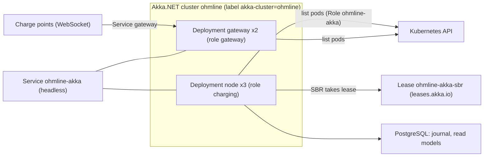
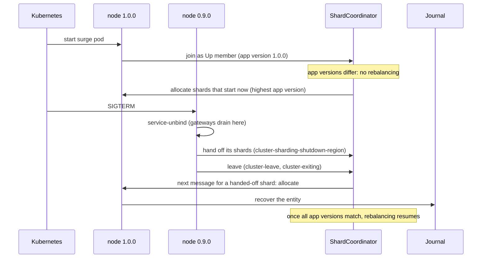
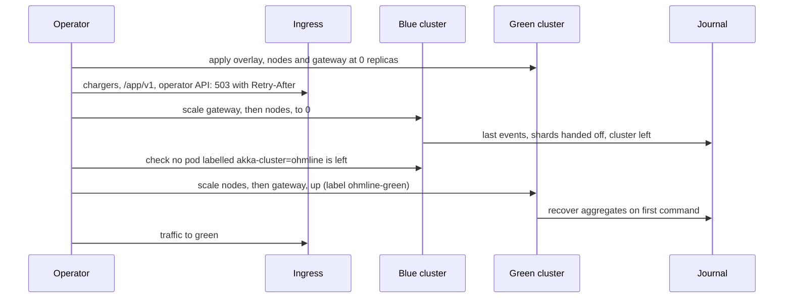
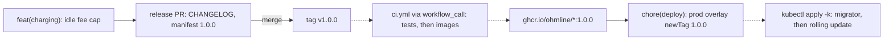

# Chapter 21. Versioning, Releasing and Running the Cluster

The first rollout of a new build onto Ohmline's staging cluster took eleven minutes, and two things went wrong in them, neither in the domain. Every node reported version `1.0.0`, old and new alike, so sharding started freshly woken charge points on whichever node had the fewest shards, including the one about to be replaced. Then the old gateway pod stopped, and its four hundred simulated chargers reconnected to the remaining gateway in the same second, each with a boot notification, a status per connector and a session lookup. Command latency went to four seconds for a minute.

At the review, someone proposed blue/green "to be safe": a second cluster beside the first, with the traffic moved across. On the same journal, that would have given every charge point two live actors, each deciding on its own copy of the state.

What is missing is the discipline of shipping: what a version promises, where it comes from, how a build becomes pods, what happens while two releases share a cluster, and which ways of trying new behaviour are safe when events are forever. This chapter adds it, ships `v1.0.0`, and then upgrades the platform underneath.

> **In this chapter you will:**
>
> - give the services, the contract packages, the manifests and the client API each a version with its own meaning, and check the packages' API on every pack;
> - derive every version from a git tag, and give Akka.NET an app version it can parse and that differs between releases;
> - release from Conventional Commits through a release PR, and build every tag, image and lock-file-pinned restore in CI;
> - run the cluster on Kubernetes with cluster bootstrap and a lease-based split-brain resolver, and stop a node or a gateway inside a 35-second budget without a reconnection storm;
> - change behaviour with a feature flag that never touches replay, and explain why blue/green must be a cut-over, never an overlap;
> - ship `v1.0.0` end to end, and move the sample to Akka.NET 1.6 without changing what is written to the journal or the wire.

> **Starting point:** `ch20-s10`, the end of Chapter 20.
>
> ```bash
> git checkout ch20-s10
> ```

## 21.1 SemVer at three layers

### Four readers of one number

The evening before Ohmline's first numbered release, the team cannot agree whether a new field in `SessionStarted` makes the node 2.0.0, whether the team that sends Charging's commands must upgrade `Ohmline.Charging.Contracts`, or whether the driver app builds in the stores are now "old". There is no single answer, because each reader is promised something different.

[Semantic Versioning 2.0.0](https://semver.org/#semantic-versioning-specification-semver) opens its specification with the rule that settles it (item 1): software that uses it "MUST declare a public API". A version is a statement about one public API, and Ohmline has several. The services' reader is the operator and the cluster: can this image join a cluster running the previous one, and can it be rolled back? A contract package's reader is another team's compiler. A manifest's reader is code of every age (Chapter 20). And the client contract's reader is every build of the driver app still on a phone (Chapter 19), which the server can neither roll back nor force forward. Tag `ch21-s01` records the decision in `docs/adr/0016-versioning-policy.md`; its table, condensed:

| Layer | Version | MAJOR | MINOR | PATCH |
|---|---|---|---|---|
| Service image | `vX.Y.Z` git tag | Cannot roll from N−1: blue/green or a full stop | New capability, rolls | Fix, rolls |
| Contract package | SemVer 2 of the .NET API | A type or member removed or changed | A type or member added | No API change |
| Event or message | `.vN` in each manifest | Never: a new `.vN+1` plus an upcaster | An optional field | — |
| Client contract | the `v1` in `/app/v1` | `/app/v2` served beside `/app/v1` | Optional field, endpoint or rejection code | — |

The rows are independent on purpose. A new event version is not a MAJOR release of the node, because rows of both versions stay readable for ever (section 20.3). A MAJOR release of the node, say a change of remoting transport, does not touch a single stored byte.

### Contracts are a Published Language with a compiler

Evans calls a well-documented shared exchange format a **Published Language**, and pairs it with an **Open Host Service (OHS)** that serves it to many consumers (Evans, [*Domain-Driven Design*](https://www.informit.com/store/domain-driven-design-tackling-complexity-in-the-heart-9780321125217), 2003, ch. 14 "Maintaining Model Integrity"; in the [*DDD Reference*](https://www.domainlanguage.com/wp-content/uploads/2016/05/DDD_Reference_2015-03.pdf#page=42), "Open-host Service" and "Published Language", pp. 35–36, which notes that the two are often combined). Chapter 16 published Charging's integration events that way, and Chapter 19 made `Ohmline.Charging.Client.Contracts` the app's. Khononov points out that an OHS can expose several versions of its language at once, so that consumers move at their own pace ([*Learning Domain-Driven Design*](https://www.oreilly.com/library/view/learning-domain-driven-design/9781098100124/ch04.html), 2021, ch. 4 "Integrating Bounded Contexts", section "Open-Host Service"); that is exactly the client-contract row, where `/app/v2` would run beside `/app/v1` until the last supported build stops calling it.

For .NET consumers, the Published Language also ships as a package, and a package's promise can be checked by a machine. Tag `ch21-s01` makes the published contracts packable and turns on package validation:

```xml
<!-- File: src/Charging/Ohmline.Charging.Contracts/Ohmline.Charging.Contracts.csproj @ ch21-s01 -->
  <!--
    A package for the teams that send these commands (ADR 0016): strict SemVer on its public API,
    which package validation checks on every pack against the last published version.
  -->
  <PropertyGroup>
    <IsPackable>true</IsPackable>
    <EnablePackageValidation>true</EnablePackageValidation>
    <Description>Commands, replies and integration events of Ohmline's Charging.</Description>
  </PropertyGroup>
```

`EnablePackageValidation` runs during `dotnet pack`. On its own it checks that the package is consistent with itself; once `PackageValidationBaselineVersion` names a published version, it also compares the new API with that package's and fails the pack on a breaking change. Before the first release there is nothing to compare with, so ADR 0016 sets the baseline after `v1.0.0`. The same block appears in `Ohmline.Charging.Client.Contracts`, `Ohmline.SharedKernel` and `Ohmline.Tariffs.Contracts`. The last is needed because `StartSession` carries a `TariffSnapshot`: the Charging package depends on a Tariffs package, and a dependency that is never published would make it unusable.

An architecture test keeps the list honest:

```csharp
// File: tests/Ohmline.ArchitectureTests/PackagingTests.cs @ ch21-s01
    private static readonly string[] Published =
    [
        "Ohmline.Charging.Client.Contracts",
        "Ohmline.Charging.Contracts",
        "Ohmline.SharedKernel",
        "Ohmline.Tariffs.Contracts",
    ];

    [Fact]
    public void Only_the_published_contracts_and_their_kernel_are_packable()
    {
        var packable = Repository.ProjectFiles
            .Where(project => Property(project, "IsPackable") == "true")
            .Select(Path.GetFileNameWithoutExtension)
            .Order(StringComparer.Ordinal);

        packable.ShouldBe(Published);
    }
```

A second test, `Every_packable_project_validates_its_package`, fails if a packable project turns validation off.

### Consequences

"1.5.0" now means one thing to an operator: it rolls. Package consumers get a promise their compiler can check, at the cost of a baseline to maintain. The client row is the slowest: a field the app reads leaves the server only after the last build that reads it is unsupported, a product decision per store release. Its JSON shape stays guarded by the golden files of section 19.2.

> **Try it**
>
> ```bash
> git checkout ch21-s01
> git diff ch20-s10 ch21-s01 --stat
> git show ch21-s01:docs/adr/0016-versioning-policy.md
> dotnet pack src/Charging/Ohmline.Charging.Contracts -warnaserror
> dotnet test --solution Ohmline.slnx
> ```
>
> The diff ends `7 files changed, 157 insertions(+)`. The pack succeeds; NuGet prints an informational line that the package is missing a readme, which is not a warning. The full run reports 2,599 tests passing.

## 21.2 Versions from git with MinVer, and the AppVersion trap

### A release is a tag, never an edit

A version typed into a project file is one someone forgets to change. The release process of section 21.3 creates a git tag; everything else should follow from it. [MinVer](https://github.com/adamralph/minver#how-it-works), an MSBuild package, finds the latest tag that is a SemVer version, here with the prefix `v`, and computes the version of the commit being built. On the tagged commit it is the tag's version. On a later commit it is the next patch as a pre-release with the *height*, the number of commits since the tag: two commits after `v1.0.0`, the sample builds `1.0.1-alpha.0.2`. With no `v` tag at all, MinVer starts from `0.0.0-alpha.0`.

Tag `ch21-s02` adds it to every project at once:

```xml
<!-- File: Directory.Build.props @ ch21-s02 -->
  <!--
    Versions come from git (section 21.2): MinVer reads the latest vX.Y.Z tag, so a release is a
    tag and never an edit. The book's chNN-sMM tags have no v, and MinVer ignores them.
  -->
  <PropertyGroup>
    <MinVerTagPrefix>v</MinVerTagPrefix>
  </PropertyGroup>
  <ItemGroup>
    <PackageReference Include="MinVer" PrivateAssets="all" />
  </ItemGroup>
```

`PrivateAssets="all"` keeps the build tool out of every package's dependencies, and the prefix keeps the hundreds of `chNN-sMM` tags out of the versioning. With normal verbosity, a build says:

```text
$ dotnet build src/Ohmline.Node -v n
...
MinVer: No commit found with a valid SemVer 2.0 version prefixed with 'v'. Using default ...
...
MinVer: Calculated version 0.0.0-alpha.0.164.
```

(Recorded before the section's commit existed; at the tag, the height is one higher.)

### The trap: two versions, and Akka.NET reads the wrong one

MinVer sets several properties, and two of them differ on purpose. `AssemblyInformationalVersion` is the whole SemVer, `1.4.2+7e4f0285...`. `AssemblyVersion` is `{Major}.0.0.0` (MinVer's README, ["Version numbers"](https://github.com/adamralph/minver#version-numbers)). That choice is right for libraries: .NET binds assemblies by `AssemblyVersion`, and keeping it stable within a major version spares every consumer binding redirects and strong-name churn.

Akka.NET reads the other one. Each cluster member carries an **app version**, and its default is `app-version = assembly-version`: the entry assembly's `AssemblyVersion` (Akka.Cluster's [reference configuration](https://github.com/akkadotnet/akka.net/blob/v1.5/src/core/Akka.Cluster/Configuration/Cluster.conf#L80-L105)). Under MinVer, every 1.x release reports `1.0.0`. Sharding relies on that number during a rolling update (section 21.7): new shards go to the nodes with the *highest* app version, and rebalancing pauses while the members' versions differ. When old and new nodes report the same version, both behaviours silently stop: new shards may land on a node that is about to be replaced, and rebalancing runs in the middle of the update. That was the first failure in this chapter's opening.

The obvious fix has a second trap behind it. Feeding Akka.NET MinVer's whole version works on a release commit and fails everywhere else, because Akka.NET's `AppVersion` parser accepts `1.4.3-rc1` but throws on a dotted pre-release identifier such as `1.4.3-alpha.0.1` or `2.0.0-rc.1`. The actor system then never starts.

### Three numbers, written by the build

The answer is to give Akka.NET exactly `MAJOR.MINOR.PATCH`, computed by the build from MinVer's parts and stored in the assembly under a key of Ohmline's own:

```xml
<!-- File: Directory.Build.targets @ ch21-s02 -->
  <!--
    The version a node gives the cluster (section 21.2): MAJOR.MINOR.PATCH of the release. Not
    the assembly version, which MinVer sets to MAJOR.0.0.0, so that every 1.x release would look
    the same to Akka.NET; and never the pre-release part, because Akka.NET cannot parse a dotted
    one such as 1.4.3-alpha.0.1 and the node would not start. OhmlineAppVersion reads it.
  -->
  <Target Name="OhmlineAppVersion" AfterTargets="MinVer">
    <ItemGroup>
      <AssemblyMetadata Include="OhmlineAppVersion"
                        Value="$(MinVerMajor).$(MinVerMinor).$(MinVerPatch)" />
    </ItemGroup>
  </Target>
```

It is a target, not a property, because MinVer's properties exist only after MinVer's target has run. The item becomes `[assembly: AssemblyMetadata("OhmlineAppVersion", "1.0.0")]` in the generated `AssemblyInfo.cs`, and the code that reads it refuses anything else:

```csharp
// File: src/Ohmline.ActorShell/Clustering/OhmlineAppVersion.cs @ ch21-s02
public static class OhmlineAppVersion
{
    public const string MetadataKey = "OhmlineAppVersion";

    // ...
    public static string Of(Assembly assembly)
    {
        var version = assembly.GetCustomAttributes<AssemblyMetadataAttribute>()
            .LastOrDefault(metadata => metadata.Key == MetadataKey)?.Value;

        return IsMajorMinorPatch(version)
            ? version
            : throw new InvalidOperationException(
                $"{assembly.GetName().Name} has the app version '{version}', not " +
                "MAJOR.MINOR.PATCH. Directory.Build.targets writes it from MinVer's version.");
    }

    /// <summary>Three numbers, and no fourth part, pre-release or build metadata.</summary>
    public static bool IsMajorMinorPatch([NotNullWhen(true)] string? version) =>
        Version.TryParse(version, out var parsed) && parsed is { Build: >= 0, Revision: -1 };
}
```

`System.Version` has no notion of a pre-release, so `TryParse` rejects `1.4.3-rc1` outright, and the property pattern rejects both `1.4` (no `Build`) and `1.4.3.0` (a `Revision`). `WithOhmlineCluster` gains an `appVersion` parameter that it puts into `ClusterOptions.AppVersion`, and the node and the gateway pass their own assembly's:

```csharp
// File: src/Ohmline.Node/Program.cs @ ch21-s02
    .WithOhmlineCluster(
        builder.Configuration,
        builder.Environment,
        ClusterRoles.Charging,
        OhmlineAppVersion.Of(typeof(Program).Assembly))
```

`AppVersionTests` pins both traps to Akka.NET's own parser, so an Akka.NET upgrade that changed it would fail here first:

```csharp
// File: tests/Ohmline.ActorShell.Tests/Clustering/AppVersionTests.cs @ ch21-s02
    [Theory]
    [InlineData("1.4.3-alpha.0.1")]
    [InlineData("2.0.0-rc.1")]
    public void Given_a_dotted_pre_release_then_akka_cannot_parse_it(string version)
    {
        Should.Throw<ArgumentOutOfRangeException>(() => AppVersion.Create(version));
    }
    // ...
    [Fact]
    public void Akka_orders_app_versions_by_number_not_by_text()
    {
        AppVersion.Create("1.10.0").ShouldBeGreaterThan(AppVersion.Create("1.4.3"));
        AppVersion.Create("1.4.3").ShouldBeGreaterThan(AppVersion.Create("1.4.3-rc1"));
    }
```

`MinVer_s_assembly_version_names_only_the_major_version` records the first trap, and `NodeClusterTests` checks that a running node's `SelfMember.AppVersion` is the release.

### Consequences

Only a `v` tag moves the app version: every build before the first release reports `0.0.0`, and every build after `v1.0.0` reports `1.0.1` until the next tag. A staging cluster rolled between two untagged builds is therefore back in the trap; tag release candidates. MinVer runs `git` in every project, so CI must clone the full history (section 21.4). A source tree with no `.git`, such as a zip, gets `0.0.0-alpha.0` and a MinVer warning, which `-warnaserror` likely turns into an error (untested).

> **Try it**
>
> ```bash
> git checkout ch21-s02
> git diff ch21-s01 ch21-s02 --stat
> dotnet test --solution Ohmline.slnx
> git checkout wrong/ch21-s02-minver-appversion
> git diff ch21-s02 wrong/ch21-s02-minver-appversion --stat
> dotnet run --project src/Ohmline.Node
> ```
>
> The first diff ends `10 files changed, 169 insertions(+), 5 deletions(-)`, and the run reports 2,613 tests passing. The side branch feeds Akka.NET `$(MinVerVersion)` unchecked (`3 files changed, 19 insertions(+), 9 deletions(-)`). It builds with no warning, but the node stops at startup:
>
> ```text
> crit: Akka.Hosting.AkkaHostedService[0]
>       Unable to start AkkaHostedService - shutting down application
>       System.ArgumentOutOfRangeException: Specified argument was out of the range of valid ...
>       ... (Parameter 'Only 3 digits separated with '.' are supported. [0.0.0-alpha.0.165]')
> ```
>
> Built from the committed branch, the height in brackets is one higher. On the branch, `Demonstrates_minver_s_whole_version_is_not_an_app_version_akka_can_parse` fails, and so do 13 of the 144 tests in `Ohmline.Node.Tests`, every one that starts the node's cluster.

## 21.3 Conventional Commits and release-please

### Who decides that it is 1.5.0

MinVer turns a tag into a version, but someone still chooses the tag, and on release day whether any of the last forty commits was breaking is a guess. Their authors knew when they wrote them. So the kind of change goes into the commit message, where a tool can read it.

[**Conventional Commits 1.0.0**](https://www.conventionalcommits.org/en/v1.0.0/#summary) is that format: a subject `type(scope): description`, a body, and footers. A `feat` maps to MINOR, a `fix` to PATCH, and a `!` after the scope or a `BREAKING CHANGE:` footer to MAJOR. Tag `ch21-s03` adopts it from this point on and writes the rules down in `docs/contributing.md`. The scopes are the bounded contexts and deployables in their durable spelling (`charging`, `site-energy`, `tariffs`, `accounts`, `billing`, `gateway`, `mobile`, `deploy`, `shell`), and "breaking" means what ADR 0016 says for a service: this release cannot roll over the previous one. A new event version, an optional field or a new endpoint is never breaking. The bounded context, in other words, becomes part of the commit's ubiquitous language.

### The release PR

[**release-please**](https://github.com/googleapis/release-please#whats-a-release-pr) reads those messages. On every push to `main` it updates one open pull request, the *release PR*, which proposes the next version and the `CHANGELOG.md` section for it. Merging the release PR commits the changelog, records the version, and tags the merge commit `vX.Y.Z`; MinVer does the rest. No person types a version number, and no project file holds one.

```yaml
# File: .github/workflows/release-please.yml @ ch21-s03
name: release-please

on:
  push:
    branches: [main]

permissions:
  contents: write
  pull-requests: write

jobs:
  release-please:
    runs-on: ubuntu-latest
    steps:
      - uses: googleapis/release-please-action@v5.0.0
        id: release
        with:
          config-file: release-please-config.json
          manifest-file: .release-please-manifest.json
```

The action is pinned to `v5.0.0`, whose only breaking change from v4 is its Node.js 24 runtime ([changelog](https://github.com/googleapis/release-please-action/blob/main/CHANGELOG.md)). release-please has no .NET release type, and Ohmline needs none: the `simple` type writes a changelog, and MinVer writes the version into the build.

*File: release-please-config.json @ ch21-s03*

```json
{
  "$schema": "https://raw.githubusercontent.com/googleapis/release-please/main/schemas/config.json",
  "bootstrap-sha": "2e99eb4e5171994a766e36e00b6ac2483a8716a5",
  "include-component-in-tag": false,
  "include-v-in-tag": true,
  "packages": {
    ".": {
      "release-type": "simple",
      "package-name": "ohmline",
      "changelog-path": "CHANGELOG.md"
    }
  }
}
```

`include-v-in-tag` produces the `v` prefix MinVer looks for, and `include-component-in-tag: false` keeps the tag `v1.0.0` rather than `ohmline-v1.0.0`. The `simple` strategy can also maintain a `version.txt`; the sample has none, on the understanding that release-please updates it only when it exists. release-please has never run against the sample, which has no GitHub remote, so that detail is unverified.

### Bootstrapping a history that was not conventional

The sample's history has subjects such as `ch12-s04: Passivation and remember-entities`, a form this chapter's section commits keep. release-please treats a subject that is not a Conventional Commit as invisible: it bumps nothing and appears in no changelog. Two settings make the starting point explicit. `bootstrap-sha` is the commit before `ch21-s03` (the `ch21-s02` commit), so release-please never wades through twenty chapters of history. `.release-please-manifest.json` starts at the version the sample would have had if it had been released before:

*File: .release-please-manifest.json @ ch21-s03*

```json
{
  ".": "0.9.0"
}
```

The first release after it should be `1.0.0`, not whatever release-please's rules for versions below 1.0 would propose. `contributing.md` documents release-please's [`Release-As:` footer](https://github.com/googleapis/release-please#how-do-i-change-the-version-number) for that: a commit that carries `Release-As: 1.0.0` asks the next release PR for exactly that version, once. Section 21.9 uses it.

### Consequences

The changelog is now a by-product of the history, so the history is written for readers: one scope and one kind of change per commit, and pull request titles in the same format when squash-merging. The version, the changelog and what was merged can no longer disagree.

> **Try it**
>
> ```bash
> git checkout ch21-s03
> git diff ch21-s02 ch21-s03 --stat
> git show ch21-s03:docs/contributing.md
> dotnet test --solution Ohmline.slnx
> ```
>
> The diff ends `4 files changed, 116 insertions(+)`: two workflow and configuration files, the manifest and `docs/contributing.md`. The run still reports 2,613 tests passing.

## 21.4 CI that builds every tag

### A tag that built in March must build in November

Evans names **Continuous Integration** among the practices that keep one bounded context's model whole: "merging all code and other implementation artifacts frequently, with automated tests to flag fragmentation quickly" (Evans, [*Domain-Driven Design Reference*](https://www.domainlanguage.com/wp-content/uploads/2016/05/DDD_Reference_2015-03.pdf#page=12), 2015, "Continuous Integration", p. 5). For Ohmline the promise is wider than "the latest commit is green": a release tag is a rollback target, and every `chNN-sMM` tag is something a reader checks out. Both must build and pass in a year's time.

Two things erode that silently. A package version that floats (a transitive dependency resolved to whatever is newest today) gives a different build on a different day. And an audit that fails the build when a vulnerability is published turns yesterday's green tag red without a change to it. Tag `ch21-s04` fixes the first with **lock files**:

```xml
<!-- File: Directory.Build.props @ ch21-s04 -->
    <!-- Reproducible old tags: the vulnerability audit runs as a separate CI job (ch21-s04),
         not in every build. -->
    <NuGetAudit>false</NuGetAudit>
    <!-- Every project's resolved package graph, committed as packages.lock.json: CI restores in
         locked mode and fails if a restore would resolve anything else (section 21.4). -->
    <RestorePackagesWithLockFile>true</RestorePackagesWithLockFile>
```

Every project now has a committed `packages.lock.json`, 73 of them in this tag's diff. `dotnet restore --locked-mode` fails if the graph it would resolve differs from the file, so a change of graph shows up in review as a diff, never as a surprise. The MAUI head is the awkward one: its target frameworks depend on the operating system (section 19.4), so its project file sends a Mac's and a Windows machine's restore to `packages.macos.lock.json` and `packages.windows.lock.json`, and only the Linux file that CI restores is committed. `LockFileTests` fails when a project has no lock file beside it.

### The workflow

`.github/workflows/ci.yml` has six jobs. The build job shows the settings they share:

```yaml
# File: .github/workflows/ci.yml @ ch21-s04
  build:
    if: github.event_name != 'schedule'
    runs-on: ubuntu-latest
    steps:
      - uses: actions/checkout@v7
        with:
          fetch-depth: 0 # MinVer reads the version from the latest vX.Y.Z tag.
      - uses: actions/setup-dotnet@v6.1.0
        with:
          global-json-file: global.json
          cache: true
          cache-dependency-path: "**/packages.lock.json"
      - run: dotnet restore Ohmline.slnx --locked-mode
      - run: dotnet build Ohmline.slnx -warnaserror --no-restore
```

`fetch-depth: 0` clones the history with its tags; a shallow clone would give MinVer no tag. `global-json-file` installs the exact pre-release SDK the repository pins. `cache: true` keys the NuGet cache by the lock files, which it requires. The `unit` job runs the fast loop of section 9.1; the `integration` job runs `--filter-trait "Category=Integration" --filter-trait "Category=System"` against the runner's Docker, and since xUnit v3 combines repeated trait filters with OR, one job runs both. The `android` job installs the `maui-android` workload and its Android dependencies and builds `mobile/Ohmline.Mobile.slnx` in locked mode.

The last two jobs are the ones that look after old tags:

```yaml
# File: .github/workflows/ci.yml @ ch21-s04
  # NuGetAudit is off in Directory.Build.props, so that an advisory published tomorrow never
  # breaks the build of an old tag. The audit runs here instead, on today's advisories.
  vulnerabilities:
    runs-on: ubuntu-latest
    steps:
      - uses: actions/checkout@v7
      - uses: actions/setup-dotnet@v6.1.0
        with:
          global-json-file: global.json
      - run: dotnet restore Ohmline.slnx --locked-mode
      - run: |
          dotnet list Ohmline.slnx package --vulnerable --include-transitive | tee audit.txt
          if grep -q "has the following vulnerable packages" audit.txt; then exit 1; fi

  # Every section of the book still builds and passes its tests, from a clean checkout of its
  # tag (tools/verify-tags.sh). Hours, not minutes: weekly and on demand only.
  verify-tags:
    if: github.event_name == 'schedule' || github.event_name == 'workflow_dispatch'
    runs-on: ubuntu-latest
    timeout-minutes: 360
    # ...
      - run: tools/verify-tags.sh
```

The audit fails *today's* main when a package it uses becomes vulnerable, which is the right place to learn of it; the old tags keep building. `verify-tags` runs every Monday at 04:17 (`cron: "17 4 * * 1"`) and on demand. On the schedule, `build` is skipped and with it `unit` and `integration`, which depend on it, so a weekly run is the audit and the tags only.

### Consequences

A reproducible build costs a diff for every package change, often a large one: almost thirty thousand lines of lock files here. The workflow passes `actionlint` and its commands were run locally, but it has not run on GitHub, because the sample has no remote; treat its first real run as its test.

> **Try it**
>
> ```bash
> git checkout ch21-s04
> git diff ch21-s03 ch21-s04 --stat -- . ':!*.lock.json'
> dotnet restore Ohmline.slnx --locked-mode
> dotnet list Ohmline.slnx package --vulnerable --include-transitive
> dotnet test --solution Ohmline.slnx
> ```
>
> Without lock files the diff ends `4 files changed, 166 insertions(+)`; with them, `77 files changed, 29897 insertions(+)`. The locked restore succeeds, every project "has no vulnerable packages given the current sources", and the run reports 2,615 tests passing.

## 21.5 Container images from the SDK

### An image is a release artifact

A release is real once each deployable is an image whose name says which release it is. Instead of four Dockerfiles, the .NET SDK builds the image: `dotnet publish -t:PublishContainer` publishes the project, layers it onto a Microsoft base image chosen for the project (`mcr.microsoft.com/dotnet/aspnet` for a web project, at its runtime version), and writes an OCI image to a registry, a local daemon, or with `ContainerArchiveOutputPath` a tarball that needs no daemon at all.

Two of the SDK's defaults need correcting for Ohmline. The default tag is `latest`, which names a different image every day, so a rollback to "latest" is a rollback to nothing in particular. And a property such as `ContainerImageTags` set in a project file is evaluated before MinVer has computed anything. Tag `ch21-s05` collects the container rules in one imported file:

```xml
<!-- File: build/Containers.targets @ ch21-s05 -->
  <!-- The base images' non-root user, app, written down: an image never runs as root. -->
  <PropertyGroup Condition="'$(ContainerRepository)' != ''">
    <ContainerUser>1654</ContainerUser>
  </PropertyGroup>

  <!--
    The image is tagged with MinVer's version and nothing else: 1.0.0 for a release,
    1.0.1-alpha.0.3 between releases. Never latest, which names a different image every day,
    and never a tag that moves. A property set in the project file would be read before MinVer
    runs, so the tag is set by a target after it.
  -->
  <Target Name="OhmlineImageTags"
          AfterTargets="MinVer"
          Condition="'$(ContainerRepository)' != ''">
    <PropertyGroup>
      <ContainerImageTags>$(MinVerVersion)</ContainerImageTags>
    </PropertyGroup>
  </Target>
```

UID 1654 is the `app` user that Microsoft's .NET 8 and later images already define ([Richard Lander, "Secure your .NET cloud apps with rootless Linux Containers"](https://devblogs.microsoft.com/dotnet/securing-containers-with-rootless/), .NET Blog, 2023); writing it down makes "never root" a property of the build rather than of whichever base image is current. `MinVerVersion` has no `+metadata` part, which matters because `+` is not legal in an image tag. A floating `MAJOR.MINOR` tag is deliberately left out as well: an image tag in Ohmline names one build for ever. Each deployable opts in by naming its repository, for example in `src/Ohmline.Node/Ohmline.Node.csproj`:

```xml
<!-- File: src/Ohmline.Node/Ohmline.Node.csproj @ ch21-s05 -->
  <!-- Its container image, ohmline/node (section 21.5, build/Containers.targets). -->
  <PropertyGroup>
    <ContainerRepository>ohmline/node</ContainerRepository>
  </PropertyGroup>
```

The gateway, Billing and the migrator name `ohmline/gateway`, `ohmline/billing` and `ohmline/migrator`; these four names are now durable vocabulary, like shard type names. `ContainerTests` checks the four repositories, that no project tags its image by hand, and, by running MSBuild on a throwaway project with a stand-in MinVer target, that a version becomes exactly one tag and that the user is 1654.

### Publishing on release

The images are built from the release tag, by CI, after the tests pass. One [GitHub rule](https://docs.github.com/en/actions/how-tos/write-workflows/choose-when-workflows-run/trigger-a-workflow#triggering-a-workflow-from-a-workflow) shapes how: a tag that a workflow creates with its own `GITHUB_TOKEN`, as release-please does, starts no other workflow, so an `on: push: tags` trigger would never fire. `release-please.yml` therefore calls `ci.yml` itself when a release was created:

```yaml
# File: .github/workflows/release-please.yml @ ch21-s05
  # The release PR was merged and tagged: build and test the tag, then publish its images to
  # ghcr.io (section 21.5).
  release:
    needs: release-please
    if: needs.release-please.outputs.release-created == 'true'
    uses: ./.github/workflows/ci.yml
    with:
      release-tag: ${{ needs.release-please.outputs.tag-name }}
    permissions:
      contents: read
      packages: write
```

`ci.yml` gains a `workflow_call` trigger with a `release-tag` input and an `images` job that needs `unit` and `integration`, checks out the tag with full history, logs in to `ghcr.io`, and runs `dotnet publish -t:PublishContainer` once per deployable, with the repository lower-cased under the GitHub owner. A run at `v1.0.0` printed `Building image 'ohmline/node' with tags '1.0.0' on top of base image 'mcr.microsoft.com/dotnet/aspnet:11.0.0-rc.3'.`, and `podman image inspect` showed `User` `1654`, entrypoint `dotnet /app/Ohmline.Node.dll` and port 8080.

> **Version note:** the base image is the RC3 `aspnet:11.0.0-rc.3`, because the SDK picks the base that matches the project's runtime. At .NET 11 GA it becomes `11.0.x` with a re-pin of `global.json` (Appendix A), and old tags keep their RC base.

Nothing has been pushed to `ghcr.io`: the sample has no remote and no credentials, so the release path is checked only by `actionlint` and local runs.

> **Try it**
>
> ```bash
> git checkout ch21-s05
> git diff ch21-s04 ch21-s05 --stat
> dotnet publish src/Ohmline.Node -t:PublishContainer \
>   -p:ContainerArchiveOutputPath="$PWD/node-image.tar.gz"
> podman load -i node-image.tar.gz
> podman run --rm --entrypoint id ohmline/node:<tag printed by publish>
> dotnet test --solution Ohmline.slnx
> ```
>
> The diff ends `9 files changed, 233 insertions(+)`. Publish prints `Building image 'ohmline/node' with tags '0.0.0-alpha.0.N'`, a pre-release because no `v` tag exists yet. The container prints `uid=1654(app) gid=1654(app) groups=1654(app)`, and the run reports 2,623 tests passing.

## 21.6 Kubernetes topology for an Akka cluster

### Pods have no addresses worth remembering

Under Aspire (section 12.10), the first node was a static seed whose address every other node knew. On Kubernetes a pod's IP exists only while the pod does, and a rolling update replaces every pod. The cluster has to be discovered.

A StatefulSet, the usual answer for "members with stable names", is the wrong one. An Ohmline node has no identity worth keeping: an aggregate's identity is its persistence id, and sharding decides where it lives. A StatefulSet also stops a pod before starting its successor, so each pod's shards move twice, and its rolling update halts on a failed health check. A **Deployment** with `maxSurge: 1` and `maxUnavailable: 0` starts a new pod, waits until it is ready, then stops an old one, so shards move once. That is Petabridge's current guidance (Aaron Stannard, ["Akka.NET + Kubernetes: Everything You Need to Know"](https://petabridge.com/blog/akkadotnet-guide-to-kubernetes/#our-recommendation-use-deployments), 2025, sections "StatefulSet Disadvantages" and "Our Recommendation: Use Deployments"), and tag `ch21-s06` follows it.

### How a node finds the cluster

How a node joins is decided once, from configuration, as a C# 15 union:

```csharp
// File: src/Ohmline.ActorShell/Clustering/ClusterFormation.cs @ ch21-s06
public union ClusterFormation(StaticSeedNodes, SelfJoin, KubernetesBootstrap)
{
    // ...
    public static ClusterFormation From(IConfiguration configuration, IHostEnvironment environment)
    {
        if (configuration.GetValue<bool>(KubernetesVariable))
        {
            return configuration.GetSection(KubernetesBootstrap.Section).Get<KubernetesBootstrap>()
                   ?? new KubernetesBootstrap();
        }

        var seedNodes =
            configuration.GetSection("Akka:Cluster:SeedNodes").Get<string[]>() ?? [];
        return seedNodes switch
        {
            [] when environment.IsDevelopment() => new SelfJoin(),
            [] => throw new InvalidOperationException(
                "Akka:Cluster:SeedNodes is empty. Only a development node may form a " +
                $"cluster on its own; on Kubernetes, set {KubernetesVariable}=true."),
            _ => new StaticSeedNodes([.. seedNodes]),
        };
    }
}
```

`OHMLINE_KUBERNETES=true` selects `KubernetesBootstrap`, whose defaults are the service name `ohmline`, two required contact points and management port 8558. `WithOhmlineCluster` switches over the union, with the `null` arm the house style requires, and for Kubernetes adds four things:

```csharp
// File: src/Ohmline.ActorShell/Clustering/ClusterExtensions.cs @ ch21-s06
                .WithKubernetesDiscovery(discovery =>
                    discovery.PodLabelSelector = "akka-cluster={0}")
                // The lease's own settings. LeaseMajorityOption only names the implementation;
                // without these the downing provider cannot create the lease, and the cluster
                // daemon fails to start with a NullReferenceException in LeaseProvider.GetLease.
                .WithKubernetesLease(new KubernetesLeaseOption())
                .WithClusterBootstrap(
                    options =>
                    {
                        options.ContactPointDiscovery.ServiceName = bootstrap.ServiceName;
                        options.ContactPointDiscovery.PortName = "management";
                        options.ContactPointDiscovery.RequiredContactPointsNr =
                            bootstrap.RequiredContactPoints;
                        options.ContactPointDiscovery.ContactWithAllContactPoints = true;
                        options.ContactPointDiscovery.StableMargin = TimeSpan.FromSeconds(5);
                    },
                    autoStart: true);
```

Above the excerpt, `WithAkkaManagement` starts Akka.Management's HTTP endpoint on port 8558; it and remoting bind `0.0.0.0` and advertise the pod's IP, which the pod spec passes in from `status.podIP`. **Kubernetes API discovery** lists the pods labelled `akka-cluster=ohmline`. [**Cluster bootstrap**](https://github.com/akkadotnet/Akka.Management/blob/dev/src/management/Akka.Management/README.md#how-it-works) probes each on port 8558: if one is already a member, the node joins that cluster; if none is, and enough contact points agree, the pod with the lowest address forms a new cluster and the others join it.

The diagram shows what the base manifests create and what each part talks to:



The gateway's pods carry the same label, so they are members and contact points too, hosting no shard (section 16.7).

### The manifests that matter

The headless service holds the one setting without which a new cluster never forms:

```yaml
# File: deploy/k8s/base/node-headless-svc.yaml @ ch21-s06
# The cluster's pods, the nodes' and the gateway's, by address: no virtual IP and no load
# balancing. publishNotReadyAddresses, because a pod becomes ready only once it has joined the
# cluster, and it can join only once the others can reach it: without it, the first pods of a
# new cluster would wait for each other for ever.
apiVersion: v1
kind: Service
metadata:
  name: ohmline-akka
spec:
  clusterIP: None
  publishNotReadyAddresses: true
```

In the node's Deployment, the strategy, the grace period and the probes carry the decisions of this chapter and of section 18.5:

```yaml
# File: deploy/k8s/base/node-deployment.yaml @ ch21-s06
  strategy:
    type: RollingUpdate
    rollingUpdate:
      maxSurge: 1
      maxUnavailable: 0
# ...
      serviceAccountName: ohmline-akka
      terminationGracePeriodSeconds: 35
# ...
          # Ready: an Up member of the cluster that reaches the journal's database. Live: the
          # actor system runs; never a dependency, or a database outage restarts every pod.
          readinessProbe:
            httpGet: { path: /health/ready, port: http }
# ...
          livenessProbe:
            httpGet: { path: /health/live, port: http }
```

`rbac.yaml` lets the `ohmline-akka` service account read pods and maintain `leases` in the `akka.io` group, nothing else. `pdb.yaml` lets voluntary disruption take one node pod and one gateway pod at a time. The migrator is a `Job` with the owner's connection string (section 20.8). The `prod` overlay runs three nodes and two gateways, requires three contact points, and names the image tags, the only lines a release changes.

> **Note:** the migrator `Job` has a fixed name, and a Job's pod template cannot be changed in place. `ttlSecondsAfterFinished: 600` deletes a finished job after ten minutes, so the next release can apply its own; applying a new release's overlay while the previous job still exists is likely to be refused by the API server. Check `kubectl get job migrator` before an apply.

### Downing with a lease

Keep-majority (section 12.1) counts members. On Kubernetes, [**lease-majority**](https://getakka.net/articles/clustering/split-brain-resolver.html#lease-majority) adds a referee: when the cluster splits, the side that acquires a Kubernetes lease, `ohmline-akka-sbr`, survives and the other downs itself, so at most one side stays up, even when the halves are equal. Kubernetes restarts the downed pods and they rejoin. The lease's CRD, `deploy/k8s/crds/akka-leases.yaml`, is installed once per Kubernetes cluster by its administrator, never by Ohmline's overlays: a CRD is cluster-wide. As the comment in the excerpt records, `LeaseMajorityOption` only *names* the lease implementation; without `WithKubernetesLease(...)` the cluster daemon crashes at start.

Outside Kubernetes a node in this mode cannot start (bootstrap stops the actor system when discovery finds no API server), so `KubernetesClusterTests` checks the HOCON the builder produces without starting one. Both overlays render with `kubectl kustomize` 1.34.1 and validate with `kubeconform -strict`. They have not been applied to a running cluster, so every statement here about pods forming a cluster rests on Akka.Management's [documented behaviour](https://github.com/akkadotnet/Akka.Management/blob/dev/src/management/Akka.Management/README.md#how-it-works).

> **Try it**
>
> ```bash
> git checkout ch21-s06
> git diff ch21-s05 ch21-s06 --stat -- . ':!*.lock.json'
> kubectl kustomize deploy/k8s/overlays/prod | grep -E '^kind:|image:'
> dotnet test --solution Ohmline.slnx
> ```
>
> Without lock files the diff ends `23 files changed, 840 insertions(+), 25 deletions(-)`; with them, `50 files changed, 2862 insertions(+), 25 deletions(-)`. The 27 lock files change because every project that references `Ohmline.ActorShell` now pulls in the Kubernetes client. The prod overlay renders 15 resources, with the four images at tag `0.9.0`. The run reports 2,632 tests passing.

## 21.7 Anatomy of a rolling update

### Two releases in one cluster

For a few minutes of every rolling update, two releases share the cluster. The sequence follows one node pod being replaced, as `docs/runbooks/rolling-update.md` (tag `ch21-s07`) describes it:



Two behaviours of sharding's allocation strategy do the steering (both in Akka.NET's [`AbstractLeastShardAllocationStrategy`](https://github.com/akkadotnet/akka.net/blob/v1.5/src/contrib/cluster/Akka.Cluster.Sharding/Internal/AbstractLeastShardAllocationStrategy.cs)), both driven by section 21.2's app version. Among nodes that are not leaving, new shards go to those with the highest app version, so every aggregate that wakes up during the update starts on a new node. And while app versions differ, the coordinator does not rebalance at all, since moving entities onto a node about to be replaced would move them twice. The cluster looks lopsided until the last old pod is gone, as expected.

### Thirty-five seconds

Kubernetes sends SIGTERM and kills the pod `terminationGracePeriodSeconds` later, 35 s here. Inside that, the .NET host gives its services `HostOptions.ShutdownTimeout`, and inside that Akka.NET's **coordinated shutdown** runs its phases in order, each with a timeout. Akka.NET's defaults add up to 75 s (`ShutdownBudgetTests.Akka_s_own_defaults_would_not_fit`), more than the pod is given. Tag `ch21-s07` writes one budget down for the node and the gateway alike:

```csharp
// File: src/Ohmline.ActorShell/Clustering/ShutdownBudget.cs @ ch21-s07
    /// <summary>Every phase's timeout, in the order the phases run: 30 seconds in all.</summary>
    public const string Hocon = """
        akka.coordinated-shutdown.phases {
          before-service-unbind.timeout = 1s
          service-unbind.timeout = 10s
          service-requests-done.timeout = 2s
          service-stop.timeout = 1s
          before-cluster-shutdown.timeout = 1s
          cluster-sharding-shutdown-region.timeout = 6s
          cluster-leave.timeout = 2s
          cluster-exiting.timeout = 2s
          cluster-exiting-done.timeout = 1s
          cluster-shutdown.timeout = 1s
          before-actor-system-terminate.timeout = 1s
          actor-system-terminate.timeout = 2s
        }
        """;
```

Both hosts set `HostOptions.ShutdownTimeout` to 30 s, leaving 5 s for the process to exit. `service-unbind` gets 10 s for the gateway's drain; the shard hand-off gets 6 s. One test sums the twelve phases' timeouts, and another reads `terminationGracePeriodSeconds` from both deployment files, so the YAML and the C# cannot drift apart.

### A message the old node cannot read

A new node can send an old one a message only the new release knows. The old node's serializer throws `SerializationException` for the unknown manifest (section 10.3), and Akka.NET's documentation ([Serialization, "Serializer with String Manifest"](https://getakka.net/articles/serialization/serialization.html#serializer-with-string-manifest)) is specific about what remoting does then: the exception is treated as transient, logged, and the message dropped, while any other exception tears down the connection between the two nodes. That is why every Ohmline serializer throws exactly that type.

The sender's `Ask` times out, the edge answers 504 (section 12.5), and a client that retries with the same command id gets the original answer if the aggregate already took the command (section 12.6). Nothing is decided twice. A few drops for a type the release adds are normal; one for a type the old release already had is a reason to stop. Stored events are not exposed in the same way, because the release that *writes* a new shape follows the one that *reads* it (section 20.2).

### Draining the chargers without a storm

The node hands off shards; the gateway hands off *connections*. Close a gateway's hundreds of WebSockets at once and the chargers all arrive at the remaining gateways in the same second: the reconnection storm from this chapter's opening. Tag `ch21-s07` spreads them out twice. The gateway closes connections in shuffled batches across a window, and tells each charger how long to wait, in the close frame: status 1012, *Service Restart* in the [IANA registry of WebSocket close codes](https://www.iana.org/assignments/websocket/websocket.xhtml#close-code-number), with the reason `retry-after=N`. Ohmline's OCPP-style protocol has no message for this, so the hint is Ohmline's own convention (`ReconnectHint`); a charger that ignores it still sees a clean close.

`DrainPlan` is a pure function, with the randomness passed in:

```csharp
// File: src/DeviceGateway/Ohmline.DeviceGateway/Draining/DrainPlan.cs @ ch21-s07
        var shuffled = connections.ToArray();
        random.Shuffle(shuffled);
        var batches = shuffled.Chunk(options.DrainBatchSize).ToArray();
        var slot = options.DrainWindow / batches.Length;
        var spread = options.ReconnectAfterMax - options.ReconnectAfterMin;
        // ...
        for (var batch = 0; batch < batches.Length; batch++)
        {
            // Somewhere in the first half of the batch's slot: batches never overlap.
            var closeAt = slot * batch + slot * (random.NextDouble() / 2);
            foreach (var connection in batches[batch])
            {
                var reconnectAfter = options.ReconnectAfterMin + spread * random.NextDouble();
                steps.Add(new DrainStep<TConnection>(
                    connection, closeAt, WholeSeconds(reconnectAfter)));
            }
        }
```

The defaults are batches of 25 over 8 s, and waits between 5 and 30 s. `ConnectionDrain` stops accepting sockets (a newcomer gets 503 with `Retry-After: 5`), closes each batch at its moment, and waits for every connection to close. Where it runs is the subtle part:

```csharp
// File: src/DeviceGateway/Ohmline.DeviceGateway/Draining/DrainExtensions.cs @ ch21-s07
        /// <summary>
        /// The drain as a coordinated-shutdown task in <c>service-unbind</c>, and coordinated
        /// shutdown started as soon as the host begins to stop. The order matters: the web
        /// server stops first, and it waits for every open request, a WebSocket among them,
        /// until the host's shutdown timeout. Were coordinated shutdown left to start after it,
        /// as Akka.Hosting starts it, every charger would wait 30 seconds and then be cut off
        /// at the same moment: the reconnection storm the drain is there to prevent.
        /// </summary>
        public AkkaConfigurationBuilder WithConnectionDrain() =>
            akka.WithActors((system, _, resolver) =>
            {
                var drain = resolver.GetService<ConnectionDrain>();
                var shutdown = CoordinatedShutdown.Get(system);
                shutdown.AddTask(
                    CoordinatedShutdown.PhaseServiceUnbind,
                    "drain-charger-connections",
                    () => drain.DrainAsync());
                resolver.GetService<IHostApplicationLifetime>().ApplicationStopping.Register(
                    () => shutdown.Run(CoordinatedShutdown.ClrExitReason.Instance));
            });
```

`CoordinatedShutdown.Run` is idempotent, so Akka.Hosting's later call joins the run in progress. Here is a real run on a laptop: a node, a gateway, the simulator's new `reconnect-storm` scenario with six chargers, and SIGTERM to the gateway, restarted at once:

```text
$ dotnet Ohmline.Simulator.dll --chargers 6 --scenario reconnect-storm --duration 75
...
18:19:22 OHM-SIM-6486 reconnected, as asked, after 10 s
18:19:22 OHM-SIM-8472 reconnected, as asked, after 10 s
18:19:22 OHM-SIM-7326 reconnected, as asked, after 10 s
18:19:27 OHM-SIM-6775 reconnected, as asked, after 15 s
18:19:38 OHM-SIM-7241 reconnected, as asked, after 26 s
18:19:41 OHM-SIM-8701 reconnected, as asked, after 29 s
```

The gateway logged `Draining 6 charger connections over 00:00:08` the moment SIGTERM arrived and `6 charger connections closed in 00:00:03.6697756`: six chargers fit in one batch, so they closed together, and their hints spread the return over 19 s. A run without hints was not recorded; without a hint, the scenario's chargers reconnect after one second.

`docs/runbooks/rolling-update.md` turns this section into an operator's checklist, with a table of signals and a "stop when" column that section 21.9 uses.

> **Try it**
>
> ```bash
> git checkout ch21-s07
> git diff ch21-s06 ch21-s07 --stat
> git show ch21-s07:docs/runbooks/rolling-update.md
> dotnet test --solution Ohmline.slnx
> ```
>
> The diff ends `25 files changed, 931 insertions(+), 5 deletions(-)`, and the run reports 2,651 tests passing, among them `GatewayDrainTests`, where three test WebSockets each receive status 1012 and a hint between 5 and 30 s when the gateway's host stops.

## 21.8 Feature flags without breaking replay; blue/green done right

### A pilot that must not rewrite history

Ohmline's operations team wants to try a *dynamic idle fee*: at a few busy sites, the idle fee starts after half the tariff's grace period, so a car that has finished charging frees the connector sooner. Switching it without a release is what a **feature flag** is for. The tempting place to check it is wherever the idle fee is computed, which in an event-sourced aggregate includes `Evolve`, and `Evolve` runs again at every recovery. Turn the flag off next month, and every pilot session replays as if it never had been one.

The rule is the decider's own (sections 7.4 and 7.5): `Decide` may depend on anything the shell passes in, and `Evolve` only on events. A flag is one more input to `Decide`, like the clock, and what it decided goes into the event. Tag `ch21-s08` adds `FeatureFlags` to `DecisionContext`, and `SessionStarted` gains an optional `PricingModel`, `standard` or `dynamic-idle-fee`, durable values from now on:

```csharp
// File: src/Charging/Ohmline.Charging.Domain/Sessions/ChargingSession.cs @ ch21-s08
                start.PhaseCount,
                features.IsEnabled(ChargingFeatures.DynamicIdleFee)
                    ? PricingModel.DynamicIdleFee
                    : PricingModel.Standard)),
        };
        // ...
    /// <summary>
    /// The terms the session started with. A session stored before the phase count or the
    /// pricing model was recorded has none, and gets the assumed one: Evolve fills the gap,
    /// Decide never sees it. Never a feature flag: the event says what the flag decided.
    /// </summary>
    private static SessionTerms Terms(SessionStarted started) =>
        new(started.SessionId, started.SiteId, started.ConnectorId, started.TokenUid,
            started.Tariff, started.SpendCap)
        {
            PhaseCount = started.PhaseCount ?? SessionTerms.AssumedPhaseCount,
            PricingModel = started.PricingModel ?? PricingModel.Standard,
        };
```

`SessionTerms.IdleFee` halves the grace period when the model is `dynamic-idle-fee`, and the idle-fee predicate and policy read it from there. The field is optional with a default, the expand step of section 20.2, so every session stored before this tag replays as `standard`; `PricingModelTests` covers both models and the old shape.

### Evaluated in the shell, without waiting

Microsoft.FeatureManagement 4.8.0 evaluates flags with `IFeatureManager.IsEnabledAsync`. An actor must not await it inside a handler: awaiting would suspend the mailbox and break the shell's consumer span (section 17.5). So the node's host evaluates the flags outside every actor, once before the actor system starts and then every 10 s, and keeps the outcome in an `IFeatureFlagSource` that an entity reads synchronously. `DeciderActor` gains a hook, called for commands only, never during recovery, and the session actor uses it for the one command that needs flags:

```csharp
// File: src/Charging/Ohmline.Charging.Actors/Sessions/ChargingSessionActor.cs @ ch21-s08
    protected override DecisionContext ContextFor(
        SessionCommand command, DecisionContext context) =>
        command is StartSession ? context with { Features = _features.Current } : context;
```

`Given_a_pilot_session_when_it_recovers_and_meters_then_no_flag_is_read` proves the boundary with a flag source whose `Current` throws: the actor recovers a pilot session and accepts a meter value without touching it. The flag is declared in `appsettings.json` in Microsoft's `feature_management` schema with `telemetry.enabled`, which 4.x requires for telemetry, and tracing now includes the `Microsoft.FeatureManagement` activity source (Microsoft Learn, [".NET Feature Flag Management" (Azure App Configuration), "Telemetry"](https://learn.microsoft.com/en-us/azure/azure-app-configuration/feature-management-dotnet-reference#telemetry)); `FeatureFlagTests` observes its activities.

> **Anti-pattern: feature flags evaluated during replay**
>
> A flag read in `Evolve`, in a recovery handler or in a projection makes history depend on today's configuration. Read it in the shell, pass it to `Decide`, and record the outcome in the event.

There is a cost: flags are evaluated per node per refresh, not per session, so a percentage or targeting filter splits the fleet's *time*, not its drivers, and two nodes may disagree for up to 10 s. Targeting a driver would need evaluation at the edge, with the outcome carried in the command. Either way, what was decided is in the event.

### Blue/green is a cut-over

The other familiar tool, **blue/green deployment**, runs the new release (green) beside the old (blue) and moves the load balancer. For a stateless service that is safe. For Ohmline it would host the same aggregates in two clusters on one journal: a charge point with a live actor in each, both recovered to sequence number n. Section 10.9 showed what that looks like: both write n + 1, the unique index refuses whichever batch arrives second, and that incarnation stops without answering its sender. Which side wins is a matter of timing, not of the rules; without the index, the two histories would interleave. Helland's entity is consistent because it lives within a single scope of serializability, one place that updates it (Helland, ["Life beyond Distributed Transactions"](https://www.cidrdb.org/cidr2007/papers/cidr07p15.pdf), CIDR 2007, section 2 "Entities"); two clusters are two places.

ADR 0017, added in this tag, decides: never two clusters on the same journal at the same time. Blue/green, needed for a release that cannot roll (ADR 0016's MAJOR), is a cut-over with a short, announced write outage, and `docs/runbooks/blue-green.md` is the only way to run it:



Green has its own discovery label and service name, so the two clusters never find each other. What may overlap is what does not write aggregates: projections under a new version (section 20.9), Billing with its own database, and the gateway's connections, which reconnect.

> **Try it**
>
> ```bash
> git checkout ch21-s08
> git diff ch21-s07 ch21-s08 --stat
> git show ch21-s08:docs/adr/0017-never-two-writers.md
> dotnet test --solution Ohmline.slnx
> ```
>
> The diff ends `38 files changed, 729 insertions(+), 42 deletions(-)`, and the run reports 2,661 tests passing. The golden files for `charging.session-started.v1` and the session snapshot now show `"pricingModel": "dynamic-idle-fee"`, while the corpus keeps the first shapes unchanged.

## 21.9 Release day, end to end

Everything in this chapter meets on one day. Tag `ch21-s09` is four commits after `ch21-s08`, the commits a real repository would contain:

```text
$ git log --format='%h %s' ch21-s08..ch21-s09
3566d59 docs: Chapter 21 in the tag index
e074715 chore(deploy): ohmline 1.0.0 to production
b7859b9 chore(main): release 1.0.0
67228e8 feat(charging): idle fee cap per tariff
```

The diagram follows the change from commit to running pods; the dashed steps need GitHub or a Kubernetes cluster, which the sample lacks:



**The feature.** `67228e8` lets a tariff's idle fee name a cap, the most its idle minutes can cost one session: `IdleFee(Money PricePerMinute, TimeSpan GracePeriod, Money? Cap = null)`. In the domain primer's charge (section 8.3), ten idle minutes at USD 0.40 stop at a USD 2.50 cap, and the total becomes USD 15.09 instead of USD 16.59 (`PriceCalculatorTests`). The cap is an optional field, so every tariff and session already stored reads without one, and eight golden files gain `"cap": null`. The commit's footers say `Release-As: 1.0.0` and `Book-Section: ch21-s09`.

**The release PR.** `b7859b9` is what merging release-please's PR would commit: `CHANGELOG.md` with a `## 1.0.0 (2026-11-05)` section listing `* **charging:** idle fee cap per tariff` with a short commit hash, and the manifest moved from `0.9.0` to `1.0.0`. It follows release-please's layout but was written by hand (a real one would link to GitHub). It carries the annotated tag `v1.0.0`, from which MinVer gives `AssemblyInformationalVersion` `1.0.0+b7859b9...`, app version `1.0.0` and image tag `1.0.0`. Two commits later, at `ch21-s09`, the build is `1.0.1-alpha.0.2`.

**The deploy commit.** `e074715` changes the four `newTag` lines of the prod overlay from `0.9.0` to `1.0.0`, the edit `kustomize edit set image` makes. Deployment is now a reviewed commit, and a rollback is that commit reverted. Applying it starts the release's migrator job and rolls the nodes and the gateways one pod at a time.

**Watching it.** The rollout follows the runbook's "Watch" table (section 21.7) with the dashboards of section 18.7 open, and its stop criteria are concrete: a member Unreachable for more than 20 s, a new pod not ready after three minutes, p99 command latency above 2 s for a minute, a `SerializationException` for a message 0.9.0 already had, or gateway connections not back within two minutes. Any of them means `kubectl rollout undo` for the node and gateway deployments, followed by a revert of the deploy commit so that the overlay says what is running.

Rolling back is mechanically safe: a 0.9.0 node reads a tariff that has a cap, because the tolerant reader of section 20.2 ignores the property it does not know. It is not neutral for drivers, because that node prices the idle fee without the cap. Strictly, the read-before-write rule would ship the cap's reader one release before anything writes it; in practice the operators publish no capped tariff until no 0.9.0 node is left, a check the runbook should name.

> **Note:** the cap changed the public constructor of `IdleFee` in `Ohmline.Tariffs.Contracts`, one of the packages of section 21.1. Adding a positional parameter removes the old two-parameter constructor and `Deconstruct`, which is a breaking change for a compiled consumer. Here it rides on the move to 1.0.0; after it, with `PackageValidationBaselineVersion` set to `1.0.0` as ADR 0016 plans, `dotnet pack` should refuse the same change in a MINOR release. That check has not been run against the sample, because no baseline package exists.

> **Try it**
>
> ```bash
> git checkout ch21-s09
> git diff ch21-s08 ch21-s09 --stat
> git show v1.0.0 --stat
> git checkout v1.0.0
> dotnet publish src/Ohmline.Node -t:PublishContainer \
>   -p:ContainerArchiveOutputPath="$PWD/node-image.tar.gz"
> git checkout ch21-s09
> dotnet test --solution Ohmline.slnx
> ```
>
> The diff from `ch21-s08` is `20 files changed, 109 insertions(+), 25 deletions(-)` over four commits. At `v1.0.0` the publish prints `Building image 'ohmline/node' with tags '1.0.0' on top of base image 'mcr.microsoft.com/dotnet/aspnet:11.0.0-rc.3'.`, and at `ch21-s09` the run reports 2,664 tests passing.

## 21.10 Upgrading the platform: Akka.NET 1.5 to 1.6

### One line, and what it must not change

At the time of writing (November 2026), Akka.NET 1.6 is in beta, and the sample's `main` stays on 1.5.73. The upgrade lives on the branch `upgrade/akka-1.6`, created from `ch21-s09`, at tag `ch21-s10`. Because every `Akka.*` package takes its version from one property, the upgrade itself is one line:

```diff
# git diff ch21-s09 ch21-s10 -- Directory.Packages.props
-    <AkkaVersion>1.5.73</AkkaVersion>
+    <AkkaVersion>1.6.0-beta5</AkkaVersion>
```

1.6 targets `net10.0`, which a `net11.0` project loads. With nothing else changed, the solution built without a warning and all 2,664 tests passed on 1.6.0-beta5. That is necessary, not sufficient: tests run one version at a time, and a rolling upgrade runs two, then perhaps rolls back. The work is making sure the line changes nothing on the journal, the wire or shard placement.

> **Version note:** 1.6.0-beta5 [shipped on 2026-11-04](https://www.nuget.org/packages/Akka/1.6.0-beta5). Re-run this branch's tests against every later 1.6 build before merging; a beta may still change its defaults and its APIs.

### Pinning what 1.6 would decide for you

Two 1.6 changes matter to a running cluster. Akka.NET's own serializers are now registered in code rather than in Akka.Remote's HOCON ([#8702](https://github.com/akkadotnet/akka.net/pull/8702)). Measured in a cluster `ActorSystem`, the effective bindings agree today on both versions: strings and integers go to `primitive` (17), actor references and `Status` replies to `akka-misc` (16). But on 1.6 that depends on code a later release may change, and a 1.5 process that does not load Akka.Remote's configuration binds a `string` to JSON, so after a rollback rows that 1.6 wrote with `primitive` may be unreadable to it. And `rebalance-absolute-limit` changes its default from 0 to 20, selecting a new rebalance algorithm ([#8445](https://github.com/akkadotnet/akka.net/pull/8445)); since the coordinator runs on the oldest node, the algorithm would switch at an unpredictable moment of the upgrade. `UpgradePins` writes the 1.5 behaviour down:

```csharp
// File: src/Ohmline.ActorShell/Clustering/UpgradePins.cs @ ch21-s10
    public const string Hocon = """
        akka.actor {
          serializers {
            primitive = "Akka.Remote.Serialization.PrimitiveSerializers, Akka.Remote"
            akka-misc = "Akka.Remote.Serialization.MiscMessageSerializer, Akka.Remote"
          }
          serialization-bindings {
            "System.String" = primitive
            "System.Int32" = primitive
            "System.Int64" = primitive
            "Akka.Actor.IActorRef, Akka" = akka-misc
            "Akka.Actor.Status+Success, Akka" = akka-misc
            "Akka.Actor.Status+Failure, Akka" = akka-misc
            "Akka.Actor.Identify, Akka" = akka-misc
            "Akka.Actor.ActorIdentity, Akka" = akka-misc
          }
        }
        akka.cluster.sharding.least-shard-allocation-strategy {
          rebalance-absolute-limit = 0
          rebalance-relative-limit = 0.1
        }
        """;
```

The pins must also *define* the two serializers, because 1.6's HOCON no longer does. `WithOhmlineCluster` applies them, and `UpgradePinTests` checks the serializer id a node chooses for eight kinds of message (17, 16, and Ohmline's own 9100 and 9101) and the rebalance settings; it passes on both versions. Ohmline's own serializers and manifests do not move, and the golden corpus (section 20.5) shows both versions reading the same bytes.

The TestKit's `IAsyncLifetime` change ([#8545](https://github.com/akkadotnet/akka.net/pull/8545)) needed nothing: it was [backported to 1.5.72](https://github.com/akkadotnet/akka.net/blob/v1.5/RELEASE_NOTES.md), and no test class in the sample declares its own `InitializeAsync` or `DisposeAsync`. 64-bit system UIDs stay off until no 1.5 node is left. The new **Artery** transport (`akka://`, port 25520) is experimental and [not wire-compatible with classic remoting](https://github.com/akkadotnet/akka.net/blob/dev/RELEASE_NOTES.md) (1.6.0-beta1 release notes), so switching transports is never a rolling update: it is ADR 0016's MAJOR, deployed through the cut-over of section 21.8.

### Union fields with Akka.Serialization.V2

1.6 also brings `Akka.Serialization.V2`, a source-generated MessagePack serializer. Unlike 1.5's default serializer, which section 3.9 showed silently emptying a union, it round-trips a C# 15 union *as a field*. The learning project `learn/Ch21.SerializationV2.Tests` shows it:

```csharp
// File: learn/Ch21.SerializationV2.Tests/Authorizations.cs @ ch21-s10
public union Authorization(RfidCard, AppToken);
// ...
[AkkaSerializable(Manifest = "learn.charging-authorized.v1")]
public sealed record ChargingAuthorized(
    [property: AkkaField(0)] string SessionId,
    [property: AkkaField(1)] Authorization By) : IAuthorizationMessage;
// ...
[AkkaSerializer<IAuthorizationMessage>("learn-authorizations", 9199)]
public sealed partial class AuthorizationSerializer : AkkaSerializer
{
    public static partial SerializerDetails CreateSerializerDetails(ExtendedActorSystem system);
}
```

The manifest and field indexes are the wire contract; the id comes from Ohmline's reserved range (9105 to 9199). `UnionFieldTests` round-trips both cases. The journal does not move to V2: a new serializer for a persisted type means a new id for new rows and the old one kept for old rows for ever (section 20.1). `docs/upgrade-akka-1.6.md` lays out the rollout: the bump with the pins as an ordinary rolling release, each 1.6 default adopted later in a release of its own, and Artery never part of it.

> **Try it**
>
> ```bash
> git checkout ch21-s10
> git diff ch21-s09 ch21-s10 --stat -- . ':!*.lock.json'
> dotnet test --solution Ohmline.slnx
> ```
>
> Without lock files the diff ends `9 files changed, 308 insertions(+), 1 deletion(-)`; with its 40 lock files, `49 files changed, 5971 insertions(+), 4290 deletions(-)`. The run reports 2,676 tests passing on 1.6.0-beta5: the 2,664 of `ch21-s09` plus `UpgradePinTests` and `UnionFieldTests`.

## Summary

- A version is a promise about one public API, so services, contract packages, manifests and the client API each have their own; a service's MAJOR means "cannot roll", and an event never has one.
- Versions come from `v` tags through MinVer; Akka.NET gets `MAJOR.MINOR.PATCH` from the build, because the assembly version names only the major and a dotted pre-release stops the node.
- Commit messages record the kind of change, and a release PR turns them into a version, a changelog and a tag nobody types.
- Every tag stays buildable through lock files, locked restores, an audit beside the build rather than in it, and a weekly rebuild of every tag; each image carries exactly one version and runs as non-root.
- On Kubernetes, a surging Deployment, API discovery, a headless service that publishes not-ready pods and a lease-based split-brain resolver form the cluster, and a 35-second grace period holds a 30-second coordinated shutdown.
- During a rolling update, the app version steers new shards and pauses rebalancing, unknown messages are dropped rather than fatal, and the gateway drains connections with jitter and a reconnect hint.
- A feature flag is an input to `Decide` whose outcome the event records; blue/green on one journal is a cut-over, never an overlap.
- A platform upgrade pins whatever the new version would change on the wire, in the journal or in shard placement, and adopts new defaults later, one release at a time.

## DDD canon covered

Continuous Integration; Published Language; OHS; Ubiquitous Language; Event Sourcing (snapshots, upcasting); Functional core / actor shell; Split-brain resolver and the single-writer guarantee; Serialization strategy and serializer IDs; Idempotency and delivery semantics; Anti-pattern catalog.

## Exercises

1. **Reflect.** The sample tags images with the exact version only. Some teams also push a moving `1.0` tag. Weigh what an overlay that names `1.0` makes easier against what it makes impossible: reproducing an incident, rolling back to a known image, and knowing which app version a pod reports.
2. **Reflect.** `FeatureManagementFlags` evaluates flags per node every 10 s. Compare it with evaluating `DynamicIdleFee` at the HTTP edge per driver and carrying the outcome in `StartSession`: think about targeting, about who may set the outcome, and about what the event records in each case.
3. **Extend.** Starting from `ch21-s09`, set `PackageValidationBaselineVersion` to `1.0.0` in the four packable projects, as ADR 0016 plans. Add `Every_packable_project_names_its_baseline` to `PackagingTests`. To see the check work, pack `v1.0.0` into a local folder feed first, then add a parameter to a record in `Ohmline.Tariffs.Contracts` and expect `dotnet pack` to fail.
4. **Extend.** Starting from `ch21-s07`, make the gateway's readiness report unhealthy while `OpenConnections.Accepting` is false, so Kubernetes stops sending chargers to a draining pod before it closes them. Test it in `GatewayDrainTests`: after the host begins to stop, `/health/ready` no longer answers 200.
5. **Break it.** At `ch21-s08`, change `ChargingSessionActor.ContextFor` to pass `_features.Current` for every command. Run `ChargingSessionActorTests`: expect `Given_a_pilot_session_when_it_recovers_and_meters_then_no_flag_is_read` to fail, because the actor now reads the flags for a meter value and `UnreadableFlags` throws "Only a session that starts reads the flags."
6. **Break it.** At `ch21-s07`, raise `service-unbind.timeout` in `ShutdownBudget.Hocon` to `40s`. Expect `Every_phase_of_coordinated_shutdown_fits_in_the_host_s_shutdown_timeout` to fail with a worst case of 60 s, and explain which part of a gateway's shutdown Kubernetes would cut off.

## Further reading

- Eric Evans, [*Domain-Driven Design Reference*](https://www.domainlanguage.com/ddd/reference/) (2015; [PDF](https://www.domainlanguage.com/wp-content/uploads/2016/05/DDD_Reference_2015-03.pdf)). Continuous Integration (p. 5), Open-host Service (p. 35) and Published Language (p. 36), in their shortest form.
- Pat Helland, ["Life beyond Distributed Transactions: an Apostate's Opinion"](https://www.cidrdb.org/cidr2007/papers/cidr07p15.pdf) (CIDR 2007), section 2, "Entities". Why one entity must have exactly one place that updates it.
- Tom Preston-Werner, [*Semantic Versioning 2.0.0*](https://semver.org/). The public-API rule (item 1) and the pre-release grammar (item 9) that Akka.NET's parser only half accepts.
- [*Conventional Commits 1.0.0*](https://www.conventionalcommits.org/en/v1.0.0/). The commit format release-please reads.
- Aaron Stannard, ["Akka.NET + Kubernetes: Everything You Need to Know"](https://petabridge.com/blog/akkadotnet-guide-to-kubernetes/) (Petabridge, 2025). Deployments over StatefulSets, cluster bootstrap and the headless service.
- Akka.NET, ["Split Brain Resolver"](https://getakka.net/articles/clustering/split-brain-resolver.html). Keep-majority, lease-majority and their timings.
- Pete Hodgson, ["Feature Toggles (aka Feature Flags)"](https://martinfowler.com/articles/feature-toggles.html) (martinfowler.com, last revised 2017). Kinds of flags ("Categories of toggles") and where to decide them ("Where to place your toggle").
- Akka.NET, [`BREAKING_CHANGES_V1.6.md`](https://github.com/akkadotnet/akka.net/blob/dev/BREAKING_CHANGES_V1.6.md). Every behaviour and wire change behind section 21.10.
